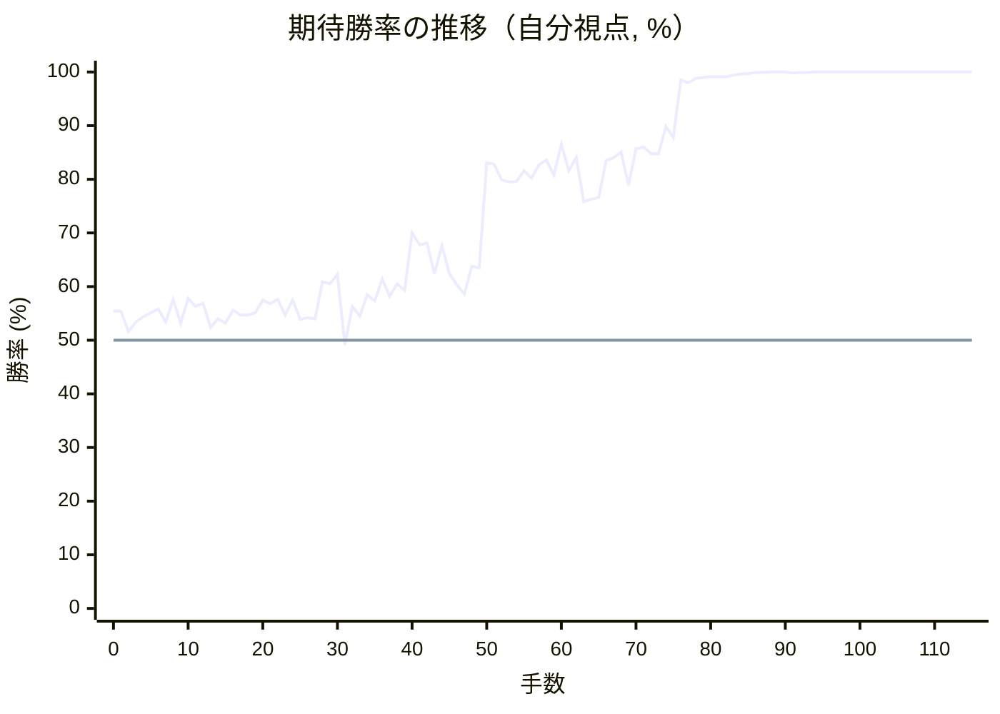
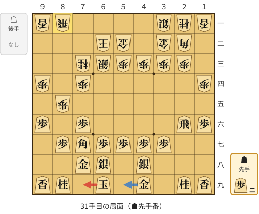
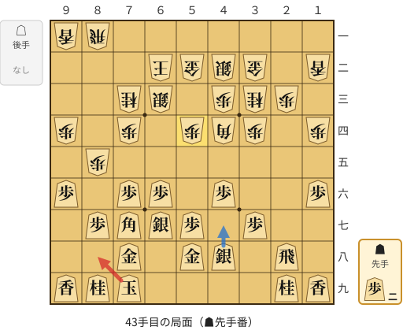
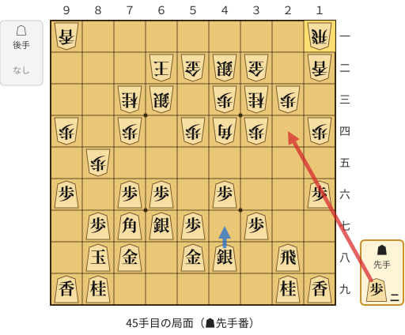
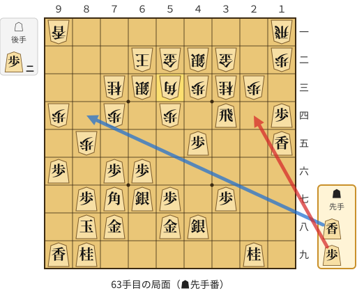
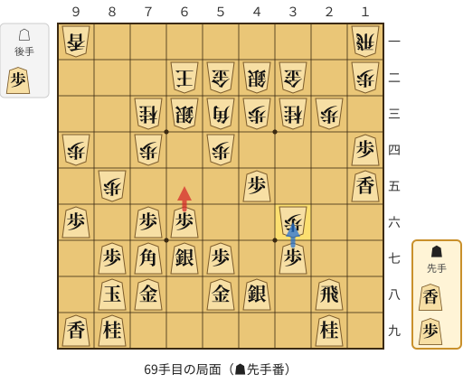

# 解析レポート 00hm06fbajl1

[README に戻る](../../../README.md)　/　棋譜: [CSA](../../../data/csa/shogi5/00hm06fbajl1.csa)　/　解析の見方: [docs/mistake_analysis.md](../../../docs/mistake_analysis.md)

## 対局情報

| 項目 | 内容 |
|---|---|
| 日時 | 2026-11-04 23:19:02 |
| 持ち時間 | 5分 |
| 自分 | 先手（▲）（1724） |
| 相手 | 相手（1662） |
| 結果 | 勝ち（詰み, 115手） |

## 解析環境

| 項目 | 内容 |
|---|---|
| エンジン | YaneuraOu NNUE 9.00git 64AVX2（V9.00/YANEURAOU_ENGINE_NNUE/AVX2） |
| 評価関数 | **水匠5**（`suisho5`） |
| nn.bin SHA-256 | `768068f0d534a0603a5d38bcd143de6bbca820d5f1c95a14d40863e5b7892d76` |
| 第1パス | movetime=150ms, MultiPV 1 |
| 第2パス | movetime=2000ms, MultiPV 3 |
| Threads / Hash | 8 / 512MB |
| 判定基準 | 疑問手 ≥5pt, 悪手 ≥10pt, 大悪手 ≥20pt（期待勝率 W(E)=1/(1+exp(-E/600))） |
| 解析日時 | 2026-11-06T01:50:19+09:00（解析バージョン 1, 37秒） |

## サマリー

| 自分の手数 | 深掘りした手 | 詰み逃し | 大悪手 | 悪手 | 疑問手 |
|--:|--:|--:|--:|--:|--:|
| 58 | 5 | 0 | 0 | 1 | 4 |

## 期待勝率の推移



<details><summary>1手ごとの数値（第1パス）</summary>

| 手数 | 指し手 | 評価値 | 勝率 | 低下 | 判定 |
|--:|---|--:|--:|--:|---|
| 1 | ▲７六歩(77) | +131 | 55.4% | +0.0pt |  |
| 2 | △８四歩(83) | +38 | 51.6% |  |  |
| 3 | ▲２六歩(27) | +81 | 53.4% | -1.8pt |  |
| 4 | △８五歩(84) | +105 | 54.4% |  |  |
| 5 | ▲７七角(88) | +124 | 55.1% | -0.8pt |  |
| 6 | △３二金(41) | +140 | 55.8% |  |  |
| 7 | ▲２五歩(26) | +81 | 53.4% | +2.4pt |  |
| 8 | △６二銀(71) | +184 | 57.6% |  |  |
| 9 | ▲６八銀(79) | +77 | 53.2% | +4.4pt |  |
| 10 | △５二金(61) | +188 | 57.8% |  |  |
| 11 | ▲７八金(69) | +151 | 56.3% | +1.5pt |  |
| 12 | △１四歩(13) | +166 | 56.9% |  |  |
| 13 | ▲６九玉(59) | +57 | 52.4% | +4.5pt |  |
| 14 | △９四歩(93) | +96 | 54.0% |  |  |
| 15 | ▲４八銀(39) | +78 | 53.2% | +0.7pt |  |
| 16 | △６四歩(63) | +136 | 55.6% |  |  |
| 17 | ▲２四歩(25) | +114 | 54.7% | +0.9pt |  |
| 18 | △同歩(23) | +113 | 54.7% |  |  |
| 19 | ▲同飛(28) | +124 | 55.1% | -0.5pt |  |
| 20 | △２三歩打 | +181 | 57.5% |  |  |
| 21 | ▲６四飛(24) | +164 | 56.8% | +0.7pt |  |
| 22 | △６三銀(62) | +184 | 57.6% |  |  |
| 23 | ▲６六飛(64) | +114 | 54.7% | +2.9pt |  |
| 24 | △７四歩(73) | +181 | 57.5% |  |  |
| 25 | ▲２六飛(66) | +93 | 53.9% | +3.6pt |  |
| 26 | △７三桂(81) | +101 | 54.2% |  |  |
| 27 | ▲１六歩(17) | +96 | 54.0% | +0.2pt |  |
| 28 | △６二玉(51) | +266 | 60.9% |  |  |
| 29 | ▲９六歩(97) | +257 | 60.5% | +0.4pt |  |
| 30 | △８一飛(82) | +302 | 62.3% |  |  |
| 31 | ▲７九玉(69) | -22 | 49.1% | +13.2pt | [疑問手](#ply-31) |
| 32 | △３四歩(33) | +151 | 56.3% |  |  |
| 33 | ▲６六歩(67) | +108 | 54.5% | +1.8pt |  |
| 34 | △４四角(22) | +205 | 58.5% |  |  |
| 35 | ▲２八飛(26) | +176 | 57.3% | +1.2pt |  |
| 36 | △３三桂(21) | +278 | 61.4% |  |  |
| 37 | ▲６七銀(68) | +198 | 58.2% | +3.2pt |  |
| 38 | △４二銀(31) | +255 | 60.5% |  |  |
| 39 | ▲５八金(49) | +226 | 59.3% | +1.2pt |  |
| 40 | △１二香(11) | +507 | 70.0% |  |  |
| 41 | ▲４六歩(47) | +448 | 67.8% | +2.1pt |  |
| 42 | △５四歩(53) | +454 | 68.1% |  |  |
| 43 | ▲８八玉(79) | +303 | 62.4% | +5.7pt | [疑問手](#ply-43) |
| 44 | △１一飛(81) | +441 | 67.6% |  |  |
| 45 | ▲２四歩打 | +304 | 62.4% | +5.2pt | [悪手](#ply-45) |
| 46 | △同歩(23) | +250 | 60.3% |  |  |
| 47 | ▲同飛(28) | +208 | 58.6% | +1.7pt |  |
| 48 | △２三歩打 | +341 | 63.8% |  |  |
| 49 | ▲３四飛(24) | +332 | 63.5% | +0.3pt |  |
| 50 | △１五歩(14) | +955 | 83.1% |  |  |
| 51 | ▲同歩(16) | +942 | 82.8% | +0.3pt |  |
| 52 | △同香(12) | +827 | 79.9% |  |  |
| 53 | ▲１二歩打 | +813 | 79.5% | +0.4pt |  |
| 54 | △同飛(11) | +818 | 79.6% |  |  |
| 55 | ▲１三歩打 | +892 | 81.6% | -1.9pt |  |
| 56 | △同飛(12) | +840 | 80.2% |  |  |
| 57 | ▲１四歩打 | +938 | 82.7% | -2.5pt |  |
| 58 | △１一飛(13) | +978 | 83.6% |  |  |
| 59 | ▲１五香(19) | +861 | 80.8% | +2.8pt |  |
| 60 | △１二歩打 | +1116 | 86.5% |  |  |
| 61 | ▲４五歩(46) | +892 | 81.6% | +5.0pt |  |
| 62 | △５三角(44) | +998 | 84.1% |  |  |
| 63 | ▲２四歩打 | +685 | 75.8% | +8.3pt | [疑問手](#ply-63) |
| 64 | △同歩(23) | +701 | 76.3% |  |  |
| 65 | ▲同飛(34) | +713 | 76.6% | -0.4pt |  |
| 66 | △２三歩打 | +971 | 83.5% |  |  |
| 67 | ▲２八飛(24) | +994 | 84.0% | -0.5pt |  |
| 68 | △３六歩打 | +1044 | 85.1% |  |  |
| 69 | ▲６五歩(66) | +793 | 78.9% | +6.1pt | [疑問手](#ply-69) |
| 70 | △３七歩成(36) | +1075 | 85.7% |  |  |
| 71 | ▲同銀(48) | +1091 | 86.0% | -0.3pt |  |
| 72 | △８一飛(11) | +1031 | 84.8% |  |  |
| 73 | ▲４六銀(37) | +1026 | 84.7% | +0.1pt |  |
| 74 | △８六歩(85) | +1306 | 89.8% |  |  |
| 75 | ▲同歩(87) | +1183 | 87.8% | +2.0pt |  |
| 76 | △同角(53) | +2527 | 98.5% |  |  |
| 77 | ▲同角(77) | +2346 | 98.0% | +0.5pt |  |
| 78 | △同飛(81) | +2651 | 98.8% |  |  |
| 79 | ▲８七香打 | +2788 | 99.0% | -0.2pt |  |
| 80 | △同飛成(86) | +2802 | 99.1% |  |  |
| 81 | ▲同金(78) | +2831 | 99.1% | -0.0pt |  |
| 82 | △６六歩打 | +2854 | 99.1% |  |  |
| 83 | ▲同銀(67) | +3025 | 99.4% | -0.2pt |  |
| 84 | △１九角打 | +3338 | 99.6% |  |  |
| 85 | ▲４八飛(28) | +3494 | 99.7% | -0.1pt |  |
| 86 | △６四歩打 | +4455 | 99.9% |  |  |
| 87 | ▲８一飛打 | +4456 | 99.9% | -0.0pt |  |
| 88 | △５三玉(62) | +4913 | 100.0% |  |  |
| 89 | ▲１七角打 | +4813 | 100.0% | +0.0pt |  |
| 90 | △４四歩(43) | +5017 | 100.0% |  |  |
| 91 | ▲同歩(45) | +3886 | 99.8% | +0.1pt |  |
| 92 | △６五歩(64) | +4021 | 99.9% |  |  |
| 93 | ▲７七銀(66) | +4228 | 99.9% | -0.0pt |  |
| 94 | △４五香打 | +5808 | 100.0% |  |  |
| 95 | ▲同銀(46) | +5407 | 100.0% | +0.0pt |  |
| 96 | △同桂(33) | +6756 | 100.0% |  |  |
| 97 | ▲同飛(48) | +6838 | 100.0% | -0.0pt |  |
| 98 | △５五角成(19) | +6853 | 100.0% |  |  |
| 99 | ▲４三歩成(44) | +7067 | 100.0% | -0.0pt |  |
| 100 | △６四玉(53) | +6981 | 100.0% |  |  |
| 101 | ▲５六桂打 | +6805 | 100.0% | +0.0pt |  |
| 102 | △同馬(55) | +7035 | 100.0% |  |  |
| 103 | ▲同歩(57) | +7173 | 100.0% | -0.0pt |  |
| 104 | △４三金(32) | +7316 | 100.0% |  |  |
| 105 | ▲６六歩打 | +6220 | 100.0% | +0.0pt |  |
| 106 | △４四歩打 | +6361 | 100.0% |  |  |
| 107 | ▲６五歩(66) | +5442 | 100.0% | +0.0pt |  |
| 108 | △同桂(73) | +6443 | 100.0% |  |  |
| 109 | ▲８二角打 | +6532 | 100.0% | -0.0pt |  |
| 110 | △５三玉(64) | +6566 | 100.0% |  |  |
| 111 | ▲６一飛成(81) | +6057 | 100.0% | +0.0pt |  |
| 112 | △６二歩打 | +6420 | 100.0% |  |  |
| 113 | ▲６五飛(45) | +6533 | 100.0% | -0.0pt |  |
| 114 | △６四銀打 | #+1 | 100.0% |  |  |
| 115 | ▲４五桂打 | #+ | 100.0% | +0.0pt |  |

</details>

## 課題局面

<a id="ply-31"></a>
### 31手目 ▲７九玉(69) — 疑問手

| | 着手前 | 着手後 | 差 |
|---|--:|--:|--:|
| 期待勝率 | 63.5% | 54.6% | -8.9pt |
| 評価値 | +331 | +110 | |

着手前の局面:



🔴 実戦 ▲７九玉(69)　🔵 AI推奨 ▲５九金(49)　🟨 直前の相手の指し手

<details><summary>テキストの盤面図（BOD・将棋ソフトに貼り付け可）</summary>

```text
後手の持駒：なし
  ９ ８ ７ ６ ５ ４ ３ ２ １
+---------------------------+
|v香v飛 ・ ・ ・ ・v銀v桂v香|一
| ・ ・ ・v玉v金 ・v金v角 ・|二
| ・ ・v桂v銀v歩v歩v歩v歩 ・|三
|v歩 ・v歩 ・ ・ ・ ・ ・v歩|四
| ・v歩 ・ ・ ・ ・ ・ ・ ・|五
| 歩 ・ 歩 ・ ・ ・ ・ 飛 歩|六
| ・ 歩 角 歩 歩 歩 歩 ・ ・|七
| ・ ・ 金 銀 ・ 銀 ・ ・ ・|八
| 香 桂 ・ 玉 ・ 金 ・ 桂 香|九
+---------------------------+
先手の持駒：歩二
手数＝30　△８一飛　まで
```

</details>

| | 指し手 | 評価値 | 読み筋 |
|---|---|--:|---|
| 実戦 | ▲７九玉(69) | +110 | △５四歩(53) ▲６六角(77) △８三飛(81) ▲７七銀(68) △４二銀(31) ▲５九銀(48) |
| AI 1位 | ▲５九金(49) | +331 | ▲５九金(49) △６四銀(63) ▲９五歩(96) △同歩(94) ▲９三歩打 △同香(91) |
| AI 2位 | ▲５九金(49) | +326 | ▲５九金(49) △４二銀(31) ▲９五歩(96) △同歩(94) ▲５八玉(69) △５一玉(62) |
| AI 3位 | ▲６六歩(67) | +218 | ▲６六歩(67) △５四歩(53) ▲６七銀(68) △４二銀(31) ▲２八飛(26) △５五歩(54) |

SFEN: `lr4snl/3kg1gb1/2nspppp1/p1p5p/1p7/P1P4RP/1PBPPPP2/2GS1S3/LN1K1G1NL b 2P 31`

<a id="ply-43"></a>
### 43手目 ▲８八玉(79) — 疑問手

| | 着手前 | 着手後 | 差 |
|---|--:|--:|--:|
| 期待勝率 | 70.0% | 62.3% | -7.7pt |
| 評価値 | +508 | +301 | |

着手前の局面:



🔴 実戦 ▲８八玉(79)　🔵 AI推奨 ▲４七銀(48)　🟨 直前の相手の指し手

<details><summary>テキストの盤面図（BOD・将棋ソフトに貼り付け可）</summary>

```text
後手の持駒：なし
  ９ ８ ７ ６ ５ ４ ３ ２ １
+---------------------------+
|v香v飛 ・ ・ ・ ・ ・ ・ ・|一
| ・ ・ ・v玉v金v銀v金 ・v香|二
| ・ ・v桂v銀 ・v歩v桂v歩 ・|三
|v歩 ・v歩 ・v歩v角v歩 ・v歩|四
| ・v歩 ・ ・ ・ ・ ・ ・ ・|五
| 歩 ・ 歩 歩 ・ 歩 ・ ・ 歩|六
| ・ 歩 角 銀 歩 ・ 歩 ・ ・|七
| ・ ・ 金 ・ 金 銀 ・ 飛 ・|八
| 香 桂 玉 ・ ・ ・ ・ 桂 香|九
+---------------------------+
先手の持駒：歩二
手数＝42　△５四歩　まで
```

</details>

| | 指し手 | 評価値 | 読み筋 |
|---|---|--:|---|
| 実戦 | ▲８八玉(79) | +301 | △５三銀(42) ▲４七銀(48) △７五歩(74) ▲同歩(76) △６四銀(53) ▲６五歩(66) |
| AI 1位 | ▲４七銀(48) | +508 | ▲４七銀(48) △２一飛(81) ▲６五歩(66) △５三銀(42) ▲４四角(77) △同歩(43) |
| AI 2位 | ▲３六歩(37) | +443 | ▲３六歩(37) △５三金(52) ▲４七銀(48) △６四金(53) ▲６五歩(66) △同金(64) |
| AI 3位 | ▲６八金(58) | +384 | ▲６八金(58) △５三角(44) ▲４七銀(48) △５一玉(62) ▲３六歩(37) △４四歩(43) |

SFEN: `lr7/3kgsg1l/2ns1pnp1/p1p1pbp1p/1p7/P1PP1P2P/1PBSP1P2/2G1GS1R1/LNK4NL b 2P 43`

<a id="ply-45"></a>
### 45手目 ▲２四歩打 — 悪手

| | 着手前 | 着手後 | 差 |
|---|--:|--:|--:|
| 期待勝率 | 70.0% | 59.1% | -10.9pt |
| 評価値 | +508 | +220 | |

着手前の局面:



🔴 実戦 ▲２四歩打　🔵 AI推奨 ▲４七銀(48)　🟨 直前の相手の指し手

<details><summary>テキストの盤面図（BOD・将棋ソフトに貼り付け可）</summary>

```text
後手の持駒：なし
  ９ ８ ７ ６ ５ ４ ３ ２ １
+---------------------------+
|v香 ・ ・ ・ ・ ・ ・ ・v飛|一
| ・ ・ ・v玉v金v銀v金 ・v香|二
| ・ ・v桂v銀 ・v歩v桂v歩 ・|三
|v歩 ・v歩 ・v歩v角v歩 ・v歩|四
| ・v歩 ・ ・ ・ ・ ・ ・ ・|五
| 歩 ・ 歩 歩 ・ 歩 ・ ・ 歩|六
| ・ 歩 角 銀 歩 ・ 歩 ・ ・|七
| ・ 玉 金 ・ 金 銀 ・ 飛 ・|八
| 香 桂 ・ ・ ・ ・ ・ 桂 香|九
+---------------------------+
先手の持駒：歩二
手数＝44　△１一飛　まで
```

</details>

| | 指し手 | 評価値 | 読み筋 |
|---|---|--:|---|
| 実戦 | ▲２四歩打 | +220 | △同歩(23) ▲同飛(28) △８六歩(85) ▲同歩(87) △８一飛(11) ▲５六歩(57) |
| AI 1位 | ▲４七銀(48) | +508 | ▲４七銀(48) △１五歩(14) ▲４五歩(46) △５三角(44) ▲１五歩(16) △同香(12) |
| AI 2位 | ▲５六歩(57) | +525 | ▲５六歩(57) △１五歩(14) ▲同歩(16) △同香(12) ▲１七歩打 △５三銀(42) |
| AI 3位 | ▲６五歩(66) | +503 | ▲６五歩(66) △５三角(44) ▲４七銀(48) △４四歩(43) ▲５六銀(47) △４三銀(42) |

SFEN: `l7r/3kgsg1l/2ns1pnp1/p1p1pbp1p/1p7/P1PP1P2P/1PBSP1P2/1KG1GS1R1/LN5NL b 2P 45`

<a id="ply-63"></a>
### 63手目 ▲２四歩打 — 疑問手

| | 着手前 | 着手後 | 差 |
|---|--:|--:|--:|
| 期待勝率 | 88.1% | 79.4% | -8.8pt |
| 評価値 | +1202 | +808 | |

着手前の局面:



🔴 実戦 ▲２四歩打　🔵 AI推奨 ▲８四香打　🟨 直前の相手の指し手

<details><summary>テキストの盤面図（BOD・将棋ソフトに貼り付け可）</summary>

```text
後手の持駒：歩二
  ９ ８ ７ ６ ５ ４ ３ ２ １
+---------------------------+
|v香 ・ ・ ・ ・ ・ ・ ・v飛|一
| ・ ・ ・v玉v金v銀v金 ・v歩|二
| ・ ・v桂v銀v角v歩v桂v歩 ・|三
|v歩 ・v歩 ・v歩 ・ 飛 ・ 歩|四
| ・v歩 ・ ・ ・ 歩 ・ ・ 香|五
| 歩 ・ 歩 歩 ・ ・ ・ ・ ・|六
| ・ 歩 角 銀 歩 ・ 歩 ・ ・|七
| ・ 玉 金 ・ 金 銀 ・ ・ ・|八
| 香 桂 ・ ・ ・ ・ ・ 桂 ・|九
+---------------------------+
先手の持駒：香　歩
手数＝62　△５三角　まで
```

</details>

| | 指し手 | 評価値 | 読み筋 |
|---|---|--:|---|
| 実戦 | ▲２四歩打 | +808 | △同歩(23) ▲同飛(34) △３五角(53) ▲３四飛(24) △５三角(35) ▲２四歩打 |
| AI 1位 | ▲８四香打 | +1202 | ▲８四香打 △８六歩(85) ▲同角(77) △同角(53) ▲同歩(87) △２七角打 |
| AI 2位 | ▲１三歩成(14) | +930 | ▲１三歩成(14) △同歩(12) ▲同香成(15) △１二歩打 ▲１四成香(13) △８六歩(85) |
| AI 3位 | ▲５六歩(57) | +883 | ▲５六歩(57) △８一飛(11) ▲１三歩成(14) △８六歩(85) ▲同角(77) △１三歩(12) |

SFEN: `l7r/3kgsg1p/2nsbpnp1/p1p1p1R1P/1p3P2L/P1PP5/1PBSP1P2/1KG1GS3/LN5N1 b LP2p 63`

<a id="ply-69"></a>
### 69手目 ▲６五歩(66) — 疑問手

| | 着手前 | 着手後 | 差 |
|---|--:|--:|--:|
| 期待勝率 | 88.0% | 80.9% | -7.1pt |
| 評価値 | +1194 | +866 | |

着手前の局面:



🔴 実戦 ▲６五歩(66)　🔵 AI推奨 ▲同歩(37)　🟨 直前の相手の指し手

<details><summary>テキストの盤面図（BOD・将棋ソフトに貼り付け可）</summary>

```text
後手の持駒：歩
  ９ ８ ７ ６ ５ ４ ３ ２ １
+---------------------------+
|v香 ・ ・ ・ ・ ・ ・ ・v飛|一
| ・ ・ ・v玉v金v銀v金 ・v歩|二
| ・ ・v桂v銀v角v歩v桂v歩 ・|三
|v歩 ・v歩 ・v歩 ・ ・ ・ 歩|四
| ・v歩 ・ ・ ・ 歩 ・ ・ 香|五
| 歩 ・ 歩 歩 ・ ・v歩 ・ ・|六
| ・ 歩 角 銀 歩 ・ 歩 ・ ・|七
| ・ 玉 金 ・ 金 銀 ・ 飛 ・|八
| 香 桂 ・ ・ ・ ・ ・ 桂 ・|九
+---------------------------+
先手の持駒：香　歩
手数＝68　△３六歩　まで
```

</details>

| | 指し手 | 評価値 | 読み筋 |
|---|---|--:|---|
| 実戦 | ▲６五歩(66) | +866 | △８一飛(11) ▲６六香打 △６四歩打 ▲同歩(65) △同銀(63) ▲同香(66) |
| AI 1位 | ▲同歩(37) | +1194 | ▲同歩(37) △８六歩(85) ▲同角(77) △同角(53) ▲同歩(87) △１九角打 |
| AI 2位 | ▲５六歩(57) | +1053 | ▲５六歩(57) △８一飛(11) ▲３六歩(37) △６四角(53) ▲２七飛(28) △８六歩(85) |
| AI 3位 | ▲６八角(77) | +1048 | ▲６八角(77) △４四歩(43) ▲３六歩(37) △８一飛(11) ▲５六歩(57) △４五歩(44) |

SFEN: `l7r/3kgsg1p/2nsbpnp1/p1p1p3P/1p3P2L/P1PP2p2/1PBSP1P2/1KG1GS1R1/LN5N1 b LPp 69`

