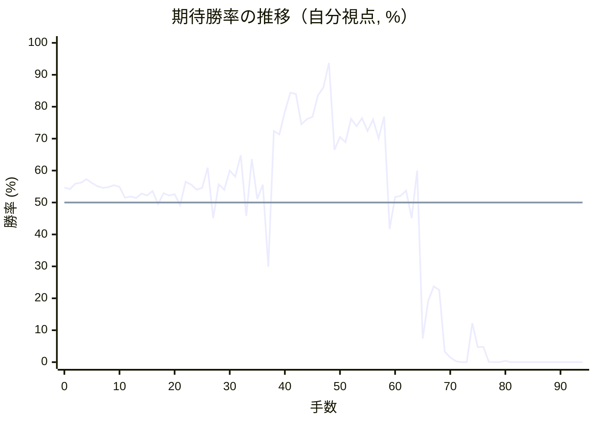

# 解析レポート 08hldm71rauz

[README に戻る](../../../README.md)　/　棋譜: [CSA](../../../data/csa/shogi5/08hldm71rauz.csa)　/　解析の見方: [docs/mistake_analysis.md](../../../docs/mistake_analysis.md)

## 対局情報

| 項目 | 内容 |
|---|---|
| 日時 | 2026-11-08 03:50:19 |
| 持ち時間 | 5分 |
| 自分 | 先手（▲）（1696） |
| 相手 | 相手（1443） |
| 結果 | 負け（詰み, 94手） |

## 解析環境

| 項目 | 内容 |
|---|---|
| エンジン | YaneuraOu NNUE 9.00git 64AVX2（V9.00/YANEURAOU_ENGINE_NNUE/AVX2） |
| 評価関数 | **水匠5**（`suisho5`） |
| nn.bin SHA-256 | `768068f0d534a0603a5d38bcd143de6bbca820d5f1c95a14d40863e5b7892d76` |
| 第1パス | movetime=150ms, MultiPV 1 |
| 第2パス | movetime=2000ms, MultiPV 3 |
| Threads / Hash | 8 / 512MB |
| 判定基準 | 疑問手 ≥5pt, 悪手 ≥10pt, 大悪手 ≥20pt（期待勝率 W(E)=1/(1+exp(-E/600))） |
| 解析日時 | 2026-11-11T20:20:54+09:00（解析バージョン 1, 53秒） |

## サマリー

| 自分の手数 | 深掘りした手 | 詰み逃し | 大悪手 | 悪手 | 疑問手 |
|--:|--:|--:|--:|--:|--:|
| 47 | 10 | 0 | 4 | 3 | 2 |

## 期待勝率の推移



<details><summary>1手ごとの数値（第1パス）</summary>

| 手数 | 指し手 | 評価値 | 勝率 | 低下 | 判定 |
|--:|---|--:|--:|--:|---|
| 1 | ▲７六歩(77) | +100 | 54.2% | +0.6pt |  |
| 2 | △３四歩(33) | +142 | 55.9% |  |  |
| 3 | ▲２六歩(27) | +150 | 56.2% | -0.3pt |  |
| 4 | △４四歩(43) | +176 | 57.3% |  |  |
| 5 | ▲２五歩(26) | +148 | 56.1% | +1.1pt |  |
| 6 | △３三角(22) | +124 | 55.1% |  |  |
| 7 | ▲４八銀(39) | +111 | 54.6% | +0.5pt |  |
| 8 | △４二銀(31) | +115 | 54.8% |  |  |
| 9 | ▲６八玉(59) | +131 | 55.4% | -0.7pt |  |
| 10 | △４三銀(42) | +118 | 54.9% |  |  |
| 11 | ▲５六歩(57) | +35 | 51.5% | +3.4pt |  |
| 12 | △３二金(41) | +45 | 51.9% |  |  |
| 13 | ▲７八玉(68) | +34 | 51.4% | +0.5pt |  |
| 14 | △８四歩(83) | +68 | 52.8% |  |  |
| 15 | ▲７七角(88) | +54 | 52.2% | +0.6pt |  |
| 16 | △６二銀(71) | +87 | 53.6% |  |  |
| 17 | ▲９六歩(97) | -11 | 49.5% | +4.1pt |  |
| 18 | △９四歩(93) | +70 | 52.9% |  |  |
| 19 | ▲８八銀(79) | +53 | 52.2% | +0.7pt |  |
| 20 | △７四歩(73) | +63 | 52.6% |  |  |
| 21 | ▲６八角(77) | -20 | 49.2% | +3.5pt |  |
| 22 | △６四歩(63) | +157 | 56.5% |  |  |
| 23 | ▲３六歩(37) | +136 | 55.6% | +0.9pt |  |
| 24 | △６三銀(62) | +95 | 54.0% |  |  |
| 25 | ▲５八金(49) | +111 | 54.6% | -0.7pt |  |
| 26 | △５四銀(63) | +267 | 60.9% |  |  |
| 27 | ▲６六歩(67) | -118 | 45.1% | +15.8pt | [疑問手](#ply-27) |
| 28 | △４五歩(44) | +137 | 55.7% |  |  |
| 29 | ▲７七銀(88) | +95 | 54.0% | +1.7pt |  |
| 30 | △６五歩(64) | +243 | 60.0% |  |  |
| 31 | ▲同歩(66) | +196 | 58.1% | +1.9pt |  |
| 32 | △同銀(54) | +365 | 64.8% |  |  |
| 33 | ▲３五歩(36) | -100 | 45.8% | +18.9pt | [悪手](#ply-33) |
| 34 | △６六歩打 | +335 | 63.6% |  |  |
| 35 | ▲３四歩(35) | +27 | 51.1% | +12.5pt | [疑問手](#ply-35) |
| 36 | △同銀(43) | +135 | 55.6% |  |  |
| 37 | ▲２四歩(25) | -511 | 29.9% | +25.7pt | [大悪手](#ply-37) |
| 38 | △同歩(23) | +578 | 72.4% |  |  |
| 39 | ▲同角(68) | +546 | 71.3% | +1.1pt |  |
| 40 | △同角(33) | +775 | 78.4% |  |  |
| 41 | ▲同飛(28) | +1013 | 84.4% | -6.0pt |  |
| 42 | △２三金(32) | +997 | 84.0% |  |  |
| 43 | ▲２八飛(24) | +643 | 74.5% | +9.6pt |  |
| 44 | △７三角打 | +696 | 76.1% |  |  |
| 45 | ▲３七歩打 | +717 | 76.8% | -0.6pt |  |
| 46 | △２四歩打 | +971 | 83.5% |  |  |
| 47 | ▲４四角打 | +1095 | 86.1% | -2.7pt |  |
| 48 | △３六歩打 | +1618 | 93.7% |  |  |
| 49 | ▲５五歩(56) | +412 | 66.5% | +27.2pt | [大悪手](#ply-49) |
| 50 | △３三金(23) | +523 | 70.5% |  |  |
| 51 | ▲５三角成(44) | +478 | 68.9% | +1.6pt |  |
| 52 | △５五角(73) | +697 | 76.2% |  |  |
| 53 | ▲５六歩打 | +623 | 73.9% | +2.3pt |  |
| 54 | △同銀(65) | +705 | 76.4% |  |  |
| 55 | ▲５四馬(53) | +578 | 72.4% | +4.0pt |  |
| 56 | △４四金(33) | +693 | 76.0% |  |  |
| 57 | ▲５五馬(54) | +512 | 70.1% | +5.9pt | [悪手](#ply-57) |
| 58 | △同金(44) | +721 | 76.9% |  |  |
| 59 | ▲６四角打 | -201 | 41.7% | +35.2pt | [大悪手](#ply-59) |
| 60 | △６七歩成(66) | +41 | 51.7% |  |  |
| 61 | ▲同金(58) | +51 | 52.1% | -0.4pt |  |
| 62 | △同銀成(56) | +88 | 53.7% |  |  |
| 63 | ▲同玉(78) | -117 | 45.1% | +8.5pt |  |
| 64 | △６二飛(82) | +243 | 60.0% |  |  |
| 65 | ▲６五歩打 | -1520 | 7.4% | +52.6pt | [大悪手](#ply-65) |
| 66 | △６四飛(62) | -862 | 19.2% |  |  |
| 67 | ▲同歩(65) | -700 | 23.7% | -4.5pt |  |
| 68 | △５六角打 | -740 | 22.6% |  |  |
| 69 | ▲５八玉(67) | -2021 | 3.3% | +19.2pt | [悪手](#ply-69) |
| 70 | △６七角打 | -2523 | 1.5% |  |  |
| 71 | ▲５九玉(58) | -3582 | 0.3% | +1.2pt |  |
| 72 | △４九金打 | -5155 | 0.0% |  |  |
| 73 | ▲６八玉(59) | -4810 | 0.0% | -0.0pt |  |
| 74 | △４八金(49) | -1186 | 12.2% |  |  |
| 75 | ▲同飛(28) | -1801 | 4.7% | +7.4pt |  |
| 76 | △８九角成(67) | -1786 | 4.8% |  |  |
| 77 | ▲５三飛打 | -4223 | 0.1% | +4.8pt |  |
| 78 | △５二歩打 | -5373 | 0.0% |  |  |
| 79 | ▲５五飛成(53) | -5316 | 0.0% | -0.0pt |  |
| 80 | △５七銀打 | -3274 | 0.4% |  |  |
| 81 | ▲５九玉(68) | -5572 | 0.0% | +0.4pt |  |
| 82 | △６七馬(89) | -5738 | 0.0% |  |  |
| 83 | ▲３二金打 | #-11 | 0.0% | +0.0pt |  |
| 84 | △４八銀成(57) | #-10 | 0.0% |  |  |
| 85 | ▲同玉(59) | #-9 | 0.0% | +0.0pt |  |
| 86 | △４九飛打 | #-8 | 0.0% |  |  |
| 87 | ▲３八玉(48) | #-7 | 0.0% | +0.0pt |  |
| 88 | △４七角成(56) | #-6 | 0.0% |  |  |
| 89 | ▲２七玉(38) | #-5 | 0.0% | +0.0pt |  |
| 90 | △２九飛成(49) | #-4 | 0.0% |  |  |
| 91 | ▲２八歩打 | #-3 | 0.0% | +0.0pt |  |
| 92 | △３七馬(47) | #-2 | 0.0% |  |  |
| 93 | ▲１六玉(27) | #-1 | 0.0% | +0.0pt |  |
| 94 | △２五銀(34) | #- | 0.0% |  |  |

</details>

## 課題局面

<a id="ply-27"></a>
### 27手目 ▲６六歩(67) — 疑問手

| | 着手前 | 着手後 | 差 |
|---|--:|--:|--:|
| 期待勝率 | 58.1% | 50.5% | -7.5pt |
| 評価値 | +195 | +13 | |

着手前の局面:

```text
後手の持駒：なし
  ９ ８ ７ ６ ５ ４ ３ ２ １
+---------------------------+
|v香v桂 ・v金v玉 ・ ・v桂v香|一
| ・v飛 ・ ・ ・ ・v金 ・ ・|二
| ・ ・ ・ ・v歩v銀v角v歩v歩|三
|v歩v歩v歩v歩v銀v歩v歩 ・ ・|四
| ・ ・ ・ ・ ・ ・ ・ 歩 ・|五
| 歩 ・ 歩 ・ 歩 ・ 歩 ・ ・|六
| ・ 歩 ・ 歩 ・ 歩 ・ ・ 歩|七
| ・ 銀 玉 角 金 銀 ・ 飛 ・|八
| 香 桂 ・ 金 ・ ・ ・ 桂 香|九
+---------------------------+
先手の持駒：なし
手数＝26　△５四銀右　まで
```

| | 指し手 | 評価値 | 読み筋 |
|---|---|--:|---|
| 実戦 | ▲６六歩(67) | +13 | △５二金(61) ▲６七金(58) △４二玉(51) ▲７七桂(89) △７三桂(81) ▲８九玉(78) |
| AI 1位 | ▲３七銀(48) | +195 | ▲３七銀(48) △８五歩(84) ▲３五歩(36) △同歩(34) ▲４六銀(37) △３六歩(35) |
| AI 2位 | ▲３五歩(36) | +185 | ▲３五歩(36) △同歩(34) ▲３七銀(48) △８五歩(84) ▲４六銀(37) △３六歩(35) |
| AI 3位 | ▲５七銀(48) | +143 | ▲５七銀(48) △８五歩(84) ▲３五歩(36) △４五歩(44) ▲３八飛(28) △３五歩(34) |

SFEN: `ln1gk2nl/1r4g2/4psbpp/ppppspp2/7P1/P1P1P1P2/1P1P1P2P/1SKBGS1R1/LN1G3NL b - 27`

<a id="ply-33"></a>
### 33手目 ▲３五歩(36) — 悪手

| | 着手前 | 着手後 | 差 |
|---|--:|--:|--:|
| 期待勝率 | 63.5% | 52.4% | -11.2pt |
| 評価値 | +333 | +57 | |

着手前の局面:

```text
後手の持駒：歩
  ９ ８ ７ ６ ５ ４ ３ ２ １
+---------------------------+
|v香v桂 ・v金v玉 ・ ・v桂v香|一
| ・v飛 ・ ・ ・ ・v金 ・ ・|二
| ・ ・ ・ ・v歩v銀v角v歩v歩|三
|v歩v歩v歩 ・ ・ ・v歩 ・ ・|四
| ・ ・ ・v銀 ・v歩 ・ 歩 ・|五
| 歩 ・ 歩 ・ 歩 ・ 歩 ・ ・|六
| ・ 歩 銀 ・ ・ 歩 ・ ・ 歩|七
| ・ ・ 玉 角 金 銀 ・ 飛 ・|八
| 香 桂 ・ 金 ・ ・ ・ 桂 香|九
+---------------------------+
先手の持駒：歩
手数＝32　△６五同銀　まで
```

| | 指し手 | 評価値 | 読み筋 |
|---|---|--:|---|
| 実戦 | ▲３五歩(36) | +57 | △７五歩(74) ▲２四歩(25) △同角(33) ▲同飛(28) △７六歩(75) ▲２六飛(24) |
| AI 1位 | ▲２四歩(25) | +333 | ▲２四歩(25) △同歩(23) ▲同角(68) △同角(33) ▲同飛(28) △２三歩打 |
| AI 2位 | ▲３七桂(29) | +305 | ▲３七桂(29) △７五歩(74) ▲２四歩(25) △同歩(23) ▲４五桂(37) △７六歩(75) |
| AI 3位 | ▲６四歩打 | +44 | ▲６四歩打 △５二金(61) ▲３七桂(29) △５六銀(65) ▲２四歩(25) △同歩(23) |

SFEN: `ln1gk2nl/1r4g2/4psbpp/ppp3p2/3s1p1P1/P1P1P1P2/1PS2P2P/2KBGS1R1/LN1G3NL b Pp 33`

<a id="ply-35"></a>
### 35手目 ▲３四歩(35) — 疑問手

| | 着手前 | 着手後 | 差 |
|---|--:|--:|--:|
| 期待勝率 | 63.5% | 56.1% | -7.4pt |
| 評価値 | +332 | +148 | |

着手前の局面:

```text
後手の持駒：なし
  ９ ８ ７ ６ ５ ４ ３ ２ １
+---------------------------+
|v香v桂 ・v金v玉 ・ ・v桂v香|一
| ・v飛 ・ ・ ・ ・v金 ・ ・|二
| ・ ・ ・ ・v歩v銀v角v歩v歩|三
|v歩v歩v歩 ・ ・ ・v歩 ・ ・|四
| ・ ・ ・v銀 ・v歩 歩 歩 ・|五
| 歩 ・ 歩v歩 歩 ・ ・ ・ ・|六
| ・ 歩 銀 ・ ・ 歩 ・ ・ 歩|七
| ・ ・ 玉 角 金 銀 ・ 飛 ・|八
| 香 桂 ・ 金 ・ ・ ・ 桂 香|九
+---------------------------+
先手の持駒：歩
手数＝34　△６六歩　まで
```

| | 指し手 | 評価値 | 読み筋 |
|---|---|--:|---|
| 実戦 | ▲３四歩(35) | +148 | △同銀(43) ▲３五歩打 △４三銀(34) ▲２四歩(25) △同歩(23) ▲３四歩(35) |
| AI 1位 | ▲２四歩(25) | +332 | ▲２四歩(25) △同角(33) ▲３四歩(35) △７五歩(74) ▲２四飛(28) △同歩(23) |
| AI 2位 | ▲３四歩(35) | +180 | ▲３四歩(35) △同銀(43) ▲３五歩打 △４三銀(34) ▲２四歩(25) △同歩(23) |
| AI 3位 | ▲６四歩打 | +54 | ▲６四歩打 △７五歩(74) ▲２四歩(25) △同角(33) ▲同飛(28) △７六歩(75) |

SFEN: `ln1gk2nl/1r4g2/4psbpp/ppp3p2/3s1pPP1/P1PpP4/1PS2P2P/2KBGS1R1/LN1G3NL b P 35`

<a id="ply-37"></a>
### 37手目 ▲２四歩(25) — 大悪手

| | 着手前 | 着手後 | 差 |
|---|--:|--:|--:|
| 期待勝率 | 57.2% | 26.5% | -30.8pt |
| 評価値 | +175 | -613 | |

着手前の局面:

```text
後手の持駒：歩
  ９ ８ ７ ６ ５ ４ ３ ２ １
+---------------------------+
|v香v桂 ・v金v玉 ・ ・v桂v香|一
| ・v飛 ・ ・ ・ ・v金 ・ ・|二
| ・ ・ ・ ・v歩 ・v角v歩v歩|三
|v歩v歩v歩 ・ ・ ・v銀 ・ ・|四
| ・ ・ ・v銀 ・v歩 ・ 歩 ・|五
| 歩 ・ 歩v歩 歩 ・ ・ ・ ・|六
| ・ 歩 銀 ・ ・ 歩 ・ ・ 歩|七
| ・ ・ 玉 角 金 銀 ・ 飛 ・|八
| 香 桂 ・ 金 ・ ・ ・ 桂 香|九
+---------------------------+
先手の持駒：歩二
手数＝36　△３四同銀　まで
```

| | 指し手 | 評価値 | 読み筋 |
|---|---|--:|---|
| 実戦 | ▲２四歩(25) | -613 | △７五歩(74) ▲２三歩成(24) △同銀(34) ▲３五角(68) △７六歩(75) ▲８八銀(77) |
| AI 1位 | ▲３五歩打 | +175 | ▲３五歩打 △４三銀(34) ▲２四歩(25) △同歩(23) ▲３四歩(35) △４四角(33) |
| AI 2位 | ▲３八飛(28) | -181 | ▲３八飛(28) △４三金(32) ▲３五歩打 △２五銀(34) ▲２八飛(38) △１四銀(25) |
| AI 3位 | ▲５七銀(48) | -417 | ▲５七銀(48) △７五歩(74) ▲同歩(76) △７六歩打 ▲８八銀(77) △６二飛(82) |

SFEN: `ln1gk2nl/1r4g2/4p1bpp/ppp3s2/3s1p1P1/P1PpP4/1PS2P2P/2KBGS1R1/LN1G3NL b 2Pp 37`

<a id="ply-49"></a>
### 49手目 ▲５五歩(56) — 大悪手

| | 着手前 | 着手後 | 差 |
|---|--:|--:|--:|
| 期待勝率 | 95.4% | 72.0% | -23.3pt |
| 評価値 | +1813 | +568 | |

着手前の局面:

```text
後手の持駒：なし
  ９ ８ ７ ６ ５ ４ ３ ２ １
+---------------------------+
|v香v桂 ・v金v玉 ・ ・v桂v香|一
| ・v飛 ・ ・ ・ ・ ・ ・ ・|二
| ・ ・v角 ・v歩 ・ ・v金v歩|三
|v歩v歩v歩 ・ ・ 角v銀v歩 ・|四
| ・ ・ ・v銀 ・v歩 ・ ・ ・|五
| 歩 ・ 歩v歩 歩 ・v歩 ・ ・|六
| ・ 歩 銀 ・ ・ 歩 歩 ・ 歩|七
| ・ ・ 玉 ・ 金 銀 ・ 飛 ・|八
| 香 桂 ・ 金 ・ ・ ・ 桂 香|九
+---------------------------+
先手の持駒：歩二
手数＝48　△３六歩　まで
```

| | 指し手 | 評価値 | 読み筋 |
|---|---|--:|---|
| 実戦 | ▲５五歩(56) | +568 | △３三桂(21) ▲５三角成(44) △５五角(73) ▲５六歩打 △５二歩打 ▲６三馬(53) |
| AI 1位 | ▲１一角成(44) | +1813 | ▲１一角成(44) △３七歩成(36) ▲同桂(29) △３六歩打 ▲２一馬(11) △５六銀(65) |
| AI 2位 | ▲６四歩打 | +1255 | ▲６四歩打 △３七歩成(36) ▲同桂(29) △６四角(73) ▲１一角成(44) △３六歩打 |
| AI 3位 | ▲６六銀(77) | +1175 | ▲６六銀(77) △同銀(65) ▲同角(44) △１二飛(82) ▲２二歩打 △３七歩成(36) |

SFEN: `ln1gk2nl/1r7/2b1p2gp/ppp2Bsp1/3s1p3/P1PpP1p2/1PS2PP1P/2K1GS1R1/LN1G3NL b 2P 49`

<a id="ply-57"></a>
### 57手目 ▲５五馬(54) — 悪手

| | 着手前 | 着手後 | 差 |
|---|--:|--:|--:|
| 期待勝率 | 89.1% | 76.0% | -13.1pt |
| 評価値 | +1261 | +691 | |

着手前の局面:

```text
後手の持駒：歩二
  ９ ８ ７ ６ ５ ４ ３ ２ １
+---------------------------+
|v香v桂 ・v金v玉 ・ ・v桂v香|一
| ・v飛 ・ ・ ・ ・ ・ ・ ・|二
| ・ ・ ・ ・ ・ ・ ・ ・v歩|三
|v歩v歩v歩 ・ 馬v金v銀v歩 ・|四
| ・ ・ ・ ・v角v歩 ・ ・ ・|五
| 歩 ・ 歩v歩v銀 ・v歩 ・ ・|六
| ・ 歩 銀 ・ ・ 歩 歩 ・ 歩|七
| ・ ・ 玉 ・ 金 銀 ・ 飛 ・|八
| 香 桂 ・ 金 ・ ・ ・ 桂 香|九
+---------------------------+
先手の持駒：歩二
手数＝56　△４四金　まで
```

| | 指し手 | 評価値 | 読み筋 |
|---|---|--:|---|
| 実戦 | ▲５五馬(54) | +691 | △同金(44) ▲６八歩打 △３三角打 ▲６四角打 △９二飛(82) ▲３六歩(37) |
| AI 1位 | ▲２一馬(54) | +1261 | ▲２一馬(54) △７五歩(74) ▲６八歩打 △７六歩(75) ▲同馬(21) △６二飛(82) |
| AI 2位 | ▲５五馬(54) | +687 | ▲５五馬(54) △６七歩成(66) ▲同金(58) △同銀成(56) ▲同玉(78) △５五金(44) |
| AI 3位 | ▲５二歩打 | +256 | ▲５二歩打 △同飛(82) ▲２一馬(54) △３七歩成(36) ▲同桂(29) △３六歩打 |

SFEN: `ln1gk2nl/1r7/8p/ppp1+Bgsp1/4bp3/P1Pps1p2/1PS2PP1P/2K1GS1R1/LN1G3NL b 2P2p 57`

<a id="ply-59"></a>
### 59手目 ▲６四角打 — 大悪手

| | 着手前 | 着手後 | 差 |
|---|--:|--:|--:|
| 期待勝率 | 73.7% | 46.5% | -27.2pt |
| 評価値 | +618 | -85 | |

着手前の局面:

```text
後手の持駒：角　歩二
  ９ ８ ７ ６ ５ ４ ３ ２ １
+---------------------------+
|v香v桂 ・v金v玉 ・ ・v桂v香|一
| ・v飛 ・ ・ ・ ・ ・ ・ ・|二
| ・ ・ ・ ・ ・ ・ ・ ・v歩|三
|v歩v歩v歩 ・ ・ ・v銀v歩 ・|四
| ・ ・ ・ ・v金v歩 ・ ・ ・|五
| 歩 ・ 歩v歩v銀 ・v歩 ・ ・|六
| ・ 歩 銀 ・ ・ 歩 歩 ・ 歩|七
| ・ ・ 玉 ・ 金 銀 ・ 飛 ・|八
| 香 桂 ・ 金 ・ ・ ・ 桂 香|九
+---------------------------+
先手の持駒：角　歩二
手数＝58　△５五同金　まで
```

| | 指し手 | 評価値 | 読み筋 |
|---|---|--:|---|
| 実戦 | ▲６四角打 | -85 | △６七歩成(66) ▲同金(58) △同銀成(56) ▲同玉(78) △５六角打 ▲６八玉(67) |
| AI 1位 | ▲６八歩打 | +618 | ▲６八歩打 △３三角打 ▲６四角打 △９二飛(82) ▲３六歩(37) △７五歩(74) |
| AI 2位 | ▲６八銀(77) | +82 | ▲６八銀(77) △３三角打 ▲６四角打 △９二飛(82) ▲３一角成(64) △３七歩成(36) |
| AI 3位 | ▲５二歩打 | +18 | ▲５二歩打 △同飛(82) ▲６八歩打 △３三角打 ▲３六歩(37) △７五歩(74) |

SFEN: `ln1gk2nl/1r7/8p/ppp3sp1/4gp3/P1Pps1p2/1PS2PP1P/2K1GS1R1/LN1G3NL b B2Pb2p 59`

<a id="ply-65"></a>
### 65手目 ▲６五歩打 — 大悪手

| | 着手前 | 着手後 | 差 |
|---|--:|--:|--:|
| 期待勝率 | 60.4% | 5.8% | -54.6pt |
| 評価値 | +253 | -1677 | |

着手前の局面:

```text
後手の持駒：角　金　歩二
  ９ ８ ７ ６ ５ ４ ３ ２ １
+---------------------------+
|v香v桂 ・v金v玉 ・ ・v桂v香|一
| ・ ・ ・v飛 ・ ・ ・ ・ ・|二
| ・ ・ ・ ・ ・ ・ ・ ・v歩|三
|v歩v歩v歩 角 ・ ・v銀v歩 ・|四
| ・ ・ ・ ・v金v歩 ・ ・ ・|五
| 歩 ・ 歩 ・ ・ ・v歩 ・ ・|六
| ・ 歩 銀 玉 ・ 歩 歩 ・ 歩|七
| ・ ・ ・ ・ ・ 銀 ・ 飛 ・|八
| 香 桂 ・ 金 ・ ・ ・ 桂 香|九
+---------------------------+
先手の持駒：銀　歩三
手数＝64　△６二飛　まで
```

| | 指し手 | 評価値 | 読み筋 |
|---|---|--:|---|
| 実戦 | ▲６五歩打 | -1677 | △同金(55) ▲５三銀打 △５六角打 ▲６八玉(67) △６四金(65) ▲６二銀成(53) |
| AI 1位 | ▲４二銀打 | +253 | ▲４二銀打 △同飛(62) ▲５五角(64) △６五金打 ▲１一角成(55) △５六角打 |
| AI 2位 | ▲５三銀打 | -317 | ▲５三銀打 △６四飛(62) ▲同銀不成(53) △５六角打 ▲６八玉(67) △６六歩打 |
| AI 3位 | ▲６五歩打 | -1724 | ▲６五歩打 △同金(55) ▲５三銀打 △６六歩打 ▲７八玉(67) △６四金(65) |

SFEN: `ln1gk2nl/3r5/8p/pppB2sp1/4gp3/P1P3p2/1PSK1PP1P/5S1R1/LN1G3NL b S3Pbg2p 65`

<a id="ply-69"></a>
### 69手目 ▲５八玉(67) — 悪手

| | 着手前 | 着手後 | 差 |
|---|--:|--:|--:|
| 期待勝率 | 19.6% | 1.6% | -18.1pt |
| 評価値 | -845 | -2473 | |

着手前の局面:

```text
後手の持駒：角　金　歩二
  ９ ８ ７ ６ ５ ４ ３ ２ １
+---------------------------+
|v香v桂 ・v金v玉 ・ ・v桂v香|一
| ・ ・ ・ ・ ・ ・ ・ ・ ・|二
| ・ ・ ・ ・ ・ ・ ・ ・v歩|三
|v歩v歩v歩 歩 ・ ・v銀v歩 ・|四
| ・ ・ ・ ・v金v歩 ・ ・ ・|五
| 歩 ・ 歩 ・v角 ・v歩 ・ ・|六
| ・ 歩 銀 玉 ・ 歩 歩 ・ 歩|七
| ・ ・ ・ ・ ・ 銀 ・ 飛 ・|八
| 香 桂 ・ 金 ・ ・ ・ 桂 香|九
+---------------------------+
先手の持駒：飛　銀　歩二
手数＝68　△５六角　まで
```

| | 指し手 | 評価値 | 読み筋 |
|---|---|--:|---|
| 実戦 | ▲５八玉(67) | -2473 | △６七角打 ▲６八玉(58) △８九角成(67) ▲５九玉(68) △６七馬(89) ▲５八歩打 |
| AI 1位 | ▲６八玉(67) | -845 | ▲６八玉(67) △８九角成(56) ▲３一飛打 △４二玉(51) ▲３四飛成(31) △３三金打 |
| AI 2位 | ▲５八玉(67) | -2361 | ▲５八玉(67) △６七角打 ▲６八玉(58) △８九角成(67) ▲５八銀打 △７八金打 |
| AI 3位 | ▲５七玉(67) | 2手で詰まされる | ▲５七玉(67) △６七金打 |

SFEN: `ln1gk2nl/9/8p/pppP2sp1/4gp3/P1P1b1p2/1PSK1PP1P/5S1R1/LN1G3NL b RS2Pbg2p 69`

