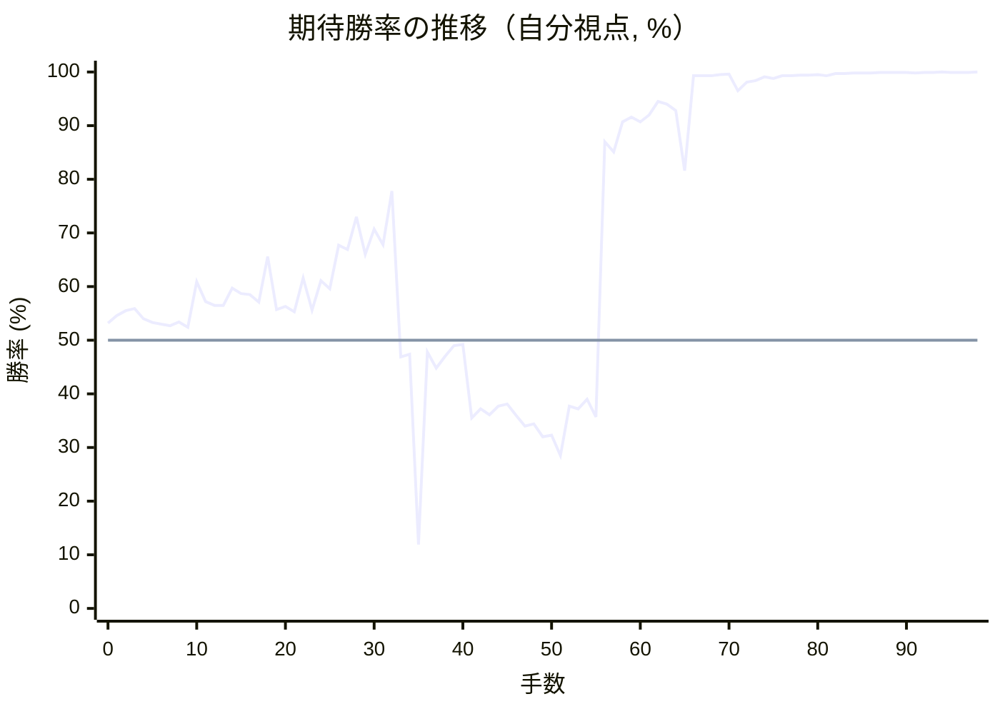

# 解析レポート 0dqu4du7tlqd

[README に戻る](../../../README.md)　/　棋譜: [CSA](../../../data/csa/shogi5/0dqu4du7tlqd.csa)　/　解析の見方: [docs/mistake_analysis.md](../../../docs/mistake_analysis.md)

## 対局情報

| 項目 | 内容 |
|---|---|
| 日時 | 2026-11-09 19:30:28 |
| 持ち時間 | 5分 |
| 自分 | 先手（▲）（1675） |
| 相手 | 相手（1669） |
| 結果 | 負け（時間切れ, 98手） |

## 解析環境

| 項目 | 内容 |
|---|---|
| エンジン | YaneuraOu NNUE 9.00git 64AVX2（V9.00/YANEURAOU_ENGINE_NNUE/AVX2） |
| 評価関数 | **水匠5**（`suisho5`） |
| nn.bin SHA-256 | `768068f0d534a0603a5d38bcd143de6bbca820d5f1c95a14d40863e5b7892d76` |
| 第1パス | movetime=150ms, MultiPV 1 |
| 第2パス | movetime=2000ms, MultiPV 3 |
| Threads / Hash | 8 / 512MB |
| 判定基準 | 疑問手 ≥5pt, 悪手 ≥10pt, 大悪手 ≥20pt（期待勝率 W(E)=1/(1+exp(-E/600))） |
| 解析日時 | 2026-11-11T20:14:27+09:00（解析バージョン 1, 43秒） |

## サマリー

| 自分の手数 | 深掘りした手 | 詰み逃し | 大悪手 | 悪手 | 疑問手 |
|--:|--:|--:|--:|--:|--:|
| 49 | 7 | 0 | 3 | 0 | 4 |

## 期待勝率の推移



<details><summary>1手ごとの数値（第1パス）</summary>

| 手数 | 指し手 | 評価値 | 勝率 | 低下 | 判定 |
|--:|---|--:|--:|--:|---|
| 1 | ▲７六歩(77) | +110 | 54.6% | -1.4pt |  |
| 2 | △３四歩(33) | +133 | 55.5% |  |  |
| 3 | ▲２六歩(27) | +143 | 55.9% | -0.4pt |  |
| 4 | △４四歩(43) | +96 | 54.0% |  |  |
| 5 | ▲２五歩(26) | +80 | 53.3% | +0.7pt |  |
| 6 | △３三角(22) | +71 | 53.0% |  |  |
| 7 | ▲４八銀(39) | +66 | 52.7% | +0.2pt |  |
| 8 | △３二銀(31) | +81 | 53.4% |  |  |
| 9 | ▲６八玉(59) | +57 | 52.4% | +1.0pt |  |
| 10 | △４二飛(82) | +266 | 60.9% |  |  |
| 11 | ▲５六歩(57) | +174 | 57.2% | +3.7pt |  |
| 12 | △６二玉(51) | +157 | 56.5% |  |  |
| 13 | ▲７八玉(68) | +157 | 56.5% | +0.0pt |  |
| 14 | △７二玉(62) | +236 | 59.7% |  |  |
| 15 | ▲９六歩(97) | +212 | 58.7% | +1.0pt |  |
| 16 | △９四歩(93) | +205 | 58.5% |  |  |
| 17 | ▲８六歩(87) | +172 | 57.1% | +1.3pt |  |
| 18 | △８四歩(83) | +388 | 65.6% |  |  |
| 19 | ▲８七玉(78) | +137 | 55.7% | +9.9pt | [疑問手](#ply-19) |
| 20 | △８二銀(71) | +152 | 56.3% |  |  |
| 21 | ▲７八銀(79) | +128 | 55.3% | +1.0pt |  |
| 22 | △８三銀(82) | +283 | 61.6% |  |  |
| 23 | ▲５七銀(48) | +134 | 55.6% | +6.0pt | [疑問手](#ply-23) |
| 24 | △７一玉(72) | +272 | 61.1% |  |  |
| 25 | ▲６六銀(57) | +233 | 59.6% | +1.6pt |  |
| 26 | △８二飛(42) | +443 | 67.7% |  |  |
| 27 | ▲７九角(88) | +421 | 66.9% | +0.8pt |  |
| 28 | △７四銀(83) | +597 | 73.0% |  |  |
| 29 | ▲７七桂(89) | +398 | 66.0% | +7.0pt | [疑問手](#ply-29) |
| 30 | △４五歩(44) | +528 | 70.7% |  |  |
| 31 | ▲３六歩(37) | +447 | 67.8% | +2.9pt |  |
| 32 | △９三桂(81) | +753 | 77.8% |  |  |
| 33 | ▲３五歩(36) | -74 | 46.9% | +30.9pt | [大悪手](#ply-33) |
| 34 | △８五歩(84) | -63 | 47.4% |  |  |
| 35 | ▲３四歩(35) | -1201 | 11.9% | +35.5pt | [大悪手](#ply-35) |
| 36 | △４四角(33) | -52 | 47.8% |  |  |
| 37 | ▲８五歩(86) | -125 | 44.8% | +3.0pt |  |
| 38 | △同桂(93) | -71 | 47.0% |  |  |
| 39 | ▲８六歩打 | -23 | 49.0% | -2.0pt |  |
| 40 | △７七桂成(85) | -20 | 49.2% |  |  |
| 41 | ▲同銀(66) | -358 | 35.5% | +13.7pt | [大悪手](#ply-41) |
| 42 | △８五歩打 | -315 | 37.2% |  |  |
| 43 | ▲６六桂打 | -342 | 36.1% | +1.0pt |  |
| 44 | △８六歩(85) | -301 | 37.7% |  |  |
| 45 | ▲同銀(77) | -292 | 38.1% | -0.4pt |  |
| 46 | △８五歩打 | -346 | 36.0% |  |  |
| 47 | ▲７七銀(86) | -397 | 34.0% | +1.9pt |  |
| 48 | △６五銀(74) | -387 | 34.4% |  |  |
| 49 | ▲２四歩(25) | -452 | 32.0% | +2.4pt |  |
| 50 | △同歩(23) | -445 | 32.3% |  |  |
| 51 | ▲同飛(28) | -553 | 28.5% | +3.8pt |  |
| 52 | △２三歩打 | -302 | 37.7% |  |  |
| 53 | ▲２五飛(24) | -313 | 37.2% | +0.4pt |  |
| 54 | △５六銀(65) | -268 | 39.0% |  |  |
| 55 | ▲５七歩打 | -352 | 35.7% | +3.3pt |  |
| 56 | △６五銀(56) | +1143 | 87.0% |  |  |
| 57 | ▲４五飛(25) | +1045 | 85.1% | +2.0pt |  |
| 58 | △６六角(44) | +1366 | 90.7% |  |  |
| 59 | ▲同歩(67) | +1437 | 91.6% | -1.0pt |  |
| 60 | △５四銀(65) | +1367 | 90.7% |  |  |
| 61 | ▲２五飛(45) | +1466 | 92.0% | -1.3pt |  |
| 62 | △８六歩(85) | +1711 | 94.5% |  |  |
| 63 | ▲同銀(77) | +1646 | 94.0% | +0.6pt |  |
| 64 | △７四桂打 | +1530 | 92.8% |  |  |
| 65 | ▲８五銀(86) | +892 | 81.6% | +11.2pt | [疑問手](#ply-65) |
| 66 | △４五桂打 | +2938 | 99.3% |  |  |
| 67 | ▲８三歩打 | +2974 | 99.3% | -0.0pt |  |
| 68 | △同飛(82) | +3001 | 99.3% |  |  |
| 69 | ▲８四歩打 | +3144 | 99.5% | -0.1pt |  |
| 70 | △８一飛(83) | +3243 | 99.6% |  |  |
| 71 | ▲９七角(79) | +1992 | 96.5% | +3.0pt |  |
| 72 | △６二金(61) | +2353 | 98.1% |  |  |
| 73 | ▲５八金(49) | +2473 | 98.4% | -0.3pt |  |
| 74 | △６六桂(74) | +2795 | 99.1% |  |  |
| 75 | ▲４六歩(47) | +2670 | 98.8% | +0.2pt |  |
| 76 | △５八桂成(66) | +2990 | 99.3% |  |  |
| 77 | ▲同金(69) | +2987 | 99.3% | +0.0pt |  |
| 78 | △９五歩(94) | +3074 | 99.4% |  |  |
| 79 | ▲同歩(96) | +3063 | 99.4% | +0.0pt |  |
| 80 | △９六歩打 | +3213 | 99.5% |  |  |
| 81 | ▲８六角(97) | +2963 | 99.3% | +0.2pt |  |
| 82 | △９七金打 | +3515 | 99.7% |  |  |
| 83 | ▲同香(99) | +3590 | 99.7% | -0.0pt |  |
| 84 | △同歩成(96) | +3721 | 99.8% |  |  |
| 85 | ▲同玉(87) | +3774 | 99.8% | -0.0pt |  |
| 86 | △９二香打 | +3835 | 99.8% |  |  |
| 87 | ▲８三桂打 | +4110 | 99.9% | -0.1pt |  |
| 88 | △６一玉(71) | +4292 | 99.9% |  |  |
| 89 | ▲９一桂成(83) | +4294 | 99.9% | -0.0pt |  |
| 90 | △同飛(81) | +4182 | 99.9% |  |  |
| 91 | ▲８三歩成(84) | +3814 | 99.8% | +0.1pt |  |
| 92 | △９五香(92) | +4004 | 99.9% |  |  |
| 93 | ▲９六歩打 | +4064 | 99.9% | -0.0pt |  |
| 94 | △７四桂打 | +4697 | 100.0% |  |  |
| 95 | ▲７七角(86) | +4206 | 99.9% | +0.1pt |  |
| 96 | △９六香(95) | +4481 | 99.9% |  |  |
| 97 | ▲同銀(85) | +4280 | 99.9% | +0.0pt |  |
| 98 | △同飛(91) | +6065 | 100.0% |  |  |

</details>

## 課題局面

<a id="ply-19"></a>
### 19手目 ▲８七玉(78) — 疑問手

| | 着手前 | 着手後 | 差 |
|---|--:|--:|--:|
| 期待勝率 | 64.2% | 55.8% | -8.3pt |
| 評価値 | +350 | +141 | |

着手前の局面:

```text
後手の持駒：なし
  ９ ８ ７ ６ ５ ４ ３ ２ １
+---------------------------+
|v香v桂v銀v金 ・v金 ・v桂v香|一
| ・ ・v玉 ・ ・v飛v銀 ・ ・|二
| ・ ・v歩v歩v歩 ・v角v歩v歩|三
|v歩v歩 ・ ・ ・v歩v歩 ・ ・|四
| ・ ・ ・ ・ ・ ・ ・ 歩 ・|五
| 歩 歩 歩 ・ 歩 ・ ・ ・ ・|六
| ・ ・ ・ 歩 ・ 歩 歩 ・ 歩|七
| ・ 角 玉 ・ ・ 銀 ・ 飛 ・|八
| 香 桂 銀 金 ・ 金 ・ 桂 香|九
+---------------------------+
先手の持駒：なし
手数＝18　△８四歩　まで
```

| | 指し手 | 評価値 | 読み筋 |
|---|---|--:|---|
| 実戦 | ▲８七玉(78) | +141 | △８二銀(71) ▲７八銀(79) △４三銀(32) ▲９八玉(87) △８三銀(82) ▲８七銀(78) |
| AI 1位 | ▲６六角(88) | +350 | ▲６六角(88) △４五歩(44) ▲５八金(49) △８二玉(72) ▲５七銀(48) △７二銀(71) |
| AI 2位 | ▲３六歩(37) | +301 | ▲３六歩(37) △４三銀(32) ▲６六角(88) △８三玉(72) ▲８八銀(79) △８二銀(71) |
| AI 3位 | ▲５八金(49) | +264 | ▲５八金(49) △４三銀(32) ▲６六角(88) △８三玉(72) ▲８八銀(79) △８二銀(71) |

SFEN: `lnsg1g1nl/2k2rs2/2ppp1bpp/pp3pp2/7P1/PPP1P4/3P1PP1P/1BK2S1R1/LNSG1G1NL b - 19`

<a id="ply-23"></a>
### 23手目 ▲５七銀(48) — 疑問手

| | 着手前 | 着手後 | 差 |
|---|--:|--:|--:|
| 期待勝率 | 60.3% | 54.4% | -5.9pt |
| 評価値 | +252 | +106 | |

着手前の局面:

```text
後手の持駒：なし
  ９ ８ ７ ６ ５ ４ ３ ２ １
+---------------------------+
|v香v桂 ・v金 ・v金 ・v桂v香|一
| ・ ・v玉 ・ ・v飛v銀 ・ ・|二
| ・v銀v歩v歩v歩 ・v角v歩v歩|三
|v歩v歩 ・ ・ ・v歩v歩 ・ ・|四
| ・ ・ ・ ・ ・ ・ ・ 歩 ・|五
| 歩 歩 歩 ・ 歩 ・ ・ ・ ・|六
| ・ 玉 ・ 歩 ・ 歩 歩 ・ 歩|七
| ・ 角 銀 ・ ・ 銀 ・ 飛 ・|八
| 香 桂 ・ 金 ・ 金 ・ 桂 香|九
+---------------------------+
先手の持駒：なし
手数＝22　△８三銀　まで
```

| | 指し手 | 評価値 | 読み筋 |
|---|---|--:|---|
| 実戦 | ▲５七銀(48) | +106 | △４三銀(32) ▲９八玉(87) |
| AI 1位 | ▲７九角(88) | +252 | ▲７九角(88) △４五歩(44) ▲７七桂(89) △７四歩(73) ▲５八金(49) △６二金(61) |
| AI 2位 | ▲５八金(49) | +126 | ▲５八金(49) △４三銀(32) ▲５七銀(48) △８二玉(72) ▲９八玉(87) △５二金(41) |
| AI 3位 | ▲９八玉(87) | +125 | ▲９八玉(87) △５二金(41) ▲８七銀(78) △４三銀(32) ▲５七銀(48) △８二玉(72) |

SFEN: `ln1g1g1nl/2k2rs2/1sppp1bpp/pp3pp2/7P1/PPP1P4/1K1P1PP1P/1BS2S1R1/LN1G1G1NL b - 23`

<a id="ply-29"></a>
### 29手目 ▲７七桂(89) — 疑問手

| | 着手前 | 着手後 | 差 |
|---|--:|--:|--:|
| 期待勝率 | 75.5% | 67.2% | -8.2pt |
| 評価値 | +674 | +431 | |

着手前の局面:

```text
後手の持駒：なし
  ９ ８ ７ ６ ５ ４ ３ ２ １
+---------------------------+
|v香v桂v玉v金 ・v金 ・v桂v香|一
| ・v飛 ・ ・ ・ ・v銀 ・ ・|二
| ・ ・v歩v歩v歩 ・v角v歩v歩|三
|v歩v歩v銀 ・ ・v歩v歩 ・ ・|四
| ・ ・ ・ ・ ・ ・ ・ 歩 ・|五
| 歩 歩 歩 銀 歩 ・ ・ ・ ・|六
| ・ 玉 ・ 歩 ・ 歩 歩 ・ 歩|七
| ・ ・ 銀 ・ ・ ・ ・ 飛 ・|八
| 香 桂 角 金 ・ 金 ・ 桂 香|九
+---------------------------+
先手の持駒：なし
手数＝28　△７四銀　まで
```

| | 指し手 | 評価値 | 読み筋 |
|---|---|--:|---|
| 実戦 | ▲７七桂(89) | +431 | △６四歩(63) ▲５八金(49) △７二金(61) ▲７五歩(76) △６三銀(74) ▲２四歩(25) |
| AI 1位 | ▲７五歩(76) | +674 | ▲７五歩(76) △８三銀(74) ▲５八金(49) △４二角(33) ▲２四歩(25) △同歩(23) |
| AI 2位 | ▲７七桂(89) | +402 | ▲７七桂(89) △６四歩(63) ▲５八金(49) △７二金(61) ▲７五銀(66) △９三桂(81) |
| AI 3位 | ▲２四歩(25) | +397 | ▲２四歩(25) △同角(33) ▲同角(79) △同歩(23) ▲７五歩(76) △４三角打 |

SFEN: `lnkg1g1nl/1r4s2/2ppp1bpp/pps2pp2/7P1/PPPSP4/1K1P1PP1P/2S4R1/LNBG1G1NL b - 29`

<a id="ply-33"></a>
### 33手目 ▲３五歩(36) — 大悪手

| | 着手前 | 着手後 | 差 |
|---|--:|--:|--:|
| 期待勝率 | 81.6% | 51.2% | -30.3pt |
| 評価値 | +892 | +30 | |

着手前の局面:

```text
後手の持駒：なし
  ９ ８ ７ ６ ５ ４ ３ ２ １
+---------------------------+
|v香 ・v玉v金 ・v金 ・v桂v香|一
| ・v飛 ・ ・ ・ ・v銀 ・ ・|二
|v桂 ・v歩v歩v歩 ・v角v歩v歩|三
|v歩v歩v銀 ・ ・ ・v歩 ・ ・|四
| ・ ・ ・ ・ ・v歩 ・ 歩 ・|五
| 歩 歩 歩 銀 歩 ・ 歩 ・ ・|六
| ・ 玉 桂 歩 ・ 歩 ・ ・ 歩|七
| ・ ・ 銀 ・ ・ ・ ・ 飛 ・|八
| 香 ・ 角 金 ・ 金 ・ 桂 香|九
+---------------------------+
先手の持駒：なし
手数＝32　△９三桂　まで
```

| | 指し手 | 評価値 | 読み筋 |
|---|---|--:|---|
| 実戦 | ▲３五歩(36) | +30 | △８五歩(84) ▲同桂(77) △同桂(93) ▲３四歩(35) △４四角(33) ▲６八角(79) |
| AI 1位 | ▲７五歩(76) | +892 | ▲７五歩(76) △８三銀(74) ▲２四歩(25) △同角(33) ▲同角(79) △同歩(23) |
| AI 2位 | ▲２四歩(25) | +616 | ▲２四歩(25) △８五歩(84) ▲同桂(77) △同銀(74) ▲同歩(86) △２四角(33) |
| AI 3位 | ▲８八玉(87) | +456 | ▲８八玉(87) △６二金(61) ▲５七角(79) △６四歩(63) ▲９五歩(96) △同歩(94) |

SFEN: `l1kg1g1nl/1r4s2/n1ppp1bpp/pps3p2/5p1P1/PPPSP1P2/1KNP1P2P/2S4R1/L1BG1G1NL b - 33`

<a id="ply-35"></a>
### 35手目 ▲３四歩(35) — 大悪手

| | 着手前 | 着手後 | 差 |
|---|--:|--:|--:|
| 期待勝率 | 52.4% | 12.9% | -39.5pt |
| 評価値 | +58 | -1144 | |

着手前の局面:

```text
後手の持駒：なし
  ９ ８ ７ ６ ５ ４ ３ ２ １
+---------------------------+
|v香 ・v玉v金 ・v金 ・v桂v香|一
| ・v飛 ・ ・ ・ ・v銀 ・ ・|二
|v桂 ・v歩v歩v歩 ・v角v歩v歩|三
|v歩 ・v銀 ・ ・ ・v歩 ・ ・|四
| ・v歩 ・ ・ ・v歩 歩 歩 ・|五
| 歩 歩 歩 銀 歩 ・ ・ ・ ・|六
| ・ 玉 桂 歩 ・ 歩 ・ ・ 歩|七
| ・ ・ 銀 ・ ・ ・ ・ 飛 ・|八
| 香 ・ 角 金 ・ 金 ・ 桂 香|九
+---------------------------+
先手の持駒：なし
手数＝34　△８五歩　まで
```

| | 指し手 | 評価値 | 読み筋 |
|---|---|--:|---|
| 実戦 | ▲３四歩(35) | -1144 | △６六角(33) ▲同歩(67) |
| AI 1位 | ▲同桂(77) | +58 | ▲同桂(77) △同桂(93) ▲３四歩(35) △４四角(33) ▲８八角(79) △７二金(61) |
| AI 2位 | ▲同歩(86) | -33 | ▲同歩(86) △同桂(93) ▲３四歩(35) △４四角(33) ▲８六歩打 △７七桂成(85) |
| AI 3位 | ▲５五歩(56) | -517 | ▲５五歩(56) △８六歩(85) ▲８八玉(87) △６四歩(63) ▲５八飛(28) △８五桂(93) |

SFEN: `l1kg1g1nl/1r4s2/n1ppp1bpp/p1s3p2/1p3pPP1/PPPSP4/1KNP1P2P/2S4R1/L1BG1G1NL b - 35`

<a id="ply-41"></a>
### 41手目 ▲同銀(66) — 大悪手

| | 着手前 | 着手後 | 差 |
|---|--:|--:|--:|
| 期待勝率 | 54.7% | 34.4% | -20.3pt |
| 評価値 | +114 | -386 | |

着手前の局面:

```text
後手の持駒：桂　歩
  ９ ８ ７ ６ ５ ４ ３ ２ １
+---------------------------+
|v香 ・v玉v金 ・v金 ・v桂v香|一
| ・v飛 ・ ・ ・ ・v銀 ・ ・|二
| ・ ・v歩v歩v歩 ・ ・v歩v歩|三
|v歩 ・v銀 ・ ・v角 歩 ・ ・|四
| ・ ・ ・ ・ ・v歩 ・ 歩 ・|五
| 歩 歩 歩 銀 歩 ・ ・ ・ ・|六
| ・ 玉v圭 歩 ・ 歩 ・ ・ 歩|七
| ・ ・ 銀 ・ ・ ・ ・ 飛 ・|八
| 香 ・ 角 金 ・ 金 ・ 桂 香|九
+---------------------------+
先手の持駒：歩
手数＝40　△７七桂成　まで
```

| | 指し手 | 評価値 | 読み筋 |
|---|---|--:|---|
| 実戦 | ▲同銀(66) | -386 | △８五歩打 ▲６六桂打 △８六歩(85) ▲同銀(77) △８五歩打 ▲７七銀(86) |
| AI 1位 | ▲同銀(78) | +114 | ▲同銀(78) △６五桂打 ▲７八金(69) △８五歩打 ▲同歩(86) △同銀(74) |
| AI 2位 | ▲同玉(87) | +1 | ▲同玉(87) △８五歩打 ▲３六桂打 △６五桂打 ▲６八玉(77) △３五角(44) |
| AI 3位 | ▲同銀(66) | -171 | ▲同銀(66) △８五歩打 ▲同歩(86) △同銀(74) ▲８六歩打 △同銀(85) |

SFEN: `l1kg1g1nl/1r4s2/2ppp2pp/p1s2bP2/5p1P1/PPPSP4/1K+nP1P2P/2S4R1/L1BG1G1NL b Pnp 41`

<a id="ply-65"></a>
### 65手目 ▲８五銀(86) — 疑問手

| | 着手前 | 着手後 | 差 |
|---|--:|--:|--:|
| 期待勝率 | 95.3% | 86.1% | -9.1pt |
| 評価値 | +1800 | +1095 | |

着手前の局面:

```text
後手の持駒：桂　歩
  ９ ８ ７ ６ ５ ４ ３ ２ １
+---------------------------+
|v香 ・v玉v金 ・v金 ・v桂v香|一
| ・v飛 ・ ・ ・ ・v銀 ・ ・|二
| ・ ・v歩v歩v歩 ・ ・v歩v歩|三
|v歩 ・v桂 ・v銀 ・ 歩 ・ ・|四
| ・ ・ ・ ・ ・ ・ ・ 飛 ・|五
| 歩 銀 歩 歩 ・ ・ ・ ・ ・|六
| ・ 玉 ・ ・ 歩 歩 ・ ・ 歩|七
| ・ ・ 銀 ・ ・ ・ ・ ・ ・|八
| 香 ・ 角 金 ・ 金 ・ 桂 香|九
+---------------------------+
先手の持駒：角　歩四
手数＝64　△７四桂　まで
```

| | 指し手 | 評価値 | 読み筋 |
|---|---|--:|---|
| 実戦 | ▲８五銀(86) | +1095 | △８六歩打 ▲９七玉(87) △６六桂(74) ▲８八角(79) △７八桂成(66) ▲同金(69) |
| AI 1位 | ▲８三歩打 | +1800 | ▲８三歩打 △同飛(82) ▲８四歩打 △同飛(83) ▲８五銀(86) △８一飛(84) |
| AI 2位 | ▲８四歩打 | +1397 | ▲８四歩打 △８六桂(74) ▲同玉(87) △８四飛(82) ▲８五歩打 △８一飛(84) |
| AI 3位 | ▲８五歩打 | +1074 | ▲８五歩打 △８六桂(74) ▲同玉(87) △２四歩(23) ▲１五飛(25) △４三銀(32) |

SFEN: `l1kg1g1nl/1r4s2/2ppp2pp/p1n1s1P2/7R1/PSPP5/1K2PP2P/2S6/L1BG1G1NL b B4Pnp 65`

