# 解析レポート 0ior84hk0pnq

[README に戻る](../../../README.md)　/　棋譜: [CSA](../../../data/csa/shogi5/0ior84hk0pnq.csa)　/　解析の見方: [docs/mistake_analysis.md](../../../docs/mistake_analysis.md)

## 対局情報

| 項目 | 内容 |
|---|---|
| 日時 | 2026-11-19 03:46:05 |
| 持ち時間 | 5分 |
| 自分 | 後手（△）（1705） |
| 相手 | 相手（1533） |
| 結果 | 勝ち（詰み, 120手） |

## 解析環境

| 項目 | 内容 |
|---|---|
| エンジン | YaneuraOu NNUE 9.00git 64AVX2（V9.00/YANEURAOU_ENGINE_NNUE/AVX2） |
| 評価関数 | **水匠5**（`suisho5`） |
| nn.bin SHA-256 | `768068f0d534a0603a5d38bcd143de6bbca820d5f1c95a14d40863e5b7892d76` |
| 第1パス | movetime=150ms, MultiPV 1 |
| 第2パス | movetime=2000ms, MultiPV 3 |
| Threads / Hash | 8 / 512MB |
| 判定基準 | 疑問手 ≥5pt, 悪手 ≥10pt, 大悪手 ≥20pt（期待勝率 W(E)=1/(1+exp(-E/600))） |
| 解析日時 | 2026-11-20T20:04:39+09:00（解析バージョン 1, 103秒） |

## サマリー

| 自分の手数 | 深掘りした手 | 詰み逃し | 大悪手 | 悪手 | 疑問手 |
|--:|--:|--:|--:|--:|--:|
| 60 | 21 | 1 | 11 | 2 | 3 |

## 期待勝率の推移

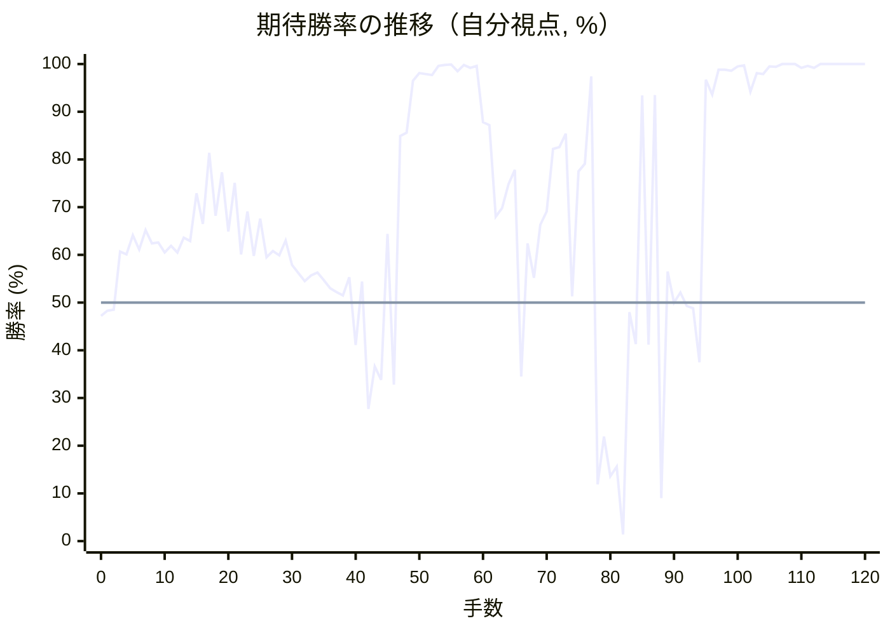

<details><summary>1手ごとの数値（第1パス）</summary>

| 手数 | 指し手 | 評価値 | 勝率 | 低下 | 判定 |
|--:|---|--:|--:|--:|---|
| 1 | ▲７六歩(77) | -40 | 48.3% |  |  |
| 2 | △８四歩(83) | -37 | 48.5% | -0.1pt |  |
| 3 | ▲７五歩(76) | +261 | 60.7% |  |  |
| 4 | △８五歩(84) | +246 | 60.1% | +0.6pt |  |
| 5 | ▲７七角(88) | +348 | 64.1% |  |  |
| 6 | △３四歩(33) | +270 | 61.1% | +3.0pt |  |
| 7 | ▲６六歩(67) | +377 | 65.2% |  |  |
| 8 | △６二銀(71) | +305 | 62.4% | +2.8pt |  |
| 9 | ▲７八飛(28) | +310 | 62.6% |  |  |
| 10 | △４二玉(51) | +257 | 60.5% | +2.1pt |  |
| 11 | ▲６八銀(79) | +292 | 61.9% |  |  |
| 12 | △６四歩(63) | +256 | 60.5% | +1.4pt |  |
| 13 | ▲６七銀(68) | +335 | 63.6% |  |  |
| 14 | △３二玉(42) | +317 | 62.9% | +0.7pt |  |
| 15 | ▲５六歩(57) | +595 | 72.9% |  |  |
| 16 | △６三銀(62) | +411 | 66.5% | +6.5pt | [疑問手](#ply-16) |
| 17 | ▲６八角(77) | +885 | 81.4% |  |  |
| 18 | △１四歩(13) | +458 | 68.2% | +13.2pt | [疑問手](#ply-18) |
| 19 | ▲１六歩(17) | +736 | 77.3% |  |  |
| 20 | △９四歩(93) | +368 | 64.9% | +12.5pt | [悪手](#ply-20) |
| 21 | ▲９六歩(97) | +661 | 75.1% |  |  |
| 22 | △２四歩(23) | +245 | 60.1% | +15.0pt | [大悪手](#ply-22) |
| 23 | ▲２六歩(27) | +482 | 69.1% |  |  |
| 24 | △２三玉(32) | +238 | 59.8% | +9.3pt | [大悪手](#ply-24) |
| 25 | ▲２八銀(39) | +441 | 67.6% |  |  |
| 26 | △３二銀(31) | +232 | 59.5% | +8.0pt |  |
| 27 | ▲３六歩(37) | +264 | 60.8% |  |  |
| 28 | △６五歩(64) | +241 | 59.9% | +0.9pt |  |
| 29 | ▲７六飛(78) | +320 | 63.0% |  |  |
| 30 | △６六歩(65) | +191 | 57.9% | +5.1pt |  |
| 31 | ▲同銀(67) | +150 | 56.2% |  |  |
| 32 | △５四銀(63) | +108 | 54.5% | +1.7pt |  |
| 33 | ▲２五歩(26) | +137 | 55.7% |  |  |
| 34 | △同歩(24) | +152 | 56.3% | -0.6pt |  |
| 35 | ▲２四歩打 | +113 | 54.7% |  |  |
| 36 | △１二玉(23) | +71 | 53.0% | +1.7pt |  |
| 37 | ▲１五歩(16) | +53 | 52.2% |  |  |
| 38 | △同歩(14) | +35 | 51.5% | +0.7pt |  |
| 39 | ▲３七桂(29) | +127 | 55.3% |  |  |
| 40 | △８六歩(85) | -217 | 41.1% | +14.2pt | [悪手](#ply-40) |
| 41 | ▲２五桂(37) | +106 | 54.4% |  |  |
| 42 | △８七歩成(86) | -576 | 27.7% | +26.7pt | [大悪手](#ply-42) |
| 43 | ▲１五香(19) | -330 | 36.6% |  |  |
| 44 | △１三歩打 | -403 | 33.8% | +2.8pt |  |
| 45 | ▲５五歩(56) | +355 | 64.4% |  |  |
| 46 | △８六と(87) | -430 | 32.8% | +31.6pt | [大悪手](#ply-46) |
| 47 | ▲５四歩(55) | +1037 | 84.9% |  |  |
| 48 | △７六と(86) | +1071 | 85.6% | -0.7pt |  |
| 49 | ▲２三銀打 | +1991 | 96.5% |  |  |
| 50 | △同銀(32) | +2356 | 98.1% | -1.6pt |  |
| 51 | ▲同歩成(24) | +2304 | 97.9% |  |  |
| 52 | △同玉(12) | +2260 | 97.7% | +0.2pt |  |
| 53 | ▲２四銀打 | +3255 | 99.6% |  |  |
| 54 | △３二玉(23) | +3615 | 99.8% | -0.2pt |  |
| 55 | ▲５三歩成(54) | +3902 | 99.9% |  |  |
| 56 | △２三歩打 | +2531 | 98.5% | +1.3pt |  |
| 57 | ▲１三銀成(24) | +3771 | 99.8% |  |  |
| 58 | △同香(11) | +2922 | 99.2% | +0.6pt |  |
| 59 | ▲同香成(15) | +3308 | 99.6% |  |  |
| 60 | △同桂(21) | +1185 | 87.8% | +11.8pt |  |
| 61 | ▲３三香打 | +1151 | 87.2% |  |  |
| 62 | △同角(22) | +451 | 68.0% | +19.2pt | [大悪手](#ply-62) |
| 63 | ▲同桂成(25) | +502 | 69.8% |  |  |
| 64 | △同玉(32) | +652 | 74.8% | -5.0pt |  |
| 65 | ▲１三角成(68) | +754 | 77.8% |  |  |
| 66 | △５六飛打 | -385 | 34.5% | +43.4pt | [大悪手](#ply-66) |
| 67 | ▲５七歩打 | +305 | 62.4% |  |  |
| 68 | △５三飛(56) | +125 | 55.2% | +7.3pt |  |
| 69 | ▲４五桂打 | +405 | 66.3% |  |  |
| 70 | △４二玉(33) | +482 | 69.1% | -2.8pt |  |
| 71 | ▲５三桂成(45) | +916 | 82.2% |  |  |
| 72 | △同玉(42) | +936 | 82.6% | -0.5pt |  |
| 73 | ▲６五銀(66) | +1060 | 85.4% |  |  |
| 74 | △６六と(76) | +32 | 51.3% | +34.1pt | [大悪手](#ply-74) |
| 75 | ▲６四角打 | +741 | 77.5% |  |  |
| 76 | △６二玉(53) | +798 | 79.1% | -1.6pt |  |
| 77 | ▲７四歩(75) | +2181 | 97.4% |  |  |
| 78 | △５七と(66) | -1204 | 11.9% | +85.6pt | [大悪手](#ply-78) |
| 79 | ▲７三歩成(74) | -763 | 21.9% |  |  |
| 80 | △同桂(81) | -1107 | 13.6% | +8.3pt |  |
| 81 | ▲６三歩打 | -1014 | 15.6% |  |  |
| 82 | △７二玉(62) | -2544 | 1.4% | +14.2pt | [疑問手](#ply-82) |
| 83 | ▲７三角成(64) | -48 | 48.0% |  |  |
| 84 | △同玉(72) | -211 | 41.3% | +6.7pt |  |
| 85 | ▲７七飛打 | +1586 | 93.4% |  |  |
| 86 | △７六歩打 | -213 | 41.2% | +52.1pt | [大悪手](#ply-86) |
| 87 | ▲同飛(77) | +1595 | 93.5% |  |  |
| 88 | △８三玉(73) | -1387 | 9.0% | +84.4pt | [大悪手](#ply-88) |
| 89 | ▲７四銀(65) | +158 | 56.5% |  |  |
| 90 | △９二玉(83) | -1 | 50.0% | +6.6pt |  |
| 91 | ▲５七馬(13) | +50 | 52.1% |  |  |
| 92 | △８七飛成(82) | -16 | 49.3% | +2.7pt |  |
| 93 | ▲７七飛(76) | -28 | 48.8% |  |  |
| 94 | △８九龍(87) | -306 | 37.5% | +11.3pt | [大悪手](#ply-94) |
| 95 | ▲７三銀成(74) | +2032 | 96.7% |  |  |
| 96 | △５四香打 | +1612 | 93.6% | +3.1pt |  |
| 97 | ▲５五歩打 | +2638 | 98.8% |  |  |
| 98 | △同香(54) | +2645 | 98.8% | -0.0pt |  |
| 99 | ▲５六歩打 | +2544 | 98.6% |  |  |
| 100 | △６五桂打 | +3152 | 99.5% | -0.9pt |  |
| 101 | ▲６七馬(57) | +3571 | 99.7% |  |  |
| 102 | △８六角打 | +1677 | 94.2% | +5.5pt |  |
| 103 | ▲８九馬(67) | +2374 | 98.1% |  |  |
| 104 | △７七角成(86) | +2300 | 97.9% | +0.2pt |  |
| 105 | ▲４八玉(59) | +3142 | 99.5% |  |  |
| 106 | △６六馬(77) | +3066 | 99.4% | +0.1pt |  |
| 107 | ▲３七玉(48) | #+21 | 100.0% |  |  |
| 108 | △４五桂打 | #+18 | 100.0% | +0.0pt |  |
| 109 | ▲２七玉(37) | #+17 | 100.0% |  |  |
| 110 | △８七飛打 | +2874 | 99.2% | +0.8pt | [詰み逃し](#ply-110) |
| 111 | ▲８三歩打 | +3248 | 99.6% |  |  |
| 112 | △４七飛成(87) | +2926 | 99.2% | +0.3pt |  |
| 113 | ▲３七飛打 | #+11 | 100.0% |  |  |
| 114 | △同桂成(45) | #+10 | 100.0% | +0.0pt |  |
| 115 | ▲１六玉(27) | #+5 | 100.0% |  |  |
| 116 | △３六龍(47) | #+4 | 100.0% | +0.0pt |  |
| 117 | ▲２六歩打 | #+3 | 100.0% |  |  |
| 118 | △２五銀打 | #+2 | 100.0% | +0.0pt |  |
| 119 | ▲１七玉(16) | #+1 | 100.0% |  |  |
| 120 | △１六香打 | #+ | 100.0% | +0.0pt |  |

</details>

## 課題局面

<a id="ply-16"></a>
### 16手目 △６三銀(62) — 疑問手

| | 着手前 | 着手後 | 差 |
|---|--:|--:|--:|
| 期待勝率 | 72.5% | 64.7% | -7.8pt |
| 評価値 | +583 | +364 | |

着手前の局面:

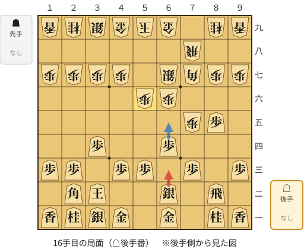

🔴 実戦 △６三銀(62)　🔵 AI推奨 △６五歩(64)　🟨 直前の相手の指し手

<details><summary>テキストの盤面図（BOD・将棋ソフトに貼り付け可）</summary>

```text
後手の持駒：なし
  ９ ８ ７ ６ ５ ４ ３ ２ １
+---------------------------+
|v香v桂 ・v金 ・v金v銀v桂v香|一
| ・v飛 ・v銀 ・ ・v玉v角 ・|二
|v歩 ・v歩 ・v歩v歩 ・v歩v歩|三
| ・ ・ ・v歩 ・ ・v歩 ・ ・|四
| ・v歩 歩 ・ ・ ・ ・ ・ ・|五
| ・ ・ ・ 歩 歩 ・ ・ ・ ・|六
| 歩 歩 角 銀 ・ 歩 歩 歩 歩|七
| ・ ・ 飛 ・ ・ ・ ・ ・ ・|八
| 香 桂 ・ 金 玉 金 銀 桂 香|九
+---------------------------+
先手の持駒：なし
後手番
手数＝15　▲５六歩　まで
```

</details>

| | 指し手 | 評価値 | 読み筋 |
|---|---|--:|---|
| 実戦 | △６三銀(62) | +364 | ▲４八玉(59) △７四歩(73) ▲同歩(75) △同銀(63) ▲３八玉(48) △７五銀(74) |
| AI 1位 | △６五歩(64) | +583 | △６五歩(64) ▲６八金(69) △８六歩(85) ▲同歩(87) △７四歩(73) ▲６五歩(66) |
| AI 2位 | △７四歩(73) | +538 | △７四歩(73) ▲４八玉(59) △７五歩(74) ▲３八玉(48) △７二飛(82) ▲２八玉(38) |
| AI 3位 | △８六歩(85) | +505 | △８六歩(85) ▲同歩(87) △６五歩(64) ▲５八金(49) △６六歩(65) ▲７六銀(67) |

SFEN: `ln1g1gsnl/1r1s2kb1/p1p1pp1pp/3p2p2/1pP6/3PP4/PPBS1PPPP/2R6/LN1GKGSNL w - 16`

<a id="ply-18"></a>
### 18手目 △１四歩(13) — 疑問手

| | 着手前 | 着手後 | 差 |
|---|--:|--:|--:|
| 期待勝率 | 81.3% | 74.2% | -7.0pt |
| 評価値 | +881 | +635 | |

着手前の局面:

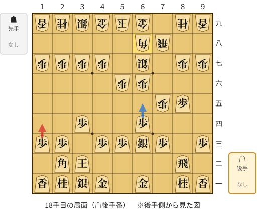

🔴 実戦 △１四歩(13)　🔵 AI推奨 △６五歩(64)　🟨 直前の相手の指し手

<details><summary>テキストの盤面図（BOD・将棋ソフトに貼り付け可）</summary>

```text
後手の持駒：なし
  ９ ８ ７ ６ ５ ４ ３ ２ １
+---------------------------+
|v香v桂 ・v金 ・v金v銀v桂v香|一
| ・v飛 ・ ・ ・ ・v玉v角 ・|二
|v歩 ・v歩v銀v歩v歩 ・v歩v歩|三
| ・ ・ ・v歩 ・ ・v歩 ・ ・|四
| ・v歩 歩 ・ ・ ・ ・ ・ ・|五
| ・ ・ ・ 歩 歩 ・ ・ ・ ・|六
| 歩 歩 ・ 銀 ・ 歩 歩 歩 歩|七
| ・ ・ 飛 角 ・ ・ ・ ・ ・|八
| 香 桂 ・ 金 玉 金 銀 桂 香|九
+---------------------------+
先手の持駒：なし
後手番
手数＝17　▲６八角　まで
```

</details>

| | 指し手 | 評価値 | 読み筋 |
|---|---|--:|---|
| 実戦 | △１四歩(13) | +635 | ▲７六飛(78) △１三角(22) |
| AI 1位 | △６五歩(64) | +881 | △６五歩(64) ▲７六飛(78) △６六歩(65) ▲同銀(67) △８六歩(85) ▲同歩(87) |
| AI 2位 | △８六歩(85) | +802 | △８六歩(85) ▲同歩(87) △６五歩(64) ▲７六飛(78) △６六歩(65) ▲同銀(67) |
| AI 3位 | △７二金(61) | +563 | △７二金(61) ▲７六飛(78) △７四歩(73) ▲４八玉(59) △７五歩(74) ▲同飛(76) |

SFEN: `ln1g1gsnl/1r4kb1/p1pspp1pp/3p2p2/1pP6/3PP4/PP1S1PPPP/2RB5/LN1GKGSNL w - 18`

<a id="ply-20"></a>
### 20手目 △９四歩(93) — 悪手

| | 着手前 | 着手後 | 差 |
|---|--:|--:|--:|
| 期待勝率 | 81.0% | 66.6% | -14.4pt |
| 評価値 | +870 | +414 | |

着手前の局面:

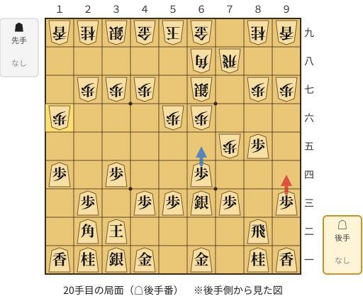

🔴 実戦 △９四歩(93)　🔵 AI推奨 △６五歩(64)　🟨 直前の相手の指し手

<details><summary>テキストの盤面図（BOD・将棋ソフトに貼り付け可）</summary>

```text
後手の持駒：なし
  ９ ８ ７ ６ ５ ４ ３ ２ １
+---------------------------+
|v香v桂 ・v金 ・v金v銀v桂v香|一
| ・v飛 ・ ・ ・ ・v玉v角 ・|二
|v歩 ・v歩v銀v歩v歩 ・v歩 ・|三
| ・ ・ ・v歩 ・ ・v歩 ・v歩|四
| ・v歩 歩 ・ ・ ・ ・ ・ ・|五
| ・ ・ ・ 歩 歩 ・ ・ ・ 歩|六
| 歩 歩 ・ 銀 ・ 歩 歩 歩 ・|七
| ・ ・ 飛 角 ・ ・ ・ ・ ・|八
| 香 桂 ・ 金 玉 金 銀 桂 香|九
+---------------------------+
先手の持駒：なし
後手番
手数＝19　▲１六歩　まで
```

</details>

| | 指し手 | 評価値 | 読み筋 |
|---|---|--:|---|
| 実戦 | △９四歩(93) | +414 | ▲４八玉(59) △６五歩(64) ▲７六飛(78) △６六歩(65) ▲同銀(67) △８六歩(85) |
| AI 1位 | △６五歩(64) | +870 | △６五歩(64) ▲７六飛(78) △８六歩(85) ▲同歩(87) △６六歩(65) ▲同銀(67) |
| AI 2位 | △８六歩(85) | +741 | △８六歩(85) ▲同角(68) △６五歩(64) ▲６八飛(78) △６六歩(65) ▲同銀(67) |
| AI 3位 | △７二金(61) | +532 | △７二金(61) ▲７六飛(78) △７四歩(73) ▲４八玉(59) △８三金(72) ▲３八玉(48) |

SFEN: `ln1g1gsnl/1r4kb1/p1pspp1p1/3p2p1p/1pP6/3PP3P/PP1S1PPP1/2RB5/LN1GKGSNL w - 20`

<a id="ply-22"></a>
### 22手目 △２四歩(23) — 大悪手

| | 着手前 | 着手後 | 差 |
|---|--:|--:|--:|
| 期待勝率 | 82.1% | 58.9% | -23.2pt |
| 評価値 | +914 | +216 | |

着手前の局面:

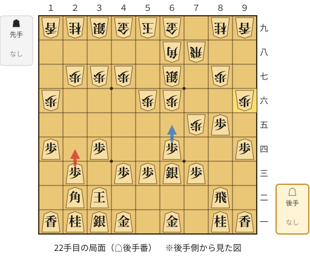

🔴 実戦 △２四歩(23)　🔵 AI推奨 △６五歩(64)　🟨 直前の相手の指し手

<details><summary>テキストの盤面図（BOD・将棋ソフトに貼り付け可）</summary>

```text
後手の持駒：なし
  ９ ８ ７ ６ ５ ４ ３ ２ １
+---------------------------+
|v香v桂 ・v金 ・v金v銀v桂v香|一
| ・v飛 ・ ・ ・ ・v玉v角 ・|二
| ・ ・v歩v銀v歩v歩 ・v歩 ・|三
|v歩 ・ ・v歩 ・ ・v歩 ・v歩|四
| ・v歩 歩 ・ ・ ・ ・ ・ ・|五
| 歩 ・ ・ 歩 歩 ・ ・ ・ 歩|六
| ・ 歩 ・ 銀 ・ 歩 歩 歩 ・|七
| ・ ・ 飛 角 ・ ・ ・ ・ ・|八
| 香 桂 ・ 金 玉 金 銀 桂 香|九
+---------------------------+
先手の持駒：なし
後手番
手数＝21　▲９六歩　まで
```

</details>

| | 指し手 | 評価値 | 読み筋 |
|---|---|--:|---|
| 実戦 | △２四歩(23) | +216 | ▲７六飛(78) △２三玉(32) ▲３六歩(37) △３二銀(31) ▲５八金(69) △５四歩(53) |
| AI 1位 | △６五歩(64) | +914 | △６五歩(64) ▲７六飛(78) △８六歩(85) ▲同歩(87) △７四歩(73) ▲５五歩(56) |
| AI 2位 | △８六歩(85) | +844 | △８六歩(85) ▲同角(68) △６五歩(64) ▲６八飛(78) △６六歩(65) ▲同銀(67) |
| AI 3位 | △９五歩(94) | +778 | △９五歩(94) ▲同歩(96) △６五歩(64) ▲７六飛(78) △６六歩(65) ▲同銀(67) |

SFEN: `ln1g1gsnl/1r4kb1/2pspp1p1/p2p2p1p/1pP6/P2PP3P/1P1S1PPP1/2RB5/LN1GKGSNL w - 22`

<a id="ply-24"></a>
### 24手目 △２三玉(32) — 大悪手

| | 着手前 | 着手後 | 差 |
|---|--:|--:|--:|
| 期待勝率 | 79.8% | 59.1% | -20.6pt |
| 評価値 | +823 | +222 | |

着手前の局面:

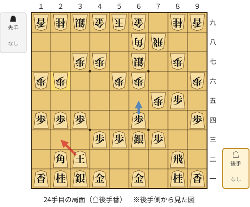

🔴 実戦 △２三玉(32)　🔵 AI推奨 △６五歩(64)　🟨 直前の相手の指し手

<details><summary>テキストの盤面図（BOD・将棋ソフトに貼り付け可）</summary>

```text
後手の持駒：なし
  ９ ８ ７ ６ ５ ４ ３ ２ １
+---------------------------+
|v香v桂 ・v金 ・v金v銀v桂v香|一
| ・v飛 ・ ・ ・ ・v玉v角 ・|二
| ・ ・v歩v銀v歩v歩 ・ ・ ・|三
|v歩 ・ ・v歩 ・ ・v歩v歩v歩|四
| ・v歩 歩 ・ ・ ・ ・ ・ ・|五
| 歩 ・ ・ 歩 歩 ・ ・ 歩 歩|六
| ・ 歩 ・ 銀 ・ 歩 歩 ・ ・|七
| ・ ・ 飛 角 ・ ・ ・ ・ ・|八
| 香 桂 ・ 金 玉 金 銀 桂 香|九
+---------------------------+
先手の持駒：なし
後手番
手数＝23　▲２六歩　まで
```

</details>

| | 指し手 | 評価値 | 読み筋 |
|---|---|--:|---|
| 実戦 | △２三玉(32) | +222 | ▲３六歩(37) △５二金(61) ▲７七角(68) △６五歩(64) ▲２八飛(78) △６四銀(63) |
| AI 1位 | △６五歩(64) | +823 | △６五歩(64) ▲７六飛(78) △８六歩(85) ▲同歩(87) △７四歩(73) ▲同歩(75) |
| AI 2位 | △８六歩(85) | +665 | △８六歩(85) ▲同角(68) △６五歩(64) ▲６八飛(78) △６六歩(65) ▲同銀(67) |
| AI 3位 | △４四角(22) | +478 | △４四角(22) ▲７六飛(78) △２二銀(31) ▲７八金(69) △３五角(44) ▲同角(68) |

SFEN: `ln1g1gsnl/1r4kb1/2pspp3/p2p2ppp/1pP6/P2PP2PP/1P1S1PP2/2RB5/LN1GKGSNL w - 24`

<a id="ply-40"></a>
### 40手目 △８六歩(85) — 悪手

| | 着手前 | 着手後 | 差 |
|---|--:|--:|--:|
| 期待勝率 | 51.0% | 40.8% | -10.1pt |
| 評価値 | +23 | -223 | |

着手前の局面:

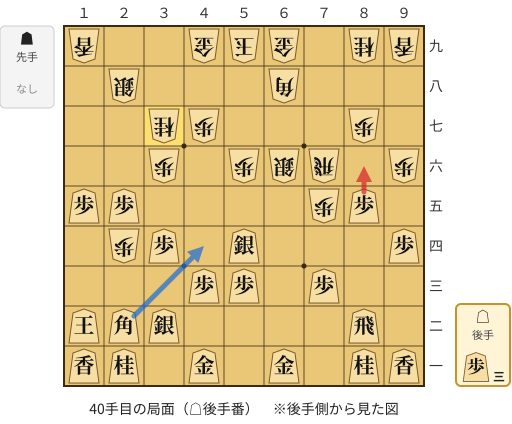

🔴 実戦 △８六歩(85)　🔵 AI推奨 △４四角(22)　🟨 直前の相手の指し手

<details><summary>テキストの盤面図（BOD・将棋ソフトに貼り付け可）</summary>

```text
後手の持駒：歩三
  ９ ８ ７ ６ ５ ４ ３ ２ １
+---------------------------+
|v香v桂 ・v金 ・v金 ・v桂v香|一
| ・v飛 ・ ・ ・ ・v銀v角v玉|二
| ・ ・v歩 ・v歩v歩 ・ ・ ・|三
|v歩 ・ ・ ・v銀 ・v歩 歩 ・|四
| ・v歩 歩 ・ ・ ・ ・v歩v歩|五
| 歩 ・ 飛 銀 歩 ・ 歩 ・ ・|六
| ・ 歩 ・ ・ ・ 歩 桂 ・ ・|七
| ・ ・ ・ 角 ・ ・ ・ 銀 ・|八
| 香 桂 ・ 金 玉 金 ・ ・ 香|九
+---------------------------+
先手の持駒：なし
後手番
手数＝39　▲３七桂　まで
```

</details>

| | 指し手 | 評価値 | 読み筋 |
|---|---|--:|---|
| 実戦 | △８六歩(85) | -223 | ▲同歩(87) △４四角(22) ▲４六角(68) △６五歩打 ▲７七銀(66) △７二飛(82) |
| AI 1位 | △４四角(22) | +23 | △４四角(22) ▲４六角(68) △６二飛(82) ▲５五歩(56) △６三銀(54) ▲６五銀(66) |
| AI 2位 | △６二飛(82) | +17 | △６二飛(82) ▲１五香(19) △１三歩打 ▲６七歩打 △６五歩打 ▲７七銀(66) |
| AI 3位 | △６五歩打 | -103 | △６五歩打 ▲７七銀(66) △４四角(22) ▲４六歩(47) △３三桂(21) ▲７四歩(75) |

SFEN: `ln1g1g1nl/1r4sbk/2p1pp3/p3s1pP1/1pP4pp/P1RSP1P2/1P3PN2/3B3S1/LN1GKG2L w 3p 40`

<a id="ply-42"></a>
### 42手目 △８七歩成(86) — 大悪手

| | 着手前 | 着手後 | 差 |
|---|--:|--:|--:|
| 期待勝率 | 55.6% | 27.1% | -28.5pt |
| 評価値 | +135 | -595 | |

着手前の局面:

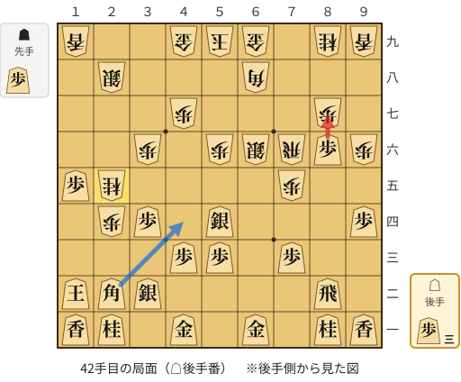

🔴 実戦 △８七歩成(86)　🔵 AI推奨 △４四角(22)　🟨 直前の相手の指し手

<details><summary>テキストの盤面図（BOD・将棋ソフトに貼り付け可）</summary>

```text
後手の持駒：歩三
  ９ ８ ７ ６ ５ ４ ３ ２ １
+---------------------------+
|v香v桂 ・v金 ・v金 ・v桂v香|一
| ・v飛 ・ ・ ・ ・v銀v角v玉|二
| ・ ・v歩 ・v歩v歩 ・ ・ ・|三
|v歩 ・ ・ ・v銀 ・v歩 歩 ・|四
| ・ ・ 歩 ・ ・ ・ ・ 桂v歩|五
| 歩v歩 飛 銀 歩 ・ 歩 ・ ・|六
| ・ 歩 ・ ・ ・ 歩 ・ ・ ・|七
| ・ ・ ・ 角 ・ ・ ・ 銀 ・|八
| 香 桂 ・ 金 玉 金 ・ ・ 香|九
+---------------------------+
先手の持駒：歩
後手番
手数＝41　▲２五桂　まで
```

</details>

| | 指し手 | 評価値 | 読み筋 |
|---|---|--:|---|
| 実戦 | △８七歩成(86) | -595 | ▲１三歩打 △同角(22) ▲１五香(19) △１四歩打 ▲同香(15) △２二玉(12) |
| AI 1位 | △４四角(22) | +135 | △４四角(22) ▲８六歩(87) △６七歩打 ▲５七角(68) △２二玉(12) ▲１二歩打 |
| AI 2位 | △６七歩打 | -196 | △６七歩打 ▲５七角(68) △４四角(22) ▲１五香(19) △１四歩打 ▲１三歩打 |
| AI 3位 | △２七歩打 | -212 | △２七歩打 ▲同銀(28) △４四角(22) ▲１五香(19) △１四歩打 ▲１三歩打 |

SFEN: `ln1g1g1nl/1r4sbk/2p1pp3/p3s1pP1/2P4Np/PpRSP1P2/1P3P3/3B3S1/LN1GKG2L w P3p 42`

<a id="ply-46"></a>
### 46手目 △８六と(87) — 大悪手

| | 着手前 | 着手後 | 差 |
|---|--:|--:|--:|
| 期待勝率 | 52.8% | 22.1% | -30.7pt |
| 評価値 | +68 | -755 | |

着手前の局面:

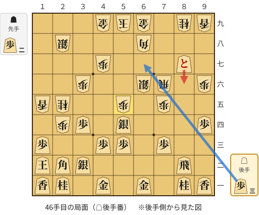

🔴 実戦 △８六と(87)　🔵 AI推奨 △６七歩打　🟨 直前の相手の指し手

<details><summary>テキストの盤面図（BOD・将棋ソフトに貼り付け可）</summary>

```text
後手の持駒：歩三
  ９ ８ ７ ６ ５ ４ ３ ２ １
+---------------------------+
|v香v桂 ・v金 ・v金 ・v桂v香|一
| ・v飛 ・ ・ ・ ・v銀v角v玉|二
| ・ ・v歩 ・v歩v歩 ・ ・v歩|三
|v歩 ・ ・ ・v銀 ・v歩 歩 ・|四
| ・ ・ 歩 ・ 歩 ・ ・ 桂 香|五
| 歩 ・ 飛 銀 ・ ・ 歩 ・ ・|六
| ・vと ・ ・ ・ 歩 ・ ・ ・|七
| ・ ・ ・ 角 ・ ・ ・ 銀 ・|八
| 香 桂 ・ 金 玉 金 ・ ・ ・|九
+---------------------------+
先手の持駒：歩二
後手番
手数＝45　▲５五歩　まで
```

</details>

| | 指し手 | 評価値 | 読み筋 |
|---|---|--:|---|
| 実戦 | △８六と(87) | -755 | ▲同角(68) △４五銀(54) ▲１四歩打 △同歩(13) ▲１三歩打 △同桂(21) |
| AI 1位 | △６七歩打 | +68 | △６七歩打 ▲５七角(68) △４五銀(54) ▲１四歩打 △同歩(13) ▲１三歩打 |
| AI 2位 | △４五銀(54) | +67 | △４五銀(54) ▲１四歩打 △同歩(13) ▲１三歩打 △同角(22) ▲１四香(15) |
| AI 3位 | △２七歩打 | -96 | △２七歩打 ▲同銀(28) △７八と(87) ▲同飛(76) △５五銀(54) ▲８三歩打 |

SFEN: `ln1g1g1nl/1r4sbk/2p1pp2p/p3s1pP1/2P1P2NL/P1RS2P2/1+p3P3/3B3S1/LN1GKG3 w 2P3p 46`

<a id="ply-62"></a>
### 62手目 △同角(22) — 大悪手

| | 着手前 | 着手後 | 差 |
|---|--:|--:|--:|
| 期待勝率 | 96.9% | 65.4% | -31.5pt |
| 評価値 | +2066 | +382 | |

着手前の局面:

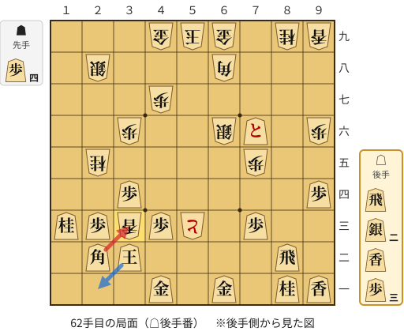

🔴 実戦 △同角(22)　🔵 AI推奨 △２一玉(32)　🟨 直前の相手の指し手

<details><summary>テキストの盤面図（BOD・将棋ソフトに貼り付け可）</summary>

```text
後手の持駒：飛　銀二　香　歩三
  ９ ８ ７ ６ ５ ４ ３ ２ １
+---------------------------+
|v香v桂 ・v金 ・v金 ・ ・ ・|一
| ・v飛 ・ ・ ・ ・v玉v角 ・|二
| ・ ・v歩 ・ とv歩 香v歩v桂|三
|v歩 ・ ・ ・ ・ ・v歩 ・ ・|四
| ・ ・ 歩 ・ ・ ・ ・ 桂 ・|五
| 歩 ・vと 銀 ・ ・ 歩 ・ ・|六
| ・ ・ ・ ・ ・ 歩 ・ ・ ・|七
| ・ ・ ・ 角 ・ ・ ・ 銀 ・|八
| 香 桂 ・ 金 玉 金 ・ ・ ・|九
+---------------------------+
先手の持駒：歩四
後手番
手数＝61　▲３三香　まで
```

</details>

| | 指し手 | 評価値 | 読み筋 |
|---|---|--:|---|
| 実戦 | △同角(22) | +382 | ▲同桂成(25) △同玉(32) ▲１三角成(68) △２二銀打 ▲２五桂打 △３二玉(33) |
| AI 1位 | △２一玉(32) | +2066 | △２一玉(32) ▲１三角成(68) △同角(22) ▲同桂成(25) △２六角打 ▲３七角打 |
| AI 2位 | △同角(22) | +574 | △同角(22) ▲同桂成(25) △同玉(32) ▲１三角成(68) △２二銀打 ▲２五桂打 |

SFEN: `ln1g1g3/1r4kb1/2p1+PpLpn/p5p2/2P4N1/P1+pS2P2/5P3/3B3S1/LN1GKG3 w 4Pr2sl3p 62`

<a id="ply-66"></a>
### 66手目 △５六飛打 — 大悪手

| | 着手前 | 着手後 | 差 |
|---|--:|--:|--:|
| 期待勝率 | 70.0% | 19.8% | -50.2pt |
| 評価値 | +507 | -841 | |

着手前の局面:

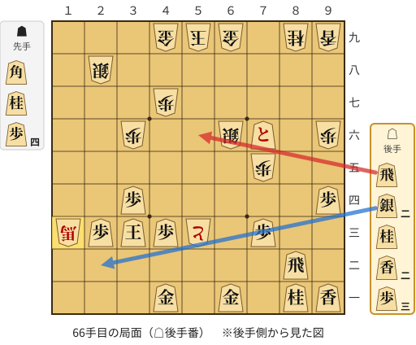

🔴 実戦 △５六飛打　🔵 AI推奨 △２二銀打　🟨 直前の相手の指し手

<details><summary>テキストの盤面図（BOD・将棋ソフトに貼り付け可）</summary>

```text
後手の持駒：飛　銀二　桂　香二　歩三
  ９ ８ ７ ６ ５ ４ ３ ２ １
+---------------------------+
|v香v桂 ・v金 ・v金 ・ ・ ・|一
| ・v飛 ・ ・ ・ ・ ・ ・ ・|二
| ・ ・v歩 ・ とv歩v玉v歩 馬|三
|v歩 ・ ・ ・ ・ ・v歩 ・ ・|四
| ・ ・ 歩 ・ ・ ・ ・ ・ ・|五
| 歩 ・vと 銀 ・ ・ 歩 ・ ・|六
| ・ ・ ・ ・ ・ 歩 ・ ・ ・|七
| ・ ・ ・ ・ ・ ・ ・ 銀 ・|八
| 香 桂 ・ 金 玉 金 ・ ・ ・|九
+---------------------------+
先手の持駒：角　桂　歩四
後手番
手数＝65　▲１三角成　まで
```

</details>

| | 指し手 | 評価値 | 読み筋 |
|---|---|--:|---|
| 実戦 | △５六飛打 | -841 | ▲５七銀(66) △５五飛(56) ▲８三歩打 △２四銀打 ▲５六歩打 △４五飛(55) |
| AI 1位 | △２二銀打 | +507 | △２二銀打 ▲２五桂打 △３二玉(33) ▲２二馬(13) △同玉(32) ▲８三歩打 |
| AI 2位 | △１五飛打 | +395 | △１五飛打 ▲１一角打 △２二桂打 ▲８三歩打 △９二飛(82) ▲１四桂打 |
| AI 3位 | △１一香打 | +391 | △１一香打 ▲２五桂打 △３二玉(33) ▲１二歩打 △５六飛打 ▲４八玉(59) |

SFEN: `ln1g1g3/1r7/2p1+Ppkp+B/p5p2/2P6/P1+pS2P2/5P3/7S1/LN1GKG3 w BN4Pr2sn2l3p 66`

<a id="ply-74"></a>
### 74手目 △６六と(76) — 大悪手

| | 着手前 | 着手後 | 差 |
|---|--:|--:|--:|
| 期待勝率 | 87.5% | 39.5% | -48.0pt |
| 評価値 | +1165 | -256 | |

着手前の局面:

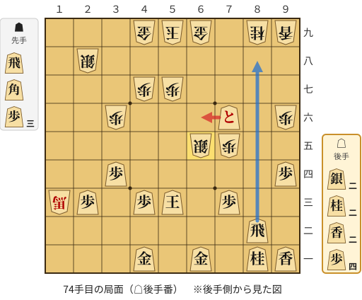

🔴 実戦 △６六と(76)　🔵 AI推奨 △８八飛成(82)　🟨 直前の相手の指し手

<details><summary>テキストの盤面図（BOD・将棋ソフトに貼り付け可）</summary>

```text
後手の持駒：銀二　桂二　香二　歩四
  ９ ８ ７ ６ ５ ４ ３ ２ １
+---------------------------+
|v香v桂 ・v金 ・v金 ・ ・ ・|一
| ・v飛 ・ ・ ・ ・ ・ ・ ・|二
| ・ ・v歩 ・v玉v歩 ・v歩 馬|三
|v歩 ・ ・ ・ ・ ・v歩 ・ ・|四
| ・ ・ 歩 銀 ・ ・ ・ ・ ・|五
| 歩 ・vと ・ ・ ・ 歩 ・ ・|六
| ・ ・ ・ ・ 歩 歩 ・ ・ ・|七
| ・ ・ ・ ・ ・ ・ ・ 銀 ・|八
| 香 桂 ・ 金 玉 金 ・ ・ ・|九
+---------------------------+
先手の持駒：飛　角　歩三
後手番
手数＝73　▲６五銀　まで
```

</details>

| | 指し手 | 評価値 | 読み筋 |
|---|---|--:|---|
| 実戦 | △６六と(76) | -256 | ▲５四飛打 △６二玉(53) ▲８三歩打 △同飛(82) ▲６三歩打 △７一玉(62) |
| AI 1位 | △８八飛成(82) | +1165 | △８八飛成(82) ▲６八歩打 △６三香打 ▲２三馬(13) △３二銀打 ▲同馬(23) |
| AI 2位 | △８九飛成(82) | +772 | △８九飛成(82) ▲６四角打 △６二玉(53) ▲６三歩打 △７二玉(62) ▲７四歩(75) |
| AI 3位 | △６四歩打 | +602 | △６四歩打 ▲４六馬(13) △６三銀打 ▲８三歩打 △同飛(82) ▲１一飛打 |

SFEN: `ln1g1g3/1r7/2p1kp1p+B/p5p2/2PS5/P1+p3P2/4PP3/7S1/LN1GKG3 w RB3P2s2n2l4p 74`

<a id="ply-78"></a>
### 78手目 △５七と(66) — 大悪手

| | 着手前 | 着手後 | 差 |
|---|--:|--:|--:|
| 期待勝率 | 98.2% | 9.0% | -89.2pt |
| 評価値 | +2412 | -1385 | |

着手前の局面:

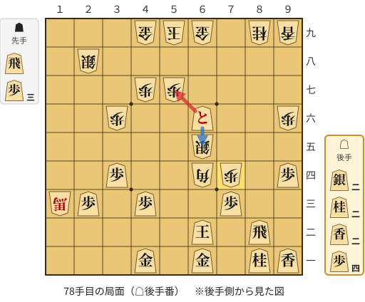

🔴 実戦 △５七と(66)　🔵 AI推奨 △６五と(66)　🟨 直前の相手の指し手

<details><summary>テキストの盤面図（BOD・将棋ソフトに貼り付け可）</summary>

```text
後手の持駒：銀二　桂二　香二　歩四
  ９ ８ ７ ６ ５ ４ ３ ２ １
+---------------------------+
|v香v桂 ・v金 ・v金 ・ ・ ・|一
| ・v飛 ・v玉 ・ ・ ・ ・ ・|二
| ・ ・v歩 ・ ・v歩 ・v歩 馬|三
|v歩 ・ 歩 角 ・ ・v歩 ・ ・|四
| ・ ・ ・ 銀 ・ ・ ・ ・ ・|五
| 歩 ・ ・vと ・ ・ 歩 ・ ・|六
| ・ ・ ・ ・ 歩 歩 ・ ・ ・|七
| ・ ・ ・ ・ ・ ・ ・ 銀 ・|八
| 香 桂 ・ 金 玉 金 ・ ・ ・|九
+---------------------------+
先手の持駒：飛　歩三
後手番
手数＝77　▲７四歩　まで
```

</details>

| | 指し手 | 評価値 | 読み筋 |
|---|---|--:|---|
| 実戦 | △５七と(66) | -1385 | ▲７三歩成(74) △同桂(81) ▲６三歩打 △７一玉(62) ▲５七馬(13) △５一香打 |
| AI 1位 | △６五と(66) | +2412 | △６五と(66) ▲７三歩成(74) △同桂(81) ▲同角成(64) △同玉(62) ▲７七桂(89) |
| AI 2位 | △６七桂打 | +1941 | △６七桂打 ▲４八玉(59) △６五と(66) ▲４六角(64) △８八飛成(82) ▲６八歩打 |
| AI 3位 | △５八歩打 | +1694 | △５八歩打 ▲同金(49) △６五と(66) ▲７三歩成(74) △同桂(81) ▲同角成(64) |

SFEN: `ln1g1g3/1r1k5/2p2p1p+B/p1PB2p2/3S5/P2+p2P2/4PP3/7S1/LN1GKG3 w R3P2s2n2l4p 78`

<a id="ply-82"></a>
### 82手目 △７二玉(62) — 疑問手

| | 着手前 | 着手後 | 差 |
|---|--:|--:|--:|
| 期待勝率 | 10.3% | 0.6% | -9.6pt |
| 評価値 | -1300 | -3021 | |

着手前の局面:

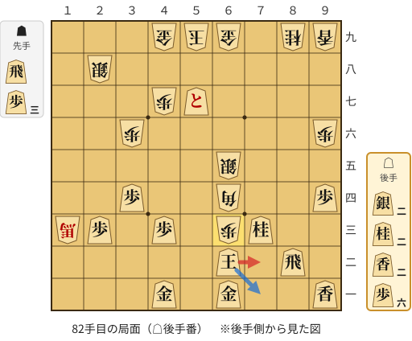

🔴 実戦 △７二玉(62)　🔵 AI推奨 △７一玉(62)　🟨 直前の相手の指し手

<details><summary>テキストの盤面図（BOD・将棋ソフトに貼り付け可）</summary>

```text
後手の持駒：銀二　桂二　香二　歩六
  ９ ８ ７ ６ ５ ４ ３ ２ １
+---------------------------+
|v香 ・ ・v金 ・v金 ・ ・ ・|一
| ・v飛 ・v玉 ・ ・ ・ ・ ・|二
| ・ ・v桂 歩 ・v歩 ・v歩 馬|三
|v歩 ・ ・ 角 ・ ・v歩 ・ ・|四
| ・ ・ ・ 銀 ・ ・ ・ ・ ・|五
| 歩 ・ ・ ・ ・ ・ 歩 ・ ・|六
| ・ ・ ・ ・vと 歩 ・ ・ ・|七
| ・ ・ ・ ・ ・ ・ ・ 銀 ・|八
| 香 桂 ・ 金 玉 金 ・ ・ ・|九
+---------------------------+
先手の持駒：飛　歩三
後手番
手数＝81　▲６三歩　まで
```

</details>

| | 指し手 | 評価値 | 読み筋 |
|---|---|--:|---|
| 実戦 | △７二玉(62) | -3021 | ▲５七馬(13) △８七飛成(82) ▲７七飛打 △同龍(87) ▲同桂(89) △５二香打 |
| AI 1位 | △７一玉(62) | -1300 | △７一玉(62) ▲５七馬(13) △６五桂(73) ▲７五飛打 △７二銀打 ▲８二角成(64) |
| AI 2位 | △５一玉(62) | -2004 | △５一玉(62) ▲７三角成(64) △６二銀打 ▲同歩成(63) △同金(61) ▲５二歩打 |
| AI 3位 | △７二玉(62) | -2888 | △７二玉(62) ▲５七馬(13) △５一香打 ▲５四歩打 △６八歩打 ▲７九金(69) |

SFEN: `l2g1g3/1r1k5/2nP1p1p+B/p2B2p2/3S5/P5P2/4+pP3/7S1/LN1GKG3 w R3P2s2n2l6p 82`

<a id="ply-86"></a>
### 86手目 △７六歩打 — 大悪手

| | 着手前 | 着手後 | 差 |
|---|--:|--:|--:|
| 期待勝率 | 93.4% | 31.2% | -62.2pt |
| 評価値 | +1590 | -475 | |

着手前の局面:

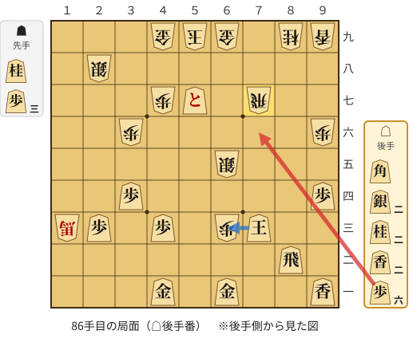

🔴 実戦 △７六歩打　🔵 AI推奨 △６三玉(73)　🟨 直前の相手の指し手

<details><summary>テキストの盤面図（BOD・将棋ソフトに貼り付け可）</summary>

```text
後手の持駒：角　銀二　桂二　香二　歩六
  ９ ８ ７ ６ ５ ４ ３ ２ １
+---------------------------+
|v香 ・ ・v金 ・v金 ・ ・ ・|一
| ・v飛 ・ ・ ・ ・ ・ ・ ・|二
| ・ ・v玉 歩 ・v歩 ・v歩 馬|三
|v歩 ・ ・ ・ ・ ・v歩 ・ ・|四
| ・ ・ ・ 銀 ・ ・ ・ ・ ・|五
| 歩 ・ ・ ・ ・ ・ 歩 ・ ・|六
| ・ ・ 飛 ・vと 歩 ・ ・ ・|七
| ・ ・ ・ ・ ・ ・ ・ 銀 ・|八
| 香 桂 ・ 金 玉 金 ・ ・ ・|九
+---------------------------+
先手の持駒：桂　歩三
後手番
手数＝85　▲７七飛　まで
```

</details>

| | 指し手 | 評価値 | 読み筋 |
|---|---|--:|---|
| 実戦 | △７六歩打 | -475 | ▲４六馬(13) △６三玉(73) ▲５七飛(77) △８六角打 ▲４八玉(59) △５六歩打 |
| AI 1位 | △６三玉(73) | +1590 | △６三玉(73) ▲７四銀(65) △５二玉(63) ▲５七飛(77) △４二玉(52) ▲８三歩打 |
| AI 2位 | △７六桂打 | +52 | △７六桂打 ▲４六馬(13) △６三玉(73) ▲５七飛(77) △５二香打 ▲５三歩打 |
| AI 3位 | △７六歩打 | +32 | △７六歩打 ▲４六馬(13) △６三玉(73) ▲６四馬(46) △６二玉(63) ▲５七飛(77) |

SFEN: `l2g1g3/1r7/2kP1p1p+B/p5p2/3S5/P5P2/2R1+pP3/7S1/LN1GKG3 w N3Pb2s2n2l6p 86`

<a id="ply-88"></a>
### 88手目 △８三玉(73) — 大悪手

| | 着手前 | 着手後 | 差 |
|---|--:|--:|--:|
| 期待勝率 | 93.2% | 10.3% | -82.8pt |
| 評価値 | +1567 | -1297 | |

着手前の局面:

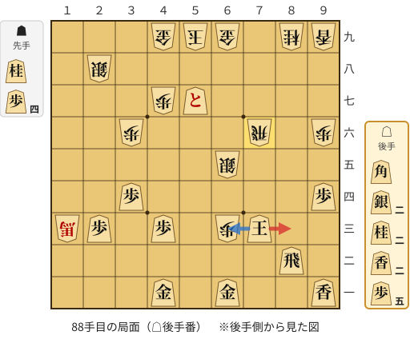

🔴 実戦 △８三玉(73)　🔵 AI推奨 △６三玉(73)　🟨 直前の相手の指し手

<details><summary>テキストの盤面図（BOD・将棋ソフトに貼り付け可）</summary>

```text
後手の持駒：角　銀二　桂二　香二　歩五
  ９ ８ ７ ６ ５ ４ ３ ２ １
+---------------------------+
|v香 ・ ・v金 ・v金 ・ ・ ・|一
| ・v飛 ・ ・ ・ ・ ・ ・ ・|二
| ・ ・v玉 歩 ・v歩 ・v歩 馬|三
|v歩 ・ ・ ・ ・ ・v歩 ・ ・|四
| ・ ・ ・ 銀 ・ ・ ・ ・ ・|五
| 歩 ・ 飛 ・ ・ ・ 歩 ・ ・|六
| ・ ・ ・ ・vと 歩 ・ ・ ・|七
| ・ ・ ・ ・ ・ ・ ・ 銀 ・|八
| 香 桂 ・ 金 玉 金 ・ ・ ・|九
+---------------------------+
先手の持駒：桂　歩四
後手番
手数＝87　▲７六同飛　まで
```

</details>

| | 指し手 | 評価値 | 読み筋 |
|---|---|--:|---|
| 実戦 | △８三玉(73) | -1297 | ▲５七馬(13) △８五銀打 ▲８四歩打 △９二玉(83) ▲７三飛成(76) △７二銀打 |
| AI 1位 | △６三玉(73) | +1567 | △６三玉(73) ▲５七馬(13) △８九飛成(82) ▲４五桂打 △２六角打 ▲４八金(49) |
| AI 2位 | △７五歩打 | +1602 | △７五歩打 ▲同飛(76) △６三玉(73) ▲５五桂打 △５二玉(63) ▲５七馬(13) |
| AI 3位 | △７四歩打 | +486 | △７四歩打 ▲５七馬(13) △２六角打 ▲３七桂打 △６三玉(73) ▲８三歩打 |

SFEN: `l2g1g3/1r7/2kP1p1p+B/p5p2/3S5/P1R3P2/4+pP3/7S1/LN1GKG3 w N4Pb2s2n2l5p 88`

<a id="ply-94"></a>
### 94手目 △８九龍(87) — 大悪手

| | 着手前 | 着手後 | 差 |
|---|--:|--:|--:|
| 期待勝率 | 53.1% | 32.7% | -20.5pt |
| 評価値 | +75 | -434 | |

着手前の局面:

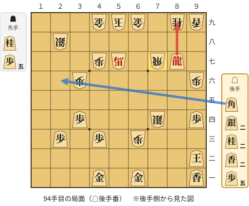

🔴 実戦 △８九龍(87)　🔵 AI推奨 △２六角打　🟨 直前の相手の指し手

<details><summary>テキストの盤面図（BOD・将棋ソフトに貼り付け可）</summary>

```text
後手の持駒：角　銀二　桂二　香二　歩五
  ９ ８ ７ ６ ５ ４ ３ ２ １
+---------------------------+
|v香 ・ ・v金 ・v金 ・ ・ ・|一
|v玉 ・ ・ ・ ・ ・ ・ ・ ・|二
| ・ ・ ・ 歩 ・v歩 ・v歩 ・|三
|v歩 ・ 銀 ・ ・ ・v歩 ・ ・|四
| ・ ・ ・ ・ ・ ・ ・ ・ ・|五
| 歩 ・ ・ ・ ・ ・ 歩 ・ ・|六
| ・v龍 飛 ・ 馬 歩 ・ ・ ・|七
| ・ ・ ・ ・ ・ ・ ・ 銀 ・|八
| 香 桂 ・ 金 玉 金 ・ ・ ・|九
+---------------------------+
先手の持駒：桂　歩五
後手番
手数＝93　▲７七飛　まで
```

</details>

| | 指し手 | 評価値 | 読み筋 |
|---|---|--:|---|
| 実戦 | △８九龍(87) | -434 | ▲８四桂打 △９三玉(92) ▲７二桂成(84) △８四角打 ▲同馬(57) △同龍(89) |
| AI 1位 | △２六角打 | +75 | △２六角打 ▲４八金(49) △５八歩打 ▲同玉(59) △８八龍(87) ▲７八金(69) |
| AI 2位 | △５八歩打 | -81 | △５八歩打 ▲同金(49) △２六角打 ▲４八金(58) △５八歩打 ▲同玉(59) |
| AI 3位 | △１五角打 | -215 | △１五角打 ▲４八金(49) △５八歩打 ▲同玉(59) △８六龍(87) ▲８四桂打 |

SFEN: `l2g1g3/k8/3P1p1p1/p1S3p2/9/P5P2/1+rR1+BP3/7S1/LN1GKG3 w N5Pb2s2n2l5p 94`

<a id="ply-110"></a>
### 110手目 △８七飛打 — 詰み逃し

| | 着手前 | 着手後 | 差 |
|---|--:|--:|--:|
| 期待勝率 | 100.0% | 99.6% | -0.4pt |
| 評価値 | 13手詰め | +3374 | |

着手前の局面:

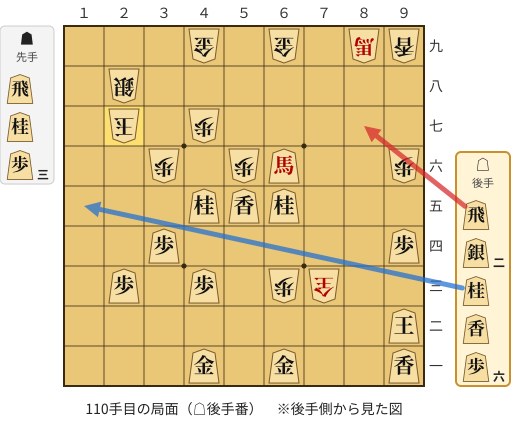

🔴 実戦 △８七飛打　🔵 AI推奨 △１五桂打　🟨 直前の相手の指し手

<details><summary>テキストの盤面図（BOD・将棋ソフトに貼り付け可）</summary>

```text
後手の持駒：飛　銀二　桂　香　歩六
  ９ ８ ７ ６ ５ ４ ３ ２ １
+---------------------------+
|v香 ・ ・v金 ・v金 ・ ・ ・|一
|v玉 ・ ・ ・ ・ ・ ・ ・ ・|二
| ・ ・ 全 歩 ・v歩 ・v歩 ・|三
|v歩 ・ ・ ・ ・ ・v歩 ・ ・|四
| ・ ・ ・v桂v香v桂 ・ ・ ・|五
| 歩 ・ ・v馬 歩 ・ 歩 ・ ・|六
| ・ ・ ・ ・ ・ 歩 ・ 玉 ・|七
| ・ ・ ・ ・ ・ ・ ・ 銀 ・|八
| 香 馬 ・ 金 ・ 金 ・ ・ ・|九
+---------------------------+
先手の持駒：飛　桂　歩三
後手番
手数＝109　▲２七玉　まで
```

</details>

| | 指し手 | 評価値 | 読み筋 |
|---|---|--:|---|
| 実戦 | △８七飛打 | +3374 | ▲９五歩(96) △８九飛成(87) |
| AI 1位 | △１五桂打 | 13手詰め | △１五桂打 ▲１八玉(27) △１七歩打 ▲同玉(18) △１六歩打 ▲同玉(17) |
| AI 2位 | △２六銀打 | 17手詰め | △２六銀打 ▲同玉(27) △２五銀打 ▲１七玉(26) △１六飛打 ▲２七玉(17) |
| AI 3位 | △１六銀打 | 17手詰め | △１六銀打 ▲同玉(27) △２五銀打 ▲１七玉(16) △１六飛打 ▲２七玉(17) |

SFEN: `l2g1g3/k8/2+SP1p1p1/p5p2/3nln3/P2+bP1P2/5P1K1/7S1/L+B1G1G3 w RN3Pr2snl6p 110`

