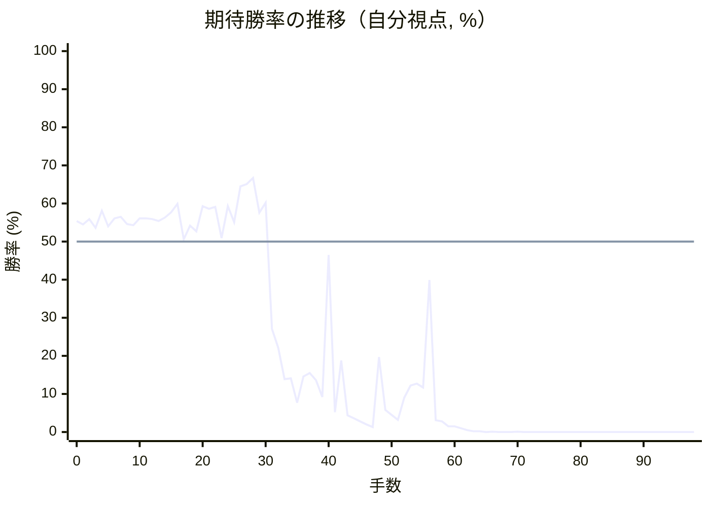
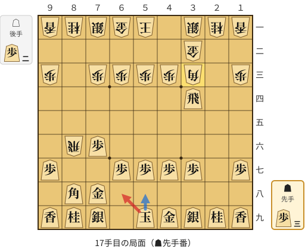
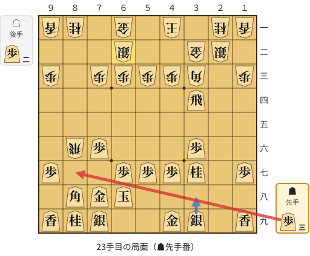
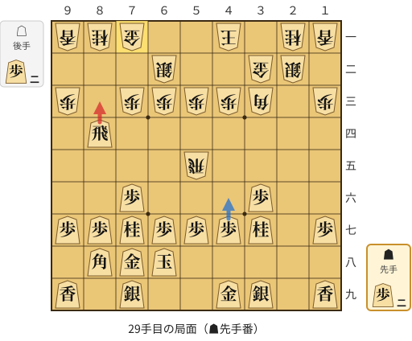
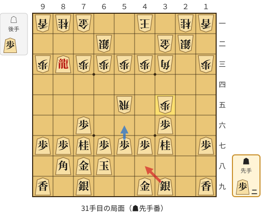
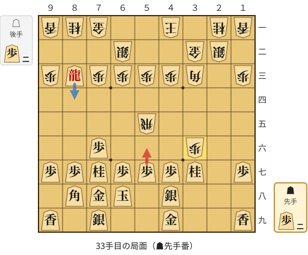
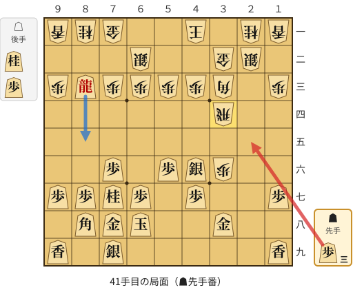
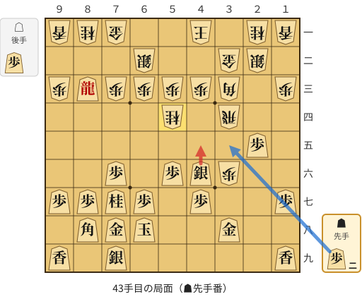
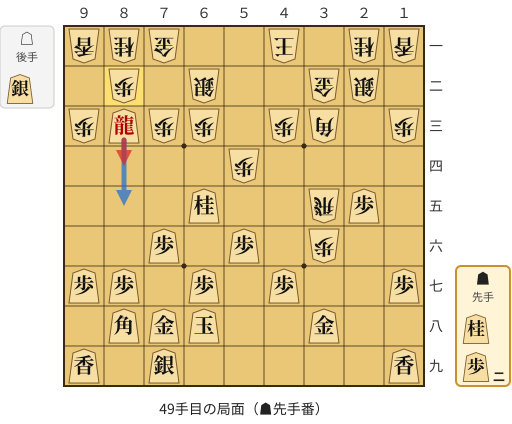
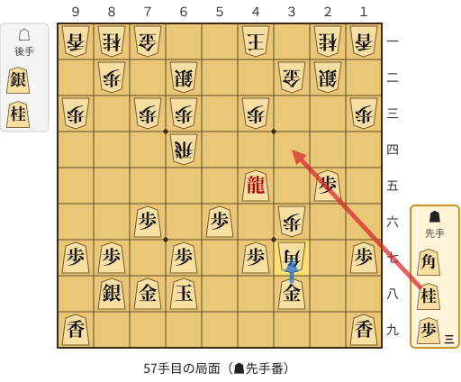

# 解析レポート 0x3vgvmqtip0

[README に戻る](../../../README.md)　/　棋譜: [CSA](../../../data/csa/shogi5/0x3vgvmqtip0.csa)　/　解析の見方: [docs/mistake_analysis.md](../../../docs/mistake_analysis.md)

## 対局情報

| 項目 | 内容 |
|---|---|
| 日時 | 2026-11-20 03:07:18 |
| 持ち時間 | 5分 |
| 自分 | 先手（▲）（1710） |
| 相手 | 相手（1590） |
| 結果 | 負け（時間切れ, 98手） |

## 解析環境

| 項目 | 内容 |
|---|---|
| エンジン | YaneuraOu NNUE 9.00git 64AVX2（V9.00/YANEURAOU_ENGINE_NNUE/AVX2） |
| 評価関数 | **水匠5**（`suisho5`） |
| nn.bin SHA-256 | `768068f0d534a0603a5d38bcd143de6bbca820d5f1c95a14d40863e5b7892d76` |
| 第1パス | movetime=150ms, MultiPV 1 |
| 第2パス | movetime=2000ms, MultiPV 3 |
| Threads / Hash | 8 / 512MB |
| 判定基準 | 疑問手 ≥5pt, 悪手 ≥10pt, 大悪手 ≥20pt（期待勝率 W(E)=1/(1+exp(-E/600))） |
| 解析日時 | 2026-11-20T19:58:01+09:00（解析バージョン 1, 55秒） |

## サマリー

| 自分の手数 | 深掘りした手 | 詰み逃し | 大悪手 | 悪手 | 疑問手 |
|--:|--:|--:|--:|--:|--:|
| 49 | 10 | 0 | 3 | 3 | 3 |

## 期待勝率の推移



<details><summary>1手ごとの数値（第1パス）</summary>

| 手数 | 指し手 | 評価値 | 勝率 | 低下 | 判定 |
|--:|---|--:|--:|--:|---|
| 1 | ▲７六歩(77) | +108 | 54.5% | +0.9pt |  |
| 2 | △３四歩(33) | +143 | 55.9% |  |  |
| 3 | ▲２六歩(27) | +87 | 53.6% | +2.3pt |  |
| 4 | △８四歩(83) | +196 | 58.1% |  |  |
| 5 | ▲２五歩(26) | +96 | 54.0% | +4.1pt |  |
| 6 | △８五歩(84) | +146 | 56.1% |  |  |
| 7 | ▲７八金(69) | +158 | 56.5% | -0.5pt |  |
| 8 | △３二金(41) | +111 | 54.6% |  |  |
| 9 | ▲２四歩(25) | +104 | 54.3% | +0.3pt |  |
| 10 | △同歩(23) | +146 | 56.1% |  |  |
| 11 | ▲同飛(28) | +148 | 56.1% | -0.1pt |  |
| 12 | △８六歩(85) | +142 | 55.9% |  |  |
| 13 | ▲同歩(87) | +131 | 55.4% | +0.5pt |  |
| 14 | △同飛(82) | +151 | 56.3% |  |  |
| 15 | ▲３四飛(24) | +187 | 57.7% | -1.5pt |  |
| 16 | △３三角(22) | +240 | 59.9% |  |  |
| 17 | ▲６八玉(59) | +15 | 50.6% | +9.2pt | [疑問手](#ply-17) |
| 18 | △２二銀(31) | +101 | 54.2% |  |  |
| 19 | ▲３六歩(37) | +66 | 52.7% | +1.5pt |  |
| 20 | △４一玉(51) | +225 | 59.3% |  |  |
| 21 | ▲３七桂(29) | +208 | 58.6% | +0.7pt |  |
| 22 | △６二銀(71) | +222 | 59.1% |  |  |
| 23 | ▲８七歩打 | +21 | 50.9% | +8.3pt | [疑問手](#ply-23) |
| 24 | △８五飛(86) | +225 | 59.3% |  |  |
| 25 | ▲７七桂(89) | +123 | 55.1% | +4.2pt |  |
| 26 | △５五飛(85) | +358 | 64.5% |  |  |
| 27 | ▲８四飛(34) | +373 | 65.1% | -0.6pt |  |
| 28 | △７一金(61) | +417 | 66.7% |  |  |
| 29 | ▲８三飛成(84) | +185 | 57.6% | +9.1pt | [疑問手](#ply-29) |
| 30 | △３五歩打 | +248 | 60.2% |  |  |
| 31 | ▲４八銀(39) | -594 | 27.1% | +33.1pt | [大悪手](#ply-31) |
| 32 | △３六歩(35) | -756 | 22.1% |  |  |
| 33 | ▲５六歩(57) | -1095 | 13.9% | +8.2pt | [悪手](#ply-33) |
| 34 | △３五飛(55) | -1086 | 14.1% |  |  |
| 35 | ▲３八金(49) | -1491 | 7.7% | +6.4pt |  |
| 36 | △３七歩成(36) | -1060 | 14.6% |  |  |
| 37 | ▲同銀(48) | -1016 | 15.5% | -0.9pt |  |
| 38 | △３六歩打 | -1110 | 13.6% |  |  |
| 39 | ▲４六銀(37) | -1375 | 9.2% | +4.4pt |  |
| 40 | △３四飛(35) | -84 | 46.5% |  |  |
| 41 | ▲２五歩打 | -1746 | 5.2% | +41.3pt | [大悪手](#ply-41) |
| 42 | △５四桂打 | -877 | 18.8% |  |  |
| 43 | ▲４五銀(46) | -1851 | 4.4% | +14.4pt | [悪手](#ply-43) |
| 44 | △３五飛(34) | -1971 | 3.6% |  |  |
| 45 | ▲５四銀(45) | -2120 | 2.8% | +0.8pt |  |
| 46 | △同歩(53) | -2320 | 2.0% |  |  |
| 47 | ▲６五桂(77) | -2596 | 1.3% | +0.7pt |  |
| 48 | △８二歩打 | -843 | 19.7% |  |  |
| 49 | ▲８四龍(83) | -1668 | 5.8% | +13.9pt | [悪手](#ply-49) |
| 50 | △６五飛(35) | -1834 | 4.5% |  |  |
| 51 | ▲５四龍(84) | -2050 | 3.2% | +1.3pt |  |
| 52 | △６四飛(65) | -1390 | 9.0% |  |  |
| 53 | ▲４五龍(54) | -1186 | 12.2% | -3.2pt |  |
| 54 | △８八角成(33) | -1157 | 12.7% |  |  |
| 55 | ▲同銀(79) | -1210 | 11.7% | +0.9pt |  |
| 56 | △３七角打 | -245 | 39.9% |  |  |
| 57 | ▲３四桂打 | -2065 | 3.1% | +36.8pt | [大悪手](#ply-57) |
| 58 | △３三銀(22) | -2137 | 2.8% |  |  |
| 59 | ▲８六角打 | -2511 | 1.5% | +1.3pt |  |
| 60 | △１九角成(37) | -2515 | 1.5% |  |  |
| 61 | ▲２四歩(25) | -2753 | 1.0% | +0.5pt |  |
| 62 | △３四銀(33) | -3165 | 0.5% |  |  |
| 63 | ▲３六龍(45) | -3605 | 0.2% | +0.3pt |  |
| 64 | △３五香打 | -3603 | 0.2% |  |  |
| 65 | ▲２六龍(36) | -4583 | 0.0% | +0.2pt |  |
| 66 | △３八香成(35) | -4547 | 0.1% |  |  |
| 67 | ▲２三歩成(24) | -4885 | 0.0% | +0.0pt |  |
| 68 | △同銀(34) | -4997 | 0.0% |  |  |
| 69 | ▲２二歩打 | -5536 | 0.0% | +0.0pt |  |
| 70 | △同金(32) | -4442 | 0.1% |  |  |
| 71 | ▲３四歩打 | -4904 | 0.0% | +0.0pt |  |
| 72 | △４八成香(38) | -4624 | 0.0% |  |  |
| 73 | ▲３三歩成(34) | -4885 | 0.0% | +0.0pt |  |
| 74 | △同桂(21) | -4855 | 0.0% |  |  |
| 75 | ▲７九玉(68) | -5428 | 0.0% | +0.0pt |  |
| 76 | △５八成香(48) | -5385 | 0.0% |  |  |
| 77 | ▲８九玉(79) | -5802 | 0.0% | +0.0pt |  |
| 78 | △６九銀打 | -5664 | 0.0% |  |  |
| 79 | ▲６四角(86) | -6703 | 0.0% | +0.0pt |  |
| 80 | △７八銀成(69) | -7337 | 0.0% |  |  |
| 81 | ▲同玉(89) | -7676 | 0.0% | +0.0pt |  |
| 82 | △６八金打 | -7158 | 0.0% |  |  |
| 83 | ▲８九玉(78) | -7491 | 0.0% | +0.0pt |  |
| 84 | △７八金打 | -35281 | 0.0% |  |  |
| 85 | ▲９八玉(89) | -35281 | 0.0% | +0.0pt |  |
| 86 | △６四馬(19) | #-16 | 0.0% |  |  |
| 87 | ▲２九飛打 | #-13 | 0.0% | +0.0pt |  |
| 88 | △６七金(68) | -6736 | 0.0% |  |  |
| 89 | ▲３四歩打 | #-13 | 0.0% | +0.0pt |  |
| 90 | △８八金(78) | #-12 | 0.0% |  |  |
| 91 | ▲同玉(98) | #-11 | 0.0% | +0.0pt |  |
| 92 | △７七角打 | #-10 | 0.0% |  |  |
| 93 | ▲９八玉(88) | #-9 | 0.0% | +0.0pt |  |
| 94 | △８六桂打 | #-10 | 0.0% |  |  |
| 95 | ▲同歩(87) | #-9 | 0.0% | +0.0pt |  |
| 96 | △同角成(77) | -35281 | 0.0% |  |  |
| 97 | ▲８七金打 | #-7 | 0.0% | +0.0pt |  |
| 98 | △７七金(67) | -35281 | 0.0% |  |  |

</details>

## 課題局面

<a id="ply-17"></a>
### 17手目 ▲６八玉(59) — 疑問手

| | 着手前 | 着手後 | 差 |
|---|--:|--:|--:|
| 期待勝率 | 56.8% | 50.0% | -6.8pt |
| 評価値 | +165 | +0 | |

着手前の局面:



🔴 実戦 ▲６八玉(59)　🔵 AI推奨 ▲５八玉(59)　🟨 直前の相手の指し手

<details><summary>テキストの盤面図（BOD・将棋ソフトに貼り付け可）</summary>

```text
後手の持駒：歩二
  ９ ８ ７ ６ ５ ４ ３ ２ １
+---------------------------+
|v香v桂v銀v金v玉 ・v銀v桂v香|一
| ・ ・ ・ ・ ・ ・v金 ・ ・|二
|v歩 ・v歩v歩v歩v歩v角 ・v歩|三
| ・ ・ ・ ・ ・ ・ 飛 ・ ・|四
| ・ ・ ・ ・ ・ ・ ・ ・ ・|五
| ・v飛 歩 ・ ・ ・ ・ ・ ・|六
| 歩 ・ ・ 歩 歩 歩 歩 ・ 歩|七
| ・ 角 金 ・ ・ ・ ・ ・ ・|八
| 香 桂 銀 ・ 玉 金 銀 桂 香|九
+---------------------------+
先手の持駒：歩三
手数＝16　△３三角　まで
```

</details>

| | 指し手 | 評価値 | 読み筋 |
|---|---|--:|---|
| 実戦 | ▲６八玉(59) | +0 | △５二玉(51) ▲９六歩(97) △７四歩(73) ▲３六飛(34) △２二銀(31) ▲１六歩(17) |
| AI 1位 | ▲５八玉(59) | +165 | ▲５八玉(59) △５二玉(51) ▲３六歩(37) △７六飛(86) ▲７七桂(89) △５五角(33) |
| AI 2位 | ▲９六歩(97) | +91 | ▲９六歩(97) △５二玉(51) ▲５八玉(59) △６二銀(71) ▲３六歩(37) △４二銀(31) |
| AI 3位 | ▲１六歩(17) | +36 | ▲１六歩(17) △７二銀(71) ▲３六飛(34) △５二玉(51) ▲９六歩(97) △８四飛(86) |

SFEN: `lnsgk1snl/6g2/p1ppppb1p/6R2/9/1rP6/P2PPPP1P/1BG6/LNS1KGSNL b 3P2p 17`

<a id="ply-23"></a>
### 23手目 ▲８七歩打 — 疑問手

| | 着手前 | 着手後 | 差 |
|---|--:|--:|--:|
| 期待勝率 | 59.1% | 49.4% | -9.7pt |
| 評価値 | +221 | -14 | |

着手前の局面:



🔴 実戦 ▲８七歩打　🔵 AI推奨 ▲３八銀(39)　🟨 直前の相手の指し手

<details><summary>テキストの盤面図（BOD・将棋ソフトに貼り付け可）</summary>

```text
後手の持駒：歩二
  ９ ８ ７ ６ ５ ４ ３ ２ １
+---------------------------+
|v香v桂 ・v金 ・v玉 ・v桂v香|一
| ・ ・ ・v銀 ・ ・v金v銀 ・|二
|v歩 ・v歩v歩v歩v歩v角 ・v歩|三
| ・ ・ ・ ・ ・ ・ 飛 ・ ・|四
| ・ ・ ・ ・ ・ ・ ・ ・ ・|五
| ・v飛 歩 ・ ・ ・ 歩 ・ ・|六
| 歩 ・ ・ 歩 歩 歩 桂 ・ 歩|七
| ・ 角 金 玉 ・ ・ ・ ・ ・|八
| 香 桂 銀 ・ ・ 金 銀 ・ 香|九
+---------------------------+
先手の持駒：歩三
手数＝22　△６二銀　まで
```

</details>

| | 指し手 | 評価値 | 読み筋 |
|---|---|--:|---|
| 実戦 | ▲８七歩打 | -14 | △８二飛(86) ▲３八銀(39) △５一金(61) ▲７七角(88) △２四歩打 ▲３五飛(34) |
| AI 1位 | ▲３八銀(39) | +221 | ▲３八銀(39) △５二金(61) ▲５八玉(68) △１四歩(13) ▲９六歩(97) △２七歩打 |
| AI 2位 | ▲９六歩(97) | +186 | ▲９六歩(97) △５一金(61) ▲３八銀(39) △２七歩打 ▲２九歩打 △１四歩(13) |
| AI 3位 | ▲５八玉(68) | +151 | ▲５八玉(68) △５一金(61) ▲３八銀(39) △２七歩打 ▲２九歩打 △１四歩(13) |

SFEN: `ln1g1k1nl/3s2gs1/p1ppppb1p/6R2/9/1rP3P2/P2PPPN1P/1BGK5/LNS2GS1L b 3P2p 23`

<a id="ply-29"></a>
### 29手目 ▲８三飛成(84) — 疑問手

| | 着手前 | 着手後 | 差 |
|---|--:|--:|--:|
| 期待勝率 | 66.7% | 57.9% | -8.9pt |
| 評価値 | +418 | +190 | |

着手前の局面:



🔴 実戦 ▲８三飛成(84)　🔵 AI推奨 ▲４六歩(47)　🟨 直前の相手の指し手

<details><summary>テキストの盤面図（BOD・将棋ソフトに貼り付け可）</summary>

```text
後手の持駒：歩二
  ９ ８ ７ ６ ５ ４ ３ ２ １
+---------------------------+
|v香v桂v金 ・ ・v玉 ・v桂v香|一
| ・ ・ ・v銀 ・ ・v金v銀 ・|二
|v歩 ・v歩v歩v歩v歩v角 ・v歩|三
| ・ 飛 ・ ・ ・ ・ ・ ・ ・|四
| ・ ・ ・ ・v飛 ・ ・ ・ ・|五
| ・ ・ 歩 ・ ・ ・ 歩 ・ ・|六
| 歩 歩 桂 歩 歩 歩 桂 ・ 歩|七
| ・ 角 金 玉 ・ ・ ・ ・ ・|八
| 香 ・ 銀 ・ ・ 金 銀 ・ 香|九
+---------------------------+
先手の持駒：歩二
手数＝28　△７一金　まで
```

</details>

| | 指し手 | 評価値 | 読み筋 |
|---|---|--:|---|
| 実戦 | ▲８三飛成(84) | +190 | △３五歩打 ▲５六歩(57) △５四飛(55) ▲４五桂(37) △４二角(33) ▲６五桂(77) |
| AI 1位 | ▲４六歩(47) | +418 | ▲４六歩(47) △４二角(33) ▲４八銀(39) △５二玉(41) ▲５八玉(68) △３五歩打 |
| AI 2位 | ▲３八銀(39) | +416 | ▲３八銀(39) △５二玉(41) ▲４六歩(47) △８二歩打 ▲５八玉(68) △４二角(33) |
| AI 3位 | ▲４八銀(39) | +321 | ▲４八銀(39) △４二角(33) ▲４六歩(47) △８二歩打 ▲３八金(49) △５四飛(55) |

SFEN: `lng2k1nl/3s2gs1/p1ppppb1p/1R7/4r4/2P3P2/PPNPPPN1P/1BGK5/L1S2GS1L b 2P2p 29`

<a id="ply-31"></a>
### 31手目 ▲４八銀(39) — 大悪手

| | 着手前 | 着手後 | 差 |
|---|--:|--:|--:|
| 期待勝率 | 59.9% | 21.3% | -38.6pt |
| 評価値 | +240 | -784 | |

着手前の局面:



🔴 実戦 ▲４八銀(39)　🔵 AI推奨 ▲５六歩(57)　🟨 直前の相手の指し手

<details><summary>テキストの盤面図（BOD・将棋ソフトに貼り付け可）</summary>

```text
後手の持駒：歩
  ９ ８ ７ ６ ５ ４ ３ ２ １
+---------------------------+
|v香v桂v金 ・ ・v玉 ・v桂v香|一
| ・ ・ ・v銀 ・ ・v金v銀 ・|二
|v歩 龍v歩v歩v歩v歩v角 ・v歩|三
| ・ ・ ・ ・ ・ ・ ・ ・ ・|四
| ・ ・ ・ ・v飛 ・v歩 ・ ・|五
| ・ ・ 歩 ・ ・ ・ 歩 ・ ・|六
| 歩 歩 桂 歩 歩 歩 桂 ・ 歩|七
| ・ 角 金 玉 ・ ・ ・ ・ ・|八
| 香 ・ 銀 ・ ・ 金 銀 ・ 香|九
+---------------------------+
先手の持駒：歩二
手数＝30　△３五歩　まで
```

</details>

| | 指し手 | 評価値 | 読み筋 |
|---|---|--:|---|
| 実戦 | ▲４八銀(39) | -784 | △３六歩(35) ▲８四龍(83) △３七歩成(36) ▲同銀(48) △３五飛(55) ▲３六歩打 |
| AI 1位 | ▲５六歩(57) | +240 | ▲５六歩(57) △５四飛(55) ▲４五桂(37) △４二角(33) ▲６五桂(77) △３六歩(35) |
| AI 2位 | ▲２三歩打 | +80 | ▲２三歩打 △同銀(22) ▲５六歩(57) △同飛(55) ▲４五桂(37) △４四角(33) |
| AI 3位 | ▲２五桂(37) | -284 | ▲２五桂(37) △１五角(33) ▲８四龍(83) △５四飛(55) ▲同龍(84) △同歩(53) |

SFEN: `lng2k1nl/3s2gs1/p+Rppppb1p/9/4r1p2/2P3P2/PPNPPPN1P/1BGK5/L1S2GS1L b 2Pp 31`

<a id="ply-33"></a>
### 33手目 ▲５六歩(57) — 悪手

| | 着手前 | 着手後 | 差 |
|---|--:|--:|--:|
| 期待勝率 | 20.0% | 6.0% | -13.9pt |
| 評価値 | -833 | -1647 | |

着手前の局面:



🔴 実戦 ▲５六歩(57)　🔵 AI推奨 ▲８四龍(83)　🟨 直前の相手の指し手

<details><summary>テキストの盤面図（BOD・将棋ソフトに貼り付け可）</summary>

```text
後手の持駒：歩二
  ９ ８ ７ ６ ５ ４ ３ ２ １
+---------------------------+
|v香v桂v金 ・ ・v玉 ・v桂v香|一
| ・ ・ ・v銀 ・ ・v金v銀 ・|二
|v歩 龍v歩v歩v歩v歩v角 ・v歩|三
| ・ ・ ・ ・ ・ ・ ・ ・ ・|四
| ・ ・ ・ ・v飛 ・ ・ ・ ・|五
| ・ ・ 歩 ・ ・ ・v歩 ・ ・|六
| 歩 歩 桂 歩 歩 歩 桂 ・ 歩|七
| ・ 角 金 玉 ・ 銀 ・ ・ ・|八
| 香 ・ 銀 ・ ・ 金 ・ ・ 香|九
+---------------------------+
先手の持駒：歩二
手数＝32　△３六歩　まで
```

</details>

| | 指し手 | 評価値 | 読み筋 |
|---|---|--:|---|
| 実戦 | ▲５六歩(57) | -1647 | △３五飛(55) ▲３八歩打 △３七歩成(36) ▲同銀(48) △３六歩打 ▲２六銀(37) |
| AI 1位 | ▲８四龍(83) | -833 | ▲８四龍(83) △３七歩成(36) ▲同銀(48) △３五飛(55) ▲３六歩打 △２五飛(35) |
| AI 2位 | ▲４六歩(47) | -925 | ▲４六歩(47) △１五角(33) ▲３八歩打 △８二歩打 ▲８四龍(83) △３七歩成(36) |
| AI 3位 | ▲３八金(49) | -1010 | ▲３八金(49) △３五飛(55) ▲２七金(38) △５五角(33) ▲３八歩打 △３七歩成(36) |

SFEN: `lng2k1nl/3s2gs1/p+Rppppb1p/9/4r4/2P3p2/PPNPPPN1P/1BGK1S3/L1S2G2L b 2P2p 33`

<a id="ply-41"></a>
### 41手目 ▲２五歩打 — 大悪手

| | 着手前 | 着手後 | 差 |
|---|--:|--:|--:|
| 期待勝率 | 44.9% | 3.7% | -41.2pt |
| 評価値 | -123 | -1956 | |

着手前の局面:



🔴 実戦 ▲２五歩打　🔵 AI推奨 ▲８五龍(83)　🟨 直前の相手の指し手

<details><summary>テキストの盤面図（BOD・将棋ソフトに貼り付け可）</summary>

```text
後手の持駒：桂　歩
  ９ ８ ７ ６ ５ ４ ３ ２ １
+---------------------------+
|v香v桂v金 ・ ・v玉 ・v桂v香|一
| ・ ・ ・v銀 ・ ・v金v銀 ・|二
|v歩 龍v歩v歩v歩v歩v角 ・v歩|三
| ・ ・ ・ ・ ・ ・v飛 ・ ・|四
| ・ ・ ・ ・ ・ ・ ・ ・ ・|五
| ・ ・ 歩 ・ 歩 銀v歩 ・ ・|六
| 歩 歩 桂 歩 ・ 歩 ・ ・ 歩|七
| ・ 角 金 玉 ・ ・ 金 ・ ・|八
| 香 ・ 銀 ・ ・ ・ ・ ・ 香|九
+---------------------------+
先手の持駒：歩三
手数＝40　△３四飛　まで
```

</details>

| | 指し手 | 評価値 | 読み筋 |
|---|---|--:|---|
| 実戦 | ▲２五歩打 | -1956 | △８四桂打 ▲６五桂(77) △７六桂(84) ▲５八玉(68) △８八桂成(76) ▲同金(78) |
| AI 1位 | ▲８五龍(83) | -123 | ▲８五龍(83) △２三銀(22) ▲５八玉(68) △４四角(33) ▲２五歩打 △３三桂(21) |
| AI 2位 | ▲６五桂(77) | -675 | ▲６五桂(77) △２四飛(34) ▲２七歩打 △４二角(33) ▲８五龍(83) △６四歩(63) |
| AI 3位 | ▲２三歩打 | -941 | ▲２三歩打 △同銀(22) ▲８五龍(83) △７四歩(73) ▲６九玉(68) △７三桂(81) |

SFEN: `lng2k1nl/3s2gs1/p+Rppppb1p/6r2/9/2P1PSp2/PPNP1P2P/1BGK2G2/L1S5L b 3Pnp 41`

<a id="ply-43"></a>
### 43手目 ▲４五銀(46) — 悪手

| | 着手前 | 着手後 | 差 |
|---|--:|--:|--:|
| 期待勝率 | 20.4% | 2.8% | -17.7pt |
| 評価値 | -816 | -2138 | |

着手前の局面:



🔴 実戦 ▲４五銀(46)　🔵 AI推奨 ▲３五歩打　🟨 直前の相手の指し手

<details><summary>テキストの盤面図（BOD・将棋ソフトに貼り付け可）</summary>

```text
後手の持駒：歩
  ９ ８ ７ ６ ５ ４ ３ ２ １
+---------------------------+
|v香v桂v金 ・ ・v玉 ・v桂v香|一
| ・ ・ ・v銀 ・ ・v金v銀 ・|二
|v歩 龍v歩v歩v歩v歩v角 ・v歩|三
| ・ ・ ・ ・v桂 ・v飛 ・ ・|四
| ・ ・ ・ ・ ・ ・ ・ 歩 ・|五
| ・ ・ 歩 ・ 歩 銀v歩 ・ ・|六
| 歩 歩 桂 歩 ・ 歩 ・ ・ 歩|七
| ・ 角 金 玉 ・ ・ 金 ・ ・|八
| 香 ・ 銀 ・ ・ ・ ・ ・ 香|九
+---------------------------+
先手の持駒：歩二
手数＝42　△５四桂　まで
```

</details>

| | 指し手 | 評価値 | 読み筋 |
|---|---|--:|---|
| 実戦 | ▲４五銀(46) | -2138 | △３五飛(34) ▲３四歩打 △４二角(33) ▲５五歩(56) △４五飛(35) ▲５四歩(55) |
| AI 1位 | ▲３五歩打 | -816 | ▲３五歩打 △４四飛(34) ▲５五銀(46) △４五飛(44) ▲６五桂(77) △３五飛(45) |
| AI 2位 | ▲８五龍(83) | -1361 | ▲８五龍(83) △４六桂(54) ▲同歩(47) △４四角(33) ▲６五桂(77) △８八角成(44) |
| AI 3位 | ▲８四龍(83) | -2014 | ▲８四龍(83) △８三歩打 ▲３五歩打 △８四歩(83) ▲３四歩(35) △１五角(33) |

SFEN: `lng2k1nl/3s2gs1/p+Rppppb1p/4n1r2/7P1/2P1PSp2/PPNP1P2P/1BGK2G2/L1S5L b 2Pp 43`

<a id="ply-49"></a>
### 49手目 ▲８四龍(83) — 悪手

| | 着手前 | 着手後 | 差 |
|---|--:|--:|--:|
| 期待勝率 | 17.4% | 3.0% | -14.4pt |
| 評価値 | -936 | -2092 | |

着手前の局面:



🔴 実戦 ▲８四龍(83)　🔵 AI推奨 ▲８五龍(83)　🟨 直前の相手の指し手

<details><summary>テキストの盤面図（BOD・将棋ソフトに貼り付け可）</summary>

```text
後手の持駒：銀
  ９ ８ ７ ６ ５ ４ ３ ２ １
+---------------------------+
|v香v桂v金 ・ ・v玉 ・v桂v香|一
| ・v歩 ・v銀 ・ ・v金v銀 ・|二
|v歩 龍v歩v歩 ・v歩v角 ・v歩|三
| ・ ・ ・ ・v歩 ・ ・ ・ ・|四
| ・ ・ ・ 桂 ・ ・v飛 歩 ・|五
| ・ ・ 歩 ・ 歩 ・v歩 ・ ・|六
| 歩 歩 ・ 歩 ・ 歩 ・ ・ 歩|七
| ・ 角 金 玉 ・ ・ 金 ・ ・|八
| 香 ・ 銀 ・ ・ ・ ・ ・ 香|九
+---------------------------+
先手の持駒：桂　歩二
手数＝48　△８二歩　まで
```

</details>

| | 指し手 | 評価値 | 読み筋 |
|---|---|--:|---|
| 実戦 | ▲８四龍(83) | -2092 | △６五飛(35) ▲５四龍(84) △２五飛(65) ▲２六歩打 △同飛(25) ▲２七歩打 |
| AI 1位 | ▲８五龍(83) | -936 | ▲８五龍(83) △５一玉(41) ▲３三角成(88) △同銀(22) ▲６六桂打 △４四角打 |
| AI 2位 | ▲３三角成(88) | -1432 | ▲３三角成(88) △同桂(21) ▲８四龍(83) △６五飛(35) ▲５四龍(84) △６四飛(65) |
| AI 3位 | ▲８四龍(83) | -2027 | ▲８四龍(83) △６五飛(35) ▲３三角成(88) △同銀(22) ▲２四桂打 △同銀(33) |

SFEN: `lng2k1nl/1p1s2gs1/p+Rpp1pb1p/4p4/3N2rP1/2P1P1p2/PP1P1P2P/1BGK2G2/L1S5L b N2Ps 49`

<a id="ply-57"></a>
### 57手目 ▲３四桂打 — 大悪手

| | 着手前 | 着手後 | 差 |
|---|--:|--:|--:|
| 期待勝率 | 36.9% | 2.7% | -34.2pt |
| 評価値 | -322 | -2160 | |

着手前の局面:



🔴 実戦 ▲３四桂打　🔵 AI推奨 ▲同金(38)　🟨 直前の相手の指し手

<details><summary>テキストの盤面図（BOD・将棋ソフトに貼り付け可）</summary>

```text
後手の持駒：銀　桂
  ９ ８ ７ ６ ５ ４ ３ ２ １
+---------------------------+
|v香v桂v金 ・ ・v玉 ・v桂v香|一
| ・v歩 ・v銀 ・ ・v金v銀 ・|二
|v歩 ・v歩v歩 ・v歩 ・ ・v歩|三
| ・ ・ ・v飛 ・ ・ ・ ・ ・|四
| ・ ・ ・ ・ ・ 龍 ・ 歩 ・|五
| ・ ・ 歩 ・ 歩 ・v歩 ・ ・|六
| 歩 歩 ・ 歩 ・ 歩v角 ・ 歩|七
| ・ 銀 金 玉 ・ ・ 金 ・ ・|八
| 香 ・ ・ ・ ・ ・ ・ ・ 香|九
+---------------------------+
先手の持駒：角　桂　歩三
手数＝56　△３七角　まで
```

</details>

| | 指し手 | 評価値 | 読み筋 |
|---|---|--:|---|
| 実戦 | ▲３四桂打 | -2160 | △３三銀(22) ▲３七金(38) △同歩成(36) ▲２二桂成(34) △同銀(33) ▲１五角打 |
| AI 1位 | ▲同金(38) | -322 | ▲同金(38) △同歩成(36) ▲７五角打 △７四飛(64) ▲２四桂打 △４二金(32) |
| AI 2位 | ▲２四桂打 | -433 | ▲２四桂打 △３一金(32) ▲３七金(38) △同歩成(36) ▲４三龍(45) △５一玉(41) |
| AI 3位 | ▲５五角打 | -1181 | ▲５五角打 △同角成(37) ▲同歩(56) △３七歩成(36) ▲同金(38) △３三桂(21) |

SFEN: `lng2k1nl/1p1s2gs1/p1pp1p2p/3r5/5+R1P1/2P1P1p2/PP1P1Pb1P/1SGK2G2/L7L b BN3Psn 57`

