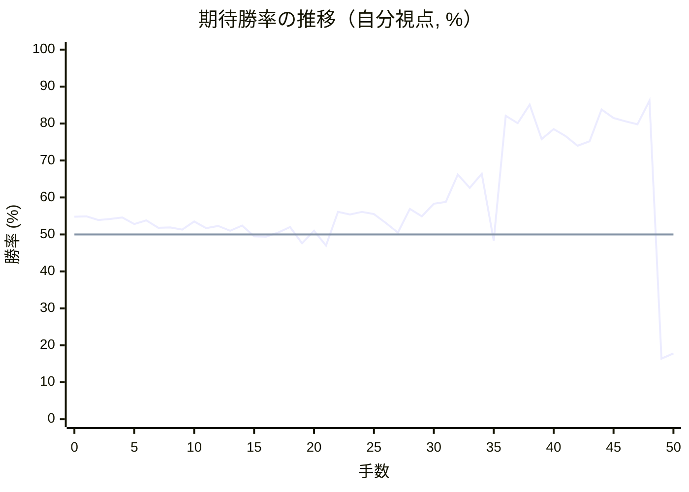
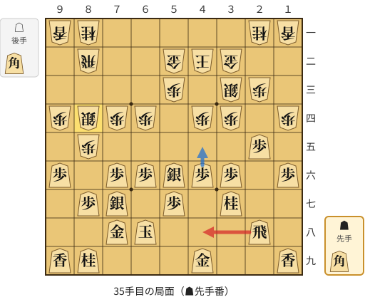
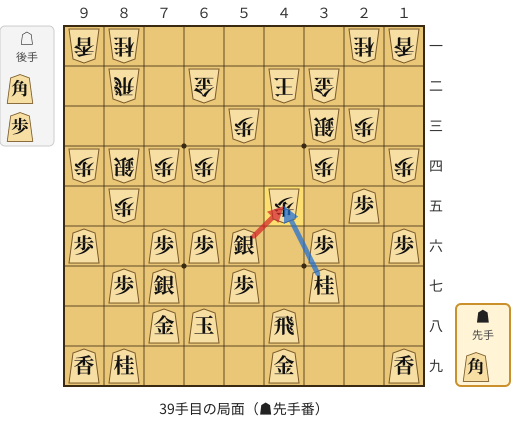
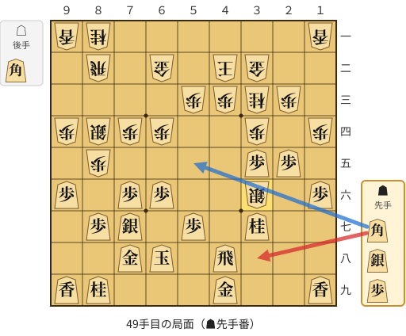

# 解析レポート 0z1pz9l4tmt6

[README に戻る](../../../README.md)　/　棋譜: [CSA](../../../data/csa/shogi5/0z1pz9l4tmt6.csa)　/　解析の見方: [docs/mistake_analysis.md](../../../docs/mistake_analysis.md)

## 対局情報

| 項目 | 内容 |
|---|---|
| 日時 | 2026-11-14 16:56:30 |
| 持ち時間 | 5分 |
| 自分 | 先手（▲）（1651） |
| 相手 | 相手（1661） |
| 結果 | 負け（投了, 50手） |

## 解析環境

| 項目 | 内容 |
|---|---|
| エンジン | YaneuraOu NNUE 9.00git 64AVX2（V9.00/YANEURAOU_ENGINE_NNUE/AVX2） |
| 評価関数 | **水匠5**（`suisho5`） |
| nn.bin SHA-256 | `768068f0d534a0603a5d38bcd143de6bbca820d5f1c95a14d40863e5b7892d76` |
| 第1パス | movetime=150ms, MultiPV 1 |
| 第2パス | movetime=2000ms, MultiPV 3 |
| Threads / Hash | 8 / 512MB |
| 判定基準 | 疑問手 ≥5pt, 悪手 ≥10pt, 大悪手 ≥20pt（期待勝率 W(E)=1/(1+exp(-E/600))） |
| 解析日時 | 2026-11-20T20:26:11+09:00（解析バージョン 1, 20秒） |

## サマリー

| 自分の手数 | 深掘りした手 | 詰み逃し | 大悪手 | 悪手 | 疑問手 |
|--:|--:|--:|--:|--:|--:|
| 25 | 3 | 0 | 1 | 1 | 1 |

## 期待勝率の推移



<details><summary>1手ごとの数値（第1パス）</summary>

| 手数 | 指し手 | 評価値 | 勝率 | 低下 | 判定 |
|--:|---|--:|--:|--:|---|
| 1 | ▲７六歩(77) | +117 | 54.9% | -0.0pt |  |
| 2 | △８四歩(83) | +94 | 53.9% |  |  |
| 3 | ▲２六歩(27) | +100 | 54.2% | -0.2pt |  |
| 4 | △８五歩(84) | +111 | 54.6% |  |  |
| 5 | ▲７七角(88) | +67 | 52.8% | +1.8pt |  |
| 6 | △３二金(41) | +91 | 53.8% |  |  |
| 7 | ▲２五歩(26) | +44 | 51.8% | +2.0pt |  |
| 8 | △３四歩(33) | +45 | 51.9% |  |  |
| 9 | ▲６八銀(79) | +31 | 51.3% | +0.6pt |  |
| 10 | △７七角成(22) | +84 | 53.5% |  |  |
| 11 | ▲同銀(68) | +40 | 51.7% | +1.8pt |  |
| 12 | △２二銀(31) | +55 | 52.3% |  |  |
| 13 | ▲７八金(69) | +24 | 51.0% | +1.3pt |  |
| 14 | △３三銀(22) | +57 | 52.4% |  |  |
| 15 | ▲４八銀(39) | -11 | 49.5% | +2.8pt |  |
| 16 | △６二銀(71) | -15 | 49.4% |  |  |
| 17 | ▲４六歩(47) | +12 | 50.5% | -1.1pt |  |
| 18 | △１四歩(13) | +47 | 52.0% |  |  |
| 19 | ▲６八玉(59) | -58 | 47.6% | +4.4pt |  |
| 20 | △４二玉(51) | +23 | 51.0% |  |  |
| 21 | ▲１六歩(17) | -72 | 47.0% | +4.0pt |  |
| 22 | △５二金(61) | +147 | 56.1% |  |  |
| 23 | ▲４七銀(48) | +130 | 55.4% | +0.7pt |  |
| 24 | △９四歩(93) | +147 | 56.1% |  |  |
| 25 | ▲９六歩(97) | +133 | 55.5% | +0.6pt |  |
| 26 | △７四歩(73) | +75 | 53.1% |  |  |
| 27 | ▲３六歩(37) | +12 | 50.5% | +2.6pt |  |
| 28 | △７三銀(62) | +167 | 56.9% |  |  |
| 29 | ▲６六歩(67) | +118 | 54.9% | +2.0pt |  |
| 30 | △４四歩(43) | +202 | 58.3% |  |  |
| 31 | ▲５六銀(47) | +214 | 58.8% | -0.5pt |  |
| 32 | △６四歩(63) | +404 | 66.2% |  |  |
| 33 | ▲３七桂(29) | +308 | 62.6% | +3.7pt |  |
| 34 | △８四銀(73) | +408 | 66.4% |  |  |
| 35 | ▲４八飛(28) | -40 | 48.3% | +18.0pt | [疑問手](#ply-35) |
| 36 | △６二金(52) | +915 | 82.1% |  |  |
| 37 | ▲４五歩(46) | +837 | 80.1% | +2.0pt |  |
| 38 | △同歩(44) | +1046 | 85.1% |  |  |
| 39 | ▲同銀(56) | +686 | 75.8% | +9.3pt | [悪手](#ply-39) |
| 40 | △４三歩打 | +777 | 78.5% |  |  |
| 41 | ▲４四歩打 | +710 | 76.6% | +1.9pt |  |
| 42 | △同歩(43) | +627 | 74.0% |  |  |
| 43 | ▲同銀(45) | +666 | 75.2% | -1.2pt |  |
| 44 | △４三歩打 | +986 | 83.8% |  |  |
| 45 | ▲３三銀成(44) | +891 | 81.5% | +2.3pt |  |
| 46 | △同桂(21) | +856 | 80.6% |  |  |
| 47 | ▲３五歩(36) | +823 | 79.8% | +0.9pt |  |
| 48 | △３六銀打 | +1098 | 86.2% |  |  |
| 49 | ▲３八角打 | -977 | 16.4% | +69.8pt | [大悪手](#ply-49) |
| 50 | △３七銀成(36) | -918 | 17.8% |  |  |

</details>

## 課題局面

<a id="ply-35"></a>
### 35手目 ▲４八飛(28) — 疑問手

| | 着手前 | 着手後 | 差 |
|---|--:|--:|--:|
| 期待勝率 | 66.3% | 56.8% | -9.5pt |
| 評価値 | +407 | +164 | |

着手前の局面:



🔴 実戦 ▲４八飛(28)　🔵 AI推奨 ▲４五歩(46)　🟨 直前の相手の指し手

<details><summary>テキストの盤面図（BOD・将棋ソフトに貼り付け可）</summary>

```text
後手の持駒：角
  ９ ８ ７ ６ ５ ４ ３ ２ １
+---------------------------+
|v香v桂 ・ ・ ・ ・ ・v桂v香|一
| ・v飛 ・ ・v金v玉v金 ・ ・|二
| ・ ・ ・ ・v歩 ・v銀v歩 ・|三
|v歩v銀v歩v歩 ・v歩v歩 ・v歩|四
| ・v歩 ・ ・ ・ ・ ・ 歩 ・|五
| 歩 ・ 歩 歩 銀 歩 歩 ・ 歩|六
| ・ 歩 銀 ・ 歩 ・ 桂 ・ ・|七
| ・ ・ 金 玉 ・ ・ ・ 飛 ・|八
| 香 桂 ・ ・ ・ 金 ・ ・ 香|九
+---------------------------+
先手の持駒：角
手数＝34　△８四銀　まで
```

</details>

| | 指し手 | 評価値 | 読み筋 |
|---|---|--:|---|
| 実戦 | ▲４八飛(28) | +164 | △３五歩(34) ▲同歩(36) △２七角打 ▲４五歩(46) △３六角成(27) ▲３八金(49) |
| AI 1位 | ▲４五歩(46) | +407 | ▲４五歩(46) △９五歩(94) ▲同歩(96) △３五歩(34) ▲同歩(36) △９五香(91) |
| AI 2位 | ▲３八金(49) | +233 | ▲３八金(49) △９五歩(94) ▲同歩(96) △同銀(84) ▲同香(99) △同香(91) |
| AI 3位 | ▲４八金(49) | +168 | ▲４八金(49) △９五歩(94) ▲同歩(96) △同銀(84) ▲同香(99) △同香(91) |

SFEN: `ln5nl/1r2gkg2/4p1sp1/pspp1pp1p/1p5P1/P1PPSPP1P/1PS1P1N2/2GK3R1/LN3G2L b Bb 35`

<a id="ply-39"></a>
### 39手目 ▲同銀(56) — 悪手

| | 着手前 | 着手後 | 差 |
|---|--:|--:|--:|
| 期待勝率 | 87.6% | 75.9% | -11.8pt |
| 評価値 | +1175 | +687 | |

着手前の局面:



🔴 実戦 ▲同銀(56)　🔵 AI推奨 ▲同桂(37)　🟨 直前の相手の指し手

<details><summary>テキストの盤面図（BOD・将棋ソフトに貼り付け可）</summary>

```text
後手の持駒：角　歩
  ９ ８ ７ ６ ５ ４ ３ ２ １
+---------------------------+
|v香v桂 ・ ・ ・ ・ ・v桂v香|一
| ・v飛 ・v金 ・v玉v金 ・ ・|二
| ・ ・ ・ ・v歩 ・v銀v歩 ・|三
|v歩v銀v歩v歩 ・ ・v歩 ・v歩|四
| ・v歩 ・ ・ ・v歩 ・ 歩 ・|五
| 歩 ・ 歩 歩 銀 ・ 歩 ・ 歩|六
| ・ 歩 銀 ・ 歩 ・ 桂 ・ ・|七
| ・ ・ 金 玉 ・ 飛 ・ ・ ・|八
| 香 桂 ・ ・ ・ 金 ・ ・ 香|九
+---------------------------+
先手の持駒：角
手数＝38　△４五同歩　まで
```

</details>

| | 指し手 | 評価値 | 読み筋 |
|---|---|--:|---|
| 実戦 | ▲同銀(56) | +687 | △５一玉(42) ▲４四歩打 △５二金(62) ▲３八金(49) △７三銀(84) ▲５六角打 |
| AI 1位 | ▲同桂(37) | +1175 | ▲同桂(37) △４四銀(33) ▲３三桂成(45) △同玉(42) ▲４五歩打 △３七角打 |
| AI 2位 | ▲１五歩(16) | +1046 | ▲１五歩(16) △５一玉(42) ▲１四歩(15) △４六歩(45) ▲１三歩成(14) △同香(11) |
| AI 3位 | ▲２四歩(25) | +968 | ▲２四歩(25) △同歩(23) ▲４五桂(37) △４四銀(33) ▲２二歩打 △３三桂(21) |

SFEN: `ln5nl/1r1g1kg2/4p1sp1/pspp2p1p/1p3p1P1/P1PPS1P1P/1PS1P1N2/2GK1R3/LN3G2L b Bbp 39`

<a id="ply-49"></a>
### 49手目 ▲３八角打 — 大悪手

| | 着手前 | 着手後 | 差 |
|---|--:|--:|--:|
| 期待勝率 | 86.0% | 19.4% | -66.7pt |
| 評価値 | +1091 | -856 | |

着手前の局面:



🔴 実戦 ▲３八角打　🔵 AI推奨 ▲５五角打　🟨 直前の相手の指し手

<details><summary>テキストの盤面図（BOD・将棋ソフトに貼り付け可）</summary>

```text
後手の持駒：角
  ９ ８ ７ ６ ５ ４ ３ ２ １
+---------------------------+
|v香v桂 ・ ・ ・ ・ ・ ・v香|一
| ・v飛 ・v金 ・v玉v金 ・ ・|二
| ・ ・ ・ ・v歩v歩v桂v歩 ・|三
|v歩v銀v歩v歩 ・ ・v歩 ・v歩|四
| ・v歩 ・ ・ ・ ・ 歩 歩 ・|五
| 歩 ・ 歩 歩 ・ ・v銀 ・ 歩|六
| ・ 歩 銀 ・ 歩 ・ 桂 ・ ・|七
| ・ ・ 金 玉 ・ 飛 ・ ・ ・|八
| 香 桂 ・ ・ ・ 金 ・ ・ 香|九
+---------------------------+
先手の持駒：角　銀　歩
手数＝48　△３六銀　まで
```

</details>

| | 指し手 | 評価値 | 読み筋 |
|---|---|--:|---|
| 実戦 | ▲３八角打 | -856 | △３七銀不成(36) ▲７一銀打 △３六角打 ▲７九玉(68) △８六歩(85) ▲８二銀不成(71) |
| AI 1位 | ▲５五角打 | +1091 | ▲５五角打 △１三角打 ▲３四歩(35) △３七銀成(36) ▲３三歩成(34) △同金(32) |
| AI 2位 | ▲４四歩打 | +1017 | ▲４四歩打 △同歩(43) ▲３四歩(35) △３七銀成(36) ▲４四飛(48) △４三歩打 |
| AI 3位 | ▲３八金(49) | +905 | ▲３八金(49) △２六角打 ▲４六角打 △４五桂(33) ▲同桂(37) △４八角成(26) |

SFEN: `ln6l/1r1g1kg2/4ppnp1/pspp2p1p/1p4PP1/P1PP2s1P/1PS1P1N2/2GK1R3/LN3G2L b BSPb 49`

