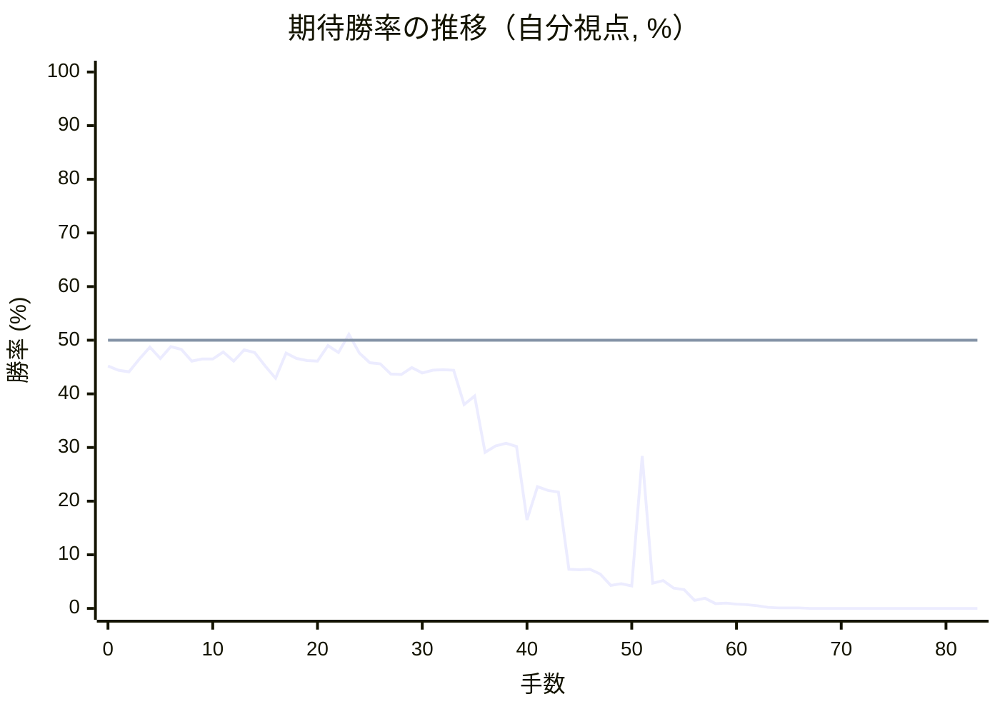

# 解析レポート 0zp9m3bb8ti1

[README に戻る](../../../README.md)　/　棋譜: [CSA](../../../data/csa/shogi5/0zp9m3bb8ti1.csa)　/　解析の見方: [docs/mistake_analysis.md](../../../docs/mistake_analysis.md)

## 対局情報

| 項目 | 内容 |
|---|---|
| 日時 | 2026-10-29 19:48:05 |
| 持ち時間 | 5分 |
| 自分 | 後手（△）（1740） |
| 相手 | 相手（1777） |
| 結果 | 負け（投了, 83手） |

## 解析環境

| 項目 | 内容 |
|---|---|
| エンジン | YaneuraOu NNUE 9.00git 64AVX2（V9.00/YANEURAOU_ENGINE_NNUE/AVX2） |
| 評価関数 | **水匠5**（`suisho5`） |
| nn.bin SHA-256 | `768068f0d534a0603a5d38bcd143de6bbca820d5f1c95a14d40863e5b7892d76` |
| 第1パス | movetime=150ms, MultiPV 1 |
| 第2パス | movetime=2000ms, MultiPV 3 |
| Threads / Hash | 8 / 512MB |
| 判定基準 | 疑問手 ≥5pt, 悪手 ≥10pt, 大悪手 ≥20pt（期待勝率 W(E)=1/(1+exp(-E/600))） |
| 解析日時 | 2026-11-03T04:17:26+09:00（解析バージョン 1, 32秒） |

## サマリー

| 自分の手数 | 深掘りした手 | 詰み逃し | 大悪手 | 悪手 | 疑問手 |
|--:|--:|--:|--:|--:|--:|
| 41 | 5 | 0 | 0 | 5 | 0 |

## 期待勝率の推移



<details><summary>1手ごとの数値（第1パス）</summary>

| 手数 | 指し手 | 評価値 | 勝率 | 低下 | 判定 |
|--:|---|--:|--:|--:|---|
| 1 | ▲７六歩(77) | -134 | 44.4% |  |  |
| 2 | △８四歩(83) | -143 | 44.1% | +0.4pt |  |
| 3 | ▲６八銀(79) | -85 | 46.5% |  |  |
| 4 | △３四歩(33) | -31 | 48.7% | -2.2pt |  |
| 5 | ▲７七銀(68) | -81 | 46.6% |  |  |
| 6 | △８五歩(84) | -28 | 48.8% | -2.2pt |  |
| 7 | ▲７八金(69) | -42 | 48.3% |  |  |
| 8 | △６二銀(71) | -94 | 46.1% | +2.2pt |  |
| 9 | ▲２六歩(27) | -83 | 46.5% |  |  |
| 10 | △４二銀(31) | -85 | 46.5% | +0.1pt |  |
| 11 | ▲２五歩(26) | -52 | 47.8% |  |  |
| 12 | △３三銀(42) | -94 | 46.1% | +1.7pt |  |
| 13 | ▲４八銀(39) | -44 | 48.2% |  |  |
| 14 | △５四歩(53) | -55 | 47.7% | +0.5pt |  |
| 15 | ▲６九玉(59) | -116 | 45.2% |  |  |
| 16 | △３二金(41) | -171 | 42.9% | +2.3pt |  |
| 17 | ▲５六歩(57) | -58 | 47.6% |  |  |
| 18 | △４一玉(51) | -82 | 46.6% | +1.0pt |  |
| 19 | ▲３六歩(37) | -91 | 46.2% |  |  |
| 20 | △７四歩(73) | -94 | 46.1% | +0.1pt |  |
| 21 | ▲４六歩(47) | -25 | 49.0% |  |  |
| 22 | △５二金(61) | -56 | 47.7% | +1.3pt |  |
| 23 | ▲４七銀(48) | +27 | 51.1% |  |  |
| 24 | △９四歩(93) | -57 | 47.6% | +3.5pt |  |
| 25 | ▲３七桂(29) | -102 | 45.8% |  |  |
| 26 | △３一角(22) | -105 | 45.6% | +0.1pt |  |
| 27 | ▲６六銀(77) | -152 | 43.7% |  |  |
| 28 | △８六歩(85) | -155 | 43.6% | +0.1pt |  |
| 29 | ▲同歩(87) | -122 | 44.9% |  |  |
| 30 | △同角(31) | -146 | 43.9% | +1.0pt |  |
| 31 | ▲８七歩打 | -135 | 44.4% |  |  |
| 32 | △４二角(86) | -132 | 44.5% | -0.1pt |  |
| 33 | ▲５八飛(28) | -135 | 44.4% |  |  |
| 34 | △４四歩(43) | -295 | 38.0% | +6.4pt | [悪手](#ply-34) |
| 35 | ▲４八金(49) | -254 | 39.6% |  |  |
| 36 | △３一玉(41) | -534 | 29.1% | +10.5pt | [悪手](#ply-36) |
| 37 | ▲５五歩(56) | -500 | 30.3% |  |  |
| 38 | △同歩(54) | -485 | 30.8% | -0.5pt |  |
| 39 | ▲同銀(66) | -504 | 30.2% |  |  |
| 40 | △７五歩(74) | -973 | 16.5% | +13.7pt | [悪手](#ply-40) |
| 41 | ▲４五歩(46) | -736 | 22.7% |  |  |
| 42 | △７六歩(75) | -760 | 22.0% | +0.7pt |  |
| 43 | ▲４四歩(45) | -770 | 21.7% |  |  |
| 44 | △７五角(42) | -1527 | 7.3% | +14.4pt | [悪手](#ply-44) |
| 45 | ▲６六銀(55) | -1536 | 7.2% |  |  |
| 46 | △５三角(75) | -1526 | 7.3% | -0.1pt |  |
| 47 | ▲４五桂(37) | -1608 | 6.4% |  |  |
| 48 | △４四銀(33) | -1868 | 4.3% | +2.2pt |  |
| 49 | ▲５三桂成(45) | -1818 | 4.6% |  |  |
| 50 | △同銀(62) | -1873 | 4.2% | +0.4pt |  |
| 51 | ▲５五銀(66) | -555 | 28.4% |  |  |
| 52 | △同銀(44) | -1810 | 4.7% | +23.7pt | [悪手](#ply-52) |
| 53 | ▲同角(88) | -1747 | 5.2% |  |  |
| 54 | △５七歩打 | -1942 | 3.8% | +1.4pt |  |
| 55 | ▲同飛(58) | -1987 | 3.5% |  |  |
| 56 | △８五飛(82) | -2511 | 1.5% | +2.0pt |  |
| 57 | ▲１一角成(55) | -2372 | 1.9% |  |  |
| 58 | △２二銀打 | -2814 | 0.9% | +1.0pt |  |
| 59 | ▲１二馬(11) | -2788 | 1.0% |  |  |
| 60 | △２五飛(85) | -2862 | 0.8% | +0.1pt |  |
| 61 | ▲５四歩打 | -2975 | 0.7% |  |  |
| 62 | △６四銀(53) | -3158 | 0.5% | +0.2pt |  |
| 63 | ▲５三銀打 | -3724 | 0.2% |  |  |
| 64 | △５一金(52) | -3936 | 0.1% | +0.1pt |  |
| 65 | ▲６四銀成(53) | -4024 | 0.1% |  |  |
| 66 | △同歩(63) | -4492 | 0.1% | +0.1pt |  |
| 67 | ▲５三歩成(54) | -4692 | 0.0% |  |  |
| 68 | △７七歩成(76) | -5123 | 0.0% | +0.0pt |  |
| 69 | ▲同桂(89) | -5358 | 0.0% |  |  |
| 70 | △７六歩打 | -6168 | 0.0% | +0.0pt |  |
| 71 | ▲４三銀打 | -6406 | 0.0% |  |  |
| 72 | △５五桂打 | #-9 | 0.0% | +0.0pt |  |
| 73 | ▲３二銀成(43) | #-8 | 0.0% |  |  |
| 74 | △同玉(31) | #-7 | 0.0% | +0.0pt |  |
| 75 | ▲５四角打 | -7713 | 0.0% |  |  |
| 76 | △３三玉(32) | #-23 | 0.0% | +0.0pt |  |
| 77 | ▲４三角成(54) | #-22 | 0.0% |  |  |
| 78 | △２四玉(33) | #-21 | 0.0% | +0.0pt |  |
| 79 | ▲２六歩打 | -7812 | 0.0% |  |  |
| 80 | △同飛(25) | #-7 | 0.0% | +0.0pt |  |
| 81 | ▲５五飛(57) | -7205 | 0.0% |  |  |
| 82 | △２九飛成(26) | -35281 | 0.0% | +0.0pt |  |
| 83 | ▲４九歩打 | -35281 | 0.0% |  |  |

</details>

## 課題局面

<a id="ply-34"></a>
### 34手目 △４四歩(43) — 悪手

| | 着手前 | 着手後 | 差 |
|---|--:|--:|--:|
| 期待勝率 | 44.7% | 30.8% | -13.9pt |
| 評価値 | -128 | -486 | |

着手前の局面:

```text
後手の持駒：歩
  ９ ８ ７ ６ ５ ４ ３ ２ １
+---------------------------+
|v香v桂 ・ ・ ・v玉 ・v桂v香|一
| ・v飛 ・v銀v金v角v金 ・ ・|二
| ・ ・ ・v歩 ・v歩v銀v歩v歩|三
|v歩 ・v歩 ・v歩 ・v歩 ・ ・|四
| ・ ・ ・ ・ ・ ・ ・ 歩 ・|五
| ・ ・ 歩 銀 歩 歩 歩 ・ ・|六
| 歩 歩 ・ 歩 ・ 銀 桂 ・ 歩|七
| ・ 角 金 ・ 飛 ・ ・ ・ ・|八
| 香 桂 ・ 玉 ・ 金 ・ ・ 香|九
+---------------------------+
先手の持駒：なし
後手番
手数＝33　▲５八飛　まで
```

| | 指し手 | 評価値 | 読み筋 |
|---|---|--:|---|
| 実戦 | △４四歩(43) | -486 | ▲５五歩(56) △同歩(54) ▲同銀(66) △７三桂(81) ▲４四銀(55) △６五桂(73) |
| AI 1位 | △７三桂(81) | -128 | △７三桂(81) ▲５五歩(56) △同歩(54) ▲同銀(66) △７五歩(74) ▲同歩(76) |
| AI 2位 | △８六歩打 | -205 | △８六歩打 ▲同歩(87) △７三桂(81) ▲５五歩(56) △同歩(54) ▲同銀(66) |
| AI 3位 | △６四歩(63) | -244 | △６四歩(63) ▲５五歩(56) △６五歩(64) ▲同銀(66) △７三桂(81) ▲７四銀(65) |

SFEN: `ln3k1nl/1r1sgbg2/3p1pspp/p1p1p1p2/7P1/2PSPPP2/PP1P1SN1P/1BG1R4/LN1K1G2L w p 34`

<a id="ply-36"></a>
### 36手目 △３一玉(41) — 悪手

| | 着手前 | 着手後 | 差 |
|---|--:|--:|--:|
| 期待勝率 | 40.1% | 28.2% | -11.9pt |
| 評価値 | -240 | -560 | |

着手前の局面:

```text
後手の持駒：歩
  ９ ８ ７ ６ ５ ４ ３ ２ １
+---------------------------+
|v香v桂 ・ ・ ・v玉 ・v桂v香|一
| ・v飛 ・v銀v金v角v金 ・ ・|二
| ・ ・ ・v歩 ・ ・v銀v歩v歩|三
|v歩 ・v歩 ・v歩v歩v歩 ・ ・|四
| ・ ・ ・ ・ ・ ・ ・ 歩 ・|五
| ・ ・ 歩 銀 歩 歩 歩 ・ ・|六
| 歩 歩 ・ 歩 ・ 銀 桂 ・ 歩|七
| ・ 角 金 ・ 飛 金 ・ ・ ・|八
| 香 桂 ・ 玉 ・ ・ ・ ・ 香|九
+---------------------------+
先手の持駒：なし
後手番
手数＝35　▲４八金　まで
```

| | 指し手 | 評価値 | 読み筋 |
|---|---|--:|---|
| 実戦 | △３一玉(41) | -560 | ▲５五歩(56) △５三銀(62) ▲５四歩(55) △６四銀(53) ▲４五歩(46) △７三桂(81) |
| AI 1位 | △７三桂(81) | -240 | △７三桂(81) ▲５五歩(56) △同歩(54) ▲同銀(66) △８六歩打 ▲同歩(87) |
| AI 2位 | △５三銀(62) | -254 | △５三銀(62) ▲５五歩(56) △同歩(54) ▲２四歩(25) △同歩(23) ▲４五歩(46) |
| AI 3位 | △４三金(52) | -310 | △４三金(52) ▲５五歩(56) △５三銀(62) ▲５四歩(55) △同金(43) ▲４五歩(46) |

SFEN: `ln3k1nl/1r1sgbg2/3p2spp/p1p1ppp2/7P1/2PSPPP2/PP1P1SN1P/1BG1RG3/LN1K4L w p 36`

<a id="ply-40"></a>
### 40手目 △７五歩(74) — 悪手

| | 着手前 | 着手後 | 差 |
|---|--:|--:|--:|
| 期待勝率 | 29.4% | 11.6% | -17.8pt |
| 評価値 | -527 | -1221 | |

着手前の局面:

```text
後手の持駒：歩二
  ９ ８ ７ ６ ５ ４ ３ ２ １
+---------------------------+
|v香v桂 ・ ・ ・ ・v玉v桂v香|一
| ・v飛 ・v銀v金v角v金 ・ ・|二
| ・ ・ ・v歩 ・ ・v銀v歩v歩|三
|v歩 ・v歩 ・ ・v歩v歩 ・ ・|四
| ・ ・ ・ ・ 銀 ・ ・ 歩 ・|五
| ・ ・ 歩 ・ ・ 歩 歩 ・ ・|六
| 歩 歩 ・ 歩 ・ 銀 桂 ・ 歩|七
| ・ 角 金 ・ 飛 金 ・ ・ ・|八
| 香 桂 ・ 玉 ・ ・ ・ ・ 香|九
+---------------------------+
先手の持駒：歩
後手番
手数＝39　▲５五同銀　まで
```

| | 指し手 | 評価値 | 読み筋 |
|---|---|--:|---|
| 実戦 | △７五歩(74) | -1221 | ▲３五歩(36) △５六歩打 ▲３四歩(35) △同銀(33) ▲５六飛(58) △８六歩打 |
| AI 1位 | △７三桂(81) | -527 | △７三桂(81) ▲４五歩(46) △５四歩打 ▲４四銀(55) △８六歩打 ▲同歩(87) |
| AI 2位 | △５三銀(62) | -696 | △５三銀(62) ▲５四歩打 △６四銀(53) ▲４四銀(55) △５七歩打 ▲同飛(58) |
| AI 3位 | △５四歩打 | -815 | △５四歩打 ▲４四銀(55) △５三銀(62) ▲３三銀成(44) △同桂(21) ▲３五歩(36) |

SFEN: `ln4knl/1r1sgbg2/3p2spp/p1p2pp2/4S2P1/2P2PP2/PP1P1SN1P/1BG1RG3/LN1K4L w P2p 40`

<a id="ply-44"></a>
### 44手目 △７五角(42) — 悪手

| | 着手前 | 着手後 | 差 |
|---|--:|--:|--:|
| 期待勝率 | 18.7% | 6.6% | -12.1pt |
| 評価値 | -880 | -1588 | |

着手前の局面:

```text
後手の持駒：歩三
  ９ ８ ７ ６ ５ ４ ３ ２ １
+---------------------------+
|v香v桂 ・ ・ ・ ・v玉v桂v香|一
| ・v飛 ・v銀v金v角v金 ・ ・|二
| ・ ・ ・v歩 ・ ・v銀v歩v歩|三
|v歩 ・ ・ ・ ・ 歩v歩 ・ ・|四
| ・ ・ ・ ・ 銀 ・ ・ 歩 ・|五
| ・ ・v歩 ・ ・ ・ 歩 ・ ・|六
| 歩 歩 ・ 歩 ・ 銀 桂 ・ 歩|七
| ・ 角 金 ・ 飛 金 ・ ・ ・|八
| 香 桂 ・ 玉 ・ ・ ・ ・ 香|九
+---------------------------+
先手の持駒：歩二
後手番
手数＝43　▲４四歩　まで
```

| | 指し手 | 評価値 | 読み筋 |
|---|---|--:|---|
| 実戦 | △７五角(42) | -1588 | ▲６六銀(55) △５三角(75) ▲４五桂(37) △５四歩打 ▲同飛(58) △６四歩(63) |
| AI 1位 | △７三桂(81) | -880 | △７三桂(81) ▲２四歩(25) △同歩(23) ▲５六飛(58) △８六歩打 ▲同歩(87) |
| AI 2位 | △５七歩打 | -885 | △５七歩打 ▲同飛(58) △８六歩打 ▲同歩(87) △同角(42) ▲８四歩打 |
| AI 3位 | △８六歩打 | -1064 | △８六歩打 ▲同歩(87) △同角(42) ▲８七歩打 △７七歩成(76) ▲同桂(89) |

SFEN: `ln4knl/1r1sgbg2/3p2spp/p4Pp2/4S2P1/2p3P2/PP1P1SN1P/1BG1RG3/LN1K4L w 2P3p 44`

<a id="ply-52"></a>
### 52手目 △同銀(44) — 悪手

| | 着手前 | 着手後 | 差 |
|---|--:|--:|--:|
| 期待勝率 | 22.4% | 3.8% | -18.6pt |
| 評価値 | -745 | -1942 | |

着手前の局面:

```text
後手の持駒：桂　歩四
  ９ ８ ７ ６ ５ ４ ３ ２ １
+---------------------------+
|v香v桂 ・ ・ ・ ・v玉v桂v香|一
| ・v飛 ・ ・v金 ・v金 ・ ・|二
| ・ ・ ・v歩v銀 ・ ・v歩v歩|三
|v歩 ・ ・ ・ ・v銀v歩 ・ ・|四
| ・ ・ ・ ・ 銀 ・ ・ 歩 ・|五
| ・ ・v歩 ・ ・ ・ 歩 ・ ・|六
| 歩 歩 ・ 歩 ・ 銀 ・ ・ 歩|七
| ・ 角 金 ・ 飛 金 ・ ・ ・|八
| 香 桂 ・ 玉 ・ ・ ・ ・ 香|九
+---------------------------+
先手の持駒：角　歩二
後手番
手数＝51　▲５五銀　まで
```

| | 指し手 | 評価値 | 読み筋 |
|---|---|--:|---|
| 実戦 | △同銀(44) | -1942 | ▲同角(88) △５七歩打 ▲同飛(58) △６四桂打 ▲１一角成(55) △７七銀打 |
| AI 1位 | △７七桂打 | -745 | △７七桂打 ▲同桂(89) △５七歩打 ▲同飛(58) △７七歩成(76) ▲同角(88) |
| AI 2位 | △５七歩打 | -751 | △５七歩打 ▲同飛(58) △７七桂打 ▲同桂(89) △同歩成(76) ▲同角(88) |
| AI 3位 | △７七歩成(76) | -881 | △７七歩成(76) ▲同角(88) △５七歩打 ▲同飛(58) △６五桂打 ▲４四銀(55) |

SFEN: `ln4knl/1r2g1g2/3ps2pp/p4sp2/4S2P1/2p3P2/PP1P1S2P/1BG1RG3/LN1K4L w B2Pn4p 52`

