# 解析レポート 1a8xq8ahv3rz

[README に戻る](../../../README.md)　/　棋譜: [CSA](../../../data/csa/shogi5/1a8xq8ahv3rz.csa)　/　解析の見方: [docs/mistake_analysis.md](../../../docs/mistake_analysis.md)

## 対局情報

| 項目 | 内容 |
|---|---|
| 日時 | 2026-11-14 16:51:21 |
| 持ち時間 | 5分 |
| 自分 | 後手（△）（1646） |
| 相手 | 相手（1569） |
| 結果 | 勝ち（時間切れ, 74手） |

## 解析環境

| 項目 | 内容 |
|---|---|
| エンジン | YaneuraOu NNUE 9.00git 64AVX2（V9.00/YANEURAOU_ENGINE_NNUE/AVX2） |
| 評価関数 | **水匠5**（`suisho5`） |
| nn.bin SHA-256 | `768068f0d534a0603a5d38bcd143de6bbca820d5f1c95a14d40863e5b7892d76` |
| 第1パス | movetime=150ms, MultiPV 1 |
| 第2パス | movetime=2000ms, MultiPV 3 |
| Threads / Hash | 8 / 512MB |
| 判定基準 | 疑問手 ≥5pt, 悪手 ≥10pt, 大悪手 ≥20pt（期待勝率 W(E)=1/(1+exp(-E/600))） |
| 解析日時 | 2026-11-20T20:27:19+09:00（解析バージョン 1, 68秒） |

## サマリー

| 自分の手数 | 深掘りした手 | 詰み逃し | 大悪手 | 悪手 | 疑問手 |
|--:|--:|--:|--:|--:|--:|
| 37 | 14 | 0 | 4 | 6 | 3 |

## 期待勝率の推移

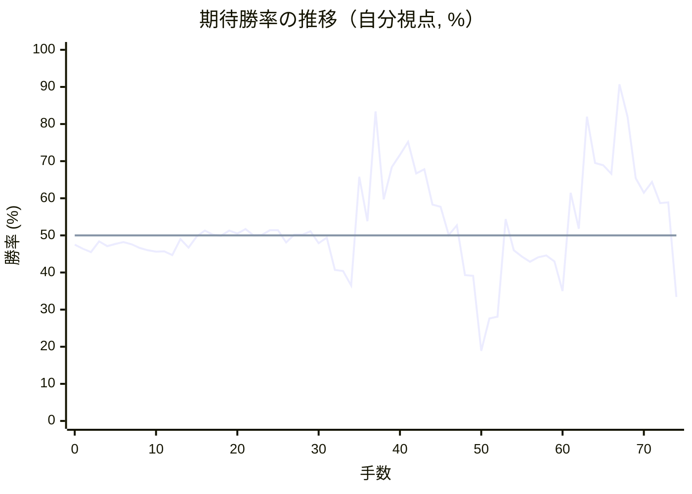

<details><summary>1手ごとの数値（第1パス）</summary>

| 手数 | 指し手 | 評価値 | 勝率 | 低下 | 判定 |
|--:|---|--:|--:|--:|---|
| 1 | ▲２六歩(27) | -87 | 46.4% |  |  |
| 2 | △８四歩(83) | -108 | 45.5% | +0.9pt |  |
| 3 | ▲２五歩(26) | -38 | 48.4% |  |  |
| 4 | △８五歩(84) | -70 | 47.1% | +1.3pt |  |
| 5 | ▲７八金(69) | -55 | 47.7% |  |  |
| 6 | △３二金(41) | -44 | 48.2% | -0.5pt |  |
| 7 | ▲３八銀(39) | -58 | 47.6% |  |  |
| 8 | △８六歩(85) | -82 | 46.6% | +1.0pt |  |
| 9 | ▲同歩(87) | -96 | 46.0% |  |  |
| 10 | △同飛(82) | -107 | 45.6% | +0.5pt |  |
| 11 | ▲８七歩打 | -103 | 45.7% |  |  |
| 12 | △８四飛(86) | -127 | 44.7% | +1.0pt |  |
| 13 | ▲５八玉(59) | -25 | 49.0% |  |  |
| 14 | △５二玉(51) | -80 | 46.7% | +2.3pt |  |
| 15 | ▲１六歩(17) | -7 | 49.7% |  |  |
| 16 | △１四歩(13) | +31 | 51.3% | -1.6pt |  |
| 17 | ▲９六歩(97) | +5 | 50.2% |  |  |
| 18 | △７二銀(71) | -2 | 49.9% | +0.3pt |  |
| 19 | ▲３六歩(37) | +31 | 51.3% |  |  |
| 20 | △３四歩(33) | +11 | 50.5% | +0.8pt |  |
| 21 | ▲２四歩(25) | +41 | 51.7% |  |  |
| 22 | △同歩(23) | +1 | 50.0% | +1.7pt |  |
| 23 | ▲同飛(28) | +3 | 50.1% |  |  |
| 24 | △２三歩打 | +34 | 51.4% | -1.3pt |  |
| 25 | ▲２六飛(24) | +34 | 51.4% |  |  |
| 26 | △９四歩(93) | -46 | 48.1% | +3.3pt |  |
| 27 | ▲３七桂(29) | +6 | 50.2% |  |  |
| 28 | △４四角(22) | +4 | 50.2% | +0.1pt |  |
| 29 | ▲２九飛(26) | +27 | 51.1% |  |  |
| 30 | △２二銀(31) | -51 | 47.9% | +3.2pt |  |
| 31 | ▲７六歩(77) | -14 | 49.4% |  |  |
| 32 | △９五歩(94) | -226 | 40.7% | +8.7pt | [悪手](#ply-32) |
| 33 | ▲同歩(96) | -234 | 40.4% |  |  |
| 34 | △３五歩(34) | -331 | 36.5% | +3.8pt |  |
| 35 | ▲２四歩打 | +392 | 65.8% |  |  |
| 36 | △同歩(23) | +91 | 53.8% | +12.0pt | [疑問手](#ply-36) |
| 37 | ▲１五歩(16) | +967 | 83.4% |  |  |
| 38 | △同歩(14) | +237 | 59.7% | +23.6pt | [悪手](#ply-38) |
| 39 | ▲１二歩打 | +462 | 68.4% |  |  |
| 40 | △同香(11) | +557 | 71.7% | -3.3pt |  |
| 41 | ▲４五桂(37) | +667 | 75.2% |  |  |
| 42 | △９八歩打 | +417 | 66.7% | +8.5pt | [疑問手](#ply-42) |
| 43 | ▲同香(99) | +446 | 67.8% |  |  |
| 44 | △９七歩打 | +201 | 58.3% | +9.5pt | [悪手](#ply-44) |
| 45 | ▲同香(98) | +186 | 57.7% |  |  |
| 46 | △９六歩打 | +3 | 50.1% | +7.6pt | [大悪手](#ply-46) |
| 47 | ▲同香(97) | +66 | 52.7% |  |  |
| 48 | △８六歩打 | -262 | 39.3% | +13.5pt | [悪手](#ply-48) |
| 49 | ▲同歩(87) | -267 | 39.1% |  |  |
| 50 | △同飛(84) | -874 | 18.9% | +20.2pt | [悪手](#ply-50) |
| 51 | ▲４四角(88) | -580 | 27.6% |  |  |
| 52 | △同歩(43) | -564 | 28.1% | -0.5pt |  |
| 53 | ▲８七歩打 | +105 | 54.4% |  |  |
| 54 | △９六飛(86) | -96 | 46.0% | +8.4pt |  |
| 55 | ▲３四角打 | -137 | 44.3% |  |  |
| 56 | △６二玉(52) | -172 | 42.9% | +1.4pt |  |
| 57 | ▲５三桂成(45) | -143 | 44.1% |  |  |
| 58 | △同玉(62) | -131 | 44.6% | -0.5pt |  |
| 59 | ▲１二角成(34) | -170 | 43.0% |  |  |
| 60 | △３一金(32) | -371 | 35.0% | +7.9pt | [悪手](#ply-60) |
| 61 | ▲７七桂(89) | +282 | 61.5% |  |  |
| 62 | △９八飛成(96) | +43 | 51.8% | +9.7pt |  |
| 63 | ▲８八銀(79) | +911 | 82.0% |  |  |
| 64 | △９五龍(98) | +495 | 69.5% | +12.5pt | [大悪手](#ply-64) |
| 65 | ▲９六歩打 | +476 | 68.9% |  |  |
| 66 | △同龍(95) | +413 | 66.6% | +2.3pt |  |
| 67 | ▲３四馬(12) | +1370 | 90.7% |  |  |
| 68 | △６二玉(53) | +904 | 81.9% | +8.9pt | [大悪手](#ply-68) |
| 69 | ▲９七香打 | +383 | 65.4% |  |  |
| 70 | △７六龍(96) | +281 | 61.5% | +3.9pt |  |
| 71 | ▲９一香成(97) | +355 | 64.4% |  |  |
| 72 | △３三銀(22) | +211 | 58.7% | +5.7pt | [疑問手](#ply-72) |
| 73 | ▲４三馬(34) | +215 | 58.9% |  |  |
| 74 | △７四龍(76) | -415 | 33.4% | +25.5pt | [大悪手](#ply-74) |

</details>

## 課題局面

<a id="ply-32"></a>
### 32手目 △９五歩(94) — 悪手

| | 着手前 | 着手後 | 差 |
|---|--:|--:|--:|
| 期待勝率 | 55.6% | 41.0% | -14.6pt |
| 評価値 | +135 | -218 | |

着手前の局面:

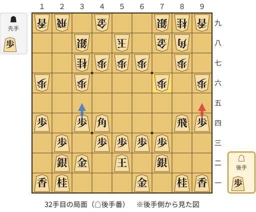

🔴 実戦 △９五歩(94)　🔵 AI推奨 △３五歩(34)　🟨 直前の相手の指し手

<details><summary>テキストの盤面図（BOD・将棋ソフトに貼り付け可）</summary>

```text
後手の持駒：歩
  ９ ８ ７ ６ ５ ４ ３ ２ １
+---------------------------+
|v香v桂 ・v金 ・ ・ ・v桂v香|一
| ・ ・v銀 ・v玉 ・v金v銀 ・|二
| ・ ・v歩v歩v歩v歩 ・v歩 ・|三
|v歩v飛 ・ ・ ・v角v歩 ・v歩|四
| ・ ・ ・ ・ ・ ・ ・ ・ ・|五
| 歩 ・ 歩 ・ ・ ・ 歩 ・ 歩|六
| ・ 歩 ・ 歩 歩 歩 桂 ・ ・|七
| ・ 角 金 ・ 玉 ・ 銀 ・ ・|八
| 香 桂 銀 ・ ・ 金 ・ 飛 香|九
+---------------------------+
先手の持駒：歩
後手番
手数＝31　▲７六歩　まで
```

</details>

| | 指し手 | 評価値 | 読み筋 |
|---|---|--:|---|
| 実戦 | △９五歩(94) | -218 | ▲同歩(96) △３五歩(34) ▲２六飛(29) △８八角成(44) ▲同銀(79) △２四飛(84) |
| AI 1位 | △３五歩(34) | +135 | △３五歩(34) ▲２六飛(29) △８八角成(44) ▲同銀(79) △２四飛(84) ▲２五歩打 |
| AI 2位 | △８八角成(44) | +83 | △８八角成(44) ▲同銀(79) △３五歩(34) ▲２六飛(29) △２四飛(84) ▲２五歩打 |
| AI 3位 | △４二玉(52) | -98 | △４二玉(52) ▲４四角(88) △同歩(43) ▲４六歩(47) △３五歩(34) ▲２六飛(29) |

SFEN: `ln1g3nl/2s1k1gs1/2pppp1p1/pr3bp1p/9/P1P3P1P/1P1PPPN2/1BG1K1S2/LNS2G1RL w Pp 32`

<a id="ply-36"></a>
### 36手目 △同歩(23) — 疑問手

| | 着手前 | 着手後 | 差 |
|---|--:|--:|--:|
| 期待勝率 | 65.0% | 55.1% | -9.9pt |
| 評価値 | +372 | +123 | |

着手前の局面:

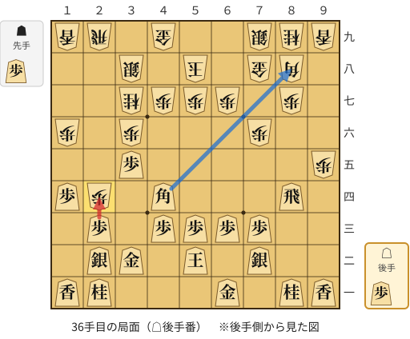

🔴 実戦 △同歩(23)　🔵 AI推奨 △８八角成(44)　🟨 直前の相手の指し手

<details><summary>テキストの盤面図（BOD・将棋ソフトに貼り付け可）</summary>

```text
後手の持駒：歩
  ９ ８ ７ ６ ５ ４ ３ ２ １
+---------------------------+
|v香v桂 ・v金 ・ ・ ・v桂v香|一
| ・ ・v銀 ・v玉 ・v金v銀 ・|二
| ・ ・v歩v歩v歩v歩 ・v歩 ・|三
| ・v飛 ・ ・ ・v角 ・ 歩v歩|四
| 歩 ・ ・ ・ ・ ・v歩 ・ ・|五
| ・ ・ 歩 ・ ・ ・ 歩 ・ 歩|六
| ・ 歩 ・ 歩 歩 歩 桂 ・ ・|七
| ・ 角 金 ・ 玉 ・ 銀 ・ ・|八
| 香 桂 銀 ・ ・ 金 ・ 飛 香|九
+---------------------------+
先手の持駒：歩
後手番
手数＝35　▲２四歩　まで
```

</details>

| | 指し手 | 評価値 | 読み筋 |
|---|---|--:|---|
| 実戦 | △同歩(23) | +123 | ▲２六飛(29) △２五歩(24) ▲同飛(26) △３六歩(35) ▲４五桂(37) △８八角成(44) |
| AI 1位 | △８八角成(44) | +372 | △８八角成(44) ▲同銀(79) △３六歩(35) ▲４五桂(37) △２四歩(23) ▲７五角打 |
| AI 2位 | △３六歩(35) | +361 | △３六歩(35) ▲４五桂(37) △８八角成(44) ▲同銀(79) △２四歩(23) ▲７五角打 |
| AI 3位 | △９八歩打 | +178 | △９八歩打 ▲２三歩成(24) △同銀(22) ▲２四歩打 △１二銀(23) ▲９八香(99) |

SFEN: `ln1g3nl/2s1k1gs1/2pppp1p1/1r3b1Pp/P5p2/2P3P1P/1P1PPPN2/1BG1K1S2/LNS2G1RL w Pp 36`

<a id="ply-38"></a>
### 38手目 △同歩(14) — 悪手

| | 着手前 | 着手後 | 差 |
|---|--:|--:|--:|
| 期待勝率 | 82.6% | 64.2% | -18.4pt |
| 評価値 | +935 | +351 | |

着手前の局面:

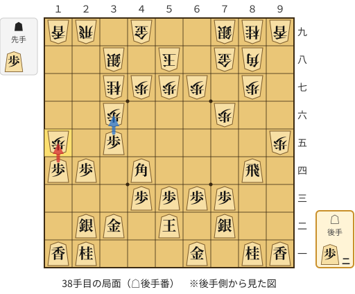

🔴 実戦 △同歩(14)　🔵 AI推奨 △３六歩(35)　🟨 直前の相手の指し手

<details><summary>テキストの盤面図（BOD・将棋ソフトに貼り付け可）</summary>

```text
後手の持駒：歩二
  ９ ８ ７ ６ ５ ４ ３ ２ １
+---------------------------+
|v香v桂 ・v金 ・ ・ ・v桂v香|一
| ・ ・v銀 ・v玉 ・v金v銀 ・|二
| ・ ・v歩v歩v歩v歩 ・ ・ ・|三
| ・v飛 ・ ・ ・v角 ・v歩v歩|四
| 歩 ・ ・ ・ ・ ・v歩 ・ 歩|五
| ・ ・ 歩 ・ ・ ・ 歩 ・ ・|六
| ・ 歩 ・ 歩 歩 歩 桂 ・ ・|七
| ・ 角 金 ・ 玉 ・ 銀 ・ ・|八
| 香 桂 銀 ・ ・ 金 ・ 飛 香|九
+---------------------------+
先手の持駒：歩
後手番
手数＝37　▲１五歩　まで
```

</details>

| | 指し手 | 評価値 | 読み筋 |
|---|---|--:|---|
| 実戦 | △同歩(14) | +351 | ▲２四飛(29) △８八角成(44) ▲８四飛(24) △９九馬(88) ▲２三歩打 △同銀(22) |
| AI 1位 | △３六歩(35) | +935 | △３六歩(35) ▲４五桂(37) △３三桂(21) ▲２三歩打 △同金(32) ▲３三桂成(45) |
| AI 2位 | △８八角成(44) | +868 | △８八角成(44) ▲同銀(79) △３六歩(35) ▲４五桂(37) △４四飛(84) ▲４六歩(47) |
| AI 3位 | △９八歩打 | +678 | △９八歩打 ▲同香(99) △３六歩(35) ▲４五桂(37) △８八角成(44) ▲同銀(79) |

SFEN: `ln1g3nl/2s1k1gs1/2pppp3/1r3b1pp/P5p1P/2P3P2/1P1PPPN2/1BG1K1S2/LNS2G1RL w P2p 38`

<a id="ply-42"></a>
### 42手目 △９八歩打 — 疑問手

| | 着手前 | 着手後 | 差 |
|---|--:|--:|--:|
| 期待勝率 | 79.2% | 71.8% | -7.3pt |
| 評価値 | +801 | +562 | |

着手前の局面:

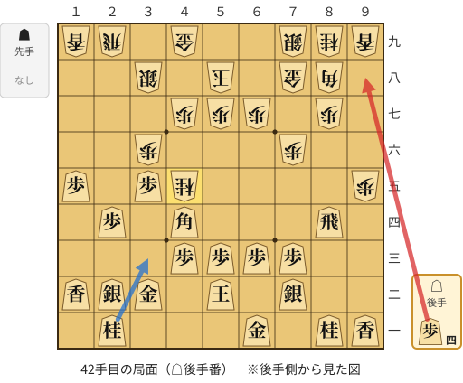

🔴 実戦 △９八歩打　🔵 AI推奨 △３三桂(21)　🟨 直前の相手の指し手

<details><summary>テキストの盤面図（BOD・将棋ソフトに貼り付け可）</summary>

```text
後手の持駒：歩四
  ９ ８ ７ ６ ５ ４ ３ ２ １
+---------------------------+
|v香v桂 ・v金 ・ ・ ・v桂 ・|一
| ・ ・v銀 ・v玉 ・v金v銀v香|二
| ・ ・v歩v歩v歩v歩 ・ ・ ・|三
| ・v飛 ・ ・ ・v角 ・v歩 ・|四
| 歩 ・ ・ ・ ・ 桂v歩 ・v歩|五
| ・ ・ 歩 ・ ・ ・ 歩 ・ ・|六
| ・ 歩 ・ 歩 歩 歩 ・ ・ ・|七
| ・ 角 金 ・ 玉 ・ 銀 ・ ・|八
| 香 桂 銀 ・ ・ 金 ・ 飛 香|九
+---------------------------+
先手の持駒：なし
後手番
手数＝41　▲４五桂　まで
```

</details>

| | 指し手 | 評価値 | 読み筋 |
|---|---|--:|---|
| 実戦 | △９八歩打 | +562 | ▲２四飛(29) △９九歩成(98) ▲同角(88) △６二玉(52) ▲４四角(99) △同飛(84) |
| AI 1位 | △３三桂(21) | +801 | △３三桂(21) ▲同桂不成(45) △同銀(22) ▲４四角(88) △同飛(84) ▲５六角打 |
| AI 2位 | △８八角成(44) | +771 | △８八角成(44) ▲同銀(79) △４四飛(84) ▲４六歩(47) △３六歩(35) ▲５六角打 |
| AI 3位 | △２三銀(22) | +600 | △２三銀(22) ▲３五歩(36) △８八角成(44) ▲同銀(79) △４四歩(43) ▲２二歩打 |

SFEN: `ln1g3n1/2s1k1gsl/2pppp3/1r3b1p1/P4Np1p/2P3P2/1P1PPP3/1BG1K1S2/LNS2G1RL w 4p 42`

<a id="ply-44"></a>
### 44手目 △９七歩打 — 悪手

| | 着手前 | 着手後 | 差 |
|---|--:|--:|--:|
| 期待勝率 | 75.3% | 63.3% | -11.9pt |
| 評価値 | +668 | +328 | |

着手前の局面:

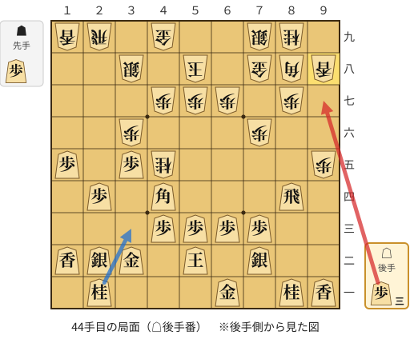

🔴 実戦 △９七歩打　🔵 AI推奨 △３三桂(21)　🟨 直前の相手の指し手

<details><summary>テキストの盤面図（BOD・将棋ソフトに貼り付け可）</summary>

```text
後手の持駒：歩三
  ９ ８ ７ ６ ５ ４ ３ ２ １
+---------------------------+
|v香v桂 ・v金 ・ ・ ・v桂 ・|一
| ・ ・v銀 ・v玉 ・v金v銀v香|二
| ・ ・v歩v歩v歩v歩 ・ ・ ・|三
| ・v飛 ・ ・ ・v角 ・v歩 ・|四
| 歩 ・ ・ ・ ・ 桂v歩 ・v歩|五
| ・ ・ 歩 ・ ・ ・ 歩 ・ ・|六
| ・ 歩 ・ 歩 歩 歩 ・ ・ ・|七
| 香 角 金 ・ 玉 ・ 銀 ・ ・|八
| ・ 桂 銀 ・ ・ 金 ・ 飛 香|九
+---------------------------+
先手の持駒：歩
後手番
手数＝43　▲９八同香　まで
```

</details>

| | 指し手 | 評価値 | 読み筋 |
|---|---|--:|---|
| 実戦 | △９七歩打 | +328 | ▲同香(98) △３三桂(21) ▲同桂不成(45) △同銀(22) ▲３五歩(36) △８八角成(44) |
| AI 1位 | △３三桂(21) | +668 | △３三桂(21) ▲同桂不成(45) △同銀(22) ▲２五歩打 △８八角成(44) ▲同銀(79) |
| AI 2位 | △８八角成(44) | +628 | △８八角成(44) ▲同銀(79) △３三桂(21) ▲同桂成(45) △同銀(22) ▲５六角打 |
| AI 3位 | △７四飛(84) | +357 | △７四飛(84) ▲７七桂(89) △３三桂(21) ▲同桂不成(45) △同金(32) ▲６五桂(77) |

SFEN: `ln1g3n1/2s1k1gsl/2pppp3/1r3b1p1/P4Np1p/2P3P2/1P1PPP3/LBG1K1S2/1NS2G1RL w P3p 44`

<a id="ply-46"></a>
### 46手目 △９六歩打 — 大悪手

| | 着手前 | 着手後 | 差 |
|---|--:|--:|--:|
| 期待勝率 | 65.8% | 41.1% | -24.6pt |
| 評価値 | +392 | -215 | |

着手前の局面:


🔴 実戦 △９六歩打　🔵 AI推奨 △３三桂(21)　🟨 直前の相手の指し手

<details><summary>テキストの盤面図（BOD・将棋ソフトに貼り付け可）</summary>

```text
後手の持駒：歩二
  ９ ８ ７ ６ ５ ４ ３ ２ １
+---------------------------+
|v香v桂 ・v金 ・ ・ ・v桂 ・|一
| ・ ・v銀 ・v玉 ・v金v銀v香|二
| ・ ・v歩v歩v歩v歩 ・ ・ ・|三
| ・v飛 ・ ・ ・v角 ・v歩 ・|四
| 歩 ・ ・ ・ ・ 桂v歩 ・v歩|五
| ・ ・ 歩 ・ ・ ・ 歩 ・ ・|六
| 香 歩 ・ 歩 歩 歩 ・ ・ ・|七
| ・ 角 金 ・ 玉 ・ 銀 ・ ・|八
| ・ 桂 銀 ・ ・ 金 ・ 飛 香|九
+---------------------------+
先手の持駒：歩二
後手番
手数＝45　▲９七同香　まで
```

</details>

| | 指し手 | 評価値 | 読み筋 |
|---|---|--:|---|
| 実戦 | △９六歩打 | -215 | ▲２四飛(29) △６二玉(52) ▲９六香(97) △３六歩(35) ▲３四飛(24) △２三銀(22) |
| AI 1位 | △３三桂(21) | +392 | △３三桂(21) ▲同桂不成(45) △同銀(22) ▲４四角(88) △同飛(84) ▲５六角打 |
| AI 2位 | △８八角成(44) | +281 | △８八角成(44) ▲同銀(79) △３六歩(35) ▲７五角打 △５四飛(84) ▲２六飛(29) |
| AI 3位 | △６四飛(84) | +145 | △６四飛(84) ▲３五歩(36) △６二玉(52) ▲９四歩(95) △８八角成(44) ▲同銀(79) |

SFEN: `ln1g3n1/2s1k1gsl/2pppp3/1r3b1p1/P4Np1p/2P3P2/LP1PPP3/1BG1K1S2/1NS2G1RL w 2P2p 46`

<a id="ply-48"></a>
### 48手目 △８六歩打 — 悪手

| | 着手前 | 着手後 | 差 |
|---|--:|--:|--:|
| 期待勝率 | 53.0% | 38.5% | -14.5pt |
| 評価値 | +73 | -280 | |

着手前の局面:

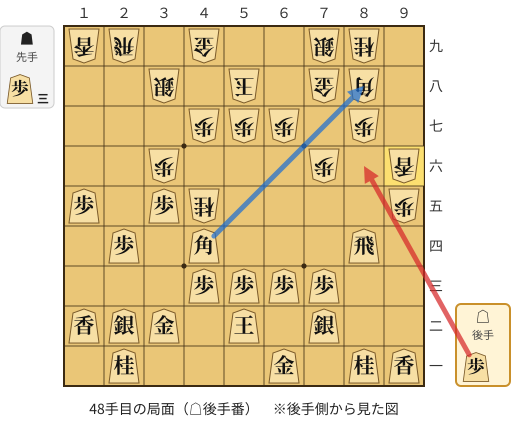

🔴 実戦 △８六歩打　🔵 AI推奨 △８八角成(44)　🟨 直前の相手の指し手

<details><summary>テキストの盤面図（BOD・将棋ソフトに貼り付け可）</summary>

```text
後手の持駒：歩
  ９ ８ ７ ６ ５ ４ ３ ２ １
+---------------------------+
|v香v桂 ・v金 ・ ・ ・v桂 ・|一
| ・ ・v銀 ・v玉 ・v金v銀v香|二
| ・ ・v歩v歩v歩v歩 ・ ・ ・|三
| ・v飛 ・ ・ ・v角 ・v歩 ・|四
| 歩 ・ ・ ・ ・ 桂v歩 ・v歩|五
| 香 ・ 歩 ・ ・ ・ 歩 ・ ・|六
| ・ 歩 ・ 歩 歩 歩 ・ ・ ・|七
| ・ 角 金 ・ 玉 ・ 銀 ・ ・|八
| ・ 桂 銀 ・ ・ 金 ・ 飛 香|九
+---------------------------+
先手の持駒：歩三
後手番
手数＝47　▲９六同香　まで
```

</details>

| | 指し手 | 評価値 | 読み筋 |
|---|---|--:|---|
| 実戦 | △８六歩打 | -280 | ▲同歩(87) △８八角成(44) ▲同銀(79) △３六歩(35) ▲４八金(49) △４四飛(84) |
| AI 1位 | △８八角成(44) | +73 | △８八角成(44) ▲同銀(79) △４四飛(84) ▲１三歩打 △同香(12) ▲１二角打 |
| AI 2位 | △７四飛(84) | +55 | △７四飛(84) ▲２四飛(29) △８八角成(44) ▲７四飛(24) △７八馬(88) ▲３四飛(74) |
| AI 3位 | △３三桂(21) | +51 | △３三桂(21) ▲４四角(88) △同飛(84) ▲３三桂成(45) △同銀(22) ▲３五歩(36) |

SFEN: `ln1g3n1/2s1k1gsl/2pppp3/1r3b1p1/P4Np1p/L1P3P2/1P1PPP3/1BG1K1S2/1NS2G1RL w 3Pp 48`

<a id="ply-50"></a>
### 50手目 △同飛(84) — 悪手

| | 着手前 | 着手後 | 差 |
|---|--:|--:|--:|
| 期待勝率 | 39.5% | 23.9% | -15.6pt |
| 評価値 | -256 | -695 | |

着手前の局面:

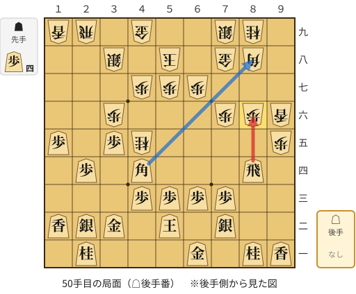

🔴 実戦 △同飛(84)　🔵 AI推奨 △８八角成(44)　🟨 直前の相手の指し手

<details><summary>テキストの盤面図（BOD・将棋ソフトに貼り付け可）</summary>

```text
後手の持駒：なし
  ９ ８ ７ ６ ５ ４ ３ ２ １
+---------------------------+
|v香v桂 ・v金 ・ ・ ・v桂 ・|一
| ・ ・v銀 ・v玉 ・v金v銀v香|二
| ・ ・v歩v歩v歩v歩 ・ ・ ・|三
| ・v飛 ・ ・ ・v角 ・v歩 ・|四
| 歩 ・ ・ ・ ・ 桂v歩 ・v歩|五
| 香 歩 歩 ・ ・ ・ 歩 ・ ・|六
| ・ ・ ・ 歩 歩 歩 ・ ・ ・|七
| ・ 角 金 ・ 玉 ・ 銀 ・ ・|八
| ・ 桂 銀 ・ ・ 金 ・ 飛 香|九
+---------------------------+
先手の持駒：歩四
後手番
手数＝49　▲８六同歩　まで
```

</details>

| | 指し手 | 評価値 | 読み筋 |
|---|---|--:|---|
| 実戦 | △同飛(84) | -695 | ▲４四角(88) △同歩(43) ▲５三桂成(45) △同玉(52) ▲７五角打 △６四角打 |
| AI 1位 | △８八角成(44) | -256 | △８八角成(44) ▲同銀(79) △３六歩(35) ▲４八金(49) △４四飛(84) ▲５六角打 |
| AI 2位 | △３三桂(21) | -317 | △３三桂(21) ▲４四角(88) △同飛(84) ▲３三桂成(45) △同銀(22) ▲３五歩(36) |
| AI 3位 | △７四飛(84) | -334 | △７四飛(84) ▲３五歩(36) △８八角成(44) ▲同銀(79) △９八角打 ▲８七銀(88) |

SFEN: `ln1g3n1/2s1k1gsl/2pppp3/1r3b1p1/P4Np1p/LPP3P2/3PPP3/1BG1K1S2/1NS2G1RL w 4P 50`

<a id="ply-60"></a>
### 60手目 △３一金(32) — 悪手

| | 着手前 | 着手後 | 差 |
|---|--:|--:|--:|
| 期待勝率 | 47.6% | 28.8% | -18.8pt |
| 評価値 | -58 | -543 | |

着手前の局面:

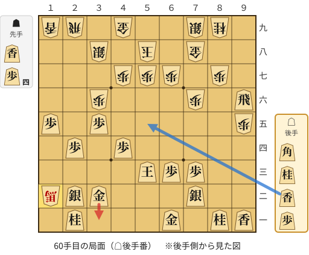

🔴 実戦 △３一金(32)　🔵 AI推奨 △５五香打　🟨 直前の相手の指し手

<details><summary>テキストの盤面図（BOD・将棋ソフトに貼り付け可）</summary>

```text
後手の持駒：角　桂　香　歩
  ９ ８ ７ ６ ５ ４ ３ ２ １
+---------------------------+
|v香v桂 ・v金 ・ ・ ・v桂 ・|一
| ・ ・v銀 ・ ・ ・v金v銀 馬|二
| ・ ・v歩v歩v玉 ・ ・ ・ ・|三
| ・ ・ ・ ・ ・v歩 ・v歩 ・|四
| 歩 ・ ・ ・ ・ ・v歩 ・v歩|五
|v飛 ・ 歩 ・ ・ ・ 歩 ・ ・|六
| ・ 歩 ・ 歩 歩 歩 ・ ・ ・|七
| ・ ・ 金 ・ 玉 ・ 銀 ・ ・|八
| ・ 桂 銀 ・ ・ 金 ・ 飛 香|九
+---------------------------+
先手の持駒：香　歩四
後手番
手数＝59　▲１二角成　まで
```

</details>

| | 指し手 | 評価値 | 読み筋 |
|---|---|--:|---|
| 実戦 | △３一金(32) | -543 | ▲２四飛(29) △２三歩打 ▲３四飛(24) △５五香打 ▲３一飛成(34) △同銀(22) |
| AI 1位 | △５五香打 | -58 | △５五香打 ▲２一馬(12) △２三銀(22) ▲５六歩(57) △同香(55) ▲５七歩打 |
| AI 2位 | △２三銀(22) | -63 | △２三銀(22) ▲２一馬(12) △５五香打 ▲５六歩(57) △同香(55) ▲５七歩打 |
| AI 3位 | △５六歩打 | -211 | △５六歩打 ▲同歩(57) △７六飛(96) ▲２一馬(12) △２三銀(22) ▲４八金(49) |

SFEN: `ln1g3n1/2s3gs+B/2ppk4/5p1p1/P5p1p/r1P3P2/1P1PPP3/2G1K1S2/1NS2G1RL w L4Pbnlp 60`

<a id="ply-64"></a>
### 64手目 △９五龍(98) — 大悪手

| | 着手前 | 着手後 | 差 |
|---|--:|--:|--:|
| 期待勝率 | 84.1% | 63.1% | -21.0pt |
| 評価値 | +1001 | +323 | |

着手前の局面:

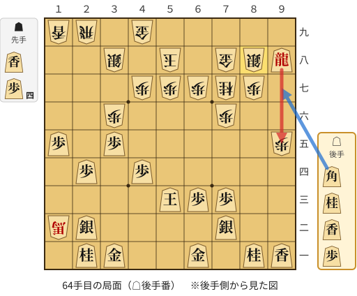

🔴 実戦 △９五龍(98)　🔵 AI推奨 △９七角打　🟨 直前の相手の指し手

<details><summary>テキストの盤面図（BOD・将棋ソフトに貼り付け可）</summary>

```text
後手の持駒：角　桂　香　歩
  ９ ８ ７ ６ ５ ４ ３ ２ １
+---------------------------+
|v香v桂 ・v金 ・ ・v金v桂 ・|一
| ・ ・v銀 ・ ・ ・ ・v銀 馬|二
| ・ ・v歩v歩v玉 ・ ・ ・ ・|三
| ・ ・ ・ ・ ・v歩 ・v歩 ・|四
| 歩 ・ ・ ・ ・ ・v歩 ・v歩|五
| ・ ・ 歩 ・ ・ ・ 歩 ・ ・|六
| ・ 歩 桂 歩 歩 歩 ・ ・ ・|七
|v龍 銀 金 ・ 玉 ・ 銀 ・ ・|八
| ・ ・ ・ ・ ・ 金 ・ 飛 香|九
+---------------------------+
先手の持駒：香　歩四
後手番
手数＝63　▲８八銀　まで
```

</details>

| | 指し手 | 評価値 | 読み筋 |
|---|---|--:|---|
| 実戦 | △９五龍(98) | +323 | ▲９六歩打 △８四龍(95) ▲３四香打 △４五角打 ▲４六歩(47) △６六桂打 |
| AI 1位 | △９七角打 | +1001 | △９七角打 ▲５六香打 △６二玉(53) ▲３四馬(12) △７一玉(62) ▲６一馬(34) |
| AI 2位 | △９六桂打 | +707 | △９六桂打 ▲６五桂(77) △６二玉(53) ▲９九香打 △８八桂成(96) ▲９八香(99) |
| AI 3位 | △５五香打 | +590 | △５五香打 ▲２四飛(29) △４五桂打 ▲５六香打 △同香(55) ▲同歩(57) |

SFEN: `ln1g2gn1/2s4s+B/2ppk4/5p1p1/P5p1p/2P3P2/1PNPPP3/+rSG1K1S2/5G1RL w L4Pbnlp 64`

<a id="ply-68"></a>
### 68手目 △６二玉(53) — 大悪手

| | 着手前 | 着手後 | 差 |
|---|--:|--:|--:|
| 期待勝率 | 86.1% | 61.4% | -24.7pt |
| 評価値 | +1095 | +278 | |

着手前の局面:

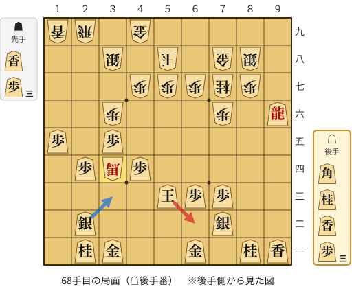

🔴 実戦 △６二玉(53)　🔵 AI推奨 △３三銀(22)　🟨 直前の相手の指し手

<details><summary>テキストの盤面図（BOD・将棋ソフトに貼り付け可）</summary>

```text
後手の持駒：角　桂　香　歩三
  ９ ８ ７ ６ ５ ４ ３ ２ １
+---------------------------+
|v香v桂 ・v金 ・ ・v金v桂 ・|一
| ・ ・v銀 ・ ・ ・ ・v銀 ・|二
| ・ ・v歩v歩v玉 ・ ・ ・ ・|三
| ・ ・ ・ ・ ・v歩 馬v歩 ・|四
| ・ ・ ・ ・ ・ ・v歩 ・v歩|五
|v龍 ・ 歩 ・ ・ ・ 歩 ・ ・|六
| ・ 歩 桂 歩 歩 歩 ・ ・ ・|七
| ・ 銀 金 ・ 玉 ・ 銀 ・ ・|八
| ・ ・ ・ ・ ・ 金 ・ 飛 香|九
+---------------------------+
先手の持駒：香　歩三
後手番
手数＝67　▲３四馬　まで
```

</details>

| | 指し手 | 評価値 | 読み筋 |
|---|---|--:|---|
| 実戦 | △６二玉(53) | +278 | ▲９七香打 △同龍(96) ▲同銀(88) △同香成(91) ▲４四馬(34) △５三銀打 |
| AI 1位 | △３三銀(22) | +1095 | △３三銀(22) ▲６五桂(77) △６二玉(53) ▲４三馬(34) △５二香打 ▲５四香打 |
| AI 2位 | △６二玉(53) | +851 | △６二玉(53) ▲２四飛(29) △３三銀(22) ▲２一飛成(24) △同金(31) ▲３三馬(34) |
| AI 3位 | △９四龍(96) | +783 | △９四龍(96) ▲２四飛(29) △３三銀(22) ▲５六香打 △５五歩打 ▲同香(56) |

SFEN: `ln1g2gn1/2s4s1/2ppk4/5p+Bp1/6p1p/+r1P3P2/1PNPPP3/1SG1K1S2/5G1RL w L3Pbnl3p 68`

<a id="ply-72"></a>
### 72手目 △３三銀(22) — 疑問手

| | 着手前 | 着手後 | 差 |
|---|--:|--:|--:|
| 期待勝率 | 63.6% | 54.2% | -9.4pt |
| 評価値 | +334 | +100 | |

着手前の局面:

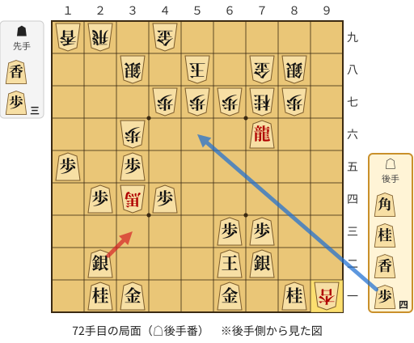

🔴 実戦 △３三銀(22)　🔵 AI推奨 △５六歩打　🟨 直前の相手の指し手

<details><summary>テキストの盤面図（BOD・将棋ソフトに貼り付け可）</summary>

```text
後手の持駒：角　桂　香　歩四
  ９ ８ ７ ６ ５ ４ ３ ２ １
+---------------------------+
| 杏v桂 ・v金 ・ ・v金v桂 ・|一
| ・ ・v銀v玉 ・ ・ ・v銀 ・|二
| ・ ・v歩v歩 ・ ・ ・ ・ ・|三
| ・ ・ ・ ・ ・v歩 馬v歩 ・|四
| ・ ・ ・ ・ ・ ・v歩 ・v歩|五
| ・ ・v龍 ・ ・ ・ 歩 ・ ・|六
| ・ 歩 桂 歩 歩 歩 ・ ・ ・|七
| ・ 銀 金 ・ 玉 ・ 銀 ・ ・|八
| ・ ・ ・ ・ ・ 金 ・ 飛 香|九
+---------------------------+
先手の持駒：香　歩三
後手番
手数＝71　▲９一香成　まで
```

</details>

| | 指し手 | 評価値 | 読み筋 |
|---|---|--:|---|
| 実戦 | △３三銀(22) | +100 | ▲４三馬(34) △３二角打 ▲同馬(43) △同金(31) ▲５四角打 △４三角打 |
| AI 1位 | △５六歩打 | +334 | △５六歩打 ▲４四馬(34) △５三香打 ▲５五香打 △５二金(61) ▲８一成香(91) |
| AI 2位 | △５三香打 | +244 | △５三香打 ▲４三馬(34) △３二角打 ▲同馬(43) △同金(31) ▲６五角打 |
| AI 3位 | △３三銀(22) | +216 | △３三銀(22) ▲４三馬(34) △３二角打 ▲同馬(43) △同金(31) ▲５四角打 |

SFEN: `+Ln1g2gn1/2sk3s1/2pp5/5p+Bp1/6p1p/2+r3P2/1PNPPP3/1SG1K1S2/5G1RL w L3Pbnl4p 72`

<a id="ply-74"></a>
### 74手目 △７四龍(76) — 大悪手

| | 着手前 | 着手後 | 差 |
|---|--:|--:|--:|
| 期待勝率 | 56.7% | 26.4% | -30.3pt |
| 評価値 | +162 | -615 | |

着手前の局面:

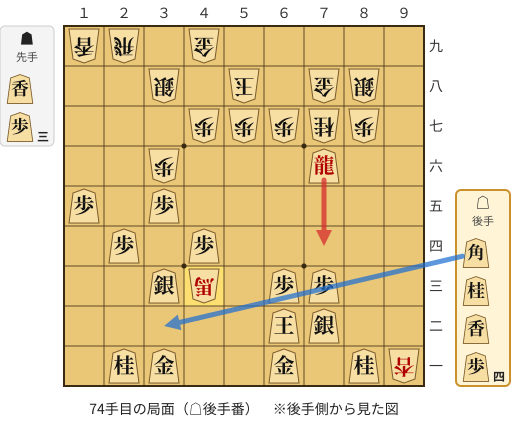

🔴 実戦 △７四龍(76)　🔵 AI推奨 △３二角打　🟨 直前の相手の指し手

<details><summary>テキストの盤面図（BOD・将棋ソフトに貼り付け可）</summary>

```text
後手の持駒：角　桂　香　歩四
  ９ ８ ７ ６ ５ ４ ３ ２ １
+---------------------------+
| 杏v桂 ・v金 ・ ・v金v桂 ・|一
| ・ ・v銀v玉 ・ ・ ・ ・ ・|二
| ・ ・v歩v歩 ・ 馬v銀 ・ ・|三
| ・ ・ ・ ・ ・v歩 ・v歩 ・|四
| ・ ・ ・ ・ ・ ・v歩 ・v歩|五
| ・ ・v龍 ・ ・ ・ 歩 ・ ・|六
| ・ 歩 桂 歩 歩 歩 ・ ・ ・|七
| ・ 銀 金 ・ 玉 ・ 銀 ・ ・|八
| ・ ・ ・ ・ ・ 金 ・ 飛 香|九
+---------------------------+
先手の持駒：香　歩三
後手番
手数＝73　▲４三馬　まで
```

</details>

| | 指し手 | 評価値 | 読み筋 |
|---|---|--:|---|
| 実戦 | △７四龍(76) | -615 | ▲８一成香(91) △４二香打 ▲６五馬(43) △７六角打 ▲７四馬(65) △同歩(73) |
| AI 1位 | △３二角打 | +162 | △３二角打 ▲同馬(43) △同金(31) ▲６五角打 △４三角打 ▲同角成(65) |
| AI 2位 | △５四歩打 | -233 | △５四歩打 ▲３四香打 △８九角打 ▲３三香不成(34) △７八角成(89) ▲３一香成(33) |
| AI 3位 | △３六龍(76) | -308 | △３六龍(76) ▲８一成香(91) △４二香打 ▲５四桂打 △５一玉(62) ▲３四歩打 |

SFEN: `+Ln1g2gn1/2sk5/2pp1+Bs2/5p1p1/6p1p/2+r3P2/1PNPPP3/1SG1K1S2/5G1RL w L3Pbnl4p 74`

