# 解析レポート 1d2x4flmctj7

[README に戻る](../../../README.md)　/　棋譜: [CSA](../../../data/csa/shogi5/1d2x4flmctj7.csa)　/　解析の見方: [docs/mistake_analysis.md](../../../docs/mistake_analysis.md)

## 対局情報

| 項目 | 内容 |
|---|---|
| 日時 | 2026-11-17 04:08:50 |
| 持ち時間 | 5分 |
| 自分 | 後手（△）（1660） |
| 相手 | 相手（1692） |
| 結果 | 負け（時間切れ, 105手） |

## 解析環境

| 項目 | 内容 |
|---|---|
| エンジン | YaneuraOu NNUE 9.00git 64AVX2（V9.00/YANEURAOU_ENGINE_NNUE/AVX2） |
| 評価関数 | **水匠5**（`suisho5`） |
| nn.bin SHA-256 | `768068f0d534a0603a5d38bcd143de6bbca820d5f1c95a14d40863e5b7892d76` |
| 第1パス | movetime=150ms, MultiPV 1 |
| 第2パス | movetime=2000ms, MultiPV 3 |
| Threads / Hash | 8 / 512MB |
| 判定基準 | 疑問手 ≥5pt, 悪手 ≥10pt, 大悪手 ≥20pt（期待勝率 W(E)=1/(1+exp(-E/600))） |
| 解析日時 | 2026-11-20T20:13:37+09:00（解析バージョン 1, 76秒） |

## サマリー

| 自分の手数 | 深掘りした手 | 詰み逃し | 大悪手 | 悪手 | 疑問手 |
|--:|--:|--:|--:|--:|--:|
| 52 | 15 | 0 | 3 | 4 | 3 |

## 期待勝率の推移

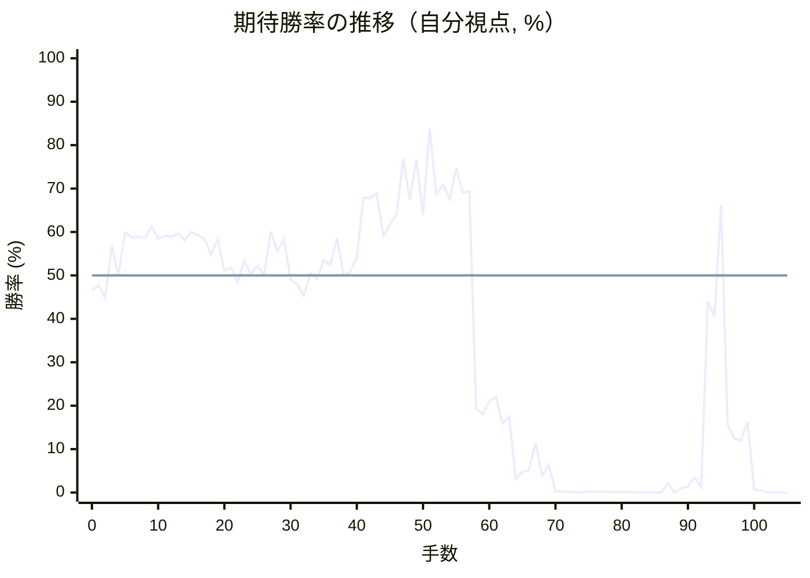

<details><summary>1手ごとの数値（第1パス）</summary>

| 手数 | 指し手 | 評価値 | 勝率 | 低下 | 判定 |
|--:|---|--:|--:|--:|---|
| 1 | ▲７六歩(77) | -55 | 47.7% |  |  |
| 2 | △３四歩(33) | -125 | 44.8% | +2.9pt |  |
| 3 | ▲６六歩(67) | +165 | 56.8% |  |  |
| 4 | △８四歩(83) | +0 | 50.0% | +6.8pt |  |
| 5 | ▲７八飛(28) | +240 | 59.9% |  |  |
| 6 | △８五歩(84) | +212 | 58.7% | +1.1pt |  |
| 7 | ▲７七角(88) | +217 | 58.9% |  |  |
| 8 | △６二銀(71) | +208 | 58.6% | +0.4pt |  |
| 9 | ▲６八銀(79) | +275 | 61.3% |  |  |
| 10 | △６四歩(63) | +207 | 58.5% | +2.7pt |  |
| 11 | ▲１六歩(17) | +222 | 59.1% |  |  |
| 12 | △１四歩(13) | +217 | 58.9% | +0.2pt |  |
| 13 | ▲４八玉(59) | +237 | 59.7% |  |  |
| 14 | △４二玉(51) | +195 | 58.1% | +1.7pt |  |
| 15 | ▲３八銀(39) | +244 | 60.0% |  |  |
| 16 | △３二玉(42) | +225 | 59.3% | +0.8pt |  |
| 17 | ▲５八金(69) | +204 | 58.4% |  |  |
| 18 | △２四歩(23) | +114 | 54.7% | +3.7pt |  |
| 19 | ▲４六歩(47) | +200 | 58.3% |  |  |
| 20 | △２三玉(32) | +27 | 51.1% | +7.1pt | [悪手](#ply-20) |
| 21 | ▲３六歩(37) | +44 | 51.8% |  |  |
| 22 | △３二銀(31) | -41 | 48.3% | +3.5pt |  |
| 23 | ▲３七桂(29) | +85 | 53.5% |  |  |
| 24 | △６三銀(62) | +7 | 50.3% | +3.2pt |  |
| 25 | ▲６七銀(68) | +53 | 52.2% |  |  |
| 26 | △５四銀(63) | -1 | 50.0% | +2.2pt |  |
| 27 | ▲３九玉(48) | +246 | 60.1% |  |  |
| 28 | △９四歩(93) | +136 | 55.6% | +4.5pt |  |
| 29 | ▲２六歩(27) | +203 | 58.4% |  |  |
| 30 | △６二飛(82) | -22 | 49.1% | +9.3pt | [疑問手](#ply-30) |
| 31 | ▲６八飛(78) | -50 | 47.9% |  |  |
| 32 | △７四歩(73) | -112 | 45.3% | +2.6pt |  |
| 33 | ▲５六銀(67) | +12 | 50.5% |  |  |
| 34 | △７三桂(81) | -20 | 49.2% | +1.3pt |  |
| 35 | ▲９八香(99) | +83 | 53.5% |  |  |
| 36 | △５二金(61) | +58 | 52.4% | +1.0pt |  |
| 37 | ▲２八玉(39) | +208 | 58.6% |  |  |
| 38 | △４四角(22) | +0 | 50.0% | +8.6pt |  |
| 39 | ▲２七銀(38) | +20 | 50.8% |  |  |
| 40 | △６五歩(64) | +102 | 54.2% | -3.4pt |  |
| 41 | ▲７五歩(76) | +451 | 68.0% |  |  |
| 42 | △同歩(74) | +448 | 67.8% | +0.1pt |  |
| 43 | ▲６五歩(66) | +476 | 68.9% |  |  |
| 44 | △同桂(73) | +220 | 59.1% | +9.8pt | [疑問手](#ply-44) |
| 45 | ▲４四角(77) | +288 | 61.8% |  |  |
| 46 | △同歩(43) | +344 | 64.0% | -2.2pt |  |
| 47 | ▲８四角打 | +725 | 77.0% |  |  |
| 48 | △６三飛(62) | +437 | 67.4% | +9.6pt | [悪手](#ply-48) |
| 49 | ▲６四歩打 | +714 | 76.7% |  |  |
| 50 | △同飛(63) | +342 | 63.9% | +12.8pt | [大悪手](#ply-50) |
| 51 | ▲７五角(84) | +984 | 83.8% |  |  |
| 52 | △６二飛(64) | +472 | 68.7% | +15.0pt | [悪手](#ply-52) |
| 53 | ▲８四角(75) | +535 | 70.9% |  |  |
| 54 | △６三飛(62) | +442 | 67.6% | +3.3pt |  |
| 55 | ▲６四歩打 | +651 | 74.7% |  |  |
| 56 | △同飛(63) | +484 | 69.1% | +5.6pt |  |
| 57 | ▲７三角成(84) | +492 | 69.4% |  |  |
| 58 | △６三飛(64) | -856 | 19.4% | +50.1pt | [大悪手](#ply-58) |
| 59 | ▲同馬(73) | -904 | 18.1% |  |  |
| 60 | △同金(52) | -796 | 21.0% | -2.8pt |  |
| 61 | ▲６五銀(56) | -760 | 22.0% |  |  |
| 62 | △同銀(54) | -1001 | 15.9% | +6.1pt | [疑問手](#ply-62) |
| 63 | ▲同飛(68) | -932 | 17.5% |  |  |
| 64 | △６四歩打 | -2043 | 3.2% | +14.2pt | [悪手](#ply-64) |
| 65 | ▲８五飛(65) | -1806 | 4.7% |  |  |
| 66 | △４七銀打 | -1737 | 5.2% | -0.5pt |  |
| 67 | ▲８二飛成(85) | -1223 | 11.5% |  |  |
| 68 | △５八銀成(47) | -1940 | 3.8% | +7.7pt |  |
| 69 | ▲同金(49) | -1607 | 6.4% |  |  |
| 70 | △３五歩(34) | -3672 | 0.2% | +6.2pt |  |
| 71 | ▲２五歩(26) | -3538 | 0.3% |  |  |
| 72 | △同歩(24) | -4280 | 0.1% | +0.2pt |  |
| 73 | ▲２四歩打 | -4398 | 0.1% |  |  |
| 74 | △同玉(23) | -4638 | 0.0% | +0.0pt |  |
| 75 | ▲２二飛打 | -3591 | 0.3% |  |  |
| 76 | △２三金打 | -3691 | 0.2% | +0.0pt |  |
| 77 | ▲３二龍(82) | -3748 | 0.2% |  |  |
| 78 | △同金(41) | -3847 | 0.2% | +0.0pt |  |
| 79 | ▲同飛成(22) | -4157 | 0.1% |  |  |
| 80 | △３三桂(21) | -4510 | 0.1% | +0.0pt |  |
| 81 | ▲２五桂(37) | -3858 | 0.2% |  |  |
| 82 | △同桂(33) | #-7 | 0.0% | +0.2pt |  |
| 83 | ▲３五龍(32) | #-8 | 0.0% |  |  |
| 84 | △１三玉(24) | #-7 | 0.0% | +0.0pt |  |
| 85 | ▲２五龍(35) | -5625 | 0.0% |  |  |
| 86 | △２四歩打 | -5585 | 0.0% | -0.0pt |  |
| 87 | ▲３五龍(25) | -2300 | 2.1% |  |  |
| 88 | △３四歩打 | #-13 | 0.0% | +2.1pt |  |
| 89 | ▲４四龍(35) | -2770 | 1.0% |  |  |
| 90 | △２五桂打 | -2538 | 1.4% | -0.5pt |  |
| 91 | ▲２六銀打 | -1985 | 3.5% |  |  |
| 92 | △４九飛打 | -2672 | 1.2% | +2.4pt |  |
| 93 | ▲３九金打 | -145 | 44.0% |  |  |
| 94 | △３七角打 | -231 | 40.5% | +3.5pt |  |
| 95 | ▲３八玉(28) | +404 | 66.2% |  |  |
| 96 | △３九飛成(49) | -1015 | 15.6% | +50.7pt | [大悪手](#ply-96) |
| 97 | ▲同玉(38) | -1174 | 12.4% |  |  |
| 98 | △２八角打 | -1195 | 12.0% | +0.4pt |  |
| 99 | ▲３八玉(39) | -982 | 16.3% |  |  |
| 100 | △３九金打 | -2938 | 0.7% | +15.6pt |  |
| 101 | ▲４七玉(38) | -3225 | 0.5% |  |  |
| 102 | △４六角成(37) | -6057 | 0.0% | +0.5pt |  |
| 103 | ▲同龍(44) | -6248 | 0.0% |  |  |
| 104 | △同角成(28) | -5994 | 0.0% | -0.0pt |  |
| 105 | ▲同玉(47) | -6466 | 0.0% |  |  |

</details>

## 課題局面

<a id="ply-20"></a>
### 20手目 △２三玉(32) — 悪手

| | 着手前 | 着手後 | 差 |
|---|--:|--:|--:|
| 期待勝率 | 56.3% | 45.7% | -10.6pt |
| 評価値 | +153 | -103 | |

着手前の局面:

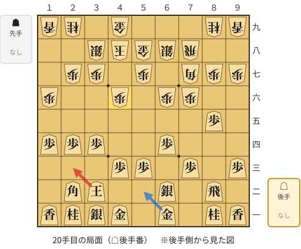

🔴 実戦 △２三玉(32)　🔵 AI推奨 △５二金(61)　🟨 直前の相手の指し手

<details><summary>テキストの盤面図（BOD・将棋ソフトに貼り付け可）</summary>

```text
後手の持駒：なし
  ９ ８ ７ ６ ５ ４ ３ ２ １
+---------------------------+
|v香v桂 ・v金 ・v金v銀v桂v香|一
| ・v飛 ・v銀 ・ ・v玉v角 ・|二
|v歩 ・v歩 ・v歩v歩 ・ ・ ・|三
| ・ ・ ・v歩 ・ ・v歩v歩v歩|四
| ・v歩 ・ ・ ・ ・ ・ ・ ・|五
| ・ ・ 歩 歩 ・ 歩 ・ ・ 歩|六
| 歩 歩 角 ・ 歩 ・ 歩 歩 ・|七
| ・ ・ 飛 銀 金 玉 銀 ・ ・|八
| 香 桂 ・ ・ ・ 金 ・ 桂 香|九
+---------------------------+
先手の持駒：なし
後手番
手数＝19　▲４六歩　まで
```

</details>

| | 指し手 | 評価値 | 読み筋 |
|---|---|--:|---|
| 実戦 | △２三玉(32) | -103 | ▲３六歩(37) △５二金(61) |
| AI 1位 | △５二金(61) | +153 | △５二金(61) ▲３六歩(37) △６三銀(62) ▲５六歩(57) △５四銀(63) ▲６七銀(68) |
| AI 2位 | △６三銀(62) | +141 | △６三銀(62) ▲３六歩(37) △５二金(61) ▲６七銀(68) △５四銀(63) ▲５六歩(57) |
| AI 3位 | △４二金(41) | +134 | △４二金(41) ▲３六歩(37) △６三銀(62) ▲６七銀(68) △５四銀(63) ▲８八飛(78) |

SFEN: `ln1g1gsnl/1r1s2kb1/p1p1pp3/3p2ppp/1p7/2PP1P2P/PPB1P1PP1/2RSGKS2/LN3G1NL w - 20`

<a id="ply-30"></a>
### 30手目 △６二飛(82) — 疑問手

| | 着手前 | 着手後 | 差 |
|---|--:|--:|--:|
| 期待勝率 | 56.1% | 49.6% | -6.5pt |
| 評価値 | +146 | -10 | |

着手前の局面:

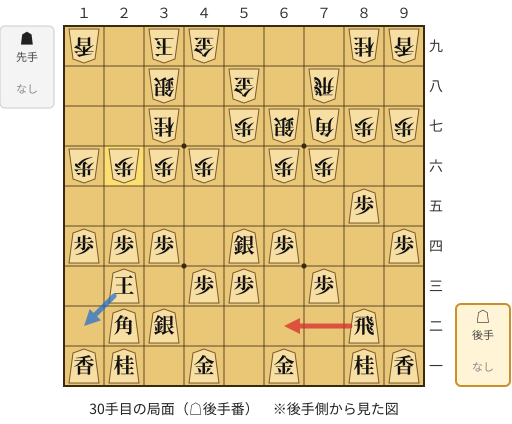

🔴 実戦 △６二飛(82)　🔵 AI推奨 △１二玉(23)　🟨 直前の相手の指し手

<details><summary>テキストの盤面図（BOD・将棋ソフトに貼り付け可）</summary>

```text
後手の持駒：なし
  ９ ８ ７ ６ ５ ４ ３ ２ １
+---------------------------+
|v香v桂 ・v金 ・v金 ・v桂v香|一
| ・v飛 ・ ・ ・ ・v銀v角 ・|二
| ・ ・v歩 ・v歩v歩 ・v玉 ・|三
|v歩 ・ ・v歩v銀 ・v歩v歩v歩|四
| ・v歩 ・ ・ ・ ・ ・ ・ ・|五
| ・ ・ 歩 歩 ・ 歩 歩 歩 歩|六
| 歩 歩 角 銀 歩 ・ 桂 ・ ・|七
| ・ ・ 飛 ・ 金 ・ 銀 ・ ・|八
| 香 桂 ・ ・ ・ 金 玉 ・ 香|九
+---------------------------+
先手の持駒：なし
後手番
手数＝29　▲２六歩　まで
```

</details>

| | 指し手 | 評価値 | 読み筋 |
|---|---|--:|---|
| 実戦 | △６二飛(82) | -10 | ▲８八飛(78) △５一金(61) ▲８六歩(87) △６五歩(64) ▲２五歩(26) △同歩(24) |
| AI 1位 | △１二玉(23) | +146 | △１二玉(23) ▲４七金(58) △５二金(61) ▲２七銀(38) △６五歩(64) ▲１五歩(16) |
| AI 2位 | △５二金(61) | +136 | △５二金(61) ▲４七金(58) △１二玉(23) ▲２七銀(38) △６五歩(64) ▲１五歩(16) |
| AI 3位 | △５一金(61) | +134 | △５一金(61) ▲４七金(58) △６五歩(64) ▲６八飛(78) △４二金(51) ▲５六銀(67) |

SFEN: `ln1g1g1nl/1r4sb1/2p1pp1k1/p2ps1ppp/1p7/2PP1PPPP/PPBSP1N2/2R1G1S2/LN3GK1L w - 30`

<a id="ply-44"></a>
### 44手目 △同桂(73) — 疑問手

| | 着手前 | 着手後 | 差 |
|---|--:|--:|--:|
| 期待勝率 | 69.8% | 62.8% | -6.9pt |
| 評価値 | +502 | +315 | |

着手前の局面:

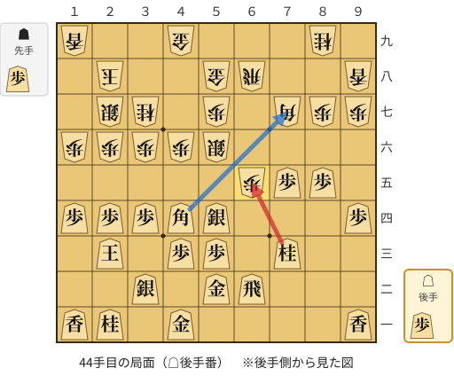

🔴 実戦 △同桂(73)　🔵 AI推奨 △７七角成(44)　🟨 直前の相手の指し手

<details><summary>テキストの盤面図（BOD・将棋ソフトに貼り付け可）</summary>

```text
後手の持駒：歩
  ９ ８ ７ ６ ５ ４ ３ ２ １
+---------------------------+
|v香 ・ ・ ・ ・v金 ・v桂v香|一
| ・ ・ ・v飛v金 ・v銀 ・ ・|二
| ・ ・v桂 ・v歩v歩 ・v玉 ・|三
|v歩 ・ ・ ・v銀v角v歩v歩v歩|四
| ・v歩v歩 歩 ・ ・ ・ ・ ・|五
| ・ ・ ・ ・ 銀 歩 歩 歩 歩|六
| 歩 歩 角 ・ 歩 ・ 桂 銀 ・|七
| 香 ・ ・ 飛 金 ・ ・ 玉 ・|八
| ・ 桂 ・ ・ ・ 金 ・ ・ 香|九
+---------------------------+
先手の持駒：歩
後手番
手数＝43　▲６五歩　まで
```

</details>

| | 指し手 | 評価値 | 読み筋 |
|---|---|--:|---|
| 実戦 | △同桂(73) | +315 | ▲４四角(77) △同歩(43) ▲２五歩(26) △同歩(24) ▲２四歩打 △同玉(23) |
| AI 1位 | △７七角成(44) | +502 | △７七角成(44) ▲同桂(89) △７六歩(75) ▲７八飛(68) △７七歩成(76) ▲同飛(78) |
| AI 2位 | △同桂(73) | +330 | △同桂(73) ▲４四角(77) △同歩(43) ▲６六角打 △７九角打 ▲７八飛(68) |
| AI 3位 | △同銀(54) | +66 | △同銀(54) ▲４四角(77) △同歩(43) ▲８三角打 △６七歩打 ▲同銀(56) |

SFEN: `l4g1nl/3rg1s2/2n1pp1k1/p3sbppp/1ppP5/4SPPPP/PPB1P1NS1/L2RG2K1/1N3G2L w Pp 44`

<a id="ply-48"></a>
### 48手目 △６三飛(62) — 悪手

| | 着手前 | 着手後 | 差 |
|---|--:|--:|--:|
| 期待勝率 | 87.5% | 71.5% | -16.0pt |
| 評価値 | +1168 | +551 | |

着手前の局面:

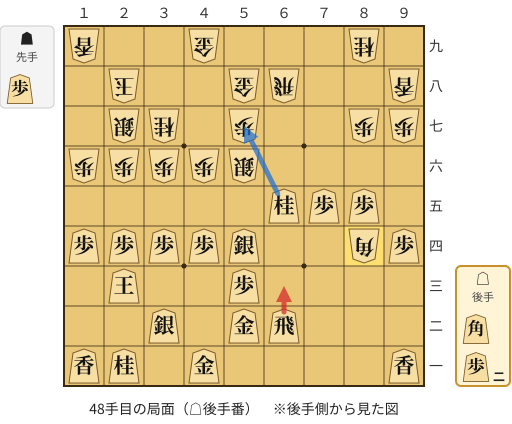

🔴 実戦 △６三飛(62)　🔵 AI推奨 △５七桂不成(65)　🟨 直前の相手の指し手

<details><summary>テキストの盤面図（BOD・将棋ソフトに貼り付け可）</summary>

```text
後手の持駒：角　歩二
  ９ ８ ７ ６ ５ ４ ３ ２ １
+---------------------------+
|v香 ・ ・ ・ ・v金 ・v桂v香|一
| ・ ・ ・v飛v金 ・v銀 ・ ・|二
| ・ ・ ・ ・v歩 ・ ・v玉 ・|三
|v歩 角 ・ ・v銀v歩v歩v歩v歩|四
| ・v歩v歩v桂 ・ ・ ・ ・ ・|五
| ・ ・ ・ ・ 銀 歩 歩 歩 歩|六
| 歩 歩 ・ ・ 歩 ・ 桂 銀 ・|七
| 香 ・ ・ 飛 金 ・ ・ 玉 ・|八
| ・ 桂 ・ ・ ・ 金 ・ ・ 香|九
+---------------------------+
先手の持駒：歩
後手番
手数＝47　▲８四角　まで
```

</details>

| | 指し手 | 評価値 | 読み筋 |
|---|---|--:|---|
| 実戦 | △６三飛(62) | +551 | ▲７五角(84) △７三飛(63) |
| AI 1位 | △５七桂不成(65) | +1168 | △５七桂不成(65) ▲６二角成(84) △４九桂成(57) ▲２九飛打 △３九金打 ▲同飛(29) |
| AI 2位 | △５七桂成(65) | +598 | △５七桂成(65) ▲６二角成(84) △６八成桂(57) ▲５二馬(62) △５八成桂(68) ▲４一馬(52) |
| AI 3位 | △６三飛(62) | +581 | △６三飛(62) ▲７五角(84) △７三飛(63) ▲７六歩打 △７五飛(73) ▲同歩(76) |

SFEN: `l4g1nl/3rg1s2/4p2k1/pB2spppp/1ppn5/4SPPPP/PP2P1NS1/L2RG2K1/1N3G2L w Pb2p 48`

<a id="ply-50"></a>
### 50手目 △同飛(63) — 大悪手

| | 着手前 | 着手後 | 差 |
|---|--:|--:|--:|
| 期待勝率 | 79.2% | 59.1% | -20.1pt |
| 評価値 | +801 | +220 | |

着手前の局面:

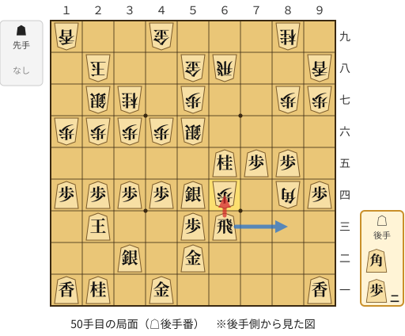

🔴 実戦 △同飛(63)　🔵 AI推奨 △８三飛(63)　🟨 直前の相手の指し手

<details><summary>テキストの盤面図（BOD・将棋ソフトに貼り付け可）</summary>

```text
後手の持駒：角　歩二
  ９ ８ ７ ６ ５ ４ ３ ２ １
+---------------------------+
|v香 ・ ・ ・ ・v金 ・v桂v香|一
| ・ ・ ・ ・v金 ・v銀 ・ ・|二
| ・ ・ ・v飛v歩 ・ ・v玉 ・|三
|v歩 角 ・ 歩v銀v歩v歩v歩v歩|四
| ・v歩v歩v桂 ・ ・ ・ ・ ・|五
| ・ ・ ・ ・ 銀 歩 歩 歩 歩|六
| 歩 歩 ・ ・ 歩 ・ 桂 銀 ・|七
| 香 ・ ・ 飛 金 ・ ・ 玉 ・|八
| ・ 桂 ・ ・ ・ 金 ・ ・ 香|九
+---------------------------+
先手の持駒：なし
後手番
手数＝49　▲６四歩　まで
```

</details>

| | 指し手 | 評価値 | 読み筋 |
|---|---|--:|---|
| 実戦 | △同飛(63) | +220 | ▲７三角成(84) △５七桂不成(65) ▲６四馬(73) △６七歩打 ▲同飛(68) △４九桂成(57) |
| AI 1位 | △８三飛(63) | +801 | △８三飛(63) ▲７五角(84) △７三飛(83) ▲７六歩打 △７五飛(73) ▲同歩(76) |
| AI 2位 | △６七歩打 | +501 | △６七歩打 ▲同銀(56) △８三飛(63) ▲７五角(84) △７三飛(83) ▲７六歩打 |
| AI 3位 | △同飛(63) | +283 | △同飛(63) ▲７三角成(84) △５七桂不成(65) ▲６四馬(73) △４九桂成(57) ▲７五馬(64) |

SFEN: `l4g1nl/4g1s2/3rp2k1/pB1Pspppp/1ppn5/4SPPPP/PP2P1NS1/L2RG2K1/1N3G2L w b2p 50`

<a id="ply-52"></a>
### 52手目 △６二飛(64) — 悪手

| | 着手前 | 着手後 | 差 |
|---|--:|--:|--:|
| 期待勝率 | 85.7% | 72.1% | -13.6pt |
| 評価値 | +1076 | +570 | |

着手前の局面:

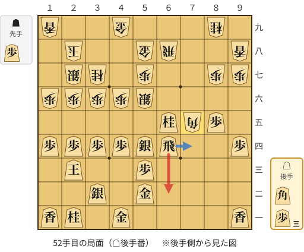

🔴 実戦 △６二飛(64)　🔵 AI推奨 △７四飛(64)　🟨 直前の相手の指し手

<details><summary>テキストの盤面図（BOD・将棋ソフトに貼り付け可）</summary>

```text
後手の持駒：角　歩三
  ９ ８ ７ ６ ５ ４ ３ ２ １
+---------------------------+
|v香 ・ ・ ・ ・v金 ・v桂v香|一
| ・ ・ ・ ・v金 ・v銀 ・ ・|二
| ・ ・ ・ ・v歩 ・ ・v玉 ・|三
|v歩 ・ ・v飛v銀v歩v歩v歩v歩|四
| ・v歩 角v桂 ・ ・ ・ ・ ・|五
| ・ ・ ・ ・ 銀 歩 歩 歩 歩|六
| 歩 歩 ・ ・ 歩 ・ 桂 銀 ・|七
| 香 ・ ・ 飛 金 ・ ・ 玉 ・|八
| ・ 桂 ・ ・ ・ 金 ・ ・ 香|九
+---------------------------+
先手の持駒：歩
後手番
手数＝51　▲７五角　まで
```

</details>

| | 指し手 | 評価値 | 読み筋 |
|---|---|--:|---|
| 実戦 | △６二飛(64) | +570 | ▲６六角(75) △３三桂(21) ▲３八金(49) △７二飛(62) ▲７七歩打 △６四歩打 |
| AI 1位 | △７四飛(64) | +1076 | △７四飛(64) ▲７六歩打 △７五飛(74) ▲同歩(76) △７九角打 ▲７八飛(68) |
| AI 2位 | △６七歩打 | +847 | △６七歩打 ▲同銀(56) △７四飛(64) ▲７六歩打 △５五銀(54) ▲２五歩(26) |
| AI 3位 | △６三飛(64) | +547 | △６三飛(64) ▲６六角(75) △３三桂(21) ▲３八金(49) △７三飛(63) ▲７五歩打 |

SFEN: `l4g1nl/4g1s2/4p2k1/p2rspppp/1pBn5/4SPPPP/PP2P1NS1/L2RG2K1/1N3G2L w Pb3p 52`

<a id="ply-58"></a>
### 58手目 △６三飛(64) — 大悪手

| | 着手前 | 着手後 | 差 |
|---|--:|--:|--:|
| 期待勝率 | 86.5% | 22.2% | -64.3pt |
| 評価値 | +1114 | -753 | |

着手前の局面:

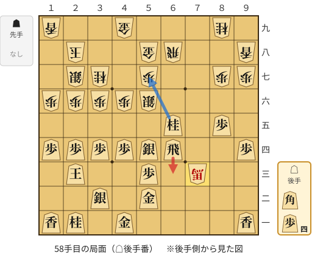

🔴 実戦 △６三飛(64)　🔵 AI推奨 △５七桂不成(65)　🟨 直前の相手の指し手

<details><summary>テキストの盤面図（BOD・将棋ソフトに貼り付け可）</summary>

```text
後手の持駒：角　歩四
  ９ ８ ７ ６ ５ ４ ３ ２ １
+---------------------------+
|v香 ・ ・ ・ ・v金 ・v桂v香|一
| ・ ・ ・ ・v金 ・v銀 ・ ・|二
| ・ ・ 馬 ・v歩 ・ ・v玉 ・|三
|v歩 ・ ・v飛v銀v歩v歩v歩v歩|四
| ・v歩 ・v桂 ・ ・ ・ ・ ・|五
| ・ ・ ・ ・ 銀 歩 歩 歩 歩|六
| 歩 歩 ・ ・ 歩 ・ 桂 銀 ・|七
| 香 ・ ・ 飛 金 ・ ・ 玉 ・|八
| ・ 桂 ・ ・ ・ 金 ・ ・ 香|九
+---------------------------+
先手の持駒：なし
後手番
手数＝57　▲７三角成　まで
```

</details>

| | 指し手 | 評価値 | 読み筋 |
|---|---|--:|---|
| 実戦 | △６三飛(64) | -753 | ▲同馬(73) △同金(52) ▲６五銀(56) △９五角打 ▲６九飛(68) △６八歩打 |
| AI 1位 | △５七桂不成(65) | +1114 | △５七桂不成(65) ▲６四馬(73) △４九桂成(57) ▲７五馬(64) △７四歩打 ▲８四馬(75) |
| AI 2位 | △６一飛(64) | +585 | △６一飛(64) ▲８三馬(73) △６三飛(61) ▲８四馬(83) △７六歩打 ▲３八金(49) |
| AI 3位 | △６三歩打 | +128 | △６三歩打 ▲６四馬(73) △同歩(63) ▲８一飛打 △７六角打 ▲３八金(49) |

SFEN: `l4g1nl/4g1s2/2+B1p2k1/p2rspppp/1p1n5/4SPPPP/PP2P1NS1/L2RG2K1/1N3G2L w b4p 58`

<a id="ply-62"></a>
### 62手目 △同銀(54) — 疑問手

| | 着手前 | 着手後 | 差 |
|---|--:|--:|--:|
| 期待勝率 | 22.5% | 16.4% | -6.1pt |
| 評価値 | -743 | -978 | |

着手前の局面:

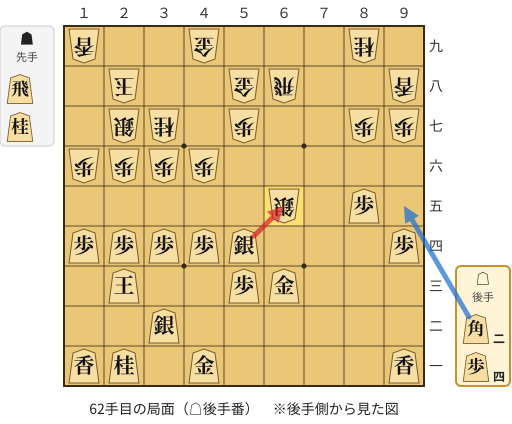

🔴 実戦 △同銀(54)　🔵 AI推奨 △９五角打　🟨 直前の相手の指し手

<details><summary>テキストの盤面図（BOD・将棋ソフトに貼り付け可）</summary>

```text
後手の持駒：角二　歩四
  ９ ８ ７ ６ ５ ４ ３ ２ １
+---------------------------+
|v香 ・ ・ ・ ・v金 ・v桂v香|一
| ・ ・ ・ ・ ・ ・v銀 ・ ・|二
| ・ ・ ・v金v歩 ・ ・v玉 ・|三
|v歩 ・ ・ ・v銀v歩v歩v歩v歩|四
| ・v歩 ・ 銀 ・ ・ ・ ・ ・|五
| ・ ・ ・ ・ ・ 歩 歩 歩 歩|六
| 歩 歩 ・ ・ 歩 ・ 桂 銀 ・|七
| 香 ・ ・ 飛 金 ・ ・ 玉 ・|八
| ・ 桂 ・ ・ ・ 金 ・ ・ 香|九
+---------------------------+
先手の持駒：飛　桂
後手番
手数＝61　▲６五銀　まで
```

</details>

| | 指し手 | 評価値 | 読み筋 |
|---|---|--:|---|
| 実戦 | △同銀(54) | -978 | ▲同飛(68) △７四角打 ▲７五飛(65) △４七銀打 ▲３八銀打 △５八銀成(47) |
| AI 1位 | △９五角打 | -743 | △９五角打 ▲６九飛(68) △６八歩打 ▲５四銀(65) △６九歩成(68) ▲６三銀成(54) |
| AI 2位 | △５五銀(54) | -833 | △５五銀(54) ▲２五歩(26) △同歩(24) ▲５六銀(65) △６七歩打 ▲同飛(68) |
| AI 3位 | △６七歩打 | -951 | △６七歩打 ▲同飛(68) △６六歩打 ▲同飛(67) △５五銀(54) ▲７六飛(66) |

SFEN: `l4g1nl/6s2/3gp2k1/p3spppp/1p1S5/5PPPP/PP2P1NS1/L2RG2K1/1N3G2L w RN2b4p 62`

<a id="ply-64"></a>
### 64手目 △６四歩打 — 悪手

| | 着手前 | 着手後 | 差 |
|---|--:|--:|--:|
| 期待勝率 | 13.5% | 2.6% | -10.8pt |
| 評価値 | -1117 | -2167 | |

着手前の局面:

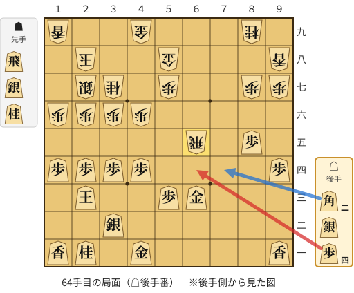

🔴 実戦 △６四歩打　🔵 AI推奨 △７四角打　🟨 直前の相手の指し手

<details><summary>テキストの盤面図（BOD・将棋ソフトに貼り付け可）</summary>

```text
後手の持駒：角二　銀　歩四
  ９ ８ ７ ６ ５ ４ ３ ２ １
+---------------------------+
|v香 ・ ・ ・ ・v金 ・v桂v香|一
| ・ ・ ・ ・ ・ ・v銀 ・ ・|二
| ・ ・ ・v金v歩 ・ ・v玉 ・|三
|v歩 ・ ・ ・ ・v歩v歩v歩v歩|四
| ・v歩 ・ 飛 ・ ・ ・ ・ ・|五
| ・ ・ ・ ・ ・ 歩 歩 歩 歩|六
| 歩 歩 ・ ・ 歩 ・ 桂 銀 ・|七
| 香 ・ ・ ・ 金 ・ ・ 玉 ・|八
| ・ 桂 ・ ・ ・ 金 ・ ・ 香|九
+---------------------------+
先手の持駒：飛　銀　桂
後手番
手数＝63　▲６五同飛　まで
```

</details>

| | 指し手 | 評価値 | 読み筋 |
|---|---|--:|---|
| 実戦 | △６四歩打 | -2167 | ▲８五飛(65) △４七銀打 ▲同金(58) △６七角打 ▲８二飛成(85) △４九角成(67) |
| AI 1位 | △７四角打 | -1117 | △７四角打 ▲７五飛(65) △６四金(63) ▲７四飛(75) △同金(64) ▲２五歩(26) |
| AI 2位 | △７四銀打 | -1274 | △７四銀打 ▲６八飛(65) △９五角打 ▲６九飛(68) △７八角打 ▲７九飛(69) |
| AI 3位 | △６二歩打 | -1297 | △６二歩打 ▲２五歩(26) △同歩(24) ▲８五飛(65) △２四銀打 ▲８一飛成(85) |

SFEN: `l4g1nl/6s2/3gp2k1/p4pppp/1p1R5/5PPPP/PP2P1NS1/L3G2K1/1N3G2L w RSN2bs4p 64`

<a id="ply-96"></a>
### 96手目 △３九飛成(49) — 大悪手

| | 着手前 | 着手後 | 差 |
|---|--:|--:|--:|
| 期待勝率 | 52.3% | 10.2% | -42.2pt |
| 評価値 | +56 | -1308 | |

着手前の局面:

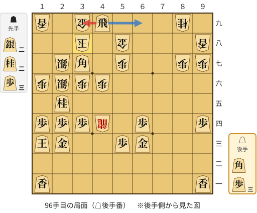

🔴 実戦 △３九飛成(49)　🔵 AI推奨 △６九飛成(49)　🟨 直前の相手の指し手

<details><summary>テキストの盤面図（BOD・将棋ソフトに貼り付け可）</summary>

```text
後手の持駒：角　歩三
  ９ ８ ７ ６ ５ ４ ３ ２ １
+---------------------------+
|v香 ・ ・ ・ ・ ・ ・ ・v香|一
| ・ ・ ・ ・ ・ ・ ・ ・ ・|二
| ・ ・ ・v金v歩 ・ ・v金v玉|三
|v歩 ・ ・v歩 ・ 龍v歩v歩v歩|四
| ・ ・ ・ ・ ・ ・ ・v桂 ・|五
| ・ ・ ・ ・ ・ 歩 歩 銀 歩|六
| 歩 歩 ・ ・ 歩 ・v角 銀 ・|七
| 香 ・ ・ ・ 金 ・ 玉 ・ ・|八
| ・ 桂 ・ ・ ・v飛 金 ・ 香|九
+---------------------------+
先手の持駒：銀二　桂二　歩三
後手番
手数＝95　▲３八玉　まで
```

</details>

| | 指し手 | 評価値 | 読み筋 |
|---|---|--:|---|
| 実戦 | △３九飛成(49) | -1308 | ▲同玉(38) △２八角打 ▲３八玉(39) △１九角成(28) ▲２五銀(26) △２八角成(37) |
| AI 1位 | △６九飛成(49) | +56 | △６九飛成(49) ▲５九銀打 △１九角成(37) ▲２八銀打 △４三香打 ▲同龍(44) |
| AI 2位 | △２六角成(37) | -421 | △２六角成(37) ▲同銀(27) △２七角打 ▲同玉(38) △３九飛成(49) ▲３一角打 |
| AI 3位 | △３九飛成(49) | -974 | △３九飛成(49) ▲同玉(38) △２八角打 ▲３八玉(39) △１九角成(28) ▲２五銀(26) |

SFEN: `l7l/9/3gp2gk/p2p1+Rppp/7n1/5PPSP/PP2P1bS1/L3G1K2/1N3rG1L w 2S2N3Pb3p 96`

