# 解析レポート 29w3l8boyi31

[README に戻る](../../../README.md)　/　棋譜: [CSA](../../../data/csa/shogi5/29w3l8boyi31.csa)　/　解析の見方: [docs/mistake_analysis.md](../../../docs/mistake_analysis.md)

## 対局情報

| 項目 | 内容 |
|---|---|
| 日時 | 2026-11-11 04:39:47 |
| 持ち時間 | 5分 |
| 自分 | 先手（▲）（1658） |
| 相手 | 相手（1610） |
| 結果 | 負け（時間切れ, 98手） |

## 解析環境

| 項目 | 内容 |
|---|---|
| エンジン | YaneuraOu NNUE 9.00git 64AVX2（V9.00/YANEURAOU_ENGINE_NNUE/AVX2） |
| 評価関数 | **水匠5**（`suisho5`） |
| nn.bin SHA-256 | `768068f0d534a0603a5d38bcd143de6bbca820d5f1c95a14d40863e5b7892d76` |
| 第1パス | movetime=150ms, MultiPV 1 |
| 第2パス | movetime=2000ms, MultiPV 3 |
| Threads / Hash | 8 / 512MB |
| 判定基準 | 疑問手 ≥5pt, 悪手 ≥10pt, 大悪手 ≥20pt（期待勝率 W(E)=1/(1+exp(-E/600))） |
| 解析日時 | 2026-11-14T10:41:49+09:00（解析バージョン 1, 75秒） |

## サマリー

| 自分の手数 | 深掘りした手 | 詰み逃し | 大悪手 | 悪手 | 疑問手 |
|--:|--:|--:|--:|--:|--:|
| 49 | 15 | 0 | 2 | 4 | 4 |

## 期待勝率の推移

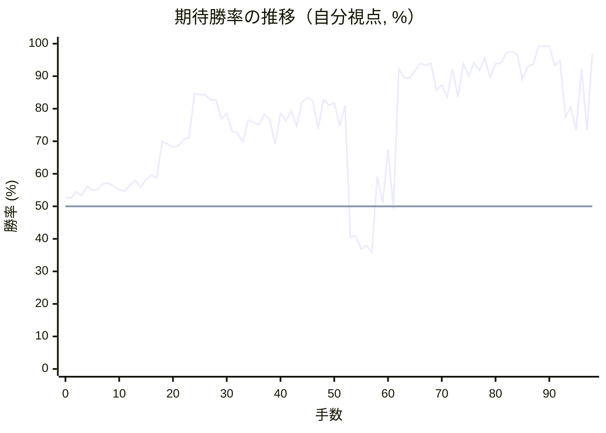

<details><summary>1手ごとの数値（第1パス）</summary>

| 手数 | 指し手 | 評価値 | 勝率 | 低下 | 判定 |
|--:|---|--:|--:|--:|---|
| 1 | ▲７六歩(77) | +61 | 52.5% | +0.2pt |  |
| 2 | △８四歩(83) | +108 | 54.5% |  |  |
| 3 | ▲２六歩(27) | +78 | 53.2% | +1.2pt |  |
| 4 | △３四歩(33) | +148 | 56.1% |  |  |
| 5 | ▲２五歩(26) | +117 | 54.9% | +1.3pt |  |
| 6 | △８五歩(84) | +125 | 55.2% |  |  |
| 7 | ▲７八金(69) | +166 | 56.9% | -1.7pt |  |
| 8 | △３二金(41) | +173 | 57.2% |  |  |
| 9 | ▲２四歩(25) | +148 | 56.1% | +1.0pt |  |
| 10 | △同歩(23) | +124 | 55.1% |  |  |
| 11 | ▲同飛(28) | +110 | 54.6% | +0.6pt |  |
| 12 | △８六歩(85) | +156 | 56.5% |  |  |
| 13 | ▲同歩(87) | +194 | 58.0% | -1.6pt |  |
| 14 | △同飛(82) | +140 | 55.8% |  |  |
| 15 | ▲３四飛(24) | +202 | 58.3% | -2.5pt |  |
| 16 | △８八角成(22) | +232 | 59.5% |  |  |
| 17 | ▲同銀(79) | +214 | 58.8% | +0.7pt |  |
| 18 | △２八歩打 | +507 | 70.0% |  |  |
| 19 | ▲同銀(39) | +484 | 69.1% | +0.8pt |  |
| 20 | △４五角打 | +455 | 68.1% |  |  |
| 21 | ▲２四飛(34) | +472 | 68.7% | -0.6pt |  |
| 22 | △２三歩打 | +523 | 70.5% |  |  |
| 23 | ▲７七角打 | +540 | 71.1% | -0.6pt |  |
| 24 | △７六飛(86) | +1027 | 84.7% |  |  |
| 25 | ▲８四飛(24) | +1010 | 84.3% | +0.4pt |  |
| 26 | △８二歩打 | +1007 | 84.3% |  |  |
| 27 | ▲３八金(49) | +940 | 82.7% | +1.5pt |  |
| 28 | △３三桂(21) | +945 | 82.8% |  |  |
| 29 | ▲８三歩打 | +718 | 76.8% | +6.1pt | [疑問手](#ply-29) |
| 30 | △７二金(61) | +778 | 78.5% |  |  |
| 31 | ▲８二歩成(83) | +600 | 73.1% | +5.4pt | [悪手](#ply-31) |
| 32 | △同銀(71) | +583 | 72.5% |  |  |
| 33 | ▲８七銀(88) | +503 | 69.8% | +2.7pt |  |
| 34 | △２六飛(76) | +708 | 76.5% |  |  |
| 35 | ▲２七歩打 | +684 | 75.8% | +0.7pt |  |
| 36 | △２五飛(26) | +663 | 75.1% |  |  |
| 37 | ▲５八玉(59) | +765 | 78.2% | -3.0pt |  |
| 38 | △５二玉(51) | +721 | 76.9% |  |  |
| 39 | ▲８六飛(84) | +482 | 69.1% | +7.8pt | [疑問手](#ply-39) |
| 40 | △６四歩(63) | +781 | 78.6% |  |  |
| 41 | ▲３六歩(37) | +700 | 76.3% | +2.4pt |  |
| 42 | △６三角(45) | +801 | 79.2% |  |  |
| 43 | ▲３七銀(28) | +650 | 74.7% | +4.5pt |  |
| 44 | △２四飛(25) | +911 | 82.0% |  |  |
| 45 | ▲７六銀(87) | +965 | 83.3% | -1.3pt |  |
| 46 | △７四歩(73) | +930 | 82.5% |  |  |
| 47 | ▲６八角(77) | +620 | 73.8% | +8.7pt |  |
| 48 | △８三歩打 | +941 | 82.8% |  |  |
| 49 | ▲７七桂(89) | +872 | 81.1% | +1.7pt |  |
| 50 | △７三銀(82) | +901 | 81.8% |  |  |
| 51 | ▲８五銀(76) | +652 | 74.8% | +7.0pt | [疑問手](#ply-51) |
| 52 | △７五歩(74) | +871 | 81.0% |  |  |
| 53 | ▲８四歩打 | -230 | 40.5% | +40.5pt | [大悪手](#ply-53) |
| 54 | △同歩(83) | -221 | 40.9% |  |  |
| 55 | ▲同銀(85) | -321 | 36.9% | +4.0pt |  |
| 56 | △８五歩打 | -296 | 37.9% |  |  |
| 57 | ▲７三銀成(84) | -348 | 35.9% | +2.0pt |  |
| 58 | △同桂(81) | +226 | 59.3% |  |  |
| 59 | ▲５六飛(86) | +22 | 50.9% | +8.4pt | [悪手](#ply-59) |
| 60 | △４五銀打 | +442 | 67.6% |  |  |
| 61 | ▲５五飛(56) | -20 | 49.2% | +18.5pt | [大悪手](#ply-61) |
| 62 | △６五歩(64) | +1480 | 92.2% |  |  |
| 63 | ▲同桂(77) | +1277 | 89.4% | +2.8pt |  |
| 64 | △５四銀(45) | +1280 | 89.4% |  |  |
| 65 | ▲７三桂成(65) | +1430 | 91.6% | -2.1pt |  |
| 66 | △同金(72) | +1640 | 93.9% |  |  |
| 67 | ▲７五飛(55) | +1585 | 93.3% | +0.5pt |  |
| 68 | △７四金(73) | +1643 | 93.9% |  |  |
| 69 | ▲７六飛(75) | +1072 | 85.7% | +8.3pt |  |
| 70 | △６五銀(54) | +1158 | 87.3% |  |  |
| 71 | ▲４六飛(76) | +982 | 83.7% | +3.6pt |  |
| 72 | △６四飛(24) | +1482 | 92.2% |  |  |
| 73 | ▲３五歩(36) | +977 | 83.6% | +8.6pt |  |
| 74 | △９四歩(93) | +1635 | 93.8% |  |  |
| 75 | ▲２六飛(46) | +1322 | 90.1% | +3.8pt |  |
| 76 | △７五金(74) | +1658 | 94.1% |  |  |
| 77 | ▲４六銀(37) | +1442 | 91.7% | +2.4pt |  |
| 78 | △７四飛(64) | +1831 | 95.5% |  |  |
| 79 | ▲５五銀(46) | +1291 | 89.6% | +5.9pt |  |
| 80 | △５四銀(65) | +1642 | 93.9% |  |  |
| 81 | ▲同銀(55) | +1654 | 94.0% | -0.1pt |  |
| 82 | △同飛(74) | +2138 | 97.2% |  |  |
| 83 | ▲７六歩打 | +2201 | 97.5% | -0.3pt |  |
| 84 | △６五金(75) | +2040 | 96.8% |  |  |
| 85 | ▲６六桂打 | +1252 | 89.0% | +7.8pt | [疑問手](#ply-85) |
| 86 | △４四飛(54) | +1553 | 93.0% |  |  |
| 87 | ▲７四銀打 | +1615 | 93.7% | -0.6pt |  |
| 88 | △６四金(65) | +2930 | 99.2% |  |  |
| 89 | ▲６三銀成(74) | +2873 | 99.2% | +0.1pt |  |
| 90 | △同金(64) | +2951 | 99.3% |  |  |
| 91 | ▲５五銀打 | +1576 | 93.3% | +6.0pt |  |
| 92 | △８四飛(44) | +1731 | 94.7% |  |  |
| 93 | ▲３六飛(26) | +743 | 77.5% | +17.2pt | [悪手](#ply-93) |
| 94 | △４五銀打 | +852 | 80.5% |  |  |
| 95 | ▲２六飛(36) | +612 | 73.5% | +7.0pt |  |
| 96 | △８六歩(85) | +1485 | 92.2% |  |  |
| 97 | ▲８八歩打 | +613 | 73.5% | +18.7pt | [悪手](#ply-97) |
| 98 | △５四歩(53) | +2054 | 96.8% |  |  |

</details>

## 課題局面

<a id="ply-29"></a>
### 29手目 ▲８三歩打 — 疑問手

| | 着手前 | 着手後 | 差 |
|---|--:|--:|--:|
| 期待勝率 | 83.2% | 76.6% | -6.7pt |
| 評価値 | +962 | +710 | |

着手前の局面:

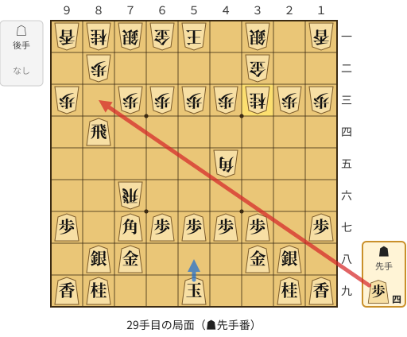

🔴 実戦 ▲８三歩打　🔵 AI推奨 ▲５八玉(59)　🟨 直前の相手の指し手

<details><summary>テキストの盤面図（BOD・将棋ソフトに貼り付け可）</summary>

```text
後手の持駒：なし
  ９ ８ ７ ６ ５ ４ ３ ２ １
+---------------------------+
|v香v桂v銀v金v玉 ・v銀 ・v香|一
| ・v歩 ・ ・ ・ ・v金 ・ ・|二
|v歩 ・v歩v歩v歩v歩v桂v歩v歩|三
| ・ 飛 ・ ・ ・ ・ ・ ・ ・|四
| ・ ・ ・ ・ ・v角 ・ ・ ・|五
| ・ ・v飛 ・ ・ ・ ・ ・ ・|六
| 歩 ・ 角 歩 歩 歩 歩 ・ 歩|七
| ・ 銀 金 ・ ・ ・ 金 銀 ・|八
| 香 桂 ・ ・ 玉 ・ ・ 桂 香|九
+---------------------------+
先手の持駒：歩四
手数＝28　△３三桂　まで
```

</details>

| | 指し手 | 評価値 | 読み筋 |
|---|---|--:|---|
| 実戦 | ▲８三歩打 | +710 | △７二金(61) ▲８七銀(88) △７五飛(76) ▲６六角(77) △６五飛(75) ▲５八玉(59) |
| AI 1位 | ▲５八玉(59) | +962 | ▲５八玉(59) △５二玉(51) ▲８七銀(88) △２六飛(76) ▲９六歩(97) △１四歩(13) |
| AI 2位 | ▲４八玉(59) | +932 | ▲４八玉(59) △５二玉(51) ▲８七銀(88) △２六飛(76) ▲２七歩打 △２四飛(26) |
| AI 3位 | ▲９六歩(97) | +926 | ▲９六歩(97) △５二玉(51) ▲５八玉(59) △４二銀(31) ▲８七銀(88) △７五飛(76) |

SFEN: `lnsgk1s1l/1p4g2/p1ppppnpp/1R7/5b3/2r6/P1BPPPP1P/1SG3GS1/LN2K2NL b 4P 29`

<a id="ply-31"></a>
### 31手目 ▲８二歩成(83) — 悪手

| | 着手前 | 着手後 | 差 |
|---|--:|--:|--:|
| 期待勝率 | 79.6% | 69.5% | -10.1pt |
| 評価値 | +816 | +494 | |

着手前の局面:

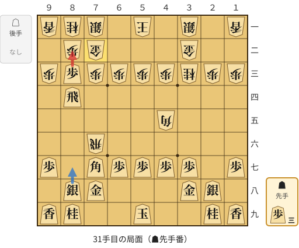

🔴 実戦 ▲８二歩成(83)　🔵 AI推奨 ▲８七銀(88)　🟨 直前の相手の指し手

<details><summary>テキストの盤面図（BOD・将棋ソフトに貼り付け可）</summary>

```text
後手の持駒：なし
  ９ ８ ７ ６ ５ ４ ３ ２ １
+---------------------------+
|v香v桂v銀 ・v玉 ・v銀 ・v香|一
| ・v歩v金 ・ ・ ・v金 ・ ・|二
|v歩 歩v歩v歩v歩v歩v桂v歩v歩|三
| ・ 飛 ・ ・ ・ ・ ・ ・ ・|四
| ・ ・ ・ ・ ・v角 ・ ・ ・|五
| ・ ・v飛 ・ ・ ・ ・ ・ ・|六
| 歩 ・ 角 歩 歩 歩 歩 ・ 歩|七
| ・ 銀 金 ・ ・ ・ 金 銀 ・|八
| 香 桂 ・ ・ 玉 ・ ・ 桂 香|九
+---------------------------+
先手の持駒：歩三
手数＝30　△７二金　まで
```

</details>

| | 指し手 | 評価値 | 読み筋 |
|---|---|--:|---|
| 実戦 | ▲８二歩成(83) | +494 | △同銀(71) ▲８五飛(84) △５二玉(51) ▲８七銀(88) △７四飛(76) ▲５八玉(59) |
| AI 1位 | ▲８七銀(88) | +816 | ▲８七銀(88) △２六飛(76) ▲８二歩成(83) △同銀(71) ▲２七歩打 △２五飛(26) |
| AI 2位 | ▲８二歩成(83) | +585 | ▲８二歩成(83) △同銀(71) ▲８七銀(88) △７五飛(76) ▲３六歩(37) △５二玉(51) |
| AI 3位 | ▲８五飛(84) | +568 | ▲８五飛(84) △５四角(45) ▲８七銀(88) △２六飛(76) ▲２七歩打 △２四飛(26) |

SFEN: `lns1k1s1l/1pg3g2/pPppppnpp/1R7/5b3/2r6/P1BPPPP1P/1SG3GS1/LN2K2NL b 3P 31`

<a id="ply-39"></a>
### 39手目 ▲８六飛(84) — 疑問手

| | 着手前 | 着手後 | 差 |
|---|--:|--:|--:|
| 期待勝率 | 77.4% | 72.4% | -5.1pt |
| 評価値 | +740 | +578 | |

着手前の局面:

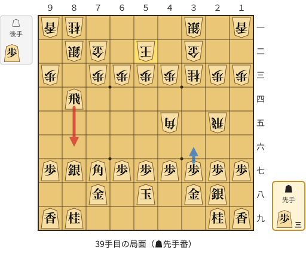

🔴 実戦 ▲８六飛(84)　🔵 AI推奨 ▲３六歩(37)　🟨 直前の相手の指し手

<details><summary>テキストの盤面図（BOD・将棋ソフトに貼り付け可）</summary>

```text
後手の持駒：歩
  ９ ８ ７ ６ ５ ４ ３ ２ １
+---------------------------+
|v香v桂 ・ ・ ・ ・v銀 ・v香|一
| ・v銀v金 ・v玉 ・v金 ・ ・|二
|v歩 ・v歩v歩v歩v歩v桂v歩v歩|三
| ・ 飛 ・ ・ ・ ・ ・ ・ ・|四
| ・ ・ ・ ・ ・v角 ・v飛 ・|五
| ・ ・ ・ ・ ・ ・ ・ ・ ・|六
| 歩 銀 角 歩 歩 歩 歩 歩 歩|七
| ・ ・ 金 ・ 玉 ・ 金 銀 ・|八
| 香 桂 ・ ・ ・ ・ ・ 桂 香|九
+---------------------------+
先手の持駒：歩三
手数＝38　△５二玉　まで
```

</details>

| | 指し手 | 評価値 | 読み筋 |
|---|---|--:|---|
| 実戦 | ▲８六飛(84) | +578 | △７四歩(73) ▲３六歩(37) △５四角(45) ▲３七銀(28) △４二銀(31) ▲４六銀(37) |
| AI 1位 | ▲３六歩(37) | +740 | ▲３六歩(37) △５四角(45) ▲３七銀(28) △４二銀(31) ▲４六銀(37) △８三銀(82) |
| AI 2位 | ▲６八角(77) | +471 | ▲６八角(77) △４二銀(31) ▲３六歩(37) △５四角(45) ▲３七銀(28) △８三銀(82) |
| AI 3位 | ▲９六歩(97) | +458 | ▲９六歩(97) △７四歩(73) ▲３六歩(37) △５四角(45) ▲３七銀(28) △４二銀(31) |

SFEN: `ln4s1l/1sg1k1g2/p1ppppnpp/1R7/5b1r1/9/PSBPPPPPP/2G1K1GS1/LN5NL b 3Pp 39`

<a id="ply-51"></a>
### 51手目 ▲８五銀(76) — 疑問手

| | 着手前 | 着手後 | 差 |
|---|--:|--:|--:|
| 期待勝率 | 84.1% | 76.8% | -7.3pt |
| 評価値 | +998 | +717 | |

着手前の局面:

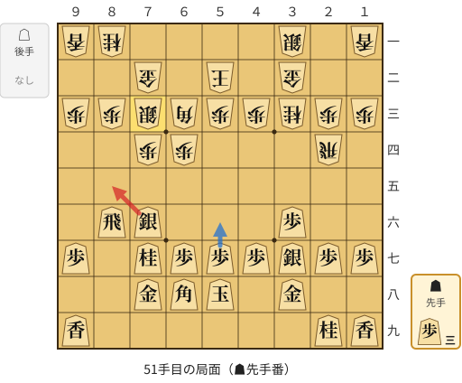

🔴 実戦 ▲８五銀(76)　🔵 AI推奨 ▲５六歩(57)　🟨 直前の相手の指し手

<details><summary>テキストの盤面図（BOD・将棋ソフトに貼り付け可）</summary>

```text
後手の持駒：なし
  ９ ８ ７ ６ ５ ４ ３ ２ １
+---------------------------+
|v香v桂 ・ ・ ・ ・v銀 ・v香|一
| ・ ・v金 ・v玉 ・v金 ・ ・|二
|v歩v歩v銀v角v歩v歩v桂v歩v歩|三
| ・ ・v歩v歩 ・ ・ ・v飛 ・|四
| ・ ・ ・ ・ ・ ・ ・ ・ ・|五
| ・ 飛 銀 ・ ・ ・ 歩 ・ ・|六
| 歩 ・ 桂 歩 歩 歩 銀 歩 歩|七
| ・ ・ 金 角 玉 ・ 金 ・ ・|八
| 香 ・ ・ ・ ・ ・ ・ 桂 香|九
+---------------------------+
先手の持駒：歩三
手数＝50　△７三銀　まで
```

</details>

| | 指し手 | 評価値 | 読み筋 |
|---|---|--:|---|
| 実戦 | ▲８五銀(76) | +717 | △３四飛(24) ▲４八玉(58) △４二銀(31) ▲７六銀(85) △８四銀(73) ▲６六歩(67) |
| AI 1位 | ▲５六歩(57) | +998 | ▲５六歩(57) △３四飛(24) ▲６六歩(67) △４二銀(31) ▲４八玉(58) △８四銀(73) |
| AI 2位 | ▲６六歩(67) | +984 | ▲６六歩(67) △３四飛(24) ▲４八玉(58) △４二銀(31) ▲５六歩(57) △９四歩(93) |
| AI 3位 | ▲４八玉(58) | +976 | ▲４八玉(58) △３四飛(24) ▲６六歩(67) △８四銀(73) ▲５六歩(57) △７三桂(81) |

SFEN: `ln4s1l/2g1k1g2/ppsbppnpp/2pp3r1/9/1RS3P2/P1NPPPSPP/2GBK1G2/L6NL b 3P 51`

<a id="ply-53"></a>
### 53手目 ▲８四歩打 — 大悪手

| | 着手前 | 着手後 | 差 |
|---|--:|--:|--:|
| 期待勝率 | 83.7% | 38.9% | -44.8pt |
| 評価値 | +981 | -271 | |

着手前の局面:

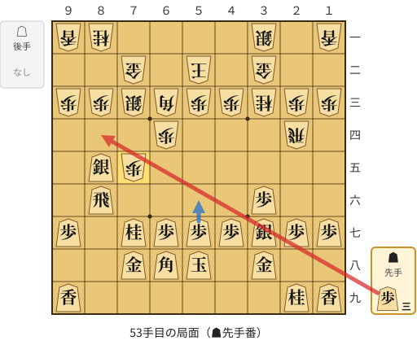

🔴 実戦 ▲８四歩打　🔵 AI推奨 ▲５六歩(57)　🟨 直前の相手の指し手

<details><summary>テキストの盤面図（BOD・将棋ソフトに貼り付け可）</summary>

```text
後手の持駒：なし
  ９ ８ ７ ６ ５ ４ ３ ２ １
+---------------------------+
|v香v桂 ・ ・ ・ ・v銀 ・v香|一
| ・ ・v金 ・v玉 ・v金 ・ ・|二
|v歩v歩v銀v角v歩v歩v桂v歩v歩|三
| ・ ・ ・v歩 ・ ・ ・v飛 ・|四
| ・ 銀v歩 ・ ・ ・ ・ ・ ・|五
| ・ 飛 ・ ・ ・ ・ 歩 ・ ・|六
| 歩 ・ 桂 歩 歩 歩 銀 歩 歩|七
| ・ ・ 金 角 玉 ・ 金 ・ ・|八
| 香 ・ ・ ・ ・ ・ ・ 桂 香|九
+---------------------------+
先手の持駒：歩三
手数＝52　△７五歩　まで
```

</details>

| | 指し手 | 評価値 | 読み筋 |
|---|---|--:|---|
| 実戦 | ▲８四歩打 | -271 | △同歩(83) ▲同銀(85) △８五歩打 ▲７三銀成(84) △８六歩(85) ▲６三成銀(73) |
| AI 1位 | ▲５六歩(57) | +981 | ▲５六歩(57) △１四飛(24) ▲１六歩(17) △４二銀(31) ▲７四歩打 △同銀(73) |
| AI 2位 | ▲５六歩(57) | +901 | ▲５六歩(57) △３四飛(24) ▲４六銀(37) △３六飛(34) ▲３七金(38) △同飛成(36) |
| AI 3位 | ▲４八玉(58) | +786 | ▲４八玉(58) △４二銀(31) ▲５六歩(57) △３四飛(24) ▲３九玉(48) △１四歩(13) |

SFEN: `ln4s1l/2g1k1g2/ppsbppnpp/3p3r1/1Sp6/1R4P2/P1NPPPSPP/2GBK1G2/L6NL b 3P 53`

<a id="ply-59"></a>
### 59手目 ▲５六飛(86) — 悪手

| | 着手前 | 着手後 | 差 |
|---|--:|--:|--:|
| 期待勝率 | 64.6% | 54.3% | -10.3pt |
| 評価値 | +361 | +104 | |

着手前の局面:

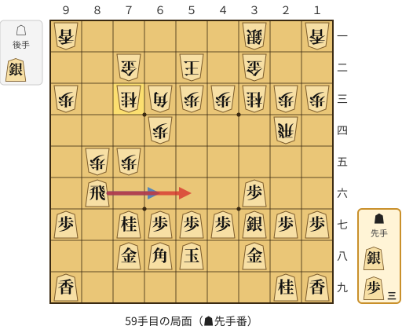

🔴 実戦 ▲５六飛(86)　🔵 AI推奨 ▲６六飛(86)　🟨 直前の相手の指し手

<details><summary>テキストの盤面図（BOD・将棋ソフトに貼り付け可）</summary>

```text
後手の持駒：銀
  ９ ８ ７ ６ ５ ４ ３ ２ １
+---------------------------+
|v香 ・ ・ ・ ・ ・v銀 ・v香|一
| ・ ・v金 ・v玉 ・v金 ・ ・|二
|v歩 ・v桂v角v歩v歩v桂v歩v歩|三
| ・ ・ ・v歩 ・ ・ ・v飛 ・|四
| ・v歩v歩 ・ ・ ・ ・ ・ ・|五
| ・ 飛 ・ ・ ・ ・ 歩 ・ ・|六
| 歩 ・ 桂 歩 歩 歩 銀 歩 歩|七
| ・ ・ 金 角 玉 ・ 金 ・ ・|八
| 香 ・ ・ ・ ・ ・ ・ 桂 香|九
+---------------------------+
先手の持駒：銀　歩三
手数＝58　△７三同桂　まで
```

</details>

| | 指し手 | 評価値 | 読み筋 |
|---|---|--:|---|
| 実戦 | ▲５六飛(86) | +104 | △４二銀(31) ▲６六飛(56) △７六銀打 ▲４八玉(58) △６五桂(73) ▲同桂(77) |
| AI 1位 | ▲６六飛(86) | +361 | ▲６六飛(86) △７六銀打 ▲４八玉(58) △８六歩(85) ▲８八歩打 △４二銀(31) |
| AI 2位 | ▲５六飛(86) | +117 | ▲５六飛(86) △７四角(63) ▲６六飛(56) △６五歩(64) ▲５六飛(66) △８三角(74) |
| AI 3位 | ▲８五桂(77) | +3 | ▲８五桂(77) △同桂(73) ▲５六歩(57) △３四飛(24) ▲８四歩打 △７七銀打 |

SFEN: `l5s1l/2g1k1g2/p1nbppnpp/3p3r1/1pp6/1R4P2/P1NPPPSPP/2GBK1G2/L6NL b S3Ps 59`

<a id="ply-61"></a>
### 61手目 ▲５五飛(56) — 大悪手

| | 着手前 | 着手後 | 差 |
|---|--:|--:|--:|
| 期待勝率 | 71.8% | 50.1% | -21.7pt |
| 評価値 | +560 | +2 | |

着手前の局面:

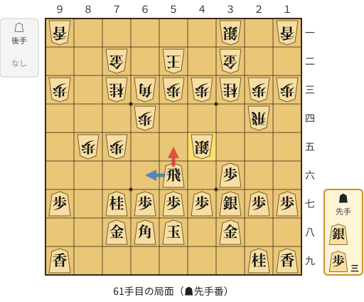

🔴 実戦 ▲５五飛(56)　🔵 AI推奨 ▲６六飛(56)　🟨 直前の相手の指し手

<details><summary>テキストの盤面図（BOD・将棋ソフトに貼り付け可）</summary>

```text
後手の持駒：なし
  ９ ８ ７ ６ ５ ４ ３ ２ １
+---------------------------+
|v香 ・ ・ ・ ・ ・v銀 ・v香|一
| ・ ・v金 ・v玉 ・v金 ・ ・|二
|v歩 ・v桂v角v歩v歩v桂v歩v歩|三
| ・ ・ ・v歩 ・ ・ ・v飛 ・|四
| ・v歩v歩 ・ ・v銀 ・ ・ ・|五
| ・ ・ ・ ・ 飛 ・ 歩 ・ ・|六
| 歩 ・ 桂 歩 歩 歩 銀 歩 歩|七
| ・ ・ 金 角 玉 ・ 金 ・ ・|八
| 香 ・ ・ ・ ・ ・ ・ 桂 香|九
+---------------------------+
先手の持駒：銀　歩三
手数＝60　△４五銀　まで
```

</details>

| | 指し手 | 評価値 | 読み筋 |
|---|---|--:|---|
| 実戦 | ▲５五飛(56) | +2 | △７六歩(75) ▲７五飛(55) △７七歩成(76) ▲同角(68) △８三桂打 ▲７六飛(75) |
| AI 1位 | ▲６六飛(56) | +560 | ▲６六飛(56) △４二銀(31) ▲８四歩打 △４一玉(52) ▲５五銀打 △７六歩(75) |
| AI 2位 | ▲９六飛(56) | +315 | ▲９六飛(56) △９四歩(93) ▲６六飛(96) △４二銀(31) ▲８四歩打 △７四角(63) |
| AI 3位 | ▲５五飛(56) | +35 | ▲５五飛(56) △７六歩(75) ▲７五飛(55) △７七歩成(76) ▲同角(68) △７四桂打 |

SFEN: `l5s1l/2g1k1g2/p1nbppnpp/3p3r1/1pp2s3/4R1P2/P1NPPPSPP/2GBK1G2/L6NL b S3P 61`

<a id="ply-85"></a>
### 85手目 ▲６六桂打 — 疑問手

| | 着手前 | 着手後 | 差 |
|---|--:|--:|--:|
| 期待勝率 | 98.4% | 92.5% | -5.9pt |
| 評価値 | +2484 | +1511 | |

着手前の局面:

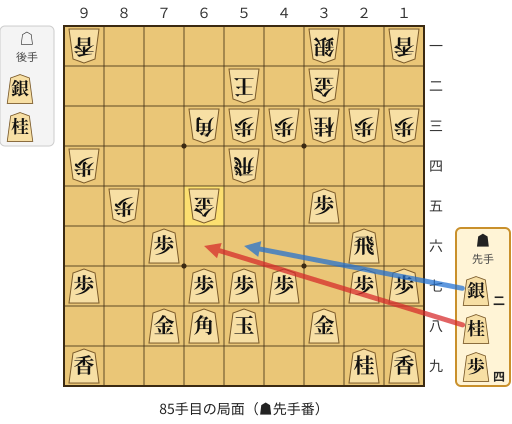

🔴 実戦 ▲６六桂打　🔵 AI推奨 ▲５六銀打　🟨 直前の相手の指し手

<details><summary>テキストの盤面図（BOD・将棋ソフトに貼り付け可）</summary>

```text
後手の持駒：銀　桂
  ９ ８ ７ ６ ５ ４ ３ ２ １
+---------------------------+
|v香 ・ ・ ・ ・ ・v銀 ・v香|一
| ・ ・ ・ ・v玉 ・v金 ・ ・|二
| ・ ・ ・v角v歩v歩v桂v歩v歩|三
|v歩 ・ ・ ・v飛 ・ ・ ・ ・|四
| ・v歩 ・v金 ・ ・ 歩 ・ ・|五
| ・ ・ 歩 ・ ・ ・ ・ 飛 ・|六
| 歩 ・ ・ 歩 歩 歩 ・ 歩 歩|七
| ・ ・ 金 角 玉 ・ 金 ・ ・|八
| 香 ・ ・ ・ ・ ・ ・ 桂 香|九
+---------------------------+
先手の持駒：銀二　桂　歩四
手数＝84　△６五金　まで
```

</details>

| | 指し手 | 評価値 | 読み筋 |
|---|---|--:|---|
| 実戦 | ▲６六桂打 | +1511 | △１四飛(54) ▲１六歩(17) △８六桂打 ▲８八金(78) △２五銀打 ▲４六飛(26) |
| AI 1位 | ▲５六銀打 | +2484 | ▲５六銀打 △６四金(65) ▲６五銀打 △同金(64) ▲同銀(56) △１四飛(54) |
| AI 2位 | ▲６六銀打 | +2327 | ▲６六銀打 △６四金(65) ▲６五銀打 △１四飛(54) ▲６四銀(65) △同飛(14) |
| AI 3位 | ▲７五桂打 | +2283 | ▲７五桂打 △７四角(63) ▲７二銀打 △５一桂打 ▲８三銀打 △同角(74) |

SFEN: `l5s1l/4k1g2/3bppnpp/p3r4/1p1g2P2/2P4R1/P2PPP1PP/2GBK1G2/L6NL b 2SN4Psn 85`

<a id="ply-93"></a>
### 93手目 ▲３六飛(26) — 悪手

| | 着手前 | 着手後 | 差 |
|---|--:|--:|--:|
| 期待勝率 | 94.9% | 81.5% | -13.4pt |
| 評価値 | +1753 | +891 | |

着手前の局面:

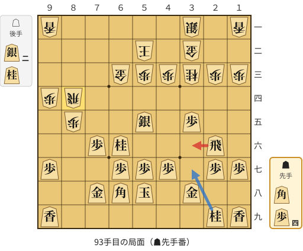

🔴 実戦 ▲３六飛(26)　🔵 AI推奨 ▲３七桂(29)　🟨 直前の相手の指し手

<details><summary>テキストの盤面図（BOD・将棋ソフトに貼り付け可）</summary>

```text
後手の持駒：銀二　桂
  ９ ８ ７ ６ ５ ４ ３ ２ １
+---------------------------+
|v香 ・ ・ ・ ・ ・v銀 ・v香|一
| ・ ・ ・ ・v玉 ・v金 ・ ・|二
| ・ ・ ・v金v歩v歩v桂v歩v歩|三
|v歩v飛 ・ ・ ・ ・ ・ ・ ・|四
| ・v歩 ・ ・ 銀 ・ 歩 ・ ・|五
| ・ ・ 歩 桂 ・ ・ ・ 飛 ・|六
| 歩 ・ ・ 歩 歩 歩 ・ 歩 歩|七
| ・ ・ 金 角 玉 ・ 金 ・ ・|八
| 香 ・ ・ ・ ・ ・ ・ 桂 香|九
+---------------------------+
先手の持駒：角　歩四
手数＝92　△８四飛　まで
```

</details>

| | 指し手 | 評価値 | 読み筋 |
|---|---|--:|---|
| 実戦 | ▲３六飛(26) | +891 | △４五銀打 ▲２六飛(36) △１五銀打 ▲４六歩(47) △２六銀(15) ▲同歩(27) |
| AI 1位 | ▲３七桂(29) | +1753 | ▲３七桂(29) △８六歩(85) ▲７五角打 △８五飛(84) ▲８八歩打 △７三銀打 |
| AI 2位 | ▲５六歩(57) | +1475 | ▲５六歩(57) △６五桂打 ▲３七桂(29) △４二銀(31) ▲１六歩(17) △５一銀(42) |
| AI 3位 | ▲９六歩(97) | +1216 | ▲９六歩(97) △２五銀打 ▲５六飛(26) △４五銀打 ▲３七桂(29) △５六銀(45) |

SFEN: `l5s1l/4k1g2/3gppnpp/pr7/1p2S1P2/2PN3R1/P2PPP1PP/2GBK1G2/L6NL b B4P2sn 93`

<a id="ply-97"></a>
### 97手目 ▲８八歩打 — 悪手

| | 着手前 | 着手後 | 差 |
|---|--:|--:|--:|
| 期待勝率 | 94.4% | 74.6% | -19.8pt |
| 評価値 | +1695 | +646 | |

着手前の局面:

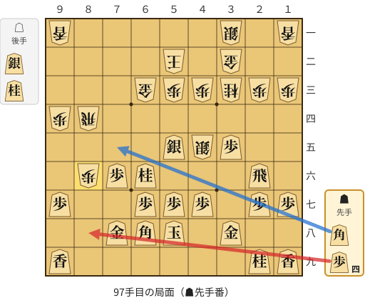

🔴 実戦 ▲８八歩打　🔵 AI推奨 ▲７五角打　🟨 直前の相手の指し手

<details><summary>テキストの盤面図（BOD・将棋ソフトに貼り付け可）</summary>

```text
後手の持駒：銀　桂
  ９ ８ ７ ６ ５ ４ ３ ２ １
+---------------------------+
|v香 ・ ・ ・ ・ ・v銀 ・v香|一
| ・ ・ ・ ・v玉 ・v金 ・ ・|二
| ・ ・ ・v金v歩v歩v桂v歩v歩|三
|v歩v飛 ・ ・ ・ ・ ・ ・ ・|四
| ・ ・ ・ ・ 銀v銀 歩 ・ ・|五
| ・v歩 歩 桂 ・ ・ ・ 飛 ・|六
| 歩 ・ ・ 歩 歩 歩 ・ 歩 歩|七
| ・ ・ 金 角 玉 ・ 金 ・ ・|八
| 香 ・ ・ ・ ・ ・ ・ 桂 香|九
+---------------------------+
先手の持駒：角　歩四
手数＝96　△８六歩　まで
```

</details>

| | 指し手 | 評価値 | 読み筋 |
|---|---|--:|---|
| 実戦 | ▲８八歩打 | +646 | △１五銀打 ▲７五角打 △１四飛(84) ▲８六角(68) △４二銀(31) ▲５四桂(66) |
| AI 1位 | ▲７五角打 | +1695 | ▲７五角打 △８五飛(84) ▲６四銀(55) △８七歩成(86) ▲６三銀不成(64) △同玉(52) |
| AI 2位 | ▲７九金(78) | +1042 | ▲７九金(78) △２五銀打 ▲同飛(26) △同桂(33) ▲２六歩(27) △１七桂成(25) |
| AI 3位 | ▲４六歩(47) | +1024 | ▲４六歩(47) △８七歩成(86) ▲７九金(78) △７七と(87) ▲同角(68) △８七飛成(84) |

SFEN: `l5s1l/4k1g2/3gppnpp/pr7/4SsP2/1pPN3R1/P2PPP1PP/2GBK1G2/L6NL b B4Psn 97`

