# 解析レポート 2pyf9x9cyrto

[README に戻る](../../../README.md)　/　棋譜: [CSA](../../../data/csa/shogi5/2pyf9x9cyrto.csa)　/　解析の見方: [docs/mistake_analysis.md](../../../docs/mistake_analysis.md)

## 対局情報

| 項目 | 内容 |
|---|---|
| 日時 | 2026-11-07 10:14:23 |
| 持ち時間 | 5分 |
| 自分 | 先手（▲）（1731） |
| 相手 | 相手（2029） |
| 結果 | 負け（時間切れ, 96手） |

## 解析環境

| 項目 | 内容 |
|---|---|
| エンジン | YaneuraOu NNUE 9.00git 64AVX2（V9.00/YANEURAOU_ENGINE_NNUE/AVX2） |
| 評価関数 | **水匠5**（`suisho5`） |
| nn.bin SHA-256 | `768068f0d534a0603a5d38bcd143de6bbca820d5f1c95a14d40863e5b7892d76` |
| 第1パス | movetime=150ms, MultiPV 1 |
| 第2パス | movetime=2000ms, MultiPV 3 |
| Threads / Hash | 8 / 512MB |
| 判定基準 | 疑問手 ≥5pt, 悪手 ≥10pt, 大悪手 ≥20pt（期待勝率 W(E)=1/(1+exp(-E/600))） |
| 解析日時 | 2026-11-11T20:27:10+09:00（解析バージョン 1, 91秒） |

## サマリー

| 自分の手数 | 深掘りした手 | 詰み逃し | 大悪手 | 悪手 | 疑問手 |
|--:|--:|--:|--:|--:|--:|
| 48 | 19 | 0 | 6 | 7 | 0 |

## 期待勝率の推移

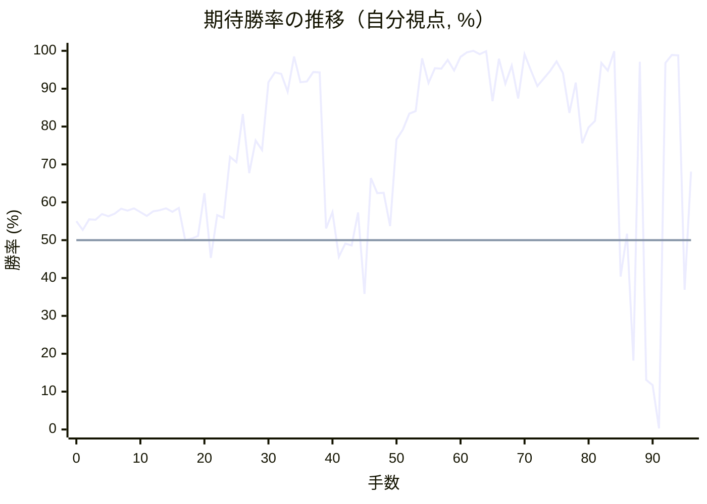

<details><summary>1手ごとの数値（第1パス）</summary>

| 手数 | 指し手 | 評価値 | 勝率 | 低下 | 判定 |
|--:|---|--:|--:|--:|---|
| 1 | ▲７六歩(77) | +66 | 52.7% | +2.2pt |  |
| 2 | △８四歩(83) | +133 | 55.5% |  |  |
| 3 | ▲２六歩(27) | +131 | 55.4% | +0.1pt |  |
| 4 | △３四歩(33) | +166 | 56.9% |  |  |
| 5 | ▲２五歩(26) | +153 | 56.3% | +0.5pt |  |
| 6 | △８五歩(84) | +168 | 57.0% |  |  |
| 7 | ▲７八金(69) | +200 | 58.3% | -1.3pt |  |
| 8 | △３二金(41) | +188 | 57.8% |  |  |
| 9 | ▲２四歩(25) | +203 | 58.4% | -0.6pt |  |
| 10 | △同歩(23) | +178 | 57.4% |  |  |
| 11 | ▲同飛(28) | +154 | 56.4% | +1.0pt |  |
| 12 | △８六歩(85) | +183 | 57.6% |  |  |
| 13 | ▲同歩(87) | +191 | 57.9% | -0.3pt |  |
| 14 | △同飛(82) | +204 | 58.4% |  |  |
| 15 | ▲３四飛(24) | +182 | 57.5% | +0.9pt |  |
| 16 | △３三角(22) | +207 | 58.5% |  |  |
| 17 | ▲６八玉(59) | +1 | 50.0% | +8.5pt |  |
| 18 | △５二玉(51) | +10 | 50.4% |  |  |
| 19 | ▲３六歩(37) | +27 | 51.1% | -0.7pt |  |
| 20 | △７二銀(71) | +305 | 62.4% |  |  |
| 21 | ▲１六歩(17) | -114 | 45.3% | +17.2pt | [悪手](#ply-21) |
| 22 | △９四歩(93) | +160 | 56.6% |  |  |
| 23 | ▲３七桂(29) | +143 | 55.9% | +0.7pt |  |
| 24 | △８五飛(86) | +567 | 72.0% |  |  |
| 25 | ▲７七桂(89) | +526 | 70.6% | +1.4pt |  |
| 26 | △５五飛(85) | +965 | 83.3% |  |  |
| 27 | ▲９六歩(97) | +444 | 67.7% | +15.6pt | [悪手](#ply-27) |
| 28 | △２六歩打 | +702 | 76.3% |  |  |
| 29 | ▲３八銀(39) | +621 | 73.8% | +2.5pt |  |
| 30 | △５四飛(55) | +1438 | 91.7% |  |  |
| 31 | ▲同飛(34) | +1681 | 94.3% | -2.6pt |  |
| 32 | △同歩(53) | +1637 | 93.9% |  |  |
| 33 | ▲４五桂(37) | +1266 | 89.2% | +4.7pt |  |
| 34 | △５五角(33) | +2506 | 98.5% |  |  |
| 35 | ▲５三飛打 | +1444 | 91.7% | +6.8pt |  |
| 36 | △６二玉(52) | +1461 | 91.9% |  |  |
| 37 | ▲５四飛成(53) | +1694 | 94.4% | -2.4pt |  |
| 38 | △１九角成(55) | +1687 | 94.3% |  |  |
| 39 | ▲８二歩打 | +75 | 53.1% | +41.2pt | [大悪手](#ply-39) |
| 40 | △５一香打 | +178 | 57.4% |  |  |
| 41 | ▲２四龍(54) | -106 | 45.6% | +11.8pt | [悪手](#ply-41) |
| 42 | △３七歩打 | -21 | 49.1% |  |  |
| 43 | ▲８一歩成(82) | -33 | 48.6% | +0.5pt |  |
| 44 | △同銀(72) | +177 | 57.3% |  |  |
| 45 | ▲８四龍(24) | -351 | 35.8% | +21.5pt | [悪手](#ply-45) |
| 46 | △８二歩打 | +410 | 66.4% |  |  |
| 47 | ▲６五桂(77) | +305 | 62.4% | +4.0pt |  |
| 48 | △３八歩成(37) | +306 | 62.5% |  |  |
| 49 | ▲同金(49) | +90 | 53.7% | +8.7pt | [悪手](#ply-49) |
| 50 | △１八飛打 | +712 | 76.6% |  |  |
| 51 | ▲２八歩打 | +802 | 79.2% | -2.6pt |  |
| 52 | △６四銀打 | +967 | 83.4% |  |  |
| 53 | ▲１一角成(88) | +1000 | 84.1% | -0.7pt |  |
| 54 | △２九馬(19) | +2335 | 98.0% |  |  |
| 55 | ▲５六香打 | +1424 | 91.5% | +6.5pt |  |
| 56 | △６五銀(64) | +1814 | 95.4% |  |  |
| 57 | ▲５一香成(56) | +1806 | 95.3% | +0.1pt |  |
| 58 | △同玉(62) | +2231 | 97.6% |  |  |
| 59 | ▲５五香打 | +1740 | 94.8% | +2.8pt |  |
| 60 | △６二玉(51) | +2453 | 98.4% |  |  |
| 61 | ▲５三桂成(45) | +3310 | 99.6% | -1.2pt |  |
| 62 | △７二玉(62) | +5776 | 100.0% |  |  |
| 63 | ▲７五桂打 | +2814 | 99.1% | +0.9pt |  |
| 64 | △７一桂打 | +4120 | 99.9% |  |  |
| 65 | ▲８三歩打 | +1127 | 86.7% | +13.2pt |  |
| 66 | △７四銀(65) | +2315 | 97.9% |  |  |
| 67 | ▲６三成桂(53) | +1408 | 91.3% | +6.7pt |  |
| 68 | △同桂(71) | +1928 | 96.1% |  |  |
| 69 | ▲同桂成(75) | +1164 | 87.4% | +8.7pt |  |
| 70 | △同銀(74) | +2816 | 99.1% |  |  |
| 71 | ▲７五桂打 | +1738 | 94.8% | +4.3pt |  |
| 72 | △７四銀(63) | +1364 | 90.7% |  |  |
| 73 | ▲５三香成(55) | +1527 | 92.7% | -2.1pt |  |
| 74 | △８三歩(82) | +1724 | 94.7% |  |  |
| 75 | ▲６三成香(53) | +2137 | 97.2% | -2.6pt |  |
| 76 | △同銀(74) | +1658 | 94.1% |  |  |
| 77 | ▲８三龍(84) | +976 | 83.6% | +10.5pt | [悪手](#ply-77) |
| 78 | △６二玉(72) | +1434 | 91.6% |  |  |
| 79 | ▲６三桂成(75) | +678 | 75.6% | +16.0pt | [大悪手](#ply-79) |
| 80 | △同玉(62) | +826 | 79.8% |  |  |
| 81 | ▲８一龍(83) | +888 | 81.5% | -1.6pt |  |
| 82 | △７一桂打 | +2040 | 96.8% |  |  |
| 83 | ▲５五馬(11) | +1737 | 94.8% | +2.0pt |  |
| 84 | △３八馬(29) | +4302 | 99.9% |  |  |
| 85 | ▲５四銀打 | -234 | 40.4% | +59.6pt | [大悪手](#ply-85) |
| 86 | △５二玉(63) | +42 | 51.7% |  |  |
| 87 | ▲８二龍(81) | -903 | 18.2% | +33.6pt | [大悪手](#ply-87) |
| 88 | △６二歩打 | +2104 | 97.1% |  |  |
| 89 | ▲５三銀打 | -1134 | 13.1% | +84.0pt | [大悪手](#ply-89) |
| 90 | △４一玉(52) | -1215 | 11.7% |  |  |
| 91 | ▲６二銀成(53) | -3500 | 0.3% | +11.4pt | [悪手](#ply-91) |
| 92 | △同金(61) | +2043 | 96.8% |  |  |
| 93 | ▲同龍(82) | +2693 | 98.9% | -2.1pt |  |
| 94 | △５一香打 | +2635 | 98.8% |  |  |
| 95 | ▲７三馬(55) | -323 | 36.9% | +61.9pt | [大悪手](#ply-95) |
| 96 | △４二銀(31) | +456 | 68.1% |  |  |

</details>

## 課題局面

<a id="ply-21"></a>
### 21手目 ▲１六歩(17) — 悪手

| | 着手前 | 着手後 | 差 |
|---|--:|--:|--:|
| 期待勝率 | 60.7% | 44.8% | -15.9pt |
| 評価値 | +260 | -126 | |

着手前の局面:

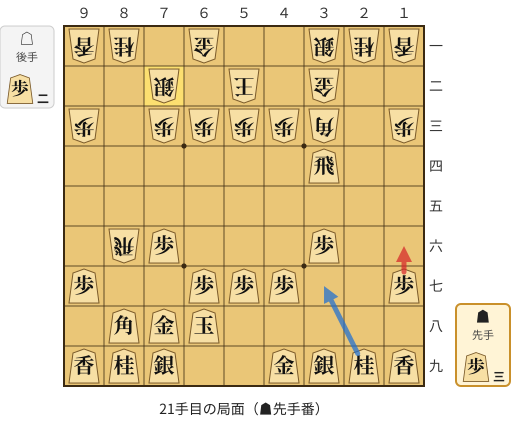

🔴 実戦 ▲１六歩(17)　🔵 AI推奨 ▲３七桂(29)　🟨 直前の相手の指し手

<details><summary>テキストの盤面図（BOD・将棋ソフトに貼り付け可）</summary>

```text
後手の持駒：歩二
  ９ ８ ７ ６ ５ ４ ３ ２ １
+---------------------------+
|v香v桂 ・v金 ・ ・v銀v桂v香|一
| ・ ・v銀 ・v玉 ・v金 ・ ・|二
|v歩 ・v歩v歩v歩v歩v角 ・v歩|三
| ・ ・ ・ ・ ・ ・ 飛 ・ ・|四
| ・ ・ ・ ・ ・ ・ ・ ・ ・|五
| ・v飛 歩 ・ ・ ・ 歩 ・ ・|六
| 歩 ・ ・ 歩 歩 歩 ・ ・ 歩|七
| ・ 角 金 玉 ・ ・ ・ ・ ・|八
| 香 桂 銀 ・ ・ 金 銀 桂 香|九
+---------------------------+
先手の持駒：歩三
手数＝20　△７二銀　まで
```

</details>

| | 指し手 | 評価値 | 読み筋 |
|---|---|--:|---|
| 実戦 | ▲１六歩(17) | -126 | △７四歩(73) ▲４八銀(39) △４二銀(31) ▲３七桂(29) △７六飛(86) ▲５九金(49) |
| AI 1位 | ▲３七桂(29) | +260 | ▲３七桂(29) △２三金(32) ▲３五飛(34) △３四歩打 ▲２五飛(35) △２四歩打 |
| AI 2位 | ▲３八銀(39) | +118 | ▲３八銀(39) △２三金(32) ▲３五飛(34) △４二銀(31) ▲３七桂(29) △２四金(23) |
| AI 3位 | ▲９六歩(97) | +10 | ▲９六歩(97) △７四歩(73) ▲４八銀(39) △７六飛(86) ▲３七桂(29) △７三桂(81) |

SFEN: `ln1g2snl/2s1k1g2/p1ppppb1p/6R2/9/1rP3P2/P2PPP2P/1BGK5/LNS2GSNL b 3P2p 21`

<a id="ply-27"></a>
### 27手目 ▲９六歩(97) — 悪手

| | 着手前 | 着手後 | 差 |
|---|--:|--:|--:|
| 期待勝率 | 88.3% | 72.4% | -15.9pt |
| 評価値 | +1213 | +580 | |

着手前の局面:

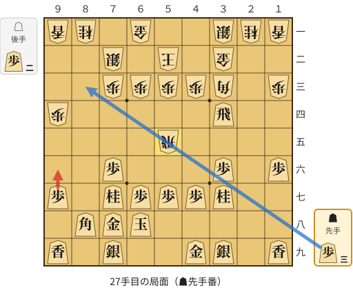

🔴 実戦 ▲９六歩(97)　🔵 AI推奨 ▲８三歩打　🟨 直前の相手の指し手

<details><summary>テキストの盤面図（BOD・将棋ソフトに貼り付け可）</summary>

```text
後手の持駒：歩二
  ９ ８ ７ ６ ５ ４ ３ ２ １
+---------------------------+
|v香v桂 ・v金 ・ ・v銀v桂v香|一
| ・ ・v銀 ・v玉 ・v金 ・ ・|二
| ・ ・v歩v歩v歩v歩v角 ・v歩|三
|v歩 ・ ・ ・ ・ ・ 飛 ・ ・|四
| ・ ・ ・ ・v飛 ・ ・ ・ ・|五
| ・ ・ 歩 ・ ・ ・ 歩 ・ 歩|六
| 歩 ・ 桂 歩 歩 歩 桂 ・ ・|七
| ・ 角 金 玉 ・ ・ ・ ・ ・|八
| 香 ・ 銀 ・ ・ 金 銀 ・ 香|九
+---------------------------+
先手の持駒：歩三
手数＝26　△５五飛　まで
```

</details>

| | 指し手 | 評価値 | 読み筋 |
|---|---|--:|---|
| 実戦 | ▲９六歩(97) | +580 | △４四歩(43) ▲８三歩打 △７一金(61) ▲５六歩(57) △同飛(55) ▲３三飛成(34) |
| AI 1位 | ▲８三歩打 | +1213 | ▲８三歩打 △同銀(72) ▲８二歩打 △９三桂(81) ▲８一歩成(82) △８五桂(93) |
| AI 2位 | ▲８二歩打 | +1011 | ▲８二歩打 △９三桂(81) ▲８一歩成(82) △同銀(72) ▲５六歩(57) △同飛(55) |
| AI 3位 | ▲５六歩(57) | +673 | ▲５六歩(57) △５四飛(55) ▲同飛(34) △同歩(53) ▲６五桂(77) △８八角成(33) |

SFEN: `ln1g2snl/2s1k1g2/2ppppb1p/p5R2/4r4/2P3P1P/P1NPPPN2/1BGK5/L1S2GS1L b 3P2p 27`

<a id="ply-39"></a>
### 39手目 ▲８二歩打 — 大悪手

| | 着手前 | 着手後 | 差 |
|---|--:|--:|--:|
| 期待勝率 | 96.0% | 55.3% | -40.7pt |
| 評価値 | +1906 | +128 | |

着手前の局面:

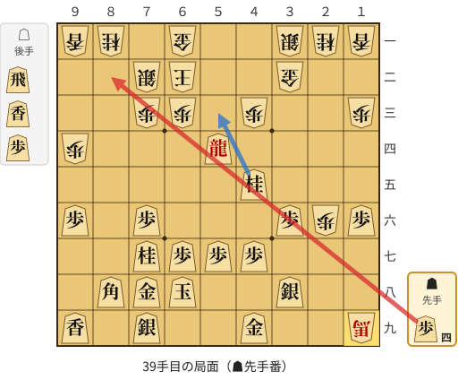

🔴 実戦 ▲８二歩打　🔵 AI推奨 ▲５三桂成(45)　🟨 直前の相手の指し手

<details><summary>テキストの盤面図（BOD・将棋ソフトに貼り付け可）</summary>

```text
後手の持駒：飛　香　歩
  ９ ８ ７ ６ ５ ４ ３ ２ １
+---------------------------+
|v香v桂 ・v金 ・ ・v銀v桂v香|一
| ・ ・v銀v玉 ・ ・v金 ・ ・|二
| ・ ・v歩v歩 ・v歩 ・ ・v歩|三
|v歩 ・ ・ ・ 龍 ・ ・ ・ ・|四
| ・ ・ ・ ・ ・ 桂 ・ ・ ・|五
| 歩 ・ 歩 ・ ・ ・ 歩v歩 歩|六
| ・ ・ 桂 歩 歩 歩 ・ ・ ・|七
| ・ 角 金 玉 ・ ・ 銀 ・ ・|八
| 香 ・ 銀 ・ ・ 金 ・ ・v馬|九
+---------------------------+
先手の持駒：歩四
手数＝38　△１九角成　まで
```

</details>

| | 指し手 | 評価値 | 読み筋 |
|---|---|--:|---|
| 実戦 | ▲８二歩打 | +128 | △５一香打 ▲８一歩成(82) △５四香(51) ▲６五桂(77) △２七歩成(26) ▲５三桂成(65) |
| AI 1位 | ▲５三桂成(45) | +1906 | ▲５三桂成(45) △７一玉(62) ▲６五桂(77) △６四飛打 ▲１一角成(88) △３三桂(21) |
| AI 2位 | ▲６五桂(77) | +1522 | ▲６五桂(77) △５二歩打 ▲１一角成(88) △６四馬(19) ▲同龍(54) △同歩(63) |
| AI 3位 | ▲９七角(88) | +1152 | ▲９七角(88) △５二歩打 ▲５三桂成(45) △５一玉(62) ▲４三成桂(53) △６四香打 |

SFEN: `ln1g2snl/2sk2g2/2pp1p2p/p3+R4/5N3/P1P3PpP/2NPPP3/1BGK2S2/L1S2G2+b b 4Prlp 39`

<a id="ply-41"></a>
### 41手目 ▲２四龍(54) — 悪手

| | 着手前 | 着手後 | 差 |
|---|--:|--:|--:|
| 期待勝率 | 52.8% | 36.8% | -16.0pt |
| 評価値 | +67 | -324 | |

着手前の局面:

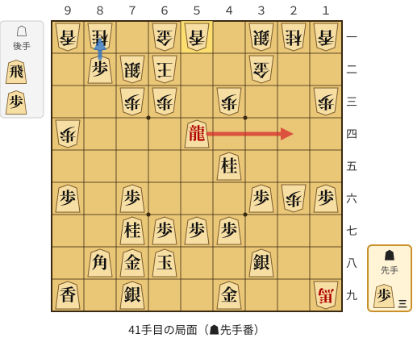

🔴 実戦 ▲２四龍(54)　🔵 AI推奨 ▲８一歩成(82)　🟨 直前の相手の指し手

<details><summary>テキストの盤面図（BOD・将棋ソフトに貼り付け可）</summary>

```text
後手の持駒：飛　歩
  ９ ８ ７ ６ ５ ４ ３ ２ １
+---------------------------+
|v香v桂 ・v金v香 ・v銀v桂v香|一
| ・ 歩v銀v玉 ・ ・v金 ・ ・|二
| ・ ・v歩v歩 ・v歩 ・ ・v歩|三
|v歩 ・ ・ ・ 龍 ・ ・ ・ ・|四
| ・ ・ ・ ・ ・ 桂 ・ ・ ・|五
| 歩 ・ 歩 ・ ・ ・ 歩v歩 歩|六
| ・ ・ 桂 歩 歩 歩 ・ ・ ・|七
| ・ 角 金 玉 ・ ・ 銀 ・ ・|八
| 香 ・ 銀 ・ ・ 金 ・ ・v馬|九
+---------------------------+
先手の持駒：歩三
手数＝40　△５一香　まで
```

</details>

| | 指し手 | 評価値 | 読み筋 |
|---|---|--:|---|
| 実戦 | ▲２四龍(54) | -324 | △９三桂(81) ▲２八歩打 △５五飛打 ▲２六龍(24) △５七飛成(55) ▲６九玉(68) |
| AI 1位 | ▲８一歩成(82) | +67 | ▲８一歩成(82) △５四香(51) ▲６五桂(77) △５二歩打 ▲４六桂打 △６四歩(63) |
| AI 2位 | ▲６五桂(77) | +24 | ▲６五桂(77) △５四香(51) ▲８一歩成(82) △５二歩打 ▲４六桂打 △６四歩(63) |
| AI 3位 | ▲３四龍(54) | -34 | ▲３四龍(54) △６四飛打 ▲３五龍(34) △３七歩打 ▲８一歩成(82) △３八歩成(37) |

SFEN: `ln1gl1snl/1Psk2g2/2pp1p2p/p3+R4/5N3/P1P3PpP/2NPPP3/1BGK2S2/L1S2G2+b b 3Prp 41`

<a id="ply-45"></a>
### 45手目 ▲８四龍(24) — 悪手

| | 着手前 | 着手後 | 差 |
|---|--:|--:|--:|
| 期待勝率 | 49.1% | 33.5% | -15.6pt |
| 評価値 | -21 | -412 | |

着手前の局面:

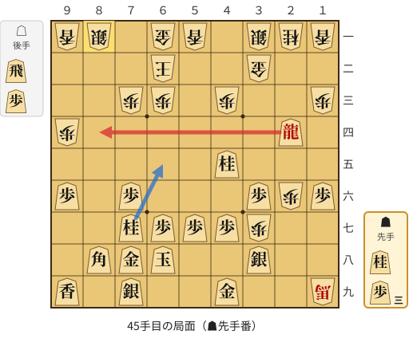

🔴 実戦 ▲８四龍(24)　🔵 AI推奨 ▲６五桂(77)　🟨 直前の相手の指し手

<details><summary>テキストの盤面図（BOD・将棋ソフトに貼り付け可）</summary>

```text
後手の持駒：飛　歩
  ９ ８ ７ ６ ５ ４ ３ ２ １
+---------------------------+
|v香v銀 ・v金v香 ・v銀v桂v香|一
| ・ ・ ・v玉 ・ ・v金 ・ ・|二
| ・ ・v歩v歩 ・v歩 ・ ・v歩|三
|v歩 ・ ・ ・ ・ ・ ・ 龍 ・|四
| ・ ・ ・ ・ ・ 桂 ・ ・ ・|五
| 歩 ・ 歩 ・ ・ ・ 歩v歩 歩|六
| ・ ・ 桂 歩 歩 歩v歩 ・ ・|七
| ・ 角 金 玉 ・ ・ 銀 ・ ・|八
| 香 ・ 銀 ・ ・ 金 ・ ・v馬|九
+---------------------------+
先手の持駒：桂　歩三
手数＝44　△８一同銀　まで
```

</details>

| | 指し手 | 評価値 | 読み筋 |
|---|---|--:|---|
| 実戦 | ▲８四龍(24) | -412 | △８三歩打 ▲同龍(84) △７二銀(81) ▲８二龍(83) △３八歩成(37) ▲６五桂(77) |
| AI 1位 | ▲６五桂(77) | -21 | ▲６五桂(77) △３八歩成(37) ▲同金(49) △６四馬(19) ▲同龍(24) △同歩(63) |
| AI 2位 | ▲８四龍(24) | -180 | ▲８四龍(24) △８三歩打 ▲同龍(84) △７二銀(81) ▲８二龍(83) △３八歩成(37) |
| AI 3位 | ▲５九金(49) | -273 | ▲５九金(49) △３八歩成(37) ▲６五桂(77) △１八飛打 ▲１一角成(88) △４九と(38) |

SFEN: `ls1gl1snl/3k2g2/2pp1p2p/p6+R1/5N3/P1P3PpP/2NPPPp2/1BGK2S2/L1S2G2+b b N3Prp 45`

<a id="ply-49"></a>
### 49手目 ▲同金(49) — 悪手

| | 着手前 | 着手後 | 差 |
|---|--:|--:|--:|
| 期待勝率 | 64.8% | 49.0% | -15.9pt |
| 評価値 | +367 | -25 | |

着手前の局面:

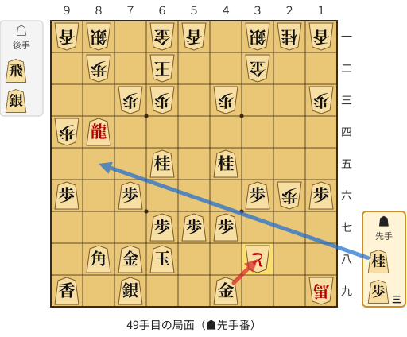

🔴 実戦 ▲同金(49)　🔵 AI推奨 ▲８五桂打　🟨 直前の相手の指し手

<details><summary>テキストの盤面図（BOD・将棋ソフトに貼り付け可）</summary>

```text
後手の持駒：飛　銀
  ９ ８ ７ ６ ５ ４ ３ ２ １
+---------------------------+
|v香v銀 ・v金v香 ・v銀v桂v香|一
| ・v歩 ・v玉 ・ ・v金 ・ ・|二
| ・ ・v歩v歩 ・v歩 ・ ・v歩|三
|v歩 龍 ・ ・ ・ ・ ・ ・ ・|四
| ・ ・ ・ 桂 ・ 桂 ・ ・ ・|五
| 歩 ・ 歩 ・ ・ ・ 歩v歩 歩|六
| ・ ・ ・ 歩 歩 歩 ・ ・ ・|七
| ・ 角 金 玉 ・ ・vと ・ ・|八
| 香 ・ 銀 ・ ・ 金 ・ ・v馬|九
+---------------------------+
先手の持駒：桂　歩三
手数＝48　△３八歩成　まで
```

</details>

| | 指し手 | 評価値 | 読み筋 |
|---|---|--:|---|
| 実戦 | ▲同金(49) | -25 | △６四銀打 ▲１一角成(88) △６五銀(64) ▲２一馬(11) △５七香成(51) ▲同玉(68) |
| AI 1位 | ▲８五桂打 | +367 | ▲８五桂打 △６四銀打 ▲７三桂成(65) △同銀(64) ▲同桂不成(85) △同馬(19) |
| AI 2位 | ▲１一角成(88) | +307 | ▲１一角成(88) △４九と(38) ▲５五香打 △８三金打 ▲５一香成(55) △８四金(83) |
| AI 3位 | ▲同金(49) | -4 | ▲同金(49) △７四銀打 ▲１一角成(88) △６五銀(74) ▲２一馬(11) △２七歩成(26) |

SFEN: `ls1gl1snl/1p1k2g2/2pp1p2p/p+R7/3N1N3/P1P3PpP/3PPP3/1BGK2+p2/L1S2G2+b b N3Prs 49`

<a id="ply-77"></a>
### 77手目 ▲８三龍(84) — 悪手

| | 着手前 | 着手後 | 差 |
|---|--:|--:|--:|
| 期待勝率 | 97.4% | 87.1% | -10.3pt |
| 評価値 | +2185 | +1148 | |

着手前の局面:

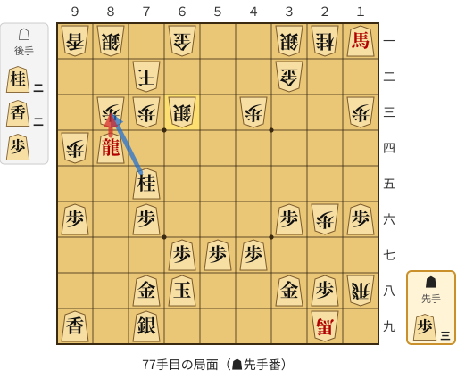

🔴 実戦 ▲８三龍(84)　🔵 AI推奨 ▲８三桂成(75)　🟨 直前の相手の指し手

<details><summary>テキストの盤面図（BOD・将棋ソフトに貼り付け可）</summary>

```text
後手の持駒：桂二　香二　歩
  ９ ８ ７ ６ ５ ４ ３ ２ １
+---------------------------+
|v香v銀 ・v金 ・ ・v銀v桂 馬|一
| ・ ・v玉 ・ ・ ・v金 ・ ・|二
| ・v歩v歩v銀 ・v歩 ・ ・v歩|三
|v歩 龍 ・ ・ ・ ・ ・ ・ ・|四
| ・ ・ 桂 ・ ・ ・ ・ ・ ・|五
| 歩 ・ 歩 ・ ・ ・ 歩v歩 歩|六
| ・ ・ ・ 歩 歩 歩 ・ ・ ・|七
| ・ ・ 金 玉 ・ ・ 金 歩v飛|八
| 香 ・ 銀 ・ ・ ・ ・v馬 ・|九
+---------------------------+
先手の持駒：歩三
手数＝76　△６三同銀　まで
```

</details>

| | 指し手 | 評価値 | 読み筋 |
|---|---|--:|---|
| 実戦 | ▲８三龍(84) | +1148 | △６二玉(72) ▲８一龍(83) △７一香打 ▲２一馬(11) △３八馬(29) ▲６五桂打 |
| AI 1位 | ▲８三桂成(75) | +2185 | ▲８三桂成(75) △７一玉(72) ▲７三龍(84) △７二歩打 ▲６三龍(73) △６二金(61) |
| AI 2位 | ▲８三龍(84) | +1516 | ▲８三龍(84) △６二玉(72) ▲８一龍(83) △７一香打 ▲５五馬(11) △７二銀(63) |
| AI 3位 | ▲同桂成(75) | -1415 | ▲同桂成(75) △同玉(72) ▲６四銀打 △５二玉(63) ▲７三龍(84) △３八馬(29) |

SFEN: `ls1g2sn+B/2k3g2/1pps1p2p/p+R7/2N6/P1P3PpP/3PPP3/2GK2GPr/L1S4+b1 b 3P2n2lp 77`

<a id="ply-79"></a>
### 79手目 ▲６三桂成(75) — 大悪手

| | 着手前 | 着手後 | 差 |
|---|--:|--:|--:|
| 期待勝率 | 91.4% | 65.4% | -26.0pt |
| 評価値 | +1420 | +382 | |

着手前の局面:

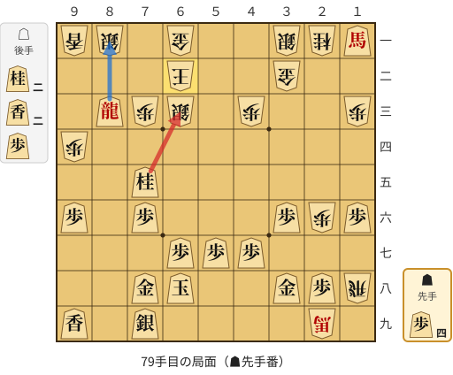

🔴 実戦 ▲６三桂成(75)　🔵 AI推奨 ▲８一龍(83)　🟨 直前の相手の指し手

<details><summary>テキストの盤面図（BOD・将棋ソフトに貼り付け可）</summary>

```text
後手の持駒：桂二　香二　歩
  ９ ８ ７ ６ ５ ４ ３ ２ １
+---------------------------+
|v香v銀 ・v金 ・ ・v銀v桂 馬|一
| ・ ・ ・v玉 ・ ・v金 ・ ・|二
| ・ 龍v歩v銀 ・v歩 ・ ・v歩|三
|v歩 ・ ・ ・ ・ ・ ・ ・ ・|四
| ・ ・ 桂 ・ ・ ・ ・ ・ ・|五
| 歩 ・ 歩 ・ ・ ・ 歩v歩 歩|六
| ・ ・ ・ 歩 歩 歩 ・ ・ ・|七
| ・ ・ 金 玉 ・ ・ 金 歩v飛|八
| 香 ・ 銀 ・ ・ ・ ・v馬 ・|九
+---------------------------+
先手の持駒：歩四
手数＝78　△６二玉　まで
```

</details>

| | 指し手 | 評価値 | 読み筋 |
|---|---|--:|---|
| 実戦 | ▲６三桂成(75) | +382 | △同玉(62) ▲８一龍(83) △７一香打 ▲８二龍(81) △５一香打 ▲２一馬(11) |
| AI 1位 | ▲８一龍(83) | +1420 | ▲８一龍(83) △７一香打 ▲５五馬(11) △５二香打 ▲６三桂成(75) △同玉(62) |
| AI 2位 | ▲６三桂成(75) | +1002 | ▲６三桂成(75) △同玉(62) ▲８一龍(83) △７一香打 ▲５五馬(11) △５一香打 |
| AI 3位 | ▲２一馬(11) | -538 | ▲２一馬(11) △７二銀(81) ▲６三桂成(75) △同玉(62) ▲８四龍(83) △７四桂打 |

SFEN: `ls1g2sn+B/3k2g2/1+Rps1p2p/p8/2N6/P1P3PpP/3PPP3/2GK2GPr/L1S4+b1 b 4P2n2lp 79`

<a id="ply-85"></a>
### 85手目 ▲５四銀打 — 大悪手

| | 着手前 | 着手後 | 差 |
|---|--:|--:|--:|
| 期待勝率 | 100.0% | 60.5% | -39.5pt |
| 評価値 | +4996 | +256 | |

着手前の局面:

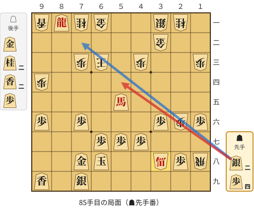

🔴 実戦 ▲５四銀打　🔵 AI推奨 ▲７二銀打　🟨 直前の相手の指し手

<details><summary>テキストの盤面図（BOD・将棋ソフトに貼り付け可）</summary>

```text
後手の持駒：金　桂二　香二　歩
  ９ ８ ７ ６ ５ ４ ３ ２ １
+---------------------------+
|v香 龍v桂v金 ・ ・v銀v桂 ・|一
| ・ ・ ・ ・ ・ ・v金 ・ ・|二
| ・ ・v歩v玉 ・v歩 ・ ・v歩|三
|v歩 ・ ・ ・ ・ ・ ・ ・ ・|四
| ・ ・ ・ ・ 馬 ・ ・ ・ ・|五
| 歩 ・ 歩 ・ ・ ・ 歩v歩 歩|六
| ・ ・ ・ 歩 歩 歩 ・ ・ ・|七
| ・ ・ 金 玉 ・ ・v馬 歩v飛|八
| 香 ・ 銀 ・ ・ ・ ・ ・ ・|九
+---------------------------+
先手の持駒：銀二　歩四
手数＝84　△３八馬　まで
```

</details>

| | 指し手 | 評価値 | 読み筋 |
|---|---|--:|---|
| 実戦 | ▲５四銀打 | +256 | △５二玉(63) ▲７七玉(68) △４二玉(52) ▲８二龍(81) △５二歩打 ▲６二銀打 |
| AI 1位 | ▲７二銀打 | +4996 | ▲７二銀打 △５三玉(63) ▲６一銀不成(72) △５二歩打 ▲７一龍(81) △４四歩(43) |
| AI 2位 | ▲８二龍(81) | +1838 | ▲８二龍(81) △６二香打 ▲７二銀打 △同金(61) ▲５四銀打 △５二玉(63) |
| AI 3位 | ▲６四銀打 | +822 | ▲６四銀打 △５二玉(63) ▲７二銀打 △５一金打 ▲７七玉(68) △２八馬(38) |

SFEN: `l+Rng2sn1/6g2/2pk1p2p/p8/4+B4/P1P3PpP/3PPP3/2GK2+bPr/L1S6 b 2S4Pg2n2lp 85`

<a id="ply-87"></a>
### 87手目 ▲８二龍(81) — 大悪手

| | 着手前 | 着手後 | 差 |
|---|--:|--:|--:|
| 期待勝率 | 62.2% | 19.0% | -43.3pt |
| 評価値 | +300 | -871 | |

着手前の局面:

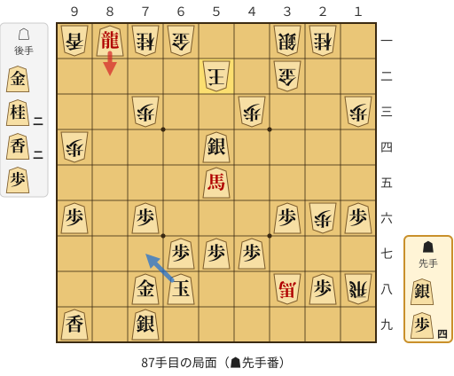

🔴 実戦 ▲８二龍(81)　🔵 AI推奨 ▲７七玉(68)　🟨 直前の相手の指し手

<details><summary>テキストの盤面図（BOD・将棋ソフトに貼り付け可）</summary>

```text
後手の持駒：金　桂二　香二　歩
  ９ ８ ７ ６ ５ ４ ３ ２ １
+---------------------------+
|v香 龍v桂v金 ・ ・v銀v桂 ・|一
| ・ ・ ・ ・v玉 ・v金 ・ ・|二
| ・ ・v歩 ・ ・v歩 ・ ・v歩|三
|v歩 ・ ・ ・ 銀 ・ ・ ・ ・|四
| ・ ・ ・ ・ 馬 ・ ・ ・ ・|五
| 歩 ・ 歩 ・ ・ ・ 歩v歩 歩|六
| ・ ・ ・ 歩 歩 歩 ・ ・ ・|七
| ・ ・ 金 玉 ・ ・v馬 歩v飛|八
| 香 ・ 銀 ・ ・ ・ ・ ・ ・|九
+---------------------------+
先手の持駒：銀　歩四
手数＝86　△５二玉　まで
```

</details>

| | 指し手 | 評価値 | 読み筋 |
|---|---|--:|---|
| 実戦 | ▲８二龍(81) | -871 | △４一玉(52) ▲１一馬(55) △２八馬(38) ▲２一馬(11) △６四馬(28) ▲５八銀打 |
| AI 1位 | ▲７七玉(68) | +300 | ▲７七玉(68) △７四桂打 ▲７三馬(55) △４七馬(38) ▲４八歩打 △６二金打 |
| AI 2位 | ▲６四馬(55) | -644 | ▲６四馬(55) △４一玉(52) ▲５二銀打 △同金(61) ▲６三銀成(54) △４二金(32) |
| AI 3位 | ▲７三馬(55) | -664 | ▲７三馬(55) △４二玉(52) ▲９一馬(73) △２八馬(38) ▲同馬(91) △同飛成(18) |

SFEN: `l+Rng2sn1/4k1g2/2p2p2p/p3S4/4+B4/P1P3PpP/3PPP3/2GK2+bPr/L1S6 b S4Pg2n2lp 87`

<a id="ply-89"></a>
### 89手目 ▲５三銀打 — 大悪手

| | 着手前 | 着手後 | 差 |
|---|--:|--:|--:|
| 期待勝率 | 98.8% | 15.7% | -83.2pt |
| 評価値 | +2671 | -1010 | |

着手前の局面:

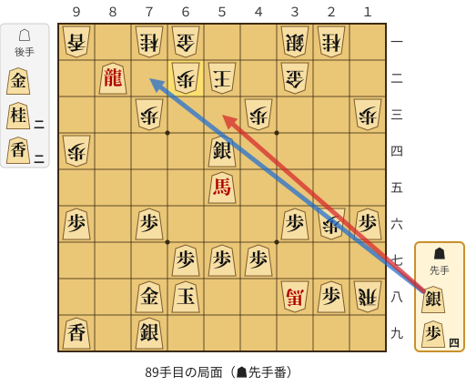

🔴 実戦 ▲５三銀打　🔵 AI推奨 ▲７二銀打　🟨 直前の相手の指し手

<details><summary>テキストの盤面図（BOD・将棋ソフトに貼り付け可）</summary>

```text
後手の持駒：金　桂二　香二
  ９ ８ ７ ６ ５ ４ ３ ２ １
+---------------------------+
|v香 ・v桂v金 ・ ・v銀v桂 ・|一
| ・ 龍 ・v歩v玉 ・v金 ・ ・|二
| ・ ・v歩 ・ ・v歩 ・ ・v歩|三
|v歩 ・ ・ ・ 銀 ・ ・ ・ ・|四
| ・ ・ ・ ・ 馬 ・ ・ ・ ・|五
| 歩 ・ 歩 ・ ・ ・ 歩v歩 歩|六
| ・ ・ ・ 歩 歩 歩 ・ ・ ・|七
| ・ ・ 金 玉 ・ ・v馬 歩v飛|八
| 香 ・ 銀 ・ ・ ・ ・ ・ ・|九
+---------------------------+
先手の持駒：銀　歩四
手数＝88　△６二歩　まで
```

</details>

| | 指し手 | 評価値 | 読み筋 |
|---|---|--:|---|
| 実戦 | ▲５三銀打 | -1010 | △４一玉(52) ▲７七玉(68) △２八馬(38) ▲４六歩(47) △５一金打 ▲２二歩打 |
| AI 1位 | ▲７二銀打 | +2671 | ▲７二銀打 △５一金(61) ▲７一龍(82) △４二銀(31) ▲９一龍(71) △５三香打 |
| AI 2位 | ▲７七玉(68) | -505 | ▲７七玉(68) △２八馬(38) ▲４六歩(47) △５三歩打 ▲７二銀打 △８五桂打 |
| AI 3位 | ▲５三銀打 | -993 | ▲５三銀打 △４一玉(52) ▲６五馬(55) △２八馬(38) ▲７七玉(68) △５一香打 |

SFEN: `l1ng2sn1/1+R1pk1g2/2p2p2p/p3S4/4+B4/P1P3PpP/3PPP3/2GK2+bPr/L1S6 b S4Pg2n2l 89`

<a id="ply-91"></a>
### 91手目 ▲６二銀成(53) — 悪手

| | 着手前 | 着手後 | 差 |
|---|--:|--:|--:|
| 期待勝率 | 10.7% | 0.3% | -10.4pt |
| 評価値 | -1275 | -3475 | |

着手前の局面:

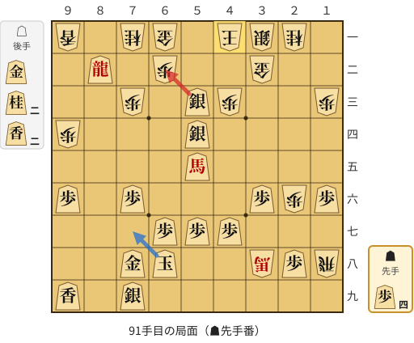

🔴 実戦 ▲６二銀成(53)　🔵 AI推奨 ▲７七玉(68)　🟨 直前の相手の指し手

<details><summary>テキストの盤面図（BOD・将棋ソフトに貼り付け可）</summary>

```text
後手の持駒：金　桂二　香二
  ９ ８ ７ ６ ５ ４ ３ ２ １
+---------------------------+
|v香 ・v桂v金 ・v玉v銀v桂 ・|一
| ・ 龍 ・v歩 ・ ・v金 ・ ・|二
| ・ ・v歩 ・ 銀v歩 ・ ・v歩|三
|v歩 ・ ・ ・ 銀 ・ ・ ・ ・|四
| ・ ・ ・ ・ 馬 ・ ・ ・ ・|五
| 歩 ・ 歩 ・ ・ ・ 歩v歩 歩|六
| ・ ・ ・ 歩 歩 歩 ・ ・ ・|七
| ・ ・ 金 玉 ・ ・v馬 歩v飛|八
| 香 ・ 銀 ・ ・ ・ ・ ・ ・|九
+---------------------------+
先手の持駒：歩四
手数＝90　△４一玉　まで
```

</details>

| | 指し手 | 評価値 | 読み筋 |
|---|---|--:|---|
| 実戦 | ▲６二銀成(53) | -3475 | △２八馬(38) ▲同馬(55) △同飛成(18) ▲７七玉(68) △４四角打 ▲６六歩(67) |
| AI 1位 | ▲７七玉(68) | -1275 | ▲７七玉(68) △２八馬(38) ▲４六歩(47) △７四桂打 ▲８六歩打 △３七馬(28) |
| AI 2位 | ▲４六歩(47) | -1831 | ▲４六歩(47) △８三馬(38) ▲同龍(82) △２八飛成(18) ▲７七玉(68) △８三桂(71) |
| AI 3位 | ▲６五馬(55) | -1685 | ▲６五馬(55) △２八馬(38) ▲７七玉(68) △５一香打 ▲２二歩打 △５三香(51) |

SFEN: `l1ng1ksn1/1+R1p2g2/2p1Sp2p/p3S4/4+B4/P1P3PpP/3PPP3/2GK2+bPr/L1S6 b 4Pg2n2l 91`

<a id="ply-95"></a>
### 95手目 ▲７三馬(55) — 大悪手

| | 着手前 | 着手後 | 差 |
|---|--:|--:|--:|
| 期待勝率 | 99.7% | 25.6% | -74.1pt |
| 評価値 | +3521 | -640 | |

着手前の局面:

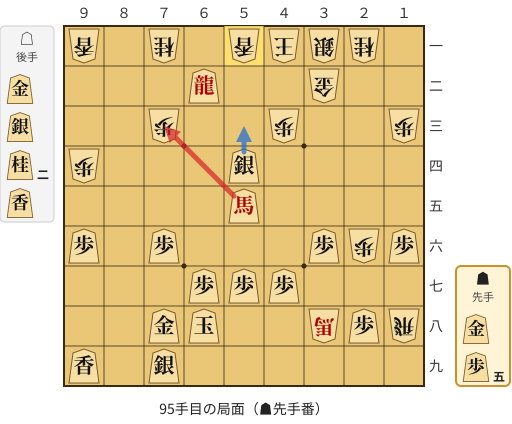

🔴 実戦 ▲７三馬(55)　🔵 AI推奨 ▲５三銀成(54)　🟨 直前の相手の指し手

<details><summary>テキストの盤面図（BOD・将棋ソフトに貼り付け可）</summary>

```text
後手の持駒：金　銀　桂二　香
  ９ ８ ７ ６ ５ ４ ３ ２ １
+---------------------------+
|v香 ・v桂 ・v香v玉v銀v桂 ・|一
| ・ ・ ・ 龍 ・ ・v金 ・ ・|二
| ・ ・v歩 ・ ・v歩 ・ ・v歩|三
|v歩 ・ ・ ・ 銀 ・ ・ ・ ・|四
| ・ ・ ・ ・ 馬 ・ ・ ・ ・|五
| 歩 ・ 歩 ・ ・ ・ 歩v歩 歩|六
| ・ ・ ・ 歩 歩 歩 ・ ・ ・|七
| ・ ・ 金 玉 ・ ・v馬 歩v飛|八
| 香 ・ 銀 ・ ・ ・ ・ ・ ・|九
+---------------------------+
先手の持駒：金　歩五
手数＝94　△５一香　まで
```

</details>

| | 指し手 | 評価値 | 読み筋 |
|---|---|--:|---|
| 実戦 | ▲７三馬(55) | -640 | △５二金打 ▲同龍(62) △同香(51) ▲５一金打 △４二玉(41) ▲５二金(51) |
| AI 1位 | ▲５三銀成(54) | +3521 | ▲５三銀成(54) △４二金(32) ▲２二馬(55) △５八金打 ▲同玉(68) △４八馬(38) |
| AI 2位 | ▲５三銀不成(54) | +3075 | ▲５三銀不成(54) △４二金(32) ▲２二馬(55) △５九銀打 ▲７七玉(68) △６五桂打 |
| AI 3位 | ▲７一龍(62) | +2418 | ▲７一龍(62) △３三金(32) ▲５三銀不成(54) △４二銀打 ▲５二金打 △３二玉(41) |

SFEN: `l1n1lksn1/3+R2g2/2p2p2p/p3S4/4+B4/P1P3PpP/3PPP3/2GK2+bPr/L1S6 b G5Pgs2nl 95`

