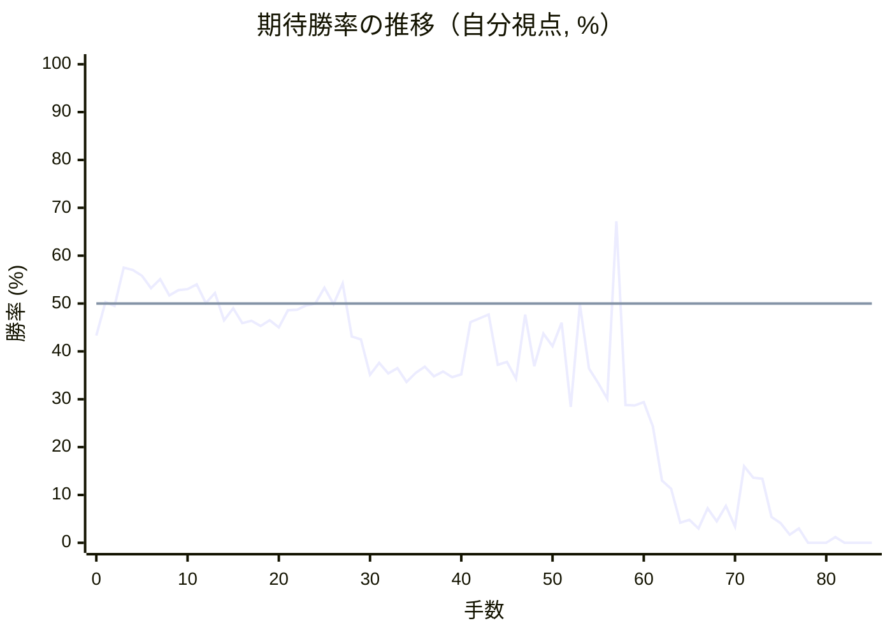

# 解析レポート 2roz1jvi3bpw

[README に戻る](../../../README.md)　/　棋譜: [CSA](../../../data/csa/shogi5/2roz1jvi3bpw.csa)　/　解析の見方: [docs/mistake_analysis.md](../../../docs/mistake_analysis.md)

## 対局情報

| 項目 | 内容 |
|---|---|
| 日時 | 2026-11-07 09:55:21 |
| 持ち時間 | 5分 |
| 自分 | 後手（△）（1731） |
| 相手 | 相手（1770） |
| 結果 | 負け（時間切れ, 85手） |

## 解析環境

| 項目 | 内容 |
|---|---|
| エンジン | YaneuraOu NNUE 9.00git 64AVX2（V9.00/YANEURAOU_ENGINE_NNUE/AVX2） |
| 評価関数 | **水匠5**（`suisho5`） |
| nn.bin SHA-256 | `768068f0d534a0603a5d38bcd143de6bbca820d5f1c95a14d40863e5b7892d76` |
| 第1パス | movetime=150ms, MultiPV 1 |
| 第2パス | movetime=2000ms, MultiPV 3 |
| Threads / Hash | 8 / 512MB |
| 判定基準 | 疑問手 ≥5pt, 悪手 ≥10pt, 大悪手 ≥20pt（期待勝率 W(E)=1/(1+exp(-E/600))） |
| 解析日時 | 2026-11-11T20:29:09+09:00（解析バージョン 1, 57秒） |

## サマリー

| 自分の手数 | 深掘りした手 | 詰み逃し | 大悪手 | 悪手 | 疑問手 |
|--:|--:|--:|--:|--:|--:|
| 42 | 11 | 0 | 2 | 3 | 2 |

## 期待勝率の推移



<details><summary>1手ごとの数値（第1パス）</summary>

| 手数 | 指し手 | 評価値 | 勝率 | 低下 | 判定 |
|--:|---|--:|--:|--:|---|
| 1 | ▲５六歩(57) | +8 | 50.3% |  |  |
| 2 | △３四歩(33) | -13 | 49.5% | +0.9pt |  |
| 3 | ▲５八飛(28) | +181 | 57.5% |  |  |
| 4 | △８四歩(83) | +168 | 57.0% | +0.5pt |  |
| 5 | ▲５五歩(56) | +140 | 55.8% |  |  |
| 6 | △８五歩(84) | +77 | 53.2% | +2.6pt |  |
| 7 | ▲７六歩(77) | +122 | 55.1% |  |  |
| 8 | △５二金(61) | +41 | 51.7% | +3.4pt |  |
| 9 | ▲７七角(88) | +67 | 52.8% |  |  |
| 10 | △６二銀(71) | +71 | 53.0% | -0.2pt |  |
| 11 | ▲６八銀(79) | +96 | 54.0% |  |  |
| 12 | △４四歩(43) | +3 | 50.1% | +3.9pt |  |
| 13 | ▲４八玉(59) | +53 | 52.2% |  |  |
| 14 | △４三金(52) | -84 | 46.5% | +5.7pt |  |
| 15 | ▲３八玉(48) | -24 | 49.0% |  |  |
| 16 | △６四歩(63) | -98 | 45.9% | +3.1pt |  |
| 17 | ▲５七銀(68) | -86 | 46.4% |  |  |
| 18 | △６三銀(62) | -114 | 45.3% | +1.2pt |  |
| 19 | ▲５六銀(57) | -83 | 46.5% |  |  |
| 20 | △４二玉(51) | -120 | 45.0% | +1.5pt |  |
| 21 | ▲４八銀(39) | -33 | 48.6% |  |  |
| 22 | △３二玉(42) | -32 | 48.7% | -0.0pt |  |
| 23 | ▲２八玉(38) | -10 | 49.6% |  |  |
| 24 | △１四歩(13) | +0 | 50.0% | -0.4pt |  |
| 25 | ▲３八金(49) | +80 | 53.3% |  |  |
| 26 | △１五歩(14) | -2 | 49.9% | +3.4pt |  |
| 27 | ▲６六歩(67) | +100 | 54.2% |  |  |
| 28 | △２四歩(23) | -167 | 43.1% | +11.1pt | [悪手](#ply-28) |
| 29 | ▲６八飛(58) | -182 | 42.5% |  |  |
| 30 | △６二飛(82) | -370 | 35.1% | +7.4pt |  |
| 31 | ▲６五歩(66) | -303 | 37.6% |  |  |
| 32 | △同歩(64) | -361 | 35.4% | +2.2pt |  |
| 33 | ▲同飛(68) | -331 | 36.5% |  |  |
| 34 | △２三玉(32) | -410 | 33.6% | +3.0pt |  |
| 35 | ▲５九金(69) | -358 | 35.5% |  |  |
| 36 | △３二銀(31) | -324 | 36.8% | -1.3pt |  |
| 37 | ▲８五飛(65) | -376 | 34.8% |  |  |
| 38 | △８二歩打 | -350 | 35.8% | -1.0pt |  |
| 39 | ▲６五飛(85) | -382 | 34.6% |  |  |
| 40 | △５四歩(53) | -365 | 35.2% | -0.6pt |  |
| 41 | ▲６七飛(65) | -94 | 46.1% |  |  |
| 42 | △５五歩(54) | -74 | 46.9% | -0.8pt |  |
| 43 | ▲同銀(56) | -56 | 47.7% |  |  |
| 44 | △４五歩(44) | -313 | 37.2% | +10.4pt | [疑問手](#ply-44) |
| 45 | ▲５四歩打 | -298 | 37.8% |  |  |
| 46 | △６六歩打 | -390 | 34.3% | +3.5pt |  |
| 47 | ▲５七飛(67) | -56 | 47.7% |  |  |
| 48 | △７四歩(73) | -323 | 36.9% | +10.8pt |  |
| 49 | ▲８六角(77) | -152 | 43.7% |  |  |
| 50 | △５二銀(63) | -215 | 41.1% | +2.6pt |  |
| 51 | ▲６八歩打 | -97 | 46.0% |  |  |
| 52 | △７三桂(81) | -554 | 28.4% | +17.5pt | [大悪手](#ply-52) |
| 53 | ▲７七桂(89) | -4 | 49.8% |  |  |
| 54 | △６五桂(73) | -334 | 36.4% | +13.4pt | [悪手](#ply-54) |
| 55 | ▲同桂(77) | -414 | 33.4% |  |  |
| 56 | △同飛(62) | -506 | 30.1% | +3.3pt |  |
| 57 | ▲４四桂打 | +431 | 67.2% |  |  |
| 58 | △同金(43) | -544 | 28.8% | +38.5pt | [大悪手](#ply-58) |
| 59 | ▲同銀(55) | -546 | 28.7% |  |  |
| 60 | △同角(22) | -525 | 29.4% | -0.7pt |  |
| 61 | ▲５三歩成(54) | -683 | 24.3% |  |  |
| 62 | △同銀(52) | -1140 | 13.0% | +11.3pt | [悪手](#ply-62) |
| 63 | ▲同角成(86) | -1238 | 11.3% |  |  |
| 64 | △同角(44) | -1871 | 4.2% | +7.0pt |  |
| 65 | ▲同飛成(57) | -1786 | 4.8% |  |  |
| 66 | △３三桂(21) | -2076 | 3.0% | +1.8pt |  |
| 67 | ▲５六龍(53) | -1532 | 7.2% |  |  |
| 68 | △８五飛(65) | -1832 | 4.5% | +2.7pt |  |
| 69 | ▲４四銀打 | -1491 | 7.7% |  |  |
| 70 | △５五歩打 | -2013 | 3.4% | +4.3pt |  |
| 71 | ▲同銀(44) | -995 | 16.0% |  |  |
| 72 | △８七飛成(85) | -1110 | 13.6% | +2.4pt |  |
| 73 | ▲４四銀(55) | -1121 | 13.4% |  |  |
| 74 | △７三角打 | -1721 | 5.4% | +8.0pt | [疑問手](#ply-74) |
| 75 | ▲６三角打 | -1898 | 4.1% |  |  |
| 76 | △５五歩打 | -2445 | 1.7% | +2.4pt |  |
| 77 | ▲６六龍(56) | -2093 | 3.0% |  |  |
| 78 | △８九龍(87) | -4567 | 0.0% | +2.9pt |  |
| 79 | ▲３三銀成(44) | -4814 | 0.0% |  |  |
| 80 | △同玉(23) | -4912 | 0.0% | +0.0pt |  |
| 81 | ▲４五角成(63) | -2648 | 1.2% |  |  |
| 82 | △５二銀打 | -4852 | 0.0% | +1.2pt |  |
| 83 | ▲８九馬(45) | -5034 | 0.0% |  |  |
| 84 | △８四角(73) | -5288 | 0.0% | +0.0pt |  |
| 85 | ▲５五龍(66) | -5461 | 0.0% |  |  |

</details>

## 課題局面

<a id="ply-28"></a>
### 28手目 △２四歩(23) — 悪手

| | 着手前 | 着手後 | 差 |
|---|--:|--:|--:|
| 期待勝率 | 55.1% | 42.7% | -12.4pt |
| 評価値 | +123 | -177 | |

着手前の局面:

```text
後手の持駒：なし
  ９ ８ ７ ６ ５ ４ ３ ２ １
+---------------------------+
|v香v桂 ・ ・ ・v金v銀v桂v香|一
| ・v飛 ・ ・ ・ ・v玉v角 ・|二
|v歩 ・v歩v銀v歩v金 ・v歩 ・|三
| ・ ・ ・v歩 ・v歩v歩 ・ ・|四
| ・v歩 ・ ・ 歩 ・ ・ ・v歩|五
| ・ ・ 歩 歩 銀 ・ ・ ・ ・|六
| 歩 歩 角 ・ ・ 歩 歩 歩 歩|七
| ・ ・ ・ ・ 飛 銀 金 玉 ・|八
| 香 桂 ・ 金 ・ ・ ・ 桂 香|九
+---------------------------+
先手の持駒：なし
後手番
手数＝27　▲６六歩　まで
```

| | 指し手 | 評価値 | 読み筋 |
|---|---|--:|---|
| 実戦 | △２四歩(23) | -177 | ▲６八飛(58) △２三玉(32) ▲６五歩(66) △同歩(64) ▲同銀(56) △６二歩打 |
| AI 1位 | △７四歩(73) | +123 | △７四歩(73) ▲６八飛(58) △７三桂(81) ▲７八飛(68) △９四歩(93) ▲６八角(77) |
| AI 2位 | △３三角(22) | +53 | △３三角(22) ▲６五歩(66) △同歩(64) ▲６八飛(58) △２四角(33) ▲６五飛(68) |
| AI 3位 | △９四歩(93) | +8 | △９四歩(93) ▲６五歩(66) △同歩(64) ▲６八飛(58) △１三角(22) ▲６七飛(68) |

SFEN: `ln3gsnl/1r4kb1/p1pspg1p1/3p1pp2/1p2P3p/2PPS4/PPB2PPPP/4RSGK1/LN1G3NL w - 28`

<a id="ply-44"></a>
### 44手目 △４五歩(44) — 疑問手

| | 着手前 | 着手後 | 差 |
|---|--:|--:|--:|
| 期待勝率 | 48.0% | 38.8% | -9.3pt |
| 評価値 | -47 | -274 | |

着手前の局面:

```text
後手の持駒：歩
  ９ ８ ７ ６ ５ ４ ３ ２ １
+---------------------------+
|v香v桂 ・ ・ ・v金 ・v桂v香|一
| ・v歩 ・v飛 ・ ・v銀v角 ・|二
|v歩 ・v歩v銀 ・v金 ・v玉 ・|三
| ・ ・ ・ ・ ・v歩v歩v歩 ・|四
| ・ ・ ・ ・ 銀 ・ ・ ・v歩|五
| ・ ・ 歩 ・ ・ ・ ・ ・ ・|六
| 歩 歩 角 飛 ・ 歩 歩 歩 歩|七
| ・ ・ ・ ・ ・ 銀 金 玉 ・|八
| 香 桂 ・ ・ 金 ・ ・ 桂 香|九
+---------------------------+
先手の持駒：歩三
後手番
手数＝43　▲５五同銀　まで
```

| | 指し手 | 評価値 | 読み筋 |
|---|---|--:|---|
| 実戦 | △４五歩(44) | -274 | ▲５四歩打 △６一飛(62) ▲４六歩(47) △６六歩打 ▲同飛(67) △５五角(22) |
| AI 1位 | △５四歩打 | -47 | △５四歩打 ▲６六銀(55) △４五歩(44) ▲６八飛(67) △６一飛(62) ▲７五銀(66) |
| AI 2位 | △６一飛(62) | -226 | △６一飛(62) ▲６四歩打 △７四銀(63) ▲５四歩打 △４五歩(44) ▲６八飛(67) |
| AI 3位 | △６四歩打 | -285 | △６四歩打 ▲４六歩(47) △７四歩(73) ▲５七飛(67) △５二飛(62) ▲４五歩(46) |

SFEN: `ln3g1nl/1p1r2sb1/p1ps1g1k1/5ppp1/4S3p/2P6/PPBR1PPPP/5SGK1/LN2G2NL w 3Pp 44`

<a id="ply-52"></a>
### 52手目 △７三桂(81) — 大悪手

| | 着手前 | 着手後 | 差 |
|---|--:|--:|--:|
| 期待勝率 | 46.4% | 22.1% | -24.4pt |
| 評価値 | -86 | -757 | |

着手前の局面:

```text
後手の持駒：なし
  ９ ８ ７ ６ ５ ４ ３ ２ １
+---------------------------+
|v香v桂 ・ ・ ・v金 ・v桂v香|一
| ・v歩 ・v飛v銀 ・v銀v角 ・|二
|v歩 ・ ・ ・ ・v金 ・v玉 ・|三
| ・ ・v歩 ・ 歩 ・v歩v歩 ・|四
| ・ ・ ・ ・ 銀v歩 ・ ・v歩|五
| ・ 角 歩v歩 ・ ・ ・ ・ ・|六
| 歩 歩 ・ ・ 飛 歩 歩 歩 歩|七
| ・ ・ ・ 歩 ・ 銀 金 玉 ・|八
| 香 桂 ・ ・ 金 ・ ・ 桂 香|九
+---------------------------+
先手の持駒：歩
後手番
手数＝51　▲６八歩　まで
```

| | 指し手 | 評価値 | 読み筋 |
|---|---|--:|---|
| 実戦 | △７三桂(81) | -757 | ▲６四銀(55) △６五桂(73) ▲５六飛(57) △６七歩成(66) ▲同歩(68) △９九角成(22) |
| AI 1位 | △７五歩(74) | -86 | △７五歩(74) ▲同角(86) △６五飛(62) ▲６四銀(55) △６七歩成(66) ▲同歩(68) |
| AI 2位 | △７三桂(81) | -586 | △７三桂(81) ▲６四銀(55) △６五桂(73) ▲５六飛(57) △６七歩成(66) ▲５三歩成(54) |
| AI 3位 | △６一飛(62) | -604 | △６一飛(62) ▲６四銀(55) △７五歩(74) ▲同角(86) △６七歩成(66) ▲同歩(68) |

SFEN: `ln3g1nl/1p1rs1sb1/p4g1k1/2p1P1pp1/4Sp2p/1BPp5/PP2RPPPP/3P1SGK1/LN2G2NL w P 52`

<a id="ply-54"></a>
### 54手目 △６五桂(73) — 悪手

| | 着手前 | 着手後 | 差 |
|---|--:|--:|--:|
| 期待勝率 | 49.8% | 33.7% | -16.1pt |
| 評価値 | -4 | -406 | |

着手前の局面:

```text
後手の持駒：なし
  ９ ８ ７ ６ ５ ４ ３ ２ １
+---------------------------+
|v香 ・ ・ ・ ・v金 ・v桂v香|一
| ・v歩 ・v飛v銀 ・v銀v角 ・|二
|v歩 ・v桂 ・ ・v金 ・v玉 ・|三
| ・ ・v歩 ・ 歩 ・v歩v歩 ・|四
| ・ ・ ・ ・ 銀v歩 ・ ・v歩|五
| ・ 角 歩v歩 ・ ・ ・ ・ ・|六
| 歩 歩 桂 ・ 飛 歩 歩 歩 歩|七
| ・ ・ ・ 歩 ・ 銀 金 玉 ・|八
| 香 ・ ・ ・ 金 ・ ・ 桂 香|九
+---------------------------+
先手の持駒：歩
後手番
手数＝53　▲７七桂　まで
```

| | 指し手 | 評価値 | 読み筋 |
|---|---|--:|---|
| 実戦 | △６五桂(73) | -406 | ▲同桂(77) △同飛(62) ▲６四銀(55) △７五歩(74) ▲５三銀成(64) △５五飛(65) |
| AI 1位 | △７五歩(74) | -4 | △７五歩(74) ▲同角(86) △６五桂(73) ▲同桂(77) △同飛(62) ▲６四銀(55) |
| AI 2位 | △６五桂(73) | -300 | △６五桂(73) ▲同桂(77) △同飛(62) ▲６四銀(55) △７五歩(74) ▲５三銀成(64) |
| AI 3位 | △９四歩(93) | -717 | △９四歩(93) ▲６四銀(55) △６七歩成(66) ▲同歩(68) △６四飛(62) ▲同角(86) |

SFEN: `l4g1nl/1p1rs1sb1/p1n2g1k1/2p1P1pp1/4Sp2p/1BPp5/PPN1RPPPP/3P1SGK1/L3G2NL w P 54`

<a id="ply-58"></a>
### 58手目 △同金(43) — 大悪手

| | 着手前 | 着手後 | 差 |
|---|--:|--:|--:|
| 期待勝率 | 61.1% | 23.1% | -37.9pt |
| 評価値 | +270 | -720 | |

着手前の局面:

```text
後手の持駒：桂
  ９ ８ ７ ６ ５ ４ ３ ２ １
+---------------------------+
|v香 ・ ・ ・ ・v金 ・v桂v香|一
| ・v歩 ・ ・v銀 ・v銀v角 ・|二
|v歩 ・ ・ ・ ・v金 ・v玉 ・|三
| ・ ・v歩 ・ 歩 桂v歩v歩 ・|四
| ・ ・ ・v飛 銀v歩 ・ ・v歩|五
| ・ 角 歩v歩 ・ ・ ・ ・ ・|六
| 歩 歩 ・ ・ 飛 歩 歩 歩 歩|七
| ・ ・ ・ 歩 ・ 銀 金 玉 ・|八
| 香 ・ ・ ・ 金 ・ ・ 桂 香|九
+---------------------------+
先手の持駒：歩
後手番
手数＝57　▲４四桂　まで
```

| | 指し手 | 評価値 | 読み筋 |
|---|---|--:|---|
| 実戦 | △同金(43) | -720 | ▲同銀(55) △６七歩成(66) ▲同歩(68) △４四角(22) ▲５三歩成(54) △同銀(52) |
| AI 1位 | △５五飛(65) | +270 | △５五飛(65) ▲同飛(57) △４四角(22) ▲４五飛(55) △５四金(43) ▲４四飛(45) |
| AI 2位 | △６七歩成(66) | +236 | △６七歩成(66) ▲同歩(68) △５五飛(65) ▲同飛(57) △４四角(22) ▲４五飛(55) |
| AI 3位 | △７五歩(74) | -466 | △７五歩(74) ▲３二桂成(44) △同金(41) ▲５六銀打 △６一飛(65) ▲４五銀(56) |

SFEN: `l4g1nl/1p2s1sb1/p4g1k1/2p1PNpp1/3rSp2p/1BPp5/PP2RPPPP/3P1SGK1/L3G2NL w Pn 58`

<a id="ply-62"></a>
### 62手目 △同銀(52) — 悪手

| | 着手前 | 着手後 | 差 |
|---|--:|--:|--:|
| 期待勝率 | 21.5% | 6.1% | -15.4pt |
| 評価値 | -777 | -1644 | |

着手前の局面:

```text
後手の持駒：銀　桂二
  ９ ８ ７ ６ ５ ４ ３ ２ １
+---------------------------+
|v香 ・ ・ ・ ・v金 ・v桂v香|一
| ・v歩 ・ ・v銀 ・v銀 ・ ・|二
|v歩 ・ ・ ・ と ・ ・v玉 ・|三
| ・ ・v歩 ・ ・v角v歩v歩 ・|四
| ・ ・ ・v飛 ・v歩 ・ ・v歩|五
| ・ 角 歩v歩 ・ ・ ・ ・ ・|六
| 歩 歩 ・ ・ 飛 歩 歩 歩 歩|七
| ・ ・ ・ 歩 ・ 銀 金 玉 ・|八
| 香 ・ ・ ・ 金 ・ ・ 桂 香|九
+---------------------------+
先手の持駒：金　歩
後手番
手数＝61　▲５三歩成　まで
```

| | 指し手 | 評価値 | 読み筋 |
|---|---|--:|---|
| 実戦 | △同銀(52) | -1644 | ▲同角成(86) △３三銀打 ▲４四馬(53) △同銀(33) ▲５二銀打 △６七歩成(66) |
| AI 1位 | △６七歩成(66) | -777 | △６七歩成(66) ▲同歩(68) △５三銀(52) ▲同角成(86) △９九角成(44) ▲４二銀打 |
| AI 2位 | △４三銀打 | -1122 | △４三銀打 ▲５二と(53) △同銀(43) ▲４二金打 △５五歩打 ▲４一金(42) |
| AI 3位 | △５一銀打 | -1123 | △５一銀打 ▲５二と(53) △同銀(51) ▲４二金打 △５五歩打 ▲４一金(42) |

SFEN: `l4g1nl/1p2s1s2/p3+P2k1/2p2bpp1/3r1p2p/1BPp5/PP2RPPPP/3P1SGK1/L3G2NL w GPs2n 62`

<a id="ply-74"></a>
### 74手目 △７三角打 — 疑問手

| | 着手前 | 着手後 | 差 |
|---|--:|--:|--:|
| 期待勝率 | 9.6% | 2.8% | -6.8pt |
| 評価値 | -1344 | -2123 | |

着手前の局面:

```text
後手の持駒：角　銀　桂二　歩
  ９ ８ ７ ６ ５ ４ ３ ２ １
+---------------------------+
|v香 ・ ・ ・ ・v金 ・ ・v香|一
| ・v歩 ・ ・ ・ ・v銀 ・ ・|二
|v歩 ・ ・ ・ ・ ・v桂v玉 ・|三
| ・ ・v歩 ・ ・ 銀v歩v歩 ・|四
| ・ ・ ・ ・ ・v歩 ・ ・v歩|五
| ・ ・ 歩v歩 龍 ・ ・ ・ ・|六
| 歩v龍 ・ ・ ・ 歩 歩 歩 歩|七
| ・ ・ ・ 歩 ・ 銀 金 玉 ・|八
| 香 ・ ・ ・ 金 ・ ・ 桂 香|九
+---------------------------+
先手の持駒：角　金　歩二
後手番
手数＝73　▲４四銀　まで
```

| | 指し手 | 評価値 | 読み筋 |
|---|---|--:|---|
| 実戦 | △７三角打 | -2123 | ▲６三角打 △３一金(41) ▲４三金打 △同銀(32) ▲同銀成(44) △３二銀打 |
| AI 1位 | △７七角打 | -1344 | △７七角打 ▲４三金打 △６七歩成(66) ▲５五角打 △同角成(77) ▲同龍(56) |
| AI 2位 | △４二銀打 | -1368 | △４二銀打 ▲５二金打 △同金(41) ▲同龍(56) △６四角打 ▲５四角打 |
| AI 3位 | △４二銀打 | -1368 | △４二銀打 ▲５二金打 △同金(41) ▲同龍(56) △６四角打 ▲５四角打 |

SFEN: `l4g2l/1p4s2/p5nk1/2p2Spp1/5p2p/2Pp+R4/P+r3PPPP/3P1SGK1/L3G2NL w BG2Pbs2np 74`

