# 解析レポート 3bbgkz3xe5hd

[README に戻る](../../../README.md)　/　棋譜: [CSA](../../../data/csa/shogi5/3bbgkz3xe5hd.csa)　/　解析の見方: [docs/mistake_analysis.md](../../../docs/mistake_analysis.md)

## 対局情報

| 項目 | 内容 |
|---|---|
| 日時 | 2026-11-08 14:05:03 |
| 持ち時間 | 5分 |
| 自分 | 先手（▲）（1680） |
| 相手 | 相手（1529） |
| 結果 | 負け（時間切れ, 96手） |

## 解析環境

| 項目 | 内容 |
|---|---|
| エンジン | YaneuraOu NNUE 9.00git 64AVX2（V9.00/YANEURAOU_ENGINE_NNUE/AVX2） |
| 評価関数 | **水匠5**（`suisho5`） |
| nn.bin SHA-256 | `768068f0d534a0603a5d38bcd143de6bbca820d5f1c95a14d40863e5b7892d76` |
| 第1パス | movetime=150ms, MultiPV 1 |
| 第2パス | movetime=2000ms, MultiPV 3 |
| Threads / Hash | 8 / 512MB |
| 判定基準 | 疑問手 ≥5pt, 悪手 ≥10pt, 大悪手 ≥20pt（期待勝率 W(E)=1/(1+exp(-E/600))） |
| 解析日時 | 2026-11-11T20:19:30+09:00（解析バージョン 1, 67秒） |

## サマリー

| 自分の手数 | 深掘りした手 | 詰み逃し | 大悪手 | 悪手 | 疑問手 |
|--:|--:|--:|--:|--:|--:|
| 48 | 13 | 0 | 3 | 5 | 3 |

## 期待勝率の推移

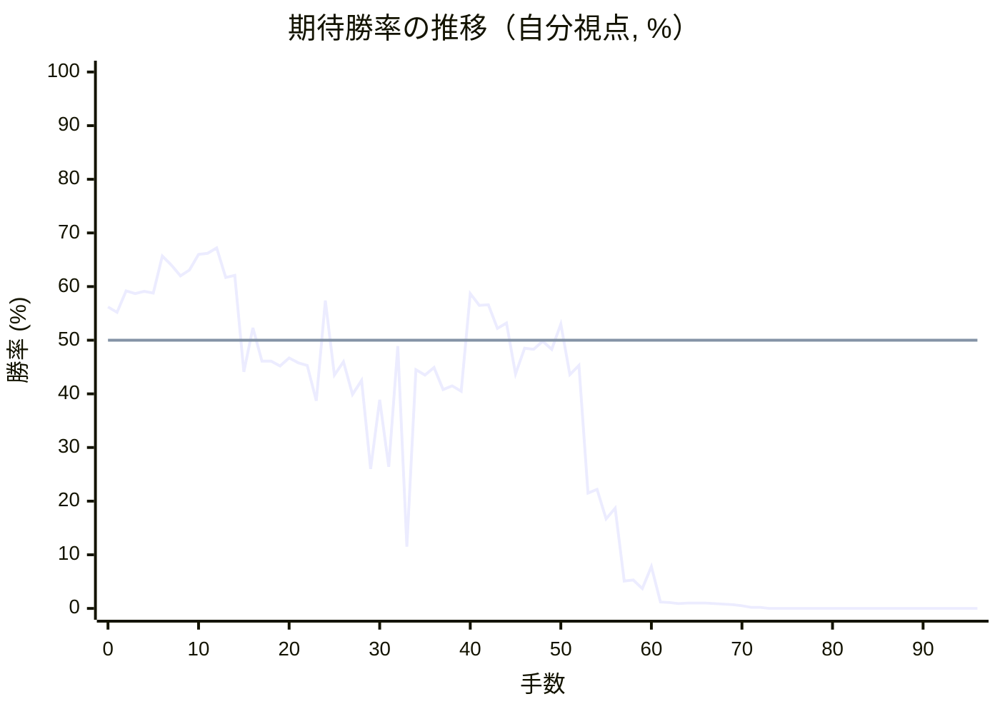

<details><summary>1手ごとの数値（第1パス）</summary>

| 手数 | 指し手 | 評価値 | 勝率 | 低下 | 判定 |
|--:|---|--:|--:|--:|---|
| 1 | ▲７六歩(77) | +125 | 55.2% | +1.0pt |  |
| 2 | △５四歩(53) | +224 | 59.2% |  |  |
| 3 | ▲２六歩(27) | +212 | 58.7% | +0.5pt |  |
| 4 | △３二金(41) | +221 | 59.1% |  |  |
| 5 | ▲２五歩(26) | +214 | 58.8% | +0.3pt |  |
| 6 | △５二飛(82) | +391 | 65.7% |  |  |
| 7 | ▲２四歩(25) | +344 | 64.0% | +1.8pt |  |
| 8 | △同歩(23) | +295 | 62.0% |  |  |
| 9 | ▲同飛(28) | +321 | 63.1% | -1.0pt |  |
| 10 | △２三歩打 | +398 | 66.0% |  |  |
| 11 | ▲２八飛(24) | +404 | 66.2% | -0.2pt |  |
| 12 | △６二玉(51) | +430 | 67.2% |  |  |
| 13 | ▲３八銀(39) | +285 | 61.7% | +5.5pt |  |
| 14 | △５五歩(54) | +296 | 62.1% |  |  |
| 15 | ▲２七銀(38) | -143 | 44.1% | +18.0pt | [悪手](#ply-15) |
| 16 | △３四歩(33) | +55 | 52.3% |  |  |
| 17 | ▲５八金(49) | -94 | 46.1% | +6.2pt | [疑問手](#ply-17) |
| 18 | △５六歩(55) | -94 | 46.1% |  |  |
| 19 | ▲同歩(57) | -116 | 45.2% | +0.9pt |  |
| 20 | △８八角成(22) | -80 | 46.7% |  |  |
| 21 | ▲同銀(79) | -101 | 45.8% | +0.9pt |  |
| 22 | △３九角打 | -113 | 45.3% |  |  |
| 23 | ▲１八飛(28) | -277 | 38.7% | +6.6pt | [疑問手](#ply-23) |
| 24 | △７二玉(62) | +178 | 57.4% |  |  |
| 25 | ▲７七銀(88) | -157 | 43.5% | +13.9pt | [悪手](#ply-25) |
| 26 | △８四角成(39) | -96 | 46.0% |  |  |
| 27 | ▲６六角打 | -247 | 39.9% | +6.2pt |  |
| 28 | △同馬(84) | -182 | 42.5% |  |  |
| 29 | ▲同歩(67) | -627 | 26.0% | +16.5pt | [大悪手](#ply-29) |
| 30 | △５六飛(52) | -272 | 38.9% |  |  |
| 31 | ▲６八玉(59) | -614 | 26.4% | +12.4pt | [悪手](#ply-31) |
| 32 | △５一飛(56) | -27 | 48.9% |  |  |
| 33 | ▲３六銀(27) | -1223 | 11.5% | +37.4pt | [大悪手](#ply-33) |
| 34 | △３三桂(21) | -132 | 44.5% |  |  |
| 35 | ▲６七金(58) | -157 | 43.5% | +1.0pt |  |
| 36 | △３五歩(34) | -122 | 44.9% |  |  |
| 37 | ▲同銀(36) | -223 | 40.8% | +4.1pt |  |
| 38 | △２七角打 | -205 | 41.5% |  |  |
| 39 | ▲２八飛(18) | -230 | 40.5% | +1.0pt |  |
| 40 | △４五角成(27) | +211 | 58.7% |  |  |
| 41 | ▲４六銀(35) | +157 | 56.5% | +2.2pt |  |
| 42 | △３四馬(45) | +160 | 56.6% |  |  |
| 43 | ▲５五歩打 | +52 | 52.2% | +4.5pt |  |
| 44 | △４二銀(31) | +76 | 53.2% |  |  |
| 45 | ▲５八飛(28) | -152 | 43.7% | +9.5pt | [悪手](#ply-45) |
| 46 | △５三銀(42) | -36 | 48.5% |  |  |
| 47 | ▲７八玉(68) | -40 | 48.3% | +0.2pt |  |
| 48 | △４四銀(53) | -5 | 49.8% |  |  |
| 49 | ▲６八金(69) | -42 | 48.3% | +1.5pt |  |
| 50 | △３八歩打 | +73 | 53.0% |  |  |
| 51 | ▲同飛(58) | -154 | 43.6% | +9.4pt | [悪手](#ply-51) |
| 52 | △５五銀(44) | -112 | 45.3% |  |  |
| 53 | ▲５四歩打 | -777 | 21.5% | +23.8pt | [大悪手](#ply-53) |
| 54 | △４六銀(55) | -751 | 22.2% |  |  |
| 55 | ▲同歩(47) | -966 | 16.7% | +5.6pt |  |
| 56 | △５六銀打 | -880 | 18.7% |  |  |
| 57 | ▲１八角打 | -1756 | 5.1% | +13.7pt | [疑問手](#ply-57) |
| 58 | △６七銀成(56) | -1732 | 5.3% |  |  |
| 59 | ▲同金(68) | -1951 | 3.7% | +1.6pt |  |
| 60 | △５七金打 | -1482 | 7.8% |  |  |
| 61 | ▲４五銀打 | -2631 | 1.2% | +6.6pt |  |
| 62 | △６七金(57) | -2683 | 1.1% |  |  |
| 63 | ▲同玉(78) | -2792 | 0.9% | +0.2pt |  |
| 64 | △４五桂(33) | -2733 | 1.0% |  |  |
| 65 | ▲同歩(46) | -2784 | 1.0% | +0.1pt |  |
| 66 | △５四飛(51) | -2757 | 1.0% |  |  |
| 67 | ▲５五歩打 | -2802 | 0.9% | +0.1pt |  |
| 68 | △同飛(54) | -2866 | 0.8% |  |  |
| 69 | ▲５六歩打 | -2943 | 0.7% | +0.1pt |  |
| 70 | △４五飛(55) | -3183 | 0.5% |  |  |
| 71 | ▲同角(18) | -3754 | 0.2% | +0.3pt |  |
| 72 | △同馬(34) | -3853 | 0.2% |  |  |
| 73 | ▲３六銀打 | -5511 | 0.0% | +0.2pt |  |
| 74 | △４九角打 | -5853 | 0.0% |  |  |
| 75 | ▲５八飛(38) | -6293 | 0.0% | +0.0pt |  |
| 76 | △同角成(49) | -6442 | 0.0% |  |  |
| 77 | ▲同玉(67) | -6366 | 0.0% | -0.0pt |  |
| 78 | △５六馬(45) | -6021 | 0.0% |  |  |
| 79 | ▲４七金打 | #-13 | 0.0% | +0.0pt |  |
| 80 | △２八飛打 | #-12 | 0.0% |  |  |
| 81 | ▲４八桂打 | #-5 | 0.0% | +0.0pt |  |
| 82 | △８九馬(56) | -6386 | 0.0% |  |  |
| 83 | ▲６八銀(77) | -6746 | 0.0% | +0.0pt |  |
| 84 | △５六歩打 | -6604 | 0.0% |  |  |
| 85 | ▲４五角打 | #-9 | 0.0% | +0.0pt |  |
| 86 | △５七銀打 | -5971 | 0.0% |  |  |
| 87 | ▲同金(47) | -6528 | 0.0% | +0.0pt |  |
| 88 | △同歩成(56) | -6587 | 0.0% |  |  |
| 89 | ▲同玉(58) | -7225 | 0.0% | +0.0pt |  |
| 90 | △４五馬(89) | -6313 | 0.0% |  |  |
| 91 | ▲同銀(36) | -6267 | 0.0% | -0.0pt |  |
| 92 | △２九飛成(28) | -5353 | 0.0% |  |  |
| 93 | ▲５四銀(45) | -5606 | 0.0% | +0.0pt |  |
| 94 | △４四桂打 | -4775 | 0.0% |  |  |
| 95 | ▲６三銀成(54) | -5301 | 0.0% | +0.0pt |  |
| 96 | △８二玉(72) | -4884 | 0.0% |  |  |

</details>

## 課題局面

<a id="ply-15"></a>
### 15手目 ▲２七銀(38) — 悪手

| | 着手前 | 着手後 | 差 |
|---|--:|--:|--:|
| 期待勝率 | 61.3% | 50.0% | -11.3pt |
| 評価値 | +275 | +0 | |

着手前の局面:

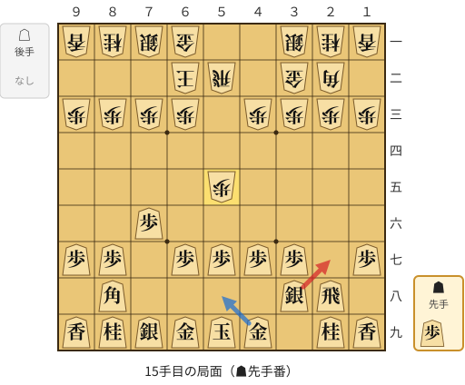

🔴 実戦 ▲２七銀(38)　🔵 AI推奨 ▲５八金(49)　🟨 直前の相手の指し手

<details><summary>テキストの盤面図（BOD・将棋ソフトに貼り付け可）</summary>

```text
後手の持駒：なし
  ９ ８ ７ ６ ５ ４ ３ ２ １
+---------------------------+
|v香v桂v銀v金 ・ ・v銀v桂v香|一
| ・ ・ ・v玉v飛 ・v金v角 ・|二
|v歩v歩v歩v歩 ・v歩v歩v歩v歩|三
| ・ ・ ・ ・ ・ ・ ・ ・ ・|四
| ・ ・ ・ ・v歩 ・ ・ ・ ・|五
| ・ ・ 歩 ・ ・ ・ ・ ・ ・|六
| 歩 歩 ・ 歩 歩 歩 歩 ・ 歩|七
| ・ 角 ・ ・ ・ ・ 銀 飛 ・|八
| 香 桂 銀 金 玉 金 ・ 桂 香|九
+---------------------------+
先手の持駒：歩
手数＝14　△５五歩　まで
```

</details>

| | 指し手 | 評価値 | 読み筋 |
|---|---|--:|---|
| 実戦 | ▲２七銀(38) | +0 | △５六歩(55) ▲同歩(57) △同飛(52) ▲６八玉(59) △１四歩(13) ▲５八金(49) |
| AI 1位 | ▲５八金(49) | +275 | ▲５八金(49) △９四歩(93) ▲９六歩(97) △３四歩(33) ▲６八玉(59) △７二銀(71) |
| AI 2位 | ▲６八玉(59) | +227 | ▲６八玉(59) △５六歩(55) ▲同歩(57) △同飛(52) ▲６六歩(67) △３四歩(33) |
| AI 3位 | ▲６八銀(79) | +218 | ▲６八銀(79) △３四歩(33) ▲５八金(49) △９四歩(93) ▲９六歩(97) △７二銀(71) |

SFEN: `lnsg2snl/3kr1gb1/pppp1pppp/9/4p4/2P6/PP1PPPP1P/1B4SR1/LNSGKG1NL b P 15`

<a id="ply-17"></a>
### 17手目 ▲５八金(49) — 疑問手

| | 着手前 | 着手後 | 差 |
|---|--:|--:|--:|
| 期待勝率 | 52.0% | 42.6% | -9.4pt |
| 評価値 | +48 | -180 | |

着手前の局面:

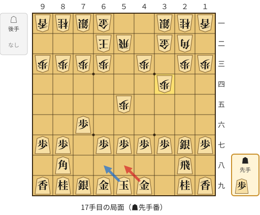

🔴 実戦 ▲５八金(49)　🔵 AI推奨 ▲６八玉(59)　🟨 直前の相手の指し手

<details><summary>テキストの盤面図（BOD・将棋ソフトに貼り付け可）</summary>

```text
後手の持駒：なし
  ９ ８ ７ ６ ５ ４ ３ ２ １
+---------------------------+
|v香v桂v銀v金 ・ ・v銀v桂v香|一
| ・ ・ ・v玉v飛 ・v金v角 ・|二
|v歩v歩v歩v歩 ・v歩 ・v歩v歩|三
| ・ ・ ・ ・ ・ ・v歩 ・ ・|四
| ・ ・ ・ ・v歩 ・ ・ ・ ・|五
| ・ ・ 歩 ・ ・ ・ ・ ・ ・|六
| 歩 歩 ・ 歩 歩 歩 歩 銀 歩|七
| ・ 角 ・ ・ ・ ・ ・ 飛 ・|八
| 香 桂 銀 金 玉 金 ・ 桂 香|九
+---------------------------+
先手の持駒：歩
手数＝16　△３四歩　まで
```

</details>

| | 指し手 | 評価値 | 読み筋 |
|---|---|--:|---|
| 実戦 | ▲５八金(49) | -180 | △５六歩(55) ▲同歩(57) △同飛(52) ▲６八玉(59) △７二玉(62) ▲９六歩(97) |
| AI 1位 | ▲６八玉(59) | +48 | ▲６八玉(59) △５六歩(55) ▲同歩(57) △同飛(52) ▲２二角成(88) △同銀(31) |
| AI 2位 | ▲５八飛(28) | +30 | ▲５八飛(28) △９四歩(93) ▲９六歩(97) △４四角(22) ▲６八玉(59) △７二玉(62) |
| AI 3位 | ▲６八金(69) | -57 | ▲６八金(69) △７二玉(62) ▲５八飛(28) △８二玉(72) ▲３六銀(27) △９四歩(93) |

SFEN: `lnsg2snl/3kr1gb1/pppp1p1pp/6p2/4p4/2P6/PP1PPPPSP/1B5R1/LNSGKG1NL b P 17`

<a id="ply-23"></a>
### 23手目 ▲１八飛(28) — 疑問手

| | 着手前 | 着手後 | 差 |
|---|--:|--:|--:|
| 期待勝率 | 45.6% | 39.9% | -5.7pt |
| 評価値 | -105 | -245 | |

着手前の局面:

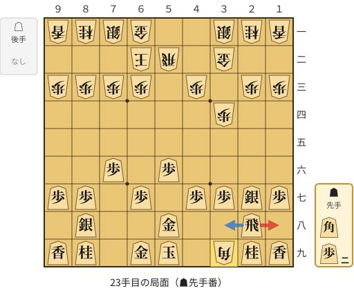

🔴 実戦 ▲１八飛(28)　🔵 AI推奨 ▲３八飛(28)　🟨 直前の相手の指し手

<details><summary>テキストの盤面図（BOD・将棋ソフトに貼り付け可）</summary>

```text
後手の持駒：なし
  ９ ８ ７ ６ ５ ４ ３ ２ １
+---------------------------+
|v香v桂v銀v金 ・ ・v銀v桂v香|一
| ・ ・ ・v玉v飛 ・v金 ・ ・|二
|v歩v歩v歩v歩 ・v歩 ・v歩v歩|三
| ・ ・ ・ ・ ・ ・v歩 ・ ・|四
| ・ ・ ・ ・ ・ ・ ・ ・ ・|五
| ・ ・ 歩 ・ 歩 ・ ・ ・ ・|六
| 歩 歩 ・ 歩 ・ 歩 歩 銀 歩|七
| ・ 銀 ・ ・ 金 ・ ・ 飛 ・|八
| 香 桂 ・ 金 玉 ・v角 桂 香|九
+---------------------------+
先手の持駒：角　歩二
手数＝22　△３九角　まで
```

</details>

| | 指し手 | 評価値 | 読み筋 |
|---|---|--:|---|
| 実戦 | ▲１八飛(28) | -245 | △８四角成(39) ▲６八玉(59) △５六飛(52) ▲５七歩打 △５一飛(56) ▲３六銀(27) |
| AI 1位 | ▲３八飛(28) | -105 | ▲３八飛(28) △８四角成(39) ▲７七銀(88) △５六飛(52) ▲６八玉(59) △３三桂(21) |
| AI 2位 | ▲１八飛(28) | -271 | ▲１八飛(28) △３三桂(21) ▲６八玉(59) △８四角成(39) ▲７七銀(88) △３九馬(84) |
| AI 3位 | ▲２六角打 | -627 | ▲２六角打 △７二玉(62) ▲３八飛(28) △８四角成(39) ▲３六歩(37) △５六飛(52) |

SFEN: `lnsg2snl/3kr1g2/pppp1p1pp/6p2/9/2P1P4/PP1P1PPSP/1S2G2R1/LN1GK1bNL b B2P 23`

<a id="ply-25"></a>
### 25手目 ▲７七銀(88) — 悪手

| | 着手前 | 着手後 | 差 |
|---|--:|--:|--:|
| 期待勝率 | 56.7% | 41.7% | -15.0pt |
| 評価値 | +162 | -202 | |

着手前の局面:

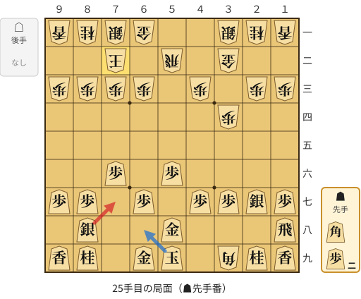

🔴 実戦 ▲７七銀(88)　🔵 AI推奨 ▲６八玉(59)　🟨 直前の相手の指し手

<details><summary>テキストの盤面図（BOD・将棋ソフトに貼り付け可）</summary>

```text
後手の持駒：なし
  ９ ８ ７ ６ ５ ４ ３ ２ １
+---------------------------+
|v香v桂v銀v金 ・ ・v銀v桂v香|一
| ・ ・v玉 ・v飛 ・v金 ・ ・|二
|v歩v歩v歩v歩 ・v歩 ・v歩v歩|三
| ・ ・ ・ ・ ・ ・v歩 ・ ・|四
| ・ ・ ・ ・ ・ ・ ・ ・ ・|五
| ・ ・ 歩 ・ 歩 ・ ・ ・ ・|六
| 歩 歩 ・ 歩 ・ 歩 歩 銀 歩|七
| ・ 銀 ・ ・ 金 ・ ・ ・ 飛|八
| 香 桂 ・ 金 玉 ・v角 桂 香|九
+---------------------------+
先手の持駒：角　歩二
手数＝24　△７二玉　まで
```

</details>

| | 指し手 | 評価値 | 読み筋 |
|---|---|--:|---|
| 実戦 | ▲７七銀(88) | -202 | △８四角成(39) ▲６六銀(77) △５六飛(52) ▲６八玉(59) △３三桂(21) ▲３六銀(27) |
| AI 1位 | ▲６八玉(59) | +162 | ▲６八玉(59) △８四角成(39) ▲５七金(58) △８二玉(72) ▲７七銀(88) △３三桂(21) |
| AI 2位 | ▲６八金(69) | -76 | ▲６八金(69) △３三桂(21) ▲７七銀(88) △８四角成(39) ▲５七金(58) △同馬(84) |
| AI 3位 | ▲５七角打 | -128 | ▲５七角打 △同角成(39) ▲同金(58) △３三桂(21) ▲６八金(69) △４五桂(33) |

SFEN: `lnsg2snl/2k1r1g2/pppp1p1pp/6p2/9/2P1P4/PP1P1PPSP/1S2G3R/LN1GK1bNL b B2P 25`

<a id="ply-29"></a>
### 29手目 ▲同歩(67) — 大悪手

| | 着手前 | 着手後 | 差 |
|---|--:|--:|--:|
| 期待勝率 | 42.4% | 17.5% | -24.9pt |
| 評価値 | -184 | -931 | |

着手前の局面:

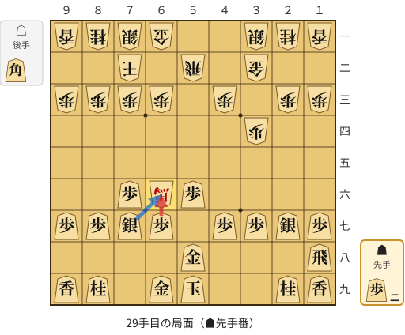

🔴 実戦 ▲同歩(67)　🔵 AI推奨 ▲同銀(77)　🟨 直前の相手の指し手

<details><summary>テキストの盤面図（BOD・将棋ソフトに貼り付け可）</summary>

```text
後手の持駒：角
  ９ ８ ７ ６ ５ ４ ３ ２ １
+---------------------------+
|v香v桂v銀v金 ・ ・v銀v桂v香|一
| ・ ・v玉 ・v飛 ・v金 ・ ・|二
|v歩v歩v歩v歩 ・v歩 ・v歩v歩|三
| ・ ・ ・ ・ ・ ・v歩 ・ ・|四
| ・ ・ ・ ・ ・ ・ ・ ・ ・|五
| ・ ・ 歩v馬 歩 ・ ・ ・ ・|六
| 歩 歩 銀 歩 ・ 歩 歩 銀 歩|七
| ・ ・ ・ ・ 金 ・ ・ ・ 飛|八
| 香 桂 ・ 金 玉 ・ ・ 桂 香|九
+---------------------------+
先手の持駒：歩二
手数＝28　△６六同馬　まで
```

</details>

| | 指し手 | 評価値 | 読み筋 |
|---|---|--:|---|
| 実戦 | ▲同歩(67) | -931 | △４五角打 ▲２八飛(18) △５六角(45) ▲７九金(69) △４七角成(56) ▲６八金(79) |
| AI 1位 | ▲同銀(77) | -184 | ▲同銀(77) △５六飛(52) ▲７七角打 △３三桂(21) ▲６八玉(59) △４二銀(31) |
| AI 2位 | ▲同歩(67) | -881 | ▲同歩(67) △４五角打 ▲２八飛(18) △５六角(45) ▲７八角打 △同角成(56) |
| AI 3位 | ▲２二歩打 | -3262 | ▲２二歩打 △同馬(66) ▲６八玉(59) △３三桂(21) ▲３六銀(27) △８二玉(72) |

SFEN: `lnsg2snl/2k1r1g2/pppp1p1pp/6p2/9/2P+bP4/PPSP1PPSP/4G3R/LN1GK2NL b 2Pb 29`

<a id="ply-31"></a>
### 31手目 ▲６八玉(59) — 悪手

| | 着手前 | 着手後 | 差 |
|---|--:|--:|--:|
| 期待勝率 | 42.1% | 24.6% | -17.5pt |
| 評価値 | -191 | -673 | |

着手前の局面:

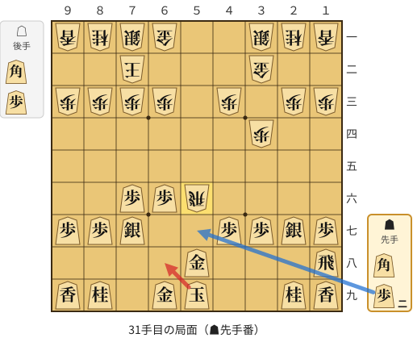

🔴 実戦 ▲６八玉(59)　🔵 AI推奨 ▲５七歩打　🟨 直前の相手の指し手

<details><summary>テキストの盤面図（BOD・将棋ソフトに貼り付け可）</summary>

```text
後手の持駒：角　歩
  ９ ８ ７ ６ ５ ４ ３ ２ １
+---------------------------+
|v香v桂v銀v金 ・ ・v銀v桂v香|一
| ・ ・v玉 ・ ・ ・v金 ・ ・|二
|v歩v歩v歩v歩 ・v歩 ・v歩v歩|三
| ・ ・ ・ ・ ・ ・v歩 ・ ・|四
| ・ ・ ・ ・ ・ ・ ・ ・ ・|五
| ・ ・ 歩 歩v飛 ・ ・ ・ ・|六
| 歩 歩 銀 ・ ・ 歩 歩 銀 歩|七
| ・ ・ ・ ・ 金 ・ ・ ・ 飛|八
| 香 桂 ・ 金 玉 ・ ・ 桂 香|九
+---------------------------+
先手の持駒：角　歩二
手数＝30　△５六飛　まで
```

</details>

| | 指し手 | 評価値 | 読み筋 |
|---|---|--:|---|
| 実戦 | ▲６八玉(59) | -673 | △４五角打 ▲６七金(58) △２七角成(45) ▲５六金(67) △１八馬(27) ▲同香(19) |
| AI 1位 | ▲５七歩打 | -191 | ▲５七歩打 △５一飛(56) ▲６七角打 △４二銀(31) ▲６八玉(59) △３三桂(21) |
| AI 2位 | ▲６七角打 | -204 | ▲６七角打 △５五飛(56) ▲５七歩打 △２五飛(55) ▲２六歩打 △２四飛(25) |
| AI 3位 | ▲７八角打 | -261 | ▲７八角打 △５四飛(56) ▲５七歩打 △８二玉(72) ▲６八玉(59) △３三桂(21) |

SFEN: `lnsg2snl/2k3g2/pppp1p1pp/6p2/9/2PPr4/PPS2PPSP/4G3R/LN1GK2NL b B2Pbp 31`

<a id="ply-33"></a>
### 33手目 ▲３六銀(27) — 大悪手

| | 着手前 | 着手後 | 差 |
|---|--:|--:|--:|
| 期待勝率 | 43.0% | 9.8% | -33.2pt |
| 評価値 | -170 | -1331 | |

着手前の局面:

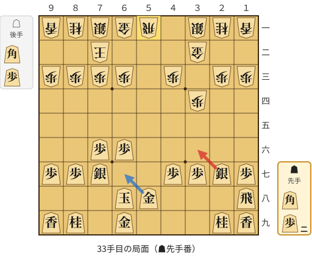

🔴 実戦 ▲３六銀(27)　🔵 AI推奨 ▲６七金(58)　🟨 直前の相手の指し手

<details><summary>テキストの盤面図（BOD・将棋ソフトに貼り付け可）</summary>

```text
後手の持駒：角　歩
  ９ ８ ７ ６ ５ ４ ３ ２ １
+---------------------------+
|v香v桂v銀v金v飛 ・v銀v桂v香|一
| ・ ・v玉 ・ ・ ・v金 ・ ・|二
|v歩v歩v歩v歩 ・v歩 ・v歩v歩|三
| ・ ・ ・ ・ ・ ・v歩 ・ ・|四
| ・ ・ ・ ・ ・ ・ ・ ・ ・|五
| ・ ・ 歩 歩 ・ ・ ・ ・ ・|六
| 歩 歩 銀 ・ ・ 歩 歩 銀 歩|七
| ・ ・ ・ 玉 金 ・ ・ ・ 飛|八
| 香 桂 ・ 金 ・ ・ ・ 桂 香|九
+---------------------------+
先手の持駒：角　歩二
手数＝32　△５一飛　まで
```

</details>

| | 指し手 | 評価値 | 読み筋 |
|---|---|--:|---|
| 実戦 | ▲３六銀(27) | -1331 | △３五歩(34) ▲同銀(36) △４五角打 ▲５六歩打 △１八角成(45) ▲同香(19) |
| AI 1位 | ▲６七金(58) | -170 | ▲６七金(58) △３三桂(21) ▲７八玉(68) △５七角打 ▲同金(67) △同飛成(51) |
| AI 2位 | ▲５六歩打 | -464 | ▲５六歩打 △同飛(51) ▲６七金(58) △５一飛(56) ▲９六歩(97) △８二玉(72) |
| AI 3位 | ▲５二歩打 | -500 | ▲５二歩打 △同飛(51) ▲６七金(58) △３三桂(21) ▲９六歩(97) △５一飛(52) |

SFEN: `lnsgr1snl/2k3g2/pppp1p1pp/6p2/9/2PP5/PPS2PPSP/3KG3R/LN1G3NL b B2Pbp 33`

<a id="ply-45"></a>
### 45手目 ▲５八飛(28) — 悪手

| | 着手前 | 着手後 | 差 |
|---|--:|--:|--:|
| 期待勝率 | 55.0% | 42.1% | -12.9pt |
| 評価値 | +120 | -192 | |

着手前の局面:

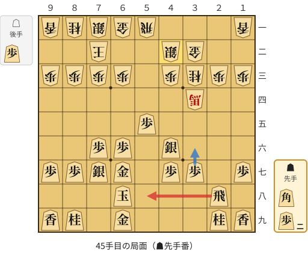

🔴 実戦 ▲５八飛(28)　🔵 AI推奨 ▲３六歩(37)　🟨 直前の相手の指し手

<details><summary>テキストの盤面図（BOD・将棋ソフトに貼り付け可）</summary>

```text
後手の持駒：歩
  ９ ８ ７ ６ ５ ４ ３ ２ １
+---------------------------+
|v香v桂v銀v金v飛 ・ ・ ・v香|一
| ・ ・v玉 ・ ・v銀v金 ・ ・|二
|v歩v歩v歩v歩 ・v歩v桂v歩v歩|三
| ・ ・ ・ ・ ・ ・v馬 ・ ・|四
| ・ ・ ・ ・ 歩 ・ ・ ・ ・|五
| ・ ・ 歩 歩 ・ 銀 ・ ・ ・|六
| 歩 歩 銀 金 ・ 歩 歩 ・ 歩|七
| ・ ・ ・ 玉 ・ ・ ・ 飛 ・|八
| 香 桂 ・ 金 ・ ・ ・ 桂 香|九
+---------------------------+
先手の持駒：角　歩二
手数＝44　△４二銀　まで
```

</details>

| | 指し手 | 評価値 | 読み筋 |
|---|---|--:|---|
| 実戦 | ▲５八飛(28) | -192 | △４四歩(43) ▲７八玉(68) △４五歩(44) ▲５七銀(46) △２四歩(23) ▲６五歩(66) |
| AI 1位 | ▲３六歩(37) | +120 | ▲３六歩(37) △４四歩(43) ▲７八玉(68) △２四歩(23) ▲３五歩(36) △２三馬(34) |
| AI 2位 | ▲７八玉(68) | +117 | ▲７八玉(68) △４四歩(43) ▲３六歩(37) △４五歩(44) ▲３五銀(46) △２五馬(34) |
| AI 3位 | ▲９六歩(97) | +22 | ▲９六歩(97) △８二玉(72) ▲３六歩(37) △７二銀(71) ▲７八玉(68) △４四歩(43) |

SFEN: `lnsgr3l/2k2sg2/pppp1pnpp/6+b2/4P4/2PP1S3/PPSG1PP1P/3K3R1/LN1G3NL b B2Pp 45`

<a id="ply-51"></a>
### 51手目 ▲同飛(58) — 悪手

| | 着手前 | 着手後 | 差 |
|---|--:|--:|--:|
| 期待勝率 | 55.8% | 37.7% | -18.2pt |
| 評価値 | +141 | -302 | |

着手前の局面:

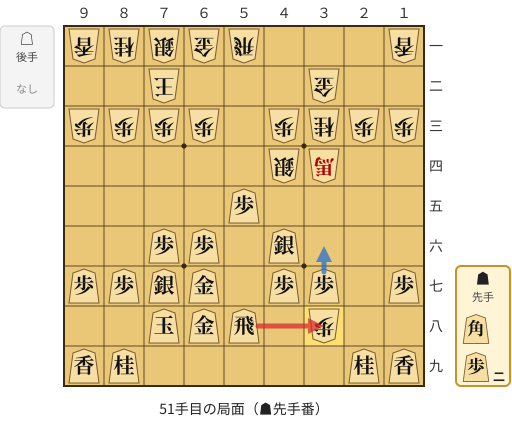

🔴 実戦 ▲同飛(58)　🔵 AI推奨 ▲３六歩(37)　🟨 直前の相手の指し手

<details><summary>テキストの盤面図（BOD・将棋ソフトに貼り付け可）</summary>

```text
後手の持駒：なし
  ９ ８ ７ ６ ５ ４ ３ ２ １
+---------------------------+
|v香v桂v銀v金v飛 ・ ・ ・v香|一
| ・ ・v玉 ・ ・ ・v金 ・ ・|二
|v歩v歩v歩v歩 ・v歩v桂v歩v歩|三
| ・ ・ ・ ・ ・v銀v馬 ・ ・|四
| ・ ・ ・ ・ 歩 ・ ・ ・ ・|五
| ・ ・ 歩 歩 ・ 銀 ・ ・ ・|六
| 歩 歩 銀 金 ・ 歩 歩 ・ 歩|七
| ・ ・ 玉 金 飛 ・v歩 ・ ・|八
| 香 桂 ・ ・ ・ ・ ・ 桂 香|九
+---------------------------+
先手の持駒：角　歩二
手数＝50　△３八歩　まで
```

</details>

| | 指し手 | 評価値 | 読み筋 |
|---|---|--:|---|
| 実戦 | ▲同飛(58) | -302 | △５五銀(44) ▲５七歩打 △５六歩打 ▲５五銀(46) △５七歩成(56) ▲同金(68) |
| AI 1位 | ▲３六歩(37) | +141 | ▲３六歩(37) △３九歩成(38) ▲３七桂(29) △８二玉(72) ▲９六歩(97) △７二銀(71) |
| AI 2位 | ▲同飛(58) | -190 | ▲同飛(58) △５五銀(44) ▲同銀(46) △同飛(51) ▲５六歩打 △２五飛(55) |
| AI 3位 | ▲５四歩(55) | -382 | ▲５四歩(55) △３九歩成(38) ▲３六歩(37) △２九と(39) ▲３五銀(46) △同銀(44) |

SFEN: `lnsgr3l/2k3g2/pppp1pnpp/5s+b2/4P4/2PP1S3/PPSG1PP1P/2KGR1p2/LN5NL b B2P 51`

<a id="ply-53"></a>
### 53手目 ▲５四歩打 — 大悪手

| | 着手前 | 着手後 | 差 |
|---|--:|--:|--:|
| 期待勝率 | 37.2% | 13.4% | -23.8pt |
| 評価値 | -314 | -1120 | |

着手前の局面:

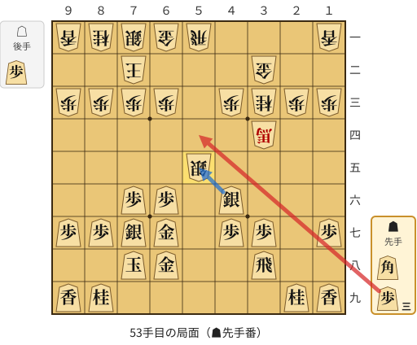

🔴 実戦 ▲５四歩打　🔵 AI推奨 ▲同銀(46)　🟨 直前の相手の指し手

<details><summary>テキストの盤面図（BOD・将棋ソフトに貼り付け可）</summary>

```text
後手の持駒：歩
  ９ ８ ７ ６ ５ ４ ３ ２ １
+---------------------------+
|v香v桂v銀v金v飛 ・ ・ ・v香|一
| ・ ・v玉 ・ ・ ・v金 ・ ・|二
|v歩v歩v歩v歩 ・v歩v桂v歩v歩|三
| ・ ・ ・ ・ ・ ・v馬 ・ ・|四
| ・ ・ ・ ・v銀 ・ ・ ・ ・|五
| ・ ・ 歩 歩 ・ 銀 ・ ・ ・|六
| 歩 歩 銀 金 ・ 歩 歩 ・ 歩|七
| ・ ・ 玉 金 ・ ・ 飛 ・ ・|八
| 香 桂 ・ ・ ・ ・ ・ 桂 香|九
+---------------------------+
先手の持駒：角　歩三
手数＝52　△５五銀　まで
```

</details>

| | 指し手 | 評価値 | 読み筋 |
|---|---|--:|---|
| 実戦 | ▲５四歩打 | -1120 | △４六銀(55) ▲同歩(47) △５六銀打 ▲５八銀打 △５七歩打 ▲６九銀(58) |
| AI 1位 | ▲同銀(46) | -314 | ▲同銀(46) △同飛(51) ▲５六歩打 △２五飛(55) ▲２八歩打 △４九銀打 |
| AI 2位 | ▲５七歩打 | -621 | ▲５七歩打 △４六銀(55) ▲同歩(47) △５六歩打 ▲同歩(57) △４七銀打 |
| AI 3位 | ▲５七銀(46) | -661 | ▲５七銀(46) △４五桂(33) ▲４八銀(57) △５六銀(55) ▲同金(67) △同飛(51) |

SFEN: `lnsgr3l/2k3g2/pppp1pnpp/6+b2/4s4/2PP1S3/PPSG1PP1P/2KG2R2/LN5NL b B3Pp 53`

<a id="ply-57"></a>
### 57手目 ▲１八角打 — 疑問手

| | 着手前 | 着手後 | 差 |
|---|--:|--:|--:|
| 期待勝率 | 11.4% | 4.1% | -7.3pt |
| 評価値 | -1230 | -1897 | |

着手前の局面:

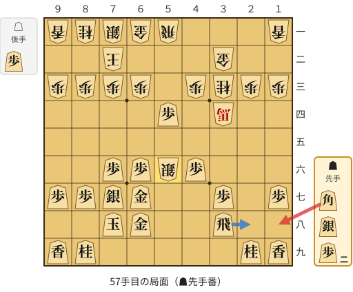

🔴 実戦 ▲１八角打　🔵 AI推奨 ▲２八飛(38)　🟨 直前の相手の指し手

<details><summary>テキストの盤面図（BOD・将棋ソフトに貼り付け可）</summary>

```text
後手の持駒：歩
  ９ ８ ７ ６ ５ ４ ３ ２ １
+---------------------------+
|v香v桂v銀v金v飛 ・ ・ ・v香|一
| ・ ・v玉 ・ ・ ・v金 ・ ・|二
|v歩v歩v歩v歩 ・v歩v桂v歩v歩|三
| ・ ・ ・ ・ 歩 ・v馬 ・ ・|四
| ・ ・ ・ ・ ・ ・ ・ ・ ・|五
| ・ ・ 歩 歩v銀 歩 ・ ・ ・|六
| 歩 歩 銀 金 ・ ・ 歩 ・ 歩|七
| ・ ・ 玉 金 ・ ・ 飛 ・ ・|八
| 香 桂 ・ ・ ・ ・ ・ 桂 香|九
+---------------------------+
先手の持駒：角　銀　歩二
手数＝56　△５六銀　まで
```

</details>

| | 指し手 | 評価値 | 読み筋 |
|---|---|--:|---|
| 実戦 | ▲１八角打 | -1897 | △６七銀不成(56) ▲同金(68) |
| AI 1位 | ▲２八飛(38) | -1230 | ▲２八飛(38) △６七銀成(56) ▲同金(68) △５七金打 ▲６八銀(77) △５四飛(51) |
| AI 2位 | ▲６五銀打 | -1262 | ▲６五銀打 △６七銀不成(56) ▲同金(68) △５七金打 ▲５六銀打 △同金(57) |
| AI 3位 | ▲３六角打 | -1300 | ▲３六角打 △６七銀不成(56) ▲同金(68) △３五金打 ▲２七角(36) △４六金(35) |

SFEN: `lnsgr3l/2k3g2/pppp1pnpp/4P1+b2/9/2PPsP3/PPSG2P1P/2KG2R2/LN5NL b BS2Pp 57`

