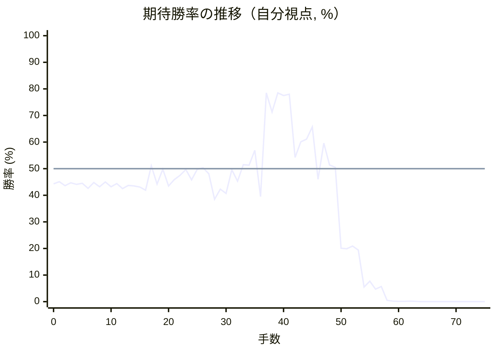
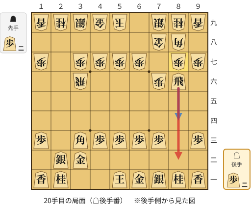
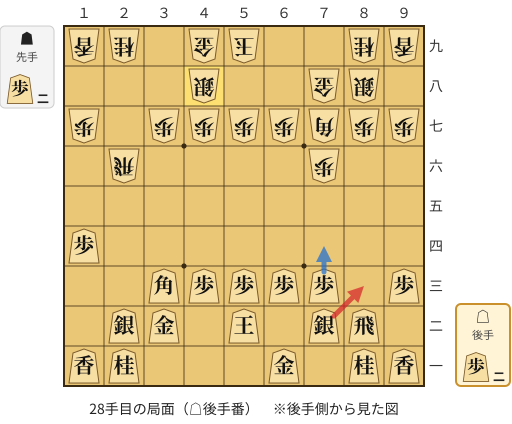
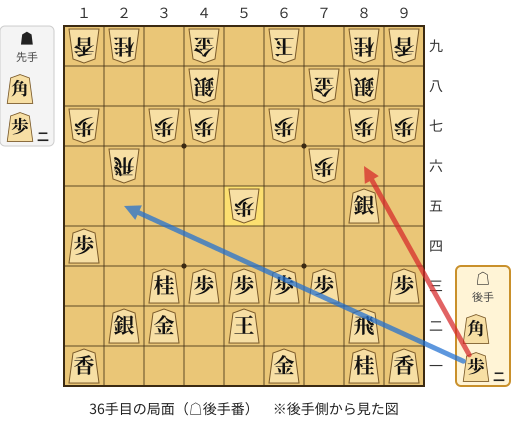
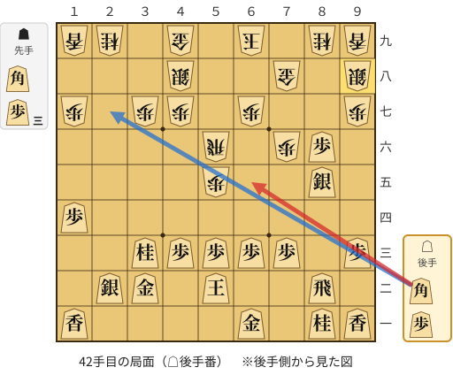
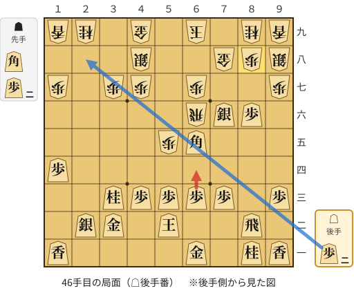
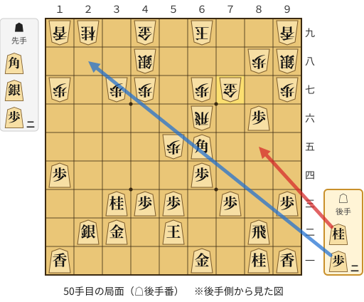
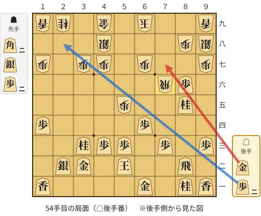

# 解析レポート 3ll02cic5ptm

[README に戻る](../../../README.md)　/　棋譜: [CSA](../../../data/csa/shogi5/3ll02cic5ptm.csa)　/　解析の見方: [docs/mistake_analysis.md](../../../docs/mistake_analysis.md)

## 対局情報

| 項目 | 内容 |
|---|---|
| 日時 | 2026-11-14 18:42:31 |
| 持ち時間 | 5分 |
| 自分 | 後手（△）（1645） |
| 相手 | 相手（1706） |
| 結果 | 負け（詰み, 75手） |

## 解析環境

| 項目 | 内容 |
|---|---|
| エンジン | YaneuraOu NNUE 9.00git 64AVX2（V9.00/YANEURAOU_ENGINE_NNUE/AVX2） |
| 評価関数 | **水匠5**（`suisho5`） |
| nn.bin SHA-256 | `768068f0d534a0603a5d38bcd143de6bbca820d5f1c95a14d40863e5b7892d76` |
| 第1パス | movetime=150ms, MultiPV 1 |
| 第2パス | movetime=2000ms, MultiPV 3 |
| Threads / Hash | 8 / 512MB |
| 判定基準 | 疑問手 ≥5pt, 悪手 ≥10pt, 大悪手 ≥20pt（期待勝率 W(E)=1/(1+exp(-E/600))） |
| 解析日時 | 2026-11-20T20:23:12+09:00（解析バージョン 1, 51秒） |

## サマリー

| 自分の手数 | 深掘りした手 | 詰み逃し | 大悪手 | 悪手 | 疑問手 |
|--:|--:|--:|--:|--:|--:|
| 37 | 10 | 0 | 3 | 3 | 1 |

## 期待勝率の推移



<details><summary>1手ごとの数値（第1パス）</summary>

| 手数 | 指し手 | 評価値 | 勝率 | 低下 | 判定 |
|--:|---|--:|--:|--:|---|
| 1 | ▲７六歩(77) | -117 | 45.1% |  |  |
| 2 | △３四歩(33) | -155 | 43.6% | +1.6pt |  |
| 3 | ▲２六歩(27) | -127 | 44.7% |  |  |
| 4 | △８四歩(83) | -143 | 44.1% | +0.7pt |  |
| 5 | ▲２五歩(26) | -133 | 44.5% |  |  |
| 6 | △８五歩(84) | -178 | 42.6% | +1.8pt |  |
| 7 | ▲７八金(69) | -125 | 44.8% |  |  |
| 8 | △３二金(41) | -163 | 43.2% | +1.6pt |  |
| 9 | ▲２四歩(25) | -120 | 45.0% |  |  |
| 10 | △同歩(23) | -164 | 43.2% | +1.8pt |  |
| 11 | ▲同飛(28) | -134 | 44.4% |  |  |
| 12 | △８六歩(85) | -182 | 42.5% | +2.0pt |  |
| 13 | ▲同歩(87) | -152 | 43.7% |  |  |
| 14 | △同飛(82) | -156 | 43.5% | +0.2pt |  |
| 15 | ▲３四飛(24) | -167 | 43.1% |  |  |
| 16 | △３三角(22) | -197 | 41.9% | +1.2pt |  |
| 17 | ▲３六飛(34) | +26 | 51.1% |  |  |
| 18 | △２二銀(31) | -141 | 44.2% | +6.9pt |  |
| 19 | ▲８七歩打 | -6 | 49.8% |  |  |
| 20 | △８二飛(86) | -158 | 43.5% | +6.3pt | [疑問手](#ply-20) |
| 21 | ▲２六飛(36) | -98 | 45.9% |  |  |
| 22 | △５二玉(51) | -61 | 47.5% | -1.5pt |  |
| 23 | ▲７七角(88) | -8 | 49.7% |  |  |
| 24 | △１四歩(13) | -102 | 45.8% | +3.9pt |  |
| 25 | ▲８八銀(79) | -4 | 49.8% |  |  |
| 26 | △７二銀(71) | +8 | 50.3% | -0.5pt |  |
| 27 | ▲４八銀(39) | -45 | 48.1% |  |  |
| 28 | △８三銀(72) | -282 | 38.5% | +9.7pt | [悪手](#ply-28) |
| 29 | ▲６九玉(59) | -186 | 42.3% |  |  |
| 30 | △７四銀(83) | -226 | 40.7% | +1.6pt |  |
| 31 | ▲５六歩(57) | -10 | 49.6% |  |  |
| 32 | △８五銀(74) | -113 | 45.3% | +4.3pt |  |
| 33 | ▲３三角成(77) | +35 | 51.5% |  |  |
| 34 | △同桂(21) | +32 | 51.3% | +0.1pt |  |
| 35 | ▲５五歩(56) | +167 | 56.9% |  |  |
| 36 | △８六歩打 | -257 | 39.5% | +17.5pt | [大悪手](#ply-36) |
| 37 | ▲５六飛(26) | +778 | 78.5% |  |  |
| 38 | △８七歩成(86) | +546 | 71.3% | +7.2pt |  |
| 39 | ▲同銀(88) | +777 | 78.5% |  |  |
| 40 | △８六歩打 | +741 | 77.5% | +1.0pt |  |
| 41 | ▲９八銀(87) | +761 | 78.0% |  |  |
| 42 | △６五角打 | +100 | 54.2% | +23.9pt | [悪手](#ply-42) |
| 43 | ▲６六飛(56) | +246 | 60.1% |  |  |
| 44 | △７六銀(85) | +270 | 61.1% | -1.0pt |  |
| 45 | ▲８八歩打 | +390 | 65.7% |  |  |
| 46 | △６四歩(63) | -97 | 46.0% | +19.7pt | [大悪手](#ply-46) |
| 47 | ▲７七桂(89) | +234 | 59.6% |  |  |
| 48 | △同銀不成(76) | +33 | 51.4% | +8.3pt |  |
| 49 | ▲同金(78) | +13 | 50.5% |  |  |
| 50 | △８五桂打 | -827 | 20.1% | +30.4pt | [大悪手](#ply-50) |
| 51 | ▲７六金(77) | -837 | 19.9% |  |  |
| 52 | △同角(65) | -800 | 20.9% | -1.0pt |  |
| 53 | ▲同飛(66) | -856 | 19.4% |  |  |
| 54 | △７七金打 | -1703 | 5.5% | +13.8pt | [悪手](#ply-54) |
| 55 | ▲６六飛(76) | -1494 | 7.7% |  |  |
| 56 | △８七歩成(86) | -1811 | 4.7% | +3.0pt |  |
| 57 | ▲同歩(88) | -1682 | 5.7% |  |  |
| 58 | △９七桂成(85) | -3163 | 0.5% | +5.2pt |  |
| 59 | ▲同銀(98) | -3623 | 0.2% |  |  |
| 60 | △８七飛成(82) | -3996 | 0.1% | +0.1pt |  |
| 61 | ▲９六角打 | -4178 | 0.1% |  |  |
| 62 | △同龍(87) | -3864 | 0.2% | -0.1pt |  |
| 63 | ▲同銀(97) | -4314 | 0.1% |  |  |
| 64 | △４五桂(33) | -4706 | 0.0% | +0.0pt |  |
| 65 | ▲８二飛打 | -4851 | 0.0% |  |  |
| 66 | △４一玉(52) | -5790 | 0.0% | +0.0pt |  |
| 67 | ▲６三角打 | -5794 | 0.0% |  |  |
| 68 | △３一玉(41) | -5940 | 0.0% | +0.0pt |  |
| 69 | ▲２四桂打 | -5950 | 0.0% |  |  |
| 70 | △２三銀(22) | #-7 | 0.0% | +0.0pt |  |
| 71 | ▲３二桂成(24) | #-6 | 0.0% |  |  |
| 72 | △同銀(23) | #-5 | 0.0% | +0.0pt |  |
| 73 | ▲４一角成(63) | #-4 | 0.0% |  |  |
| 74 | △同銀(32) | #-1 | 0.0% | +0.0pt |  |
| 75 | ▲２二金打 | #- | 0.0% |  |  |

</details>

## 課題局面

<a id="ply-20"></a>
### 20手目 △８二飛(86) — 疑問手

| | 着手前 | 着手後 | 差 |
|---|--:|--:|--:|
| 期待勝率 | 51.3% | 45.3% | -6.0pt |
| 評価値 | +31 | -113 | |

着手前の局面:



🔴 実戦 △８二飛(86)　🔵 AI推奨 △８四飛(86)　🟨 直前の相手の指し手

<details><summary>テキストの盤面図（BOD・将棋ソフトに貼り付け可）</summary>

```text
後手の持駒：歩二
  ９ ８ ７ ６ ５ ４ ３ ２ １
+---------------------------+
|v香v桂v銀v金v玉 ・ ・v桂v香|一
| ・ ・ ・ ・ ・ ・v金v銀 ・|二
|v歩 ・v歩v歩v歩v歩v角 ・v歩|三
| ・ ・ ・ ・ ・ ・ ・ ・ ・|四
| ・ ・ ・ ・ ・ ・ ・ ・ ・|五
| ・v飛 歩 ・ ・ ・ 飛 ・ ・|六
| 歩 歩 ・ 歩 歩 歩 歩 ・ 歩|七
| ・ 角 金 ・ ・ ・ ・ ・ ・|八
| 香 桂 銀 ・ 玉 金 銀 桂 香|九
+---------------------------+
先手の持駒：歩二
後手番
手数＝19　▲８七歩　まで
```

</details>

| | 指し手 | 評価値 | 読み筋 |
|---|---|--:|---|
| 実戦 | △８二飛(86) | -113 | ▲２六飛(36) △７二銀(71) ▲５八玉(59) △７四歩(73) ▲３六歩(37) △５二玉(51) |
| AI 1位 | △８四飛(86) | +31 | △８四飛(86) ▲２六飛(36) △５二玉(51) ▲５八玉(59) △７四歩(73) ▲１六歩(17) |
| AI 2位 | △８五飛(86) | -43 | △８五飛(86) ▲２六飛(36) △５二玉(51) ▲５八玉(59) △７四歩(73) ▲７七角(88) |
| AI 3位 | △８二飛(86) | -52 | △８二飛(86) ▲２六飛(36) △５二玉(51) ▲５八玉(59) △７四歩(73) ▲３六歩(37) |

SFEN: `lnsgk2nl/6gs1/p1ppppb1p/9/9/1rP3R2/PP1PPPP1P/1BG6/LNS1KGSNL w 2P2p 20`

<a id="ply-28"></a>
### 28手目 △８三銀(72) — 悪手

| | 着手前 | 着手後 | 差 |
|---|--:|--:|--:|
| 期待勝率 | 49.1% | 37.6% | -11.5pt |
| 評価値 | -21 | -304 | |

着手前の局面:



🔴 実戦 △８三銀(72)　🔵 AI推奨 △７四歩(73)　🟨 直前の相手の指し手

<details><summary>テキストの盤面図（BOD・将棋ソフトに貼り付け可）</summary>

```text
後手の持駒：歩二
  ９ ８ ７ ６ ５ ４ ３ ２ １
+---------------------------+
|v香v桂 ・v金 ・ ・ ・v桂v香|一
| ・v飛v銀 ・v玉 ・v金v銀 ・|二
|v歩 ・v歩v歩v歩v歩v角 ・ ・|三
| ・ ・ ・ ・ ・ ・ ・ ・v歩|四
| ・ ・ ・ ・ ・ ・ ・ ・ ・|五
| ・ ・ 歩 ・ ・ ・ ・ 飛 ・|六
| 歩 歩 角 歩 歩 歩 歩 ・ 歩|七
| ・ 銀 金 ・ ・ 銀 ・ ・ ・|八
| 香 桂 ・ ・ 玉 金 ・ 桂 香|九
+---------------------------+
先手の持駒：歩二
後手番
手数＝27　▲４八銀　まで
```

</details>

| | 指し手 | 評価値 | 読み筋 |
|---|---|--:|---|
| 実戦 | △８三銀(72) | -304 | ▲３六歩(37) △７四銀(83) ▲３五歩(36) △８五飛(82) ▲３三角成(77) △同桂(21) |
| AI 1位 | △７四歩(73) | -21 | △７四歩(73) ▲３八金(49) △８四飛(82) ▲５八玉(59) △７三桂(81) ▲３六歩(37) |
| AI 2位 | △８四飛(82) | -56 | △８四飛(82) ▲３八金(49) △７四歩(73) ▲５八玉(59) △７三桂(81) ▲３六歩(37) |
| AI 3位 | △９四歩(93) | -108 | △９四歩(93) ▲３六歩(37) △８四飛(82) ▲３七桂(29) △２四飛(84) ▲３三角成(77) |

SFEN: `ln1g3nl/1rs1k1gs1/p1ppppb2/8p/9/2P4R1/PPBPPPP1P/1SG2S3/LN2KG1NL w 2P2p 28`

<a id="ply-36"></a>
### 36手目 △８六歩打 — 大悪手

| | 着手前 | 着手後 | 差 |
|---|--:|--:|--:|
| 期待勝率 | 58.1% | 32.3% | -25.7pt |
| 評価値 | +195 | -443 | |

着手前の局面:



🔴 実戦 △８六歩打　🔵 AI推奨 △２五歩打　🟨 直前の相手の指し手

<details><summary>テキストの盤面図（BOD・将棋ソフトに貼り付け可）</summary>

```text
後手の持駒：角　歩二
  ９ ８ ７ ６ ５ ４ ３ ２ １
+---------------------------+
|v香v桂 ・v金 ・ ・ ・ ・v香|一
| ・v飛 ・ ・v玉 ・v金v銀 ・|二
|v歩 ・v歩v歩v歩v歩v桂 ・ ・|三
| ・ ・ ・ ・ ・ ・ ・ ・v歩|四
| ・v銀 ・ ・ 歩 ・ ・ ・ ・|五
| ・ ・ 歩 ・ ・ ・ ・ 飛 ・|六
| 歩 歩 ・ 歩 ・ 歩 歩 ・ 歩|七
| ・ 銀 金 ・ ・ 銀 ・ ・ ・|八
| 香 桂 ・ 玉 ・ 金 ・ 桂 香|九
+---------------------------+
先手の持駒：角　歩二
後手番
手数＝35　▲５五歩　まで
```

</details>

| | 指し手 | 評価値 | 読み筋 |
|---|---|--:|---|
| 実戦 | △８六歩打 | -443 | ▲同歩(87) △８七歩打 ▲同銀(88) △８六銀(85) ▲同銀(87) △同飛(82) |
| AI 1位 | △２五歩打 | +195 | △２五歩打 ▲２八飛(26) △７六銀(85) ▲５八金(49) △８四飛(82) ▲２六歩打 |
| AI 2位 | △４四角打 | +7 | △４四角打 ▲２八飛(26) △７六銀(85) ▲５七銀(48) △５五角(44) ▲６六銀(57) |
| AI 3位 | △６二金(61) | -200 | △６二金(61) ▲７七桂(89) △２五歩打 ▲４六飛(26) △７四銀(85) ▲３六歩(37) |

SFEN: `ln1g4l/1r2k1gs1/p1ppppn2/8p/1s2P4/2P4R1/PP1P1PP1P/1SG2S3/LN1K1G1NL w B2Pb2p 36`

<a id="ply-42"></a>
### 42手目 △６五角打 — 悪手

| | 着手前 | 着手後 | 差 |
|---|--:|--:|--:|
| 期待勝率 | 82.5% | 65.8% | -16.7pt |
| 評価値 | +932 | +393 | |

着手前の局面:



🔴 実戦 △６五角打　🔵 AI推奨 △２七角打　🟨 直前の相手の指し手

<details><summary>テキストの盤面図（BOD・将棋ソフトに貼り付け可）</summary>

```text
後手の持駒：角　歩
  ９ ８ ７ ６ ５ ４ ３ ２ １
+---------------------------+
|v香v桂 ・v金 ・ ・ ・ ・v香|一
| ・v飛 ・ ・v玉 ・v金v銀 ・|二
|v歩 ・v歩v歩v歩v歩v桂 ・ ・|三
| ・ ・ ・ ・ ・ ・ ・ ・v歩|四
| ・v銀 ・ ・ 歩 ・ ・ ・ ・|五
| ・v歩 歩 ・ 飛 ・ ・ ・ ・|六
| 歩 ・ ・ 歩 ・ 歩 歩 ・ 歩|七
| 銀 ・ 金 ・ ・ 銀 ・ ・ ・|八
| 香 桂 ・ 玉 ・ 金 ・ 桂 香|九
+---------------------------+
先手の持駒：角　歩三
後手番
手数＝41　▲９八銀　まで
```

</details>

| | 指し手 | 評価値 | 読み筋 |
|---|---|--:|---|
| 実戦 | △６五角打 | +393 | ▲８三歩打 △同飛(82) ▲６六飛(56) △７六銀(85) ▲８八歩打 △２八歩打 |
| AI 1位 | △２七角打 | +932 | △２七角打 ▲３八角打 △４五角成(27) ▲４六歩(47) △５六馬(45) ▲同角(38) |
| AI 2位 | △４五角打 | +583 | △４五角打 ▲２六飛(56) △２八歩打 ▲４六歩(47) △３四角(45) ▲８三歩打 |
| AI 3位 | △２八歩打 | +487 | △２八歩打 ▲５四歩(55) △同歩(53) ▲７七桂(89) △７四銀(85) ▲８三歩打 |

SFEN: `ln1g4l/1r2k1gs1/p1ppppn2/8p/1s2P4/1pP1R4/P2P1PP1P/S1G2S3/LN1K1G1NL w B3Pbp 42`

<a id="ply-46"></a>
### 46手目 △６四歩(63) — 大悪手

| | 着手前 | 着手後 | 差 |
|---|--:|--:|--:|
| 期待勝率 | 72.0% | 37.0% | -35.0pt |
| 評価値 | +566 | -320 | |

着手前の局面:



🔴 実戦 △６四歩(63)　🔵 AI推奨 △２八歩打　🟨 直前の相手の指し手

<details><summary>テキストの盤面図（BOD・将棋ソフトに貼り付け可）</summary>

```text
後手の持駒：歩二
  ９ ８ ７ ６ ５ ４ ３ ２ １
+---------------------------+
|v香v桂 ・v金 ・ ・ ・ ・v香|一
| ・v飛 ・ ・v玉 ・v金v銀 ・|二
|v歩 ・v歩v歩v歩v歩v桂 ・ ・|三
| ・ ・ ・ ・ ・ ・ ・ ・v歩|四
| ・ ・ ・v角 歩 ・ ・ ・ ・|五
| ・v歩v銀 飛 ・ ・ ・ ・ ・|六
| 歩 ・ ・ 歩 ・ 歩 歩 ・ 歩|七
| 銀 歩 金 ・ ・ 銀 ・ ・ ・|八
| 香 桂 ・ 玉 ・ 金 ・ 桂 香|九
+---------------------------+
先手の持駒：角　歩二
後手番
手数＝45　▲８八歩　まで
```

</details>

| | 指し手 | 評価値 | 読み筋 |
|---|---|--:|---|
| 実戦 | △６四歩(63) | -320 | ▲２六飛(66) △４四歩(43) ▲７七桂(89) △４三角(65) ▲５四歩(55) △３六歩打 |
| AI 1位 | △２八歩打 | +566 | △２八歩打 ▲７七桂(89) △同銀成(76) ▲同金(78) △７四角(65) ▲５四歩(55) |
| AI 2位 | △８七歩成(86) | +536 | △８七歩成(86) ▲同歩(88) △２八歩打 ▲７七桂(89) △同銀成(76) ▲同金(78) |
| AI 3位 | △６四歩(63) | -210 | △６四歩(63) ▲２六飛(66) △４二玉(52) ▲５九金(49) △９四歩(93) ▲６六歩(67) |

SFEN: `ln1g4l/1r2k1gs1/p1ppppn2/8p/3bP4/1psR5/P2P1PP1P/SPG2S3/LN1K1G1NL w B2P2p 46`

<a id="ply-50"></a>
### 50手目 △８五桂打 — 大悪手

| | 着手前 | 着手後 | 差 |
|---|--:|--:|--:|
| 期待勝率 | 47.3% | 17.2% | -30.1pt |
| 評価値 | -65 | -942 | |

着手前の局面:



🔴 実戦 △８五桂打　🔵 AI推奨 △２八歩打　🟨 直前の相手の指し手

<details><summary>テキストの盤面図（BOD・将棋ソフトに貼り付け可）</summary>

```text
後手の持駒：桂　歩二
  ９ ８ ７ ６ ５ ４ ３ ２ １
+---------------------------+
|v香v桂 ・v金 ・ ・ ・ ・v香|一
| ・v飛 ・ ・v玉 ・v金v銀 ・|二
|v歩 ・v歩 ・v歩v歩v桂 ・ ・|三
| ・ ・ ・v歩 ・ ・ ・ ・v歩|四
| ・ ・ ・v角 歩 ・ ・ ・ ・|五
| ・v歩 ・ 飛 ・ ・ ・ ・ ・|六
| 歩 ・ 金 歩 ・ 歩 歩 ・ 歩|七
| 銀 歩 ・ ・ ・ 銀 ・ ・ ・|八
| 香 ・ ・ 玉 ・ 金 ・ 桂 香|九
+---------------------------+
先手の持駒：角　銀　歩二
後手番
手数＝49　▲７七同金　まで
```

</details>

| | 指し手 | 評価値 | 読み筋 |
|---|---|--:|---|
| 実戦 | △８五桂打 | -942 | ▲７六金(77) △同角(65) ▲同飛(66) △２八歩打 ▲１八角打 △６二金打 |
| AI 1位 | △２八歩打 | -65 | △２八歩打 ▲７六金(77) △同角(65) ▲同飛(66) △２九歩成(28) ▲９六角打 |
| AI 2位 | △８七歩成(86) | -390 | △８七歩成(86) ▲同銀(98) △２八歩打 ▲９六角打 △７四角(65) ▲同角(96) |
| AI 3位 | △５一玉(52) | -521 | △５一玉(52) ▲６三角打 △２八歩打 ▲８六飛(66) △８四歩打 ▲７六金(77) |

SFEN: `ln1g4l/1r2k1gs1/p1p1ppn2/3p4p/3bP4/1p1R5/P1GP1PP1P/SP3S3/L2K1G1NL w BS2Pn2p 50`

<a id="ply-54"></a>
### 54手目 △７七金打 — 悪手

| | 着手前 | 着手後 | 差 |
|---|--:|--:|--:|
| 期待勝率 | 17.0% | 4.7% | -12.3pt |
| 評価値 | -950 | -1805 | |

着手前の局面:



🔴 実戦 △７七金打　🔵 AI推奨 △２八歩打　🟨 直前の相手の指し手

<details><summary>テキストの盤面図（BOD・将棋ソフトに貼り付け可）</summary>

```text
後手の持駒：金　歩二
  ９ ８ ７ ６ ５ ４ ３ ２ １
+---------------------------+
|v香v桂 ・v金 ・ ・ ・ ・v香|一
| ・v飛 ・ ・v玉 ・v金v銀 ・|二
|v歩 ・v歩 ・v歩v歩v桂 ・ ・|三
| ・ ・ ・v歩 ・ ・ ・ ・v歩|四
| ・v桂 ・ ・ 歩 ・ ・ ・ ・|五
| ・v歩 飛 ・ ・ ・ ・ ・ ・|六
| 歩 ・ ・ 歩 ・ 歩 歩 ・ 歩|七
| 銀 歩 ・ ・ ・ 銀 ・ ・ ・|八
| 香 ・ ・ 玉 ・ 金 ・ 桂 香|九
+---------------------------+
先手の持駒：角二　銀　歩二
後手番
手数＝53　▲７六同飛　まで
```

</details>

| | 指し手 | 評価値 | 読み筋 |
|---|---|--:|---|
| 実戦 | △７七金打 | -1805 | ▲５六飛(76) △２八歩打 ▲７八歩打 △２九歩成(28) ▲７七歩(78) △１九と(29) |
| AI 1位 | △２八歩打 | -950 | △２八歩打 ▲１八角打 △６二金打 ▲４六歩(47) △７二金(61) ▲３六歩(37) |
| AI 2位 | △７二金(61) | -1400 | △７二金(61) ▲５四歩(55) △同歩(53) ▲２六角打 △４四金打 ▲５八金(49) |
| AI 3位 | △２三銀(22) | -1487 | △２三銀(22) ▲３九金(49) △２八歩打 ▲同金(39) △７四歩(73) ▲１八角打 |

SFEN: `ln1g4l/1r2k1gs1/p1p1ppn2/3p4p/1n2P4/1pR6/P2P1PP1P/SP3S3/L2K1G1NL w 2BS2Pg2p 54`

