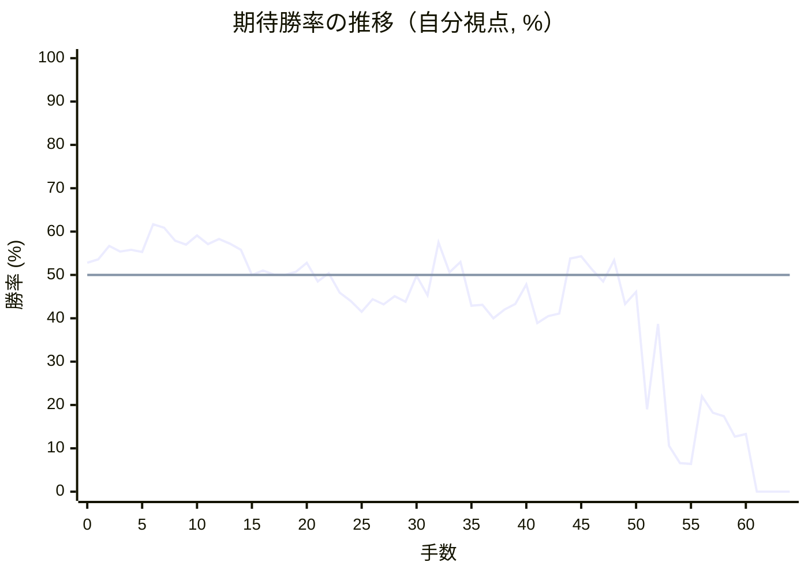
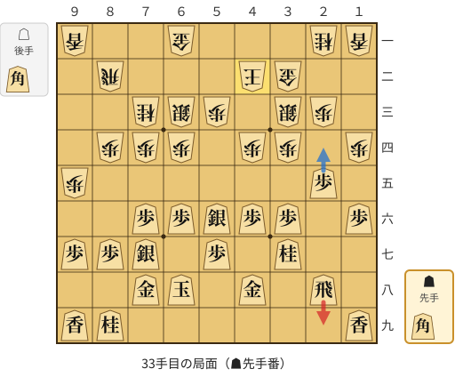
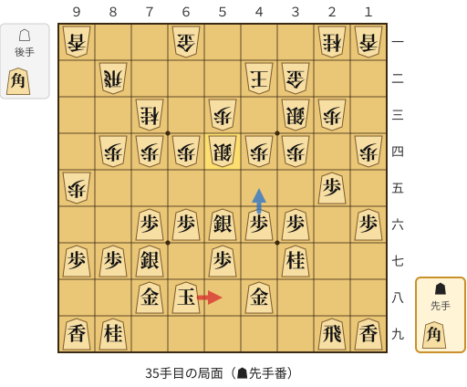
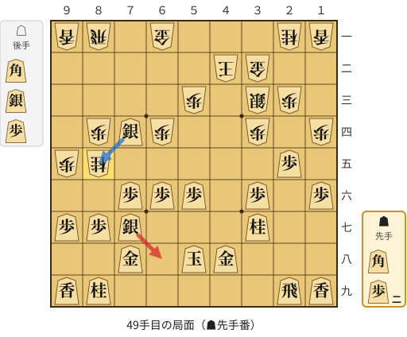
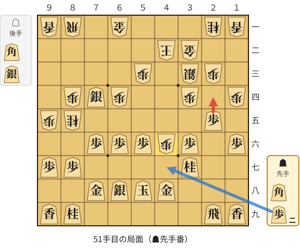
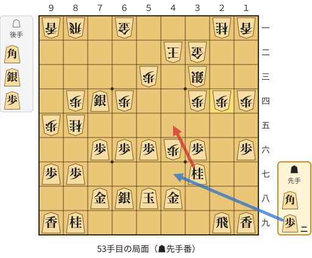
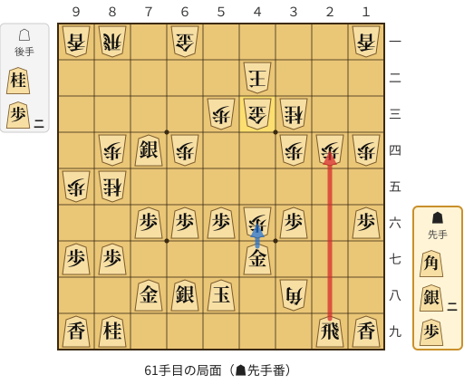

# 解析レポート 40hvj60yffkx

[README に戻る](../../../README.md)　/　棋譜: [CSA](../../../data/csa/shogi5/40hvj60yffkx.csa)　/　解析の見方: [docs/mistake_analysis.md](../../../docs/mistake_analysis.md)

## 対局情報

| 項目 | 内容 |
|---|---|
| 日時 | 2026-10-28 21:36:32 |
| 持ち時間 | 5分 |
| 自分 | 先手（▲）（1759） |
| 相手 | 相手（1819） |
| 結果 | 負け（投了, 64手） |

## 解析環境

| 項目 | 内容 |
|---|---|
| エンジン | YaneuraOu NNUE 9.00git 64AVX2（V9.00/YANEURAOU_ENGINE_NNUE/AVX2） |
| 評価関数 | **水匠5**（`suisho5`） |
| nn.bin SHA-256 | `768068f0d534a0603a5d38bcd143de6bbca820d5f1c95a14d40863e5b7892d76` |
| 第1パス | movetime=150ms, MultiPV 1 |
| 第2パス | movetime=2000ms, MultiPV 3 |
| Threads / Hash | 8 / 512MB |
| 判定基準 | 疑問手 ≥5pt, 悪手 ≥10pt, 大悪手 ≥20pt（期待勝率 W(E)=1/(1+exp(-E/600))） |
| 解析日時 | 2026-11-03T04:24:29+09:00（解析バージョン 1, 35秒） |

## サマリー

| 自分の手数 | 深掘りした手 | 詰み逃し | 大悪手 | 悪手 | 疑問手 |
|--:|--:|--:|--:|--:|--:|
| 32 | 7 | 0 | 2 | 1 | 3 |

## 期待勝率の推移



<details><summary>1手ごとの数値（第1パス）</summary>

| 手数 | 指し手 | 評価値 | 勝率 | 低下 | 判定 |
|--:|---|--:|--:|--:|---|
| 1 | ▲７六歩(77) | +87 | 53.6% | -0.8pt |  |
| 2 | △３四歩(33) | +161 | 56.7% |  |  |
| 3 | ▲２六歩(27) | +130 | 55.4% | +1.3pt |  |
| 4 | △８四歩(83) | +141 | 55.8% |  |  |
| 5 | ▲２五歩(26) | +128 | 55.3% | +0.5pt |  |
| 6 | △８八角成(22) | +286 | 61.7% |  |  |
| 7 | ▲同銀(79) | +267 | 60.9% | +0.8pt |  |
| 8 | △２二銀(31) | +190 | 57.9% |  |  |
| 9 | ▲７七銀(88) | +170 | 57.0% | +0.8pt |  |
| 10 | △３三銀(22) | +222 | 59.1% |  |  |
| 11 | ▲４八銀(39) | +171 | 57.1% | +2.1pt |  |
| 12 | △３二金(41) | +201 | 58.3% |  |  |
| 13 | ▲７八金(69) | +175 | 57.2% | +1.1pt |  |
| 14 | △６二銀(71) | +140 | 55.8% |  |  |
| 15 | ▲４六歩(47) | +0 | 50.0% | +5.8pt |  |
| 16 | △６四歩(63) | +23 | 51.0% |  |  |
| 17 | ▲４七銀(48) | +2 | 50.1% | +0.9pt |  |
| 18 | △６三銀(62) | +0 | 50.0% |  |  |
| 19 | ▲６八玉(59) | +17 | 50.7% | -0.7pt |  |
| 20 | △７四歩(73) | +67 | 52.8% |  |  |
| 21 | ▲６六歩(67) | -36 | 48.5% | +4.3pt |  |
| 22 | △９四歩(93) | +10 | 50.4% |  |  |
| 23 | ▲５六銀(47) | -98 | 45.9% | +4.5pt |  |
| 24 | △９五歩(94) | -144 | 44.0% |  |  |
| 25 | ▲１六歩(17) | -207 | 41.5% | +2.6pt |  |
| 26 | △１四歩(13) | -134 | 44.4% |  |  |
| 27 | ▲３六歩(37) | -164 | 43.2% | +1.2pt |  |
| 28 | △７三桂(81) | -117 | 45.1% |  |  |
| 29 | ▲３七桂(29) | -150 | 43.8% | +1.4pt |  |
| 30 | △４四歩(43) | -4 | 49.8% |  |  |
| 31 | ▲４八金(49) | -113 | 45.3% | +4.5pt |  |
| 32 | △４二玉(51) | +181 | 57.5% |  |  |
| 33 | ▲２九飛(28) | +14 | 50.6% | +6.9pt | [疑問手](#ply-33) |
| 34 | △５四銀(63) | +73 | 53.0% |  |  |
| 35 | ▲５八玉(68) | -172 | 42.9% | +10.2pt | [疑問手](#ply-35) |
| 36 | △６二金(61) | -167 | 43.1% |  |  |
| 37 | ▲４五歩(46) | -244 | 40.0% | +3.1pt |  |
| 38 | △同歩(44) | -194 | 42.0% |  |  |
| 39 | ▲同銀(56) | -162 | 43.3% | -1.3pt |  |
| 40 | △５五銀(54) | -54 | 47.8% |  |  |
| 41 | ▲５六銀(45) | -272 | 38.9% | +8.9pt |  |
| 42 | △同銀(55) | -232 | 40.5% |  |  |
| 43 | ▲同歩(57) | -216 | 41.1% | -0.6pt |  |
| 44 | △８一飛(82) | +92 | 53.8% |  |  |
| 45 | ▲６三銀打 | +104 | 54.3% | -0.5pt |  |
| 46 | △６一金(62) | +28 | 51.2% |  |  |
| 47 | ▲７四銀不成(63) | -35 | 48.5% | +2.6pt |  |
| 48 | △８五桂(73) | +82 | 53.4% |  |  |
| 49 | ▲６八銀(77) | -161 | 43.3% | +10.1pt | [疑問手](#ply-49) |
| 50 | △４六歩打 | -93 | 46.1% |  |  |
| 51 | ▲２四歩(25) | -870 | 19.0% | +27.1pt | [大悪手](#ply-51) |
| 52 | △同歩(23) | -277 | 38.7% |  |  |
| 53 | ▲４五桂(37) | -1281 | 10.6% | +28.1pt | [大悪手](#ply-53) |
| 54 | △４七銀打 | -1586 | 6.6% |  |  |
| 55 | ▲同金(48) | -1608 | 6.4% | +0.2pt |  |
| 56 | △３八角打 | -758 | 22.0% |  |  |
| 57 | ▲３三桂成(45) | -901 | 18.2% | +3.8pt |  |
| 58 | △同桂(21) | -936 | 17.4% |  |  |
| 59 | ▲４三歩打 | -1158 | 12.7% | +4.7pt |  |
| 60 | △同金(32) | -1123 | 13.3% |  |  |
| 61 | ▲２四飛(29) | #-5 | 0.0% | +13.3pt | [悪手](#ply-61) |
| 62 | △４七角成(38) | #-4 | 0.0% |  |  |
| 63 | ▲６七玉(58) | #-3 | 0.0% | +0.0pt |  |
| 64 | △５五桂打 | #-2 | 0.0% |  |  |

</details>

## 課題局面

<a id="ply-33"></a>
### 33手目 ▲２九飛(28) — 疑問手

| | 着手前 | 着手後 | 差 |
|---|--:|--:|--:|
| 期待勝率 | 58.4% | 52.0% | -6.4pt |
| 評価値 | +203 | +48 | |

着手前の局面:



🔴 実戦 ▲２九飛(28)　🔵 AI推奨 ▲２四歩(25)　🟨 直前の相手の指し手

<details><summary>テキストの盤面図（BOD・将棋ソフトに貼り付け可）</summary>

```text
後手の持駒：角
  ９ ８ ７ ６ ５ ４ ３ ２ １
+---------------------------+
|v香 ・ ・v金 ・ ・ ・v桂v香|一
| ・v飛 ・ ・ ・v玉v金 ・ ・|二
| ・ ・v桂v銀v歩 ・v銀v歩 ・|三
| ・v歩v歩v歩 ・v歩v歩 ・v歩|四
|v歩 ・ ・ ・ ・ ・ ・ 歩 ・|五
| ・ ・ 歩 歩 銀 歩 歩 ・ 歩|六
| 歩 歩 銀 ・ 歩 ・ 桂 ・ ・|七
| ・ ・ 金 玉 ・ 金 ・ 飛 ・|八
| 香 桂 ・ ・ ・ ・ ・ ・ 香|九
+---------------------------+
先手の持駒：角
手数＝32　△４二玉　まで
```

</details>

| | 指し手 | 評価値 | 読み筋 |
|---|---|--:|---|
| 実戦 | ▲２九飛(28) | +48 | △３一玉(42) ▲４五歩(46) △４二飛(82) ▲４四歩(45) △同銀(33) ▲４六歩打 |
| AI 1位 | ▲２四歩(25) | +203 | ▲２四歩(25) △同銀(33) ▲４五歩(46) △３五歩(34) ▲２六飛(28) △３六歩(35) |
| AI 2位 | ▲４五歩(46) | +190 | ▲４五歩(46) △６二金(61) ▲２四歩(25) △同歩(23) ▲４四歩(45) △同銀(33) |
| AI 3位 | ▲７九玉(68) | +95 | ▲７九玉(68) △５四銀(63) ▲４五歩(46) △同歩(44) ▲２四歩(25) △同銀(33) |

SFEN: `l2g3nl/1r3kg2/2nsp1sp1/1ppp1pp1p/p6P1/2PPSPP1P/PPS1P1N2/2GK1G1R1/LN6L b Bb 33`

<a id="ply-35"></a>
### 35手目 ▲５八玉(68) — 疑問手

| | 着手前 | 着手後 | 差 |
|---|--:|--:|--:|
| 期待勝率 | 53.2% | 43.6% | -9.6pt |
| 評価値 | +78 | -154 | |

着手前の局面:



🔴 実戦 ▲５八玉(68)　🔵 AI推奨 ▲４五歩(46)　🟨 直前の相手の指し手

<details><summary>テキストの盤面図（BOD・将棋ソフトに貼り付け可）</summary>

```text
後手の持駒：角
  ９ ８ ７ ６ ５ ４ ３ ２ １
+---------------------------+
|v香 ・ ・v金 ・ ・ ・v桂v香|一
| ・v飛 ・ ・ ・v玉v金 ・ ・|二
| ・ ・v桂 ・v歩 ・v銀v歩 ・|三
| ・v歩v歩v歩v銀v歩v歩 ・v歩|四
|v歩 ・ ・ ・ ・ ・ ・ 歩 ・|五
| ・ ・ 歩 歩 銀 歩 歩 ・ 歩|六
| 歩 歩 銀 ・ 歩 ・ 桂 ・ ・|七
| ・ ・ 金 玉 ・ 金 ・ ・ ・|八
| 香 桂 ・ ・ ・ ・ ・ 飛 香|九
+---------------------------+
先手の持駒：角
手数＝34　△５四銀　まで
```

</details>

| | 指し手 | 評価値 | 読み筋 |
|---|---|--:|---|
| 実戦 | ▲５八玉(68) | -154 | △６二金(61) ▲６九玉(58) △８一飛(82) ▲７九玉(69) △５二玉(42) ▲６八玉(79) |
| AI 1位 | ▲４五歩(46) | +78 | ▲４五歩(46) △同歩(44) ▲７五歩(76) △同歩(74) ▲８六銀(77) △７六歩(75) |
| AI 2位 | ▲７五歩(76) | +70 | ▲７五歩(76) △同歩(74) ▲８六銀(77) △６三銀(54) ▲７五銀(86) △７四歩打 |
| AI 3位 | ▲２四歩(25) | +23 | ▲２四歩(25) △同歩(23) ▲４五歩(46) △６二金(61) ▲４四歩(45) △８一飛(82) |

SFEN: `l2g3nl/1r3kg2/2n1p1sp1/1pppspp1p/p6P1/2PPSPP1P/PPS1P1N2/2GK1G3/LN5RL b Bb 35`

<a id="ply-49"></a>
### 49手目 ▲６八銀(77) — 疑問手

| | 着手前 | 着手後 | 差 |
|---|--:|--:|--:|
| 期待勝率 | 52.6% | 44.3% | -8.3pt |
| 評価値 | +63 | -137 | |

着手前の局面:



🔴 実戦 ▲６八銀(77)　🔵 AI推奨 ▲同銀(74)　🟨 直前の相手の指し手

<details><summary>テキストの盤面図（BOD・将棋ソフトに貼り付け可）</summary>

```text
後手の持駒：角　銀　歩
  ９ ８ ７ ６ ５ ４ ３ ２ １
+---------------------------+
|v香v飛 ・v金 ・ ・ ・v桂v香|一
| ・ ・ ・ ・ ・v玉v金 ・ ・|二
| ・ ・ ・ ・v歩 ・v銀v歩 ・|三
| ・v歩 銀v歩 ・ ・v歩 ・v歩|四
|v歩v桂 ・ ・ ・ ・ ・ 歩 ・|五
| ・ ・ 歩 歩 歩 ・ 歩 ・ 歩|六
| 歩 歩 銀 ・ ・ ・ 桂 ・ ・|七
| ・ ・ 金 ・ 玉 金 ・ ・ ・|八
| 香 桂 ・ ・ ・ ・ ・ 飛 香|九
+---------------------------+
先手の持駒：角　歩二
手数＝48　△８五桂　まで
```

</details>

| | 指し手 | 評価値 | 読み筋 |
|---|---|--:|---|
| 実戦 | ▲６八銀(77) | -137 | △９二角打 ▲７五歩(76) △７三歩打 ▲６三銀成(74) △５六角(92) ▲７九飛(29) |
| AI 1位 | ▲同銀(74) | +63 | ▲同銀(74) △同歩(84) ▲７三桂打 △７一飛(81) ▲６一桂成(73) △同飛(71) |
| AI 2位 | ▲６八銀(77) | -143 | ▲６八銀(77) △４六歩打 ▲４七歩打 △同歩成(46) ▲同玉(58) △２八銀打 |
| AI 3位 | ▲４七歩打 | -168 | ▲４七歩打 △７二銀打 ▲８六銀(77) △７三歩打 ▲８五銀(74) △同歩(84) |

SFEN: `lr1g3nl/5kg2/4p1sp1/1pSp2p1p/pn5P1/2PPP1P1P/PPS3N2/2G1KG3/LN5RL b B2Pbsp 49`

<a id="ply-51"></a>
### 51手目 ▲２四歩(25) — 大悪手

| | 着手前 | 着手後 | 差 |
|---|--:|--:|--:|
| 期待勝率 | 46.0% | 15.4% | -30.6pt |
| 評価値 | -96 | -1020 | |

着手前の局面:



🔴 実戦 ▲２四歩(25)　🔵 AI推奨 ▲４七歩打　🟨 直前の相手の指し手

<details><summary>テキストの盤面図（BOD・将棋ソフトに貼り付け可）</summary>

```text
後手の持駒：角　銀
  ９ ８ ７ ６ ５ ４ ３ ２ １
+---------------------------+
|v香v飛 ・v金 ・ ・ ・v桂v香|一
| ・ ・ ・ ・ ・v玉v金 ・ ・|二
| ・ ・ ・ ・v歩 ・v銀v歩 ・|三
| ・v歩 銀v歩 ・ ・v歩 ・v歩|四
|v歩v桂 ・ ・ ・ ・ ・ 歩 ・|五
| ・ ・ 歩 歩 歩v歩 歩 ・ 歩|六
| 歩 歩 ・ ・ ・ ・ 桂 ・ ・|七
| ・ ・ 金 銀 玉 金 ・ ・ ・|八
| 香 桂 ・ ・ ・ ・ ・ 飛 香|九
+---------------------------+
先手の持駒：角　歩二
手数＝50　△４六歩　まで
```

</details>

| | 指し手 | 評価値 | 読み筋 |
|---|---|--:|---|
| 実戦 | ▲２四歩(25) | -1020 | △４七銀打 ▲同金(48) △３八角打 ▲４六金(47) △２九角成(38) ▲４三歩打 |
| AI 1位 | ▲４七歩打 | -96 | ▲４七歩打 △同歩成(46) ▲同玉(58) △２八銀打 ▲同飛(29) △６九角打 |
| AI 2位 | ▲４三歩打 | -491 | ▲４三歩打 △同金(32) ▲４七歩打 △７一飛(81) ▲７五歩(76) △４七歩成(46) |
| AI 3位 | ▲６三角打 | -575 | ▲６三角打 △７一飛(81) ▲４七歩打 △同歩成(46) ▲同玉(58) △５二金(61) |

SFEN: `lr1g3nl/5kg2/4p1sp1/1pSp2p1p/pn5P1/2PPPpP1P/PP4N2/2GSKG3/LN5RL b B2Pbs 51`

<a id="ply-53"></a>
### 53手目 ▲４五桂(37) — 大悪手

| | 着手前 | 着手後 | 差 |
|---|--:|--:|--:|
| 期待勝率 | 40.4% | 7.3% | -33.1pt |
| 評価値 | -234 | -1523 | |

着手前の局面:



🔴 実戦 ▲４五桂(37)　🔵 AI推奨 ▲４七歩打　🟨 直前の相手の指し手

<details><summary>テキストの盤面図（BOD・将棋ソフトに貼り付け可）</summary>

```text
後手の持駒：角　銀　歩
  ９ ８ ７ ６ ５ ４ ３ ２ １
+---------------------------+
|v香v飛 ・v金 ・ ・ ・v桂v香|一
| ・ ・ ・ ・ ・v玉v金 ・ ・|二
| ・ ・ ・ ・v歩 ・v銀 ・ ・|三
| ・v歩 銀v歩 ・ ・v歩v歩v歩|四
|v歩v桂 ・ ・ ・ ・ ・ ・ ・|五
| ・ ・ 歩 歩 歩v歩 歩 ・ 歩|六
| 歩 歩 ・ ・ ・ ・ 桂 ・ ・|七
| ・ ・ 金 銀 玉 金 ・ ・ ・|八
| 香 桂 ・ ・ ・ ・ ・ 飛 香|九
+---------------------------+
先手の持駒：角　歩二
手数＝52　△２四同歩　まで
```

</details>

| | 指し手 | 評価値 | 読み筋 |
|---|---|--:|---|
| 実戦 | ▲４五桂(37) | -1523 | △４七銀打 ▲同金(48) △同歩成(46) ▲同玉(58) △４六歩打 ▲同玉(47) |
| AI 1位 | ▲４七歩打 | -234 | ▲４七歩打 △同歩成(46) ▲同玉(58) △３五歩(34) ▲同歩(36) △３六歩打 |
| AI 2位 | ▲４三歩打 | -482 | ▲４三歩打 △同金(32) ▲４七歩打 △同歩成(46) ▲同玉(58) △３五歩(34) |
| AI 3位 | ▲２二歩打 | -688 | ▲２二歩打 △４七銀打 ▲同金(48) △３八角打 ▲４三歩打 △同金(32) |

SFEN: `lr1g3nl/5kg2/4p1s2/1pSp2ppp/pn7/2PPPpP1P/PP4N2/2GSKG3/LN5RL b B2Pbsp 53`

<a id="ply-61"></a>
### 61手目 ▲２四飛(29) — 悪手

| | 着手前 | 着手後 | 差 |
|---|--:|--:|--:|
| 期待勝率 | 10.2% | 0.0% | -10.2pt |
| 評価値 | -1308 | 5手で詰まされる | |

着手前の局面:



🔴 実戦 ▲２四飛(29)　🔵 AI推奨 ▲４六金(47)　🟨 直前の相手の指し手

<details><summary>テキストの盤面図（BOD・将棋ソフトに貼り付け可）</summary>

```text
後手の持駒：桂　歩二
  ９ ８ ７ ６ ５ ４ ３ ２ １
+---------------------------+
|v香v飛 ・v金 ・ ・ ・ ・v香|一
| ・ ・ ・ ・ ・v玉 ・ ・ ・|二
| ・ ・ ・ ・v歩v金v桂 ・ ・|三
| ・v歩 銀v歩 ・ ・v歩v歩v歩|四
|v歩v桂 ・ ・ ・ ・ ・ ・ ・|五
| ・ ・ 歩 歩 歩v歩 歩 ・ 歩|六
| 歩 歩 ・ ・ ・ 金 ・ ・ ・|七
| ・ ・ 金 銀 玉 ・v角 ・ ・|八
| 香 桂 ・ ・ ・ ・ ・ 飛 香|九
+---------------------------+
先手の持駒：角　銀二　歩
手数＝60　△４三同金　まで
```

</details>

| | 指し手 | 評価値 | 読み筋 |
|---|---|--:|---|
| 実戦 | ▲２四飛(29) | 5手で詰まされる | △４七角成(38) ▲６七玉(58) △５五桂打 ▲同歩(56) △５六金打 |
| AI 1位 | ▲４六金(47) | -1308 | ▲４六金(47) △２九角成(38) ▲８五銀(74) △７七歩打 ▲７九金(78) △５四桂打 |
| AI 2位 | ▲５七金(47) | -1625 | ▲５七金(47) △２九角成(38) ▲８五銀(74) △４七歩成(46) ▲同金(57) △２八飛打 |
| AI 3位 | ▲６七玉(58) | -1715 | ▲６七玉(58) △２九角成(38) ▲４六金(47) △２七飛打 ▲５七銀打 △１九馬(29) |

SFEN: `lr1g4l/5k3/4pgn2/1pSp2ppp/pn7/2PPPpP1P/PP3G3/2GSK1b2/LN5RL b B2SPn2p 61`

