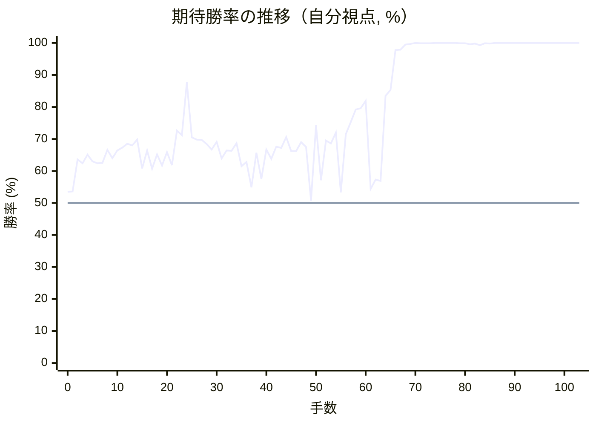
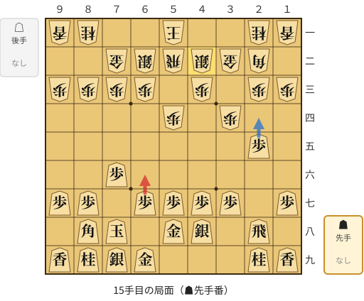
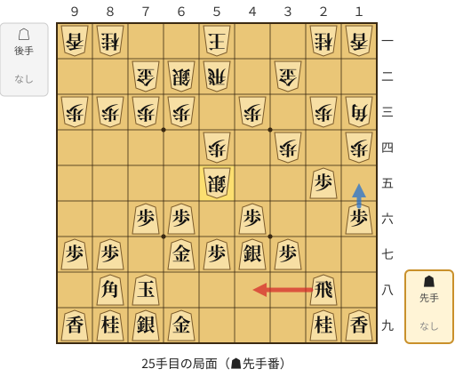
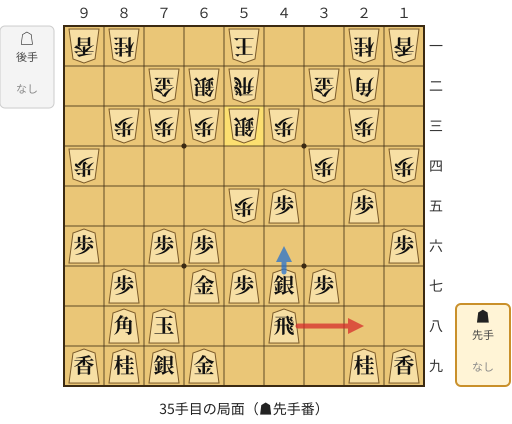
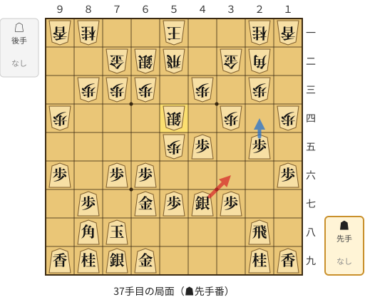
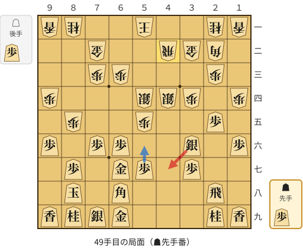
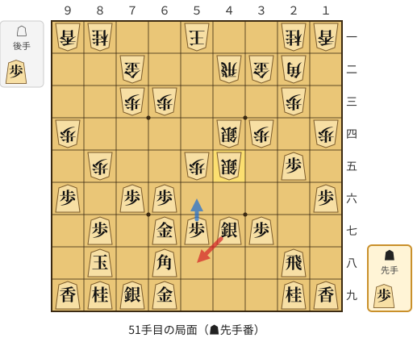
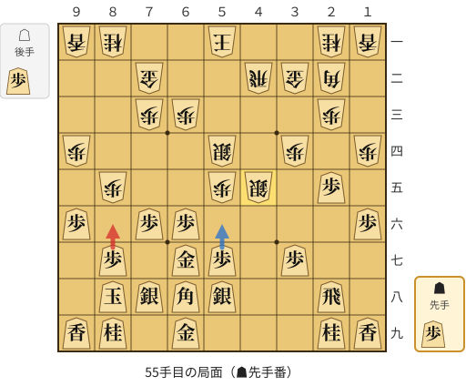
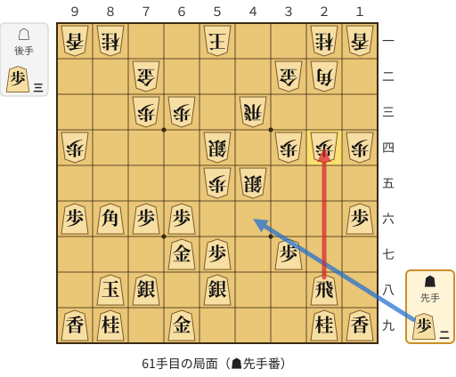

# 解析レポート 494ierslpp4b

[README に戻る](../../../README.md)　/　棋譜: [CSA](../../../data/csa/shogi5/494ierslpp4b.csa)　/　解析の見方: [docs/mistake_analysis.md](../../../docs/mistake_analysis.md)

## 対局情報

| 項目 | 内容 |
|---|---|
| 日時 | 2026-11-08 14:24:40 |
| 持ち時間 | 5分 |
| 自分 | 先手（▲）（1663） |
| 相手 | 相手（1436） |
| 結果 | 勝ち（詰み, 103手） |

## 解析環境

| 項目 | 内容 |
|---|---|
| エンジン | YaneuraOu NNUE 9.00git 64AVX2（V9.00/YANEURAOU_ENGINE_NNUE/AVX2） |
| 評価関数 | **水匠5**（`suisho5`） |
| nn.bin SHA-256 | `768068f0d534a0603a5d38bcd143de6bbca820d5f1c95a14d40863e5b7892d76` |
| 第1パス | movetime=150ms, MultiPV 1 |
| 第2パス | movetime=2000ms, MultiPV 3 |
| Threads / Hash | 8 / 512MB |
| 判定基準 | 疑問手 ≥5pt, 悪手 ≥10pt, 大悪手 ≥20pt（期待勝率 W(E)=1/(1+exp(-E/600))） |
| 解析日時 | 2026-11-11T20:17:21+09:00（解析バージョン 1, 59秒） |

## サマリー

| 自分の手数 | 深掘りした手 | 詰み逃し | 大悪手 | 悪手 | 疑問手 |
|--:|--:|--:|--:|--:|--:|
| 52 | 11 | 0 | 1 | 4 | 3 |

## 期待勝率の推移



<details><summary>1手ごとの数値（第1パス）</summary>

| 手数 | 指し手 | 評価値 | 勝率 | 低下 | 判定 |
|--:|---|--:|--:|--:|---|
| 1 | ▲７六歩(77) | +87 | 53.6% | -0.1pt |  |
| 2 | △５二飛(82) | +334 | 63.6% |  |  |
| 3 | ▲２六歩(27) | +304 | 62.4% | +1.2pt |  |
| 4 | △３二金(41) | +373 | 65.1% |  |  |
| 5 | ▲２五歩(26) | +320 | 63.0% | +2.0pt |  |
| 6 | △３四歩(33) | +304 | 62.4% |  |  |
| 7 | ▲４八銀(39) | +306 | 62.5% | -0.1pt |  |
| 8 | △７二金(61) | +413 | 66.6% |  |  |
| 9 | ▲６八玉(59) | +345 | 64.0% | +2.6pt |  |
| 10 | △６二銀(71) | +410 | 66.4% |  |  |
| 11 | ▲７八玉(68) | +432 | 67.3% | -0.8pt |  |
| 12 | △５四歩(53) | +467 | 68.5% |  |  |
| 13 | ▲５八金(49) | +452 | 68.0% | +0.5pt |  |
| 14 | △４二銀(31) | +503 | 69.8% |  |  |
| 15 | ▲６六歩(67) | +264 | 60.8% | +9.0pt | [疑問手](#ply-15) |
| 16 | △５三銀(42) | +410 | 66.4% |  |  |
| 17 | ▲６七金(58) | +260 | 60.7% | +5.8pt |  |
| 18 | △４四銀(53) | +376 | 65.2% |  |  |
| 19 | ▲４六歩(47) | +287 | 61.7% | +3.4pt |  |
| 20 | △１四歩(13) | +396 | 65.9% |  |  |
| 21 | ▲４七銀(48) | +288 | 61.8% | +4.2pt |  |
| 22 | △１三角(22) | +585 | 72.6% |  |  |
| 23 | ▲１六歩(17) | +543 | 71.2% | +1.4pt |  |
| 24 | △５五銀(44) | +1177 | 87.7% |  |  |
| 25 | ▲４八飛(28) | +523 | 70.5% | +17.2pt | [悪手](#ply-25) |
| 26 | △２二角(13) | +503 | 69.8% |  |  |
| 27 | ▲９六歩(97) | +500 | 69.7% | +0.1pt |  |
| 28 | △９四歩(93) | +464 | 68.4% |  |  |
| 29 | ▲４五歩(46) | +418 | 66.7% | +1.7pt |  |
| 30 | △６四銀(55) | +483 | 69.1% |  |  |
| 31 | ▲５六銀(47) | +342 | 63.9% | +5.2pt |  |
| 32 | △５五歩(54) | +408 | 66.4% |  |  |
| 33 | ▲４七銀(56) | +407 | 66.3% | +0.0pt |  |
| 34 | △５三銀(64) | +471 | 68.7% |  |  |
| 35 | ▲２八飛(48) | +281 | 61.5% | +7.2pt | [疑問手](#ply-35) |
| 36 | △５四銀(53) | +315 | 62.8% |  |  |
| 37 | ▲３六銀(47) | +118 | 54.9% | +7.9pt | [疑問手](#ply-37) |
| 38 | △５三銀(62) | +391 | 65.7% |  |  |
| 39 | ▲７七角(88) | +182 | 57.5% | +8.2pt |  |
| 40 | △４四歩(43) | +417 | 66.7% |  |  |
| 41 | ▲同歩(45) | +340 | 63.8% | +2.9pt |  |
| 42 | △同銀(53) | +442 | 67.6% |  |  |
| 43 | ▲８六角(77) | +430 | 67.2% | +0.4pt |  |
| 44 | △８四歩(83) | +526 | 70.6% |  |  |
| 45 | ▲８八玉(78) | +403 | 66.2% | +4.4pt |  |
| 46 | △８五歩(84) | +402 | 66.2% |  |  |
| 47 | ▲６八角(86) | +480 | 69.0% | -2.8pt |  |
| 48 | △４二飛(52) | +438 | 67.5% |  |  |
| 49 | ▲４七銀(36) | +16 | 50.7% | +16.8pt | [悪手](#ply-49) |
| 50 | △４五銀(54) | +637 | 74.3% |  |  |
| 51 | ▲５八銀(47) | +172 | 57.1% | +17.2pt | [悪手](#ply-51) |
| 52 | △５四銀(45) | +494 | 69.5% |  |  |
| 53 | ▲７八銀(79) | +468 | 68.6% | +0.9pt |  |
| 54 | △４五銀(44) | +568 | 72.0% |  |  |
| 55 | ▲８六歩(87) | +80 | 53.3% | +18.7pt | [悪手](#ply-55) |
| 56 | △同歩(85) | +552 | 71.5% |  |  |
| 57 | ▲同角(68) | +670 | 75.3% | -3.8pt |  |
| 58 | △４三飛(42) | +803 | 79.2% |  |  |
| 59 | ▲２四歩(25) | +817 | 79.6% | -0.4pt |  |
| 60 | △同歩(23) | +904 | 81.9% |  |  |
| 61 | ▲同飛(28) | +105 | 54.4% | +27.5pt | [大悪手](#ply-61) |
| 62 | △２三歩打 | +176 | 57.3% |  |  |
| 63 | ▲２六飛(24) | +166 | 56.9% | +0.4pt |  |
| 64 | △４六銀(45) | +971 | 83.5% |  |  |
| 65 | ▲４四歩打 | +1055 | 85.3% | -1.8pt |  |
| 66 | △同角(22) | +2270 | 97.8% |  |  |
| 67 | ▲４六飛(26) | +2296 | 97.9% | -0.1pt |  |
| 68 | △３五角(44) | +3194 | 99.5% |  |  |
| 69 | ▲４三飛成(46) | +3413 | 99.7% | -0.1pt |  |
| 70 | △同金(32) | +5326 | 100.0% |  |  |
| 71 | ▲２二歩打 | +4017 | 99.9% | +0.1pt |  |
| 72 | △２八飛打 | +4071 | 99.9% |  |  |
| 73 | ▲２一歩成(22) | +4491 | 99.9% | -0.1pt |  |
| 74 | △２九飛成(28) | +5313 | 100.0% |  |  |
| 75 | ▲３二飛打 | +5482 | 100.0% | -0.0pt |  |
| 76 | △６二金(72) | +6267 | 100.0% |  |  |
| 77 | ▲３一飛成(32) | +5136 | 100.0% | +0.0pt |  |
| 78 | △５二玉(51) | +5677 | 100.0% |  |  |
| 79 | ▲３二龍(31) | +4114 | 99.9% | +0.1pt |  |
| 80 | △４二歩打 | +4257 | 99.9% |  |  |
| 81 | ▲３六歩(37) | +3340 | 99.6% | +0.3pt |  |
| 82 | △２六角(35) | +3795 | 99.8% |  |  |
| 83 | ▲３一龍(32) | +3015 | 99.3% | +0.5pt |  |
| 84 | △４一桂打 | +4441 | 99.9% |  |  |
| 85 | ▲１一と(21) | +3884 | 99.8% | +0.1pt |  |
| 86 | △４八角成(26) | +6767 | 100.0% |  |  |
| 87 | ▲４九香打 | +6115 | 100.0% | +0.0pt |  |
| 88 | △５八馬(48) | +35281 | 100.0% |  |  |
| 89 | ▲４三香成(49) | #+16 | 100.0% | +0.0pt |  |
| 90 | △同銀(54) | #+15 | 100.0% |  |  |
| 91 | ▲４二角成(86) | #+12 | 100.0% | +0.0pt |  |
| 92 | △６一玉(52) | #+11 | 100.0% |  |  |
| 93 | ▲４一龍(31) | #+10 | 100.0% | +0.0pt |  |
| 94 | △７二玉(61) | #+9 | 100.0% |  |  |
| 95 | ▲８四桂打 | #+8 | 100.0% | +0.0pt |  |
| 96 | △８三玉(72) | #+7 | 100.0% |  |  |
| 97 | ▲８一龍(41) | #+6 | 100.0% | +0.0pt |  |
| 98 | △８二香打 | #+5 | 100.0% |  |  |
| 99 | ▲７二銀打 | #+6 | 100.0% | +0.0pt |  |
| 100 | △同金(62) | #+5 | 100.0% |  |  |
| 101 | ▲同龍(81) | #+4 | 100.0% | +0.0pt |  |
| 102 | △８四玉(83) | #+1 | 100.0% |  |  |
| 103 | ▲７五馬(42) | #+ | 100.0% | +0.0pt |  |

</details>

## 課題局面

<a id="ply-15"></a>
### 15手目 ▲６六歩(67) — 疑問手

| | 着手前 | 着手後 | 差 |
|---|--:|--:|--:|
| 期待勝率 | 69.2% | 64.0% | -5.3pt |
| 評価値 | +486 | +344 | |

着手前の局面:



🔴 実戦 ▲６六歩(67)　🔵 AI推奨 ▲２四歩(25)　🟨 直前の相手の指し手

<details><summary>テキストの盤面図（BOD・将棋ソフトに貼り付け可）</summary>

```text
後手の持駒：なし
  ９ ８ ７ ６ ５ ４ ３ ２ １
+---------------------------+
|v香v桂 ・ ・v玉 ・ ・v桂v香|一
| ・ ・v金v銀v飛v銀v金v角 ・|二
|v歩v歩v歩v歩 ・v歩 ・v歩v歩|三
| ・ ・ ・ ・v歩 ・v歩 ・ ・|四
| ・ ・ ・ ・ ・ ・ ・ 歩 ・|五
| ・ ・ 歩 ・ ・ ・ ・ ・ ・|六
| 歩 歩 ・ 歩 歩 歩 歩 ・ 歩|七
| ・ 角 玉 ・ 金 銀 ・ 飛 ・|八
| 香 桂 銀 金 ・ ・ ・ 桂 香|九
+---------------------------+
先手の持駒：なし
手数＝14　△４二銀　まで
```

</details>

| | 指し手 | 評価値 | 読み筋 |
|---|---|--:|---|
| 実戦 | ▲６六歩(67) | +344 | △３三角(22) ▲３六歩(37) △９四歩(93) ▲９六歩(97) △６一玉(51) ▲３七銀(48) |
| AI 1位 | ▲２四歩(25) | +486 | ▲２四歩(25) △同歩(23) ▲同飛(28) △２三歩打 ▲２二角成(88) △同金(32) |
| AI 2位 | ▲９六歩(97) | +462 | ▲９六歩(97) △９四歩(93) ▲２四歩(25) △同歩(23) ▲同飛(28) △３三銀(42) |
| AI 3位 | ▲９六歩(97) | +460 | ▲９六歩(97) △９四歩(93) ▲２四歩(25) △同歩(23) ▲同飛(28) △３三銀(42) |

SFEN: `ln2k2nl/2gsrsgb1/pppp1p1pp/4p1p2/7P1/2P6/PP1PPPP1P/1BK1GS1R1/LNSG3NL b - 15`

<a id="ply-25"></a>
### 25手目 ▲４八飛(28) — 悪手

| | 着手前 | 着手後 | 差 |
|---|--:|--:|--:|
| 期待勝率 | 88.5% | 72.2% | -16.3pt |
| 評価値 | +1223 | +572 | |

着手前の局面:



🔴 実戦 ▲４八飛(28)　🔵 AI推奨 ▲１五歩(16)　🟨 直前の相手の指し手

<details><summary>テキストの盤面図（BOD・将棋ソフトに貼り付け可）</summary>

```text
後手の持駒：なし
  ９ ８ ７ ６ ５ ４ ３ ２ １
+---------------------------+
|v香v桂 ・ ・v玉 ・ ・v桂v香|一
| ・ ・v金v銀v飛 ・v金 ・ ・|二
|v歩v歩v歩v歩 ・v歩 ・v歩v角|三
| ・ ・ ・ ・v歩 ・v歩 ・v歩|四
| ・ ・ ・ ・v銀 ・ ・ 歩 ・|五
| ・ ・ 歩 歩 ・ 歩 ・ ・ 歩|六
| 歩 歩 ・ 金 歩 銀 歩 ・ ・|七
| ・ 角 玉 ・ ・ ・ ・ 飛 ・|八
| 香 桂 銀 金 ・ ・ ・ 桂 香|九
+---------------------------+
先手の持駒：なし
手数＝24　△５五銀　まで
```

</details>

| | 指し手 | 評価値 | 読み筋 |
|---|---|--:|---|
| 実戦 | ▲４八飛(28) | +572 | △２二角(13) ▲９六歩(97) △９四歩(93) ▲２八飛(48) △４四銀(55) ▲２四歩(25) |
| AI 1位 | ▲１五歩(16) | +1223 | ▲１五歩(16) △２二角(13) ▲４五歩(46) △７四歩(73) ▲１四歩(15) △６四銀(55) |
| AI 2位 | ▲６五歩(66) | +943 | ▲６五歩(66) △６四歩(63) ▲５六歩(57) △４四銀(55) ▲６四歩(65) △２二角(13) |
| AI 3位 | ▲４五歩(46) | +804 | ▲４五歩(46) △４六銀(55) ▲同銀(47) △同角(13) ▲９六歩(97) △７四歩(73) |

SFEN: `ln2k2nl/2gsr1g2/pppp1p1pb/4p1p1p/4s2P1/2PP1P2P/PP1GPSP2/1BK4R1/LNSG3NL b - 25`

<a id="ply-35"></a>
### 35手目 ▲２八飛(48) — 疑問手

| | 着手前 | 着手後 | 差 |
|---|--:|--:|--:|
| 期待勝率 | 67.9% | 60.7% | -7.3pt |
| 評価値 | +450 | +260 | |

着手前の局面:



🔴 実戦 ▲２八飛(48)　🔵 AI推奨 ▲４六銀(47)　🟨 直前の相手の指し手

<details><summary>テキストの盤面図（BOD・将棋ソフトに貼り付け可）</summary>

```text
後手の持駒：なし
  ９ ８ ７ ６ ５ ４ ３ ２ １
+---------------------------+
|v香v桂 ・ ・v玉 ・ ・v桂v香|一
| ・ ・v金v銀v飛 ・v金v角 ・|二
| ・v歩v歩v歩v銀v歩 ・v歩 ・|三
|v歩 ・ ・ ・ ・ ・v歩 ・v歩|四
| ・ ・ ・ ・v歩 歩 ・ 歩 ・|五
| 歩 ・ 歩 歩 ・ ・ ・ ・ 歩|六
| ・ 歩 ・ 金 歩 銀 歩 ・ ・|七
| ・ 角 玉 ・ ・ 飛 ・ ・ ・|八
| 香 桂 銀 金 ・ ・ ・ 桂 香|九
+---------------------------+
先手の持駒：なし
手数＝34　△５三銀引　まで
```

</details>

| | 指し手 | 評価値 | 読み筋 |
|---|---|--:|---|
| 実戦 | ▲２八飛(48) | +260 | △６一玉(51) ▲７七角(88) △７一玉(61) ▲２四歩(25) △同歩(23) ▲同飛(28) |
| AI 1位 | ▲４六銀(47) | +450 | ▲４六銀(47) △５四銀(53) ▲３六歩(37) △６一玉(51) ▲３五歩(36) △同歩(34) |
| AI 2位 | ▲３六歩(37) | +437 | ▲３六歩(37) △５四銀(53) ▲４六銀(47) △６一玉(51) ▲７七角(88) △７四歩(73) |
| AI 3位 | ▲７七角(88) | +421 | ▲７七角(88) △６一玉(51) ▲３六歩(37) △５四銀(53) ▲４六銀(47) △７四歩(73) |

SFEN: `ln2k2nl/2gsr1gb1/1pppsp1p1/p5p1p/4pP1P1/P1PP4P/1P1GPSP2/1BK2R3/LNSG3NL b - 35`

<a id="ply-37"></a>
### 37手目 ▲３六銀(47) — 疑問手

| | 着手前 | 着手後 | 差 |
|---|--:|--:|--:|
| 期待勝率 | 61.7% | 54.1% | -7.6pt |
| 評価値 | +285 | +98 | |

着手前の局面:



🔴 実戦 ▲３六銀(47)　🔵 AI推奨 ▲２四歩(25)　🟨 直前の相手の指し手

<details><summary>テキストの盤面図（BOD・将棋ソフトに貼り付け可）</summary>

```text
後手の持駒：なし
  ９ ８ ７ ６ ５ ４ ３ ２ １
+---------------------------+
|v香v桂 ・ ・v玉 ・ ・v桂v香|一
| ・ ・v金v銀v飛 ・v金v角 ・|二
| ・v歩v歩v歩 ・v歩 ・v歩 ・|三
|v歩 ・ ・ ・v銀 ・v歩 ・v歩|四
| ・ ・ ・ ・v歩 歩 ・ 歩 ・|五
| 歩 ・ 歩 歩 ・ ・ ・ ・ 歩|六
| ・ 歩 ・ 金 歩 銀 歩 ・ ・|七
| ・ 角 玉 ・ ・ ・ ・ 飛 ・|八
| 香 桂 銀 金 ・ ・ ・ 桂 香|九
+---------------------------+
先手の持駒：なし
手数＝36　△５四銀　まで
```

</details>

| | 指し手 | 評価値 | 読み筋 |
|---|---|--:|---|
| 実戦 | ▲３六銀(47) | +98 | △３三角(22) ▲４七銀(36) △４四歩(43) ▲同歩(45) △４二飛(52) ▲４八飛(28) |
| AI 1位 | ▲２四歩(25) | +285 | ▲２四歩(25) △同歩(23) ▲７七角(88) △６一玉(51) ▲８八玉(78) △７一玉(61) |
| AI 2位 | ▲３六歩(37) | +280 | ▲３六歩(37) △６一玉(51) ▲３七桂(29) △７一玉(61) ▲７七角(88) △４四歩(43) |
| AI 3位 | ▲７七角(88) | +276 | ▲７七角(88) △６一玉(51) ▲８八玉(78) △７一玉(61) ▲７八金(69) △８二玉(71) |

SFEN: `ln2k2nl/2gsr1gb1/1ppp1p1p1/p3s1p1p/4pP1P1/P1PP4P/1P1GPSP2/1BK4R1/LNSG3NL b - 37`

<a id="ply-49"></a>
### 49手目 ▲４七銀(36) — 悪手

| | 着手前 | 着手後 | 差 |
|---|--:|--:|--:|
| 期待勝率 | 69.1% | 52.2% | -16.9pt |
| 評価値 | +482 | +52 | |

着手前の局面:



🔴 実戦 ▲４七銀(36)　🔵 AI推奨 ▲５六歩(57)　🟨 直前の相手の指し手

<details><summary>テキストの盤面図（BOD・将棋ソフトに貼り付け可）</summary>

```text
後手の持駒：歩
  ９ ８ ７ ６ ５ ４ ３ ２ １
+---------------------------+
|v香v桂 ・ ・v玉 ・ ・v桂v香|一
| ・ ・v金 ・ ・v飛v金v角 ・|二
| ・ ・v歩v歩 ・ ・ ・v歩 ・|三
|v歩 ・ ・ ・v銀v銀v歩 ・v歩|四
| ・v歩 ・ ・v歩 ・ ・ 歩 ・|五
| 歩 ・ 歩 歩 ・ ・ 銀 ・ 歩|六
| ・ 歩 ・ 金 歩 ・ 歩 ・ ・|七
| ・ 玉 ・ 角 ・ ・ ・ 飛 ・|八
| 香 桂 銀 金 ・ ・ ・ 桂 香|九
+---------------------------+
先手の持駒：歩
手数＝48　△４二飛　まで
```

</details>

| | 指し手 | 評価値 | 読み筋 |
|---|---|--:|---|
| 実戦 | ▲４七銀(36) | +52 | △５三銀(44) ▲４六歩打 △６四歩(63) ▲２四歩(25) △同歩(23) ▲同飛(28) |
| AI 1位 | ▲５六歩(57) | +482 | ▲５六歩(57) △６二玉(51) ▲４五歩打 △同銀(44) ▲２四歩(25) △同歩(23) |
| AI 2位 | ▲２四歩(25) | +437 | ▲２四歩(25) △同歩(23) ▲５六歩(57) △６一玉(51) ▲２四角(68) △４三飛(42) |
| AI 3位 | ▲７八銀(79) | +358 | ▲７八銀(79) △３三銀(44) ▲４七歩打 △７四歩(73) ▲５六歩(57) △同歩(55) |

SFEN: `ln2k2nl/2g2rgb1/2pp3p1/p3ssp1p/1p2p2P1/P1PP2S1P/1P1GP1P2/1K1B3R1/LNSG3NL b Pp 49`

<a id="ply-51"></a>
### 51手目 ▲５八銀(47) — 悪手

| | 着手前 | 着手後 | 差 |
|---|--:|--:|--:|
| 期待勝率 | 76.0% | 58.9% | -17.0pt |
| 評価値 | +691 | +217 | |

着手前の局面:



🔴 実戦 ▲５八銀(47)　🔵 AI推奨 ▲５六歩(57)　🟨 直前の相手の指し手

<details><summary>テキストの盤面図（BOD・将棋ソフトに貼り付け可）</summary>

```text
後手の持駒：歩
  ９ ８ ７ ６ ５ ４ ３ ２ １
+---------------------------+
|v香v桂 ・ ・v玉 ・ ・v桂v香|一
| ・ ・v金 ・ ・v飛v金v角 ・|二
| ・ ・v歩v歩 ・ ・ ・v歩 ・|三
|v歩 ・ ・ ・ ・v銀v歩 ・v歩|四
| ・v歩 ・ ・v歩v銀 ・ 歩 ・|五
| 歩 ・ 歩 歩 ・ ・ ・ ・ 歩|六
| ・ 歩 ・ 金 歩 銀 歩 ・ ・|七
| ・ 玉 ・ 角 ・ ・ ・ 飛 ・|八
| 香 桂 銀 金 ・ ・ ・ 桂 香|九
+---------------------------+
先手の持駒：歩
手数＝50　△４五銀右　まで
```

</details>

| | 指し手 | 評価値 | 読み筋 |
|---|---|--:|---|
| 実戦 | ▲５八銀(47) | +217 | △３五銀(44) ▲５六歩(57) △同歩(55) ▲７八金(69) △６二玉(51) ▲２四歩(25) |
| AI 1位 | ▲５六歩(57) | +691 | ▲５六歩(57) △６二玉(51) ▲７八銀(79) △３三角(22) ▲３六歩(37) △５六銀(45) |
| AI 2位 | ▲４六歩打 | +644 | ▲４六歩打 △５四銀(45) ▲５六歩(57) △６四歩(63) ▲４五歩(46) △３三銀(44) |
| AI 3位 | ▲２四歩(25) | +613 | ▲２四歩(25) △同歩(23) ▲４六歩打 △５四銀(45) ▲５六歩(57) △４一玉(51) |

SFEN: `ln2k2nl/2g2rgb1/2pp3p1/p4sp1p/1p2ps1P1/P1PP4P/1P1GPSP2/1K1B3R1/LNSG3NL b Pp 51`

<a id="ply-55"></a>
### 55手目 ▲８六歩(87) — 悪手

| | 着手前 | 着手後 | 差 |
|---|--:|--:|--:|
| 期待勝率 | 75.9% | 58.0% | -17.9pt |
| 評価値 | +688 | +193 | |

着手前の局面:



🔴 実戦 ▲８六歩(87)　🔵 AI推奨 ▲５六歩(57)　🟨 直前の相手の指し手

<details><summary>テキストの盤面図（BOD・将棋ソフトに貼り付け可）</summary>

```text
後手の持駒：歩
  ９ ８ ７ ６ ５ ４ ３ ２ １
+---------------------------+
|v香v桂 ・ ・v玉 ・ ・v桂v香|一
| ・ ・v金 ・ ・v飛v金v角 ・|二
| ・ ・v歩v歩 ・ ・ ・v歩 ・|三
|v歩 ・ ・ ・v銀 ・v歩 ・v歩|四
| ・v歩 ・ ・v歩v銀 ・ 歩 ・|五
| 歩 ・ 歩 歩 ・ ・ ・ ・ 歩|六
| ・ 歩 ・ 金 歩 ・ 歩 ・ ・|七
| ・ 玉 銀 角 銀 ・ ・ 飛 ・|八
| 香 桂 ・ 金 ・ ・ ・ 桂 香|九
+---------------------------+
先手の持駒：歩
手数＝54　△４五銀直　まで
```

</details>

| | 指し手 | 評価値 | 読み筋 |
|---|---|--:|---|
| 実戦 | ▲８六歩(87) | +193 | △３三角(22) ▲８五歩(86) △６四歩(63) ▲８六角(68) △４三飛(42) ▲６四角(86) |
| AI 1位 | ▲５六歩(57) | +688 | ▲５六歩(57) △６一玉(51) ▲２四歩(25) △同歩(23) ▲同角(68) △４三飛(42) |
| AI 2位 | ▲２四歩(25) | +628 | ▲２四歩(25) △同歩(23) ▲５六歩(57) △４六歩打 ▲４七歩打 △同歩成(46) |
| AI 3位 | ▲１五歩(16) | +613 | ▲１五歩(16) △同歩(14) ▲５六歩(57) △４六歩打 ▲２四歩(25) △同歩(23) |

SFEN: `ln2k2nl/2g2rgb1/2pp3p1/p3s1p1p/1p2ps1P1/P1PP4P/1P1GP1P2/1KSBS2R1/LN1G3NL b Pp 55`

<a id="ply-61"></a>
### 61手目 ▲同飛(28) — 大悪手

| | 着手前 | 着手後 | 差 |
|---|--:|--:|--:|
| 期待勝率 | 82.0% | 59.3% | -22.7pt |
| 評価値 | +908 | +225 | |

着手前の局面:



🔴 実戦 ▲同飛(28)　🔵 AI推奨 ▲４六歩打　🟨 直前の相手の指し手

<details><summary>テキストの盤面図（BOD・将棋ソフトに貼り付け可）</summary>

```text
後手の持駒：歩三
  ９ ８ ７ ６ ５ ４ ３ ２ １
+---------------------------+
|v香v桂 ・ ・v玉 ・ ・v桂v香|一
| ・ ・v金 ・ ・ ・v金v角 ・|二
| ・ ・v歩v歩 ・v飛 ・ ・ ・|三
|v歩 ・ ・ ・v銀 ・v歩v歩v歩|四
| ・ ・ ・ ・v歩v銀 ・ ・ ・|五
| 歩 角 歩 歩 ・ ・ ・ ・ 歩|六
| ・ ・ ・ 金 歩 ・ 歩 ・ ・|七
| ・ 玉 銀 ・ 銀 ・ ・ 飛 ・|八
| 香 桂 ・ 金 ・ ・ ・ 桂 香|九
+---------------------------+
先手の持駒：歩二
手数＝60　△２四同歩　まで
```

</details>

| | 指し手 | 評価値 | 読み筋 |
|---|---|--:|---|
| 実戦 | ▲同飛(28) | +225 | △２三歩打 ▲２五飛(24) △８五歩打 ▲７七角(86) △７四歩(73) ▲５六歩(57) |
| AI 1位 | ▲４六歩打 | +908 | ▲４六歩打 △同銀(45) ▲２四飛(28) △２三金(32) ▲２八飛(24) △２六歩打 |
| AI 2位 | ▲８二歩打 | +740 | ▲８二歩打 △８七歩打 ▲同玉(88) △８五歩打 ▲９七角(86) △８二金(72) |
| AI 3位 | ▲１五歩(16) | +334 | ▲１五歩(16) △８五歩打 ▲６八角(86) △１五歩(14) ▲４六歩打 △同銀(45) |

SFEN: `ln2k2nl/2g3gb1/2pp1r3/p3s1ppp/4ps3/PBPP4P/3GP1P2/1KS1S2R1/LN1G3NL b 2P3p 61`

