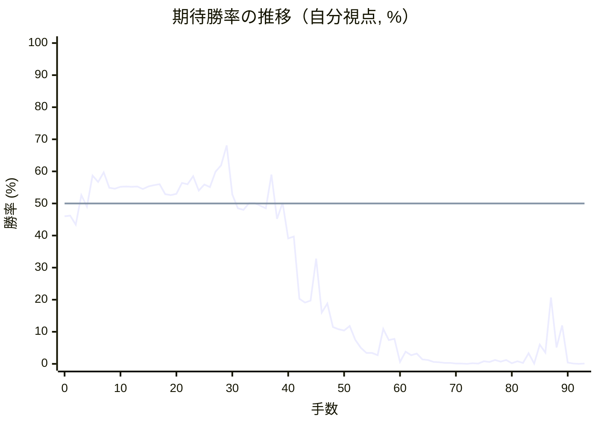

# 解析レポート 4r8on6lpy0jh

[README に戻る](../../../README.md)　/　棋譜: [CSA](../../../data/csa/shogi5/4r8on6lpy0jh.csa)　/　解析の見方: [docs/mistake_analysis.md](../../../docs/mistake_analysis.md)

## 対局情報

| 項目 | 内容 |
|---|---|
| 日時 | 2026-10-29 19:03:03 |
| 持ち時間 | 5分 |
| 自分 | 後手（△）（1732） |
| 相手 | 相手（1788） |
| 結果 | 負け（時間切れ, 93手） |

## 解析環境

| 項目 | 内容 |
|---|---|
| エンジン | YaneuraOu NNUE 9.00git 64AVX2（V9.00/YANEURAOU_ENGINE_NNUE/AVX2） |
| 評価関数 | **水匠5**（`suisho5`） |
| nn.bin SHA-256 | `768068f0d534a0603a5d38bcd143de6bbca820d5f1c95a14d40863e5b7892d76` |
| 第1パス | movetime=150ms, MultiPV 1 |
| 第2パス | movetime=2000ms, MultiPV 3 |
| Threads / Hash | 8 / 512MB |
| 判定基準 | 疑問手 ≥5pt, 悪手 ≥10pt, 大悪手 ≥20pt（期待勝率 W(E)=1/(1+exp(-E/600))） |
| 解析日時 | 2026-11-03T04:19:56+09:00（解析バージョン 1, 50秒） |

## サマリー

| 自分の手数 | 深掘りした手 | 詰み逃し | 大悪手 | 悪手 | 疑問手 |
|--:|--:|--:|--:|--:|--:|
| 46 | 9 | 0 | 3 | 4 | 1 |

## 期待勝率の推移



<details><summary>1手ごとの数値（第1パス）</summary>

| 手数 | 指し手 | 評価値 | 勝率 | 低下 | 判定 |
|--:|---|--:|--:|--:|---|
| 1 | ▲７六歩(77) | -92 | 46.2% |  |  |
| 2 | △３四歩(33) | -160 | 43.4% | +2.8pt |  |
| 3 | ▲６六歩(67) | +62 | 52.6% |  |  |
| 4 | △８四歩(83) | -25 | 49.0% | +3.6pt |  |
| 5 | ▲６八飛(28) | +212 | 58.7% |  |  |
| 6 | △６二銀(71) | +161 | 56.7% | +2.1pt |  |
| 7 | ▲４八玉(59) | +237 | 59.7% |  |  |
| 8 | △５四歩(53) | +117 | 54.9% | +4.9pt |  |
| 9 | ▲１六歩(17) | +111 | 54.6% |  |  |
| 10 | △１四歩(13) | +126 | 55.2% | -0.6pt |  |
| 11 | ▲７八銀(79) | +127 | 55.3% |  |  |
| 12 | △５三銀(62) | +126 | 55.2% | +0.0pt |  |
| 13 | ▲３八銀(39) | +127 | 55.3% |  |  |
| 14 | △８五歩(84) | +108 | 54.5% | +0.8pt |  |
| 15 | ▲７七角(88) | +127 | 55.3% |  |  |
| 16 | △４二玉(51) | +138 | 55.7% | -0.5pt |  |
| 17 | ▲５八金(69) | +145 | 56.0% |  |  |
| 18 | △３二銀(31) | +70 | 52.9% | +3.1pt |  |
| 19 | ▲３九玉(48) | +63 | 52.6% |  |  |
| 20 | △３一玉(42) | +73 | 53.0% | -0.4pt |  |
| 21 | ▲２八玉(39) | +155 | 56.4% |  |  |
| 22 | △５二金(61) | +145 | 56.0% | +0.4pt |  |
| 23 | ▲６七銀(78) | +206 | 58.5% |  |  |
| 24 | △３三角(22) | +95 | 54.0% | +4.5pt |  |
| 25 | ▲５六銀(67) | +143 | 55.9% |  |  |
| 26 | △４四歩(43) | +124 | 55.1% | +0.8pt |  |
| 27 | ▲６五歩(66) | +242 | 59.9% |  |  |
| 28 | △４三金(52) | +291 | 61.9% | -1.9pt |  |
| 29 | ▲７五歩(76) | +456 | 68.1% |  |  |
| 30 | △４二角(33) | +68 | 52.8% | +15.3pt | [大悪手](#ply-30) |
| 31 | ▲６六飛(68) | -36 | 48.5% |  |  |
| 32 | △９四歩(93) | -48 | 48.0% | +0.5pt |  |
| 33 | ▲９六歩(97) | +2 | 50.1% |  |  |
| 34 | △２二玉(31) | +2 | 50.1% | +0.0pt |  |
| 35 | ▲７六飛(66) | -16 | 49.3% |  |  |
| 36 | △８四飛(82) | -35 | 48.5% | +0.8pt |  |
| 37 | ▲６六角(77) | +218 | 59.0% |  |  |
| 38 | △６四歩(63) | -116 | 45.2% | +13.8pt | [悪手](#ply-38) |
| 39 | ▲同歩(65) | +4 | 50.2% |  |  |
| 40 | △同飛(84) | -266 | 39.1% | +11.1pt | [悪手](#ply-40) |
| 41 | ▲７七桂(89) | -251 | 39.7% |  |  |
| 42 | △６六飛(64) | -821 | 20.3% | +19.4pt | [大悪手](#ply-42) |
| 43 | ▲同飛(76) | -866 | 19.1% |  |  |
| 44 | △６四銀(53) | -843 | 19.7% | -0.6pt |  |
| 45 | ▲６二飛打 | -431 | 32.8% |  |  |
| 46 | △６五歩打 | -997 | 16.0% | +16.8pt | [悪手](#ply-46) |
| 47 | ▲同銀(56) | -877 | 18.8% |  |  |
| 48 | △５五銀(64) | -1225 | 11.5% | +7.3pt | [疑問手](#ply-48) |
| 49 | ▲７六飛(66) | -1266 | 10.8% |  |  |
| 50 | △４五歩(44) | -1292 | 10.4% | +0.4pt |  |
| 51 | ▲７四歩(75) | -1208 | 11.8% |  |  |
| 52 | △同歩(73) | -1506 | 7.5% | +4.3pt |  |
| 53 | ▲同飛(76) | -1766 | 5.0% |  |  |
| 54 | △４六歩(45) | -2014 | 3.4% | +1.6pt |  |
| 55 | ▲同歩(47) | -2013 | 3.4% |  |  |
| 56 | △同銀(55) | -2146 | 2.7% | +0.7pt |  |
| 57 | ▲５四銀(65) | -1263 | 10.9% |  |  |
| 58 | △同金(43) | -1516 | 7.4% | +3.5pt |  |
| 59 | ▲同飛(74) | -1486 | 7.8% |  |  |
| 60 | △４七歩打 | -3047 | 0.6% | +7.1pt |  |
| 61 | ▲４四飛(54) | -1941 | 3.8% |  |  |
| 62 | △５三銀打 | -2140 | 2.7% | +1.0pt |  |
| 63 | ▲４二飛成(62) | -2051 | 3.2% |  |  |
| 64 | △同金(41) | -2545 | 1.4% | +1.8pt |  |
| 65 | ▲４六飛(44) | -2661 | 1.2% |  |  |
| 66 | △５五角打 | -3084 | 0.6% | +0.6pt |  |
| 67 | ▲６六角打 | -3236 | 0.5% |  |  |
| 68 | △同角(55) | -3427 | 0.3% | +0.1pt |  |
| 69 | ▲同飛(46) | -3428 | 0.3% |  |  |
| 70 | △５五角打 | -3927 | 0.1% | +0.2pt |  |
| 71 | ▲６一飛成(66) | -3976 | 0.1% |  |  |
| 72 | △７七角成(55) | -4882 | 0.0% | +0.1pt |  |
| 73 | ▲３一銀打 | -3846 | 0.2% |  |  |
| 74 | △１二玉(22) | -3975 | 0.1% | +0.0pt |  |
| 75 | ▲４二銀成(31) | -2874 | 0.8% |  |  |
| 76 | △同銀(53) | -3083 | 0.6% | +0.2pt |  |
| 77 | ▲５二金打 | -2631 | 1.2% |  |  |
| 78 | △３三銀(42) | -3005 | 0.7% | +0.6pt |  |
| 79 | ▲３一金打 | -2647 | 1.2% |  |  |
| 80 | △８七馬(77) | -3733 | 0.2% | +1.0pt |  |
| 81 | ▲１五歩(16) | -2890 | 0.8% |  |  |
| 82 | △同歩(14) | -3551 | 0.3% | +0.5pt |  |
| 83 | ▲１四歩打 | -2020 | 3.3% |  |  |
| 84 | △２四銀(33) | -4015 | 0.1% | +3.2pt |  |
| 85 | ▲３二金(31) | -1656 | 6.0% |  |  |
| 86 | △同馬(87) | -1983 | 3.5% | +2.4pt |  |
| 87 | ▲４一角打 | -807 | 20.7% |  |  |
| 88 | △２二馬(32) | -1755 | 5.1% | +15.6pt | [大悪手](#ply-88) |
| 89 | ▲４二金(52) | -1194 | 12.0% |  |  |
| 90 | △５五馬(22) | -3372 | 0.4% | +11.7pt | [悪手](#ply-90) |
| 91 | ▲４七金(58) | -4051 | 0.1% |  |  |
| 92 | △４四飛打 | -7420 | 0.0% | +0.1pt |  |
| 93 | ▲５二龍(61) | -4028 | 0.1% |  |  |

</details>

## 課題局面

<a id="ply-30"></a>
### 30手目 △４二角(33) — 大悪手

| | 着手前 | 着手後 | 差 |
|---|--:|--:|--:|
| 期待勝率 | 69.0% | 48.8% | -20.2pt |
| 評価値 | +480 | -28 | |

着手前の局面:

```text
後手の持駒：なし
  ９ ８ ７ ６ ５ ４ ３ ２ １
+---------------------------+
|v香v桂 ・ ・ ・v金v玉v桂v香|一
| ・v飛 ・ ・ ・ ・v銀 ・ ・|二
|v歩 ・v歩v歩v銀v金v角v歩 ・|三
| ・ ・ ・ ・v歩v歩v歩 ・v歩|四
| ・v歩 歩 歩 ・ ・ ・ ・ ・|五
| ・ ・ ・ ・ 銀 ・ ・ ・ 歩|六
| 歩 歩 角 ・ 歩 歩 歩 歩 ・|七
| ・ ・ ・ 飛 金 ・ 銀 玉 ・|八
| 香 桂 ・ ・ ・ 金 ・ 桂 香|九
+---------------------------+
先手の持駒：なし
後手番
手数＝29　▲７五歩　まで
```

| | 指し手 | 評価値 | 読み筋 |
|---|---|--:|---|
| 実戦 | △４二角(33) | -28 | ▲６六飛(68) △２二玉(31) ▲７六飛(66) △６四歩(63) ▲７四歩(75) △同歩(73) |
| AI 1位 | △４五歩(44) | +480 | △４五歩(44) ▲同銀(56) △８六歩(85) ▲３三角成(77) △同桂(21) ▲７一角打 |
| AI 2位 | △２二玉(31) | +322 | △２二玉(31) ▲４六歩(47) △４五歩(44) ▲同歩(46) △７七角成(33) ▲同桂(89) |
| AI 3位 | △７二飛(82) | +271 | △７二飛(82) ▲４六歩(47) △２二玉(31) ▲６六角(77) △７四歩(73) ▲７八飛(68) |

SFEN: `ln3gknl/1r4s2/p1ppsgbp1/4ppp1p/1pPP5/4S3P/PPB1PPPP1/3RG1SK1/LN3G1NL w - 30`

<a id="ply-38"></a>
### 38手目 △６四歩(63) — 悪手

| | 着手前 | 着手後 | 差 |
|---|--:|--:|--:|
| 期待勝率 | 56.8% | 41.7% | -15.1pt |
| 評価値 | +165 | -200 | |

着手前の局面:

```text
後手の持駒：なし
  ９ ８ ７ ６ ５ ４ ３ ２ １
+---------------------------+
|v香v桂 ・ ・ ・v金 ・v桂v香|一
| ・ ・ ・ ・ ・v角v銀v玉 ・|二
| ・ ・v歩v歩v銀v金 ・v歩 ・|三
|v歩v飛 ・ ・v歩v歩v歩 ・v歩|四
| ・v歩 歩 歩 ・ ・ ・ ・ ・|五
| 歩 ・ 飛 角 銀 ・ ・ ・ 歩|六
| ・ 歩 ・ ・ 歩 歩 歩 歩 ・|七
| ・ ・ ・ ・ 金 ・ 銀 玉 ・|八
| 香 桂 ・ ・ ・ 金 ・ 桂 香|九
+---------------------------+
先手の持駒：なし
後手番
手数＝37　▲６六角　まで
```

| | 指し手 | 評価値 | 読み筋 |
|---|---|--:|---|
| 実戦 | △６四歩(63) | -200 | ▲７七桂(89) △２四歩(23) ▲４六歩(47) △５五歩(54) ▲７四歩(75) △同飛(84) |
| AI 1位 | △３三角(42) | +165 | △３三角(42) ▲４六歩(47) △４五歩(44) ▲３三角成(66) △同桂(21) ▲７四歩(75) |
| AI 2位 | △９五歩(94) | +4 | △９五歩(94) ▲同歩(96) △３三角(42) ▲９四歩(95) △４五歩(44) ▲３三角成(66) |
| AI 3位 | △８二飛(84) | -72 | △８二飛(84) ▲４六歩(47) △２四歩(23) ▲７七桂(89) △３三角(42) ▲４七銀(56) |

SFEN: `ln3g1nl/5bsk1/2ppsg1p1/pr2ppp1p/1pPP5/P1RBS3P/1P2PPPP1/4G1SK1/LN3G1NL w - 38`

<a id="ply-40"></a>
### 40手目 △同飛(84) — 悪手

| | 着手前 | 着手後 | 差 |
|---|--:|--:|--:|
| 期待勝率 | 51.7% | 39.7% | -12.0pt |
| 評価値 | +41 | -250 | |

着手前の局面:

```text
後手の持駒：なし
  ９ ８ ７ ６ ５ ４ ３ ２ １
+---------------------------+
|v香v桂 ・ ・ ・v金 ・v桂v香|一
| ・ ・ ・ ・ ・v角v銀v玉 ・|二
| ・ ・v歩 ・v銀v金 ・v歩 ・|三
|v歩v飛 ・ 歩v歩v歩v歩 ・v歩|四
| ・v歩 歩 ・ ・ ・ ・ ・ ・|五
| 歩 ・ 飛 角 銀 ・ ・ ・ 歩|六
| ・ 歩 ・ ・ 歩 歩 歩 歩 ・|七
| ・ ・ ・ ・ 金 ・ 銀 玉 ・|八
| 香 桂 ・ ・ ・ 金 ・ 桂 香|九
+---------------------------+
先手の持駒：歩
後手番
手数＝39　▲６四同歩　まで
```

| | 指し手 | 評価値 | 読み筋 |
|---|---|--:|---|
| 実戦 | △同飛(84) | -250 | ▲７七桂(89) △５五歩(54) ▲６五銀(56) △６一飛(64) ▲７四歩(75) △６四歩打 |
| AI 1位 | △同銀(53) | +41 | △同銀(53) ▲６五歩打 △５五歩(54) ▲６四歩(65) △５六歩(55) ▲６五銀打 |
| AI 2位 | △同飛(84) | -214 | △同飛(84) ▲７七桂(89) △５五歩(54) ▲６五歩打 △５六歩(55) ▲６四歩(65) |
| AI 3位 | △５五歩(54) | -661 | △５五歩(54) ▲同銀(56) △６四銀(53) ▲４四銀(55) △同金(43) ▲同角(66) |

SFEN: `ln3g1nl/5bsk1/2p1sg1p1/pr1Pppp1p/1pP6/P1RBS3P/1P2PPPP1/4G1SK1/LN3G1NL w P 40`

<a id="ply-42"></a>
### 42手目 △６六飛(64) — 大悪手

| | 着手前 | 着手後 | 差 |
|---|--:|--:|--:|
| 期待勝率 | 39.5% | 14.6% | -24.9pt |
| 評価値 | -256 | -1062 | |

着手前の局面:

```text
後手の持駒：歩
  ９ ８ ７ ６ ５ ４ ３ ２ １
+---------------------------+
|v香v桂 ・ ・ ・v金 ・v桂v香|一
| ・ ・ ・ ・ ・v角v銀v玉 ・|二
| ・ ・v歩 ・v銀v金 ・v歩 ・|三
|v歩 ・ ・v飛v歩v歩v歩 ・v歩|四
| ・v歩 歩 ・ ・ ・ ・ ・ ・|五
| 歩 ・ 飛 角 銀 ・ ・ ・ 歩|六
| ・ 歩 桂 ・ 歩 歩 歩 歩 ・|七
| ・ ・ ・ ・ 金 ・ 銀 玉 ・|八
| 香 ・ ・ ・ ・ 金 ・ 桂 香|九
+---------------------------+
先手の持駒：歩
後手番
手数＝41　▲７七桂　まで
```

| | 指し手 | 評価値 | 読み筋 |
|---|---|--:|---|
| 実戦 | △６六飛(64) | -1062 | ▲同飛(76) △６四歩打 ▲８二飛打 △８八角打 ▲７六飛(66) △９九角成(88) |
| AI 1位 | △６二飛(64) | -256 | △６二飛(64) ▲６五歩打 △８二飛(62) ▲７四歩(75) △同歩(73) ▲同飛(76) |
| AI 2位 | △５五歩(54) | -280 | △５五歩(54) ▲６五銀(56) △６一飛(64) ▲７四歩(75) △６四歩打 ▲８四角(66) |
| AI 3位 | △２四歩(23) | -268 | △２四歩(23) ▲６五銀(56) △同飛(64) ▲同桂(77) △６四銀(53) ▲６三飛打 |

SFEN: `ln3g1nl/5bsk1/2p1sg1p1/p2rppp1p/1pP6/P1RBS3P/1PN1PPPP1/4G1SK1/L4G1NL w Pp 42`

<a id="ply-46"></a>
### 46手目 △６五歩打 — 悪手

| | 着手前 | 着手後 | 差 |
|---|--:|--:|--:|
| 期待勝率 | 26.4% | 11.4% | -15.1pt |
| 評価値 | -615 | -1233 | |

着手前の局面:

```text
後手の持駒：角　歩
  ９ ８ ７ ６ ５ ４ ３ ２ １
+---------------------------+
|v香v桂 ・ ・ ・v金 ・v桂v香|一
| ・ ・ ・ 飛 ・v角v銀v玉 ・|二
| ・ ・v歩 ・ ・v金 ・v歩 ・|三
|v歩 ・ ・v銀v歩v歩v歩 ・v歩|四
| ・v歩 歩 ・ ・ ・ ・ ・ ・|五
| 歩 ・ ・ 飛 銀 ・ ・ ・ 歩|六
| ・ 歩 桂 ・ 歩 歩 歩 歩 ・|七
| ・ ・ ・ ・ 金 ・ 銀 玉 ・|八
| 香 ・ ・ ・ ・ 金 ・ 桂 香|九
+---------------------------+
先手の持駒：歩
後手番
手数＝45　▲６二飛　まで
```

| | 指し手 | 評価値 | 読み筋 |
|---|---|--:|---|
| 実戦 | △６五歩打 | -1233 | ▲６八飛(66) △７五銀(64) ▲６五飛(68) △７六角打 ▲６一飛成(62) △６五角(76) |
| AI 1位 | △５五歩(54) | -615 | △５五歩(54) ▲６七銀(56) △６五歩打 ▲３六飛(66) △８八角打 ▲６八金(58) |
| AI 2位 | △６五歩打 | -1041 | △６五歩打 ▲６八飛(66) △７六角打 ▲６五銀(56) △同銀(64) ▲同桂(77) |
| AI 3位 | △６三歩打 | -1107 | △６三歩打 ▲６八飛(66) △５五歩(54) ▲６七銀(56) △５四角打 ▲７八銀(67) |

SFEN: `ln3g1nl/3R1bsk1/2p2g1p1/p2sppp1p/1pP6/P2RS3P/1PN1PPPP1/4G1SK1/L4G1NL w Pbp 46`

<a id="ply-48"></a>
### 48手目 △５五銀(64) — 疑問手

| | 着手前 | 着手後 | 差 |
|---|--:|--:|--:|
| 期待勝率 | 12.9% | 5.2% | -7.6pt |
| 評価値 | -1148 | -1737 | |

着手前の局面:

```text
後手の持駒：角
  ９ ８ ７ ６ ５ ４ ３ ２ １
+---------------------------+
|v香v桂 ・ ・ ・v金 ・v桂v香|一
| ・ ・ ・ 飛 ・v角v銀v玉 ・|二
| ・ ・v歩 ・ ・v金 ・v歩 ・|三
|v歩 ・ ・v銀v歩v歩v歩 ・v歩|四
| ・v歩 歩 銀 ・ ・ ・ ・ ・|五
| 歩 ・ ・ 飛 ・ ・ ・ ・ 歩|六
| ・ 歩 桂 ・ 歩 歩 歩 歩 ・|七
| ・ ・ ・ ・ 金 ・ 銀 玉 ・|八
| 香 ・ ・ ・ ・ 金 ・ 桂 香|九
+---------------------------+
先手の持駒：歩二
後手番
手数＝47　▲６五同銀　まで
```

| | 指し手 | 評価値 | 読み筋 |
|---|---|--:|---|
| 実戦 | △５五銀(64) | -1737 | ▲６八飛(66) △６六角打 ▲５四銀(65) △同金(43) ▲６六飛(68) △同銀(55) |
| AI 1位 | △７五銀(64) | -1148 | △７五銀(64) ▲６八飛(66) △６四歩打 ▲５六銀(65) △７六銀(75) ▲７八歩打 |
| AI 2位 | △５五角打 | -1200 | △５五角打 ▲６七飛(66) △６五銀(64) ▲同飛成(62) △７八銀打 ▲６六飛(67) |
| AI 3位 | △５五銀(64) | -1425 | △５五銀(64) ▲６八飛(66) △６六角打 ▲６七飛(68) △８六歩(85) ▲同歩(87) |

SFEN: `ln3g1nl/3R1bsk1/2p2g1p1/p2sppp1p/1pPS5/P2R4P/1PN1PPPP1/4G1SK1/L4G1NL w 2Pb 48`

<a id="ply-88"></a>
### 88手目 △２二馬(32) — 大悪手

| | 着手前 | 着手後 | 差 |
|---|--:|--:|--:|
| 期待勝率 | 24.9% | 3.1% | -21.8pt |
| 評価値 | -662 | -2056 | |

着手前の局面:

```text
後手の持駒：飛　金　銀　桂　歩三
  ９ ８ ７ ６ ５ ４ ３ ２ １
+---------------------------+
|v香v桂 ・ 龍 ・ 角 ・v桂v香|一
| ・ ・ ・ ・ 金 ・v馬 ・v玉|二
| ・ ・ ・ ・ ・ ・ ・v歩 ・|三
|v歩 ・ ・ ・ ・ ・v歩v銀 歩|四
| ・v歩 ・ ・ ・ ・ ・ ・v歩|五
| 歩 ・ ・ ・ ・ ・ ・ ・ ・|六
| ・ ・ ・ ・ 歩v歩 歩 歩 ・|七
| ・ ・ ・ ・ 金 ・ 銀 玉 ・|八
| 香 ・ ・ ・ ・ 金 ・ 桂 香|九
+---------------------------+
先手の持駒：銀　歩四
後手番
手数＝87　▲４一角　まで
```

| | 指し手 | 評価値 | 読み筋 |
|---|---|--:|---|
| 実戦 | △２二馬(32) | -2056 | ▲３二銀打 △１六桂打 ▲同香(19) △同歩(15) ▲２一銀不成(32) △同馬(22) |
| AI 1位 | △１六桂打 | -662 | △１六桂打 ▲同香(19) △１七銀打 ▲同桂(29) △１六歩(15) ▲３九玉(28) |
| AI 2位 | △３三馬(32) | -1305 | △３三馬(32) ▲３二銀打 △２二金打 ▲２一銀成(32) △同金(22) ▲３六桂打 |
| AI 3位 | △２二馬(32) | -1943 | △２二馬(32) ▲３二銀打 △１六桂打 ▲同香(19) △同歩(15) ▲４七金(58) |

SFEN: `ln1+R1B1nl/4G1+b1k/7p1/p5psP/1p6p/P8/4PpPP1/4G1SK1/L4G1NL w S4Prgsn3p 88`

<a id="ply-90"></a>
### 90手目 △５五馬(22) — 悪手

| | 着手前 | 着手後 | 差 |
|---|--:|--:|--:|
| 期待勝率 | 17.8% | 0.0% | -17.7pt |
| 評価値 | -920 | -4734 | |

着手前の局面:

```text
後手の持駒：飛　金　銀　桂　歩三
  ９ ８ ７ ６ ５ ４ ３ ２ １
+---------------------------+
|v香v桂 ・ 龍 ・ 角 ・v桂v香|一
| ・ ・ ・ ・ ・ 金 ・v馬v玉|二
| ・ ・ ・ ・ ・ ・ ・v歩 ・|三
|v歩 ・ ・ ・ ・ ・v歩v銀 歩|四
| ・v歩 ・ ・ ・ ・ ・ ・v歩|五
| 歩 ・ ・ ・ ・ ・ ・ ・ ・|六
| ・ ・ ・ ・ 歩v歩 歩 歩 ・|七
| ・ ・ ・ ・ 金 ・ 銀 玉 ・|八
| 香 ・ ・ ・ ・ 金 ・ 桂 香|九
+---------------------------+
先手の持駒：銀　歩四
後手番
手数＝89　▲４二金　まで
```

| | 指し手 | 評価値 | 読み筋 |
|---|---|--:|---|
| 実戦 | △５五馬(22) | -4734 | ▲４七金(58) △２二金打 ▲３二角成(41) △５一歩打 ▲同龍(61) △４一歩打 |
| AI 1位 | △１六桂打 | -920 | △１六桂打 ▲同香(19) △同歩(15) ▲２六銀打 △１五香打 ▲３九玉(28) |
| AI 2位 | △１六歩(15) | -2607 | △１六歩(15) ▲４七金(58) △４八歩打 ▲同金(49) △３一金打 ▲５二角成(41) |
| AI 3位 | △５一歩打 | -2758 | △５一歩打 ▲６三龍(61) △３三銀打 ▲３一銀打 △同馬(22) ▲同金(42) |

SFEN: `ln1+R1B1nl/5G1+bk/7p1/p5psP/1p6p/P8/4PpPP1/4G1SK1/L4G1NL w S4Prgsn3p 90`

