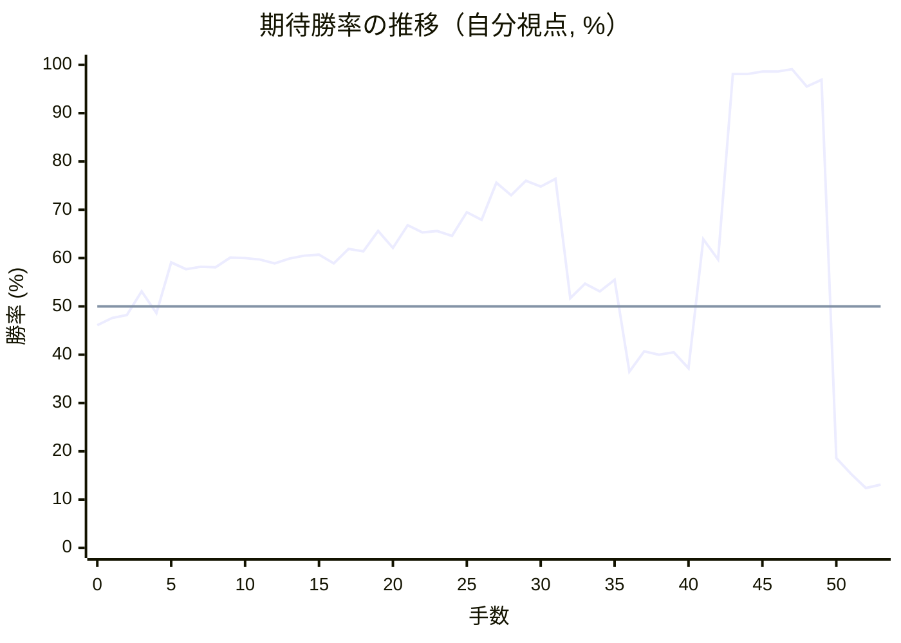

# 解析レポート 4vdv08093jtj

[README に戻る](../../../README.md)　/　棋譜: [CSA](../../../data/csa/shogi5/4vdv08093jtj.csa)　/　解析の見方: [docs/mistake_analysis.md](../../../docs/mistake_analysis.md)

## 対局情報

| 項目 | 内容 |
|---|---|
| 日時 | 2026-11-05 00:57:27 |
| 持ち時間 | 5分 |
| 自分 | 後手（△）（1741） |
| 相手 | 相手（1599） |
| 結果 | 負け（投了, 53手） |

## 解析環境

| 項目 | 内容 |
|---|---|
| エンジン | YaneuraOu NNUE 9.00git 64AVX2（V9.00/YANEURAOU_ENGINE_NNUE/AVX2） |
| 評価関数 | **水匠5**（`suisho5`） |
| nn.bin SHA-256 | `768068f0d534a0603a5d38bcd143de6bbca820d5f1c95a14d40863e5b7892d76` |
| 第1パス | movetime=150ms, MultiPV 1 |
| 第2パス | movetime=2000ms, MultiPV 3 |
| Threads / Hash | 8 / 512MB |
| 判定基準 | 疑問手 ≥5pt, 悪手 ≥10pt, 大悪手 ≥20pt（期待勝率 W(E)=1/(1+exp(-E/600))） |
| 解析日時 | 2026-11-06T01:47:53+09:00（解析バージョン 1, 20秒） |

## サマリー

| 自分の手数 | 深掘りした手 | 詰み逃し | 大悪手 | 悪手 | 疑問手 |
|--:|--:|--:|--:|--:|--:|
| 26 | 3 | 0 | 1 | 2 | 0 |

## 期待勝率の推移



<details><summary>1手ごとの数値（第1パス）</summary>

| 手数 | 指し手 | 評価値 | 勝率 | 低下 | 判定 |
|--:|---|--:|--:|--:|---|
| 1 | ▲２六歩(27) | -57 | 47.6% |  |  |
| 2 | △８四歩(83) | -43 | 48.2% | -0.6pt |  |
| 3 | ▲９六歩(97) | +75 | 53.1% |  |  |
| 4 | △８五歩(84) | -33 | 48.6% | +4.5pt |  |
| 5 | ▲９七角(88) | +221 | 59.1% |  |  |
| 6 | △６二銀(71) | +186 | 57.7% | +1.4pt |  |
| 7 | ▲２五歩(26) | +198 | 58.2% |  |  |
| 8 | △３二金(41) | +195 | 58.1% | +0.1pt |  |
| 9 | ▲２四歩(25) | +247 | 60.1% |  |  |
| 10 | △同歩(23) | +243 | 60.0% | +0.2pt |  |
| 11 | ▲同飛(28) | +235 | 59.7% |  |  |
| 12 | △１四歩(13) | +217 | 58.9% | +0.7pt |  |
| 13 | ▲４八銀(39) | +241 | 59.9% |  |  |
| 14 | △２三歩打 | +256 | 60.5% | -0.6pt |  |
| 15 | ▲２六飛(24) | +260 | 60.7% |  |  |
| 16 | △５二玉(51) | +217 | 58.9% | +1.7pt |  |
| 17 | ▲６八銀(79) | +290 | 61.9% |  |  |
| 18 | △９四歩(93) | +278 | 61.4% | +0.5pt |  |
| 19 | ▲３九金(49) | +386 | 65.6% |  |  |
| 20 | △５一金(61) | +296 | 62.1% | +3.5pt |  |
| 21 | ▲７九金(69) | +420 | 66.8% |  |  |
| 22 | △４二銀(31) | +380 | 65.3% | +1.5pt |  |
| 23 | ▲５八玉(59) | +386 | 65.6% |  |  |
| 24 | △３四歩(33) | +360 | 64.6% | +1.0pt |  |
| 25 | ▲５六飛(26) | +494 | 69.5% |  |  |
| 26 | △７四歩(73) | +450 | 67.9% | +1.6pt |  |
| 27 | ▲３六歩(37) | +678 | 75.6% |  |  |
| 28 | △７三銀(62) | +596 | 73.0% | +2.6pt |  |
| 29 | ▲３七桂(29) | +692 | 76.0% |  |  |
| 30 | △６四銀(73) | +654 | 74.8% | +1.2pt |  |
| 31 | ▲７六飛(56) | +706 | 76.4% |  |  |
| 32 | △７二飛(82) | +41 | 51.7% | +24.7pt | [悪手](#ply-32) |
| 33 | ▲６四角(97) | +112 | 54.7% |  |  |
| 34 | △同歩(63) | +74 | 53.1% | +1.6pt |  |
| 35 | ▲８三銀打 | +132 | 55.5% |  |  |
| 36 | △７五歩(74) | -331 | 36.5% | +18.9pt | [悪手](#ply-36) |
| 37 | ▲７二銀成(83) | -227 | 40.7% |  |  |
| 38 | △７六歩(75) | -243 | 40.0% | +0.6pt |  |
| 39 | ▲７一飛打 | -230 | 40.5% |  |  |
| 40 | △７七歩成(76) | -315 | 37.2% | +3.4pt |  |
| 41 | ▲同桂(89) | +343 | 63.9% |  |  |
| 42 | △７六歩打 | +235 | 59.7% | +4.2pt |  |
| 43 | ▲７四歩打 | +2381 | 98.1% |  |  |
| 44 | △７七歩成(76) | +2375 | 98.1% | +0.0pt |  |
| 45 | ▲７三歩成(74) | +2548 | 98.6% |  |  |
| 46 | △６八と(77) | +2554 | 98.6% | -0.0pt |  |
| 47 | ▲同金(79) | +2793 | 99.1% |  |  |
| 48 | △８九飛打 | +1838 | 95.5% | +3.5pt |  |
| 49 | ▲６二と(73) | +2064 | 96.9% |  |  |
| 50 | △４一玉(52) | -884 | 18.6% | +78.2pt | [大悪手](#ply-50) |
| 51 | ▲５一と(62) | -1026 | 15.3% |  |  |
| 52 | △同銀(42) | -1172 | 12.4% | +2.9pt |  |
| 53 | ▲６二成銀(72) | -1136 | 13.1% |  |  |

</details>

## 課題局面

<a id="ply-32"></a>
### 32手目 △７二飛(82) — 悪手

| | 着手前 | 着手後 | 差 |
|---|--:|--:|--:|
| 期待勝率 | 74.0% | 56.3% | -17.7pt |
| 評価値 | +627 | +151 | |

着手前の局面:

```text
後手の持駒：なし
  ９ ８ ７ ６ ５ ４ ３ ２ １
+---------------------------+
|v香v桂 ・ ・v金 ・ ・v桂v香|一
| ・v飛 ・ ・v玉v銀v金v角 ・|二
| ・ ・ ・v歩v歩v歩 ・v歩 ・|三
|v歩 ・v歩v銀 ・ ・v歩 ・v歩|四
| ・v歩 ・ ・ ・ ・ ・ ・ ・|五
| 歩 ・ 飛 ・ ・ ・ 歩 ・ ・|六
| 角 歩 歩 歩 歩 歩 桂 ・ 歩|七
| ・ ・ ・ 銀 玉 銀 ・ ・ ・|八
| 香 桂 金 ・ ・ ・ 金 ・ 香|九
+---------------------------+
先手の持駒：歩
後手番
手数＝31　▲７六飛　まで
```

| | 指し手 | 評価値 | 読み筋 |
|---|---|--:|---|
| 実戦 | △７二飛(82) | +151 | ▲６四角(97) △同歩(63) ▲８三銀打 △７三飛(72) ▲８二銀不成(83) △８三飛(73) |
| AI 1位 | △８四飛(82) | +627 | △８四飛(82) ▲８六歩(87) △同歩(85) ▲８五歩打 △８二飛(84) ▲８六飛(76) |
| AI 2位 | △６五銀(64) | +574 | △６五銀(64) ▲４六飛(76) △５四銀(65) ▲８八角(97) △６二金(51) ▲７六歩(77) |
| AI 3位 | △７三銀(64) | +507 | △７三銀(64) ▲１六歩(17) △４四歩(43) ▲７八金(79) △４三銀(42) ▲３八金(39) |

SFEN: `ln2g2nl/1r2ksgb1/3ppp1p1/p1ps2p1p/1p7/P1R3P2/BPPPPPN1P/3SKS3/LNG3G1L w P 32`

<a id="ply-36"></a>
### 36手目 △７五歩(74) — 悪手

| | 着手前 | 着手後 | 差 |
|---|--:|--:|--:|
| 期待勝率 | 58.5% | 40.5% | -18.0pt |
| 評価値 | +207 | -230 | |

着手前の局面:

```text
後手の持駒：角
  ９ ８ ７ ６ ５ ４ ３ ２ １
+---------------------------+
|v香v桂 ・ ・v金 ・ ・v桂v香|一
| ・ ・v飛 ・v玉v銀v金v角 ・|二
| ・ 銀 ・ ・v歩v歩 ・v歩 ・|三
|v歩 ・v歩v歩 ・ ・v歩 ・v歩|四
| ・v歩 ・ ・ ・ ・ ・ ・ ・|五
| 歩 ・ 飛 ・ ・ ・ 歩 ・ ・|六
| ・ 歩 歩 歩 歩 歩 桂 ・ 歩|七
| ・ ・ ・ 銀 玉 銀 ・ ・ ・|八
| 香 桂 金 ・ ・ ・ 金 ・ 香|九
+---------------------------+
先手の持駒：歩
後手番
手数＝35　▲８三銀　まで
```

| | 指し手 | 評価値 | 読み筋 |
|---|---|--:|---|
| 実戦 | △７五歩(74) | -230 | ▲７二銀成(83) △７六歩(75) |
| AI 1位 | △７三飛(72) | +207 | △７三飛(72) ▲７四飛(76) △同飛(73) ▲同銀成(83) △５四角打 ▲８三飛打 |
| AI 2位 | △６二飛(72) | +0 | △６二飛(72) ▲７四飛(76) △６一金(51) ▲８四飛(74) △７一金(61) ▲７四飛(84) |
| AI 3位 | △７一飛(72) | -38 | △７一飛(72) ▲８二銀不成(83) △７二飛(71) ▲８一銀成(82) △９三香(91) ▲６六飛(76) |

SFEN: `ln2g2nl/2r1ksgb1/1S2pp1p1/p1pp2p1p/1p7/P1R3P2/1PPPPPN1P/3SKS3/LNG3G1L w Pb 36`

<a id="ply-50"></a>
### 50手目 △４一玉(52) — 大悪手

| | 着手前 | 着手後 | 差 |
|---|--:|--:|--:|
| 期待勝率 | 98.1% | 7.3% | -90.8pt |
| 評価値 | +2365 | -1527 | |

着手前の局面:

```text
後手の持駒：角　銀　桂
  ９ ８ ７ ６ ５ ４ ３ ２ １
+---------------------------+
|v香v桂 飛 ・v金 ・ ・v桂v香|一
| ・ ・ 全 とv玉v銀v金v角 ・|二
| ・ ・ ・ ・v歩v歩 ・v歩 ・|三
|v歩 ・ ・v歩 ・ ・v歩 ・v歩|四
| ・v歩 ・ ・ ・ ・ ・ ・ ・|五
| 歩 ・ ・ ・ ・ ・ 歩 ・ ・|六
| ・ 歩 ・ 歩 歩 歩 桂 ・ 歩|七
| ・ ・ ・ 金 玉 銀 ・ ・ ・|八
| 香v飛 ・ ・ ・ ・ 金 ・ 香|九
+---------------------------+
先手の持駒：歩二
後手番
手数＝49　▲６二と　まで
```

| | 指し手 | 評価値 | 読み筋 |
|---|---|--:|---|
| 実戦 | △４一玉(52) | -1527 | ▲５一と(62) △同銀(42) ▲６二成銀(72) △３一金(32) ▲５一成銀(62) △３二玉(41) |
| AI 1位 | △同金(51) | +2365 | △同金(51) ▲７七歩打 △７九銀打 ▲７八金(68) △５一銀(42) ▲８一飛成(71) |
| AI 2位 | △４一玉(52) | -1288 | △４一玉(52) ▲５一と(62) △同銀(42) ▲６二成銀(72) △３一金(32) ▲５一成銀(62) |

SFEN: `lnR1g2nl/2+S+Pksgb1/4pp1p1/p2p2p1p/1p7/P5P2/1P1PPPN1P/3GKS3/Lr4G1L w 2Pbsn 50`

