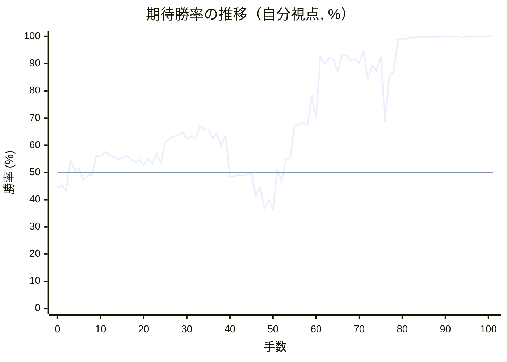

# 解析レポート 5dzax427ectk

[README に戻る](../../../README.md)　/　棋譜: [CSA](../../../data/csa/shogi5/5dzax427ectk.csa)　/　解析の見方: [docs/mistake_analysis.md](../../../docs/mistake_analysis.md)

## 対局情報

| 項目 | 内容 |
|---|---|
| 日時 | 2026-10-30 22:33:43 |
| 持ち時間 | 5分 |
| 自分 | 後手（△）（1716） |
| 相手 | 相手（1722） |
| 結果 | 負け（時間切れ, 101手） |

## 解析環境

| 項目 | 内容 |
|---|---|
| エンジン | YaneuraOu NNUE 9.00git 64AVX2（V9.00/YANEURAOU_ENGINE_NNUE/AVX2） |
| 評価関数 | **水匠5**（`suisho5`） |
| nn.bin SHA-256 | `768068f0d534a0603a5d38bcd143de6bbca820d5f1c95a14d40863e5b7892d76` |
| 第1パス | movetime=150ms, MultiPV 1 |
| 第2パス | movetime=2000ms, MultiPV 3 |
| Threads / Hash | 8 / 512MB |
| 判定基準 | 疑問手 ≥5pt, 悪手 ≥10pt, 大悪手 ≥20pt（期待勝率 W(E)=1/(1+exp(-E/600))） |
| 解析日時 | 2026-11-03T04:12:03+09:00（解析バージョン 1, 44秒） |

## サマリー

| 自分の手数 | 深掘りした手 | 詰み逃し | 大悪手 | 悪手 | 疑問手 |
|--:|--:|--:|--:|--:|--:|
| 50 | 7 | 1 | 1 | 3 | 1 |

## 期待勝率の推移



<details><summary>1手ごとの数値（第1パス）</summary>

| 手数 | 指し手 | 評価値 | 勝率 | 低下 | 判定 |
|--:|---|--:|--:|--:|---|
| 1 | ▲７六歩(77) | -115 | 45.2% |  |  |
| 2 | △３四歩(33) | -162 | 43.3% | +1.9pt |  |
| 3 | ▲６六歩(67) | +114 | 54.7% |  |  |
| 4 | △８四歩(83) | +11 | 50.5% | +4.3pt |  |
| 5 | ▲７八銀(79) | +38 | 51.6% |  |  |
| 6 | △８五歩(84) | -65 | 47.3% | +4.3pt |  |
| 7 | ▲７七角(88) | -27 | 48.9% |  |  |
| 8 | △６二銀(71) | -20 | 49.2% | -0.3pt |  |
| 9 | ▲６八飛(28) | +151 | 56.3% |  |  |
| 10 | △４二玉(51) | +140 | 55.8% | +0.5pt |  |
| 11 | ▲４八玉(59) | +185 | 57.6% |  |  |
| 12 | △５四歩(53) | +157 | 56.5% | +1.1pt |  |
| 13 | ▲１六歩(17) | +142 | 55.9% |  |  |
| 14 | △１四歩(13) | +117 | 54.9% | +1.0pt |  |
| 15 | ▲３八銀(39) | +131 | 55.4% |  |  |
| 16 | △３二玉(42) | +147 | 56.1% | -0.7pt |  |
| 17 | ▲３九玉(48) | +120 | 55.0% |  |  |
| 18 | △２四歩(23) | +87 | 53.6% | +1.4pt |  |
| 19 | ▲６七銀(78) | +115 | 54.8% |  |  |
| 20 | △２三玉(32) | +65 | 52.7% | +2.1pt |  |
| 21 | ▲４六歩(47) | +121 | 55.0% |  |  |
| 22 | △３二銀(31) | +76 | 53.2% | +1.9pt |  |
| 23 | ▲７八金(69) | +167 | 56.9% |  |  |
| 24 | △５三銀(62) | +81 | 53.4% | +3.5pt |  |
| 25 | ▲５六銀(67) | +271 | 61.1% |  |  |
| 26 | △４四銀(53) | +305 | 62.4% | -1.3pt |  |
| 27 | ▲３六歩(37) | +328 | 63.3% |  |  |
| 28 | △３一角(22) | +337 | 63.7% | -0.3pt |  |
| 29 | ▲２八玉(39) | +366 | 64.8% |  |  |
| 30 | △８六歩(85) | +301 | 62.3% | +2.5pt |  |
| 31 | ▲同歩(87) | +326 | 63.3% |  |  |
| 32 | △同角(31) | +305 | 62.4% | +0.8pt |  |
| 33 | ▲８七歩打 | +426 | 67.0% |  |  |
| 34 | △７七角成(86) | +398 | 66.0% | +1.0pt |  |
| 35 | ▲同桂(89) | +391 | 65.7% |  |  |
| 36 | △３三桂(21) | +308 | 62.6% | +3.2pt |  |
| 37 | ▲３七桂(29) | +352 | 64.3% |  |  |
| 38 | △９四歩(93) | +235 | 59.7% | +4.6pt |  |
| 39 | ▲６五歩(66) | +338 | 63.7% |  |  |
| 40 | △２二玉(23) | -35 | 48.5% | +15.2pt | [悪手](#ply-40) |
| 41 | ▲６四歩(65) | -33 | 48.6% |  |  |
| 42 | △同歩(63) | -21 | 49.1% | -0.5pt |  |
| 43 | ▲同飛(68) | -28 | 48.8% |  |  |
| 44 | △６二歩打 | -16 | 49.3% | -0.5pt |  |
| 45 | ▲６三歩打 | -3 | 49.9% |  |  |
| 46 | △５三銀(44) | -210 | 41.3% | +8.5pt | [悪手](#ply-46) |
| 47 | ▲６九飛(64) | -127 | 44.7% |  |  |
| 48 | △７二金(61) | -327 | 36.7% | +8.0pt | [悪手](#ply-48) |
| 49 | ▲６二歩成(63) | -243 | 40.0% |  |  |
| 50 | △同金(72) | -337 | 36.3% | +3.7pt |  |
| 51 | ▲７一角打 | +28 | 51.2% |  |  |
| 52 | △７二飛(82) | -78 | 46.8% | +4.4pt |  |
| 53 | ▲６二角成(71) | +116 | 54.8% |  |  |
| 54 | △同飛(72) | +126 | 55.2% | -0.4pt |  |
| 55 | ▲６三金打 | +445 | 67.7% |  |  |
| 56 | △６一飛(62) | +436 | 67.4% | +0.3pt |  |
| 57 | ▲６二歩打 | +464 | 68.4% |  |  |
| 58 | △５一飛(61) | +435 | 67.4% | +1.1pt |  |
| 59 | ▲６五桂(77) | +775 | 78.4% |  |  |
| 60 | △４四銀(53) | +514 | 70.2% | +8.2pt |  |
| 61 | ▲４五桂(37) | +1534 | 92.8% |  |  |
| 62 | △同銀(44) | +1317 | 90.0% | +2.8pt |  |
| 63 | ▲同歩(46) | +1470 | 92.1% |  |  |
| 64 | △４六角打 | +1461 | 91.9% | +0.1pt |  |
| 65 | ▲３七銀打 | +1148 | 87.1% |  |  |
| 66 | △５七角成(46) | +1562 | 93.1% | -6.0pt |  |
| 67 | ▲６七金(78) | +1555 | 93.0% |  |  |
| 68 | △７八角打 | +1397 | 91.1% | +1.9pt |  |
| 69 | ▲５七金(67) | +1441 | 91.7% |  |  |
| 70 | △６九角成(78) | +1320 | 90.0% | +1.7pt |  |
| 71 | ▲５三桂成(65) | +1736 | 94.8% |  |  |
| 72 | △３五歩(34) | +1007 | 84.3% | +10.5pt | [疑問手](#ply-72) |
| 73 | ▲同歩(36) | +1275 | 89.3% |  |  |
| 74 | △３六歩打 | +1167 | 87.5% | +1.8pt |  |
| 75 | ▲４八銀(37) | +1536 | 92.8% |  |  |
| 76 | △２五桂(33) | +468 | 68.6% | +24.3pt | [大悪手](#ply-76) |
| 77 | ▲６六角打 | +1063 | 85.5% |  |  |
| 78 | △１二玉(22) | +1145 | 87.1% | -1.6pt |  |
| 79 | ▲３四歩(35) | +2607 | 98.7% |  |  |
| 80 | △３七歩成(36) | +2891 | 99.2% | -0.5pt |  |
| 81 | ▲同銀(38) | +2744 | 99.0% |  |  |
| 82 | △同桂成(25) | +3815 | 99.8% | -0.8pt |  |
| 83 | ▲同銀(48) | +3451 | 99.7% |  |  |
| 84 | △３六歩打 | +4293 | 99.9% | -0.2pt |  |
| 85 | ▲同銀(37) | +4021 | 99.9% |  |  |
| 86 | △同馬(69) | +4507 | 99.9% | -0.1pt |  |
| 87 | ▲４七金(57) | +4421 | 99.9% |  |  |
| 88 | △６八飛打 | +4244 | 99.9% | +0.0pt |  |
| 89 | ▲４八桂打 | +5292 | 100.0% |  |  |
| 90 | △４七馬(36) | +5393 | 100.0% | -0.0pt |  |
| 91 | ▲同銀(56) | +5704 | 100.0% |  |  |
| 92 | △２五桂打 | +3963 | 99.9% | +0.1pt |  |
| 93 | ▲３八金(49) | +5193 | 100.0% |  |  |
| 94 | △３七歩打 | +3478 | 99.7% | +0.3pt |  |
| 95 | ▲３三歩成(34) | #+19 | 100.0% |  |  |
| 96 | △３八歩成(37) | #+18 | 100.0% | +0.0pt |  |
| 97 | ▲同銀(47) | #+17 | 100.0% |  |  |
| 98 | △６六飛成(68) | +5780 | 100.0% | +0.0pt | [詰み逃し](#ply-98) |
| 99 | ▲３四角打 | +5977 | 100.0% |  |  |
| 100 | △１三玉(12) | +5864 | 100.0% | +0.0pt |  |
| 101 | ▲３二と(33) | #+11 | 100.0% |  |  |

</details>

## 課題局面

<a id="ply-40"></a>
### 40手目 △２二玉(23) — 悪手

| | 着手前 | 着手後 | 差 |
|---|--:|--:|--:|
| 期待勝率 | 63.8% | 49.6% | -14.3pt |
| 評価値 | +341 | -10 | |

着手前の局面:

```text
後手の持駒：角　歩
  ９ ８ ７ ６ ５ ４ ３ ２ １
+---------------------------+
|v香v桂 ・v金 ・v金 ・ ・v香|一
| ・v飛 ・ ・ ・ ・v銀 ・ ・|二
| ・ ・v歩v歩 ・v歩v桂v玉 ・|三
|v歩 ・ ・ ・v歩v銀v歩v歩v歩|四
| ・ ・ ・ 歩 ・ ・ ・ ・ ・|五
| ・ ・ 歩 ・ 銀 歩 歩 ・ 歩|六
| 歩 歩 桂 ・ 歩 ・ 桂 歩 ・|七
| ・ ・ 金 飛 ・ ・ 銀 玉 ・|八
| 香 ・ ・ ・ ・ 金 ・ ・ 香|九
+---------------------------+
先手の持駒：角
後手番
手数＝39　▲６五歩　まで
```

| | 指し手 | 評価値 | 読み筋 |
|---|---|--:|---|
| 実戦 | △２二玉(23) | -10 | ▲６四歩(65) △同歩(63) ▲同飛(68) △６二歩打 ▲４七銀(56) △５二金(61) |
| AI 1位 | △５三銀(44) | +341 | △５三銀(44) ▲４五歩(46) △２二玉(23) ▲２六歩(27) △５二金(61) ▲６六飛(68) |
| AI 2位 | △５二金(61) | +153 | △５二金(61) ▲６四歩(65) △同歩(63) ▲同飛(68) △６三歩打 ▲６五飛(64) |
| AI 3位 | △６二飛(82) | +120 | △６二飛(82) ▲４五歩(46) △５三銀(44) ▲４七銀(56) △７四歩(73) ▲２六歩(27) |

SFEN: `ln1g1g2l/1r4s2/2pp1pnk1/p3psppp/3P5/2P1SPP1P/PPN1P1NP1/2GR2SK1/L4G2L w Bbp 40`

<a id="ply-46"></a>
### 46手目 △５三銀(44) — 悪手

| | 着手前 | 着手後 | 差 |
|---|--:|--:|--:|
| 期待勝率 | 51.7% | 40.8% | -11.0pt |
| 評価値 | +42 | -224 | |

着手前の局面:

```text
後手の持駒：角　歩
  ９ ８ ７ ６ ５ ４ ３ ２ １
+---------------------------+
|v香v桂 ・v金 ・v金 ・ ・v香|一
| ・v飛 ・v歩 ・ ・v銀v玉 ・|二
| ・ ・v歩 歩 ・v歩v桂 ・ ・|三
|v歩 ・ ・ 飛v歩v銀v歩v歩v歩|四
| ・ ・ ・ ・ ・ ・ ・ ・ ・|五
| ・ ・ 歩 ・ 銀 歩 歩 ・ 歩|六
| 歩 歩 桂 ・ 歩 ・ 桂 歩 ・|七
| ・ ・ 金 ・ ・ ・ 銀 玉 ・|八
| 香 ・ ・ ・ ・ 金 ・ ・ 香|九
+---------------------------+
先手の持駒：角
後手番
手数＝45　▲６三歩　まで
```

| | 指し手 | 評価値 | 読み筋 |
|---|---|--:|---|
| 実戦 | △５三銀(44) | -224 | ▲６五飛(64) △４二金(41) ▲４七銀(56) △２三銀(32) ▲６二歩成(63) △同銀(53) |
| AI 1位 | △３五歩(34) | +42 | △３五歩(34) ▲４七銀(56) △３六歩(35) ▲同銀(47) △２三角打 ▲５六角打 |
| AI 2位 | △８九角打 | -103 | △８九角打 ▲８八金(78) △５六角成(89) ▲同歩(57) △５二金(61) ▲６二歩成(63) |
| AI 3位 | △９三角打 | -161 | △９三角打 ▲６七飛(64) △６三歩(62) ▲９六歩(97) △５二金(61) ▲９五歩(96) |

SFEN: `ln1g1g2l/1r1p2sk1/2pP1pn2/p2Rpsppp/9/2P1SPP1P/PPN1P1NP1/2G3SK1/L4G2L w Bbp 46`

<a id="ply-48"></a>
### 48手目 △７二金(61) — 悪手

| | 着手前 | 着手後 | 差 |
|---|--:|--:|--:|
| 期待勝率 | 46.2% | 30.3% | -16.0pt |
| 評価値 | -91 | -501 | |

着手前の局面:

```text
後手の持駒：角　歩
  ９ ８ ７ ６ ５ ４ ３ ２ １
+---------------------------+
|v香v桂 ・v金 ・v金 ・ ・v香|一
| ・v飛 ・v歩 ・ ・v銀v玉 ・|二
| ・ ・v歩 歩v銀v歩v桂 ・ ・|三
|v歩 ・ ・ ・v歩 ・v歩v歩v歩|四
| ・ ・ ・ ・ ・ ・ ・ ・ ・|五
| ・ ・ 歩 ・ 銀 歩 歩 ・ 歩|六
| 歩 歩 桂 ・ 歩 ・ 桂 歩 ・|七
| ・ ・ 金 ・ ・ ・ 銀 玉 ・|八
| 香 ・ ・ 飛 ・ 金 ・ ・ 香|九
+---------------------------+
先手の持駒：角
後手番
手数＝47　▲６九飛　まで
```

| | 指し手 | 評価値 | 読み筋 |
|---|---|--:|---|
| 実戦 | △７二金(61) | -501 | ▲３五歩(36) △２三銀(32) ▲４五桂(37) △同桂(33) ▲同銀(56) △４四歩(43) |
| AI 1位 | △５二金(61) | -91 | △５二金(61) ▲３五歩(36) △２三角打 ▲６二歩成(63) △同飛(82) ▲同飛成(69) |
| AI 2位 | △４四歩(43) | -194 | △４四歩(43) ▲４七銀(56) △５二金(61) ▲３五歩(36) △同歩(34) ▲６二歩成(63) |
| AI 3位 | △９五歩(94) | -222 | △９五歩(94) ▲３五歩(36) △２三銀(32) ▲６二歩成(63) △同金(61) ▲７一角打 |

SFEN: `ln1g1g2l/1r1p2sk1/2pPspn2/p3p1ppp/9/2P1SPP1P/PPN1P1NP1/2G3SK1/L2R1G2L w Bbp 48`

<a id="ply-72"></a>
### 72手目 △３五歩(34) — 疑問手

| | 着手前 | 着手後 | 差 |
|---|--:|--:|--:|
| 期待勝率 | 94.3% | 89.0% | -5.3pt |
| 評価値 | +1685 | +1255 | |

着手前の局面:

```text
後手の持駒：飛　桂　歩三
  ９ ８ ７ ６ ５ ４ ３ ２ １
+---------------------------+
|v香v桂 ・ ・v飛v金 ・ ・v香|一
| ・ ・ ・ 歩 ・ ・v銀v玉 ・|二
| ・ ・v歩 金 圭v歩v桂 ・ ・|三
|v歩 ・ ・ ・v歩 ・v歩v歩v歩|四
| ・ ・ ・ ・ ・ 歩 ・ ・ ・|五
| ・ ・ 歩 ・ 銀 ・ 歩 ・ 歩|六
| 歩 歩 ・ ・ 金 ・ 銀 歩 ・|七
| ・ ・ ・ ・ ・ ・ 銀 玉 ・|八
| 香 ・ ・v馬 ・ 金 ・ ・ 香|九
+---------------------------+
先手の持駒：角
後手番
手数＝71　▲５三桂成　まで
```

| | 指し手 | 評価値 | 読み筋 |
|---|---|--:|---|
| 実戦 | △３五歩(34) | +1255 | ▲４六金(57) △２五桂打 ▲３五金(46) △３七桂成(25) ▲同銀(38) △６八飛打 |
| AI 1位 | △５五歩(54) | +1685 | △５五歩(54) ▲同銀(56) △４五桂(33) ▲４六銀(55) △３七桂成(45) ▲同銀(46) |
| AI 2位 | △２五桂打 | +1488 | △２五桂打 ▲２六銀(37) △３五歩(34) ▲４六金(57) △３六歩(35) ▲４八角打 |
| AI 3位 | △１五歩(14) | +1376 | △１五歩(14) ▲同歩(16) △１八歩打 ▲同香(19) △５五歩(54) ▲５二歩打 |

SFEN: `ln2rg2l/3P2sk1/2pG+Npn2/p3p1ppp/5P3/2P1S1P1P/PP2G1SP1/6SK1/L2+b1G2L w Brn3p 72`

<a id="ply-76"></a>
### 76手目 △２五桂(33) — 大悪手

| | 着手前 | 着手後 | 差 |
|---|--:|--:|--:|
| 期待勝率 | 97.0% | 72.1% | -24.9pt |
| 評価値 | +2088 | +571 | |

着手前の局面:

```text
後手の持駒：飛　桂　歩二
  ９ ８ ７ ６ ５ ４ ３ ２ １
+---------------------------+
|v香v桂 ・ ・v飛v金 ・ ・v香|一
| ・ ・ ・ 歩 ・ ・v銀v玉 ・|二
| ・ ・v歩 金 圭v歩v桂 ・ ・|三
|v歩 ・ ・ ・v歩 ・ ・v歩v歩|四
| ・ ・ ・ ・ ・ 歩 歩 ・ ・|五
| ・ ・ 歩 ・ 銀 ・v歩 ・ 歩|六
| 歩 歩 ・ ・ 金 ・ ・ 歩 ・|七
| ・ ・ ・ ・ ・ 銀 銀 玉 ・|八
| 香 ・ ・v馬 ・ 金 ・ ・ 香|九
+---------------------------+
先手の持駒：角　歩
後手番
手数＝75　▲４八銀　まで
```

| | 指し手 | 評価値 | 読み筋 |
|---|---|--:|---|
| 実戦 | △２五桂(33) | +571 | ▲５八歩打 △５五歩(54) ▲４七銀(56) △５六桂打 ▲同金(57) △同歩(55) |
| AI 1位 | △２五桂打 | +2088 | △２五桂打 ▲４七角打 △５五歩(54) ▲６七銀(56) △７九飛打 ▲５八金(57) |
| AI 2位 | △５五歩(54) | +1506 | △５五歩(54) ▲４七銀(56) △４五桂(33) ▲４六金(57) △４七馬(69) ▲同金(46) |
| AI 3位 | △３七歩成(36) | +1104 | △３七歩成(36) ▲同銀(38) △２五桂打 ▲２六銀(37) △５三飛(51) ▲同金(63) |

SFEN: `ln2rg2l/3P2sk1/2pG+Npn2/p3p2pp/5PP2/2P1S1p1P/PP2G2P1/5SSK1/L2+b1G2L w BPrn2p 76`

<a id="ply-98"></a>
### 98手目 △６六飛成(68) — 詰み逃し

| | 着手前 | 着手後 | 差 |
|---|--:|--:|--:|
| 期待勝率 | 100.0% | 100.0% | -0.0pt |
| 評価値 | 17手詰め | +6148 | |

着手前の局面:

```text
後手の持駒：金二　銀二
  ９ ８ ７ ６ ５ ４ ３ ２ １
+---------------------------+
|v香v桂 ・ ・v飛v金 ・ ・v香|一
| ・ ・ ・ 歩 ・ ・v銀 ・v玉|二
| ・ ・v歩 金 圭v歩 と ・ ・|三
|v歩 ・ ・ ・v歩 ・ ・v歩v歩|四
| ・ ・ ・ ・ ・ 歩 ・v桂 ・|五
| ・ ・ 歩 角 ・ ・ ・ ・ 歩|六
| 歩 歩 ・ ・ ・ ・ ・ 歩 ・|七
| ・ ・ ・v飛 ・ 桂 銀 玉 ・|八
| 香 ・ ・ ・ ・ ・ ・ ・ 香|九
+---------------------------+
先手の持駒：角　歩四
後手番
手数＝97　▲３八同銀　まで
```

| | 指し手 | 評価値 | 読み筋 |
|---|---|--:|---|
| 実戦 | △６六飛成(68) | +6148 | ▲３四角打 △１三玉(12) ▲２五角(34) △同歩(24) ▲３七桂打 △４六角打 |
| AI 1位 | △３七銀打 | 17手詰め | △３七銀打 ▲同銀(38) △同桂成(25) ▲同玉(28) △４六銀打 ▲同玉(37) |
| AI 2位 | △３七金打 | 19手詰め | △３七金打 ▲同銀(38) △同桂成(25) ▲同玉(28) △４六銀打 ▲同玉(37) |
| AI 3位 | △１七銀打 | 23手詰め | △１七銀打 ▲同香(19) △３七銀打 ▲同銀(38) △同桂成(25) ▲同玉(28) |

SFEN: `ln2rg2l/3P2s1k/2pG+Np+P2/p3p2pp/5P1n1/2PB4P/PP5P1/3r1NSK1/L7L w B4P2g2s 98`

