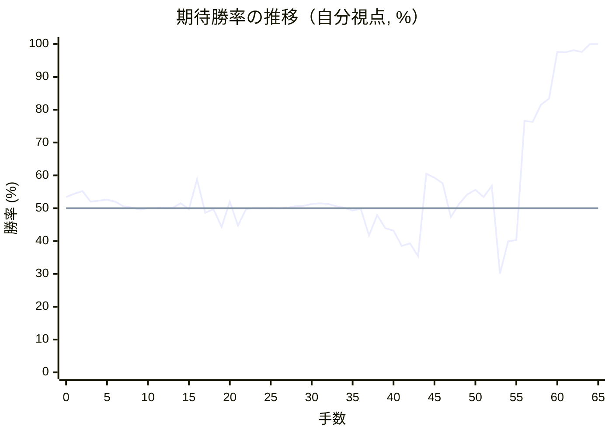
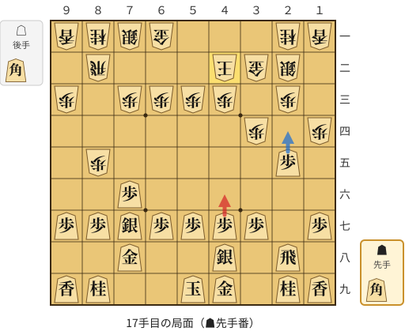
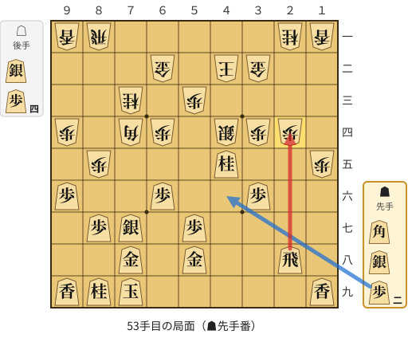

# 解析レポート 5iwi16xga15y

[README に戻る](../../../README.md)　/　棋譜: [CSA](../../../data/csa/shogi10/5iwi16xga15y.csa)　/　解析の見方: [docs/mistake_analysis.md](../../../docs/mistake_analysis.md)

## 対局情報

| 項目 | 内容 |
|---|---|
| 日時 | 2026-09-12 14:59:41 |
| 持ち時間 | 10分 |
| 自分 | 先手（▲）（1843） |
| 相手 | 相手（1498） |
| 結果 | 勝ち（投了, 65手） |

## 解析環境

| 項目 | 内容 |
|---|---|
| エンジン | YaneuraOu NNUE 9.00git 64AVX2（V9.00/YANEURAOU_ENGINE_NNUE/AVX2） |
| 評価関数 | **水匠5**（`suisho5`） |
| nn.bin SHA-256 | `768068f0d534a0603a5d38bcd143de6bbca820d5f1c95a14d40863e5b7892d76` |
| 第1パス | movetime=150ms, MultiPV 1 |
| 第2パス | movetime=2000ms, MultiPV 3 |
| Threads / Hash | 8 / 512MB |
| 判定基準 | 疑問手 ≥5pt, 悪手 ≥10pt, 大悪手 ≥20pt（期待勝率 W(E)=1/(1+exp(-E/600))） |
| 解析日時 | 2026-11-03T04:30:19+09:00（解析バージョン 1, 34秒） |

## サマリー

| 自分の手数 | 深掘りした手 | 詰み逃し | 大悪手 | 悪手 | 疑問手 |
|--:|--:|--:|--:|--:|--:|
| 33 | 6 | 0 | 0 | 1 | 1 |

## 期待勝率の推移



<details><summary>1手ごとの数値（第1パス）</summary>

| 手数 | 指し手 | 評価値 | 勝率 | 低下 | 判定 |
|--:|---|--:|--:|--:|---|
| 1 | ▲７六歩(77) | +105 | 54.4% | -1.0pt |  |
| 2 | △８四歩(83) | +126 | 55.2% |  |  |
| 3 | ▲２六歩(27) | +48 | 52.0% | +3.2pt |  |
| 4 | △８五歩(84) | +55 | 52.3% |  |  |
| 5 | ▲７七角(88) | +63 | 52.6% | -0.3pt |  |
| 6 | △３二金(41) | +47 | 52.0% |  |  |
| 7 | ▲２五歩(26) | +14 | 50.6% | +1.4pt |  |
| 8 | △３四歩(33) | +6 | 50.2% |  |  |
| 9 | ▲６八銀(79) | -10 | 49.6% | +0.7pt |  |
| 10 | △７七角成(22) | +0 | 50.0% |  |  |
| 11 | ▲同銀(68) | +1 | 50.0% | -0.0pt |  |
| 12 | △２二銀(31) | +4 | 50.2% |  |  |
| 13 | ▲４八銀(39) | +3 | 50.1% | +0.0pt |  |
| 14 | △１四歩(13) | +37 | 51.5% |  |  |
| 15 | ▲７八金(69) | -7 | 49.7% | +1.8pt |  |
| 16 | △４二玉(51) | +214 | 58.8% |  |  |
| 17 | ▲４六歩(47) | -33 | 48.6% | +10.2pt | [疑問手](#ply-17) |
| 18 | △３三銀(22) | -8 | 49.7% |  |  |
| 19 | ▲４七銀(48) | -138 | 44.3% | +5.4pt |  |
| 20 | △６二銀(71) | +47 | 52.0% |  |  |
| 21 | ▲６八玉(59) | -128 | 44.7% | +7.3pt |  |
| 22 | △６四歩(63) | -6 | 49.8% |  |  |
| 23 | ▲１六歩(17) | +0 | 50.0% | -0.2pt |  |
| 24 | △６三銀(62) | -2 | 49.9% |  |  |
| 25 | ▲３六歩(37) | +0 | 50.0% | -0.1pt |  |
| 26 | △７四歩(73) | -2 | 49.9% |  |  |
| 27 | ▲９六歩(97) | +2 | 50.1% | -0.2pt |  |
| 28 | △９四歩(93) | +14 | 50.6% |  |  |
| 29 | ▲３七桂(29) | +16 | 50.7% | -0.1pt |  |
| 30 | △６二金(61) | +31 | 51.3% |  |  |
| 31 | ▲５六銀(47) | +36 | 51.5% | -0.2pt |  |
| 32 | △７三桂(81) | +32 | 51.3% |  |  |
| 33 | ▲６六歩(67) | +14 | 50.6% | +0.7pt |  |
| 34 | △５四銀(63) | +3 | 50.1% |  |  |
| 35 | ▲７九玉(68) | -18 | 49.3% | +0.9pt |  |
| 36 | △８一飛(82) | -5 | 49.8% |  |  |
| 37 | ▲５八金(49) | -202 | 41.7% | +8.1pt |  |
| 38 | △４四歩(43) | -50 | 47.9% |  |  |
| 39 | ▲４五歩(46) | -146 | 43.9% | +4.0pt |  |
| 40 | △同歩(44) | -163 | 43.2% |  |  |
| 41 | ▲１五歩(16) | -282 | 38.5% | +4.8pt |  |
| 42 | △同歩(14) | -260 | 39.3% |  |  |
| 43 | ▲７五歩(76) | -361 | 35.4% | +3.9pt |  |
| 44 | △６三角打 | +255 | 60.5% |  |  |
| 45 | ▲７四歩(75) | +226 | 59.3% | +1.2pt |  |
| 46 | △同角(63) | +183 | 57.6% |  |  |
| 47 | ▲４五銀(56) | -66 | 47.3% | +10.3pt |  |
| 48 | △同銀(54) | +31 | 51.3% |  |  |
| 49 | ▲同桂(37) | +102 | 54.2% | -2.9pt |  |
| 50 | △４四銀(33) | +136 | 55.6% |  |  |
| 51 | ▲２四歩(25) | +81 | 53.4% | +2.3pt |  |
| 52 | △同歩(23) | +164 | 56.8% |  |  |
| 53 | ▲同飛(28) | -505 | 30.1% | +26.7pt | [悪手](#ply-53) |
| 54 | △４五銀(44) | -246 | 39.9% |  |  |
| 55 | ▲４四歩打 | -236 | 40.3% | -0.4pt |  |
| 56 | △２三歩打 | +710 | 76.6% |  |  |
| 57 | ▲４三銀打 | +702 | 76.3% | +0.2pt |  |
| 58 | △３三玉(42) | +891 | 81.5% |  |  |
| 59 | ▲２五飛(24) | +970 | 83.4% | -1.9pt |  |
| 60 | △３六銀(45) | +2212 | 97.6% |  |  |
| 61 | ▲３二銀成(43) | +2206 | 97.5% | +0.0pt |  |
| 62 | △同玉(33) | +2370 | 98.1% |  |  |
| 63 | ▲４三歩成(44) | +2236 | 97.6% | +0.5pt |  |
| 64 | △２二玉(32) | +6286 | 100.0% |  |  |
| 65 | ▲３二金打 | +6552 | 100.0% | -0.0pt |  |

</details>

## 課題局面

<a id="ply-17"></a>
### 17手目 ▲４六歩(47) — 疑問手

| | 着手前 | 着手後 | 差 |
|---|--:|--:|--:|
| 期待勝率 | 59.5% | 50.0% | -9.5pt |
| 評価値 | +230 | +0 | |

着手前の局面:



🔴 実戦 ▲４六歩(47)　🔵 AI推奨 ▲２四歩(25)　🟨 直前の相手の指し手

<details><summary>テキストの盤面図（BOD・将棋ソフトに貼り付け可）</summary>

```text
後手の持駒：角
  ９ ８ ７ ６ ５ ４ ３ ２ １
+---------------------------+
|v香v桂v銀v金 ・ ・ ・v桂v香|一
| ・v飛 ・ ・ ・v玉v金v銀 ・|二
|v歩 ・v歩v歩v歩v歩 ・v歩 ・|三
| ・ ・ ・ ・ ・ ・v歩 ・v歩|四
| ・v歩 ・ ・ ・ ・ ・ 歩 ・|五
| ・ ・ 歩 ・ ・ ・ ・ ・ ・|六
| 歩 歩 銀 歩 歩 歩 歩 ・ 歩|七
| ・ ・ 金 ・ ・ 銀 ・ 飛 ・|八
| 香 桂 ・ ・ 玉 金 ・ 桂 香|九
+---------------------------+
先手の持駒：角
手数＝16　△４二玉　まで
```

</details>

| | 指し手 | 評価値 | 読み筋 |
|---|---|--:|---|
| 実戦 | ▲４六歩(47) | +0 | △３三銀(22) ▲１六歩(17) △７二銀(71) ▲３六歩(37) △７四歩(73) ▲９六歩(97) |
| AI 1位 | ▲２四歩(25) | +230 | ▲２四歩(25) △同歩(23) ▲同飛(28) △６四歩(63) ▲２八飛(24) △７二銀(71) |
| AI 2位 | ▲６八玉(59) | +141 | ▲６八玉(59) △３三銀(22) ▲３六歩(37) △７四歩(73) ▲３七銀(48) △７二銀(71) |
| AI 3位 | ▲３六歩(37) | +135 | ▲３六歩(37) △３三銀(22) ▲３七銀(48) △７四歩(73) ▲４六銀(37) △７二銀(71) |

SFEN: `lnsg3nl/1r3kgs1/p1pppp1p1/6p1p/1p5P1/2P6/PPSPPPP1P/2G2S1R1/LN2KG1NL b Bb 17`

<a id="ply-53"></a>
### 53手目 ▲同飛(28) — 悪手

| | 着手前 | 着手後 | 差 |
|---|--:|--:|--:|
| 期待勝率 | 55.1% | 39.9% | -15.1pt |
| 評価値 | +122 | -245 | |

着手前の局面:



🔴 実戦 ▲同飛(28)　🔵 AI推奨 ▲４六歩打　🟨 直前の相手の指し手

<details><summary>テキストの盤面図（BOD・将棋ソフトに貼り付け可）</summary>

```text
後手の持駒：銀　歩四
  ９ ８ ７ ６ ５ ４ ３ ２ １
+---------------------------+
|v香v飛 ・ ・ ・ ・ ・v桂v香|一
| ・ ・ ・v金 ・v玉v金 ・ ・|二
| ・ ・v桂 ・v歩 ・ ・ ・ ・|三
|v歩 ・v角v歩 ・v銀v歩v歩 ・|四
| ・v歩 ・ ・ ・ 桂 ・ ・v歩|五
| 歩 ・ ・ 歩 ・ ・ 歩 ・ ・|六
| ・ 歩 銀 ・ 歩 ・ ・ ・ ・|七
| ・ ・ 金 ・ 金 ・ ・ 飛 ・|八
| 香 桂 玉 ・ ・ ・ ・ ・ 香|九
+---------------------------+
先手の持駒：角　銀　歩二
手数＝52　△２四同歩　まで
```

</details>

| | 指し手 | 評価値 | 読み筋 |
|---|---|--:|---|
| 実戦 | ▲同飛(28) | -245 | △２三歩打 ▲２五飛(24) △８六歩(85) ▲同銀(77) △４六歩打 ▲２二歩打 |
| AI 1位 | ▲４六歩打 | +122 | ▲４六歩打 △７五歩打 ▲７六歩打 △５二角(74) ▲２四飛(28) △２三歩打 |
| AI 2位 | ▲２二歩打 | +61 | ▲２二歩打 △１三桂(21) ▲７五銀打 △６三角(74) ▲４六歩打 △５四角(63) |
| AI 3位 | ▲２二歩打 | +42 | ▲２二歩打 △同金(32) ▲７五銀打 △６三角(74) ▲４六歩打 △５五銀打 |

SFEN: `lr5nl/3g1kg2/2n1p4/p1bp1spp1/1p3N2p/P2P2P2/1PS1P4/2G1G2R1/LNK5L b BS2Ps4p 53`

