# 解析レポート 5rtfbpyzr3ec

[README に戻る](../../../README.md)　/　棋譜: [CSA](../../../data/csa/shogi5/5rtfbpyzr3ec.csa)　/　解析の見方: [docs/mistake_analysis.md](../../../docs/mistake_analysis.md)

## 対局情報

| 項目 | 内容 |
|---|---|
| 日時 | 2026-10-29 18:53:36 |
| 持ち時間 | 5分 |
| 自分 | 先手（▲）（1739） |
| 相手 | 相手（1729） |
| 結果 | 負け（詰み, 106手） |

## 解析環境

| 項目 | 内容 |
|---|---|
| エンジン | YaneuraOu NNUE 9.00git 64AVX2（V9.00/YANEURAOU_ENGINE_NNUE/AVX2） |
| 評価関数 | **水匠5**（`suisho5`） |
| nn.bin SHA-256 | `768068f0d534a0603a5d38bcd143de6bbca820d5f1c95a14d40863e5b7892d76` |
| 第1パス | movetime=150ms, MultiPV 1 |
| 第2パス | movetime=2000ms, MultiPV 3 |
| Threads / Hash | 8 / 512MB |
| 判定基準 | 疑問手 ≥5pt, 悪手 ≥10pt, 大悪手 ≥20pt（期待勝率 W(E)=1/(1+exp(-E/600))） |
| 解析日時 | 2026-11-03T04:21:17+09:00（解析バージョン 1, 78秒） |

## サマリー

| 自分の手数 | 深掘りした手 | 詰み逃し | 大悪手 | 悪手 | 疑問手 |
|--:|--:|--:|--:|--:|--:|
| 53 | 16 | 4 | 4 | 3 | 4 |

## 期待勝率の推移

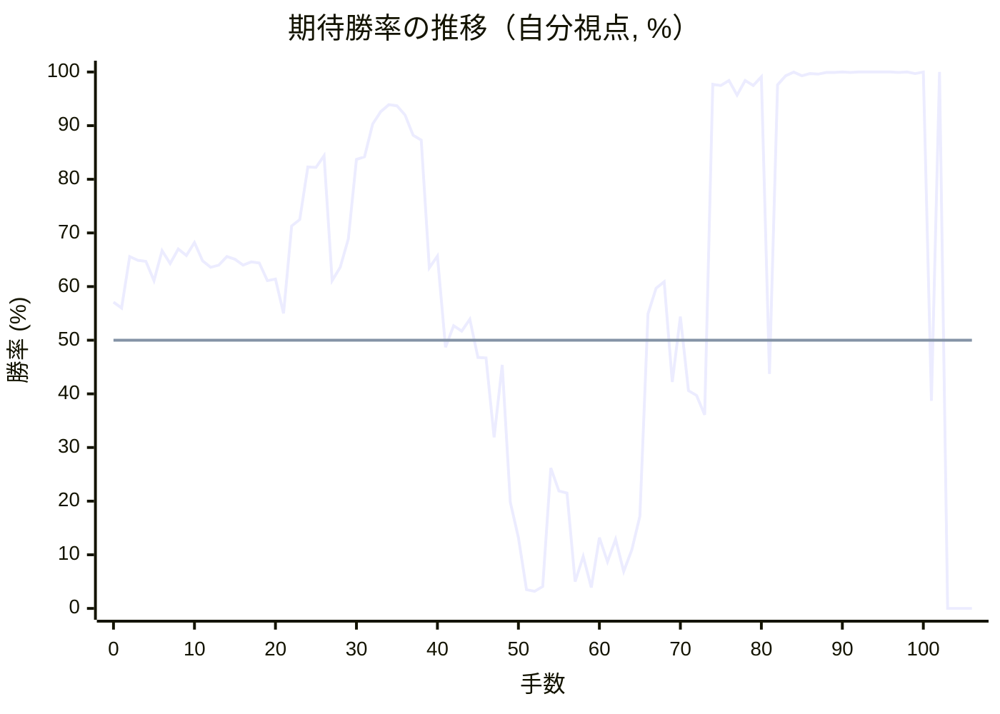

<details><summary>1手ごとの数値（第1パス）</summary>

| 手数 | 指し手 | 評価値 | 勝率 | 低下 | 判定 |
|--:|---|--:|--:|--:|---|
| 1 | ▲７六歩(77) | +145 | 56.0% | +1.1pt |  |
| 2 | △５二飛(82) | +388 | 65.6% |  |  |
| 3 | ▲２六歩(27) | +368 | 64.9% | +0.8pt |  |
| 4 | △５四歩(53) | +363 | 64.7% |  |  |
| 5 | ▲２五歩(26) | +270 | 61.1% | +3.6pt |  |
| 6 | △３二金(41) | +417 | 66.7% |  |  |
| 7 | ▲４八銀(39) | +352 | 64.3% | +2.4pt |  |
| 8 | △６二玉(51) | +425 | 67.0% |  |  |
| 9 | ▲６八玉(59) | +393 | 65.8% | +1.2pt |  |
| 10 | △７二玉(62) | +458 | 68.2% |  |  |
| 11 | ▲３六歩(37) | +365 | 64.8% | +3.5pt |  |
| 12 | △５五歩(54) | +336 | 63.6% |  |  |
| 13 | ▲７八銀(79) | +345 | 64.0% | -0.3pt |  |
| 14 | △５六歩(55) | +386 | 65.6% |  |  |
| 15 | ▲同歩(57) | +374 | 65.1% | +0.5pt |  |
| 16 | △同飛(52) | +346 | 64.0% |  |  |
| 17 | ▲７七銀(78) | +360 | 64.6% | -0.5pt |  |
| 18 | △３六飛(56) | +355 | 64.4% |  |  |
| 19 | ▲６六銀(77) | +270 | 61.1% | +3.3pt |  |
| 20 | △３四飛(36) | +278 | 61.4% |  |  |
| 21 | ▲５五銀(66) | +120 | 55.0% | +6.4pt | [疑問手](#ply-21) |
| 22 | △３五飛(34) | +547 | 71.3% |  |  |
| 23 | ▲３七銀(48) | +582 | 72.5% | -1.2pt |  |
| 24 | △３四歩(33) | +923 | 82.3% |  |  |
| 25 | ▲４六銀(37) | +918 | 82.2% | +0.1pt |  |
| 26 | △５五角(22) | +1014 | 84.4% |  |  |
| 27 | ▲同角(88) | +272 | 61.1% | +23.3pt | [悪手](#ply-27) |
| 28 | △同飛(35) | +335 | 63.6% |  |  |
| 29 | ▲同銀(46) | +476 | 68.9% | -5.2pt |  |
| 30 | △３三桂(21) | +982 | 83.7% |  |  |
| 31 | ▲７八玉(68) | +1003 | 84.2% | -0.5pt |  |
| 32 | △５四歩打 | +1338 | 90.3% |  |  |
| 33 | ▲６六銀(55) | +1512 | 92.6% | -2.3pt |  |
| 34 | △５五銀打 | +1637 | 93.9% |  |  |
| 35 | ▲同銀(66) | +1623 | 93.7% | +0.1pt |  |
| 36 | △同歩(54) | +1463 | 92.0% |  |  |
| 37 | ▲６八金(69) | +1206 | 88.2% | +3.8pt |  |
| 38 | △５六歩(55) | +1156 | 87.3% |  |  |
| 39 | ▲５八歩打 | +331 | 63.5% | +23.8pt | [大悪手](#ply-39) |
| 40 | △５五角打 | +391 | 65.7% |  |  |
| 41 | ▲４六角打 | -32 | 48.7% | +17.1pt | [疑問手](#ply-41) |
| 42 | △９九角成(55) | +64 | 52.7% |  |  |
| 43 | ▲８八銀打 | +40 | 51.7% | +1.0pt |  |
| 44 | △９八馬(99) | +93 | 53.9% |  |  |
| 45 | ▲２四歩(25) | -76 | 46.8% | +7.0pt | [疑問手](#ply-45) |
| 46 | △同歩(23) | -80 | 46.7% |  |  |
| 47 | ▲３七桂(29) | -454 | 31.9% | +14.7pt | [悪手](#ply-47) |
| 48 | △４四香打 | -111 | 45.4% |  |  |
| 49 | ▲２四角(46) | -841 | 19.8% | +25.6pt | [大悪手](#ply-49) |
| 50 | △４七香成(44) | -1128 | 13.2% |  |  |
| 51 | ▲３三角成(24) | -1990 | 3.5% | +9.7pt | [疑問手](#ply-51) |
| 52 | △同金(32) | -2042 | 3.2% |  |  |
| 53 | ▲２一飛成(28) | -1887 | 4.1% | -0.9pt |  |
| 54 | △２二銀打 | -622 | 26.2% |  |  |
| 55 | ▲４五桂(37) | -763 | 21.9% | +4.3pt |  |
| 56 | △３二金(33) | -776 | 21.5% |  |  |
| 57 | ▲２四桂打 | -1771 | 5.0% | +16.6pt | [悪手](#ply-57) |
| 58 | △４四角打 | -1338 | 9.7% |  |  |
| 59 | ▲７七桂(89) | -1917 | 3.9% | +5.8pt |  |
| 60 | △４二金(32) | -1130 | 13.2% |  |  |
| 61 | ▲２三歩打 | -1410 | 8.7% | +4.5pt |  |
| 62 | △５七歩成(56) | -1147 | 12.9% |  |  |
| 63 | ▲同歩(58) | -1558 | 6.9% | +5.9pt |  |
| 64 | △５六歩打 | -1258 | 10.9% |  |  |
| 65 | ▲同歩(57) | -943 | 17.2% | -6.3pt |  |
| 66 | △５七歩打 | +118 | 54.9% |  |  |
| 67 | ▲２二歩成(23) | +236 | 59.7% | -4.8pt |  |
| 68 | △５八歩成(57) | +266 | 60.9% |  |  |
| 69 | ▲同金(49) | -188 | 42.2% | +18.7pt |  |
| 70 | △同成香(47) | +107 | 54.4% |  |  |
| 71 | ▲同金(68) | -228 | 40.6% | +13.8pt |  |
| 72 | △５七歩打 | -251 | 39.7% |  |  |
| 73 | ▲同金(58) | -343 | 36.1% | +3.6pt |  |
| 74 | △７七角成(44) | +2256 | 97.7% |  |  |
| 75 | ▲同銀(88) | +2198 | 97.5% | +0.2pt |  |
| 76 | △６五桂打 | +2486 | 98.4% |  |  |
| 77 | ▲６六銀(77) | +1857 | 95.7% | +2.8pt |  |
| 78 | △５七桂成(65) | +2486 | 98.4% |  |  |
| 79 | ▲同銀(66) | +2192 | 97.5% | +1.0pt |  |
| 80 | △５八金打 | +2805 | 99.1% |  |  |
| 81 | ▲６八銀(57) | -152 | 43.7% | +55.4pt | [大悪手](#ply-81) |
| 82 | △４四歩(43) | +2215 | 97.6% |  |  |
| 83 | ▲３一龍(21) | +3016 | 99.3% | -1.8pt |  |
| 84 | △５二金(42) | #+17 | 100.0% |  |  |
| 85 | ▲５五香打 | +2943 | 99.3% | +0.7pt | [詰み逃し](#ply-85) |
| 86 | △８八金打 | +3447 | 99.7% |  |  |
| 87 | ▲７七玉(78) | +3278 | 99.6% | +0.1pt |  |
| 88 | △８七馬(98) | +4296 | 99.9% |  |  |
| 89 | ▲６六玉(77) | +4497 | 99.9% | -0.0pt |  |
| 90 | △６二金(52) | +5398 | 100.0% |  |  |
| 91 | ▲５三桂成(45) | +4425 | 99.9% | +0.1pt |  |
| 92 | △７八金(88) | +5802 | 100.0% |  |  |
| 93 | ▲６二成桂(53) | +5261 | 100.0% | +0.0pt |  |
| 94 | △同金(61) | +6251 | 100.0% |  |  |
| 95 | ▲６一銀打 | #+14 | 100.0% | -0.0pt |  |
| 96 | △８二玉(72) | #+13 | 100.0% |  |  |
| 97 | ▲５三香成(55) | +4406 | 99.9% | +0.1pt | [詰み逃し](#ply-97) |
| 98 | △６八金(78) | #+11 | 100.0% |  |  |
| 99 | ▲７二金打 | +3523 | 99.7% | +0.3pt | [詰み逃し](#ply-99) |
| 100 | △同銀(71) | #+7 | 100.0% |  |  |
| 101 | ▲６二成香(53) | -275 | 38.7% | +61.3pt | [詰み逃し](#ply-101) |
| 102 | △６五銀打 | +5633 | 100.0% |  |  |
| 103 | ▲同玉(66) | #-3 | 0.0% | +100.0pt | [大悪手](#ply-103) |
| 104 | △６四金打 | #-2 | 0.0% |  |  |
| 105 | ▲６六玉(65) | #-1 | 0.0% | +0.0pt |  |
| 106 | △７四桂打 | #- | 0.0% |  |  |

</details>

## 課題局面

<a id="ply-21"></a>
### 21手目 ▲５五銀(66) — 疑問手

| | 着手前 | 着手後 | 差 |
|---|--:|--:|--:|
| 期待勝率 | 63.7% | 56.3% | -7.3pt |
| 評価値 | +337 | +153 | |

着手前の局面:

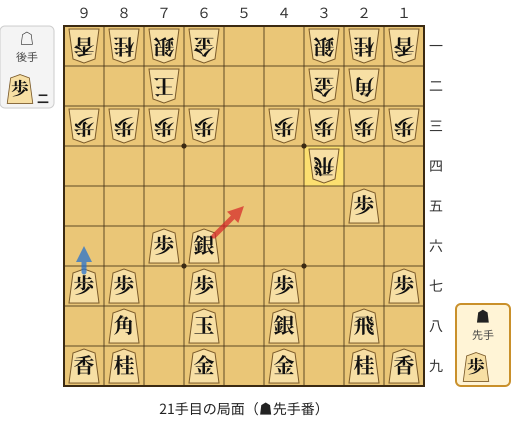

🔴 実戦 ▲５五銀(66)　🔵 AI推奨 ▲９六歩(97)　🟨 直前の相手の指し手

<details><summary>テキストの盤面図（BOD・将棋ソフトに貼り付け可）</summary>

```text
後手の持駒：歩二
  ９ ８ ７ ６ ５ ４ ３ ２ １
+---------------------------+
|v香v桂v銀v金 ・ ・v銀v桂v香|一
| ・ ・v玉 ・ ・ ・v金v角 ・|二
|v歩v歩v歩v歩 ・v歩v歩v歩v歩|三
| ・ ・ ・ ・ ・ ・v飛 ・ ・|四
| ・ ・ ・ ・ ・ ・ ・ 歩 ・|五
| ・ ・ 歩 銀 ・ ・ ・ ・ ・|六
| 歩 歩 ・ 歩 ・ 歩 ・ ・ 歩|七
| ・ 角 ・ 玉 ・ 銀 ・ 飛 ・|八
| 香 桂 ・ 金 ・ 金 ・ 桂 香|九
+---------------------------+
先手の持駒：歩
手数＝20　△３四飛　まで
```

</details>

| | 指し手 | 評価値 | 読み筋 |
|---|---|--:|---|
| 実戦 | ▲５五銀(66) | +153 | △４二銀(31) ▲５七銀(48) △９四歩(93) ▲９六歩(97) △８二玉(72) ▲５六銀(57) |
| AI 1位 | ▲９六歩(97) | +337 | ▲９六歩(97) △９四歩(93) ▲５七銀(48) △８二玉(72) ▲４六銀(57) △１四歩(13) |
| AI 2位 | ▲３七銀(48) | +336 | ▲３七銀(48) △８二玉(72) ▲４六銀(37) △９四歩(93) ▲９六歩(97) △７二銀(71) |
| AI 3位 | ▲５七銀(48) | +318 | ▲５七銀(48) △９四歩(93) ▲９六歩(97) △８二玉(72) ▲４六銀(57) △７二銀(71) |

SFEN: `lnsg2snl/2k3gb1/pppp1pppp/6r2/7P1/2PS5/PP1P1P2P/1B1K1S1R1/LN1G1G1NL b P2p 21`

<a id="ply-27"></a>
### 27手目 ▲同角(88) — 悪手

| | 着手前 | 着手後 | 差 |
|---|--:|--:|--:|
| 期待勝率 | 83.4% | 67.6% | -15.8pt |
| 評価値 | +968 | +440 | |

着手前の局面:

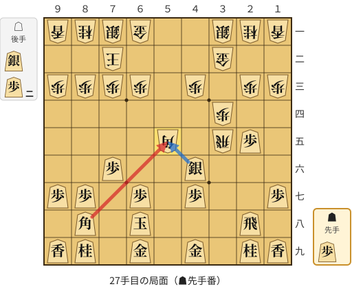

🔴 実戦 ▲同角(88)　🔵 AI推奨 ▲同銀(46)　🟨 直前の相手の指し手

<details><summary>テキストの盤面図（BOD・将棋ソフトに貼り付け可）</summary>

```text
後手の持駒：銀　歩二
  ９ ８ ７ ６ ５ ４ ３ ２ １
+---------------------------+
|v香v桂v銀v金 ・ ・v銀v桂v香|一
| ・ ・v玉 ・ ・ ・v金 ・ ・|二
|v歩v歩v歩v歩 ・v歩 ・v歩v歩|三
| ・ ・ ・ ・ ・ ・v歩 ・ ・|四
| ・ ・ ・ ・v角 ・v飛 歩 ・|五
| ・ ・ 歩 ・ ・ 銀 ・ ・ ・|六
| 歩 歩 ・ 歩 ・ 歩 ・ ・ 歩|七
| ・ 角 ・ 玉 ・ ・ ・ 飛 ・|八
| 香 桂 ・ 金 ・ 金 ・ 桂 香|九
+---------------------------+
先手の持駒：歩
手数＝26　△５五角　まで
```

</details>

| | 指し手 | 評価値 | 読み筋 |
|---|---|--:|---|
| 実戦 | ▲同角(88) | +440 | △同飛(35) ▲同銀(46) △８八銀打 ▲７七桂(89) △６二銀(71) ▲７八金(69) |
| AI 1位 | ▲同銀(46) | +968 | ▲同銀(46) △３三桂(21) ▲７八玉(68) △６二銀(71) ▲４六銀(55) △８五飛(35) |
| AI 2位 | ▲同角(88) | +466 | ▲同角(88) △同飛(35) ▲同銀(46) △８八銀打 ▲７七桂(89) △６二銀(71) |
| AI 3位 | ▲７七角(88) | -1373 | ▲７七角(88) △同角成(55) ▲同桂(89) △５六歩打 ▲３五銀(46) △同歩(34) |

SFEN: `lnsg2snl/2k3g2/pppp1p1pp/6p2/4b1rP1/2P2S3/PP1P1P2P/1B1K3R1/LN1G1G1NL b Ps2p 27`

<a id="ply-39"></a>
### 39手目 ▲５八歩打 — 大悪手

| | 着手前 | 着手後 | 差 |
|---|--:|--:|--:|
| 期待勝率 | 88.2% | 58.5% | -29.7pt |
| 評価値 | +1206 | +205 | |

着手前の局面:

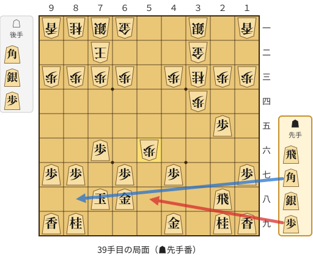

🔴 実戦 ▲５八歩打　🔵 AI推奨 ▲８八角打　🟨 直前の相手の指し手

<details><summary>テキストの盤面図（BOD・将棋ソフトに貼り付け可）</summary>

```text
後手の持駒：角　銀　歩
  ９ ８ ７ ６ ５ ４ ３ ２ １
+---------------------------+
|v香v桂v銀v金 ・ ・v銀 ・v香|一
| ・ ・v玉 ・ ・ ・v金 ・ ・|二
|v歩v歩v歩v歩 ・v歩v桂v歩v歩|三
| ・ ・ ・ ・ ・ ・v歩 ・ ・|四
| ・ ・ ・ ・ ・ ・ ・ 歩 ・|五
| ・ ・ 歩 ・v歩 ・ ・ ・ ・|六
| 歩 歩 ・ 歩 ・ 歩 ・ ・ 歩|七
| ・ ・ 玉 金 ・ ・ ・ 飛 ・|八
| 香 桂 ・ ・ ・ 金 ・ 桂 香|九
+---------------------------+
先手の持駒：飛　角　銀　歩
手数＝38　△５六歩　まで
```

</details>

| | 指し手 | 評価値 | 読み筋 |
|---|---|--:|---|
| 実戦 | ▲５八歩打 | +205 | △５五角打 ▲４六歩(47) △９九角成(55) ▲８八銀打 △９八馬(99) ▲２一飛打 |
| AI 1位 | ▲８八角打 | +1206 | ▲８八角打 △７四歩(73) ▲４六銀打 △６二銀(71) ▲５八歩打 △９四歩(93) |
| AI 2位 | ▲７七角打 | +1205 | ▲７七角打 △８二角打 ▲５五角(77) △４五桂(33) ▲５八歩打 △７四歩(73) |
| AI 3位 | ▲５五角打 | +1118 | ▲５五角打 △５七角打 ▲４六銀打 △８四角成(57) ▲５八歩打 △２二銀(31) |

SFEN: `lnsg2s1l/2k3g2/pppp1pnpp/6p2/7P1/2P1p4/PP1P1P2P/2KG3R1/LN3G1NL b RBSPbsp 39`

<a id="ply-41"></a>
### 41手目 ▲４六角打 — 疑問手

| | 着手前 | 着手後 | 差 |
|---|--:|--:|--:|
| 期待勝率 | 57.7% | 50.9% | -6.8pt |
| 評価値 | +186 | +21 | |

着手前の局面:

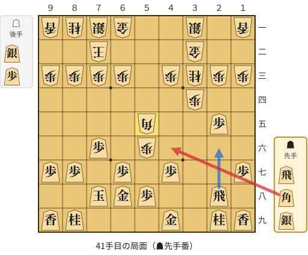

🔴 実戦 ▲４六角打　🔵 AI推奨 ▲２六飛(28)　🟨 直前の相手の指し手

<details><summary>テキストの盤面図（BOD・将棋ソフトに貼り付け可）</summary>

```text
後手の持駒：銀　歩
  ９ ８ ７ ６ ５ ４ ３ ２ １
+---------------------------+
|v香v桂v銀v金 ・ ・v銀 ・v香|一
| ・ ・v玉 ・ ・ ・v金 ・ ・|二
|v歩v歩v歩v歩 ・v歩v桂v歩v歩|三
| ・ ・ ・ ・ ・ ・v歩 ・ ・|四
| ・ ・ ・ ・v角 ・ ・ 歩 ・|五
| ・ ・ 歩 ・v歩 ・ ・ ・ ・|六
| 歩 歩 ・ 歩 ・ 歩 ・ ・ 歩|七
| ・ ・ 玉 金 歩 ・ ・ 飛 ・|八
| 香 桂 ・ ・ ・ 金 ・ 桂 香|九
+---------------------------+
先手の持駒：飛　角　銀
手数＝40　△５五角　まで
```

</details>

| | 指し手 | 評価値 | 読み筋 |
|---|---|--:|---|
| 実戦 | ▲４六角打 | +21 | △９九角成(55) ▲８八銀打 △９八馬(99) ▲５五角(46) △７四香打 ▲２四歩(25) |
| AI 1位 | ▲２六飛(28) | +186 | ▲２六飛(28) △９九角成(55) ▲８八銀打 △９八馬(99) ▲５六飛(26) △５二香打 |
| AI 2位 | ▲４六歩(47) | +140 | ▲４六歩(47) △９九角成(55) ▲８八銀打 △９八馬(99) ▲２一飛打 △８四香打 |
| AI 3位 | ▲４六歩(47) | +140 | ▲４六歩(47) △９九角成(55) ▲８八銀打 △９八馬(99) ▲５三角打 △８四香打 |

SFEN: `lnsg2s1l/2k3g2/pppp1pnpp/6p2/4b2P1/2P1p4/PP1P1P2P/2KGP2R1/LN3G1NL b RBSsp 41`

<a id="ply-45"></a>
### 45手目 ▲２四歩(25) — 疑問手

| | 着手前 | 着手後 | 差 |
|---|--:|--:|--:|
| 期待勝率 | 48.2% | 42.7% | -5.5pt |
| 評価値 | -43 | -176 | |

着手前の局面:

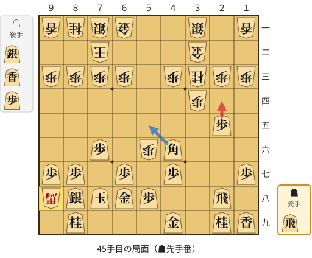

🔴 実戦 ▲２四歩(25)　🔵 AI推奨 ▲５五角(46)　🟨 直前の相手の指し手

<details><summary>テキストの盤面図（BOD・将棋ソフトに貼り付け可）</summary>

```text
後手の持駒：銀　香　歩
  ９ ８ ７ ６ ５ ４ ３ ２ １
+---------------------------+
|v香v桂v銀v金 ・ ・v銀 ・v香|一
| ・ ・v玉 ・ ・ ・v金 ・ ・|二
|v歩v歩v歩v歩 ・v歩v桂v歩v歩|三
| ・ ・ ・ ・ ・ ・v歩 ・ ・|四
| ・ ・ ・ ・ ・ ・ ・ 歩 ・|五
| ・ ・ 歩 ・v歩 角 ・ ・ ・|六
| 歩 歩 ・ 歩 ・ 歩 ・ ・ 歩|七
|v馬 銀 玉 金 歩 ・ ・ 飛 ・|八
| ・ 桂 ・ ・ ・ 金 ・ 桂 香|九
+---------------------------+
先手の持駒：飛
手数＝44　△９八馬　まで
```

</details>

| | 指し手 | 評価値 | 読み筋 |
|---|---|--:|---|
| 実戦 | ▲２四歩(25) | -176 | △同歩(23) ▲５五角(46) △２五香打 ▲３八飛(28) △２九香成(25) ▲９九銀(88) |
| AI 1位 | ▲５五角(46) | -43 | ▲５五角(46) △７四香打 ▲７七桂(89) △７六香(74) ▲２四歩(25) △同歩(23) |
| AI 2位 | ▲２四歩(25) | -190 | ▲２四歩(25) △同歩(23) ▲５五角(46) △２五香打 ▲３八飛(28) △２九香成(25) |
| AI 3位 | ▲５九金(49) | -330 | ▲５九金(49) △５一香打 ▲２四歩(25) △同歩(23) ▲同角(46) △６二銀(71) |

SFEN: `lnsg2s1l/2k3g2/pppp1pnpp/6p2/7P1/2P1pB3/PP1P1P2P/+bSKGP2R1/1N3G1NL b Rslp 45`

<a id="ply-47"></a>
### 47手目 ▲３七桂(29) — 悪手

| | 着手前 | 着手後 | 差 |
|---|--:|--:|--:|
| 期待勝率 | 42.0% | 25.7% | -16.3pt |
| 評価値 | -193 | -636 | |

着手前の局面:

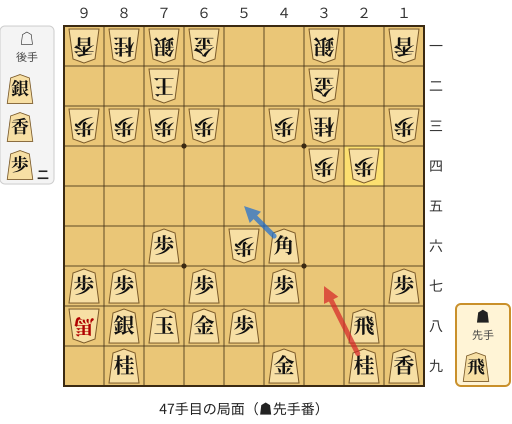

🔴 実戦 ▲３七桂(29)　🔵 AI推奨 ▲５五角(46)　🟨 直前の相手の指し手

<details><summary>テキストの盤面図（BOD・将棋ソフトに貼り付け可）</summary>

```text
後手の持駒：銀　香　歩二
  ９ ８ ７ ６ ５ ４ ３ ２ １
+---------------------------+
|v香v桂v銀v金 ・ ・v銀 ・v香|一
| ・ ・v玉 ・ ・ ・v金 ・ ・|二
|v歩v歩v歩v歩 ・v歩v桂 ・v歩|三
| ・ ・ ・ ・ ・ ・v歩v歩 ・|四
| ・ ・ ・ ・ ・ ・ ・ ・ ・|五
| ・ ・ 歩 ・v歩 角 ・ ・ ・|六
| 歩 歩 ・ 歩 ・ 歩 ・ ・ 歩|七
|v馬 銀 玉 金 歩 ・ ・ 飛 ・|八
| ・ 桂 ・ ・ ・ 金 ・ 桂 香|九
+---------------------------+
先手の持駒：飛
手数＝46　△２四同歩　まで
```

</details>

| | 指し手 | 評価値 | 読み筋 |
|---|---|--:|---|
| 実戦 | ▲３七桂(29) | -636 | △３五銀打 ▲５五角(46) △２六香打 ▲４八飛(28) △２七香成(26) ▲３八金(49) |
| AI 1位 | ▲５五角(46) | -193 | ▲５五角(46) △２五香打 ▲３八飛(28) △２九香成(25) ▲９九銀(88) △同馬(98) |
| AI 2位 | ▲３七桂(29) | -337 | ▲３七桂(29) △５一香打 ▲２四飛(28) △３五銀打 ▲２一飛成(24) △４六銀(35) |
| AI 3位 | ▲３七桂(29) | -454 | ▲３七桂(29) △３五銀打 ▲５五角(46) △２六香打 ▲４八飛(28) △２七香成(26) |

SFEN: `lnsg2s1l/2k3g2/pppp1pn1p/6pp1/9/2P1pB3/PP1P1P2P/+bSKGP2R1/1N3G1NL b Rsl2p 47`

<a id="ply-49"></a>
### 49手目 ▲２四角(46) — 大悪手

| | 着手前 | 着手後 | 差 |
|---|--:|--:|--:|
| 期待勝率 | 44.6% | 11.2% | -33.3pt |
| 評価値 | -131 | -1240 | |

着手前の局面:

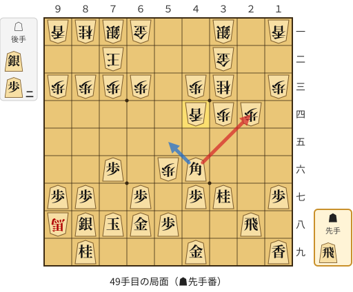

🔴 実戦 ▲２四角(46)　🔵 AI推奨 ▲５五角(46)　🟨 直前の相手の指し手

<details><summary>テキストの盤面図（BOD・将棋ソフトに貼り付け可）</summary>

```text
後手の持駒：銀　歩二
  ９ ８ ７ ６ ５ ４ ３ ２ １
+---------------------------+
|v香v桂v銀v金 ・ ・v銀 ・v香|一
| ・ ・v玉 ・ ・ ・v金 ・ ・|二
|v歩v歩v歩v歩 ・v歩v桂 ・v歩|三
| ・ ・ ・ ・ ・v香v歩v歩 ・|四
| ・ ・ ・ ・ ・ ・ ・ ・ ・|五
| ・ ・ 歩 ・v歩 角 ・ ・ ・|六
| 歩 歩 ・ 歩 ・ 歩 桂 ・ 歩|七
|v馬 銀 玉 金 歩 ・ ・ 飛 ・|八
| ・ 桂 ・ ・ ・ 金 ・ ・ 香|九
+---------------------------+
先手の持駒：飛
手数＝48　△４四香　まで
```

</details>

| | 指し手 | 評価値 | 読み筋 |
|---|---|--:|---|
| 実戦 | ▲２四角(46) | -1240 | △４七香成(44) ▲３八歩打 △２三歩打 ▲１五角(24) △６二銀(71) ▲２一飛打 |
| AI 1位 | ▲５五角(46) | -131 | ▲５五角(46) △４七香成(44) ▲９九銀(88) △４六銀打 ▲３三角成(55) △同金(32) |
| AI 2位 | ▲２四角(46) | -1177 | ▲２四角(46) △４七香成(44) ▲１五角(24) △１四歩(13) ▲２六角(15) △２五歩打 |
| AI 3位 | ▲４五桂(37) | -1505 | ▲４五桂(37) △同桂(33) ▲５五角(46) △６四銀打 ▲７七角(55) △５七歩成(56) |

SFEN: `lnsg2s1l/2k3g2/pppp1pn1p/5lpp1/9/2P1pB3/PP1P1PN1P/+bSKGP2R1/1N3G2L b Rs2p 49`

<a id="ply-51"></a>
### 51手目 ▲３三角成(24) — 疑問手

| | 着手前 | 着手後 | 差 |
|---|--:|--:|--:|
| 期待勝率 | 11.8% | 2.4% | -9.3pt |
| 評価値 | -1208 | -2214 | |

着手前の局面:

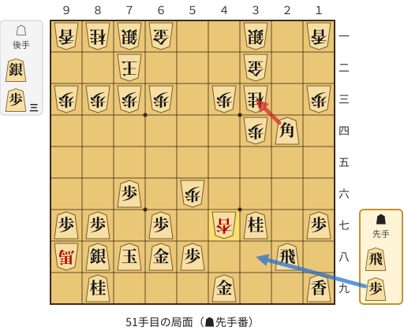

🔴 実戦 ▲３三角成(24)　🔵 AI推奨 ▲３八歩打　🟨 直前の相手の指し手

<details><summary>テキストの盤面図（BOD・将棋ソフトに貼り付け可）</summary>

```text
後手の持駒：銀　歩三
  ９ ８ ７ ６ ５ ４ ３ ２ １
+---------------------------+
|v香v桂v銀v金 ・ ・v銀 ・v香|一
| ・ ・v玉 ・ ・ ・v金 ・ ・|二
|v歩v歩v歩v歩 ・v歩v桂 ・v歩|三
| ・ ・ ・ ・ ・ ・v歩 角 ・|四
| ・ ・ ・ ・ ・ ・ ・ ・ ・|五
| ・ ・ 歩 ・v歩 ・ ・ ・ ・|六
| 歩 歩 ・ 歩 ・v杏 桂 ・ 歩|七
|v馬 銀 玉 金 歩 ・ ・ 飛 ・|八
| ・ 桂 ・ ・ ・ 金 ・ ・ 香|九
+---------------------------+
先手の持駒：飛　歩
手数＝50　△４七香成　まで
```

</details>

| | 指し手 | 評価値 | 読み筋 |
|---|---|--:|---|
| 実戦 | ▲３三角成(24) | -2214 | △同金(32) ▲２一飛成(28) △３二金(33) ▲４五飛打 △３三角打 ▲６六桂打 |
| AI 1位 | ▲３八歩打 | -1208 | ▲３八歩打 △２三歩打 ▲１五角(24) △１四歩(13) ▲２六角(15) △３五銀打 |
| AI 2位 | ▲１五角(24) | -1421 | ▲１五角(24) △１四歩(13) ▲２六角(15) △２五歩打 ▲同桂(37) △４五桂(33) |
| AI 3位 | ▲５九金(49) | -1342 | ▲５九金(49) △３七成香(47) ▲２六飛(28) △４七成香(37) ▲５六飛(26) △６四桂打 |

SFEN: `lnsg2s1l/2k3g2/pppp1pn1p/6pB1/9/2P1p4/PP1P1+lN1P/+bSKGP2R1/1N3G2L b RPs3p 51`

<a id="ply-57"></a>
### 57手目 ▲２四桂打 — 悪手

| | 着手前 | 着手後 | 差 |
|---|--:|--:|--:|
| 期待勝率 | 16.2% | 3.7% | -12.6pt |
| 評価値 | -984 | -1957 | |

着手前の局面:

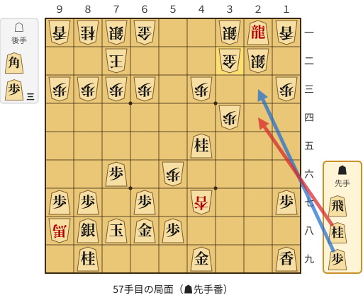

🔴 実戦 ▲２四桂打　🔵 AI推奨 ▲２三歩打　🟨 直前の相手の指し手

<details><summary>テキストの盤面図（BOD・将棋ソフトに貼り付け可）</summary>

```text
後手の持駒：角　歩三
  ９ ８ ７ ６ ５ ４ ３ ２ １
+---------------------------+
|v香v桂v銀v金 ・ ・v銀 龍v香|一
| ・ ・v玉 ・ ・ ・v金v銀 ・|二
|v歩v歩v歩v歩 ・v歩 ・ ・v歩|三
| ・ ・ ・ ・ ・ ・v歩 ・ ・|四
| ・ ・ ・ ・ ・ 桂 ・ ・ ・|五
| ・ ・ 歩 ・v歩 ・ ・ ・ ・|六
| 歩 歩 ・ 歩 ・v杏 ・ ・ 歩|七
|v馬 銀 玉 金 歩 ・ ・ ・ ・|八
| ・ 桂 ・ ・ ・ 金 ・ ・ 香|九
+---------------------------+
先手の持駒：飛　桂　歩
手数＝56　△３二金　まで
```

</details>

| | 指し手 | 評価値 | 読み筋 |
|---|---|--:|---|
| 実戦 | ▲２四桂打 | -1957 | △４六角打 ▲５九金(49) △２四角(46) ▲２七飛打 △６八角成(24) ▲同金(59) |
| AI 1位 | ▲２三歩打 | -984 | ▲２三歩打 △同銀(22) ▲５三飛打 △２七角打 ▲５六飛成(53) △４九角成(27) |
| AI 2位 | ▲２三歩打 | -936 | ▲２三歩打 △同銀(22) ▲５三飛打 △４六角打 ▲５九金(49) △１九角成(46) |
| AI 3位 | ▲２七飛打 | -931 | ▲２七飛打 △４四角打 ▲６六桂打 △４六成香(47) ▲３三歩打 △２六歩打 |

SFEN: `lnsg2s+Rl/2k3gs1/pppp1p2p/6p2/5N3/2P1p4/PP1P1+l2P/+bSKGP4/1N3G2L b RNPb3p 57`

<a id="ply-81"></a>
### 81手目 ▲６八銀(57) — 大悪手

| | 着手前 | 着手後 | 差 |
|---|--:|--:|--:|
| 期待勝率 | 98.1% | 72.3% | -25.8pt |
| 評価値 | +2371 | +577 | |

着手前の局面:

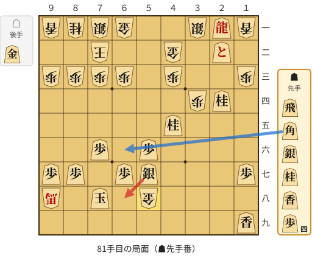

🔴 実戦 ▲６八銀(57)　🔵 AI推奨 ▲６六角打　🟨 直前の相手の指し手

<details><summary>テキストの盤面図（BOD・将棋ソフトに貼り付け可）</summary>

```text
後手の持駒：金
  ９ ８ ７ ６ ５ ４ ３ ２ １
+---------------------------+
|v香v桂v銀v金 ・ ・v銀 龍v香|一
| ・ ・v玉 ・ ・v金 ・ と ・|二
|v歩v歩v歩v歩 ・v歩 ・ ・v歩|三
| ・ ・ ・ ・ ・ ・v歩 桂 ・|四
| ・ ・ ・ ・ ・ 桂 ・ ・ ・|五
| ・ ・ 歩 ・ 歩 ・ ・ ・ ・|六
| 歩 歩 ・ 歩 銀 ・ ・ ・ 歩|七
|v馬 ・ 玉 ・v金 ・ ・ ・ ・|八
| ・ ・ ・ ・ ・ ・ ・ ・ 香|九
+---------------------------+
先手の持駒：飛　角　銀　桂　香　歩四
手数＝80　△５八金　まで
```

</details>

| | 指し手 | 評価値 | 読み筋 |
|---|---|--:|---|
| 実戦 | ▲６八銀(57) | +577 | △８八金打 ▲７七玉(78) △８七金(88) ▲６六玉(77) △９九馬(98) ▲７七香打 |
| AI 1位 | ▲６六角打 | +2371 | ▲６六角打 △２二銀(31) ▲同龍(21) △８八金打 ▲同角(66) △同馬(98) |
| AI 2位 | ▲３一龍(21) | +2055 | ▲３一龍(21) △８八金打 ▲７七玉(78) △８七金(88) ▲６六玉(77) △９九馬(98) |
| AI 3位 | ▲４六銀(57) | +1654 | ▲４六銀(57) △６二銀(71) ▲８五飛打 △７四金打 ▲８六飛(85) △９七馬(98) |

SFEN: `lnsg2s+Rl/2k2g1+P1/pppp1p2p/6pN1/5N3/2P1P4/PP1PS3P/+b1K1g4/8L b RBSNL4Pg 81`

<a id="ply-85"></a>
### 85手目 ▲５五香打 — 詰み逃し

| | 着手前 | 着手後 | 差 |
|---|--:|--:|--:|
| 期待勝率 | 100.0% | 99.5% | -0.5pt |
| 評価値 | 17手詰め | +3233 | |

着手前の局面:

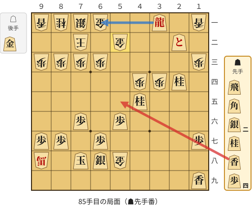

🔴 実戦 ▲５五香打　🔵 AI推奨 ▲６一龍(31)　🟨 直前の相手の指し手

<details><summary>テキストの盤面図（BOD・将棋ソフトに貼り付け可）</summary>

```text
後手の持駒：金
  ９ ８ ７ ６ ５ ４ ３ ２ １
+---------------------------+
|v香v桂v銀v金 ・ ・ 龍 ・v香|一
| ・ ・v玉 ・v金 ・ ・ と ・|二
|v歩v歩v歩v歩 ・ ・ ・ ・v歩|三
| ・ ・ ・ ・ ・v歩v歩 桂 ・|四
| ・ ・ ・ ・ ・ 桂 ・ ・ ・|五
| ・ ・ 歩 ・ 歩 ・ ・ ・ ・|六
| 歩 歩 ・ 歩 ・ ・ ・ ・ 歩|七
|v馬 ・ 玉 銀v金 ・ ・ ・ ・|八
| ・ ・ ・ ・ ・ ・ ・ ・ 香|九
+---------------------------+
先手の持駒：飛　角　銀二　桂　香　歩四
手数＝84　△５二金寄　まで
```

</details>

| | 指し手 | 評価値 | 読み筋 |
|---|---|--:|---|
| 実戦 | ▲５五香打 | +3233 | △５一金打 ▲７五桂打 |
| AI 1位 | ▲６一龍(31) | 17手詰め | ▲６一龍(31) △同玉(72) ▲５三桂打 △同金(52) ▲同桂不成(45) △６二玉(61) |
| AI 2位 | ▲８五香打 | +3678 | ▲８五香打 △８八金打 ▲７七玉(78) △８七馬(98) ▲６六玉(77) △４五歩(44) |
| AI 3位 | ▲７五桂打 | +3354 | ▲７五桂打 △６八金(58) ▲同玉(78) △９七馬(98) ▲３二飛打 △７五馬(97) |

SFEN: `lnsg2+R1l/2k1g2+P1/pppp4p/5ppN1/5N3/2P1P4/PP1P4P/+b1KSg4/8L b RB2SNL4Pg 85`

<a id="ply-97"></a>
### 97手目 ▲５三香成(55) — 詰み逃し

| | 着手前 | 着手後 | 差 |
|---|--:|--:|--:|
| 期待勝率 | 100.0% | 100.0% | -0.0pt |
| 評価値 | 13手詰め | +5700 | |

着手前の局面:

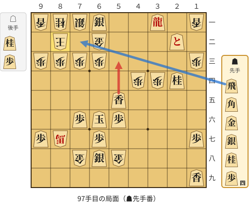

🔴 実戦 ▲５三香成(55)　🔵 AI推奨 ▲７二飛打　🟨 直前の相手の指し手

<details><summary>テキストの盤面図（BOD・将棋ソフトに貼り付け可）</summary>

```text
後手の持駒：桂　歩
  ９ ８ ７ ６ ５ ４ ３ ２ １
+---------------------------+
|v香v桂v銀 銀 ・ ・ 龍 ・v香|一
| ・v玉 ・v金 ・ ・ ・ と ・|二
|v歩v歩v歩v歩 ・ ・ ・ ・v歩|三
| ・ ・ ・ ・ ・v歩v歩 桂 ・|四
| ・ ・ ・ ・ 香 ・ ・ ・ ・|五
| ・ ・ 歩 玉 歩 ・ ・ ・ ・|六
| 歩v馬 ・ 歩 ・ ・ ・ ・ 歩|七
| ・ ・v金 銀v金 ・ ・ ・ ・|八
| ・ ・ ・ ・ ・ ・ ・ ・ 香|九
+---------------------------+
先手の持駒：飛　角　金　銀　桂　歩四
手数＝96　△８二玉　まで
```

</details>

| | 指し手 | 評価値 | 読み筋 |
|---|---|--:|---|
| 実戦 | ▲５三香成(55) | +5700 | △９四歩(93) ▲６二成香(53) △７四桂打 ▲５五玉(66) △７六馬(87) ▲８四歩打 |
| AI 1位 | ▲７二飛打 | 13手詰め | ▲７二飛打 △同銀(71) ▲７一銀打 △同玉(82) ▲７二銀成(61) △同玉(71) |
| AI 2位 | ▲３二飛打 | +5652 | ▲３二飛打 △５二歩打 ▲同香成(55) △７七金(78) ▲５五玉(66) △７六馬(87) |
| AI 3位 | ▲４二飛打 | +5560 | ▲４二飛打 △５二歩打 ▲同香成(55) △６八金(58) ▲５五玉(66) △７七馬(87) |

SFEN: `lnsS2+R1l/1k1g3+P1/pppp4p/5ppN1/4L4/2PKP4/P+b1P4P/2gSg4/8L b RBGSN4Pnp 97`

<a id="ply-99"></a>
### 99手目 ▲７二金打 — 詰み逃し

| | 着手前 | 着手後 | 差 |
|---|--:|--:|--:|
| 期待勝率 | 100.0% | 100.0% | -0.0pt |
| 評価値 | 11手詰め | +5923 | |

着手前の局面:

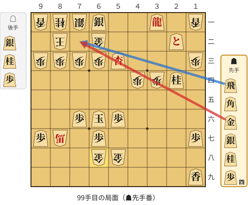

🔴 実戦 ▲７二金打　🔵 AI推奨 ▲７二飛打　🟨 直前の相手の指し手

<details><summary>テキストの盤面図（BOD・将棋ソフトに貼り付け可）</summary>

```text
後手の持駒：銀　桂　歩
  ９ ８ ７ ６ ５ ４ ３ ２ １
+---------------------------+
|v香v桂v銀 銀 ・ ・ 龍 ・v香|一
| ・v玉 ・v金 ・ ・ ・ と ・|二
|v歩v歩v歩v歩 杏 ・ ・ ・v歩|三
| ・ ・ ・ ・ ・v歩v歩 桂 ・|四
| ・ ・ ・ ・ ・ ・ ・ ・ ・|五
| ・ ・ 歩 玉 歩 ・ ・ ・ ・|六
| 歩v馬 ・ 歩 ・ ・ ・ ・ 歩|七
| ・ ・ ・v金v金 ・ ・ ・ ・|八
| ・ ・ ・ ・ ・ ・ ・ ・ 香|九
+---------------------------+
先手の持駒：飛　角　金　銀　桂　歩四
手数＝98　△６八金右　まで
```

</details>

| | 指し手 | 評価値 | 読み筋 |
|---|---|--:|---|
| 実戦 | ▲７二金打 | +5923 | △９二玉(82) ▲６二成香(53) △７四桂打 ▲５五玉(66) △７七馬(87) ▲５四玉(55) |
| AI 1位 | ▲７二飛打 | 11手詰め | ▲７二飛打 △同銀(71) ▲７一銀打 △同玉(82) ▲６二成香(53) △同玉(71) |
| AI 2位 | ▲６二成香(53) | +5934 | ▲６二成香(53) △７五銀打 ▲５五玉(66) △９四歩(93) ▲４四玉(55) △７六馬(87) |
| AI 3位 | ▲７二金打 | +4168 | ▲７二金打 △９二玉(82) ▲６二成香(53) △８二銀打 ▲５五玉(66) △７二銀(71) |

SFEN: `lnsS2+R1l/1k1g3+P1/pppp+L3p/5ppN1/9/2PKP4/P+b1P4P/3gg4/8L b RBGSN4Psnp 99`

<a id="ply-101"></a>
### 101手目 ▲６二成香(53) — 詰み逃し

| | 着手前 | 着手後 | 差 |
|---|--:|--:|--:|
| 期待勝率 | 100.0% | 100.0% | -0.0pt |
| 評価値 | 7手詰め | +5138 | |

着手前の局面:

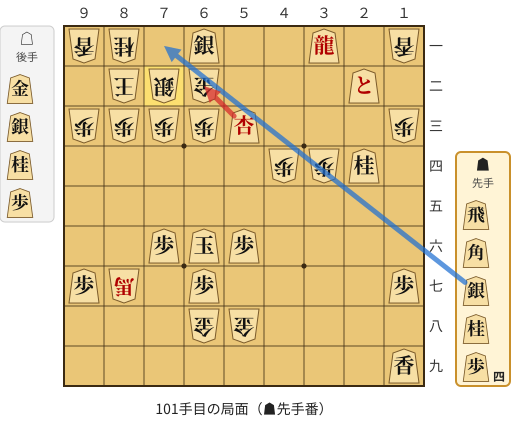

🔴 実戦 ▲６二成香(53)　🔵 AI推奨 ▲７一銀打　🟨 直前の相手の指し手

<details><summary>テキストの盤面図（BOD・将棋ソフトに貼り付け可）</summary>

```text
後手の持駒：金　銀　桂　歩
  ９ ８ ７ ６ ５ ４ ３ ２ １
+---------------------------+
|v香v桂 ・ 銀 ・ ・ 龍 ・v香|一
| ・v玉v銀v金 ・ ・ ・ と ・|二
|v歩v歩v歩v歩 杏 ・ ・ ・v歩|三
| ・ ・ ・ ・ ・v歩v歩 桂 ・|四
| ・ ・ ・ ・ ・ ・ ・ ・ ・|五
| ・ ・ 歩 玉 歩 ・ ・ ・ ・|六
| 歩v馬 ・ 歩 ・ ・ ・ ・ 歩|七
| ・ ・ ・v金v金 ・ ・ ・ ・|八
| ・ ・ ・ ・ ・ ・ ・ ・ 香|九
+---------------------------+
先手の持駒：飛　角　銀　桂　歩四
手数＝100　△７二同銀　まで
```

</details>

| | 指し手 | 評価値 | 読み筋 |
|---|---|--:|---|
| 実戦 | ▲６二成香(53) | +5138 | △８八馬(87) ▲７七桂打 |
| AI 1位 | ▲７一銀打 | 7手詰め | ▲７一銀打 △同玉(82) ▲７二銀成(61) △同玉(71) ▲７一飛打 △８二玉(72) |
| AI 2位 | ▲７一角打 | 7手詰め | ▲７一角打 △同玉(82) ▲６二成香(53) △同玉(71) ▲５二飛打 △７一玉(62) |
| AI 3位 | ▲同銀成(61) | 11手詰め | ▲同銀成(61) △同金(62) ▲７一角打 △９二玉(82) ▲８二飛打 △同金(72) |

SFEN: `ln1S2+R1l/1ksg3+P1/pppp+L3p/5ppN1/9/2PKP4/P+b1P4P/3gg4/8L b RBSN4Pgsnp 101`

<a id="ply-103"></a>
### 103手目 ▲同玉(66) — 大悪手

| | 着手前 | 着手後 | 差 |
|---|--:|--:|--:|
| 期待勝率 | 100.0% | 0.0% | -100.0pt |
| 評価値 | +6398 | 3手で詰まされる | |

着手前の局面:

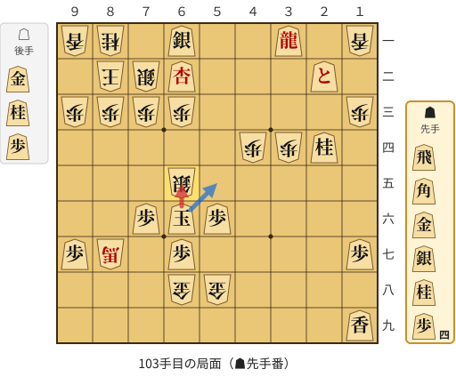

🔴 実戦 ▲同玉(66)　🔵 AI推奨 ▲５五玉(66)　🟨 直前の相手の指し手

<details><summary>テキストの盤面図（BOD・将棋ソフトに貼り付け可）</summary>

```text
後手の持駒：金　桂　歩
  ９ ８ ７ ６ ５ ４ ３ ２ １
+---------------------------+
|v香v桂 ・ 銀 ・ ・ 龍 ・v香|一
| ・v玉v銀 杏 ・ ・ ・ と ・|二
|v歩v歩v歩v歩 ・ ・ ・ ・v歩|三
| ・ ・ ・ ・ ・v歩v歩 桂 ・|四
| ・ ・ ・v銀 ・ ・ ・ ・ ・|五
| ・ ・ 歩 玉 歩 ・ ・ ・ ・|六
| 歩v馬 ・ 歩 ・ ・ ・ ・ 歩|七
| ・ ・ ・v金v金 ・ ・ ・ ・|八
| ・ ・ ・ ・ ・ ・ ・ ・ 香|九
+---------------------------+
先手の持駒：飛　角　金　銀　桂　歩四
手数＝102　△６五銀　まで
```

</details>

| | 指し手 | 評価値 | 読み筋 |
|---|---|--:|---|
| 実戦 | ▲同玉(66) | 3手で詰まされる | △６四金打 ▲６六玉(65) △５四桂打 |
| AI 1位 | ▲５五玉(66) | +6398 | ▲５五玉(66) △７七馬(87) ▲６六桂打 △同銀(65) ▲４四玉(55) △３二桂打 |
| AI 2位 | ▲同玉(66) | 4手で詰まされる | ▲同玉(66) △６四金打 ▲６六玉(65) △５四桂打 |
| AI 3位 | ▲７五玉(66) | 2手で詰まされる | ▲７五玉(66) △７四金打 |

SFEN: `ln1S2+R1l/1ks+L3+P1/pppp4p/5ppN1/3s5/2PKP4/P+b1P4P/3gg4/8L b RBGSN4Pgnp 103`

