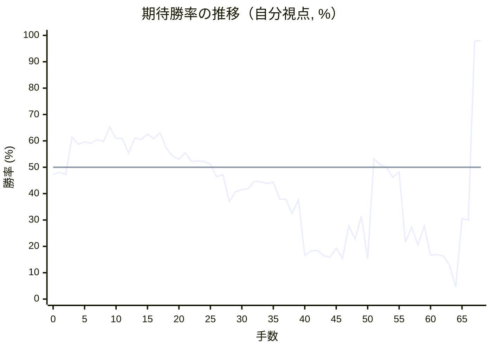

# 解析レポート 61jc90j12d6l

[README に戻る](../../../README.md)　/　棋譜: [CSA](../../../data/csa/shogi10/61jc90j12d6l.csa)　/　解析の見方: [docs/mistake_analysis.md](../../../docs/mistake_analysis.md)

## 対局情報

| 項目 | 内容 |
|---|---|
| 日時 | 2026-09-12 14:37:03 |
| 持ち時間 | 10分 |
| 自分 | 後手（△）（1836） |
| 相手 | 相手（1679） |
| 結果 | 勝ち（投了, 68手） |

## 解析環境

| 項目 | 内容 |
|---|---|
| エンジン | YaneuraOu NNUE 9.00git 64AVX2（V9.00/YANEURAOU_ENGINE_NNUE/AVX2） |
| 評価関数 | **水匠5**（`suisho5`） |
| nn.bin SHA-256 | `768068f0d534a0603a5d38bcd143de6bbca820d5f1c95a14d40863e5b7892d76` |
| 第1パス | movetime=150ms, MultiPV 1 |
| 第2パス | movetime=2000ms, MultiPV 3 |
| Threads / Hash | 8 / 512MB |
| 判定基準 | 疑問手 ≥5pt, 悪手 ≥10pt, 大悪手 ≥20pt（期待勝率 W(E)=1/(1+exp(-E/600))） |
| 解析日時 | 2026-11-03T04:31:20+09:00（解析バージョン 1, 59秒） |

## サマリー

| 自分の手数 | 深掘りした手 | 詰み逃し | 大悪手 | 悪手 | 疑問手 |
|--:|--:|--:|--:|--:|--:|
| 34 | 12 | 0 | 2 | 1 | 6 |

## 期待勝率の推移



<details><summary>1手ごとの数値（第1パス）</summary>

| 手数 | 指し手 | 評価値 | 勝率 | 低下 | 判定 |
|--:|---|--:|--:|--:|---|
| 1 | ▲７六歩(77) | -46 | 48.1% |  |  |
| 2 | △８四歩(83) | -66 | 47.3% | +0.8pt |  |
| 3 | ▲６八飛(28) | +278 | 61.4% |  |  |
| 4 | △３四歩(33) | +212 | 58.7% | +2.6pt |  |
| 5 | ▲４八玉(59) | +234 | 59.6% |  |  |
| 6 | △８五歩(84) | +221 | 59.1% | +0.5pt |  |
| 7 | ▲２二角成(88) | +255 | 60.5% |  |  |
| 8 | △同銀(31) | +235 | 59.7% | +0.8pt |  |
| 9 | ▲７八金(69) | +376 | 65.2% |  |  |
| 10 | △３三銀(22) | +267 | 60.9% | +4.2pt |  |
| 11 | ▲３八玉(48) | +265 | 60.9% |  |  |
| 12 | △３二金(41) | +128 | 55.3% | +5.6pt | [疑問手](#ply-12) |
| 13 | ▲６九飛(68) | +270 | 61.1% |  |  |
| 14 | △６二銀(71) | +257 | 60.5% | +0.5pt |  |
| 15 | ▲６八銀(79) | +308 | 62.6% |  |  |
| 16 | △４二玉(51) | +264 | 60.8% | +1.7pt |  |
| 17 | ▲６六歩(67) | +323 | 63.1% |  |  |
| 18 | △８六歩(85) | +174 | 57.2% | +5.9pt | [疑問手](#ply-18) |
| 19 | ▲同歩(87) | +101 | 54.2% |  |  |
| 20 | △同飛(82) | +73 | 53.0% | +1.2pt |  |
| 21 | ▲８七歩打 | +132 | 55.5% |  |  |
| 22 | △８四飛(86) | +52 | 52.2% | +3.3pt |  |
| 23 | ▲６七銀(68) | +57 | 52.4% |  |  |
| 24 | △３一玉(42) | +54 | 52.2% | +0.1pt |  |
| 25 | ▲７七桂(89) | +28 | 51.2% |  |  |
| 26 | △６四歩(63) | -87 | 46.4% | +4.8pt |  |
| 27 | ▲８九飛(69) | -68 | 47.2% |  |  |
| 28 | △６三銀(62) | -317 | 37.1% | +10.1pt |  |
| 29 | ▲８六歩(87) | -225 | 40.7% |  |  |
| 30 | △８二飛(84) | -206 | 41.5% | -0.8pt |  |
| 31 | ▲８五歩(86) | -197 | 41.9% |  |  |
| 32 | △８三歩打 | -128 | 44.7% | -2.8pt |  |
| 33 | ▲２八玉(38) | -133 | 44.5% |  |  |
| 34 | △２二玉(31) | -150 | 43.8% | +0.7pt |  |
| 35 | ▲３八銀(39) | -136 | 44.4% |  |  |
| 36 | △１二香(11) | -293 | 38.0% | +6.3pt | [疑問手](#ply-36) |
| 37 | ▲１六歩(17) | -298 | 37.8% |  |  |
| 38 | △１一玉(22) | -438 | 32.5% | +5.3pt |  |
| 39 | ▲４一角打 | -301 | 37.7% |  |  |
| 40 | △５四角打 | -971 | 16.5% | +21.2pt | [悪手](#ply-40) |
| 41 | ▲３二角成(41) | -898 | 18.3% |  |  |
| 42 | △同飛(82) | -888 | 18.5% | -0.3pt |  |
| 43 | ▲８四歩(85) | -974 | 16.5% |  |  |
| 44 | △同歩(83) | -1002 | 15.8% | +0.6pt |  |
| 45 | ▲同飛(89) | -858 | 19.3% |  |  |
| 46 | △７一金(61) | -1024 | 15.4% | +4.0pt |  |
| 47 | ▲８三歩打 | -573 | 27.8% |  |  |
| 48 | △７四銀(63) | -734 | 22.7% | +5.1pt |  |
| 49 | ▲８二金打 | -465 | 31.5% |  |  |
| 50 | △６一金(71) | -1031 | 15.2% | +16.3pt | [大悪手](#ply-50) |
| 51 | ▲８一金(82) | +78 | 53.2% |  |  |
| 52 | △同角(54) | +24 | 51.0% | +2.2pt |  |
| 53 | ▲８二歩成(83) | +1 | 50.0% |  |  |
| 54 | △４五角(81) | -91 | 46.2% | +3.8pt |  |
| 55 | ▲９一と(82) | -46 | 48.1% |  |  |
| 56 | △６五歩(64) | -773 | 21.6% | +26.5pt | [大悪手](#ply-56) |
| 57 | ▲５六銀(67) | -588 | 27.3% |  |  |
| 58 | △同角(45) | -811 | 20.6% | +6.7pt | [疑問手](#ply-58) |
| 59 | ▲同歩(57) | -577 | 27.7% |  |  |
| 60 | △６六歩(65) | -966 | 16.7% | +11.0pt | [疑問手](#ply-60) |
| 61 | ▲８一飛成(84) | -954 | 16.9% |  |  |
| 62 | △７二銀打 | -976 | 16.4% | +0.5pt |  |
| 63 | ▲８八龍(81) | -1145 | 12.9% |  |  |
| 64 | △６七金打 | -1817 | 4.6% | +8.3pt | [疑問手](#ply-64) |
| 65 | ▲６四香打 | -492 | 30.6% |  |  |
| 66 | △５一金(61) | -512 | 29.9% | +0.7pt |  |
| 67 | ▲８一龍(88) | +2282 | 97.8% |  |  |
| 68 | △同銀(72) | +2352 | 98.1% | -0.2pt |  |

</details>

## 課題局面

<a id="ply-12"></a>
### 12手目 △３二金(41) — 疑問手

| | 着手前 | 着手後 | 差 |
|---|--:|--:|--:|
| 期待勝率 | 61.3% | 54.1% | -7.3pt |
| 評価値 | +277 | +98 | |

着手前の局面:

```text
後手の持駒：角
  ９ ８ ７ ６ ５ ４ ３ ２ １
+---------------------------+
|v香v桂v銀v金v玉v金 ・v桂v香|一
| ・v飛 ・ ・ ・ ・ ・ ・ ・|二
|v歩 ・v歩v歩v歩v歩v銀v歩v歩|三
| ・ ・ ・ ・ ・ ・v歩 ・ ・|四
| ・v歩 ・ ・ ・ ・ ・ ・ ・|五
| ・ ・ 歩 ・ ・ ・ ・ ・ ・|六
| 歩 歩 ・ 歩 歩 歩 歩 歩 歩|七
| ・ ・ 金 飛 ・ ・ 玉 ・ ・|八
| 香 桂 銀 ・ ・ 金 銀 桂 香|九
+---------------------------+
先手の持駒：角
後手番
手数＝11　▲３八玉　まで
```

| | 指し手 | 評価値 | 読み筋 |
|---|---|--:|---|
| 実戦 | △３二金(41) | +98 | ▲７七金(78) △７二銀(71) ▲８八飛(68) △４二玉(51) ▲８六歩(87) △同歩(85) |
| AI 1位 | △４二玉(51) | +277 | △４二玉(51) ▲７七金(78) △７二銀(71) ▲８八飛(68) △６四歩(63) ▲６八銀(79) |
| AI 2位 | △７四歩(73) | +273 | △７四歩(73) ▲７七金(78) △４二玉(51) ▲８八飛(68) △７二銀(71) ▲６八銀(79) |
| AI 3位 | △７二銀(71) | +230 | △７二銀(71) ▲１六歩(17) △１四歩(13) ▲６六歩(67) △７四歩(73) ▲７七桂(89) |

SFEN: `lnsgkg1nl/1r7/p1ppppspp/6p2/1p7/2P6/PP1PPPPPP/2GR2K2/LNS2GSNL w Bb 12`

<a id="ply-18"></a>
### 18手目 △８六歩(85) — 疑問手

| | 着手前 | 着手後 | 差 |
|---|--:|--:|--:|
| 期待勝率 | 61.7% | 52.8% | -8.9pt |
| 評価値 | +287 | +67 | |

着手前の局面:

```text
後手の持駒：角
  ９ ８ ７ ６ ５ ４ ３ ２ １
+---------------------------+
|v香v桂 ・v金 ・ ・ ・v桂v香|一
| ・v飛 ・v銀 ・v玉v金 ・ ・|二
|v歩 ・v歩v歩v歩v歩v銀v歩v歩|三
| ・ ・ ・ ・ ・ ・v歩 ・ ・|四
| ・v歩 ・ ・ ・ ・ ・ ・ ・|五
| ・ ・ 歩 歩 ・ ・ ・ ・ ・|六
| 歩 歩 ・ ・ 歩 歩 歩 歩 歩|七
| ・ ・ 金 銀 ・ ・ 玉 ・ ・|八
| 香 桂 ・ 飛 ・ 金 銀 桂 香|九
+---------------------------+
先手の持駒：角
後手番
手数＝17　▲６六歩　まで
```

| | 指し手 | 評価値 | 読み筋 |
|---|---|--:|---|
| 実戦 | △８六歩(85) | +67 | ▲同歩(87) △同飛(82) ▲８七歩打 △８二飛(86) ▲１六歩(17) △１四歩(13) |
| AI 1位 | △３一玉(42) | +287 | △３一玉(42) ▲１六歩(17) △１四歩(13) ▲７七桂(89) △５二金(61) ▲２八玉(38) |
| AI 2位 | △１四歩(13) | +295 | △１四歩(13) ▲１六歩(17) △３一玉(42) ▲７七桂(89) △４四歩(43) ▲６七銀(68) |
| AI 3位 | △１四歩(13) | +295 | △１四歩(13) ▲１六歩(17) △３一玉(42) ▲７七桂(89) △４四歩(43) ▲６七銀(68) |

SFEN: `ln1g3nl/1r1s1kg2/p1ppppspp/6p2/1p7/2PP5/PP2PPPPP/2GS2K2/LN1R1GSNL w Bb 18`

<a id="ply-36"></a>
### 36手目 △１二香(11) — 疑問手

| | 着手前 | 着手後 | 差 |
|---|--:|--:|--:|
| 期待勝率 | 43.2% | 35.6% | -7.6pt |
| 評価値 | -163 | -355 | |

着手前の局面:

```text
後手の持駒：角
  ９ ８ ７ ６ ５ ４ ３ ２ １
+---------------------------+
|v香v桂 ・v金 ・ ・ ・v桂v香|一
| ・v飛 ・ ・ ・ ・v金v玉 ・|二
|v歩v歩v歩v銀v歩v歩v銀v歩v歩|三
| ・ ・ ・v歩 ・ ・v歩 ・ ・|四
| ・ 歩 ・ ・ ・ ・ ・ ・ ・|五
| ・ ・ 歩 歩 ・ ・ ・ ・ ・|六
| 歩 ・ 桂 銀 歩 歩 歩 歩 歩|七
| ・ ・ 金 ・ ・ ・ 銀 玉 ・|八
| 香 飛 ・ ・ ・ 金 ・ 桂 香|九
+---------------------------+
先手の持駒：角
後手番
手数＝35　▲３八銀　まで
```

| | 指し手 | 評価値 | 読み筋 |
|---|---|--:|---|
| 実戦 | △１二香(11) | -355 | ▲５六銀(67) △１四歩(13) ▲６九飛(89) △５二金(61) ▲６五歩(66) △同歩(64) |
| AI 1位 | △１四歩(13) | -163 | △１四歩(13) ▲５六銀(67) △１五歩(14) ▲６九飛(89) △６二飛(82) ▲６五歩(66) |
| AI 2位 | △５二金(61) | -117 | △５二金(61) ▲５六銀(67) △１四歩(13) ▲６五歩(66) △同歩(64) ▲同銀(56) |
| AI 3位 | △４四歩(43) | -171 | △４四歩(43) ▲１六歩(17) △１四歩(13) ▲５六銀(67) △５二金(61) ▲６五歩(66) |

SFEN: `ln1g3nl/1r4gk1/pppsppspp/3p2p2/1P7/2PP5/P1NSPPPPP/2G3SK1/LR3G1NL w Bb 36`

<a id="ply-40"></a>
### 40手目 △５四角打 — 悪手

| | 着手前 | 着手後 | 差 |
|---|--:|--:|--:|
| 期待勝率 | 32.4% | 18.9% | -13.5pt |
| 評価値 | -442 | -874 | |

着手前の局面:

```text
後手の持駒：角
  ９ ８ ７ ６ ５ ４ ３ ２ １
+---------------------------+
|v香v桂 ・v金 ・ 角 ・v桂v玉|一
| ・v飛 ・ ・ ・ ・v金 ・v香|二
|v歩v歩v歩v銀v歩v歩v銀v歩v歩|三
| ・ ・ ・v歩 ・ ・v歩 ・ ・|四
| ・ 歩 ・ ・ ・ ・ ・ ・ ・|五
| ・ ・ 歩 歩 ・ ・ ・ ・ 歩|六
| 歩 ・ 桂 銀 歩 歩 歩 歩 ・|七
| ・ ・ 金 ・ ・ ・ 銀 玉 ・|八
| 香 飛 ・ ・ ・ 金 ・ 桂 香|九
+---------------------------+
先手の持駒：なし
後手番
手数＝39　▲４一角　まで
```

| | 指し手 | 評価値 | 読み筋 |
|---|---|--:|---|
| 実戦 | △５四角打 | -874 | ▲３二角成(41) △同飛(82) ▲８四歩(85) △同歩(83) ▲同飛(89) △８二歩打 |
| AI 1位 | △７四銀(63) | -442 | △７四銀(63) ▲８四歩(85) △同歩(83) ▲同飛(89) △８三歩打 ▲８六飛(84) |
| AI 2位 | △５四銀(63) | -654 | △５四銀(63) ▲３二角成(41) △同飛(82) ▲８四歩(85) △同歩(83) ▲同飛(89) |
| AI 3位 | △５四角打 | -918 | △５四角打 ▲８四歩(85) △同歩(83) ▲３二角成(41) △同飛(82) ▲８四飛(89) |

SFEN: `ln1g1B1nk/1r4g1l/pppsppspp/3p2p2/1P7/2PP4P/P1NSPPPP1/2G3SK1/LR3G1NL w b 40`

<a id="ply-50"></a>
### 50手目 △６一金(71) — 大悪手

| | 着手前 | 着手後 | 差 |
|---|--:|--:|--:|
| 期待勝率 | 33.4% | 12.8% | -20.6pt |
| 評価値 | -413 | -1150 | |

着手前の局面:

```text
後手の持駒：角　歩
  ９ ８ ７ ６ ５ ４ ３ ２ １
+---------------------------+
|v香v桂v金 ・ ・ ・ ・v桂v玉|一
| ・ 金 ・ ・ ・ ・v飛 ・v香|二
|v歩 歩v歩 ・v歩v歩v銀v歩v歩|三
| ・ 飛v銀v歩v角 ・v歩 ・ ・|四
| ・ ・ ・ ・ ・ ・ ・ ・ ・|五
| ・ ・ 歩 歩 ・ ・ ・ ・ 歩|六
| 歩 ・ 桂 銀 歩 歩 歩 歩 ・|七
| ・ ・ 金 ・ ・ ・ 銀 玉 ・|八
| 香 ・ ・ ・ ・ 金 ・ 桂 香|九
+---------------------------+
先手の持駒：なし
後手番
手数＝49　▲８二金　まで
```

| | 指し手 | 評価値 | 読み筋 |
|---|---|--:|---|
| 実戦 | △６一金(71) | -1150 | ▲９一金(82) △３五歩(34) ▲８二歩成(83) △２二銀(33) ▲８一金(91) △５一金(61) |
| AI 1位 | △８三銀(74) | -413 | △８三銀(74) ▲同金(82) △８二歩打 ▲５五銀打 △８三歩(82) ▲同飛成(84) |
| AI 2位 | △６二金(71) | -1056 | △６二金(71) ▲９一金(82) △３五角打 ▲８二歩成(83) △６五歩(64) ▲８一と(82) |
| AI 3位 | △６一金(71) | -1097 | △６一金(71) ▲９一金(82) △５二金(61) ▲８二歩成(83) △３五歩(34) ▲８一金(91) |

SFEN: `lng4nk/1G4r1l/pPp1ppspp/1Rspb1p2/9/2PP4P/P1NSPPPP1/2G3SK1/L4G1NL w bp 50`

<a id="ply-56"></a>
### 56手目 △６五歩(64) — 大悪手

| | 着手前 | 着手後 | 差 |
|---|--:|--:|--:|
| 期待勝率 | 48.5% | 19.2% | -29.2pt |
| 評価値 | -37 | -861 | |

着手前の局面:

```text
後手の持駒：角　金　歩
  ９ ８ ７ ６ ５ ４ ３ ２ １
+---------------------------+
| と ・ ・v金 ・ ・ ・v桂v玉|一
| ・ ・ ・ ・ ・ ・v飛 ・v香|二
|v歩 ・v歩 ・v歩v歩v銀v歩v歩|三
| ・ 飛v銀v歩 ・ ・v歩 ・ ・|四
| ・ ・ ・ ・ ・v角 ・ ・ ・|五
| ・ ・ 歩 歩 ・ ・ ・ ・ 歩|六
| 歩 ・ 桂 銀 歩 歩 歩 歩 ・|七
| ・ ・ 金 ・ ・ ・ 銀 玉 ・|八
| 香 ・ ・ ・ ・ 金 ・ 桂 香|九
+---------------------------+
先手の持駒：桂　香
後手番
手数＝55　▲９一と　まで
```

| | 指し手 | 評価値 | 読み筋 |
|---|---|--:|---|
| 実戦 | △６五歩(64) | -861 | ▲４六香打 △５四角(45) ▲６五桂(77) △同銀(74) ▲同歩(66) △４二銀(33) |
| AI 1位 | △５一金(61) | -37 | △５一金(61) ▲５六銀(67) △５四角(45) ▲６七金(78) △９五角打 ▲８八飛(84) |
| AI 2位 | △２二銀(33) | -110 | △２二銀(33) ▲５六銀(67) △６三角(45) ▲６五歩(66) △６六角打 ▲８九飛(84) |
| AI 3位 | △６三角(45) | -133 | △６三角(45) ▲６五歩(66) △８三歩打 ▲８八飛(84) △６五歩(64) ▲６四香打 |

SFEN: `+P2g3nk/6r1l/p1p1ppspp/1Rsp2p2/5b3/2PP4P/P1NSPPPP1/2G3SK1/L4G1NL w NLbgp 56`

<a id="ply-58"></a>
### 58手目 △同角(45) — 疑問手

| | 着手前 | 着手後 | 差 |
|---|--:|--:|--:|
| 期待勝率 | 26.2% | 19.7% | -6.6pt |
| 評価値 | -620 | -844 | |

着手前の局面:

```text
後手の持駒：角　金　歩
  ９ ８ ７ ６ ５ ４ ３ ２ １
+---------------------------+
| と ・ ・v金 ・ ・ ・v桂v玉|一
| ・ ・ ・ ・ ・ ・v飛 ・v香|二
|v歩 ・v歩 ・v歩v歩v銀v歩v歩|三
| ・ 飛v銀 ・ ・ ・v歩 ・ ・|四
| ・ ・ ・v歩 ・v角 ・ ・ ・|五
| ・ ・ 歩 歩 銀 ・ ・ ・ 歩|六
| 歩 ・ 桂 ・ 歩 歩 歩 歩 ・|七
| ・ ・ 金 ・ ・ ・ 銀 玉 ・|八
| 香 ・ ・ ・ ・ 金 ・ 桂 香|九
+---------------------------+
先手の持駒：桂　香
後手番
手数＝57　▲５六銀　まで
```

| | 指し手 | 評価値 | 読み筋 |
|---|---|--:|---|
| 実戦 | △同角(45) | -844 | ▲同歩(57) △８三歩打 ▲８八飛(84) △６六歩(65) ▲５五角打 △２二金打 |
| AI 1位 | △７二角(45) | -620 | △７二角(45) ▲６五桂(77) △同銀(74) ▲同歩(66) △６六角打 ▲８九飛(84) |
| AI 2位 | △８三歩打 | -756 | △８三歩打 ▲８八飛(84) △７二角(45) ▲６五桂(77) △同銀(74) ▲同歩(66) |
| AI 3位 | △同角(45) | -767 | △同角(45) ▲同歩(57) △８三歩打 ▲８八飛(84) △６六歩(65) ▲５五角打 |

SFEN: `+P2g3nk/6r1l/p1p1ppspp/1Rs3p2/3p1b3/2PPS3P/P1N1PPPP1/2G3SK1/L4G1NL w NLbgp 58`

<a id="ply-60"></a>
### 60手目 △６六歩(65) — 疑問手

| | 着手前 | 着手後 | 差 |
|---|--:|--:|--:|
| 期待勝率 | 20.3% | 13.7% | -6.6pt |
| 評価値 | -820 | -1103 | |

着手前の局面:

```text
後手の持駒：角　金　銀　歩
  ９ ８ ７ ６ ５ ４ ３ ２ １
+---------------------------+
| と ・ ・v金 ・ ・ ・v桂v玉|一
| ・ ・ ・ ・ ・ ・v飛 ・v香|二
|v歩 ・v歩 ・v歩v歩v銀v歩v歩|三
| ・ 飛v銀 ・ ・ ・v歩 ・ ・|四
| ・ ・ ・v歩 ・ ・ ・ ・ ・|五
| ・ ・ 歩 歩 歩 ・ ・ ・ 歩|六
| 歩 ・ 桂 ・ ・ 歩 歩 歩 ・|七
| ・ ・ 金 ・ ・ ・ 銀 玉 ・|八
| 香 ・ ・ ・ ・ 金 ・ 桂 香|九
+---------------------------+
先手の持駒：角　桂　香
後手番
手数＝59　▲５六同歩　まで
```

| | 指し手 | 評価値 | 読み筋 |
|---|---|--:|---|
| 実戦 | △６六歩(65) | -1103 | ▲８一飛成(84) △７二銀打 ▲８八龍(81) △６二飛(32) ▲６九香打 △５七角打 |
| AI 1位 | △８三歩打 | -820 | △８三歩打 ▲８八飛(84) △６六歩(65) ▲５五角打 △２二金打 ▲７三角成(55) |
| AI 2位 | △６六歩(65) | -1084 | △６六歩(65) ▲８一飛成(84) △７二角打 ▲８四龍(81) △６二飛(32) ▲７三龍(84) |
| AI 3位 | △６二飛(32) | -1094 | △６二飛(32) ▲５五角打 △８三歩打 ▲８九飛(84) △６六歩(65) ▲４五桂打 |

SFEN: `+P2g3nk/6r1l/p1p1ppspp/1Rs3p2/3p5/2PPP3P/P1N2PPP1/2G3SK1/L4G1NL w BNLbgsp 60`

<a id="ply-64"></a>
### 64手目 △６七金打 — 疑問手

| | 着手前 | 着手後 | 差 |
|---|--:|--:|--:|
| 期待勝率 | 11.6% | 2.7% | -8.9pt |
| 評価値 | -1217 | -2150 | |

着手前の局面:

```text
後手の持駒：角　金　歩二
  ９ ８ ７ ６ ５ ４ ３ ２ １
+---------------------------+
| と ・ ・v金 ・ ・ ・v桂v玉|一
| ・ ・v銀 ・ ・ ・v飛 ・v香|二
|v歩 ・v歩 ・v歩v歩v銀v歩v歩|三
| ・ ・v銀 ・ ・ ・v歩 ・ ・|四
| ・ ・ ・ ・ ・ ・ ・ ・ ・|五
| ・ ・ 歩v歩 歩 ・ ・ ・ 歩|六
| 歩 ・ 桂 ・ ・ 歩 歩 歩 ・|七
| ・ 龍 金 ・ ・ ・ 銀 玉 ・|八
| 香 ・ ・ ・ ・ 金 ・ 桂 香|九
+---------------------------+
先手の持駒：角　桂　香
後手番
手数＝63　▲８八龍　まで
```

| | 指し手 | 評価値 | 読み筋 |
|---|---|--:|---|
| 実戦 | △６七金打 | -2150 | ▲２六香打 △２四歩(23) ▲４一角打 △４二飛(32) ▲２三角成(41) △２二飛(42) |
| AI 1位 | △６二飛(32) | -1217 | △６二飛(32) ▲６九香打 △２四角打 ▲８一と(91) △５七角成(24) ▲８二と(81) |
| AI 2位 | △５一金(61) | -1262 | △５一金(61) ▲８一と(91) △４一金(51) ▲８二と(81) △６三銀(72) ▲５五角打 |
| AI 3位 | △２二銀(33) | -1310 | △２二銀(33) ▲９二と(91) △５一金(61) ▲８二と(92) △６三銀(72) ▲４六角打 |

SFEN: `+P2g3nk/2s3r1l/p1p1ppspp/2s3p2/9/2PpP3P/P1N2PPP1/1+RG3SK1/L4G1NL w BNLbg2p 64`

