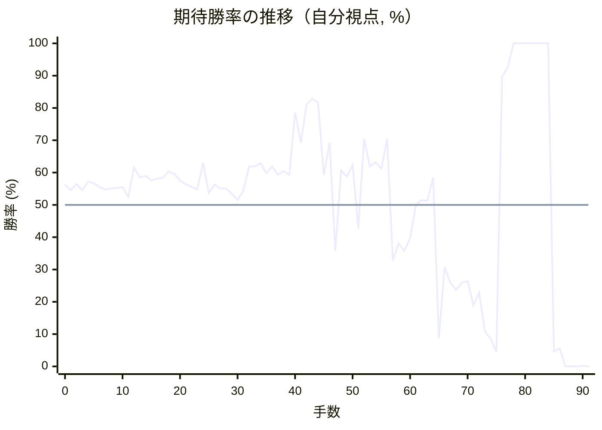

# 解析レポート 63aputghegju

[README に戻る](../../../README.md)　/　棋譜: [CSA](../../../data/csa/shogi5/63aputghegju.csa)　/　解析の見方: [docs/mistake_analysis.md](../../../docs/mistake_analysis.md)

## 対局情報

| 項目 | 内容 |
|---|---|
| 日時 | 2026-11-03 03:13:20 |
| 持ち時間 | 5分 |
| 自分 | 先手（▲）（1717） |
| 相手 | 相手（1763） |
| 結果 | 勝ち（時間切れ, 91手） |

## 解析環境

| 項目 | 内容 |
|---|---|
| エンジン | YaneuraOu NNUE 9.00git 64AVX2（V9.00/YANEURAOU_ENGINE_NNUE/AVX2） |
| 評価関数 | **水匠5**（`suisho5`） |
| nn.bin SHA-256 | `768068f0d534a0603a5d38bcd143de6bbca820d5f1c95a14d40863e5b7892d76` |
| 第1パス | movetime=150ms, MultiPV 1 |
| 第2パス | movetime=2000ms, MultiPV 3 |
| Threads / Hash | 8 / 512MB |
| 判定基準 | 疑問手 ≥5pt, 悪手 ≥10pt, 大悪手 ≥20pt（期待勝率 W(E)=1/(1+exp(-E/600))） |
| 解析日時 | 2026-11-03T05:25:09+09:00（解析バージョン 1, 54秒） |

## サマリー

| 自分の手数 | 深掘りした手 | 詰み逃し | 大悪手 | 悪手 | 疑問手 |
|--:|--:|--:|--:|--:|--:|
| 46 | 10 | 1 | 5 | 2 | 1 |

## 期待勝率の推移



<details><summary>1手ごとの数値（第1パス）</summary>

| 手数 | 指し手 | 評価値 | 勝率 | 低下 | 判定 |
|--:|---|--:|--:|--:|---|
| 1 | ▲７六歩(77) | +111 | 54.6% | +1.7pt |  |
| 2 | △３四歩(33) | +155 | 56.4% |  |  |
| 3 | ▲２六歩(27) | +108 | 54.5% | +1.9pt |  |
| 4 | △４四歩(43) | +174 | 57.2% |  |  |
| 5 | ▲２五歩(26) | +162 | 56.7% | +0.5pt |  |
| 6 | △３三角(22) | +132 | 55.5% |  |  |
| 7 | ▲４八銀(39) | +115 | 54.8% | +0.7pt |  |
| 8 | △３二銀(31) | +122 | 55.1% |  |  |
| 9 | ▲６八玉(59) | +125 | 55.2% | -0.1pt |  |
| 10 | △４三銀(32) | +132 | 55.5% |  |  |
| 11 | ▲５六歩(57) | +60 | 52.5% | +3.0pt |  |
| 12 | △２二飛(82) | +282 | 61.5% |  |  |
| 13 | ▲７八玉(68) | +205 | 58.5% | +3.1pt |  |
| 14 | △６二玉(51) | +218 | 59.0% |  |  |
| 15 | ▲９六歩(97) | +185 | 57.6% | +1.3pt |  |
| 16 | △９四歩(93) | +196 | 58.1% |  |  |
| 17 | ▲８六歩(87) | +203 | 58.4% | -0.3pt |  |
| 18 | △７二玉(62) | +250 | 60.3% |  |  |
| 19 | ▲８七玉(78) | +233 | 59.6% | +0.7pt |  |
| 20 | △８二玉(72) | +182 | 57.5% |  |  |
| 21 | ▲７八銀(79) | +155 | 56.4% | +1.1pt |  |
| 22 | △７二銀(71) | +136 | 55.6% |  |  |
| 23 | ▲５八金(49) | +115 | 54.8% | +0.9pt |  |
| 24 | △３五歩(34) | +320 | 63.0% |  |  |
| 25 | ▲７七桂(89) | +90 | 53.7% | +9.3pt | [疑問手](#ply-25) |
| 26 | △４五歩(44) | +153 | 56.3% |  |  |
| 27 | ▲７九角(88) | +123 | 55.1% | +1.2pt |  |
| 28 | △３四銀(43) | +124 | 55.1% |  |  |
| 29 | ▲１六歩(17) | +81 | 53.4% | +1.8pt |  |
| 30 | △５二金(41) | +36 | 51.5% |  |  |
| 31 | ▲４六歩(47) | +106 | 54.4% | -2.9pt |  |
| 32 | △４四角(33) | +290 | 61.9% |  |  |
| 33 | ▲４七銀(48) | +290 | 61.9% | +0.0pt |  |
| 34 | △３三桂(21) | +318 | 62.9% |  |  |
| 35 | ▲４五歩(46) | +238 | 59.8% | +3.2pt |  |
| 36 | △同銀(34) | +291 | 61.9% |  |  |
| 37 | ▲４六銀(47) | +227 | 59.3% | +2.5pt |  |
| 38 | △同銀(45) | +257 | 60.5% |  |  |
| 39 | ▲同角(79) | +227 | 59.3% | +1.2pt |  |
| 40 | △４二飛(22) | +781 | 78.6% |  |  |
| 41 | ▲５五銀打 | +488 | 69.3% | +9.3pt |  |
| 42 | △５四歩(53) | +874 | 81.1% |  |  |
| 43 | ▲４四銀(55) | +947 | 82.9% | -1.8pt |  |
| 44 | △同飛(42) | +894 | 81.6% |  |  |
| 45 | ▲３五角(46) | +223 | 59.2% | +22.4pt | [悪手](#ply-45) |
| 46 | △４九飛成(44) | +486 | 69.2% |  |  |
| 47 | ▲２四歩(25) | -352 | 35.7% | +33.5pt | [悪手](#ply-47) |
| 48 | △３四歩打 | +262 | 60.7% |  |  |
| 49 | ▲１七角(35) | +210 | 58.7% | +2.1pt |  |
| 50 | △４五桂(33) | +304 | 62.4% |  |  |
| 51 | ▲２三歩成(24) | -176 | 42.7% | +19.7pt | [大悪手](#ply-51) |
| 52 | △８九銀打 | +520 | 70.4% |  |  |
| 53 | ▲５九金(58) | +291 | 61.9% | +8.5pt | [大悪手](#ply-53) |
| 54 | △７八銀不成(89) | +325 | 63.2% |  |  |
| 55 | ▲同玉(87) | +274 | 61.2% | +2.0pt |  |
| 56 | △３九龍(49) | +523 | 70.5% |  |  |
| 57 | ▲３三と(23) | -431 | 32.8% | +37.7pt | [大悪手](#ply-57) |
| 58 | △２八龍(39) | -291 | 38.1% |  |  |
| 59 | ▲同角(17) | -352 | 35.7% | +2.4pt |  |
| 60 | △３八飛打 | -252 | 39.7% |  |  |
| 61 | ▲４八飛打 | +0 | 50.0% | -10.3pt |  |
| 62 | △同飛成(38) | +36 | 51.5% |  |  |
| 63 | ▲同金(59) | +31 | 51.3% | +0.2pt |  |
| 64 | △５七銀打 | +204 | 58.4% |  |  |
| 65 | ▲４九金(48) | -1411 | 8.7% | +49.7pt | [大悪手](#ply-65) |
| 66 | △２七飛打 | -485 | 30.8% |  |  |
| 67 | ▲１七角打 | -630 | 25.9% | +4.9pt |  |
| 68 | △２八飛成(27) | -702 | 23.7% |  |  |
| 69 | ▲同角(17) | -631 | 25.9% | -2.2pt |  |
| 70 | △４七角打 | -616 | 26.4% |  |  |
| 71 | ▲７九金(69) | -873 | 18.9% | +7.4pt |  |
| 72 | △２九角成(47) | -733 | 22.8% |  |  |
| 73 | ▲１七角(28) | -1261 | 10.9% | +11.9pt | [大悪手](#ply-73) |
| 74 | △５六馬(29) | -1424 | 8.5% |  |  |
| 75 | ▲３一飛打 | -1835 | 4.5% | +4.0pt |  |
| 76 | △６六桂打 | +1301 | 89.7% |  |  |
| 77 | ▲８七玉(78) | +1524 | 92.7% | -3.0pt |  |
| 78 | △６七馬(56) | +6080 | 100.0% |  |  |
| 79 | ▲７一銀打 | +6250 | 100.0% | -0.0pt |  |
| 80 | △９三玉(82) | +7638 | 100.0% |  |  |
| 81 | ▲６一飛成(31) | +35281 | 100.0% | -0.0pt |  |
| 82 | △７八銀打 | +35281 | 100.0% |  |  |
| 83 | ▲９七玉(87) | +35281 | 100.0% | +0.0pt |  |
| 84 | △７六馬(67) | #+17 | 100.0% |  |  |
| 85 | ▲８八金(79) | -1816 | 4.6% | +95.4pt | [詰み逃し](#ply-85) |
| 86 | △６一銀(72) | -1690 | 5.6% |  |  |
| 87 | ▲８五桂(77) | -6592 | 0.0% | +5.6pt |  |
| 88 | △８四玉(93) | -6704 | 0.0% |  |  |
| 89 | ▲９八金打 | #-13 | 0.0% | +0.0pt |  |
| 90 | △７五玉(84) | -3757 | 0.2% |  |  |
| 91 | ▲５六飛打 | #-1 | 0.0% | +0.2pt |  |

</details>

## 課題局面

<a id="ply-25"></a>
### 25手目 ▲７七桂(89) — 疑問手

| | 着手前 | 着手後 | 差 |
|---|--:|--:|--:|
| 期待勝率 | 63.0% | 54.7% | -8.3pt |
| 評価値 | +320 | +113 | |

着手前の局面:

```text
後手の持駒：なし
  ９ ８ ７ ６ ５ ４ ３ ２ １
+---------------------------+
|v香v桂 ・v金 ・v金 ・v桂v香|一
| ・v玉v銀 ・ ・ ・ ・v飛 ・|二
| ・v歩v歩v歩v歩v銀v角v歩v歩|三
|v歩 ・ ・ ・ ・v歩 ・ ・ ・|四
| ・ ・ ・ ・ ・ ・v歩 歩 ・|五
| 歩 歩 歩 ・ 歩 ・ ・ ・ ・|六
| ・ 玉 ・ 歩 ・ 歩 歩 ・ 歩|七
| ・ 角 銀 ・ 金 銀 ・ 飛 ・|八
| 香 桂 ・ 金 ・ ・ ・ 桂 香|九
+---------------------------+
先手の持駒：なし
手数＝24　△３五歩　まで
```

| | 指し手 | 評価値 | 読み筋 |
|---|---|--:|---|
| 実戦 | ▲７七桂(89) | +113 | △５二金(41) ▲７九角(88) △３四銀(43) ▲４六歩(47) △３二飛(22) ▲５五歩(56) |
| AI 1位 | ▲５七銀(48) | +320 | ▲５七銀(48) △３二飛(22) ▲４六歩(47) △３四銀(43) ▲５五歩(56) △５二金(41) |
| AI 2位 | ▲１六歩(17) | +283 | ▲１六歩(17) △５二金(41) ▲５七銀(48) △５四歩(53) ▲７七角(88) △３二飛(22) |
| AI 3位 | ▲４六歩(47) | +278 | ▲４六歩(47) △３四銀(43) ▲５五歩(56) △４二飛(22) ▲４七金(58) △５二金(41) |

SFEN: `ln1g1g1nl/1ks4r1/1ppppsbpp/p4p3/6pP1/PPP1P4/1K1P1PP1P/1BS1GS1R1/LN1G3NL b - 25`

<a id="ply-45"></a>
### 45手目 ▲３五角(46) — 悪手

| | 着手前 | 着手後 | 差 |
|---|--:|--:|--:|
| 期待勝率 | 84.9% | 70.3% | -14.6pt |
| 評価値 | +1035 | +517 | |

着手前の局面:

```text
後手の持駒：銀二　歩
  ９ ８ ７ ６ ５ ４ ３ ２ １
+---------------------------+
|v香v桂 ・v金 ・ ・ ・ ・v香|一
| ・v玉v銀 ・v金 ・ ・ ・ ・|二
| ・v歩v歩v歩 ・ ・v桂v歩v歩|三
|v歩 ・ ・ ・v歩v飛 ・ ・ ・|四
| ・ ・ ・ ・ ・ ・v歩 歩 ・|五
| 歩 歩 歩 ・ 歩 角 ・ ・ 歩|六
| ・ 玉 桂 歩 ・ ・ 歩 ・ ・|七
| ・ ・ 銀 ・ 金 ・ ・ 飛 ・|八
| 香 ・ ・ 金 ・ ・ ・ 桂 香|九
+---------------------------+
先手の持駒：角　歩
手数＝44　△４四同飛　まで
```

| | 指し手 | 評価値 | 読み筋 |
|---|---|--:|---|
| 実戦 | ▲３五角(46) | +517 | △４九飛成(44) ▲４八飛(28) △同龍(49) ▲同金(58) △４五飛打 ▲５七角(35) |
| AI 1位 | ▲４七歩打 | +1035 | ▲４七歩打 △４二金(52) ▲３五角(46) △４五飛(44) ▲１七角打 △３四歩打 |
| AI 2位 | ▲４八飛(28) | +1000 | ▲４八飛(28) △６四歩(63) ▲２二角打 △３九銀打 ▲３三角成(22) △４八銀成(39) |
| AI 3位 | ▲２六飛(28) | +694 | ▲２六飛(28) △３六歩(35) ▲同飛(26) △３二歩打 ▲２六飛(36) △３四銀打 |

SFEN: `ln1g4l/1ks1g4/1ppp2npp/p3pr3/6pP1/PPP1PB2P/1KNP2P2/2S1G2R1/L2G3NL b BP2sp 45`

<a id="ply-47"></a>
### 47手目 ▲２四歩(25) — 悪手

| | 着手前 | 着手後 | 差 |
|---|--:|--:|--:|
| 期待勝率 | 74.5% | 55.3% | -19.1pt |
| 評価値 | +642 | +128 | |

着手前の局面:

```text
後手の持駒：銀二　歩
  ９ ８ ７ ６ ５ ４ ３ ２ １
+---------------------------+
|v香v桂 ・v金 ・ ・ ・ ・v香|一
| ・v玉v銀 ・v金 ・ ・ ・ ・|二
| ・v歩v歩v歩 ・ ・v桂v歩v歩|三
|v歩 ・ ・ ・v歩 ・ ・ ・ ・|四
| ・ ・ ・ ・ ・ ・ 角 歩 ・|五
| 歩 歩 歩 ・ 歩 ・ ・ ・ 歩|六
| ・ 玉 桂 歩 ・ ・ 歩 ・ ・|七
| ・ ・ 銀 ・ 金 ・ ・ 飛 ・|八
| 香 ・ ・ 金 ・v龍 ・ 桂 香|九
+---------------------------+
先手の持駒：角　歩二
手数＝46　△４九飛成　まで
```

| | 指し手 | 評価値 | 読み筋 |
|---|---|--:|---|
| 実戦 | ▲２四歩(25) | +128 | △４五桂(33) ▲２三歩成(24) △３四歩打 ▲６八角(35) △８九銀打 ▲５九金(58) |
| AI 1位 | ▲４八飛(28) | +642 | ▲４八飛(28) △同龍(49) ▲同金(58) △４五飛打 ▲５七角(35) △２五飛(45) |
| AI 2位 | ▲２二角打 | +231 | ▲２二角打 △４六銀打 ▲同角(35) △同龍(49) ▲３三角成(22) △３九角打 |
| AI 3位 | ▲１七角打 | +184 | ▲１七角打 △３四銀打 ▲４八飛(28) △２九龍(49) ▲４一飛成(48) △３五銀(34) |

SFEN: `ln1g4l/1ks1g4/1ppp2npp/p3p4/6BP1/PPP1P3P/1KNP2P2/2S1G2R1/L2G1+r1NL b B2P2sp 47`

<a id="ply-51"></a>
### 51手目 ▲２三歩成(24) — 大悪手

| | 着手前 | 着手後 | 差 |
|---|--:|--:|--:|
| 期待勝率 | 65.8% | 43.3% | -22.5pt |
| 評価値 | +393 | -161 | |

着手前の局面:

```text
後手の持駒：銀二
  ９ ８ ７ ６ ５ ４ ３ ２ １
+---------------------------+
|v香v桂 ・v金 ・ ・ ・ ・v香|一
| ・v玉v銀 ・v金 ・ ・ ・ ・|二
| ・v歩v歩v歩 ・ ・ ・v歩v歩|三
|v歩 ・ ・ ・v歩 ・v歩 歩 ・|四
| ・ ・ ・ ・ ・v桂 ・ ・ ・|五
| 歩 歩 歩 ・ 歩 ・ ・ ・ 歩|六
| ・ 玉 桂 歩 ・ ・ 歩 ・ 角|七
| ・ ・ 銀 ・ 金 ・ ・ 飛 ・|八
| 香 ・ ・ 金 ・v龍 ・ 桂 香|九
+---------------------------+
先手の持駒：角　歩二
手数＝50　△４五桂　まで
```

| | 指し手 | 評価値 | 読み筋 |
|---|---|--:|---|
| 実戦 | ▲２三歩成(24) | -161 | △３七桂成(45) ▲同桂(29) △１九龍(49) ▲２九桂打 △２八龍(19) ▲同角(17) |
| AI 1位 | ▲５九金(58) | +393 | ▲５九金(58) △４七龍(49) ▲２五角打 △５六龍(47) ▲３四角(25) △７四歩(73) |
| AI 2位 | ▲２七角打 | +361 | ▲２七角打 △３九龍(49) ▲４五角(27) △８九銀打 ▲３四角(45) △７八銀不成(89) |
| AI 3位 | ▲５九金(69) | +183 | ▲５九金(69) △４六龍(49) ▲２六飛(28) △同龍(46) ▲同角(17) △２七飛打 |

SFEN: `ln1g4l/1ks1g4/1ppp3pp/p3p1pP1/5n3/PPP1P3P/1KNP2P1B/2S1G2R1/L2G1+r1NL b B2P2s 51`

<a id="ply-53"></a>
### 53手目 ▲５九金(58) — 大悪手

| | 着手前 | 着手後 | 差 |
|---|--:|--:|--:|
| 期待勝率 | 84.3% | 63.3% | -21.0pt |
| 評価値 | +1007 | +326 | |

着手前の局面:

```text
後手の持駒：銀
  ９ ８ ７ ６ ５ ４ ３ ２ １
+---------------------------+
|v香v桂 ・v金 ・ ・ ・ ・v香|一
| ・v玉v銀 ・v金 ・ ・ ・ ・|二
| ・v歩v歩v歩 ・ ・ ・ とv歩|三
|v歩 ・ ・ ・v歩 ・v歩 ・ ・|四
| ・ ・ ・ ・ ・v桂 ・ ・ ・|五
| 歩 歩 歩 ・ 歩 ・ ・ ・ 歩|六
| ・ 玉 桂 歩 ・ ・ 歩 ・ 角|七
| ・ ・ 銀 ・ 金 ・ ・ 飛 ・|八
| 香v銀 ・ 金 ・v龍 ・ 桂 香|九
+---------------------------+
先手の持駒：角　歩三
手数＝52　△８九銀　まで
```

| | 指し手 | 評価値 | 読み筋 |
|---|---|--:|---|
| 実戦 | ▲５九金(58) | +326 | △７八銀不成(89) ▲同玉(87) △４六龍(49) ▲３三と(23) △５七桂成(45) ▲６八銀打 |
| AI 1位 | ▲５九金(69) | +1007 | ▲５九金(69) △７八銀不成(89) ▲同玉(87) △４六龍(49) ▲４七銀打 △１六龍(46) |
| AI 2位 | ▲５九金(58) | +585 | ▲５九金(58) △７八銀不成(89) ▲同玉(87) △４七龍(49) ▲３三と(23) △５七桂成(45) |
| AI 3位 | ▲同銀(78) | -95 | ▲同銀(78) △６九龍(49) ▲７八銀打 △３九龍(69) ▲２六飛(28) △４九龍(39) |

SFEN: `ln1g4l/1ks1g4/1ppp3+Pp/p3p1p2/5n3/PPP1P3P/1KNP2P1B/2S1G2R1/Ls1G1+r1NL b B3Ps 53`

<a id="ply-57"></a>
### 57手目 ▲３三と(23) — 大悪手

| | 着手前 | 着手後 | 差 |
|---|--:|--:|--:|
| 期待勝率 | 81.2% | 55.3% | -25.9pt |
| 評価値 | +878 | +127 | |

着手前の局面:

```text
後手の持駒：銀二
  ９ ８ ７ ６ ５ ４ ３ ２ １
+---------------------------+
|v香v桂 ・v金 ・ ・ ・ ・v香|一
| ・v玉v銀 ・v金 ・ ・ ・ ・|二
| ・v歩v歩v歩 ・ ・ ・ とv歩|三
|v歩 ・ ・ ・v歩 ・v歩 ・ ・|四
| ・ ・ ・ ・ ・v桂 ・ ・ ・|五
| 歩 歩 歩 ・ 歩 ・ ・ ・ 歩|六
| ・ ・ 桂 歩 ・ ・ 歩 ・ 角|七
| ・ ・ 玉 ・ ・ ・ ・ 飛 ・|八
| 香 ・ ・ 金 金 ・v龍 桂 香|九
+---------------------------+
先手の持駒：角　銀　歩三
手数＝56　△３九龍　まで
```

| | 指し手 | 評価値 | 読み筋 |
|---|---|--:|---|
| 実戦 | ▲３三と(23) | +127 | △２八龍(39) ▲同角(17) △３八飛打 ▲４八飛打 △同飛成(38) ▲同金(59) |
| AI 1位 | ▲２五飛(28) | +878 | ▲２五飛(28) △３八龍(39) ▲４八歩打 △３七桂不成(45) ▲３三と(23) △４九桂成(37) |
| AI 2位 | ▲２四飛(28) | +820 | ▲２四飛(28) △３八龍(39) ▲４八歩打 △５七桂成(45) ▲３九銀打 △同龍(38) |
| AI 3位 | ▲６八銀打 | +247 | ▲６八銀打 △２八龍(39) ▲同角(17) △２七飛打 ▲１七角(28) △２九飛成(27) |

SFEN: `ln1g4l/1ks1g4/1ppp3+Pp/p3p1p2/5n3/PPP1P3P/2NP2P1B/2K4R1/L2GG1+rNL b BS3P2s 57`

<a id="ply-65"></a>
### 65手目 ▲４九金(48) — 大悪手

| | 着手前 | 着手後 | 差 |
|---|--:|--:|--:|
| 期待勝率 | 68.9% | 2.8% | -66.1pt |
| 評価値 | +477 | -2123 | |

着手前の局面:

```text
後手の持駒：飛　銀
  ９ ８ ７ ６ ５ ４ ３ ２ １
+---------------------------+
|v香v桂 ・v金 ・ ・ ・ ・v香|一
| ・v玉v銀 ・v金 ・ ・ ・ ・|二
| ・v歩v歩v歩 ・ ・ と ・v歩|三
|v歩 ・ ・ ・v歩 ・v歩 ・ ・|四
| ・ ・ ・ ・ ・v桂 ・ ・ ・|五
| 歩 歩 歩 ・ 歩 ・ ・ ・ 歩|六
| ・ ・ 桂 歩v銀 ・ 歩 ・ ・|七
| ・ ・ 玉 ・ ・ 金 ・ 角 ・|八
| 香 ・ ・ 金 ・ ・ ・ 桂 香|九
+---------------------------+
先手の持駒：飛　角　銀　歩三
手数＝64　△５七銀　まで
```

| | 指し手 | 評価値 | 読み筋 |
|---|---|--:|---|
| 実戦 | ▲４九金(48) | -2123 | △６八銀打 ▲同金(69) △同銀成(57) ▲同玉(78) △４七飛打 ▲５八銀打 |
| AI 1位 | ▲１七角(28) | +477 | ▲１七角(28) △４八銀成(57) ▲４一飛打 △７一金打 ▲４四角打 △３五銀打 |
| AI 2位 | ▲４一飛打 | +444 | ▲４一飛打 △４八銀成(57) ▲１七角(28) △５一金打 ▲４五飛成(41) △４九飛打 |
| AI 3位 | ▲２一飛打 | +157 | ▲２一飛打 △４八銀成(57) ▲１七角(28) △６二銀打 ▲４三と(33) △５一金(52) |

SFEN: `ln1g4l/1ks1g4/1ppp2+P1p/p3p1p2/5n3/PPP1P3P/2NPs1P2/2K2G1B1/L2G3NL b RBS3Prs 65`

<a id="ply-73"></a>
### 73手目 ▲１七角(28) — 大悪手

| | 着手前 | 着手後 | 差 |
|---|--:|--:|--:|
| 期待勝率 | 27.9% | 3.6% | -24.2pt |
| 評価値 | -571 | -1966 | |

着手前の局面:

```text
後手の持駒：銀　桂
  ９ ８ ７ ６ ５ ４ ３ ２ １
+---------------------------+
|v香v桂 ・v金 ・ ・ ・ ・v香|一
| ・v玉v銀 ・v金 ・ ・ ・ ・|二
| ・v歩v歩v歩 ・ ・ と ・v歩|三
|v歩 ・ ・ ・v歩 ・v歩 ・ ・|四
| ・ ・ ・ ・ ・v桂 ・ ・ ・|五
| 歩 歩 歩 ・ 歩 ・ ・ ・ 歩|六
| ・ ・ 桂 歩v銀 ・ 歩 ・ ・|七
| ・ ・ 玉 ・ ・ ・ ・ 角 ・|八
| 香 ・ 金 ・ ・ 金 ・v馬 香|九
+---------------------------+
先手の持駒：飛二　銀　歩三
手数＝72　△２九角成　まで
```

| | 指し手 | 評価値 | 読み筋 |
|---|---|--:|---|
| 実戦 | ▲１七角(28) | -1966 | △５六馬(29) ▲２一飛打 △６六銀成(57) ▲７一銀打 △９三玉(82) ▲５八金(49) |
| AI 1位 | ▲２六飛打 | -571 | ▲２六飛打 △６八銀打 ▲同金(79) △同銀成(57) ▲同玉(78) △４七馬(29) |
| AI 2位 | ▲４二と(33) | -1234 | ▲４二と(33) △同金(52) ▲２二飛打 △５六馬(29) ▲４二飛成(22) △６六銀成(57) |
| AI 3位 | ▲４三と(33) | -1503 | ▲４三と(33) △同金(52) ▲８七玉(78) △２八馬(29) ▲４一飛打 △６八銀打 |

SFEN: `ln1g4l/1ks1g4/1ppp2+P1p/p3p1p2/5n3/PPP1P3P/2NPs1P2/2K4B1/L1G2G1+bL b 2RS3Psn 73`

<a id="ply-85"></a>
### 85手目 ▲８八金(79) — 詰み逃し

| | 着手前 | 着手後 | 差 |
|---|--:|--:|--:|
| 期待勝率 | 100.0% | 0.4% | -99.6pt |
| 評価値 | 17手詰め | -3372 | |

着手前の局面:

```text
後手の持駒：歩三
  ９ ８ ７ ６ ５ ４ ３ ２ １
+---------------------------+
|v香v桂 銀 龍 ・ ・ ・ ・v香|一
| ・ ・v銀 ・v金 ・ ・ ・ ・|二
|v玉v歩v歩v歩 ・ ・ と ・v歩|三
|v歩 ・ ・ ・v歩 ・v歩 ・ ・|四
| ・ ・ ・ ・ ・v桂 ・ ・ ・|五
| 歩 歩v馬v桂 ・ ・ ・ ・ 歩|六
| 玉 ・ 桂 ・v銀 ・ 歩 ・ 角|七
| ・ ・v銀 ・ ・ ・ ・ ・ ・|八
| 香 ・ 金 ・ ・ 金 ・ ・ 香|九
+---------------------------+
先手の持駒：飛　金　歩三
手数＝84　△７六馬　まで
```

| | 指し手 | 評価値 | 読み筋 |
|---|---|--:|---|
| 実戦 | ▲８八金(79) | -3372 | △６一銀(72) ▲７八金(88) △同桂成(66) ▲８二銀打 △８四玉(93) ▲８五金打 |
| AI 1位 | ▲８二銀不成(71) | 17手詰め | ▲８二銀不成(71) △８四玉(93) ▲７八金(79) △９三桂(81) ▲同銀不成(82) △同玉(84) |
| AI 2位 | ▲７八金(79) | 19手詰め | ▲７八金(79) △９五歩(94) ▲８二銀不成(71) △９四玉(93) ▲９五歩(96) △同玉(94) |
| AI 3位 | ▲９二飛打 | -1456 | ▲９二飛打 △同香(91) ▲８二銀不成(71) △８四玉(93) ▲８五金打 △同馬(76) |

SFEN: `lnS+R4l/2s1g4/kppp2+P1p/p3p1p2/5n3/PP+bn4P/K1N1s1P1B/2s6/L1G2G2L b RG3P3p 85`

