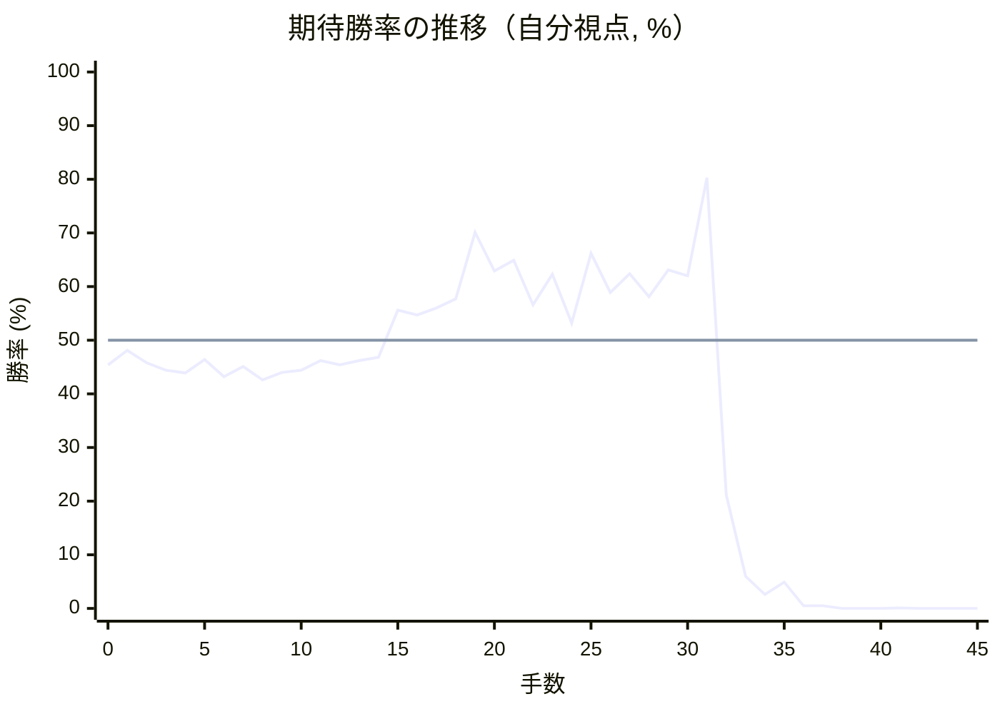

# 解析レポート 63qkmna4g2ds

[README に戻る](../../../README.md)　/　棋譜: [CSA](../../../data/csa/shogi5/63qkmna4g2ds.csa)　/　解析の見方: [docs/mistake_analysis.md](../../../docs/mistake_analysis.md)

## 対局情報

| 項目 | 内容 |
|---|---|
| 日時 | 2026-11-07 14:03:08 |
| 持ち時間 | 5分 |
| 自分 | 後手（△）（1702） |
| 相手 | 相手（1704） |
| 結果 | 負け（詰み, 45手） |

## 解析環境

| 項目 | 内容 |
|---|---|
| エンジン | YaneuraOu NNUE 9.00git 64AVX2（V9.00/YANEURAOU_ENGINE_NNUE/AVX2） |
| 評価関数 | **水匠5**（`suisho5`） |
| nn.bin SHA-256 | `768068f0d534a0603a5d38bcd143de6bbca820d5f1c95a14d40863e5b7892d76` |
| 第1パス | movetime=150ms, MultiPV 1 |
| 第2パス | movetime=2000ms, MultiPV 3 |
| Threads / Hash | 8 / 512MB |
| 判定基準 | 疑問手 ≥5pt, 悪手 ≥10pt, 大悪手 ≥20pt（期待勝率 W(E)=1/(1+exp(-E/600))） |
| 解析日時 | 2026-11-11T20:21:07+09:00（解析バージョン 1, 11秒） |

## サマリー

| 自分の手数 | 深掘りした手 | 詰み逃し | 大悪手 | 悪手 | 疑問手 |
|--:|--:|--:|--:|--:|--:|
| 22 | 1 | 0 | 1 | 0 | 0 |

## 期待勝率の推移



<details><summary>1手ごとの数値（第1パス）</summary>

| 手数 | 指し手 | 評価値 | 勝率 | 低下 | 判定 |
|--:|---|--:|--:|--:|---|
| 1 | ▲２六歩(27) | -46 | 48.1% |  |  |
| 2 | △８四歩(83) | -100 | 45.8% | +2.2pt |  |
| 3 | ▲２五歩(26) | -136 | 44.4% |  |  |
| 4 | △８五歩(84) | -146 | 43.9% | +0.4pt |  |
| 5 | ▲７六歩(77) | -86 | 46.4% |  |  |
| 6 | △３四歩(33) | -164 | 43.2% | +3.2pt |  |
| 7 | ▲７八金(69) | -118 | 45.1% |  |  |
| 8 | △３二金(41) | -180 | 42.6% | +2.5pt |  |
| 9 | ▲２四歩(25) | -144 | 44.0% |  |  |
| 10 | △同歩(23) | -135 | 44.4% | -0.4pt |  |
| 11 | ▲同飛(28) | -91 | 46.2% |  |  |
| 12 | △８六歩(85) | -111 | 45.4% | +0.8pt |  |
| 13 | ▲同歩(87) | -92 | 46.2% |  |  |
| 14 | △同飛(82) | -78 | 46.8% | -0.6pt |  |
| 15 | ▲１六歩(17) | +136 | 55.6% |  |  |
| 16 | △７六飛(86) | +112 | 54.7% | +1.0pt |  |
| 17 | ▲２二角成(88) | +145 | 56.0% |  |  |
| 18 | △同銀(31) | +186 | 57.7% | -1.7pt |  |
| 19 | ▲８二歩打 | +512 | 70.1% |  |  |
| 20 | △同銀(71) | +317 | 62.9% | +7.2pt |  |
| 21 | ▲６五角打 | +370 | 64.9% |  |  |
| 22 | △８六飛(76) | +160 | 56.6% | +8.3pt |  |
| 23 | ▲８七歩打 | +302 | 62.3% |  |  |
| 24 | △３三角打 | +76 | 53.2% | +9.2pt |  |
| 25 | ▲２二飛成(24) | +403 | 66.2% |  |  |
| 26 | △同角(33) | +216 | 58.9% | +7.3pt |  |
| 27 | ▲８六歩(87) | +304 | 62.4% |  |  |
| 28 | △９九角成(22) | +197 | 58.1% | +4.3pt |  |
| 29 | ▲７七桂(89) | +322 | 63.1% |  |  |
| 30 | △７四香打 | +295 | 62.0% | +1.1pt |  |
| 31 | ▲４四銀打 | +844 | 80.3% |  |  |
| 32 | △２五飛打 | -788 | 21.2% | +59.1pt | [大悪手](#ply-32) |
| 33 | ▲４三角成(65) | -1648 | 6.0% |  |  |
| 34 | △同金(32) | -2183 | 2.6% | +3.5pt |  |
| 35 | ▲同銀成(44) | -1782 | 4.9% |  |  |
| 36 | △６二玉(51) | -3154 | 0.5% | +4.4pt |  |
| 37 | ▲３二飛打 | -3154 | 0.5% |  |  |
| 38 | △７一玉(62) | -4936 | 0.0% | +0.5pt |  |
| 39 | ▲５二成銀(43) | -5027 | 0.0% |  |  |
| 40 | △同金(61) | -5291 | 0.0% | +0.0pt |  |
| 41 | ▲同飛成(32) | -4445 | 0.1% |  |  |
| 42 | △６一銀打 | #-3 | 0.0% | +0.1pt |  |
| 43 | ▲７二金打 | #-2 | 0.0% |  |  |
| 44 | △同銀(61) | #-1 | 0.0% | +0.0pt |  |
| 45 | ▲６二金打 | #- | 0.0% |  |  |

</details>

## 課題局面

<a id="ply-32"></a>
### 32手目 △２五飛打 — 大悪手

| | 着手前 | 着手後 | 差 |
|---|--:|--:|--:|
| 期待勝率 | 68.1% | 1.0% | -67.1pt |
| 評価値 | +455 | -2744 | |

着手前の局面:

```text
後手の持駒：飛　歩四
  ９ ８ ７ ６ ５ ４ ３ ２ １
+---------------------------+
|v香v桂 ・v金v玉 ・ ・v桂v香|一
| ・v銀 ・ ・ ・ ・v金 ・ ・|二
|v歩 ・v歩v歩v歩v歩 ・ ・v歩|三
| ・ ・v香 ・ ・ 銀v歩 ・ ・|四
| ・ ・ ・ 角 ・ ・ ・ ・ ・|五
| ・ 歩 ・ ・ ・ ・ ・ ・ 歩|六
| 歩 ・ 桂 歩 歩 歩 歩 ・ ・|七
| ・ ・ 金 ・ ・ ・ ・ ・ ・|八
|v馬 ・ 銀 ・ 玉 金 銀 桂 香|九
+---------------------------+
先手の持駒：飛
後手番
手数＝31　▲４四銀　まで
```

| | 指し手 | 評価値 | 読み筋 |
|---|---|--:|---|
| 実戦 | △２五飛打 | -2744 | ▲４三角成(65) △同金(32) ▲同銀成(44) △２二飛(25) ▲３一飛打 △４一歩打 |
| AI 1位 | △７七香不成(74) | +455 | △７七香不成(74) ▲４三角成(65) △同金(32) ▲同銀成(44) △４二歩打 ▲２二飛打 |
| AI 2位 | △５二金(61) | +450 | △５二金(61) ▲７二飛打 △６二飛打 ▲同飛成(72) △同玉(51) ▲６八銀(79) |
| AI 3位 | △７七香成(74) | +323 | △７七香成(74) ▲４三角成(65) △７八成香(77) ▲３二馬(43) △４四馬(99) ▲４一飛打 |

SFEN: `ln1gk2nl/1s4g2/p1pppp2p/2l2Sp2/3B5/1P6P/P1NPPPP2/2G6/+b1S1KGSNL w Rr4p 32`

