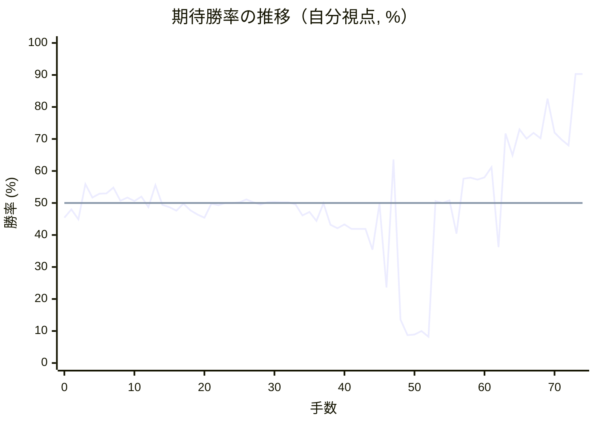
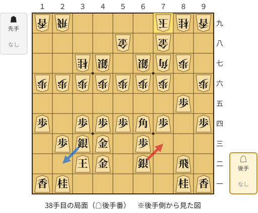
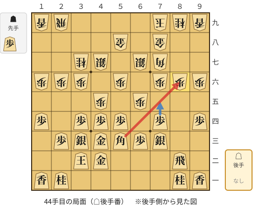
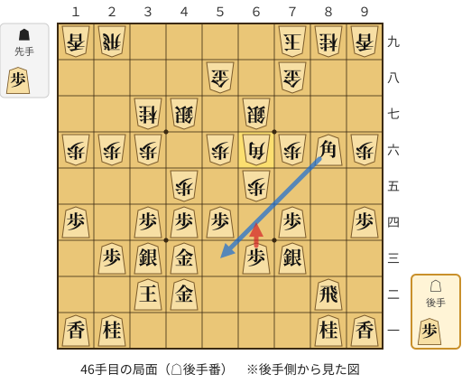
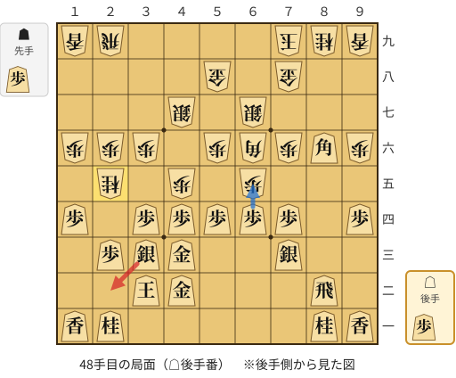
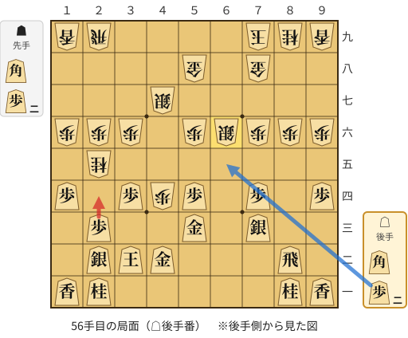
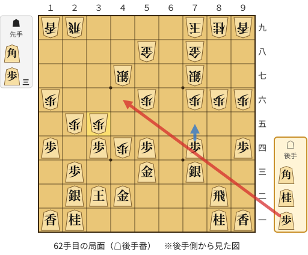
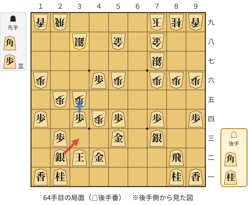
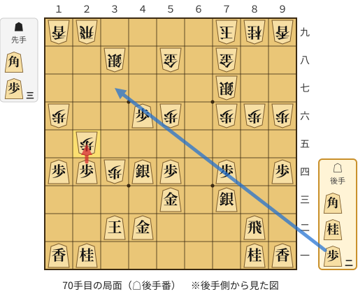

# 解析レポート 67kn1hr0u1qx

[README に戻る](../../../README.md)　/　棋譜: [CSA](../../../data/csa/shogi5/67kn1hr0u1qx.csa)　/　解析の見方: [docs/mistake_analysis.md](../../../docs/mistake_analysis.md)

## 対局情報

| 項目 | 内容 |
|---|---|
| 日時 | 2026-11-20 01:30:08 |
| 持ち時間 | 5分 |
| 自分 | 後手（△）（1706） |
| 相手 | 相手（1656） |
| 結果 | 勝ち（投了, 74手） |

## 解析環境

| 項目 | 内容 |
|---|---|
| エンジン | YaneuraOu NNUE 9.00git 64AVX2（V9.00/YANEURAOU_ENGINE_NNUE/AVX2） |
| 評価関数 | **水匠5**（`suisho5`） |
| nn.bin SHA-256 | `768068f0d534a0603a5d38bcd143de6bbca820d5f1c95a14d40863e5b7892d76` |
| 第1パス | movetime=150ms, MultiPV 1 |
| 第2パス | movetime=2000ms, MultiPV 3 |
| Threads / Hash | 8 / 512MB |
| 判定基準 | 疑問手 ≥5pt, 悪手 ≥10pt, 大悪手 ≥20pt（期待勝率 W(E)=1/(1+exp(-E/600))） |
| 解析日時 | 2026-11-20T19:59:32+09:00（解析バージョン 1, 48秒） |

## サマリー

| 自分の手数 | 深掘りした手 | 詰み逃し | 大悪手 | 悪手 | 疑問手 |
|--:|--:|--:|--:|--:|--:|
| 37 | 9 | 0 | 3 | 2 | 3 |

## 期待勝率の推移



<details><summary>1手ごとの数値（第1パス）</summary>

| 手数 | 指し手 | 評価値 | 勝率 | 低下 | 判定 |
|--:|---|--:|--:|--:|---|
| 1 | ▲７六歩(77) | -47 | 48.0% |  |  |
| 2 | △３四歩(33) | -123 | 44.9% | +3.1pt |  |
| 3 | ▲６六歩(67) | +143 | 55.9% |  |  |
| 4 | △８四歩(83) | +40 | 51.7% | +4.3pt |  |
| 5 | ▲６八銀(79) | +70 | 52.9% |  |  |
| 6 | △６二銀(71) | +71 | 53.0% | -0.0pt |  |
| 7 | ▲６七銀(68) | +116 | 54.8% |  |  |
| 8 | △８五歩(84) | +17 | 50.7% | +4.1pt |  |
| 9 | ▲７七角(88) | +40 | 51.7% |  |  |
| 10 | △４二玉(51) | +15 | 50.6% | +1.0pt |  |
| 11 | ▲５六歩(57) | +47 | 52.0% |  |  |
| 12 | △３二玉(42) | -31 | 48.7% | +3.2pt |  |
| 13 | ▲９六歩(97) | +135 | 55.6% |  |  |
| 14 | △９四歩(93) | -14 | 49.4% | +6.2pt |  |
| 15 | ▲７八金(69) | -32 | 48.7% |  |  |
| 16 | △１四歩(13) | -57 | 47.6% | +1.0pt |  |
| 17 | ▲１六歩(17) | -4 | 49.8% |  |  |
| 18 | △４二銀(31) | -56 | 47.7% | +2.2pt |  |
| 19 | ▲２六歩(27) | -86 | 46.4% |  |  |
| 20 | △３三銀(42) | -111 | 45.4% | +1.0pt |  |
| 21 | ▲４八銀(39) | -5 | 49.8% |  |  |
| 22 | △５四歩(53) | -16 | 49.3% | +0.5pt |  |
| 23 | ▲３六歩(37) | +1 | 50.0% |  |  |
| 24 | △３一角(22) | +0 | 50.0% | +0.0pt |  |
| 25 | ▲６九玉(59) | +5 | 50.2% |  |  |
| 26 | △５二金(61) | +27 | 51.1% | -0.9pt |  |
| 27 | ▲５八金(49) | +6 | 50.2% |  |  |
| 28 | △４四歩(43) | -13 | 49.5% | +0.8pt |  |
| 29 | ▲４六歩(47) | +5 | 50.2% |  |  |
| 30 | △４三金(52) | +7 | 50.3% | -0.1pt |  |
| 31 | ▲３七桂(29) | +5 | 50.2% |  |  |
| 32 | △７四歩(73) | +5 | 50.2% | +0.0pt |  |
| 33 | ▲４七銀(48) | -10 | 49.6% |  |  |
| 34 | △６四角(31) | -93 | 46.1% | +3.5pt |  |
| 35 | ▲２九飛(28) | -68 | 47.2% |  |  |
| 36 | △４二金(41) | -135 | 44.4% | +2.8pt |  |
| 37 | ▲７九玉(69) | -3 | 49.9% |  |  |
| 38 | △７三銀(62) | -165 | 43.2% | +6.7pt | [疑問手](#ply-38) |
| 39 | ▲６五歩(66) | -191 | 42.1% |  |  |
| 40 | △５三角(64) | -162 | 43.3% | -1.2pt |  |
| 41 | ▲４五歩(46) | -195 | 41.9% |  |  |
| 42 | △８六歩(85) | -196 | 41.9% | +0.0pt |  |
| 43 | ▲同歩(87) | -196 | 41.9% |  |  |
| 44 | △同角(53) | -362 | 35.4% | +6.5pt | [悪手](#ply-44) |
| 45 | ▲６六角(77) | -6 | 49.8% |  |  |
| 46 | △６四歩(63) | -705 | 23.6% | +26.2pt | [大悪手](#ply-46) |
| 47 | ▲２五桂(37) | +334 | 63.6% |  |  |
| 48 | △２二銀(33) | -1110 | 13.6% | +50.0pt | [大悪手](#ply-48) |
| 49 | ▲４四歩(45) | -1412 | 8.7% |  |  |
| 50 | △５三金(43) | -1398 | 8.9% | -0.2pt |  |
| 51 | ▲８七歩打 | -1318 | 10.0% |  |  |
| 52 | △６五歩(64) | -1452 | 8.2% | +1.8pt |  |
| 53 | ▲８六歩(87) | +15 | 50.6% |  |  |
| 54 | △６六歩(65) | -1 | 50.0% | +0.7pt |  |
| 55 | ▲同銀(67) | +20 | 50.8% |  |  |
| 56 | △２四歩(23) | -233 | 40.4% | +10.4pt | [疑問手](#ply-56) |
| 57 | ▲７七銀(66) | +184 | 57.6% |  |  |
| 58 | △２五歩(24) | +192 | 57.9% | -0.3pt |  |
| 59 | ▲同歩(26) | +176 | 57.3% |  |  |
| 60 | △２三歩打 | +193 | 58.0% | -0.7pt |  |
| 61 | ▲３五歩(36) | +274 | 61.2% |  |  |
| 62 | △４六歩打 | -340 | 36.2% | +25.0pt | [大悪手](#ply-62) |
| 63 | ▲３八銀(47) | +558 | 71.7% |  |  |
| 64 | △３三銀(22) | +368 | 64.9% | +6.8pt | [疑問手](#ply-64) |
| 65 | ▲３四歩(35) | +596 | 73.0% |  |  |
| 66 | △４四銀(33) | +510 | 70.1% | +2.9pt |  |
| 67 | ▲２四歩(25) | +565 | 71.9% |  |  |
| 68 | △同歩(23) | +515 | 70.2% | +1.7pt |  |
| 69 | ▲２五歩打 | +934 | 82.6% |  |  |
| 70 | △同歩(24) | +568 | 72.0% | +10.5pt | [悪手](#ply-70) |
| 71 | ▲４五歩打 | +504 | 69.8% |  |  |
| 72 | △３六角打 | +453 | 68.0% | +1.8pt |  |
| 73 | ▲４四歩(45) | +1337 | 90.3% |  |  |
| 74 | △５八角成(36) | +1341 | 90.3% | -0.1pt |  |

</details>

## 課題局面

<a id="ply-38"></a>
### 38手目 △７三銀(62) — 疑問手

| | 着手前 | 着手後 | 差 |
|---|--:|--:|--:|
| 期待勝率 | 49.3% | 43.5% | -5.8pt |
| 評価値 | -17 | -156 | |

着手前の局面:



🔴 実戦 △７三銀(62)　🔵 AI推奨 △２二銀(33)　🟨 直前の相手の指し手

<details><summary>テキストの盤面図（BOD・将棋ソフトに貼り付け可）</summary>

```text
後手の持駒：なし
  ９ ８ ７ ６ ５ ４ ３ ２ １
+---------------------------+
|v香v桂 ・ ・ ・ ・ ・v桂v香|一
| ・v飛 ・v銀 ・v金v玉 ・ ・|二
| ・ ・ ・v歩 ・v金v銀v歩 ・|三
|v歩 ・v歩v角v歩v歩v歩 ・v歩|四
| ・v歩 ・ ・ ・ ・ ・ ・ ・|五
| 歩 ・ 歩 歩 歩 歩 歩 歩 歩|六
| ・ 歩 角 銀 ・ 銀 桂 ・ ・|七
| ・ ・ 金 ・ 金 ・ ・ ・ ・|八
| 香 桂 玉 ・ ・ ・ ・ 飛 香|九
+---------------------------+
先手の持駒：なし
後手番
手数＝37　▲７九玉　まで
```

</details>

| | 指し手 | 評価値 | 読み筋 |
|---|---|--:|---|
| 実戦 | △７三銀(62) | -156 | ▲６五歩(66) △５三角(64) ▲４五歩(46) △７五歩(74) ▲同歩(76) △８四銀(73) |
| AI 1位 | △２二銀(33) | -17 | △２二銀(33) ▲２五歩(26) △３三桂(21) ▲２四歩(25) △同歩(23) ▲同飛(29) |
| AI 2位 | △７三桂(81) | -48 | △７三桂(81) ▲２五歩(26) △２二玉(32) ▲８八玉(79) △３二金(42) ▲５九角(77) |
| AI 3位 | △５一銀(62) | -74 | △５一銀(62) ▲６五歩(66) △７三角(64) ▲６六銀(67) △８四角(73) ▲５五歩(56) |

SFEN: `ln5nl/1r1s1gk2/3p1gsp1/p1pbppp1p/1p7/P1PPPPPPP/1PBS1SN2/2G1G4/LNK4RL w - 38`

<a id="ply-44"></a>
### 44手目 △同角(53) — 悪手

| | 着手前 | 着手後 | 差 |
|---|--:|--:|--:|
| 期待勝率 | 42.1% | 30.5% | -11.6pt |
| 評価値 | -192 | -495 | |

着手前の局面:



🔴 実戦 △同角(53)　🔵 AI推奨 △７五歩(74)　🟨 直前の相手の指し手

<details><summary>テキストの盤面図（BOD・将棋ソフトに貼り付け可）</summary>

```text
後手の持駒：なし
  ９ ８ ７ ６ ５ ４ ３ ２ １
+---------------------------+
|v香v桂 ・ ・ ・ ・ ・v桂v香|一
| ・v飛 ・ ・ ・v金v玉 ・ ・|二
| ・ ・v銀v歩v角v金v銀v歩 ・|三
|v歩 ・v歩 ・v歩v歩v歩 ・v歩|四
| ・ ・ ・ 歩 ・ 歩 ・ ・ ・|五
| 歩 歩 歩 ・ 歩 ・ 歩 歩 歩|六
| ・ ・ 角 銀 ・ 銀 桂 ・ ・|七
| ・ ・ 金 ・ 金 ・ ・ ・ ・|八
| 香 桂 玉 ・ ・ ・ ・ 飛 香|九
+---------------------------+
先手の持駒：歩
後手番
手数＝43　▲８六同歩　まで
```

</details>

| | 指し手 | 評価値 | 読み筋 |
|---|---|--:|---|
| 実戦 | △同角(53) | -495 | ▲同角(77) △同飛(82) ▲２五桂(37) △４五歩(44) ▲３三桂成(25) △同金(42) |
| AI 1位 | △７五歩(74) | -192 | △７五歩(74) ▲２五歩(26) △７四銀(73) ▲２四歩(25) △同歩(23) ▲２五歩打 |
| AI 2位 | △同角(53) | -397 | △同角(53) ▲同角(77) △同飛(82) ▲２五桂(37) △２四角打 ▲６八角打 |
| AI 3位 | △同角(53) | -442 | △同角(53) ▲同角(77) △同飛(82) ▲２五桂(37) △２四角打 ▲６八角打 |

SFEN: `ln5nl/1r3gk2/2spbgsp1/p1p1ppp1p/3P1P3/PPP1P1PPP/2BS1SN2/2G1G4/LNK4RL w P 44`

<a id="ply-46"></a>
### 46手目 △６四歩(63) — 大悪手

| | 着手前 | 着手後 | 差 |
|---|--:|--:|--:|
| 期待勝率 | 48.5% | 13.5% | -35.0pt |
| 評価値 | -36 | -1115 | |

着手前の局面:



🔴 実戦 △６四歩(63)　🔵 AI推奨 △５三角(86)　🟨 直前の相手の指し手

<details><summary>テキストの盤面図（BOD・将棋ソフトに貼り付け可）</summary>

```text
後手の持駒：歩
  ９ ８ ７ ６ ５ ４ ３ ２ １
+---------------------------+
|v香v桂 ・ ・ ・ ・ ・v桂v香|一
| ・v飛 ・ ・ ・v金v玉 ・ ・|二
| ・ ・v銀v歩 ・v金v銀v歩 ・|三
|v歩 ・v歩 ・v歩v歩v歩 ・v歩|四
| ・ ・ ・ 歩 ・ 歩 ・ ・ ・|五
| 歩v角 歩 角 歩 ・ 歩 歩 歩|六
| ・ ・ ・ 銀 ・ 銀 桂 ・ ・|七
| ・ ・ 金 ・ 金 ・ ・ ・ ・|八
| 香 桂 玉 ・ ・ ・ ・ 飛 香|九
+---------------------------+
先手の持駒：歩
後手番
手数＝45　▲６六角　まで
```

</details>

| | 指し手 | 評価値 | 読み筋 |
|---|---|--:|---|
| 実戦 | △６四歩(63) | -1115 | ▲４四歩(45) △５三金(43) ▲４三歩成(44) △同金(42) ▲８七歩打 △６五歩(64) |
| AI 1位 | △５三角(86) | -36 | △５三角(86) ▲８七歩打 △６四歩(63) ▲４四歩(45) △同銀(33) ▲７七桂(89) |
| AI 2位 | △８七歩打 | -285 | △８七歩打 ▲同金(78) △５三角(86) ▲８六歩打 △６四歩(63) ▲７七桂(89) |
| AI 3位 | △９五歩(94) | -253 | △９五歩(94) ▲４四歩(45) △同銀(33) ▲４五歩打 △３三銀(44) ▲２五桂(37) |

SFEN: `ln5nl/1r3gk2/2sp1gsp1/p1p1ppp1p/3P1P3/PbPBP1PPP/3S1SN2/2G1G4/LNK4RL w Pp 46`

<a id="ply-48"></a>
### 48手目 △２二銀(33) — 大悪手

| | 着手前 | 着手後 | 差 |
|---|--:|--:|--:|
| 期待勝率 | 64.9% | 7.3% | -57.6pt |
| 評価値 | +370 | -1523 | |

着手前の局面:



🔴 実戦 △２二銀(33)　🔵 AI推奨 △６五歩(64)　🟨 直前の相手の指し手

<details><summary>テキストの盤面図（BOD・将棋ソフトに貼り付け可）</summary>

```text
後手の持駒：歩
  ９ ８ ７ ６ ５ ４ ３ ２ １
+---------------------------+
|v香v桂 ・ ・ ・ ・ ・v桂v香|一
| ・v飛 ・ ・ ・v金v玉 ・ ・|二
| ・ ・v銀 ・ ・v金v銀v歩 ・|三
|v歩 ・v歩v歩v歩v歩v歩 ・v歩|四
| ・ ・ ・ 歩 ・ 歩 ・ 桂 ・|五
| 歩v角 歩 角 歩 ・ 歩 歩 歩|六
| ・ ・ ・ 銀 ・ 銀 ・ ・ ・|七
| ・ ・ 金 ・ 金 ・ ・ ・ ・|八
| 香 桂 玉 ・ ・ ・ ・ 飛 香|九
+---------------------------+
先手の持駒：歩
後手番
手数＝47　▲２五桂　まで
```

</details>

| | 指し手 | 評価値 | 読み筋 |
|---|---|--:|---|
| 実戦 | △２二銀(33) | -1523 | ▲４四歩(45) △５三金(43) ▲４三歩成(44) △同金(42) ▲８七歩打 △６五歩(64) |
| AI 1位 | △６五歩(64) | +370 | △６五歩(64) ▲５七角(66) △４五歩(44) ▲３三桂成(25) △同金(42) ▲７七桂(89) |
| AI 2位 | △８七歩打 | -181 | △８七歩打 ▲４四歩(45) △同銀(33) ▲８三歩打 △同飛(82) ▲８四歩打 |
| AI 3位 | △８八歩打 | -450 | △８八歩打 ▲３三桂成(25) △同金(43) ▲８八角(66) △６五歩(64) ▲４四歩(45) |

SFEN: `ln5nl/1r3gk2/2s2gsp1/p1ppppp1p/3P1P1N1/PbPBP1PPP/3S1S3/2G1G4/LNK4RL w Pp 48`

<a id="ply-56"></a>
### 56手目 △２四歩(23) — 疑問手

| | 着手前 | 着手後 | 差 |
|---|--:|--:|--:|
| 期待勝率 | 46.7% | 36.7% | -9.9pt |
| 評価値 | -80 | -326 | |

着手前の局面:



🔴 実戦 △２四歩(23)　🔵 AI推奨 △６五歩打　🟨 直前の相手の指し手

<details><summary>テキストの盤面図（BOD・将棋ソフトに貼り付け可）</summary>

```text
後手の持駒：角　歩二
  ９ ８ ７ ６ ５ ４ ３ ２ １
+---------------------------+
|v香v桂 ・ ・ ・ ・ ・v桂v香|一
| ・v飛 ・ ・ ・v金v玉v銀 ・|二
| ・ ・v銀 ・v金 ・ ・v歩 ・|三
|v歩 ・v歩 ・v歩 歩v歩 ・v歩|四
| ・ ・ ・ ・ ・ ・ ・ 桂 ・|五
| 歩 歩 歩 銀 歩 ・ 歩 歩 歩|六
| ・ ・ ・ ・ ・ 銀 ・ ・ ・|七
| ・ ・ 金 ・ 金 ・ ・ ・ ・|八
| 香 桂 玉 ・ ・ ・ ・ 飛 香|九
+---------------------------+
先手の持駒：角　歩二
後手番
手数＝55　▲６六同銀　まで
```

</details>

| | 指し手 | 評価値 | 読み筋 |
|---|---|--:|---|
| 実戦 | △２四歩(23) | -326 | ▲７七桂(89) △６四銀(73) ▲１五歩(16) △２五歩(24) ▲６五歩打 △７三銀(64) |
| AI 1位 | △６五歩打 | -80 | △６五歩打 ▲５七銀(66) △７五歩(74) ▲１五歩(16) △７六歩(75) ▲１四歩(15) |
| AI 2位 | △６二飛(82) | -278 | △６二飛(82) ▲６七歩打 △６五歩打 ▲５七銀(66) △２四歩(23) ▲１五歩(16) |
| AI 3位 | △２四歩(23) | -295 | △２四歩(23) ▲７七桂(89) △６四歩打 ▲１五歩(16) △２五歩(24) ▲１四歩(15) |

SFEN: `ln5nl/1r3gks1/2s1g2p1/p1p1pPp1p/7N1/PPPSP1PPP/5S3/2G1G4/LNK4RL w B2Pb2p 56`

<a id="ply-62"></a>
### 62手目 △４六歩打 — 大悪手

| | 着手前 | 着手後 | 差 |
|---|--:|--:|--:|
| 期待勝率 | 65.0% | 41.7% | -23.3pt |
| 評価値 | +372 | -201 | |

着手前の局面:



🔴 実戦 △４六歩打　🔵 AI推奨 △７五歩(74)　🟨 直前の相手の指し手

<details><summary>テキストの盤面図（BOD・将棋ソフトに貼り付け可）</summary>

```text
後手の持駒：角　桂　歩
  ９ ８ ７ ６ ５ ４ ３ ２ １
+---------------------------+
|v香v桂 ・ ・ ・ ・ ・v桂v香|一
| ・v飛 ・ ・ ・v金v玉v銀 ・|二
| ・ ・v銀 ・v金 ・ ・v歩 ・|三
|v歩 ・v歩 ・v歩 歩v歩 ・v歩|四
| ・ ・ ・ ・ ・ ・ 歩 歩 ・|五
| 歩 歩 歩 ・ 歩 ・ ・ ・ 歩|六
| ・ ・ 銀 ・ ・ 銀 ・ ・ ・|七
| ・ ・ 金 ・ 金 ・ ・ ・ ・|八
| 香 桂 玉 ・ ・ ・ ・ 飛 香|九
+---------------------------+
先手の持駒：角　歩三
後手番
手数＝61　▲３五歩　まで
```

</details>

| | 指し手 | 評価値 | 読み筋 |
|---|---|--:|---|
| 実戦 | △４六歩打 | -201 | ▲同銀(47) △３五歩(34) ▲７一角打 △７二飛(82) ▲５三角成(71) △同金(42) |
| AI 1位 | △７五歩(74) | +372 | △７五歩(74) ▲同歩(76) △３五歩(34) ▲４六銀(47) △７六歩打 ▲同銀(77) |
| AI 2位 | △同歩(34) | +330 | △同歩(34) ▲５五歩(56) △３三銀(22) ▲７一角打 △５二飛(82) ▲５三角成(71) |
| AI 3位 | △９五歩(94) | +171 | △９五歩(94) ▲６九飛(29) △６四歩打 ▲９五歩(96) △３五歩(34) ▲９四歩(95) |

SFEN: `ln5nl/1r3gks1/2s1g2p1/p1p1pPp1p/6PP1/PPP1P3P/2S2S3/2G1G4/LNK4RL w B3Pbnp 62`

<a id="ply-64"></a>
### 64手目 △３三銀(22) — 疑問手

| | 着手前 | 着手後 | 差 |
|---|--:|--:|--:|
| 期待勝率 | 76.4% | 69.4% | -7.0pt |
| 評価値 | +705 | +492 | |

着手前の局面:



🔴 実戦 △３三銀(22)　🔵 AI推奨 △３五歩(34)　🟨 直前の相手の指し手

<details><summary>テキストの盤面図（BOD・将棋ソフトに貼り付け可）</summary>

```text
後手の持駒：角　桂
  ９ ８ ７ ６ ５ ４ ３ ２ １
+---------------------------+
|v香v桂 ・ ・ ・ ・ ・v桂v香|一
| ・v飛 ・ ・ ・v金v玉v銀 ・|二
| ・ ・v銀 ・v金 ・ ・v歩 ・|三
|v歩 ・v歩 ・v歩 歩v歩 ・v歩|四
| ・ ・ ・ ・ ・ ・ 歩 歩 ・|五
| 歩 歩 歩 ・ 歩v歩 ・ ・ 歩|六
| ・ ・ 銀 ・ ・ ・ ・ ・ ・|七
| ・ ・ 金 ・ 金 ・ 銀 ・ ・|八
| 香 桂 玉 ・ ・ ・ ・ 飛 香|九
+---------------------------+
先手の持駒：角　歩三
後手番
手数＝63　▲３八銀　まで
```

</details>

| | 指し手 | 評価値 | 読み筋 |
|---|---|--:|---|
| 実戦 | △３三銀(22) | +492 | ▲３四歩(35) △４四銀(33) ▲４五歩打 △３五銀(44) ▲２四歩(25) △同歩(23) |
| AI 1位 | △３五歩(34) | +705 | △３五歩(34) ▲２四歩(25) △同歩(23) ▲同飛(29) △２三歩打 ▲２六飛(24) |
| AI 2位 | △７五歩(74) | +647 | △７五歩(74) ▲同歩(76) △３五歩(34) ▲６九飛(29) △６四歩打 ▲６五歩打 |
| AI 3位 | △３三銀(22) | +501 | △３三銀(22) ▲６九飛(29) △３六角打 ▲３四歩(35) △４四銀(33) ▲４七歩打 |

SFEN: `ln5nl/1r3gks1/2s1g2p1/p1p1pPp1p/6PP1/PPP1Pp2P/2S6/2G1G1S2/LNK4RL w B3Pbn 64`

<a id="ply-70"></a>
### 70手目 △同歩(24) — 悪手

| | 着手前 | 着手後 | 差 |
|---|--:|--:|--:|
| 期待勝率 | 83.7% | 71.5% | -12.2pt |
| 評価値 | +982 | +553 | |

着手前の局面:



🔴 実戦 △同歩(24)　🔵 AI推奨 △３七歩打　🟨 直前の相手の指し手

<details><summary>テキストの盤面図（BOD・将棋ソフトに貼り付け可）</summary>

```text
後手の持駒：角　桂　歩二
  ９ ８ ７ ６ ５ ４ ３ ２ １
+---------------------------+
|v香v桂 ・ ・ ・ ・ ・v桂v香|一
| ・v飛 ・ ・ ・v金v玉 ・ ・|二
| ・ ・v銀 ・v金 ・ ・ ・ ・|三
|v歩 ・v歩 ・v歩v銀 歩v歩v歩|四
| ・ ・ ・ ・ ・ ・ ・ 歩 ・|五
| 歩 歩 歩 ・ 歩v歩 ・ ・ 歩|六
| ・ ・ 銀 ・ ・ ・ ・ ・ ・|七
| ・ ・ 金 ・ 金 ・ 銀 ・ ・|八
| 香 桂 玉 ・ ・ ・ ・ 飛 香|九
+---------------------------+
先手の持駒：角　歩三
後手番
手数＝69　▲２五歩　まで
```

</details>

| | 指し手 | 評価値 | 読み筋 |
|---|---|--:|---|
| 実戦 | △同歩(24) | +553 | ▲２二歩打 △３七歩打 |
| AI 1位 | △３七歩打 | +982 | △３七歩打 ▲２七銀(38) △７五歩(74) ▲同歩(76) △７六歩打 ▲６六銀(77) |
| AI 2位 | △７五歩(74) | +876 | △７五歩(74) ▲４三歩打 △同金(42) ▲２四歩(25) △２二歩打 ▲６八金(58) |
| AI 3位 | △５五歩(54) | +690 | △５五歩(54) ▲２四歩(25) △２二歩打 ▲２三歩成(24) △同歩(22) ▲４五歩打 |

SFEN: `ln5nl/1r3gk2/2s1g4/p1p1psPpp/7P1/PPP1Pp2P/2S6/2G1G1S2/LNK4RL w B3Pbn2p 70`

