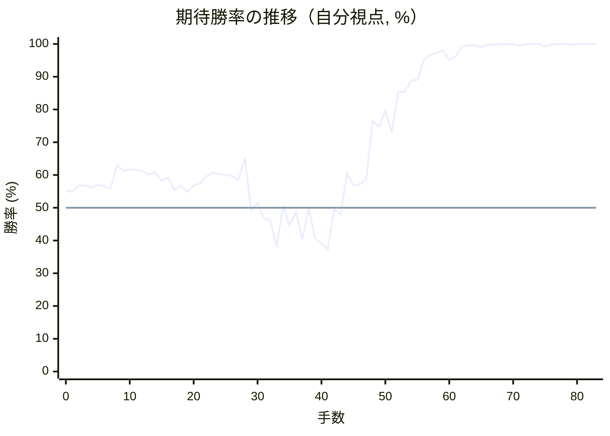
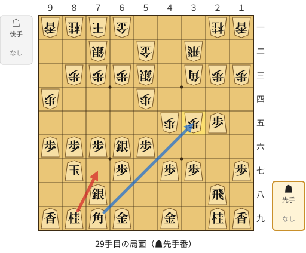
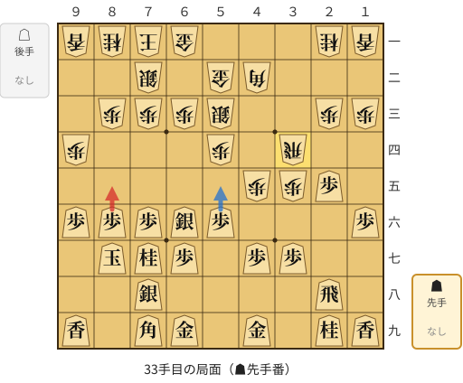
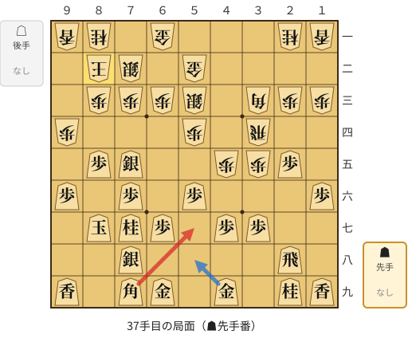
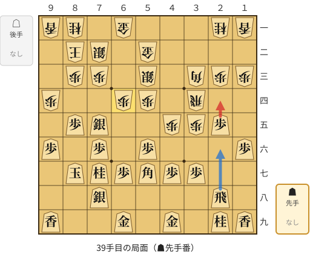
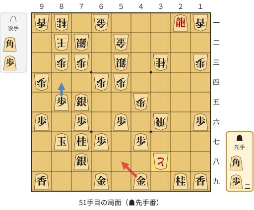
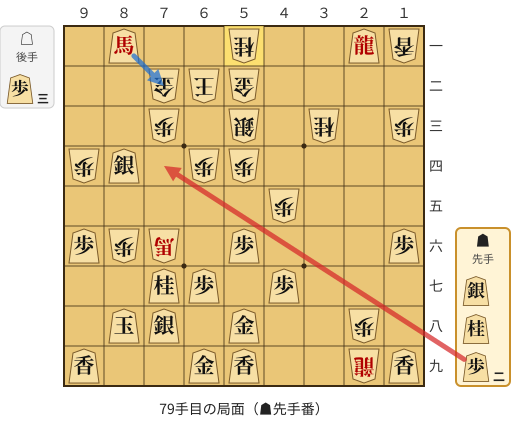

# 解析レポート 67tvt251l6xc

[README に戻る](../../../README.md)　/　棋譜: [CSA](../../../data/csa/shogi5/67tvt251l6xc.csa)　/　解析の見方: [docs/mistake_analysis.md](../../../docs/mistake_analysis.md)

## 対局情報

| 項目 | 内容 |
|---|---|
| 日時 | 2026-10-31 00:42:07 |
| 持ち時間 | 5分 |
| 自分 | 先手（▲）（1715） |
| 相手 | 相手（1738） |
| 結果 | 勝ち（投了, 83手） |

## 解析環境

| 項目 | 内容 |
|---|---|
| エンジン | YaneuraOu NNUE 9.00git 64AVX2（V9.00/YANEURAOU_ENGINE_NNUE/AVX2） |
| 評価関数 | **水匠5**（`suisho5`） |
| nn.bin SHA-256 | `768068f0d534a0603a5d38bcd143de6bbca820d5f1c95a14d40863e5b7892d76` |
| 第1パス | movetime=150ms, MultiPV 1 |
| 第2パス | movetime=2000ms, MultiPV 3 |
| Threads / Hash | 8 / 512MB |
| 判定基準 | 疑問手 ≥5pt, 悪手 ≥10pt, 大悪手 ≥20pt（期待勝率 W(E)=1/(1+exp(-E/600))） |
| 解析日時 | 2026-11-03T04:10:52+09:00（解析バージョン 1, 40秒） |

## サマリー

| 自分の手数 | 深掘りした手 | 詰み逃し | 大悪手 | 悪手 | 疑問手 |
|--:|--:|--:|--:|--:|--:|
| 42 | 7 | 1 | 0 | 3 | 2 |

## 期待勝率の推移



<details><summary>1手ごとの数値（第1パス）</summary>

| 手数 | 指し手 | 評価値 | 勝率 | 低下 | 判定 |
|--:|---|--:|--:|--:|---|
| 1 | ▲７六歩(77) | +115 | 54.8% | +0.4pt |  |
| 2 | △３四歩(33) | +164 | 56.8% |  |  |
| 3 | ▲２六歩(27) | +165 | 56.8% | -0.0pt |  |
| 4 | △４四歩(43) | +146 | 56.1% |  |  |
| 5 | ▲２五歩(26) | +170 | 57.0% | -1.0pt |  |
| 6 | △３三角(22) | +157 | 56.5% |  |  |
| 7 | ▲４八銀(39) | +142 | 55.9% | +0.6pt |  |
| 8 | △３二飛(82) | +323 | 63.1% |  |  |
| 9 | ▲６八玉(59) | +277 | 61.3% | +1.8pt |  |
| 10 | △４二銀(31) | +287 | 61.7% |  |  |
| 11 | ▲７八玉(68) | +282 | 61.5% | +0.2pt |  |
| 12 | △６二玉(51) | +274 | 61.2% |  |  |
| 13 | ▲９六歩(97) | +247 | 60.1% | +1.1pt |  |
| 14 | △９四歩(93) | +267 | 60.9% |  |  |
| 15 | ▲８六歩(87) | +198 | 58.2% | +2.8pt |  |
| 16 | △５二金(41) | +222 | 59.1% |  |  |
| 17 | ▲８七玉(78) | +130 | 55.4% | +3.8pt |  |
| 18 | △７二銀(71) | +164 | 56.8% |  |  |
| 19 | ▲７八銀(79) | +115 | 54.8% | +2.0pt |  |
| 20 | △５四歩(53) | +164 | 56.8% |  |  |
| 21 | ▲５六歩(57) | +180 | 57.4% | -0.7pt |  |
| 22 | △５三銀(42) | +234 | 59.6% |  |  |
| 23 | ▲５七銀(48) | +260 | 60.7% | -1.0pt |  |
| 24 | △７一玉(62) | +251 | 60.3% |  |  |
| 25 | ▲６六銀(57) | +243 | 60.0% | +0.3pt |  |
| 26 | △４五歩(44) | +237 | 59.7% |  |  |
| 27 | ▲７九角(88) | +203 | 58.4% | +1.4pt |  |
| 28 | △３五歩(34) | +378 | 65.2% |  |  |
| 29 | ▲７七桂(89) | -21 | 49.1% | +16.1pt | [悪手](#ply-29) |
| 30 | △４二角(33) | +36 | 51.5% |  |  |
| 31 | ▲１六歩(17) | -78 | 46.8% | +4.7pt |  |
| 32 | △３四飛(32) | -95 | 46.0% |  |  |
| 33 | ▲８五歩(86) | -293 | 38.0% | +8.0pt | [疑問手](#ply-33) |
| 34 | △３三角(42) | +20 | 50.8% |  |  |
| 35 | ▲７五銀(66) | -131 | 44.6% | +6.3pt |  |
| 36 | △８二玉(71) | -31 | 48.7% |  |  |
| 37 | ▲５七角(79) | -235 | 40.3% | +8.4pt | [悪手](#ply-37) |
| 38 | △６四歩(63) | -5 | 49.8% |  |  |
| 39 | ▲２四歩(25) | -227 | 40.7% | +9.1pt | [悪手](#ply-39) |
| 40 | △同歩(23) | -265 | 39.1% |  |  |
| 41 | ▲６六角(57) | -312 | 37.3% | +1.8pt |  |
| 42 | △３六歩(35) | -11 | 49.5% |  |  |
| 43 | ▲同歩(37) | -51 | 47.9% | +1.7pt |  |
| 44 | △同飛(34) | +256 | 60.5% |  |  |
| 45 | ▲３三角成(66) | +163 | 56.8% | +3.8pt |  |
| 46 | △同桂(21) | +175 | 57.2% |  |  |
| 47 | ▲２四飛(28) | +210 | 58.7% | -1.4pt |  |
| 48 | △３七歩打 | +713 | 76.6% |  |  |
| 49 | ▲２一飛成(24) | +648 | 74.6% | +2.0pt |  |
| 50 | △３八歩成(37) | +821 | 79.7% |  |  |
| 51 | ▲５八金(49) | +596 | 73.0% | +6.7pt | [疑問手](#ply-51) |
| 52 | △４八と(38) | +1065 | 85.5% |  |  |
| 53 | ▲同金(58) | +1054 | 85.3% | +0.2pt |  |
| 54 | △３九飛成(36) | +1241 | 88.8% |  |  |
| 55 | ▲５八金(48) | +1253 | 89.0% | -0.2pt |  |
| 56 | △２八歩打 | +1774 | 95.1% |  |  |
| 57 | ▲８四歩(85) | +2000 | 96.6% | -1.5pt |  |
| 58 | △同歩(83) | +2152 | 97.3% |  |  |
| 59 | ▲８三歩打 | +2328 | 98.0% | -0.7pt |  |
| 60 | △同玉(82) | +1777 | 95.1% |  |  |
| 61 | ▲８四銀(75) | +1920 | 96.1% | -1.0pt |  |
| 62 | △８二玉(83) | +2933 | 99.3% |  |  |
| 63 | ▲８三歩打 | +3316 | 99.6% | -0.4pt |  |
| 64 | △７一玉(82) | +3348 | 99.6% |  |  |
| 65 | ▲８二角打 | +2728 | 99.0% | +0.7pt |  |
| 66 | △６二玉(71) | +3600 | 99.8% |  |  |
| 67 | ▲９一角成(82) | +3735 | 99.8% | -0.0pt |  |
| 68 | △２九龍(39) | +3977 | 99.9% |  |  |
| 69 | ▲８二歩成(83) | +4148 | 99.9% | -0.0pt |  |
| 70 | △８六歩打 | +4527 | 99.9% |  |  |
| 71 | ▲８八玉(87) | +3222 | 99.5% | +0.4pt |  |
| 72 | △８七角打 | +4041 | 99.9% |  |  |
| 73 | ▲７二と(82) | +5797 | 100.0% | -0.1pt |  |
| 74 | △同金(61) | +5802 | 100.0% |  |  |
| 75 | ▲５九香打 | +2925 | 99.2% | +0.8pt |  |
| 76 | △７六角成(87) | +3978 | 99.9% |  |  |
| 77 | ▲８一馬(91) | +4222 | 99.9% | -0.0pt |  |
| 78 | △５一桂打 | #+7 | 100.0% |  |  |
| 79 | ▲７四歩打 | +3897 | 99.8% | +0.2pt | [詰み逃し](#ply-79) |
| 80 | △１九龍(29) | #+5 | 100.0% |  |  |
| 81 | ▲７二馬(81) | #+4 | 100.0% | +0.0pt |  |
| 82 | △同玉(62) | #+3 | 100.0% |  |  |
| 83 | ▲７三歩成(74) | #+2 | 100.0% | +0.0pt |  |

</details>

## 課題局面

<a id="ply-29"></a>
### 29手目 ▲７七桂(89) — 悪手

| | 着手前 | 着手後 | 差 |
|---|--:|--:|--:|
| 期待勝率 | 63.7% | 51.7% | -12.1pt |
| 評価値 | +338 | +40 | |

着手前の局面:



🔴 実戦 ▲７七桂(89)　🔵 AI推奨 ▲同角(79)　🟨 直前の相手の指し手

<details><summary>テキストの盤面図（BOD・将棋ソフトに貼り付け可）</summary>

```text
後手の持駒：なし
  ９ ８ ７ ６ ５ ４ ３ ２ １
+---------------------------+
|v香v桂v玉v金 ・ ・ ・v桂v香|一
| ・ ・v銀 ・v金 ・v飛 ・ ・|二
| ・v歩v歩v歩v銀 ・v角v歩v歩|三
|v歩 ・ ・ ・v歩 ・ ・ ・ ・|四
| ・ ・ ・ ・ ・v歩v歩 歩 ・|五
| 歩 歩 歩 銀 歩 ・ ・ ・ ・|六
| ・ 玉 ・ 歩 ・ 歩 歩 ・ 歩|七
| ・ ・ 銀 ・ ・ ・ ・ 飛 ・|八
| 香 桂 角 金 ・ 金 ・ 桂 香|九
+---------------------------+
先手の持駒：なし
手数＝28　△３五歩　まで
```

</details>

| | 指し手 | 評価値 | 読み筋 |
|---|---|--:|---|
| 実戦 | ▲７七桂(89) | +40 | △８二玉(71) ▲５八金(49) △４二角(33) ▲５五歩(56) △同歩(54) ▲同銀(66) |
| AI 1位 | ▲同角(79) | +338 | ▲同角(79) △４二角(33) ▲６八角(35) △８二玉(71) ▲５八金(49) △４四銀(53) |
| AI 2位 | ▲２四歩(25) | +180 | ▲２四歩(25) △同歩(23) ▲３五角(79) △８二玉(71) ▲３六歩(37) △２二飛(32) |
| AI 3位 | ▲５八金(49) | +114 | ▲５八金(49) △４四銀(53) ▲５七金(58) △８二玉(71) ▲４六歩(47) △６四歩(63) |

SFEN: `lnkg3nl/2s1g1r2/1ppps1bpp/p3p4/5ppP1/PPPSP4/1K1P1PP1P/2S4R1/LNBG1G1NL b - 29`

<a id="ply-33"></a>
### 33手目 ▲８五歩(86) — 疑問手

| | 着手前 | 着手後 | 差 |
|---|--:|--:|--:|
| 期待勝率 | 49.0% | 42.9% | -6.0pt |
| 評価値 | -25 | -171 | |

着手前の局面:



🔴 実戦 ▲８五歩(86)　🔵 AI推奨 ▲５五歩(56)　🟨 直前の相手の指し手

<details><summary>テキストの盤面図（BOD・将棋ソフトに貼り付け可）</summary>

```text
後手の持駒：なし
  ９ ８ ７ ６ ５ ４ ３ ２ １
+---------------------------+
|v香v桂v玉v金 ・ ・ ・v桂v香|一
| ・ ・v銀 ・v金v角 ・ ・ ・|二
| ・v歩v歩v歩v銀 ・ ・v歩v歩|三
|v歩 ・ ・ ・v歩 ・v飛 ・ ・|四
| ・ ・ ・ ・ ・v歩v歩 歩 ・|五
| 歩 歩 歩 銀 歩 ・ ・ ・ 歩|六
| ・ 玉 桂 歩 ・ 歩 歩 ・ ・|七
| ・ ・ 銀 ・ ・ ・ ・ 飛 ・|八
| 香 ・ 角 金 ・ 金 ・ 桂 香|九
+---------------------------+
先手の持駒：なし
手数＝32　△３四飛　まで
```

</details>

| | 指し手 | 評価値 | 読み筋 |
|---|---|--:|---|
| 実戦 | ▲８五歩(86) | -171 | △３三桂(21) ▲５八金(49) △８二玉(71) ▲４六歩(47) △３六歩(35) ▲同歩(37) |
| AI 1位 | ▲５五歩(56) | -25 | ▲５五歩(56) △８二玉(71) ▲５八飛(28) △５五歩(54) ▲同銀(66) △５四歩打 |
| AI 2位 | ▲５八飛(28) | -53 | ▲５八飛(28) △８二玉(71) ▲５五歩(56) △６四歩(63) ▲４八金(49) △５五歩(54) |
| AI 3位 | ▲２四歩(25) | -55 | ▲２四歩(25) △同歩(23) ▲４六歩(47) △同歩(45) ▲同角(79) △３三桂(21) |

SFEN: `lnkg3nl/2s1gb3/1ppps2pp/p3p1r2/5ppP1/PPPSP3P/1KNP1PP2/2S4R1/L1BG1G1NL b - 33`

<a id="ply-37"></a>
### 37手目 ▲５七角(79) — 悪手

| | 着手前 | 着手後 | 差 |
|---|--:|--:|--:|
| 期待勝率 | 49.3% | 38.7% | -10.6pt |
| 評価値 | -18 | -276 | |

着手前の局面:



🔴 実戦 ▲５七角(79)　🔵 AI推奨 ▲５八金(49)　🟨 直前の相手の指し手

<details><summary>テキストの盤面図（BOD・将棋ソフトに貼り付け可）</summary>

```text
後手の持駒：なし
  ９ ８ ７ ６ ５ ４ ３ ２ １
+---------------------------+
|v香v桂 ・v金 ・ ・ ・v桂v香|一
| ・v玉v銀 ・v金 ・ ・ ・ ・|二
| ・v歩v歩v歩v銀 ・v角v歩v歩|三
|v歩 ・ ・ ・v歩 ・v飛 ・ ・|四
| ・ 歩 銀 ・ ・v歩v歩 歩 ・|五
| 歩 ・ 歩 ・ 歩 ・ ・ ・ 歩|六
| ・ 玉 桂 歩 ・ 歩 歩 ・ ・|七
| ・ ・ 銀 ・ ・ ・ ・ 飛 ・|八
| 香 ・ 角 金 ・ 金 ・ 桂 香|九
+---------------------------+
先手の持駒：なし
手数＝36　△８二玉　まで
```

</details>

| | 指し手 | 評価値 | 読み筋 |
|---|---|--:|---|
| 実戦 | ▲５七角(79) | -276 | △５五歩(54) ▲同歩(56) △３六歩(35) ▲５八飛(28) △７四歩(73) ▲８六銀(75) |
| AI 1位 | ▲５八金(49) | -18 | ▲５八金(49) △７四歩(73) ▲８六銀(75) △６四銀(53) ▲４六歩(47) △３六歩(35) |
| AI 2位 | ▲４八金(49) | -66 | ▲４八金(49) △４四角(33) ▲４六歩(47) △同歩(45) ▲同角(79) △３三桂(21) |
| AI 3位 | ▲２六飛(28) | -97 | ▲２六飛(28) △７四歩(73) ▲８六銀(75) △４四角(33) ▲５七角(79) △６四銀(53) |

SFEN: `ln1g3nl/1ks1g4/1ppps1bpp/p3p1r2/1PS2ppP1/P1P1P3P/1KNP1PP2/2S4R1/L1BG1G1NL b - 37`

<a id="ply-39"></a>
### 39手目 ▲２四歩(25) — 悪手

| | 着手前 | 着手後 | 差 |
|---|--:|--:|--:|
| 期待勝率 | 48.3% | 37.9% | -10.4pt |
| 評価値 | -41 | -297 | |

着手前の局面:



🔴 実戦 ▲２四歩(25)　🔵 AI推奨 ▲２六飛(28)　🟨 直前の相手の指し手

<details><summary>テキストの盤面図（BOD・将棋ソフトに貼り付け可）</summary>

```text
後手の持駒：なし
  ９ ８ ７ ６ ５ ４ ３ ２ １
+---------------------------+
|v香v桂 ・v金 ・ ・ ・v桂v香|一
| ・v玉v銀 ・v金 ・ ・ ・ ・|二
| ・v歩v歩 ・v銀 ・v角v歩v歩|三
|v歩 ・ ・v歩v歩 ・v飛 ・ ・|四
| ・ 歩 銀 ・ ・v歩v歩 歩 ・|五
| 歩 ・ 歩 ・ 歩 ・ ・ ・ 歩|六
| ・ 玉 桂 歩 角 歩 歩 ・ ・|七
| ・ ・ 銀 ・ ・ ・ ・ 飛 ・|八
| 香 ・ ・ 金 ・ 金 ・ 桂 香|九
+---------------------------+
先手の持駒：なし
手数＝38　△６四歩　まで
```

</details>

| | 指し手 | 評価値 | 読み筋 |
|---|---|--:|---|
| 実戦 | ▲２四歩(25) | -297 | △同歩(23) ▲６六角(57) △４四銀(53) ▲８四歩(85) △同歩(83) ▲９五歩(96) |
| AI 1位 | ▲２六飛(28) | -41 | ▲２六飛(28) △６五歩(64) ▲５八金(49) △５五歩(54) ▲同歩(56) △７四歩(73) |
| AI 2位 | ▲５八金(49) | -41 | ▲５八金(49) △５五歩(54) ▲同歩(56) △３六歩(35) ▲２六飛(28) △５五角(33) |
| AI 3位 | ▲４八金(49) | -74 | ▲４八金(49) △５五歩(54) ▲同歩(56) △３六歩(35) ▲同歩(37) △同飛(34) |

SFEN: `ln1g3nl/1ks1g4/1pp1s1bpp/p2pp1r2/1PS2ppP1/P1P1P3P/1KNPBPP2/2S4R1/L2G1G1NL b - 39`

<a id="ply-51"></a>
### 51手目 ▲５八金(49) — 疑問手

| | 着手前 | 着手後 | 差 |
|---|--:|--:|--:|
| 期待勝率 | 83.1% | 74.4% | -8.7pt |
| 評価値 | +954 | +640 | |

着手前の局面:



🔴 実戦 ▲５八金(49)　🔵 AI推奨 ▲８四歩(85)　🟨 直前の相手の指し手

<details><summary>テキストの盤面図（BOD・将棋ソフトに貼り付け可）</summary>

```text
後手の持駒：角　歩
  ９ ８ ７ ６ ５ ４ ３ ２ １
+---------------------------+
|v香v桂 ・v金 ・ ・ ・ 龍v香|一
| ・v玉v銀 ・v金 ・ ・ ・ ・|二
| ・v歩v歩 ・v銀 ・v桂 ・v歩|三
|v歩 ・ ・v歩v歩 ・ ・ ・ ・|四
| ・ 歩 銀 ・ ・v歩 ・ ・ ・|五
| 歩 ・ 歩 ・ 歩 ・v飛 ・ 歩|六
| ・ 玉 桂 歩 ・ 歩 ・ ・ ・|七
| ・ ・ 銀 ・ ・ ・vと ・ ・|八
| 香 ・ ・ 金 ・ 金 ・ 桂 香|九
+---------------------------+
先手の持駒：角　歩二
手数＝50　△３八歩成　まで
```

</details>

| | 指し手 | 評価値 | 読み筋 |
|---|---|--:|---|
| 実戦 | ▲５八金(49) | +640 | △２九と(38) ▲８四歩(85) △同歩(83) ▲１一龍(21) △３九角打 ▲８三歩打 |
| AI 1位 | ▲８四歩(85) | +954 | ▲８四歩(85) △同歩(83) ▲３七歩打 △５六飛(36) ▲３八金(49) △５八角打 |
| AI 2位 | ▲３七歩打 | +826 | ▲３七歩打 △５六飛(36) ▲８四歩(85) △同歩(83) ▲３八金(49) △４二銀(53) |
| AI 3位 | ▲５八金(49) | +578 | ▲５八金(49) △２九と(38) ▲８四歩(85) △同歩(83) ▲８三歩打 △同玉(82) |

SFEN: `ln1g3+Rl/1ks1g4/1pp1s1n1p/p2pp4/1PS2p3/P1P1P1r1P/1KNP1P3/2S3+p2/L2G1G1NL b B2Pbp 51`

<a id="ply-79"></a>
### 79手目 ▲７四歩打 — 詰み逃し

| | 着手前 | 着手後 | 差 |
|---|--:|--:|--:|
| 期待勝率 | 100.0% | 100.0% | -0.0pt |
| 評価値 | 7手詰め | +7624 | |

着手前の局面:



🔴 実戦 ▲７四歩打　🔵 AI推奨 ▲７二馬(81)　🟨 直前の相手の指し手

<details><summary>テキストの盤面図（BOD・将棋ソフトに貼り付け可）</summary>

```text
後手の持駒：歩三
  ９ ８ ７ ６ ５ ４ ３ ２ １
+---------------------------+
| ・ 馬 ・ ・v桂 ・ ・ 龍v香|一
| ・ ・v金v玉v金 ・ ・ ・ ・|二
| ・ ・v歩 ・v銀 ・v桂 ・v歩|三
|v歩 銀 ・v歩v歩 ・ ・ ・ ・|四
| ・ ・ ・ ・ ・v歩 ・ ・ ・|五
| 歩v歩v馬 ・ 歩 ・ ・ ・ 歩|六
| ・ ・ 桂 歩 ・ 歩 ・ ・ ・|七
| ・ 玉 銀 ・ 金 ・ ・v歩 ・|八
| 香 ・ ・ 金 香 ・ ・v龍 香|九
+---------------------------+
先手の持駒：銀　桂　歩二
手数＝78　△５一桂　まで
```

</details>

| | 指し手 | 評価値 | 読み筋 |
|---|---|--:|---|
| 実戦 | ▲７四歩打 | +7624 | △８七歩成(86) ▲同銀(78) |
| AI 1位 | ▲７二馬(81) | 7手詰め | ▲７二馬(81) △同玉(62) ▲８三金打 △７一玉(72) ▲７二銀打 △６二玉(71) |
| AI 2位 | ▲７四桂打 | 9手詰め | ▲７四桂打 △同歩(73) ▲７二馬(81) △同玉(62) ▲７三金打 △８一玉(72) |
| AI 3位 | ▲４一龍(21) | +7583 | ▲４一龍(21) △８七歩成(86) ▲同銀(78) △同馬(76) ▲同玉(88) △６三銀打 |

SFEN: `1+B2n2+Rl/2gkg4/2p1s1n1p/pS1pp4/5p3/Pp+b1P3P/2NP1P3/1KS1G2p1/L2GL2+rL b SN2P3p 79`

