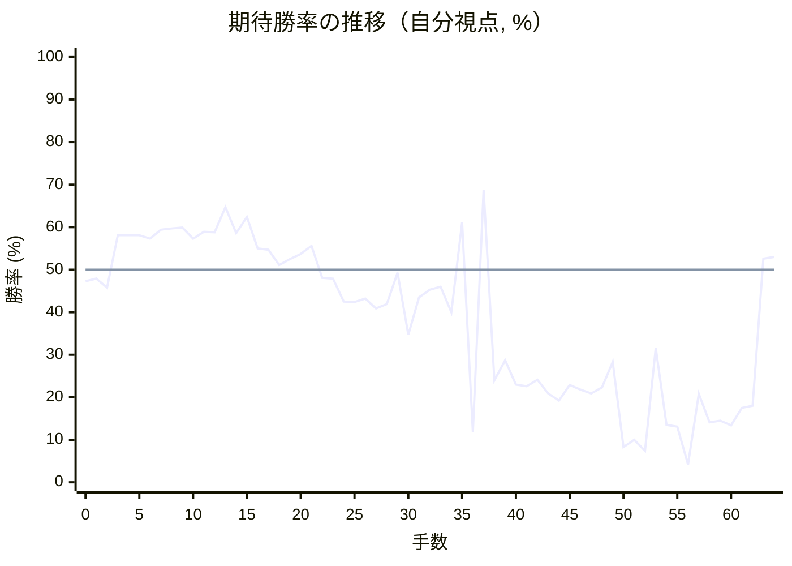
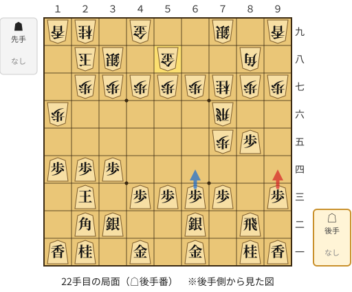
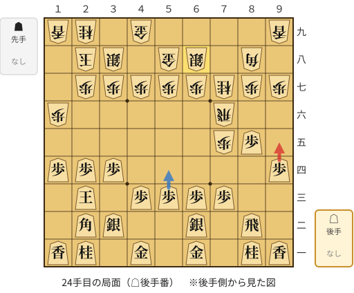
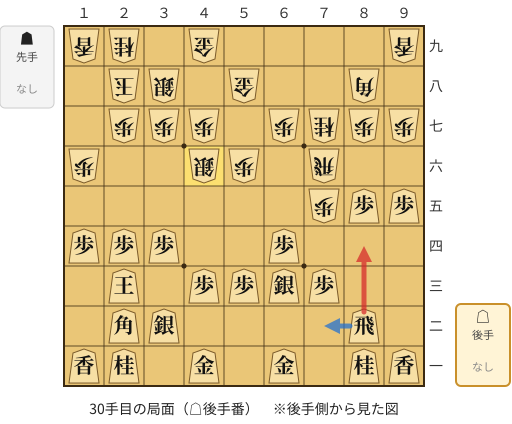
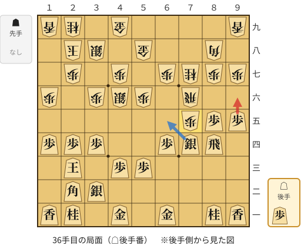
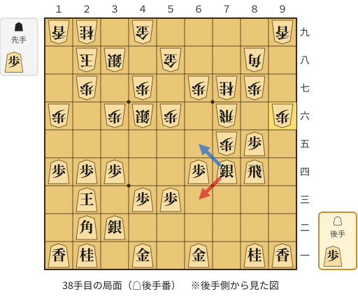
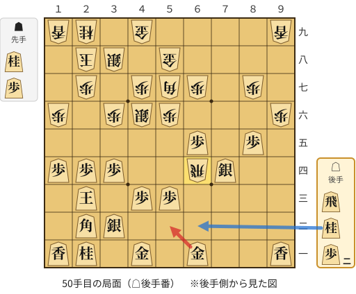
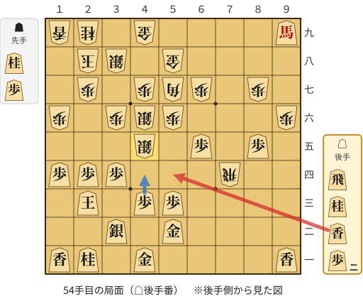

# 解析レポート 6b1mcz1l326i

[README に戻る](../../../README.md)　/　棋譜: [CSA](../../../data/csa/shogi5/6b1mcz1l326i.csa)　/　解析の見方: [docs/mistake_analysis.md](../../../docs/mistake_analysis.md)

## 対局情報

| 項目 | 内容 |
|---|---|
| 日時 | 2026-10-31 09:33:00 |
| 持ち時間 | 5分 |
| 自分 | 後手（△）（1718） |
| 相手 | 相手（1907） |
| 結果 | 勝ち（投了, 64手） |

## 解析環境

| 項目 | 内容 |
|---|---|
| エンジン | YaneuraOu NNUE 9.00git 64AVX2（V9.00/YANEURAOU_ENGINE_NNUE/AVX2） |
| 評価関数 | **水匠5**（`suisho5`） |
| nn.bin SHA-256 | `768068f0d534a0603a5d38bcd143de6bbca820d5f1c95a14d40863e5b7892d76` |
| 第1パス | movetime=150ms, MultiPV 1 |
| 第2パス | movetime=2000ms, MultiPV 3 |
| Threads / Hash | 8 / 512MB |
| 判定基準 | 疑問手 ≥5pt, 悪手 ≥10pt, 大悪手 ≥20pt（期待勝率 W(E)=1/(1+exp(-E/600))） |
| 解析日時 | 2026-11-03T04:09:25+09:00（解析バージョン 1, 54秒） |

## サマリー

| 自分の手数 | 深掘りした手 | 詰み逃し | 大悪手 | 悪手 | 疑問手 |
|--:|--:|--:|--:|--:|--:|
| 32 | 11 | 0 | 3 | 2 | 2 |

## 期待勝率の推移



<details><summary>1手ごとの数値（第1パス）</summary>

| 手数 | 指し手 | 評価値 | 勝率 | 低下 | 判定 |
|--:|---|--:|--:|--:|---|
| 1 | ▲７六歩(77) | -51 | 47.9% |  |  |
| 2 | △３四歩(33) | -102 | 45.8% | +2.1pt |  |
| 3 | ▲７五歩(76) | +195 | 58.1% |  |  |
| 4 | △８四歩(83) | +195 | 58.1% | +0.0pt |  |
| 5 | ▲７八飛(28) | +196 | 58.1% |  |  |
| 6 | △８五歩(84) | +176 | 57.3% | +0.8pt |  |
| 7 | ▲４八玉(59) | +228 | 59.4% |  |  |
| 8 | △６二銀(71) | +237 | 59.7% | -0.4pt |  |
| 9 | ▲３八玉(48) | +240 | 59.9% |  |  |
| 10 | △４二玉(51) | +177 | 57.3% | +2.5pt |  |
| 11 | ▲２八玉(38) | +216 | 58.9% |  |  |
| 12 | △３二玉(42) | +213 | 58.8% | +0.1pt |  |
| 13 | ▲３八銀(39) | +363 | 64.7% |  |  |
| 14 | △１四歩(13) | +208 | 58.6% | +6.1pt |  |
| 15 | ▲１六歩(17) | +303 | 62.4% |  |  |
| 16 | △２四歩(23) | +120 | 55.0% | +7.4pt |  |
| 17 | ▲７六飛(78) | +113 | 54.7% |  |  |
| 18 | △２三玉(32) | +27 | 51.1% | +3.6pt |  |
| 19 | ▲７七桂(89) | +60 | 52.5% |  |  |
| 20 | △３二銀(31) | +90 | 53.7% | -1.2pt |  |
| 21 | ▲５八金(69) | +134 | 55.6% |  |  |
| 22 | △９四歩(93) | -46 | 48.1% | +7.5pt | [疑問手](#ply-22) |
| 23 | ▲６八銀(79) | -50 | 47.9% |  |  |
| 24 | △９五歩(94) | -181 | 42.5% | +5.4pt | [疑問手](#ply-24) |
| 25 | ▲５六歩(57) | -184 | 42.4% |  |  |
| 26 | △６四歩(63) | -165 | 43.2% | -0.8pt |  |
| 27 | ▲５七銀(68) | -221 | 40.9% |  |  |
| 28 | △６三銀(62) | -197 | 41.9% | -1.0pt |  |
| 29 | ▲４六銀(57) | -17 | 49.3% |  |  |
| 30 | △８四飛(82) | -380 | 34.7% | +14.6pt | [悪手](#ply-30) |
| 31 | ▲３六歩(37) | -157 | 43.5% |  |  |
| 32 | △７四歩(73) | -113 | 45.3% | -1.8pt |  |
| 33 | ▲同歩(75) | -95 | 46.0% |  |  |
| 34 | △同銀(63) | -243 | 40.0% | +6.0pt |  |
| 35 | ▲７五歩打 | +270 | 61.1% |  |  |
| 36 | △９六歩(95) | -1208 | 11.8% | +49.3pt | [大悪手](#ply-36) |
| 37 | ▲同歩(97) | +475 | 68.8% |  |  |
| 38 | △６三銀(74) | -693 | 24.0% | +44.9pt | [大悪手](#ply-38) |
| 39 | ▲７九角(88) | -546 | 28.7% |  |  |
| 40 | △７三桂(81) | -726 | 23.0% | +5.7pt |  |
| 41 | ▲５七角(79) | -738 | 22.6% |  |  |
| 42 | △６五桂(73) | -688 | 24.1% | -1.5pt |  |
| 43 | ▲同桂(77) | -798 | 20.9% |  |  |
| 44 | △同歩(64) | -864 | 19.2% | +1.8pt |  |
| 45 | ▲７四歩(75) | -730 | 22.9% |  |  |
| 46 | △同飛(84) | -766 | 21.8% | +1.0pt |  |
| 47 | ▲同飛(76) | -798 | 20.9% |  |  |
| 48 | △同銀(63) | -750 | 22.3% | -1.4pt |  |
| 49 | ▲６四飛打 | -557 | 28.3% |  |  |
| 50 | △５二金(61) | -1442 | 8.3% | +20.0pt | [悪手](#ply-50) |
| 51 | ▲７四飛(64) | -1317 | 10.0% |  |  |
| 52 | △９九角成(22) | -1513 | 7.4% | +2.6pt |  |
| 53 | ▲４五銀打 | -463 | 31.6% |  |  |
| 54 | △５四香打 | -1114 | 13.5% | +18.1pt | [大悪手](#ply-54) |
| 55 | ▲７七歩打 | -1133 | 13.1% |  |  |
| 56 | △３三桂(21) | -1878 | 4.2% | +9.0pt |  |
| 57 | ▲５五歩(56) | -802 | 20.8% |  |  |
| 58 | △４五桂(33) | -1082 | 14.1% | +6.7pt |  |
| 59 | ▲同銀(46) | -1064 | 14.5% |  |  |
| 60 | △７三歩打 | -1121 | 13.4% | +1.1pt |  |
| 61 | ▲６四飛(74) | -932 | 17.5% |  |  |
| 62 | △７七馬(99) | -911 | 18.0% | -0.5pt |  |
| 63 | ▲５四歩(55) | +63 | 52.6% |  |  |
| 64 | △５五馬(77) | +72 | 53.0% | -0.4pt |  |

</details>

## 課題局面

<a id="ply-22"></a>
### 22手目 △９四歩(93) — 疑問手

| | 着手前 | 着手後 | 差 |
|---|--:|--:|--:|
| 期待勝率 | 52.2% | 44.9% | -7.4pt |
| 評価値 | +54 | -124 | |

着手前の局面:



🔴 実戦 △９四歩(93)　🔵 AI推奨 △６四歩(63)　🟨 直前の相手の指し手

<details><summary>テキストの盤面図（BOD・将棋ソフトに貼り付け可）</summary>

```text
後手の持駒：なし
  ９ ８ ７ ６ ５ ４ ３ ２ １
+---------------------------+
|v香v桂 ・v金 ・v金 ・v桂v香|一
| ・v飛 ・v銀 ・ ・v銀v角 ・|二
|v歩 ・v歩v歩v歩v歩 ・v玉 ・|三
| ・ ・ ・ ・ ・ ・v歩v歩v歩|四
| ・v歩 歩 ・ ・ ・ ・ ・ ・|五
| ・ ・ 飛 ・ ・ ・ ・ ・ 歩|六
| 歩 歩 桂 歩 歩 歩 歩 歩 ・|七
| ・ 角 ・ ・ 金 ・ 銀 玉 ・|八
| 香 ・ 銀 ・ ・ 金 ・ 桂 香|九
+---------------------------+
先手の持駒：なし
後手番
手数＝21　▲５八金左　まで
```

</details>

| | 指し手 | 評価値 | 読み筋 |
|---|---|--:|---|
| 実戦 | △９四歩(93) | -124 | ▲６八銀(79) △６四歩(63) ▲５六歩(57) △６三銀(62) ▲５七銀(68) △６五歩(64) |
| AI 1位 | △６四歩(63) | +54 | △６四歩(63) ▲３六歩(37) △６三銀(62) ▲５六歩(57) △８四飛(82) ▲９六歩(97) |
| AI 2位 | △５四歩(53) | +54 | △５四歩(53) ▲６八銀(79) △５三銀(62) ▲９六歩(97) △５二金(61) ▲５六歩(57) |
| AI 3位 | △５四歩(53) | +63 | △５四歩(53) ▲９六歩(97) △５二金(61) ▲６八銀(79) △５三銀(62) ▲５六歩(57) |

SFEN: `ln1g1g1nl/1r1s2sb1/p1pppp1k1/6ppp/1pP6/2R5P/PPNPPPPP1/1B2G1SK1/L1S2G1NL w - 22`

<a id="ply-24"></a>
### 24手目 △９五歩(94) — 疑問手

| | 着手前 | 着手後 | 差 |
|---|--:|--:|--:|
| 期待勝率 | 47.0% | 41.8% | -5.2pt |
| 評価値 | -72 | -198 | |

着手前の局面:



🔴 実戦 △９五歩(94)　🔵 AI推奨 △５四歩(53)　🟨 直前の相手の指し手

<details><summary>テキストの盤面図（BOD・将棋ソフトに貼り付け可）</summary>

```text
後手の持駒：なし
  ９ ８ ７ ６ ５ ４ ３ ２ １
+---------------------------+
|v香v桂 ・v金 ・v金 ・v桂v香|一
| ・v飛 ・v銀 ・ ・v銀v角 ・|二
| ・ ・v歩v歩v歩v歩 ・v玉 ・|三
|v歩 ・ ・ ・ ・ ・v歩v歩v歩|四
| ・v歩 歩 ・ ・ ・ ・ ・ ・|五
| ・ ・ 飛 ・ ・ ・ ・ ・ 歩|六
| 歩 歩 桂 歩 歩 歩 歩 歩 ・|七
| ・ 角 ・ 銀 金 ・ 銀 玉 ・|八
| 香 ・ ・ ・ ・ 金 ・ 桂 香|九
+---------------------------+
先手の持駒：なし
後手番
手数＝23　▲６八銀　まで
```

</details>

| | 指し手 | 評価値 | 読み筋 |
|---|---|--:|---|
| 実戦 | △９五歩(94) | -198 | ▲５六歩(57) △５四歩(53) ▲５七銀(68) △５三銀(62) ▲７九角(88) △６四銀(53) |
| AI 1位 | △５四歩(53) | -72 | △５四歩(53) ▲５六歩(57) △５三銀(62) ▲５七銀(68) △６四銀(53) ▲７九角(88) |
| AI 2位 | △５二金(61) | -122 | △５二金(61) ▲７九角(88) △５四歩(53) ▲５六歩(57) △５三銀(62) ▲５七銀(68) |
| AI 3位 | △５四歩(53) | -146 | △５四歩(53) ▲５六歩(57) △５二金(61) ▲５七銀(68) △５三金(52) ▲７九角(88) |

SFEN: `ln1g1g1nl/1r1s2sb1/2pppp1k1/p5ppp/1pP6/2R5P/PPNPPPPP1/1B1SG1SK1/L4G1NL w - 24`

<a id="ply-30"></a>
### 30手目 △８四飛(82) — 悪手

| | 着手前 | 着手後 | 差 |
|---|--:|--:|--:|
| 期待勝率 | 45.1% | 32.6% | -12.5pt |
| 評価値 | -118 | -436 | |

着手前の局面:



🔴 実戦 △８四飛(82)　🔵 AI推奨 △７二飛(82)　🟨 直前の相手の指し手

<details><summary>テキストの盤面図（BOD・将棋ソフトに貼り付け可）</summary>

```text
後手の持駒：なし
  ９ ８ ７ ６ ５ ４ ３ ２ １
+---------------------------+
|v香v桂 ・v金 ・v金 ・v桂v香|一
| ・v飛 ・ ・ ・ ・v銀v角 ・|二
| ・ ・v歩v銀v歩v歩 ・v玉 ・|三
| ・ ・ ・v歩 ・ ・v歩v歩v歩|四
|v歩v歩 歩 ・ ・ ・ ・ ・ ・|五
| ・ ・ 飛 ・ 歩 銀 ・ ・ 歩|六
| 歩 歩 桂 歩 ・ 歩 歩 歩 ・|七
| ・ 角 ・ ・ 金 ・ 銀 玉 ・|八
| 香 ・ ・ ・ ・ 金 ・ 桂 香|九
+---------------------------+
先手の持駒：なし
後手番
手数＝29　▲４六銀　まで
```

</details>

| | 指し手 | 評価値 | 読み筋 |
|---|---|--:|---|
| 実戦 | △８四飛(82) | -436 | ▲７九角(88) △５二金(61) ▲２六歩(27) △４四歩(43) ▲３六歩(37) △３三角(22) |
| AI 1位 | △７二飛(82) | -118 | △７二飛(82) ▲５五歩(56) △５四歩(53) ▲同歩(55) △同銀(63) ▲２六歩(27) |
| AI 2位 | △３三角(22) | -151 | △３三角(22) ▲３六歩(37) △５二金(61) ▲２六歩(27) △４四歩(43) ▲７九角(88) |
| AI 3位 | △５二金(61) | -178 | △５二金(61) ▲７九角(88) △３三角(22) ▲３六歩(37) △４四歩(43) ▲２六歩(27) |

SFEN: `ln1g1g1nl/1r4sb1/2pspp1k1/3p2ppp/ppP6/2R1PS2P/PPNP1PPP1/1B2G1SK1/L4G1NL w - 30`

<a id="ply-36"></a>
### 36手目 △９六歩(95) — 大悪手

| | 着手前 | 着手後 | 差 |
|---|--:|--:|--:|
| 期待勝率 | 62.9% | 9.4% | -53.5pt |
| 評価値 | +317 | -1360 | |

着手前の局面:



🔴 実戦 △９六歩(95)　🔵 AI推奨 △６五銀(74)　🟨 直前の相手の指し手

<details><summary>テキストの盤面図（BOD・将棋ソフトに貼り付け可）</summary>

```text
後手の持駒：歩
  ９ ８ ７ ６ ５ ４ ３ ２ １
+---------------------------+
|v香v桂 ・v金 ・v金 ・v桂v香|一
| ・ ・ ・ ・ ・ ・v銀v角 ・|二
| ・ ・ ・ ・v歩v歩 ・v玉 ・|三
| ・v飛v銀v歩 ・ ・v歩v歩v歩|四
|v歩v歩 歩 ・ ・ ・ ・ ・ ・|五
| ・ ・ 飛 ・ 歩 銀 歩 ・ 歩|六
| 歩 歩 桂 歩 ・ 歩 ・ 歩 ・|七
| ・ 角 ・ ・ 金 ・ 銀 玉 ・|八
| 香 ・ ・ ・ ・ 金 ・ 桂 香|九
+---------------------------+
先手の持駒：なし
後手番
手数＝35　▲７五歩　まで
```

</details>

| | 指し手 | 評価値 | 読み筋 |
|---|---|--:|---|
| 実戦 | △９六歩(95) | -1360 | ▲７四歩(75) △８六歩(85) ▲同歩(87) △７五歩打 ▲同飛(76) △８六飛(84) |
| AI 1位 | △６五銀(74) | +317 | △６五銀(74) ▲同桂(77) △８八角成(22) ▲５三桂不成(65) △８七馬(88) ▲４一桂成(53) |
| AI 2位 | △８六歩(85) | +212 | △８六歩(85) ▲同歩(87) △６五銀(74) ▲同桂(77) △８八角成(22) ▲５三桂不成(65) |
| AI 3位 | △６三銀(74) | -488 | △６三銀(74) ▲７九角(88) △７三桂(81) ▲５七角(79) △５二金(61) ▲２六歩(27) |

SFEN: `ln1g1g1nl/6sb1/4pp1k1/1rsp2ppp/ppP6/2R1PSP1P/PPNP1P1P1/1B2G1SK1/L4G1NL w p 36`

<a id="ply-38"></a>
### 38手目 △６三銀(74) — 大悪手

| | 着手前 | 着手後 | 差 |
|---|--:|--:|--:|
| 期待勝率 | 61.5% | 20.9% | -40.5pt |
| 評価値 | +280 | -798 | |

着手前の局面:



🔴 実戦 △６三銀(74)　🔵 AI推奨 △６五銀(74)　🟨 直前の相手の指し手

<details><summary>テキストの盤面図（BOD・将棋ソフトに貼り付け可）</summary>

```text
後手の持駒：歩
  ９ ８ ７ ６ ５ ４ ３ ２ １
+---------------------------+
|v香v桂 ・v金 ・v金 ・v桂v香|一
| ・ ・ ・ ・ ・ ・v銀v角 ・|二
| ・ ・ ・ ・v歩v歩 ・v玉 ・|三
| ・v飛v銀v歩 ・ ・v歩v歩v歩|四
| ・v歩 歩 ・ ・ ・ ・ ・ ・|五
| 歩 ・ 飛 ・ 歩 銀 歩 ・ 歩|六
| ・ 歩 桂 歩 ・ 歩 ・ 歩 ・|七
| ・ 角 ・ ・ 金 ・ 銀 玉 ・|八
| 香 ・ ・ ・ ・ 金 ・ 桂 香|九
+---------------------------+
先手の持駒：歩
後手番
手数＝37　▲９六同歩　まで
```

</details>

| | 指し手 | 評価値 | 読み筋 |
|---|---|--:|---|
| 実戦 | △６三銀(74) | -798 | ▲３五歩(36) △７四歩打 ▲同歩(75) △同銀(63) ▲５五歩(56) △３五歩(34) |
| AI 1位 | △６五銀(74) | +280 | △６五銀(74) ▲同桂(77) △８八角成(22) ▲５三桂不成(65) △８七馬(88) ▲４一桂成(53) |
| AI 2位 | △８六歩(85) | -168 | △８六歩(85) ▲７四歩(75) △８七歩成(86) ▲８五歩打 △８三飛(84) ▲８四銀打 |
| AI 3位 | △６三銀(74) | -723 | △６三銀(74) ▲３五歩(36) △７四歩打 ▲同歩(75) △同銀(63) ▲５五歩(56) |

SFEN: `ln1g1g1nl/6sb1/4pp1k1/1rsp2ppp/1pP6/P1R1PSP1P/1PNP1P1P1/1B2G1SK1/L4G1NL w Pp 38`

<a id="ply-50"></a>
### 50手目 △５二金(61) — 悪手

| | 着手前 | 着手後 | 差 |
|---|--:|--:|--:|
| 期待勝率 | 25.6% | 7.4% | -18.2pt |
| 評価値 | -640 | -1513 | |

着手前の局面:



🔴 実戦 △５二金(61)　🔵 AI推奨 △６二桂打　🟨 直前の相手の指し手

<details><summary>テキストの盤面図（BOD・将棋ソフトに貼り付け可）</summary>

```text
後手の持駒：飛　桂　歩二
  ９ ８ ７ ６ ５ ４ ３ ２ １
+---------------------------+
|v香 ・ ・v金 ・v金 ・v桂v香|一
| ・ ・ ・ ・ ・ ・v銀v角 ・|二
| ・ ・ ・ ・v歩v歩 ・v玉 ・|三
| ・ ・v銀 飛 ・ ・v歩v歩v歩|四
| ・v歩 ・v歩 ・ ・ ・ ・ ・|五
| 歩 ・ ・ ・ 歩 銀 歩 ・ 歩|六
| ・ 歩 ・ 歩 角 歩 ・ 歩 ・|七
| ・ ・ ・ ・ 金 ・ 銀 玉 ・|八
| 香 ・ ・ ・ ・ 金 ・ 桂 香|九
+---------------------------+
先手の持駒：桂　歩
後手番
手数＝49　▲６四飛　まで
```

</details>

| | 指し手 | 評価値 | 読み筋 |
|---|---|--:|---|
| 実戦 | △５二金(61) | -1513 | ▲７四飛(64) △９九角成(22) ▲７一飛成(74) △３三馬(99) ▲９一龍(71) △４四香打 |
| AI 1位 | △６二桂打 | -640 | △６二桂打 ▲７五歩打 △８三銀(74) ▲５五歩(56) △８九飛打 ▲６三飛成(64) |
| AI 2位 | △７一飛打 | -1336 | △７一飛打 ▲７二歩打 △同金(61) ▲７四飛(64) △７三金(72) ▲７六飛(74) |
| AI 3位 | △５一金(61) | -1386 | △５一金(61) ▲７四飛(64) △９九角成(22) ▲３五歩(36) △７三歩打 ▲同飛成(74) |

SFEN: `l2g1g1nl/6sb1/4pp1k1/2sR2ppp/1p1p5/P3PSP1P/1P1PBP1P1/4G1SK1/L4G1NL w NPrn2p 50`

<a id="ply-54"></a>
### 54手目 △５四香打 — 大悪手

| | 着手前 | 着手後 | 差 |
|---|--:|--:|--:|
| 期待勝率 | 28.7% | 8.1% | -20.6pt |
| 評価値 | -546 | -1458 | |

着手前の局面:



🔴 実戦 △５四香打　🔵 AI推奨 △４四歩(43)　🟨 直前の相手の指し手

<details><summary>テキストの盤面図（BOD・将棋ソフトに貼り付け可）</summary>

```text
後手の持駒：飛　桂　香　歩二
  ９ ８ ７ ６ ５ ４ ３ ２ １
+---------------------------+
|v香 ・ ・ ・ ・v金 ・v桂v香|一
| ・ ・ ・ ・v金 ・v銀 ・ ・|二
| ・ ・ ・ ・v歩v歩 ・v玉 ・|三
| ・ ・ 飛 ・ ・ ・v歩v歩v歩|四
| ・v歩 ・v歩 ・ 銀 ・ ・ ・|五
| 歩 ・ ・ ・ 歩 銀 歩 ・ 歩|六
| ・ 歩 ・ 歩 角 歩 ・ 歩 ・|七
| ・ ・ ・ ・ 金 ・ 銀 玉 ・|八
|v馬 ・ ・ ・ ・ 金 ・ 桂 香|九
+---------------------------+
先手の持駒：桂　歩
後手番
手数＝53　▲４五銀打　まで
```

</details>

| | 指し手 | 評価値 | 読み筋 |
|---|---|--:|---|
| 実戦 | △５四香打 | -1458 | ▲７七歩打 △４四歩(43) ▲３四銀(45) △同玉(23) ▲５五歩(56) △同香(54) |
| AI 1位 | △４四歩(43) | -546 | △４四歩(43) ▲同銀(45) △４三歩打 ▲５五銀(44) △５四歩(53) ▲同飛(74) |
| AI 2位 | △４四香打 | -700 | △４四香打 ▲７一飛成(74) △４五香(44) ▲同銀(46) △３三桂(21) ▲３四銀(45) |
| AI 3位 | △８九飛打 | -923 | △８九飛打 ▲３四銀(45) △２二玉(23) ▲３五銀(46) △３三歩打 ▲４五銀(34) |

SFEN: `l4g1nl/4g1s2/4pp1k1/2R3ppp/1p1p1S3/P3PSP1P/1P1PBP1P1/4G1SK1/+b4G1NL w NPrnl2p 54`

