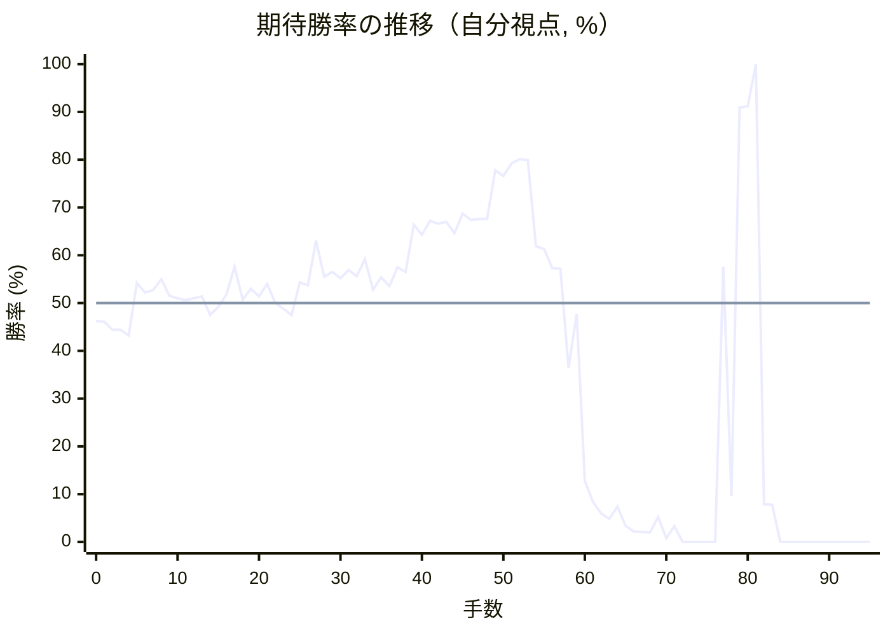
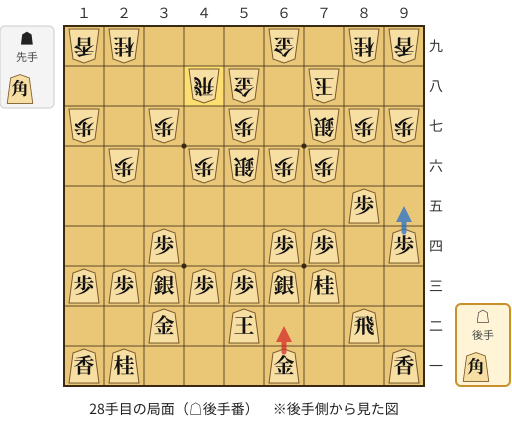
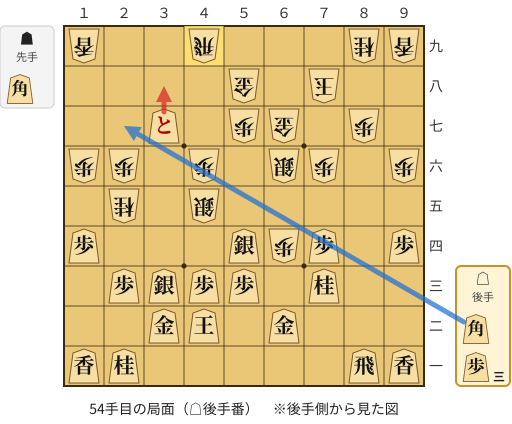
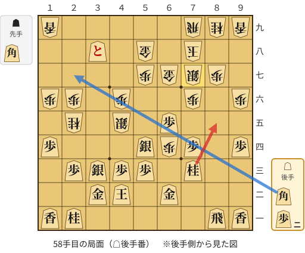
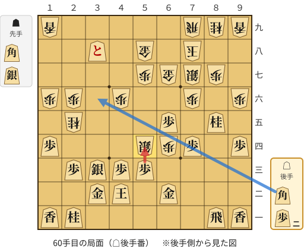
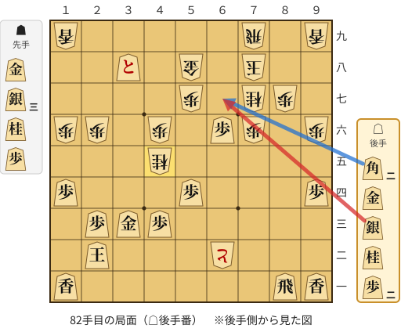

# 解析レポート 6csegkafzmab

[README に戻る](../../../README.md)　/　棋譜: [CSA](../../../data/csa/shogi5/6csegkafzmab.csa)　/　解析の見方: [docs/mistake_analysis.md](../../../docs/mistake_analysis.md)

## 対局情報

| 項目 | 内容 |
|---|---|
| 日時 | 2026-10-31 01:07:21 |
| 持ち時間 | 5分 |
| 自分 | 後手（△）（1722） |
| 相手 | 相手（1843） |
| 結果 | 負け（投了, 95手） |

## 解析環境

| 項目 | 内容 |
|---|---|
| エンジン | YaneuraOu NNUE 9.00git 64AVX2（V9.00/YANEURAOU_ENGINE_NNUE/AVX2） |
| 評価関数 | **水匠5**（`suisho5`） |
| nn.bin SHA-256 | `768068f0d534a0603a5d38bcd143de6bbca820d5f1c95a14d40863e5b7892d76` |
| 第1パス | movetime=150ms, MultiPV 1 |
| 第2パス | movetime=2000ms, MultiPV 3 |
| Threads / Hash | 8 / 512MB |
| 判定基準 | 疑問手 ≥5pt, 悪手 ≥10pt, 大悪手 ≥20pt（期待勝率 W(E)=1/(1+exp(-E/600))） |
| 解析日時 | 2026-11-03T04:10:09+09:00（解析バージョン 1, 43秒） |

## サマリー

| 自分の手数 | 深掘りした手 | 詰み逃し | 大悪手 | 悪手 | 疑問手 |
|--:|--:|--:|--:|--:|--:|
| 47 | 8 | 1 | 2 | 0 | 2 |

## 期待勝率の推移



<details><summary>1手ごとの数値（第1パス）</summary>

| 手数 | 指し手 | 評価値 | 勝率 | 低下 | 判定 |
|--:|---|--:|--:|--:|---|
| 1 | ▲７六歩(77) | -93 | 46.1% |  |  |
| 2 | △３四歩(33) | -135 | 44.4% | +1.7pt |  |
| 3 | ▲２六歩(27) | -135 | 44.4% |  |  |
| 4 | △８四歩(83) | -164 | 43.2% | +1.2pt |  |
| 5 | ▲２二角成(88) | +102 | 54.2% |  |  |
| 6 | △同銀(31) | +53 | 52.2% | +2.0pt |  |
| 7 | ▲８八銀(79) | +66 | 52.7% |  |  |
| 8 | △３三銀(22) | +120 | 55.0% | -2.2pt |  |
| 9 | ▲７七銀(88) | +37 | 51.5% |  |  |
| 10 | △８五歩(84) | +25 | 51.0% | +0.5pt |  |
| 11 | ▲４八銀(39) | +15 | 50.6% |  |  |
| 12 | △６二銀(71) | +24 | 51.0% | -0.4pt |  |
| 13 | ▲４六歩(47) | +34 | 51.4% |  |  |
| 14 | △３二金(41) | -61 | 47.5% | +4.0pt |  |
| 15 | ▲４七銀(48) | -20 | 49.2% |  |  |
| 16 | △６四歩(63) | +43 | 51.8% | -2.6pt |  |
| 17 | ▲５六銀(47) | +184 | 57.6% |  |  |
| 18 | △６三銀(62) | +17 | 50.7% | +6.9pt |  |
| 19 | ▲５八金(49) | +71 | 53.0% |  |  |
| 20 | △７四歩(73) | +33 | 51.4% | +1.6pt |  |
| 21 | ▲６六歩(67) | +96 | 54.0% |  |  |
| 22 | △５二玉(51) | -1 | 50.0% | +4.0pt |  |
| 23 | ▲６八玉(59) | -28 | 48.8% |  |  |
| 24 | △７三桂(81) | -61 | 47.5% | +1.4pt |  |
| 25 | ▲７八玉(68) | +104 | 54.3% |  |  |
| 26 | △９四歩(93) | +88 | 53.7% | +0.7pt |  |
| 27 | ▲４八飛(28) | +323 | 63.1% |  |  |
| 28 | △６二金(61) | +132 | 55.5% | +7.7pt | [疑問手](#ply-28) |
| 29 | ▲９六歩(97) | +158 | 56.5% |  |  |
| 30 | △８一飛(82) | +126 | 55.2% | +1.3pt |  |
| 31 | ▲６八金(69) | +166 | 56.9% |  |  |
| 32 | △５四銀(63) | +134 | 55.6% | +1.3pt |  |
| 33 | ▲３六歩(37) | +223 | 59.2% |  |  |
| 34 | △４二玉(52) | +68 | 52.8% | +6.4pt |  |
| 35 | ▲１六歩(17) | +131 | 55.4% |  |  |
| 36 | △１四歩(13) | +84 | 53.5% | +1.9pt |  |
| 37 | ▲３七桂(29) | +182 | 57.5% |  |  |
| 38 | △６五歩(64) | +157 | 56.5% | +1.0pt |  |
| 39 | ▲６七金(68) | +408 | 66.4% |  |  |
| 40 | △６六歩(65) | +352 | 64.3% | +2.1pt |  |
| 41 | ▲同銀(77) | +431 | 67.2% |  |  |
| 42 | △８六歩(85) | +413 | 66.6% | +0.7pt |  |
| 43 | ▲同歩(87) | +426 | 67.0% |  |  |
| 44 | △同飛(81) | +360 | 64.6% | +2.5pt |  |
| 45 | ▲８七歩打 | +473 | 68.7% |  |  |
| 46 | △８一飛(86) | +435 | 67.4% | +1.4pt |  |
| 47 | ▲６四歩打 | +440 | 67.6% |  |  |
| 48 | △３五歩(34) | +442 | 67.6% | -0.1pt |  |
| 49 | ▲４五銀(56) | +751 | 77.8% |  |  |
| 50 | △３六歩(35) | +713 | 76.6% | +1.1pt |  |
| 51 | ▲２五桂(37) | +802 | 79.2% |  |  |
| 52 | △３七歩成(36) | +837 | 80.1% | -0.9pt |  |
| 53 | ▲４九飛(48) | +828 | 79.9% |  |  |
| 54 | △３八と(37) | +291 | 61.9% | +18.0pt | [大悪手](#ply-54) |
| 55 | ▲７九飛(49) | +277 | 61.3% |  |  |
| 56 | △６五歩打 | +176 | 57.3% | +4.1pt |  |
| 57 | ▲７七銀(66) | +174 | 57.2% |  |  |
| 58 | △８五桂(73) | -336 | 36.4% | +20.8pt | [疑問手](#ply-58) |
| 59 | ▲５四銀(45) | -56 | 47.7% |  |  |
| 60 | △同歩(53) | -1150 | 12.8% | +34.8pt | [大悪手](#ply-60) |
| 61 | ▲６三歩成(64) | -1432 | 8.4% |  |  |
| 62 | △７七桂成(85) | -1652 | 6.0% | +2.4pt |  |
| 63 | ▲同金(67) | -1794 | 4.8% |  |  |
| 64 | △６六銀打 | -1517 | 7.4% | -2.6pt |  |
| 65 | ▲６二と(63) | -2013 | 3.4% |  |  |
| 66 | △７七銀成(66) | -2290 | 2.2% | +1.2pt |  |
| 67 | ▲同桂(89) | -2316 | 2.1% |  |  |
| 68 | △３一玉(42) | -2341 | 2.0% | +0.1pt |  |
| 69 | ▲４五桂打 | -1740 | 5.2% |  |  |
| 70 | △７五歩(74) | -2894 | 0.8% | +4.4pt |  |
| 71 | ▲６四角打 | -2028 | 3.3% |  |  |
| 72 | △２二玉(31) | #-23 | 0.0% | +3.3pt |  |
| 73 | ▲３三桂成(45) | #-22 | 0.0% |  |  |
| 74 | △同桂(21) | #-21 | 0.0% | +0.0pt |  |
| 75 | ▲同桂成(25) | #-20 | 0.0% |  |  |
| 76 | △同金(32) | #-17 | 0.0% | +0.0pt |  |
| 77 | ▲７五角(64) | +185 | 57.6% |  |  |
| 78 | △６六桂打 | -1343 | 9.6% | +48.0pt |  |
| 79 | ▲同角(75) | +1383 | 90.9% |  |  |
| 80 | △同歩(65) | +1400 | 91.2% | -0.2pt |  |
| 81 | ▲４五桂打 | #+17 | 100.0% |  |  |
| 82 | △６七銀打 | -1477 | 7.9% | +92.1pt | [詰み逃し](#ply-82) |
| 83 | ▲８八玉(78) | -1483 | 7.8% |  |  |
| 84 | △７六銀成(67) | #-11 | 0.0% | +7.8pt |  |
| 85 | ▲３三桂成(45) | #-10 | 0.0% |  |  |
| 86 | △同玉(22) | #-9 | 0.0% | +0.0pt |  |
| 87 | ▲２五桂打 | #-8 | 0.0% |  |  |
| 88 | △４四玉(33) | #-7 | 0.0% | +0.0pt |  |
| 89 | ▲４五銀打 | #-6 | 0.0% |  |  |
| 90 | △５三玉(44) | #-5 | 0.0% | +0.0pt |  |
| 91 | ▲６三金打 | #-4 | 0.0% |  |  |
| 92 | △４二玉(53) | #-3 | 0.0% | +0.0pt |  |
| 93 | ▲３三銀打 | #-2 | 0.0% |  |  |
| 94 | △３一玉(42) | #-1 | 0.0% | +0.0pt |  |
| 95 | ▲４二銀打 | #-2 | 0.0% |  |  |

</details>

## 課題局面

<a id="ply-28"></a>
### 28手目 △６二金(61) — 疑問手

| | 着手前 | 着手後 | 差 |
|---|--:|--:|--:|
| 期待勝率 | 60.5% | 54.9% | -5.7pt |
| 評価値 | +257 | +117 | |

着手前の局面:



🔴 実戦 △６二金(61)　🔵 AI推奨 △９五歩(94)　🟨 直前の相手の指し手

<details><summary>テキストの盤面図（BOD・将棋ソフトに貼り付け可）</summary>

```text
後手の持駒：角
  ９ ８ ７ ６ ５ ４ ３ ２ １
+---------------------------+
|v香 ・ ・v金 ・ ・ ・v桂v香|一
| ・v飛 ・ ・v玉 ・v金 ・ ・|二
| ・ ・v桂v銀v歩v歩v銀v歩v歩|三
|v歩 ・v歩v歩 ・ ・v歩 ・ ・|四
| ・v歩 ・ ・ ・ ・ ・ ・ ・|五
| ・ ・ 歩 歩 銀 歩 ・ 歩 ・|六
| 歩 歩 銀 ・ 歩 ・ 歩 ・ 歩|七
| ・ ・ 玉 ・ 金 飛 ・ ・ ・|八
| 香 桂 ・ 金 ・ ・ ・ 桂 香|九
+---------------------------+
先手の持駒：角
後手番
手数＝27　▲４八飛　まで
```

</details>

| | 指し手 | 評価値 | 読み筋 |
|---|---|--:|---|
| 実戦 | △６二金(61) | +117 | ▲９六歩(97) △３五歩(34) ▲１六歩(17) △１四歩(13) ▲８八玉(78) △８一飛(82) |
| AI 1位 | △９五歩(94) | +257 | △９五歩(94) ▲１六歩(17) △１四歩(13) ▲３六歩(37) △８一飛(82) ▲８八玉(78) |
| AI 2位 | △８一飛(82) | +162 | △８一飛(82) ▲９六歩(97) △５四銀(63) ▲４五歩(46) △６二金(61) ▲１六歩(17) |
| AI 3位 | △６二金(61) | +151 | △６二金(61) ▲９六歩(97) △８一飛(82) ▲３六歩(37) △５四銀(63) ▲４五歩(46) |

SFEN: `l2g3nl/1r2k1g2/2nsppspp/p1pp2p2/1p7/2PPSP1P1/PPS1P1P1P/2K1GR3/LN1G3NL w Bb 28`

<a id="ply-54"></a>
### 54手目 △３八と(37) — 大悪手

| | 着手前 | 着手後 | 差 |
|---|--:|--:|--:|
| 期待勝率 | 81.2% | 60.3% | -20.9pt |
| 評価値 | +878 | +250 | |

着手前の局面:



🔴 実戦 △３八と(37)　🔵 AI推奨 △２七角打　🟨 直前の相手の指し手

<details><summary>テキストの盤面図（BOD・将棋ソフトに貼り付け可）</summary>

```text
後手の持駒：角　歩三
  ９ ８ ７ ６ ５ ４ ３ ２ １
+---------------------------+
|v香v飛 ・ ・ ・ ・ ・v桂v香|一
| ・ ・ ・v金 ・v玉v金 ・ ・|二
| ・ ・v桂 ・v歩v歩v銀v歩 ・|三
|v歩 ・v歩 歩v銀 ・ ・ ・v歩|四
| ・ ・ ・ ・ ・ 銀 ・ 桂 ・|五
| 歩 ・ 歩 銀 ・ 歩 ・ 歩 歩|六
| ・ 歩 ・ 金 歩 ・vと ・ ・|七
| ・ ・ 玉 ・ 金 ・ ・ ・ ・|八
| 香 桂 ・ ・ ・ 飛 ・ ・ 香|九
+---------------------------+
先手の持駒：角
後手番
手数＝53　▲４九飛　まで
```

</details>

| | 指し手 | 評価値 | 読み筋 |
|---|---|--:|---|
| 実戦 | △３八と(37) | +250 | ▲７九飛(49) △２七角打 ▲５四銀(45) △同角成(27) ▲４五角打 △同馬(54) |
| AI 1位 | △２七角打 | +878 | △２七角打 ▲２九飛(49) △４五銀(54) ▲６三歩成(64) △３六角成(27) ▲６八金(67) |
| AI 2位 | △６五歩打 | +861 | △６五歩打 ▲７七銀(66) △４四銀(33) ▲５四銀(45) △２七角打 ▲３九飛(49) |
| AI 3位 | △４四銀(33) | +820 | △４四銀(33) ▲５四銀(45) △２七角打 ▲３九飛(49) △５四角成(27) ▲６三銀打 |

SFEN: `lr5nl/3g1kg2/2n1ppsp1/p1pPs3p/5S1N1/P1PS1P1PP/1P1GP1+p2/2K1G4/LN3R2L w Bb3p 54`

<a id="ply-58"></a>
### 58手目 △８五桂(73) — 疑問手

| | 着手前 | 着手後 | 差 |
|---|--:|--:|--:|
| 期待勝率 | 58.4% | 49.0% | -9.4pt |
| 評価値 | +204 | -23 | |

着手前の局面:



🔴 実戦 △８五桂(73)　🔵 AI推奨 △２七角打　🟨 直前の相手の指し手

<details><summary>テキストの盤面図（BOD・将棋ソフトに貼り付け可）</summary>

```text
後手の持駒：角　歩二
  ９ ８ ７ ６ ５ ４ ３ ２ １
+---------------------------+
|v香v飛 ・ ・ ・ ・ ・v桂v香|一
| ・ ・ ・v金 ・v玉v金 ・ ・|二
| ・ ・v桂 ・v歩v歩v銀v歩 ・|三
|v歩 ・v歩 歩v銀 ・ ・ ・v歩|四
| ・ ・ ・v歩 ・ 銀 ・ 桂 ・|五
| 歩 ・ 歩 ・ ・ 歩 ・ 歩 歩|六
| ・ 歩 銀 金 歩 ・ ・ ・ ・|七
| ・ ・ 玉 ・ 金 ・vと ・ ・|八
| 香 桂 飛 ・ ・ ・ ・ ・ 香|九
+---------------------------+
先手の持駒：角
後手番
手数＝57　▲７七銀　まで
```

</details>

| | 指し手 | 評価値 | 読み筋 |
|---|---|--:|---|
| 実戦 | △８五桂(73) | -23 | ▲５四銀(45) △３六角打 ▲３三桂成(25) △同金(32) ▲６三歩成(64) △５八角成(36) |
| AI 1位 | △２七角打 | +204 | △２七角打 ▲５四銀(45) △同角成(27) ▲４五角打 △同馬(54) ▲同歩(46) |
| AI 2位 | △８五桂(73) | -76 | △８五桂(73) ▲５四銀(45) △３六角打 ▲６三歩成(64) △５八角成(36) ▲５三と(63) |
| AI 3位 | △６六歩(65) | -147 | △６六歩(65) ▲同銀(77) △２七角打 ▲１八角打 △同角成(27) ▲同香(19) |

SFEN: `lr5nl/3g1kg2/2n1ppsp1/p1pPs3p/3p1S1N1/P1P2P1PP/1PSGP4/2K1G1+p2/LNR5L w Bb2p 58`

<a id="ply-60"></a>
### 60手目 △同歩(53) — 大悪手

| | 着手前 | 着手後 | 差 |
|---|--:|--:|--:|
| 期待勝率 | 44.8% | 7.1% | -37.6pt |
| 評価値 | -126 | -1540 | |

着手前の局面:



🔴 実戦 △同歩(53)　🔵 AI推奨 △３六角打　🟨 直前の相手の指し手

<details><summary>テキストの盤面図（BOD・将棋ソフトに貼り付け可）</summary>

```text
後手の持駒：角　歩二
  ９ ８ ７ ６ ５ ４ ３ ２ １
+---------------------------+
|v香v飛 ・ ・ ・ ・ ・v桂v香|一
| ・ ・ ・v金 ・v玉v金 ・ ・|二
| ・ ・ ・ ・v歩v歩v銀v歩 ・|三
|v歩 ・v歩 歩 銀 ・ ・ ・v歩|四
| ・v桂 ・v歩 ・ ・ ・ 桂 ・|五
| 歩 ・ 歩 ・ ・ 歩 ・ 歩 歩|六
| ・ 歩 銀 金 歩 ・ ・ ・ ・|七
| ・ ・ 玉 ・ 金 ・vと ・ ・|八
| 香 桂 飛 ・ ・ ・ ・ ・ 香|九
+---------------------------+
先手の持駒：角　銀
後手番
手数＝59　▲５四銀　まで
```

</details>

| | 指し手 | 評価値 | 読み筋 |
|---|---|--:|---|
| 実戦 | △同歩(53) | -1540 | ▲６三歩成(64) △３一玉(42) ▲６二と(63) △６六銀打 ▲４一銀打 △同玉(31) |
| AI 1位 | △３六角打 | -126 | △３六角打 ▲６三歩成(64) △５八角成(36) ▲５三と(63) △同金(62) ▲同銀不成(54) |
| AI 2位 | △８八歩打 | -940 | △８八歩打 ▲同玉(78) △３六角打 ▲３三桂成(25) △同金(32) ▲６八金(58) |
| AI 3位 | △７七桂不成(85) | -948 | △７七桂不成(85) ▲同金(67) △３六角打 ▲６三歩成(64) △５八角成(36) ▲５三と(63) |

SFEN: `lr5nl/3g1kg2/4ppsp1/p1pPS3p/1n1p3N1/P1P2P1PP/1PSGP4/2K1G1+p2/LNR5L w BSb2p 60`

<a id="ply-82"></a>
### 82手目 △６七銀打 — 詰み逃し

| | 着手前 | 着手後 | 差 |
|---|--:|--:|--:|
| 期待勝率 | 100.0% | 2.4% | -97.6pt |
| 評価値 | 17手詰め | -2216 | |

着手前の局面:



🔴 実戦 △６七銀打　🔵 AI推奨 △６七角打　🟨 直前の相手の指し手

<details><summary>テキストの盤面図（BOD・将棋ソフトに貼り付け可）</summary>

```text
後手の持駒：角二　金　銀　桂　歩二
  ９ ８ ７ ６ ５ ４ ３ ２ １
+---------------------------+
|v香v飛 ・ ・ ・ ・ ・ ・v香|一
| ・ ・ ・ と ・ ・ ・v玉 ・|二
| ・ ・ ・ ・ ・v歩v金v歩 ・|三
|v歩 ・ ・ ・v歩 ・ ・ ・v歩|四
| ・ ・ ・ ・ ・ 桂 ・ ・ ・|五
| 歩 ・ 歩v歩 ・ 歩 ・ 歩 歩|六
| ・ 歩 桂 ・ 歩 ・ ・ ・ ・|七
| ・ ・ 玉 ・ 金 ・vと ・ ・|八
| 香 ・ 飛 ・ ・ ・ ・ ・ 香|九
+---------------------------+
先手の持駒：金　銀三　桂　歩
後手番
手数＝81　▲４五桂　まで
```

</details>

| | 指し手 | 評価値 | 読み筋 |
|---|---|--:|---|
| 実戦 | △６七銀打 | -2216 | ▲８八玉(78) △３二歩打 ▲４二銀打 △８七飛成(81) ▲同玉(88) △７八角打 |
| AI 1位 | △６七角打 | 17手詰め | △６七角打 ▲同金(58) △同歩成(66) ▲同玉(78) △６六歩打 ▲同玉(67) |
| AI 2位 | △８六桂打 | +833 | △８六桂打 ▲同歩(87) △６七角打 ▲同金(58) △同歩成(66) ▲同玉(78) |
| AI 3位 | △３二歩打 | -46 | △３二歩打 ▲８八玉(78) △４二角打 ▲３三桂不成(45) △同歩(32) ▲２五桂打 |

SFEN: `lr6l/3+P3k1/5pgp1/p3p3p/5N3/P1Pp1P1PP/1PN1P4/2K1G1+p2/L1R5L w G3SNP2bgsn2p 82`

