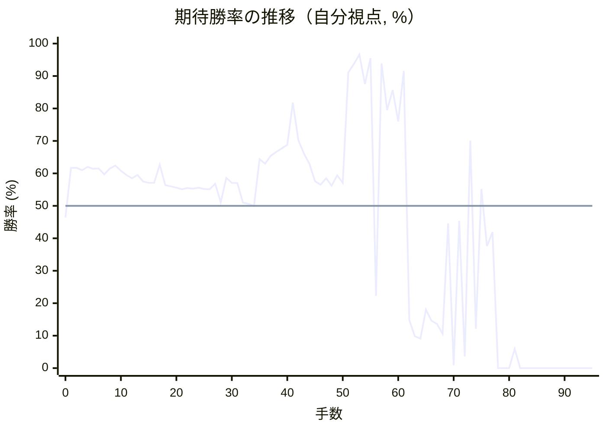

# 解析レポート 6k5xczmyfn8n

[README に戻る](../../../README.md)　/　棋譜: [CSA](../../../data/csa/shogi5/6k5xczmyfn8n.csa)　/　解析の見方: [docs/mistake_analysis.md](../../../docs/mistake_analysis.md)

## 対局情報

| 項目 | 内容 |
|---|---|
| 日時 | 2026-10-27 21:11:18 |
| 持ち時間 | 5分 |
| 自分 | 後手（△）（1766） |
| 相手 | 相手（1742） |
| 結果 | 負け（詰み, 95手） |

## 解析環境

| 項目 | 内容 |
|---|---|
| エンジン | YaneuraOu NNUE 9.00git 64AVX2（V9.00/YANEURAOU_ENGINE_NNUE/AVX2） |
| 評価関数 | **水匠5**（`suisho5`） |
| nn.bin SHA-256 | `768068f0d534a0603a5d38bcd143de6bbca820d5f1c95a14d40863e5b7892d76` |
| 第1パス | movetime=150ms, MultiPV 1 |
| 第2パス | movetime=2000ms, MultiPV 3 |
| Threads / Hash | 8 / 512MB |
| 判定基準 | 疑問手 ≥5pt, 悪手 ≥10pt, 大悪手 ≥20pt（期待勝率 W(E)=1/(1+exp(-E/600))） |
| 解析日時 | 2026-11-03T04:27:51+09:00（解析バージョン 1, 63秒） |

## サマリー

| 自分の手数 | 深掘りした手 | 詰み逃し | 大悪手 | 悪手 | 疑問手 |
|--:|--:|--:|--:|--:|--:|
| 47 | 13 | 0 | 4 | 2 | 2 |

## 期待勝率の推移



<details><summary>1手ごとの数値（第1パス）</summary>

| 手数 | 指し手 | 評価値 | 勝率 | 低下 | 判定 |
|--:|---|--:|--:|--:|---|
| 1 | ▲７八飛(28) | +286 | 61.7% |  |  |
| 2 | △８四歩(83) | +286 | 61.7% | +0.0pt |  |
| 3 | ▲７六歩(77) | +268 | 61.0% |  |  |
| 4 | △８五歩(84) | +293 | 62.0% | -1.0pt |  |
| 5 | ▲７七角(88) | +278 | 61.4% |  |  |
| 6 | △３四歩(33) | +282 | 61.5% | -0.2pt |  |
| 7 | ▲６六歩(67) | +235 | 59.7% |  |  |
| 8 | △６二銀(71) | +282 | 61.5% | -1.9pt |  |
| 9 | ▲６八銀(79) | +303 | 62.4% |  |  |
| 10 | △６四歩(63) | +264 | 60.8% | +1.5pt |  |
| 11 | ▲４八玉(59) | +232 | 59.5% |  |  |
| 12 | △６三銀(62) | +206 | 58.5% | +1.0pt |  |
| 13 | ▲３八玉(48) | +232 | 59.5% |  |  |
| 14 | △４二玉(51) | +181 | 57.5% | +2.1pt |  |
| 15 | ▲２八玉(38) | +172 | 57.1% |  |  |
| 16 | △１四歩(13) | +171 | 57.1% | +0.0pt |  |
| 17 | ▲３八銀(39) | +311 | 62.7% |  |  |
| 18 | △３二玉(42) | +155 | 56.4% | +6.3pt |  |
| 19 | ▲１六歩(17) | +145 | 56.0% |  |  |
| 20 | △２四歩(23) | +134 | 55.6% | +0.5pt |  |
| 21 | ▲５八金(69) | +124 | 55.1% |  |  |
| 22 | △２三玉(32) | +132 | 55.5% | -0.3pt |  |
| 23 | ▲５六歩(57) | +128 | 55.3% |  |  |
| 24 | △３二銀(31) | +134 | 55.6% | -0.2pt |  |
| 25 | ▲５七銀(68) | +125 | 55.2% |  |  |
| 26 | △５四銀(63) | +124 | 55.1% | +0.0pt |  |
| 27 | ▲６八飛(78) | +164 | 56.8% |  |  |
| 28 | △９四歩(93) | +27 | 51.1% | +5.7pt |  |
| 29 | ▲７五歩(76) | +208 | 58.6% |  |  |
| 30 | △６二飛(82) | +172 | 57.1% | +1.5pt |  |
| 31 | ▲２六歩(27) | +168 | 57.0% |  |  |
| 32 | △４四角(22) | +25 | 51.0% | +5.9pt | [疑問手](#ply-32) |
| 33 | ▲４六銀(57) | +15 | 50.6% |  |  |
| 34 | △３三桂(21) | +1 | 50.0% | +0.6pt |  |
| 35 | ▲５五歩(56) | +355 | 64.4% |  |  |
| 36 | △同銀(54) | +320 | 63.0% | +1.3pt |  |
| 37 | ▲６五歩(66) | +383 | 65.4% |  |  |
| 38 | △４六銀(55) | +413 | 66.6% | -1.1pt |  |
| 39 | ▲同歩(47) | +443 | 67.7% |  |  |
| 40 | △６五歩(64) | +474 | 68.8% | -1.1pt |  |
| 41 | ▲２五歩(26) | +901 | 81.8% |  |  |
| 42 | △６六歩(65) | +514 | 70.2% | +11.6pt | [悪手](#ply-42) |
| 43 | ▲２四歩(25) | +401 | 66.1% |  |  |
| 44 | △同玉(23) | +316 | 62.9% | +3.2pt |  |
| 45 | ▲４五歩(46) | +183 | 57.6% |  |  |
| 46 | △同桂(33) | +158 | 56.5% | +1.0pt |  |
| 47 | ▲４六歩打 | +206 | 58.5% |  |  |
| 48 | △２七歩打 | +150 | 56.2% | +2.3pt |  |
| 49 | ▲同銀(38) | +228 | 59.4% |  |  |
| 50 | △２六歩打 | +172 | 57.1% | +2.3pt |  |
| 51 | ▲３六銀(27) | +1392 | 91.1% |  |  |
| 52 | △２七銀打 | +1620 | 93.7% | -2.7pt |  |
| 53 | ▲３九玉(28) | +2012 | 96.6% |  |  |
| 54 | △３六銀成(27) | +1168 | 87.5% | +9.1pt |  |
| 55 | ▲同歩(37) | +1838 | 95.5% |  |  |
| 56 | △６七銀打 | -750 | 22.3% | +73.3pt | [大悪手](#ply-56) |
| 57 | ▲２五歩打 | +1636 | 93.9% |  |  |
| 58 | △２三玉(24) | +812 | 79.5% | +14.4pt |  |
| 59 | ▲２四銀打 | +1075 | 85.7% |  |  |
| 60 | △２二玉(23) | +693 | 76.0% | +9.7pt |  |
| 61 | ▲４五歩(46) | +1432 | 91.6% |  |  |
| 62 | △５五角(44) | -1052 | 14.8% | +76.8pt | [大悪手](#ply-62) |
| 63 | ▲６七金(58) | -1333 | 9.8% |  |  |
| 64 | △３一玉(22) | -1378 | 9.1% | +0.6pt |  |
| 65 | ▲５六金(67) | -911 | 18.0% |  |  |
| 66 | △１九角成(55) | -1058 | 14.6% | +3.3pt |  |
| 67 | ▲３三銀打 | -1111 | 13.6% |  |  |
| 68 | △４二金(41) | -1281 | 10.6% | +3.0pt |  |
| 69 | ▲６六角(77) | -131 | 44.6% |  |  |
| 70 | △４七香打 | -2826 | 0.9% | +43.7pt | [疑問手](#ply-70) |
| 71 | ▲３八金(49) | -111 | 45.4% |  |  |
| 72 | △２七歩成(26) | -1966 | 3.6% | +41.8pt | [悪手](#ply-72) |
| 73 | ▲４七金(38) | +511 | 70.1% |  |  |
| 74 | △６七歩打 | -1191 | 12.1% | +58.0pt | [大悪手](#ply-74) |
| 75 | ▲同飛(68) | +125 | 55.2% |  |  |
| 76 | △３三銀(32) | -303 | 37.6% | +17.6pt |  |
| 77 | ▲同銀成(24) | -195 | 41.9% |  |  |
| 78 | △５八銀打 | #-27 | 0.0% | +41.9pt | [大悪手](#ply-78) |
| 79 | ▲４二成銀(33) | #-26 | 0.0% |  |  |
| 80 | △同飛(62) | #-25 | 0.0% | +0.0pt |  |
| 81 | ▲３三香打 | -1667 | 5.9% |  |  |
| 82 | △２一玉(31) | #-7 | 0.0% | +5.9pt |  |
| 83 | ▲３二金打 | #-8 | 0.0% |  |  |
| 84 | △同飛(42) | #-7 | 0.0% | +0.0pt |  |
| 85 | ▲同香成(33) | #-6 | 0.0% |  |  |
| 86 | △同玉(21) | #-5 | 0.0% | +0.0pt |  |
| 87 | ▲２二飛打 | #-10 | 0.0% |  |  |
| 88 | △４一玉(32) | #-9 | 0.0% | +0.0pt |  |
| 89 | ▲４二銀打 | #-8 | 0.0% |  |  |
| 90 | △５二玉(41) | #-7 | 0.0% | +0.0pt |  |
| 91 | ▲３一銀不成(42) | #-8 | 0.0% |  |  |
| 92 | △６三玉(52) | #-5 | 0.0% | +0.0pt |  |
| 93 | ▲５五角(66) | #-4 | 0.0% |  |  |
| 94 | △６四歩打 | #-1 | 0.0% | +0.0pt |  |
| 95 | ▲同飛(67) | #- | 0.0% |  |  |

</details>

## 課題局面

<a id="ply-32"></a>
### 32手目 △４四角(22) — 疑問手

| | 着手前 | 着手後 | 差 |
|---|--:|--:|--:|
| 期待勝率 | 57.1% | 49.1% | -8.0pt |
| 評価値 | +171 | -21 | |

着手前の局面:

```text
後手の持駒：なし
  ９ ８ ７ ６ ５ ４ ３ ２ １
+---------------------------+
|v香v桂 ・v金 ・v金 ・v桂v香|一
| ・ ・ ・v飛 ・ ・v銀v角 ・|二
| ・ ・v歩 ・v歩v歩 ・v玉 ・|三
|v歩 ・ ・v歩v銀 ・v歩v歩v歩|四
| ・v歩 歩 ・ ・ ・ ・ ・ ・|五
| ・ ・ ・ 歩 歩 ・ ・ 歩 歩|六
| 歩 歩 角 ・ 銀 歩 歩 ・ ・|七
| ・ ・ ・ 飛 金 ・ 銀 玉 ・|八
| 香 桂 ・ ・ ・ 金 ・ 桂 香|九
+---------------------------+
先手の持駒：なし
後手番
手数＝31　▲２六歩　まで
```

| | 指し手 | 評価値 | 読み筋 |
|---|---|--:|---|
| 実戦 | △４四角(22) | -21 | ▲４六銀(57) △５二金(61) ▲３六歩(37) △１二玉(23) ▲４八金(58) △２二角(44) |
| AI 1位 | △５二金(61) | +171 | △５二金(61) ▲４六銀(57) △４四歩(43) ▲５五歩(56) △４三銀(54) ▲５七金(58) |
| AI 2位 | △１二玉(23) | +74 | △１二玉(23) ▲３六歩(37) △５二金(61) ▲４六銀(57) △２三銀(32) ▲２七銀(38) |
| AI 3位 | △５一金(61) | +64 | △５一金(61) ▲４六銀(57) △１二玉(23) ▲２七銀(38) △２三銀(32) ▲３六歩(37) |

SFEN: `ln1g1g1nl/3r2sb1/2p1pp1k1/p2ps1ppp/1pP6/3PP2PP/PPB1SPP2/3RG1SK1/LN3G1NL w - 32`

<a id="ply-42"></a>
### 42手目 △６六歩(65) — 悪手

| | 着手前 | 着手後 | 差 |
|---|--:|--:|--:|
| 期待勝率 | 86.6% | 68.2% | -18.4pt |
| 評価値 | +1122 | +458 | |

着手前の局面:

```text
後手の持駒：銀　歩二
  ９ ８ ７ ６ ５ ４ ３ ２ １
+---------------------------+
|v香v桂 ・v金 ・v金 ・ ・v香|一
| ・ ・ ・v飛 ・ ・v銀 ・ ・|二
| ・ ・v歩 ・v歩v歩v桂v玉 ・|三
|v歩 ・ ・ ・ ・v角v歩v歩v歩|四
| ・v歩 歩v歩 ・ ・ ・ 歩 ・|五
| ・ ・ ・ ・ ・ 歩 ・ ・ 歩|六
| 歩 歩 角 ・ ・ ・ 歩 ・ ・|七
| ・ ・ ・ 飛 金 ・ 銀 玉 ・|八
| 香 桂 ・ ・ ・ 金 ・ 桂 香|九
+---------------------------+
先手の持駒：銀
後手番
手数＝41　▲２五歩　まで
```

| | 指し手 | 評価値 | 読み筋 |
|---|---|--:|---|
| 実戦 | △６六歩(65) | +458 | ▲２四歩(25) △２二玉(23) ▲２三銀打 △同銀(32) ▲同歩成(24) △同玉(22) |
| AI 1位 | △同歩(24) | +1122 | △同歩(24) ▲４四角(77) △同歩(43) ▲５五銀打 △５二金(61) ▲４四銀(55) |
| AI 2位 | △同桂(33) | +564 | △同桂(33) ▲４五銀打 △３三角(44) ▲同角成(77) △同銀(32) ▲８三角打 |
| AI 3位 | △６六歩(65) | +400 | △６六歩(65) ▲２四歩(25) △同玉(23) ▲４五歩(46) △３五角(44) ▲２五歩打 |

SFEN: `ln1g1g2l/3r2s2/2p1ppnk1/p4bppp/1pPp3P1/5P2P/PPB3P2/3RG1SK1/LN3G1NL w Ss2p 42`

<a id="ply-56"></a>
### 56手目 △６七銀打 — 大悪手

| | 着手前 | 着手後 | 差 |
|---|--:|--:|--:|
| 期待勝率 | 98.6% | 14.7% | -83.9pt |
| 評価値 | +2544 | -1054 | |

着手前の局面:

```text
後手の持駒：銀　歩二
  ９ ８ ７ ６ ５ ４ ３ ２ １
+---------------------------+
|v香v桂 ・v金 ・v金 ・ ・v香|一
| ・ ・ ・v飛 ・ ・v銀 ・ ・|二
| ・ ・v歩 ・v歩v歩 ・ ・ ・|三
|v歩 ・ ・ ・ ・v角v歩v玉v歩|四
| ・v歩 歩 ・ ・v桂 ・ ・ ・|五
| ・ ・ ・v歩 ・ 歩 歩v歩 歩|六
| 歩 歩 角 ・ ・ ・ ・ ・ ・|七
| ・ ・ ・ 飛 金 ・ ・ ・ ・|八
| 香 桂 ・ ・ ・ 金 玉 桂 香|九
+---------------------------+
先手の持駒：銀二　歩
後手番
手数＝55　▲３六同歩　まで
```

| | 指し手 | 評価値 | 読み筋 |
|---|---|--:|---|
| 実戦 | △６七銀打 | -1054 | ▲４五歩(46) △５五角(44) ▲６七飛(68) △１九角成(55) ▲６六角(77) △同飛(62) |
| AI 1位 | △２七歩成(26) | +2544 | △２七歩成(26) ▲４五歩(46) △５五角(44) ▲４八玉(39) △１九角成(55) ▲３九金(49) |
| AI 2位 | △６七歩成(66) | +1872 | △６七歩成(66) ▲同金(58) △７七角成(44) ▲同桂(89) △５七桂成(45) ▲６三歩打 |
| AI 3位 | △７六銀打 | +1682 | △７六銀打 ▲４五歩(46) △５五角(44) ▲８八角(77) △２七歩成(26) ▲３八金(49) |

SFEN: `ln1g1g2l/3r2s2/2p1pp3/p4bpkp/1pP2n3/3p1PPpP/PPB6/3RG4/LN3GKNL w 2SPs2p 56`

<a id="ply-62"></a>
### 62手目 △５五角(44) — 大悪手

| | 着手前 | 着手後 | 差 |
|---|--:|--:|--:|
| 期待勝率 | 95.6% | 6.3% | -89.3pt |
| 評価値 | +1854 | -1618 | |

着手前の局面:

```text
後手の持駒：歩二
  ９ ８ ７ ６ ５ ４ ３ ２ １
+---------------------------+
|v香v桂 ・v金 ・v金 ・ ・v香|一
| ・ ・ ・v飛 ・ ・v銀v玉 ・|二
| ・ ・v歩 ・v歩v歩 ・ ・ ・|三
|v歩 ・ ・ ・ ・v角v歩 銀v歩|四
| ・v歩 歩 ・ ・ 歩 ・ 歩 ・|五
| ・ ・ ・v歩 ・ ・ 歩v歩 歩|六
| 歩 歩 角v銀 ・ ・ ・ ・ ・|七
| ・ ・ ・ 飛 金 ・ ・ ・ ・|八
| 香 桂 ・ ・ ・ 金 玉 桂 香|九
+---------------------------+
先手の持駒：銀　桂
後手番
手数＝61　▲４五歩　まで
```

| | 指し手 | 評価値 | 読み筋 |
|---|---|--:|---|
| 実戦 | △５五角(44) | -1618 | ▲６七金(58) △３一玉(22) ▲６六金(67) △１九角成(55) ▲６三歩打 △８二飛(62) |
| AI 1位 | △６八銀成(67) | +1854 | △６八銀成(67) ▲４四歩(45) △５八成銀(68) ▲同金(49) △２七歩成(26) ▲４七角打 |
| AI 2位 | △６八銀不成(67) | -912 | △６八銀不成(67) ▲４四歩(45) △同歩(43) ▲４六桂打 △３一玉(22) ▲３四桂(46) |
| AI 3位 | △３一玉(22) | -1470 | △３一玉(22) ▲４四歩(45) △６八銀成(67) ▲同角(77) △４二金(41) ▲４三歩成(44) |

SFEN: `ln1g1g2l/3r2sk1/2p1pp3/p4bpSp/1pP2P1P1/3p2PpP/PPBs5/3RG4/LN3GKNL w SN2p 62`

<a id="ply-70"></a>
### 70手目 △４七香打 — 疑問手

| | 着手前 | 着手後 | 差 |
|---|--:|--:|--:|
| 期待勝率 | 8.2% | 0.0% | -8.2pt |
| 評価値 | -1450 | 23手で詰まされる | |

着手前の局面:

```text
後手の持駒：香　歩二
  ９ ８ ７ ６ ５ ４ ３ ２ １
+---------------------------+
|v香v桂 ・v金 ・ ・v玉 ・v香|一
| ・ ・ ・v飛 ・v金v銀 ・ ・|二
| ・ ・v歩 ・v歩v歩 銀 ・ ・|三
|v歩 ・ ・ ・ ・ ・v歩 銀v歩|四
| ・v歩 歩 ・ ・ 歩 ・ 歩 ・|五
| ・ ・ ・ 角 金 ・ 歩v歩 歩|六
| 歩 歩 ・ ・ ・ ・ ・ ・ ・|七
| ・ ・ ・ 飛 ・ ・ ・ ・ ・|八
| 香 桂 ・ ・ ・ 金 玉 桂v馬|九
+---------------------------+
先手の持駒：銀　桂　歩
後手番
手数＝69　▲６六角　まで
```

| | 指し手 | 評価値 | 読み筋 |
|---|---|--:|---|
| 実戦 | △４七香打 | 23手で詰まされる | ▲４二銀不成(33) △同玉(31) ▲３三角成(66) △同銀(32) ▲同銀不成(24) △５一玉(42) |
| AI 1位 | △２七歩成(26) | -1450 | △２七歩成(26) ▲２二銀打 △４一玉(31) ▲４二銀成(33) △同飛(62) ▲３三角成(66) |
| AI 2位 | △４六香打 | -1556 | △４六香打 ▲２二銀打 △４一玉(31) ▲４二銀不成(33) △５二玉(41) ▲５四歩打 |
| AI 3位 | △３三金(42) | -1311 | △３三金(42) ▲２二銀打 △４一玉(31) ▲３三銀不成(22) △同銀(32) ▲６三歩打 |

SFEN: `ln1g2k1l/3r1gs2/2p1ppS2/p5pSp/1pP2P1P1/3BG1PpP/PP7/3R5/LN3GKN+b w SNPl2p 70`

<a id="ply-72"></a>
### 72手目 △２七歩成(26) — 悪手

| | 着手前 | 着手後 | 差 |
|---|--:|--:|--:|
| 期待勝率 | 15.1% | 0.0% | -15.1pt |
| 評価値 | -1037 | 23手で詰まされる | |

着手前の局面:

```text
後手の持駒：歩二
  ９ ８ ７ ６ ５ ４ ３ ２ １
+---------------------------+
|v香v桂 ・v金 ・ ・v玉 ・v香|一
| ・ ・ ・v飛 ・v金v銀 ・ ・|二
| ・ ・v歩 ・v歩v歩 銀 ・ ・|三
|v歩 ・ ・ ・ ・ ・v歩 銀v歩|四
| ・v歩 歩 ・ ・ 歩 ・ 歩 ・|五
| ・ ・ ・ 角 金 ・ 歩v歩 歩|六
| 歩 歩 ・ ・ ・v香 ・ ・ ・|七
| ・ ・ ・ 飛 ・ ・ 金 ・ ・|八
| 香 桂 ・ ・ ・ ・ 玉 桂v馬|九
+---------------------------+
先手の持駒：銀　桂　歩
後手番
手数＝71　▲３八金　まで
```

| | 指し手 | 評価値 | 読み筋 |
|---|---|--:|---|
| 実戦 | △２七歩成(26) | 23手で詰まされる | ▲４二銀不成(33) △同飛(62) ▲２二角成(66) △同玉(31) ▲２三銀打 △同銀(32) |
| AI 1位 | △３三銀(32) | -1037 | △３三銀(32) ▲同銀不成(24) △２七歩成(26) ▲４二銀成(33) △同飛(62) ▲２七金(38) |
| AI 2位 | △３三金(42) | -1495 | △３三金(42) ▲同銀成(24) △２七歩成(26) ▲２二金打 △４一玉(31) ▲３二金(22) |
| AI 3位 | △６五歩打 | -1535 | △６五歩打 ▲２二銀成(33) △４一玉(31) ▲７七角(66) △２七歩成(26) ▲４七金(38) |

SFEN: `ln1g2k1l/3r1gs2/2p1ppS2/p5pSp/1pP2P1P1/3BG1PpP/PP3l3/3R2G2/LN4KN+b w SNP2p 72`

<a id="ply-74"></a>
### 74手目 △６七歩打 — 大悪手

| | 着手前 | 着手後 | 差 |
|---|--:|--:|--:|
| 期待勝率 | 61.5% | 5.2% | -56.3pt |
| 評価値 | +281 | -1746 | |

着手前の局面:

```text
後手の持駒：歩二
  ９ ８ ７ ６ ５ ４ ３ ２ １
+---------------------------+
|v香v桂 ・v金 ・ ・v玉 ・v香|一
| ・ ・ ・v飛 ・v金v銀 ・ ・|二
| ・ ・v歩 ・v歩v歩 銀 ・ ・|三
|v歩 ・ ・ ・ ・ ・v歩 銀v歩|四
| ・v歩 歩 ・ ・ 歩 ・ 歩 ・|五
| ・ ・ ・ 角 金 ・ 歩 ・ 歩|六
| 歩 歩 ・ ・ ・ 金 ・vと ・|七
| ・ ・ ・ 飛 ・ ・ ・ ・ ・|八
| 香 桂 ・ ・ ・ ・ 玉 桂v馬|九
+---------------------------+
先手の持駒：銀　桂　香　歩
後手番
手数＝73　▲４七金　まで
```

| | 指し手 | 評価値 | 読み筋 |
|---|---|--:|---|
| 実戦 | △６七歩打 | -1746 | ▲２二銀成(33) △４一玉(31) ▲６七飛(68) △２一歩打 ▲１一成銀(22) △５一金(61) |
| AI 1位 | △３三銀(32) | +281 | △３三銀(32) ▲４八玉(39) △６七歩打 ▲同飛(68) △７八銀打 ▲６八飛(67) |
| AI 2位 | △６七歩打 | -1378 | △６七歩打 ▲２二銀成(33) △４一玉(31) ▲６七飛(68) △２一歩打 ▲１一成銀(22) |
| AI 3位 | △３三金(42) | -1500 | △３三金(42) ▲２二銀打 △４一玉(31) ▲３三銀不成(22) △同銀(32) ▲同銀成(24) |

SFEN: `ln1g2k1l/3r1gs2/2p1ppS2/p5pSp/1pP2P1P1/3BG1P1P/PP3G1+p1/3R5/LN4KN+b w SNLP2p 74`

<a id="ply-78"></a>
### 78手目 △５八銀打 — 大悪手

| | 着手前 | 着手後 | 差 |
|---|--:|--:|--:|
| 期待勝率 | 47.6% | 0.0% | -47.6pt |
| 評価値 | -57 | 27手で詰まされる | |

着手前の局面:

```text
後手の持駒：銀　歩
  ９ ８ ７ ６ ５ ４ ３ ２ １
+---------------------------+
|v香v桂 ・v金 ・ ・v玉 ・v香|一
| ・ ・ ・v飛 ・v金 ・ ・ ・|二
| ・ ・v歩 ・v歩v歩 全 ・ ・|三
|v歩 ・ ・ ・ ・ ・v歩 ・v歩|四
| ・v歩 歩 ・ ・ 歩 ・ 歩 ・|五
| ・ ・ ・ 角 金 ・ 歩 ・ 歩|六
| 歩 歩 ・ 飛 ・ 金 ・vと ・|七
| ・ ・ ・ ・ ・ ・ ・ ・ ・|八
| 香 桂 ・ ・ ・ ・ 玉 桂v馬|九
+---------------------------+
先手の持駒：銀二　桂　香　歩二
後手番
手数＝77　▲３三同成　まで
```

| | 指し手 | 評価値 | 読み筋 |
|---|---|--:|---|
| 実戦 | △５八銀打 | 27手で詰まされる | ▲４二成銀(33) △同飛(62) ▲２二角成(66) △同飛(42) ▲６一飛成(67) △４一角打 |
| AI 1位 | △同金(42) | -57 | △同金(42) ▲６五香打 △５八銀打 ▲３三角成(66) △２九馬(19) ▲４八玉(39) |
| AI 2位 | △２九馬(19) | -868 | △２九馬(19) ▲４八玉(39) △３三金(42) ▲６三歩打 △同飛(62) ▲６五香打 |
| AI 3位 | △３八銀打 | -944 | △３八銀打 ▲４八玉(39) △４七銀成(38) ▲同飛(67) △３三金(42) ▲６五香打 |

SFEN: `ln1g2k1l/3r1g3/2p1pp+S2/p5p1p/1pP2P1P1/3BG1P1P/PP1R1G1+p1/9/LN4KN+b w 2SNL2Psp 78`

