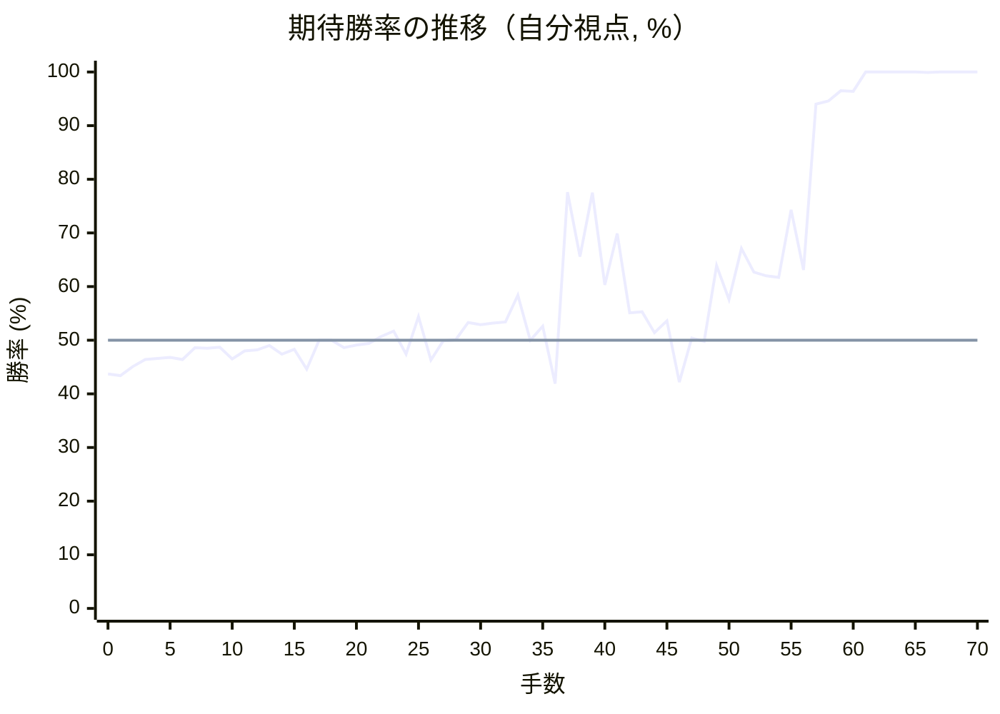
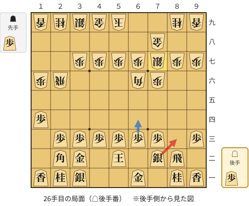
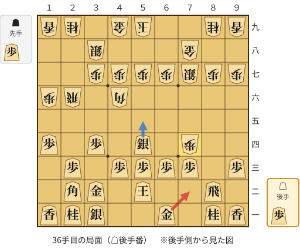
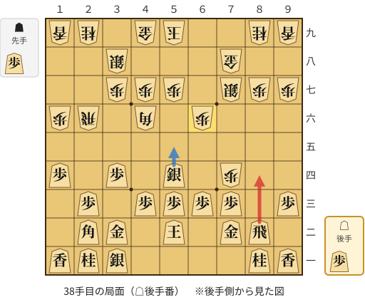
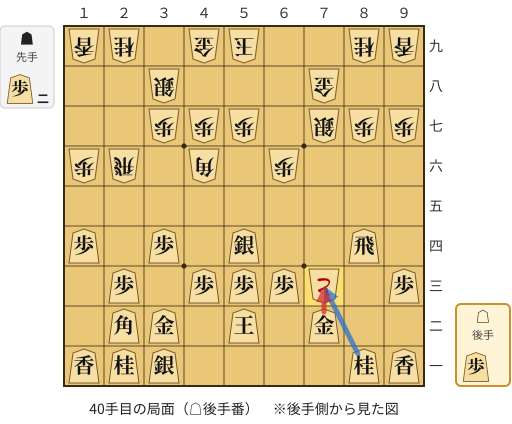
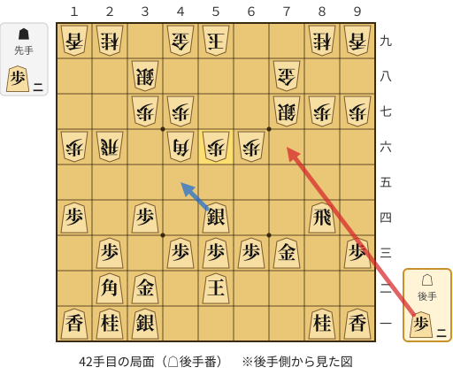
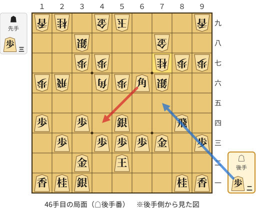
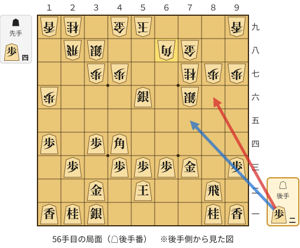
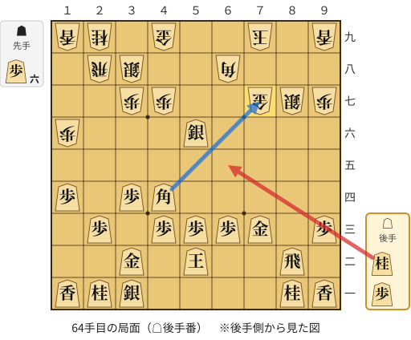

# 解析レポート 7dsyroqso91s

[README に戻る](../../../README.md)　/　棋譜: [CSA](../../../data/csa/shogi5/7dsyroqso91s.csa)　/　解析の見方: [docs/mistake_analysis.md](../../../docs/mistake_analysis.md)

## 対局情報

| 項目 | 内容 |
|---|---|
| 日時 | 2026-11-11 04:19:25 |
| 持ち時間 | 5分 |
| 自分 | 後手（△）（1663） |
| 相手 | 相手（1529） |
| 結果 | 勝ち（投了, 70手） |

## 解析環境

| 項目 | 内容 |
|---|---|
| エンジン | YaneuraOu NNUE 9.00git 64AVX2（V9.00/YANEURAOU_ENGINE_NNUE/AVX2） |
| 評価関数 | **水匠5**（`suisho5`） |
| nn.bin SHA-256 | `768068f0d534a0603a5d38bcd143de6bbca820d5f1c95a14d40863e5b7892d76` |
| 第1パス | movetime=150ms, MultiPV 1 |
| 第2パス | movetime=2000ms, MultiPV 3 |
| Threads / Hash | 8 / 512MB |
| 判定基準 | 疑問手 ≥5pt, 悪手 ≥10pt, 大悪手 ≥20pt（期待勝率 W(E)=1/(1+exp(-E/600))） |
| 解析日時 | 2026-11-14T10:43:34+09:00（解析バージョン 1, 47秒） |

## サマリー

| 自分の手数 | 深掘りした手 | 詰み逃し | 大悪手 | 悪手 | 疑問手 |
|--:|--:|--:|--:|--:|--:|
| 35 | 9 | 1 | 0 | 5 | 2 |

## 期待勝率の推移



<details><summary>1手ごとの数値（第1パス）</summary>

| 手数 | 指し手 | 評価値 | 勝率 | 低下 | 判定 |
|--:|---|--:|--:|--:|---|
| 1 | ▲２六歩(27) | -160 | 43.4% |  |  |
| 2 | △８四歩(83) | -118 | 45.1% | -1.7pt |  |
| 3 | ▲２五歩(26) | -86 | 46.4% |  |  |
| 4 | △８五歩(84) | -81 | 46.6% | -0.2pt |  |
| 5 | ▲７八金(69) | -78 | 46.8% |  |  |
| 6 | △３二金(41) | -86 | 46.4% | +0.3pt |  |
| 7 | ▲２四歩(25) | -33 | 48.6% |  |  |
| 8 | △同歩(23) | -36 | 48.5% | +0.1pt |  |
| 9 | ▲同飛(28) | -31 | 48.7% |  |  |
| 10 | △１四歩(13) | -84 | 46.5% | +2.2pt |  |
| 11 | ▲２六飛(24) | -47 | 48.0% |  |  |
| 12 | △２三歩打 | -43 | 48.2% | -0.2pt |  |
| 13 | ▲１六歩(17) | -25 | 49.0% |  |  |
| 14 | △５二玉(51) | -62 | 47.4% | +1.5pt |  |
| 15 | ▲７六歩(77) | -40 | 48.3% |  |  |
| 16 | △７二銀(71) | -130 | 44.6% | +3.7pt |  |
| 17 | ▲６八銀(79) | +0 | 50.0% |  |  |
| 18 | △８六歩(85) | +1 | 50.0% | -0.0pt |  |
| 19 | ▲同歩(87) | -34 | 48.6% |  |  |
| 20 | △同飛(82) | -21 | 49.1% | -0.5pt |  |
| 21 | ▲８七歩打 | -15 | 49.4% |  |  |
| 22 | △８四飛(86) | +17 | 50.7% | -1.3pt |  |
| 23 | ▲６六角(88) | +40 | 51.7% |  |  |
| 24 | △８二飛(84) | -63 | 47.4% | +4.3pt |  |
| 25 | ▲７七銀(68) | +107 | 54.4% |  |  |
| 26 | △８三銀(72) | -88 | 46.3% | +8.1pt | [疑問手](#ply-26) |
| 27 | ▲３八銀(39) | -2 | 49.9% |  |  |
| 28 | △７四銀(83) | +2 | 50.1% | -0.2pt |  |
| 29 | ▲７五歩(76) | +80 | 53.3% |  |  |
| 30 | △６五銀(74) | +70 | 52.9% | +0.4pt |  |
| 31 | ▲５五角(66) | +78 | 53.2% |  |  |
| 32 | △５四銀(65) | +82 | 53.4% | -0.2pt |  |
| 33 | ▲４六角(55) | +204 | 58.4% |  |  |
| 34 | △３四歩(33) | +1 | 50.0% | +8.4pt |  |
| 35 | ▲７四歩(75) | +62 | 52.6% |  |  |
| 36 | △７二金(61) | -197 | 41.9% | +10.7pt | [悪手](#ply-36) |
| 37 | ▲６六歩(67) | +744 | 77.6% |  |  |
| 38 | △８四飛(82) | +388 | 65.6% | +11.9pt | [悪手](#ply-38) |
| 39 | ▲７三歩成(74) | +742 | 77.5% |  |  |
| 40 | △同金(72) | +252 | 60.3% | +17.2pt | [悪手](#ply-40) |
| 41 | ▲５六歩(57) | +506 | 69.9% |  |  |
| 42 | △７六歩打 | +123 | 55.1% | +14.8pt | [悪手](#ply-42) |
| 43 | ▲同銀(77) | +127 | 55.3% |  |  |
| 44 | △６六角(22) | +34 | 51.4% | +3.9pt |  |
| 45 | ▲７七桂(89) | +87 | 53.6% |  |  |
| 46 | △４四角(66) | -188 | 42.2% | +11.4pt | [悪手](#ply-46) |
| 47 | ▲２八飛(26) | +10 | 50.4% |  |  |
| 48 | △４五銀(54) | -6 | 49.8% | +0.7pt |  |
| 49 | ▲５七角(46) | +342 | 63.9% |  |  |
| 50 | △８二飛(84) | +185 | 57.6% | +6.2pt |  |
| 51 | ▲６七銀(76) | +428 | 67.1% |  |  |
| 52 | △７六歩打 | +312 | 62.7% | +4.4pt |  |
| 53 | ▲同銀(67) | +294 | 62.0% |  |  |
| 54 | △５六銀(45) | +286 | 61.7% | +0.3pt |  |
| 55 | ▲６八角(57) | +638 | 74.3% |  |  |
| 56 | △８六歩打 | +323 | 63.1% | +11.2pt | [疑問手](#ply-56) |
| 57 | ▲６九玉(59) | +1654 | 94.0% |  |  |
| 58 | △８七歩成(86) | +1721 | 94.6% | -0.6pt |  |
| 59 | ▲同銀(76) | +1986 | 96.5% |  |  |
| 60 | △７六歩打 | +1974 | 96.4% | +0.1pt |  |
| 61 | ▲７九玉(69) | +4816 | 100.0% |  |  |
| 62 | △７七歩成(76) | +5393 | 100.0% | -0.0pt |  |
| 63 | ▲同金(78) | #+17 | 100.0% |  |  |
| 64 | △６五桂打 | +4932 | 100.0% | +0.0pt | [詰み逃し](#ply-64) |
| 65 | ▲７八金(77) | +5500 | 100.0% |  |  |
| 66 | △７七歩打 | +4451 | 99.9% | +0.0pt |  |
| 67 | ▲８八金(78) | +4787 | 100.0% |  |  |
| 68 | △６七銀成(56) | +5135 | 100.0% | -0.0pt |  |
| 69 | ▲５九角(68) | #+7 | 100.0% |  |  |
| 70 | △８七飛成(82) | #+6 | 100.0% | +0.0pt |  |

</details>

## 課題局面

<a id="ply-26"></a>
### 26手目 △８三銀(72) — 疑問手

| | 着手前 | 着手後 | 差 |
|---|--:|--:|--:|
| 期待勝率 | 53.8% | 47.1% | -6.7pt |
| 評価値 | +91 | -70 | |

着手前の局面:



🔴 実戦 △８三銀(72)　🔵 AI推奨 △６四歩(63)　🟨 直前の相手の指し手

<details><summary>テキストの盤面図（BOD・将棋ソフトに貼り付け可）</summary>

```text
後手の持駒：歩
  ９ ８ ７ ６ ５ ４ ３ ２ １
+---------------------------+
|v香v桂 ・v金 ・ ・v銀v桂v香|一
| ・v飛v銀 ・v玉 ・v金v角 ・|二
|v歩 ・v歩v歩v歩v歩v歩v歩 ・|三
| ・ ・ ・ ・ ・ ・ ・ ・v歩|四
| ・ ・ ・ ・ ・ ・ ・ ・ ・|五
| ・ ・ 歩 角 ・ ・ ・ 飛 歩|六
| 歩 歩 銀 歩 歩 歩 歩 ・ ・|七
| ・ ・ 金 ・ ・ ・ ・ ・ ・|八
| 香 桂 ・ ・ 玉 金 銀 桂 香|九
+---------------------------+
先手の持駒：歩
後手番
手数＝25　▲７七銀　まで
```

</details>

| | 指し手 | 評価値 | 読み筋 |
|---|---|--:|---|
| 実戦 | △８三銀(72) | -70 | ▲７五歩(76) △７二銀(83) ▲３八銀(39) △６四歩(63) ▲７六銀(77) △４二玉(52) |
| AI 1位 | △６四歩(63) | +91 | △６四歩(63) ▲３六歩(37) △６五歩(64) ▲５五角(66) △４二銀(31) ▲４八銀(39) |
| AI 2位 | △４二銀(31) | +98 | △４二銀(31) ▲５八金(49) △６四歩(63) ▲８六銀(77) △７四歩(73) ▲６八玉(59) |
| AI 3位 | △６二金(61) | +42 | △６二金(61) ▲３六歩(37) △６四歩(63) ▲３五歩(36) △６三銀(72) ▲６九玉(59) |

SFEN: `ln1g2snl/1rs1k1gb1/p1pppppp1/8p/9/2PB3RP/PPSPPPP2/2G6/LN2KGSNL w Pp 26`

<a id="ply-36"></a>
### 36手目 △７二金(61) — 悪手

| | 着手前 | 着手後 | 差 |
|---|--:|--:|--:|
| 期待勝率 | 54.7% | 35.1% | -19.6pt |
| 評価値 | +113 | -368 | |

着手前の局面:



🔴 実戦 △７二金(61)　🔵 AI推奨 △５五銀(54)　🟨 直前の相手の指し手

<details><summary>テキストの盤面図（BOD・将棋ソフトに貼り付け可）</summary>

```text
後手の持駒：歩
  ９ ８ ７ ６ ５ ４ ３ ２ １
+---------------------------+
|v香v桂 ・v金 ・ ・v銀v桂v香|一
| ・v飛 ・ ・v玉 ・v金v角 ・|二
|v歩 ・v歩v歩v歩v歩 ・v歩 ・|三
| ・ ・ 歩 ・v銀 ・v歩 ・v歩|四
| ・ ・ ・ ・ ・ ・ ・ ・ ・|五
| ・ ・ ・ ・ ・ 角 ・ 飛 歩|六
| 歩 歩 銀 歩 歩 歩 歩 ・ ・|七
| ・ ・ 金 ・ ・ ・ 銀 ・ ・|八
| 香 桂 ・ ・ 玉 金 ・ 桂 香|九
+---------------------------+
先手の持駒：歩
後手番
手数＝35　▲７四歩　まで
```

</details>

| | 指し手 | 評価値 | 読み筋 |
|---|---|--:|---|
| 実戦 | △７二金(61) | -368 | ▲７三歩成(74) △同金(72) ▲同角成(46) △同桂(81) ▲８六飛(26) △８五歩打 |
| AI 1位 | △５五銀(54) | +113 | △５五銀(54) ▲７三歩成(74) △同桂(81) ▲５五角(46) △同角(22) ▲５六飛(26) |
| AI 2位 | △７二金(61) | -291 | △７二金(61) ▲７三歩成(74) △同金(72) ▲同角成(46) △同桂(81) ▲８六飛(26) |
| AI 3位 | △６二金(61) | -312 | △６二金(61) ▲７三歩成(74) △同金(62) ▲同角成(46) △同桂(81) ▲８六飛(26) |

SFEN: `ln1g2snl/1r2k1gb1/p1pppp1p1/2P1s1p1p/9/5B1RP/PPSPPPP2/2G3S2/LN2KG1NL w Pp 36`

<a id="ply-38"></a>
### 38手目 △８四飛(82) — 悪手

| | 着手前 | 着手後 | 差 |
|---|--:|--:|--:|
| 期待勝率 | 80.6% | 66.9% | -13.7pt |
| 評価値 | +855 | +423 | |

着手前の局面:



🔴 実戦 △８四飛(82)　🔵 AI推奨 △５五銀(54)　🟨 直前の相手の指し手

<details><summary>テキストの盤面図（BOD・将棋ソフトに貼り付け可）</summary>

```text
後手の持駒：歩
  ９ ８ ７ ６ ５ ４ ３ ２ １
+---------------------------+
|v香v桂 ・ ・ ・ ・v銀v桂v香|一
| ・v飛v金 ・v玉 ・v金v角 ・|二
|v歩 ・v歩v歩v歩v歩 ・v歩 ・|三
| ・ ・ 歩 ・v銀 ・v歩 ・v歩|四
| ・ ・ ・ ・ ・ ・ ・ ・ ・|五
| ・ ・ ・ 歩 ・ 角 ・ 飛 歩|六
| 歩 歩 銀 ・ 歩 歩 歩 ・ ・|七
| ・ ・ 金 ・ ・ ・ 銀 ・ ・|八
| 香 桂 ・ ・ 玉 金 ・ 桂 香|九
+---------------------------+
先手の持駒：歩
後手番
手数＝37　▲６六歩　まで
```

</details>

| | 指し手 | 評価値 | 読み筋 |
|---|---|--:|---|
| 実戦 | △８四飛(82) | +423 | ▲５六歩(57) △６四歩(63) ▲同角(46) △７四飛(84) ▲４六角(64) △６六角(22) |
| AI 1位 | △５五銀(54) | +855 | △５五銀(54) ▲５八金(49) △４六銀(55) ▲同歩(47) △７四歩(73) ▲６九玉(59) |
| AI 2位 | △６四歩(63) | +517 | △６四歩(63) ▲７三歩成(74) △同金(72) ▲３六歩(37) △４五銀(54) ▲３七角(46) |
| AI 3位 | △８四飛(82) | +402 | △８四飛(82) ▲５六歩(57) △４二銀(31) ▲５八金(49) △６四歩(63) ▲３六歩(37) |

SFEN: `ln4snl/1rg1k1gb1/p1pppp1p1/2P1s1p1p/9/3P1B1RP/PPS1PPP2/2G3S2/LN2KG1NL w Pp 38`

<a id="ply-40"></a>
### 40手目 △同金(72) — 悪手

| | 着手前 | 着手後 | 差 |
|---|--:|--:|--:|
| 期待勝率 | 79.5% | 64.1% | -15.4pt |
| 評価値 | +813 | +348 | |

着手前の局面:



🔴 実戦 △同金(72)　🔵 AI推奨 △同桂(81)　🟨 直前の相手の指し手

<details><summary>テキストの盤面図（BOD・将棋ソフトに貼り付け可）</summary>

```text
後手の持駒：歩
  ９ ８ ７ ６ ５ ４ ３ ２ １
+---------------------------+
|v香v桂 ・ ・ ・ ・v銀v桂v香|一
| ・ ・v金 ・v玉 ・v金v角 ・|二
|v歩 ・ とv歩v歩v歩 ・v歩 ・|三
| ・v飛 ・ ・v銀 ・v歩 ・v歩|四
| ・ ・ ・ ・ ・ ・ ・ ・ ・|五
| ・ ・ ・ 歩 ・ 角 ・ 飛 歩|六
| 歩 歩 銀 ・ 歩 歩 歩 ・ ・|七
| ・ ・ 金 ・ ・ ・ 銀 ・ ・|八
| 香 桂 ・ ・ 玉 金 ・ 桂 香|九
+---------------------------+
先手の持駒：歩二
後手番
手数＝39　▲７三歩成　まで
```

</details>

| | 指し手 | 評価値 | 読み筋 |
|---|---|--:|---|
| 実戦 | △同金(72) | +348 | ▲７二歩打 △７六歩打 |
| AI 1位 | △同桂(81) | +813 | △同桂(81) ▲５八金(49) △４五銀(54) ▲６七金(58) △５四飛(84) ▲４八玉(59) |
| AI 2位 | △同金(72) | +278 | △同金(72) ▲７二歩打 △７六歩打 ▲同銀(77) △７四飛(84) ▲６七金(78) |
| AI 3位 | △７一金(72) | -1351 | △７一金(72) ▲８三と(73) △同飛(84) ▲９一角成(46) △８四飛(83) ▲６八玉(59) |

SFEN: `ln4snl/2g1k1gb1/p1+Pppp1p1/1r2s1p1p/9/3P1B1RP/PPS1PPP2/2G3S2/LN2KG1NL w 2Pp 40`

<a id="ply-42"></a>
### 42手目 △７六歩打 — 悪手

| | 着手前 | 着手後 | 差 |
|---|--:|--:|--:|
| 期待勝率 | 69.5% | 57.4% | -12.1pt |
| 評価値 | +494 | +178 | |

着手前の局面:



🔴 実戦 △７六歩打　🔵 AI推奨 △４五銀(54)　🟨 直前の相手の指し手

<details><summary>テキストの盤面図（BOD・将棋ソフトに貼り付け可）</summary>

```text
後手の持駒：歩二
  ９ ８ ７ ６ ５ ４ ３ ２ １
+---------------------------+
|v香v桂 ・ ・ ・ ・v銀v桂v香|一
| ・ ・ ・ ・v玉 ・v金v角 ・|二
|v歩 ・v金v歩v歩v歩 ・v歩 ・|三
| ・v飛 ・ ・v銀 ・v歩 ・v歩|四
| ・ ・ ・ ・ ・ ・ ・ ・ ・|五
| ・ ・ ・ 歩 歩 角 ・ 飛 歩|六
| 歩 歩 銀 ・ ・ 歩 歩 ・ ・|七
| ・ ・ 金 ・ ・ ・ 銀 ・ ・|八
| 香 桂 ・ ・ 玉 金 ・ 桂 香|九
+---------------------------+
先手の持駒：歩二
後手番
手数＝41　▲５六歩　まで
```

</details>

| | 指し手 | 評価値 | 読み筋 |
|---|---|--:|---|
| 実戦 | △７六歩打 | +178 | ▲同銀(77) △４五銀(54) ▲６八角(46) △６六角(22) ▲７七桂(89) △４四角(66) |
| AI 1位 | △４五銀(54) | +494 | △４五銀(54) ▲５七角(46) △４四角(22) ▲２八飛(26) △５六銀(45) ▲３九角(57) |
| AI 2位 | △８八歩打 | +376 | △８八歩打 ▲同銀(77) △４五銀(54) ▲６八角(46) △４四角(22) ▲２八飛(26) |
| AI 3位 | △８八歩打 | +377 | △８八歩打 ▲同銀(77) △６六角(22) ▲５五歩(56) △同角(66) ▲同角(46) |

SFEN: `ln4snl/4k1gb1/p1gppp1p1/1r2s1p1p/9/3PPB1RP/PPS2PP2/2G3S2/LN2KG1NL w 2P2p 42`

<a id="ply-46"></a>
### 46手目 △４四角(66) — 悪手

| | 着手前 | 着手後 | 差 |
|---|--:|--:|--:|
| 期待勝率 | 55.2% | 42.0% | -13.2pt |
| 評価値 | +126 | -193 | |

着手前の局面:



🔴 実戦 △４四角(66)　🔵 AI推奨 △７五歩打　🟨 直前の相手の指し手

<details><summary>テキストの盤面図（BOD・将棋ソフトに貼り付け可）</summary>

```text
後手の持駒：歩二
  ９ ８ ７ ６ ５ ４ ３ ２ １
+---------------------------+
|v香v桂 ・ ・ ・ ・v銀v桂v香|一
| ・ ・ ・ ・v玉 ・v金 ・ ・|二
|v歩 ・v金v歩v歩v歩 ・v歩 ・|三
| ・v飛 ・ ・v銀 ・v歩 ・v歩|四
| ・ ・ ・ ・ ・ ・ ・ ・ ・|五
| ・ ・ 銀v角 歩 角 ・ 飛 歩|六
| 歩 歩 桂 ・ ・ 歩 歩 ・ ・|七
| ・ ・ 金 ・ ・ ・ 銀 ・ ・|八
| 香 ・ ・ ・ 玉 金 ・ 桂 香|九
+---------------------------+
先手の持駒：歩三
後手番
手数＝45　▲７七桂　まで
```

</details>

| | 指し手 | 評価値 | 読み筋 |
|---|---|--:|---|
| 実戦 | △４四角(66) | -193 | ▲２五飛(26) △６四歩(63) ▲８五銀(76) △８二飛(84) ▲７四歩打 △６三金(73) |
| AI 1位 | △７五歩打 | +126 | △７五歩打 ▲６七銀(76) △４四角(66) ▲２五飛(26) △６四金(73) ▲２四歩打 |
| AI 2位 | △８六歩打 | +71 | △８六歩打 ▲８五銀(76) △７七角成(66) ▲同金(78) △８五飛(84) ▲７六金(77) |
| AI 3位 | △３三桂(21) | -82 | △３三桂(21) ▲５五歩(56) △同銀(54) ▲６八角(46) △５四飛(84) ▲５八歩打 |

SFEN: `ln4snl/4k1g2/p1gppp1p1/1r2s1p1p/9/2SbPB1RP/PPN2PP2/2G3S2/L3KG1NL w 3P2p 46`

<a id="ply-56"></a>
### 56手目 △８六歩打 — 疑問手

| | 着手前 | 着手後 | 差 |
|---|--:|--:|--:|
| 期待勝率 | 78.4% | 72.9% | -5.5pt |
| 評価値 | +772 | +593 | |

着手前の局面:



🔴 実戦 △８六歩打　🔵 AI推奨 △７五歩打　🟨 直前の相手の指し手

<details><summary>テキストの盤面図（BOD・将棋ソフトに貼り付け可）</summary>

```text
後手の持駒：歩二
  ９ ８ ７ ６ ５ ４ ３ ２ １
+---------------------------+
|v香v桂 ・ ・ ・ ・v銀v桂v香|一
| ・v飛 ・ ・v玉 ・v金 ・ ・|二
|v歩 ・v金v歩v歩v歩 ・v歩 ・|三
| ・ ・ ・ ・ ・v角v歩 ・v歩|四
| ・ ・ ・ ・ ・ ・ ・ ・ ・|五
| ・ ・ 銀 ・v銀 ・ ・ ・ 歩|六
| 歩 歩 桂 ・ ・ 歩 歩 ・ ・|七
| ・ ・ 金 角 ・ ・ 銀 飛 ・|八
| 香 ・ ・ ・ 玉 金 ・ 桂 香|九
+---------------------------+
先手の持駒：歩四
後手番
手数＝55　▲６八角　まで
```

</details>

| | 指し手 | 評価値 | 読み筋 |
|---|---|--:|---|
| 実戦 | △８六歩打 | +593 | ▲同歩(87) △同飛(82) ▲８七金(78) △８二飛(86) ▲５八金(49) △６四金(73) |
| AI 1位 | △７五歩打 | +772 | △７五歩打 ▲６五銀(76) △同銀(56) ▲同桂(77) △６四金(73) ▲２四歩打 |
| AI 2位 | △６四金(73) | +577 | △６四金(73) ▲７五歩打 △８六歩打 ▲同歩(87) △同飛(82) ▲８七金(78) |
| AI 3位 | △８六歩打 | +482 | △８六歩打 ▲同歩(87) △同飛(82) ▲８七金(78) △８二飛(86) ▲５八金(49) |

SFEN: `ln4snl/1r2k1g2/p1gppp1p1/5bp1p/9/2S1s3P/PPN2PP2/2GB2SR1/L3KG1NL w 4P2p 56`

<a id="ply-64"></a>
### 64手目 △６五桂打 — 詰み逃し

| | 着手前 | 着手後 | 差 |
|---|--:|--:|--:|
| 期待勝率 | 100.0% | 100.0% | -0.0pt |
| 評価値 | 17手詰め | +6071 | |

着手前の局面:



🔴 実戦 △６五桂打　🔵 AI推奨 △同角成(44)　🟨 直前の相手の指し手

<details><summary>テキストの盤面図（BOD・将棋ソフトに貼り付け可）</summary>

```text
後手の持駒：桂　歩
  ９ ８ ７ ６ ５ ４ ３ ２ １
+---------------------------+
|v香v桂 ・ ・ ・ ・v銀v桂v香|一
| ・v飛 ・ ・v玉 ・v金 ・ ・|二
|v歩 ・v金v歩v歩v歩 ・v歩 ・|三
| ・ ・ ・ ・ ・v角v歩 ・v歩|四
| ・ ・ ・ ・ ・ ・ ・ ・ ・|五
| ・ ・ ・ ・v銀 ・ ・ ・ 歩|六
| 歩 銀 金 ・ ・ 歩 歩 ・ ・|七
| ・ ・ ・ 角 ・ ・ 銀 飛 ・|八
| 香 ・ 玉 ・ ・ 金 ・ 桂 香|九
+---------------------------+
先手の持駒：歩六
後手番
手数＝63　▲７七同金　まで
```

</details>

| | 指し手 | 評価値 | 読み筋 |
|---|---|--:|---|
| 実戦 | △６五桂打 | +6071 | ▲７八金(77) △９九角成(44) ▲８六歩打 △７七香打 ▲５八金(49) △７八香成(77) |
| AI 1位 | △同角成(44) | 17手詰め | △同角成(44) ▲６九玉(79) △８七飛成(82) ▲７七角(68) △同龍(87) ▲６一角打 |
| AI 2位 | △６七銀成(56) | +5846 | △６七銀成(56) ▲７八銀(87) △６八成銀(67) ▲同玉(79) △８八飛成(82) ▲５五歩打 |
| AI 3位 | △６五桂打 | +5682 | △６五桂打 ▲７八金(77) △９九角成(44) ▲８三歩打 △同飛(82) ▲８四歩打 |

SFEN: `ln4snl/1r2k1g2/p1gppp1p1/5bp1p/9/4s3P/PSG2PP2/3B2SR1/L1K2G1NL w 6Pnp 64`

