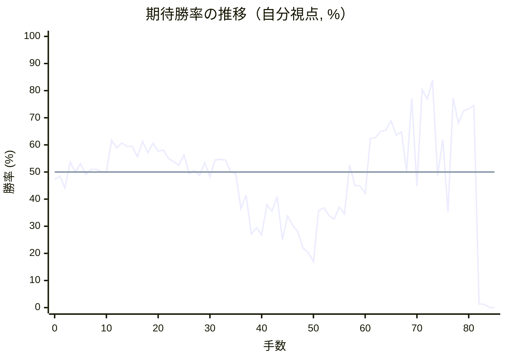

# 解析レポート 7yprli13t5sq

[README に戻る](../../../README.md)　/　棋譜: [CSA](../../../data/csa/shogi5/7yprli13t5sq.csa)　/　解析の見方: [docs/mistake_analysis.md](../../../docs/mistake_analysis.md)

## 対局情報

| 項目 | 内容 |
|---|---|
| 日時 | 2026-11-07 12:35:03 |
| 持ち時間 | 5分 |
| 自分 | 後手（△）（1730） |
| 相手 | 相手（1542） |
| 結果 | 負け（投了, 85手） |

## 解析環境

| 項目 | 内容 |
|---|---|
| エンジン | YaneuraOu NNUE 9.00git 64AVX2（V9.00/YANEURAOU_ENGINE_NNUE/AVX2） |
| 評価関数 | **水匠5**（`suisho5`） |
| nn.bin SHA-256 | `768068f0d534a0603a5d38bcd143de6bbca820d5f1c95a14d40863e5b7892d76` |
| 第1パス | movetime=150ms, MultiPV 1 |
| 第2パス | movetime=2000ms, MultiPV 3 |
| Threads / Hash | 8 / 512MB |
| 判定基準 | 疑問手 ≥5pt, 悪手 ≥10pt, 大悪手 ≥20pt（期待勝率 W(E)=1/(1+exp(-E/600))） |
| 解析日時 | 2026-11-11T20:25:35+09:00（解析バージョン 1, 65秒） |

## サマリー

| 自分の手数 | 深掘りした手 | 詰み逃し | 大悪手 | 悪手 | 疑問手 |
|--:|--:|--:|--:|--:|--:|
| 42 | 13 | 0 | 3 | 4 | 1 |

## 期待勝率の推移



<details><summary>1手ごとの数値（第1パス）</summary>

| 手数 | 指し手 | 評価値 | 勝率 | 低下 | 判定 |
|--:|---|--:|--:|--:|---|
| 1 | ▲７六歩(77) | -36 | 48.5% |  |  |
| 2 | △３四歩(33) | -143 | 44.1% | +4.4pt |  |
| 3 | ▲６六歩(67) | +86 | 53.6% |  |  |
| 4 | △８四歩(83) | +0 | 50.0% | +3.6pt |  |
| 5 | ▲６八銀(79) | +74 | 53.1% |  |  |
| 6 | △８五歩(84) | -22 | 49.1% | +4.0pt |  |
| 7 | ▲７七角(88) | +23 | 51.0% |  |  |
| 8 | △６二銀(71) | +23 | 51.0% | +0.0pt |  |
| 9 | ▲６七銀(68) | +3 | 50.1% |  |  |
| 10 | △４二玉(51) | +2 | 50.1% | +0.0pt |  |
| 11 | ▲８八飛(28) | +287 | 61.7% |  |  |
| 12 | △３二玉(42) | +217 | 58.9% | +2.8pt |  |
| 13 | ▲４八玉(59) | +262 | 60.7% |  |  |
| 14 | △１四歩(13) | +228 | 59.4% | +1.4pt |  |
| 15 | ▲１六歩(17) | +231 | 59.5% |  |  |
| 16 | △２四歩(23) | +136 | 55.6% | +3.9pt |  |
| 17 | ▲３八玉(48) | +275 | 61.3% |  |  |
| 18 | △２三玉(32) | +171 | 57.1% | +4.2pt |  |
| 19 | ▲２八玉(38) | +258 | 60.6% |  |  |
| 20 | △３二銀(31) | +186 | 57.7% | +2.9pt |  |
| 21 | ▲３八銀(39) | +196 | 58.1% |  |  |
| 22 | △５四歩(53) | +120 | 55.0% | +3.1pt |  |
| 23 | ▲５八金(69) | +91 | 53.8% |  |  |
| 24 | △５三銀(62) | +60 | 52.5% | +1.3pt |  |
| 25 | ▲４六歩(47) | +152 | 56.3% |  |  |
| 26 | △４四銀(53) | -14 | 49.4% | +6.9pt |  |
| 27 | ▲４七金(58) | +12 | 50.5% |  |  |
| 28 | △３一角(22) | -31 | 48.7% | +1.8pt |  |
| 29 | ▲６五歩(66) | +85 | 53.5% |  |  |
| 30 | △９四歩(93) | -43 | 48.2% | +5.3pt |  |
| 31 | ▲９六歩(97) | +107 | 54.4% |  |  |
| 32 | △７四歩(73) | +113 | 54.7% | -0.2pt |  |
| 33 | ▲６六銀(67) | +107 | 54.4% |  |  |
| 34 | △３三桂(21) | +3 | 50.1% | +4.3pt |  |
| 35 | ▲５六歩(57) | -16 | 49.3% |  |  |
| 36 | △２五歩(24) | -333 | 36.5% | +12.9pt | [悪手](#ply-36) |
| 37 | ▲３六歩(37) | -206 | 41.5% |  |  |
| 38 | △３五歩(34) | -594 | 27.1% | +14.4pt | [悪手](#ply-38) |
| 39 | ▲同歩(36) | -524 | 29.5% |  |  |
| 40 | △同銀(44) | -602 | 26.8% | +2.6pt |  |
| 41 | ▲３六歩打 | -296 | 37.9% |  |  |
| 42 | △２四銀(35) | -355 | 35.6% | +2.3pt |  |
| 43 | ▲３七桂(29) | -222 | 40.9% |  |  |
| 44 | △６四歩(63) | -660 | 25.0% | +15.9pt | [悪手](#ply-44) |
| 45 | ▲５五歩(56) | -404 | 33.8% |  |  |
| 46 | △６五歩(64) | -501 | 30.3% | +3.5pt |  |
| 47 | ▲同銀(66) | -567 | 28.0% |  |  |
| 48 | △８六歩(85) | -763 | 21.9% | +6.1pt | [疑問手](#ply-48) |
| 49 | ▲同歩(87) | -822 | 20.3% |  |  |
| 50 | △１五歩(14) | -957 | 16.9% | +3.4pt |  |
| 51 | ▲５四歩(55) | -352 | 35.7% |  |  |
| 52 | △１六歩(15) | -325 | 36.8% | -1.0pt |  |
| 53 | ▲１八歩打 | -397 | 34.0% |  |  |
| 54 | △６二飛(82) | -437 | 32.6% | +1.5pt |  |
| 55 | ▲６四歩打 | -316 | 37.1% |  |  |
| 56 | △７三桂(81) | -385 | 34.5% | +2.6pt |  |
| 57 | ▲７四銀(65) | +63 | 52.6% |  |  |
| 58 | △６四飛(62) | -120 | 45.0% | +7.6pt |  |
| 59 | ▲７三銀不成(74) | -124 | 44.9% |  |  |
| 60 | △６九飛成(64) | -191 | 42.1% | +2.7pt |  |
| 61 | ▲５三桂打 | +301 | 62.3% |  |  |
| 62 | △５一金(61) | +312 | 62.7% | -0.4pt |  |
| 63 | ▲４一桂成(53) | +371 | 65.0% |  |  |
| 64 | △同金(51) | +382 | 65.4% | -0.4pt |  |
| 65 | ▲５八飛(88) | +477 | 68.9% |  |  |
| 66 | △５七歩打 | +336 | 63.6% | +5.2pt | [悪手](#ply-66) |
| 67 | ▲５九飛(58) | +366 | 64.8% |  |  |
| 68 | △同龍(69) | +7 | 50.3% | +14.5pt | [大悪手](#ply-68) |
| 69 | ▲同角(77) | +730 | 77.1% |  |  |
| 70 | △８八飛打 | -124 | 44.9% | +32.3pt | [大悪手](#ply-70) |
| 71 | ▲５七金(47) | +848 | 80.4% |  |  |
| 72 | △８九飛成(88) | +723 | 76.9% | +3.5pt |  |
| 73 | ▲５三歩成(54) | +984 | 83.8% |  |  |
| 74 | △同角(31) | -32 | 48.7% | +35.1pt |  |
| 75 | ▲５四飛打 | +291 | 61.9% |  |  |
| 76 | △４四角(53) | -364 | 35.3% | +26.6pt |  |
| 77 | ▲４五歩(46) | +734 | 77.3% |  |  |
| 78 | △９九角成(44) | +455 | 68.1% | +9.2pt |  |
| 79 | ▲３四金打 | +583 | 72.5% |  |  |
| 80 | △２二玉(23) | +605 | 73.3% | -0.7pt |  |
| 81 | ▲２四金(34) | +643 | 74.5% |  |  |
| 82 | △２六桂打 | -2555 | 1.4% | +73.1pt | [大悪手](#ply-82) |
| 83 | ▲同歩(27) | -2623 | 1.2% |  |  |
| 84 | △同歩(25) | #-5 | 0.0% | +1.2pt |  |
| 85 | ▲３四桂打 | #-4 | 0.0% |  |  |

</details>

## 課題局面

<a id="ply-36"></a>
### 36手目 △２五歩(24) — 悪手

| | 着手前 | 着手後 | 差 |
|---|--:|--:|--:|
| 期待勝率 | 47.6% | 36.6% | -11.0pt |
| 評価値 | -58 | -330 | |

着手前の局面:

```text
後手の持駒：なし
  ９ ８ ７ ６ ５ ４ ３ ２ １
+---------------------------+
|v香v桂 ・v金 ・v金v角 ・v香|一
| ・v飛 ・ ・ ・ ・v銀 ・ ・|二
| ・ ・ ・v歩 ・v歩v桂v玉 ・|三
|v歩 ・v歩 ・v歩v銀v歩v歩v歩|四
| ・v歩 ・ 歩 ・ ・ ・ ・ ・|五
| 歩 ・ 歩 銀 歩 歩 ・ ・ 歩|六
| ・ 歩 角 ・ ・ 金 歩 歩 ・|七
| ・ 飛 ・ ・ ・ ・ 銀 玉 ・|八
| 香 桂 ・ ・ ・ 金 ・ 桂 香|九
+---------------------------+
先手の持駒：なし
後手番
手数＝35　▲５六歩　まで
```

| | 指し手 | 評価値 | 読み筋 |
|---|---|--:|---|
| 実戦 | △２五歩(24) | -330 | ▲５五歩(56) △７五歩(74) ▲同歩(76) △５五歩(54) ▲同銀(66) △５二飛(82) |
| AI 1位 | △７三桂(81) | -58 | △７三桂(81) ▲３六歩(37) △５二金(61) ▲５九角(77) △６四歩(63) ▲同歩(65) |
| AI 2位 | △５二金(61) | -70 | △５二金(61) ▲５五歩(56) △５三金(52) ▲５八飛(88) △８六歩(85) ▲同歩(87) |
| AI 3位 | △５三銀(44) | -131 | △５三銀(44) ▲３六歩(37) △５二金(61) ▲２六歩(27) △６四歩(63) ▲３五歩(36) |

SFEN: `ln1g1gb1l/1r4s2/3p1pnk1/p1p1psppp/1p1P5/P1PSPP2P/1PB2GPP1/1R4SK1/LN3G1NL w - 36`

<a id="ply-38"></a>
### 38手目 △３五歩(34) — 悪手

| | 着手前 | 着手後 | 差 |
|---|--:|--:|--:|
| 期待勝率 | 36.5% | 22.5% | -14.1pt |
| 評価値 | -331 | -743 | |

着手前の局面:

```text
後手の持駒：なし
  ９ ８ ７ ６ ５ ４ ３ ２ １
+---------------------------+
|v香v桂 ・v金 ・v金v角 ・v香|一
| ・v飛 ・ ・ ・ ・v銀 ・ ・|二
| ・ ・ ・v歩 ・v歩v桂v玉 ・|三
|v歩 ・v歩 ・v歩v銀v歩 ・v歩|四
| ・v歩 ・ 歩 ・ ・ ・v歩 ・|五
| 歩 ・ 歩 銀 歩 歩 歩 ・ 歩|六
| ・ 歩 角 ・ ・ 金 ・ 歩 ・|七
| ・ 飛 ・ ・ ・ ・ 銀 玉 ・|八
| 香 桂 ・ ・ ・ 金 ・ 桂 香|九
+---------------------------+
先手の持駒：なし
後手番
手数＝37　▲３六歩　まで
```

| | 指し手 | 評価値 | 読み筋 |
|---|---|--:|---|
| 実戦 | △３五歩(34) | -743 | ▲４五歩(46) △同桂(33) ▲３五歩(36) △５二金(61) ▲４六歩打 △３七歩打 |
| AI 1位 | △７三桂(81) | -331 | △７三桂(81) ▲３七桂(29) △５二金(61) ▲２五桂(37) △６四歩(63) ▲同歩(65) |
| AI 2位 | △６二金(61) | -395 | △６二金(61) ▲５五歩(56) △５三金(62) ▲４五歩(46) △同銀(44) ▲３七桂(29) |
| AI 3位 | △５二金(61) | -402 | △５二金(61) ▲５五歩(56) △７五歩(74) ▲同歩(76) △５五歩(54) ▲同銀(66) |

SFEN: `ln1g1gb1l/1r4s2/3p1pnk1/p1p1psp1p/1p1P3p1/P1PSPPP1P/1PB2G1P1/1R4SK1/LN3G1NL w - 38`

<a id="ply-44"></a>
### 44手目 △６四歩(63) — 悪手

| | 着手前 | 着手後 | 差 |
|---|--:|--:|--:|
| 期待勝率 | 39.5% | 21.3% | -18.1pt |
| 評価値 | -257 | -783 | |

着手前の局面:

```text
後手の持駒：歩
  ９ ８ ７ ６ ５ ４ ３ ２ １
+---------------------------+
|v香v桂 ・v金 ・v金v角 ・v香|一
| ・v飛 ・ ・ ・ ・v銀 ・ ・|二
| ・ ・ ・v歩 ・v歩v桂v玉 ・|三
|v歩 ・v歩 ・v歩 ・ ・v銀v歩|四
| ・v歩 ・ 歩 ・ ・ ・v歩 ・|五
| 歩 ・ 歩 銀 歩 歩 歩 ・ 歩|六
| ・ 歩 角 ・ ・ 金 桂 歩 ・|七
| ・ 飛 ・ ・ ・ ・ 銀 玉 ・|八
| 香 桂 ・ ・ ・ 金 ・ ・ 香|九
+---------------------------+
先手の持駒：なし
後手番
手数＝43　▲３七桂　まで
```

| | 指し手 | 評価値 | 読み筋 |
|---|---|--:|---|
| 実戦 | △６四歩(63) | -783 | ▲同歩(65) △６二飛(82) ▲６八飛(88) △８六歩(85) ▲同歩(87) △７三桂(81) |
| AI 1位 | △７三桂(81) | -257 | △７三桂(81) ▲５五歩(56) △同歩(54) ▲４五歩(46) △５二金(61) ▲５五銀(66) |
| AI 2位 | △５二金(61) | -275 | △５二金(61) ▲５五歩(56) △同歩(54) ▲４五歩(46) △３四歩打 ▲５七銀(66) |
| AI 3位 | △３四歩打 | -291 | △３四歩打 ▲５五歩(56) △同歩(54) ▲同銀(66) △７五歩(74) ▲６六角(77) |

SFEN: `ln1g1gb1l/1r4s2/3p1pnk1/p1p1p2sp/1p1P3p1/P1PSPPP1P/1PB2GNP1/1R4SK1/LN3G2L w p 44`

<a id="ply-48"></a>
### 48手目 △８六歩(85) — 疑問手

| | 着手前 | 着手後 | 差 |
|---|--:|--:|--:|
| 期待勝率 | 25.9% | 19.3% | -6.5pt |
| 評価値 | -632 | -858 | |

着手前の局面:

```text
後手の持駒：歩二
  ９ ８ ７ ６ ５ ４ ３ ２ １
+---------------------------+
|v香v桂 ・v金 ・v金v角 ・v香|一
| ・v飛 ・ ・ ・ ・v銀 ・ ・|二
| ・ ・ ・ ・ ・v歩v桂v玉 ・|三
|v歩 ・v歩 ・v歩 ・ ・v銀v歩|四
| ・v歩 ・ 銀 歩 ・ ・v歩 ・|五
| 歩 ・ 歩 ・ ・ 歩 歩 ・ 歩|六
| ・ 歩 角 ・ ・ 金 桂 歩 ・|七
| ・ 飛 ・ ・ ・ ・ 銀 玉 ・|八
| 香 桂 ・ ・ ・ 金 ・ ・ 香|九
+---------------------------+
先手の持駒：歩
後手番
手数＝47　▲６五同銀　まで
```

| | 指し手 | 評価値 | 読み筋 |
|---|---|--:|---|
| 実戦 | △８六歩(85) | -858 | ▲同歩(87) △６四歩打 ▲７四銀(65) △５五歩(54) ▲５四歩打 △５二金(61) |
| AI 1位 | △６二飛(82) | -632 | △６二飛(82) ▲６八飛(88) △７三桂(81) ▲６四歩打 △６五桂(73) ▲同飛(68) |
| AI 2位 | △６四歩打 | -661 | △６四歩打 ▲５四銀(65) △５二金(61) ▲２六歩(27) △同歩(25) ▲２五歩打 |
| AI 3位 | △１五歩(14) | -905 | △１五歩(14) ▲同歩(16) △１六歩打 ▲同香(19) △６六歩打 ▲同角(77) |

SFEN: `ln1g1gb1l/1r4s2/5pnk1/p1p1p2sp/1p1SP2p1/P1P2PP1P/1PB2GNP1/1R4SK1/LN3G2L w P2p 48`

<a id="ply-66"></a>
### 66手目 △５七歩打 — 悪手

| | 着手前 | 着手後 | 差 |
|---|--:|--:|--:|
| 期待勝率 | 68.5% | 58.5% | -10.0pt |
| 評価値 | +466 | +205 | |

着手前の局面:

```text
後手の持駒：桂　歩四
  ９ ８ ７ ６ ５ ４ ３ ２ １
+---------------------------+
|v香 ・ ・ ・ ・v金v角 ・v香|一
| ・ ・ ・ ・ ・ ・v銀 ・ ・|二
| ・ ・ 銀 ・ ・v歩v桂v玉 ・|三
|v歩 ・ ・ ・ 歩 ・ ・v銀 ・|四
| ・ ・ ・ ・ ・ ・ ・v歩 ・|五
| 歩 歩 歩 ・ ・ 歩 歩 ・v歩|六
| ・ ・ 角 ・ ・ 金 桂 歩 ・|七
| ・ ・ ・ ・ 飛 ・ 銀 玉 歩|八
| 香 桂 ・v龍 ・ 金 ・ ・ 香|九
+---------------------------+
先手の持駒：金　歩二
後手番
手数＝65　▲５八飛　まで
```

| | 指し手 | 評価値 | 読み筋 |
|---|---|--:|---|
| 実戦 | △５七歩打 | +205 | ▲同飛(58) △６五桂打 ▲３三角成(77) △同銀(24) ▲５九飛(57) △同龍(69) |
| AI 1位 | △８九龍(69) | +466 | △８九龍(69) ▲５三歩成(54) △２六歩(25) ▲同歩(27) △２七歩打 ▲３九玉(28) |
| AI 2位 | △５七歩打 | +402 | △５七歩打 ▲５九飛(58) △６三龍(69) ▲２六歩(27) △同歩(25) ▲２五歩打 |
| AI 3位 | △５七歩打 | +402 | △５七歩打 ▲５九飛(58) △６三龍(69) ▲２六歩(27) △同歩(25) ▲２五歩打 |

SFEN: `l4gb1l/6s2/2S2pnk1/p3P2s1/7p1/PPP2PP1p/2B2GNP1/4R1SKP/LN1+r1G2L w G2Pn4p 66`

<a id="ply-68"></a>
### 68手目 △同龍(69) — 大悪手

| | 着手前 | 着手後 | 差 |
|---|--:|--:|--:|
| 期待勝率 | 66.7% | 43.2% | -23.5pt |
| 評価値 | +417 | -163 | |

着手前の局面:

```text
後手の持駒：桂　歩三
  ９ ８ ７ ６ ５ ４ ３ ２ １
+---------------------------+
|v香 ・ ・ ・ ・v金v角 ・v香|一
| ・ ・ ・ ・ ・ ・v銀 ・ ・|二
| ・ ・ 銀 ・ ・v歩v桂v玉 ・|三
|v歩 ・ ・ ・ 歩 ・ ・v銀 ・|四
| ・ ・ ・ ・ ・ ・ ・v歩 ・|五
| 歩 歩 歩 ・ ・ 歩 歩 ・v歩|六
| ・ ・ 角 ・v歩 金 桂 歩 ・|七
| ・ ・ ・ ・ ・ ・ 銀 玉 歩|八
| 香 桂 ・v龍 飛 金 ・ ・ 香|九
+---------------------------+
先手の持駒：金　歩二
後手番
手数＝67　▲５九飛　まで
```

| | 指し手 | 評価値 | 読み筋 |
|---|---|--:|---|
| 実戦 | △同龍(69) | -163 | ▲同金(49) △７九飛打 ▲２六歩(27) △５五桂打 ▲同角(77) △５九飛成(79) |
| AI 1位 | △６三龍(69) | +417 | △６三龍(69) ▲４五桂(37) △７三龍(63) ▲５三歩成(54) △３七歩打 ▲３三桂成(45) |
| AI 2位 | △６五龍(69) | +285 | △６五龍(69) ▲５七飛(59) △５六歩打 ▲同飛(57) △同龍(65) ▲同金(47) |
| AI 3位 | △７八龍(69) | +235 | △７八龍(69) ▲５三歩成(54) △６六歩打 ▲５七飛(59) △６七歩成(66) ▲５四飛(57) |

SFEN: `l4gb1l/6s2/2S2pnk1/p3P2s1/7p1/PPP2PP1p/2B1pGNP1/6SKP/LN1+rRG2L w G2Pn3p 68`

<a id="ply-70"></a>
### 70手目 △８八飛打 — 大悪手

| | 着手前 | 着手後 | 差 |
|---|--:|--:|--:|
| 期待勝率 | 76.5% | 31.3% | -45.2pt |
| 評価値 | +707 | -472 | |

着手前の局面:

```text
後手の持駒：飛　桂　歩三
  ９ ８ ７ ６ ５ ４ ３ ２ １
+---------------------------+
|v香 ・ ・ ・ ・v金v角 ・v香|一
| ・ ・ ・ ・ ・ ・v銀 ・ ・|二
| ・ ・ 銀 ・ ・v歩v桂v玉 ・|三
|v歩 ・ ・ ・ 歩 ・ ・v銀 ・|四
| ・ ・ ・ ・ ・ ・ ・v歩 ・|五
| 歩 歩 歩 ・ ・ 歩 歩 ・v歩|六
| ・ ・ ・ ・v歩 金 桂 歩 ・|七
| ・ ・ ・ ・ ・ ・ 銀 玉 歩|八
| 香 桂 ・ ・ 角 金 ・ ・ 香|九
+---------------------------+
先手の持駒：飛　金　歩二
後手番
手数＝69　▲５九同角　まで
```

| | 指し手 | 評価値 | 読み筋 |
|---|---|--:|---|
| 実戦 | △８八飛打 | -472 | ▲７七角(59) △８九飛成(88) ▲４五桂(37) △３五歩打 ▲３三桂不成(45) △同銀(24) |
| AI 1位 | △５八歩成(57) | +707 | △５八歩成(57) ▲同金(49) △８八飛打 ▲４九金打 △８九飛成(88) ▲４五桂(37) |
| AI 2位 | △７八飛打 | +525 | △７八飛打 ▲５五飛打 △５八歩成(57) ▲同金(49) △５六歩打 ▲４八金(58) |
| AI 3位 | △６九飛打 | +420 | △６九飛打 ▲５三歩成(54) △５八歩成(57) ▲同金(49) △５七歩打 ▲同金(47) |

SFEN: `l4gb1l/6s2/2S2pnk1/p3P2s1/7p1/PPP2PP1p/4pGNP1/6SKP/LN2BG2L w RG2Prn3p 70`

<a id="ply-82"></a>
### 82手目 △２六桂打 — 大悪手

| | 着手前 | 着手後 | 差 |
|---|--:|--:|--:|
| 期待勝率 | 77.6% | 1.4% | -76.2pt |
| 評価値 | +747 | -2537 | |

着手前の局面:

```text
後手の持駒：桂二　香　歩四
  ９ ８ ７ ６ ５ ４ ３ ２ １
+---------------------------+
|v香 ・ ・ ・ ・v金 ・ ・v香|一
| ・ ・ ・ ・ ・ ・v銀v玉 ・|二
| ・ ・ 銀 ・ ・v歩v桂 ・ ・|三
|v歩 ・ ・ ・ 飛 ・ ・ 金 ・|四
| ・ ・ ・ ・ ・ 歩 ・v歩 ・|五
| 歩 歩 歩 ・ ・ ・ 歩 ・v歩|六
| ・ ・ ・ ・ 金 ・ 桂 歩 ・|七
| ・ ・ ・ ・ ・ ・ 銀 玉 歩|八
|v馬v龍 ・ ・ 角 金 ・ ・ 香|九
+---------------------------+
先手の持駒：銀　歩三
後手番
手数＝81　▲２四金　まで
```

| | 指し手 | 評価値 | 読み筋 |
|---|---|--:|---|
| 実戦 | △２六桂打 | -2537 | ▲同歩(27) △３四歩打 ▲１四桂打 △同香(11) ▲同金(24) △１二香打 |
| AI 1位 | △２三香打 | +747 | △２三香打 ▲同金(24) △同銀(32) ▲２四香打 △同銀(23) ▲同飛(54) |
| AI 2位 | △５三歩打 | +337 | △５三歩打 ▲６四飛(54) △２三香打 ▲同金(24) △同銀(32) ▲２四香打 |
| AI 3位 | △５八歩打 | +287 | △５八歩打 ▲６八角(59) △２三香打 ▲同金(24) △同銀(32) ▲４七金(57) |

SFEN: `l4g2l/6sk1/2S2pn2/p3R2G1/5P1p1/PPP3P1p/4G1NP1/6SKP/+b+r2BG2L w S3P2nl4p 82`

