# 解析レポート 893h0bwg0r2q

[README に戻る](../../../README.md)　/　棋譜: [CSA](../../../data/csa/shogi5/893h0bwg0r2q.csa)　/　解析の見方: [docs/mistake_analysis.md](../../../docs/mistake_analysis.md)

## 対局情報

| 項目 | 内容 |
|---|---|
| 日時 | 2026-11-19 19:03:34 |
| 持ち時間 | 5分 |
| 自分 | 先手（▲）（1716） |
| 相手 | 相手（1960） |
| 結果 | 負け（時間切れ, 92手） |

## 解析環境

| 項目 | 内容 |
|---|---|
| エンジン | YaneuraOu NNUE 9.00git 64AVX2（V9.00/YANEURAOU_ENGINE_NNUE/AVX2） |
| 評価関数 | **水匠5**（`suisho5`） |
| nn.bin SHA-256 | `768068f0d534a0603a5d38bcd143de6bbca820d5f1c95a14d40863e5b7892d76` |
| 第1パス | movetime=150ms, MultiPV 1 |
| 第2パス | movetime=2000ms, MultiPV 3 |
| Threads / Hash | 8 / 512MB |
| 判定基準 | 疑問手 ≥5pt, 悪手 ≥10pt, 大悪手 ≥20pt（期待勝率 W(E)=1/(1+exp(-E/600))） |
| 解析日時 | 2026-11-20T20:01:37+09:00（解析バージョン 1, 67秒） |

## サマリー

| 自分の手数 | 深掘りした手 | 詰み逃し | 大悪手 | 悪手 | 疑問手 |
|--:|--:|--:|--:|--:|--:|
| 46 | 13 | 0 | 4 | 7 | 1 |

## 期待勝率の推移

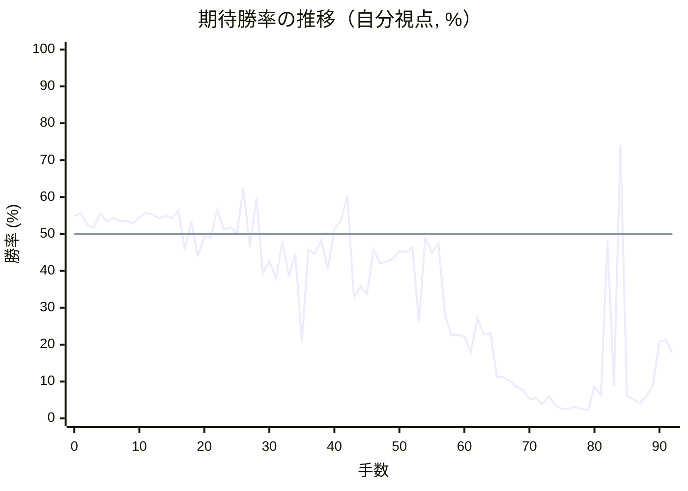

<details><summary>1手ごとの数値（第1パス）</summary>

| 手数 | 指し手 | 評価値 | 勝率 | 低下 | 判定 |
|--:|---|--:|--:|--:|---|
| 1 | ▲７六歩(77) | +134 | 55.6% | -0.7pt |  |
| 2 | △８四歩(83) | +57 | 52.4% |  |  |
| 3 | ▲２六歩(27) | +41 | 51.7% | +0.7pt |  |
| 4 | △３四歩(33) | +134 | 55.6% |  |  |
| 5 | ▲２五歩(26) | +80 | 53.3% | +2.2pt |  |
| 6 | △８五歩(84) | +107 | 54.4% |  |  |
| 7 | ▲７八金(69) | +85 | 53.5% | +0.9pt |  |
| 8 | △３二金(41) | +87 | 53.6% |  |  |
| 9 | ▲２四歩(25) | +67 | 52.8% | +0.8pt |  |
| 10 | △同歩(23) | +108 | 54.5% |  |  |
| 11 | ▲同飛(28) | +141 | 55.8% | -1.4pt |  |
| 12 | △８六歩(85) | +127 | 55.3% |  |  |
| 13 | ▲同歩(87) | +100 | 54.2% | +1.1pt |  |
| 14 | △同飛(82) | +121 | 55.0% |  |  |
| 15 | ▲３四飛(24) | +100 | 54.2% | +0.9pt |  |
| 16 | △４二玉(51) | +150 | 56.2% |  |  |
| 17 | ▲６八玉(59) | -100 | 45.8% | +10.4pt |  |
| 18 | △８二飛(86) | +85 | 53.5% |  |  |
| 19 | ▲８四歩打 | -147 | 43.9% | +9.6pt | [悪手](#ply-19) |
| 20 | △８八角成(22) | -14 | 49.4% |  |  |
| 21 | ▲同銀(79) | -23 | 49.0% | +0.4pt |  |
| 22 | △２七角打 | +161 | 56.7% |  |  |
| 23 | ▲３八銀(39) | +28 | 51.2% | +5.5pt |  |
| 24 | △４五角成(27) | +43 | 51.8% |  |  |
| 25 | ▲２四飛(34) | +5 | 50.2% | +1.6pt |  |
| 26 | △２三歩打 | +302 | 62.3% |  |  |
| 27 | ▲２六飛(24) | -87 | 46.4% | +15.9pt | [悪手](#ply-27) |
| 28 | △４四馬(45) | +237 | 59.7% |  |  |
| 29 | ▲２五飛(26) | -261 | 39.3% | +20.5pt | [悪手](#ply-29) |
| 30 | △８四飛(82) | -177 | 42.7% |  |  |
| 31 | ▲７七桂(89) | -295 | 38.0% | +4.7pt |  |
| 32 | △８二飛(84) | -45 | 48.1% |  |  |
| 33 | ▲９六歩(97) | -280 | 38.5% | +9.6pt | [悪手](#ply-33) |
| 34 | △７二銀(71) | -132 | 44.5% |  |  |
| 35 | ▲８七銀(88) | -808 | 20.6% | +23.9pt | [悪手](#ply-35) |
| 36 | △８三銀(72) | -100 | 45.8% |  |  |
| 37 | ▲３六歩(37) | -130 | 44.6% | +1.2pt |  |
| 38 | △２二銀(31) | -44 | 48.2% |  |  |
| 39 | ▲３七銀(38) | -234 | 40.4% | +7.8pt | [疑問手](#ply-39) |
| 40 | △３三桂(21) | +32 | 51.3% |  |  |
| 41 | ▲２八飛(25) | +86 | 53.6% | -2.2pt |  |
| 42 | △７四銀(83) | +256 | 60.5% |  |  |
| 43 | ▲４六銀(37) | -430 | 32.8% | +27.7pt | [大悪手](#ply-43) |
| 44 | △８六歩打 | -352 | 35.7% |  |  |
| 45 | ▲９八銀(87) | -405 | 33.7% | +2.0pt |  |
| 46 | △５四馬(44) | -103 | 45.7% |  |  |
| 47 | ▲８五歩打 | -191 | 42.1% | +3.6pt |  |
| 48 | △４四歩(43) | -183 | 42.4% |  |  |
| 49 | ▲３五歩(36) | -162 | 43.3% | -0.9pt |  |
| 50 | △５二金(61) | -111 | 45.4% |  |  |
| 51 | ▲３四歩(35) | -117 | 45.1% | +0.2pt |  |
| 52 | △４五桂(33) | -88 | 46.3% |  |  |
| 53 | ▲３七桂(29) | -622 | 26.2% | +20.2pt | [大悪手](#ply-53) |
| 54 | △４三金(52) | -21 | 49.1% |  |  |
| 55 | ▲４五桂(37) | -123 | 44.9% | +4.2pt |  |
| 56 | △同歩(44) | -62 | 47.4% |  |  |
| 57 | ▲６六桂打 | -562 | 28.2% | +19.3pt | [悪手](#ply-57) |
| 58 | △４四馬(54) | -742 | 22.5% |  |  |
| 59 | ▲７四桂(66) | -736 | 22.7% | -0.2pt |  |
| 60 | △同歩(73) | -755 | 22.1% |  |  |
| 61 | ▲３三銀打 | -908 | 18.0% | +4.1pt |  |
| 62 | △同銀(22) | -593 | 27.1% |  |  |
| 63 | ▲同歩成(34) | -734 | 22.7% | +4.4pt |  |
| 64 | △同金(43) | -725 | 23.0% |  |  |
| 65 | ▲５五角打 | -1234 | 11.3% | +11.7pt | [悪手](#ply-65) |
| 66 | △同馬(44) | -1243 | 11.2% |  |  |
| 67 | ▲同銀(46) | -1302 | 10.2% | +0.9pt |  |
| 68 | △３七角打 | -1421 | 8.6% |  |  |
| 69 | ▲３八飛(28) | -1491 | 7.7% | +0.9pt |  |
| 70 | △５五角成(37) | -1743 | 5.2% |  |  |
| 71 | ▲３四歩打 | -1708 | 5.5% | -0.3pt |  |
| 72 | △４三金(33) | -1927 | 3.9% |  |  |
| 73 | ▲３三銀打 | -1656 | 6.0% | -2.1pt |  |
| 74 | △同金(43) | -1997 | 3.5% |  |  |
| 75 | ▲同歩成(34) | -2177 | 2.6% | +0.9pt |  |
| 76 | △同金(32) | -2177 | 2.6% |  |  |
| 77 | ▲６六角打 | -2075 | 3.1% | -0.5pt |  |
| 78 | △同馬(55) | -2166 | 2.6% |  |  |
| 79 | ▲同歩(67) | -2264 | 2.2% | +0.4pt |  |
| 80 | △３七歩打 | -1428 | 8.5% |  |  |
| 81 | ▲同飛(38) | -1622 | 6.3% | +2.2pt |  |
| 82 | △７三角打 | -42 | 48.3% |  |  |
| 83 | ▲３六飛(37) | -1408 | 8.7% | +39.5pt | [大悪手](#ply-83) |
| 84 | △４四桂打 | +634 | 74.2% |  |  |
| 85 | ▲３五飛(36) | -1638 | 6.1% | +68.1pt | [大悪手](#ply-85) |
| 86 | △３四銀打 | -1760 | 5.1% |  |  |
| 87 | ▲３九飛(35) | -1886 | 4.1% | +0.9pt |  |
| 88 | △２七桂打 | -1636 | 6.1% |  |  |
| 89 | ▲３八飛(39) | -1383 | 9.1% | -2.9pt |  |
| 90 | △３七銀打 | -798 | 20.9% |  |  |
| 91 | ▲１八飛(38) | -788 | 21.2% | -0.3pt |  |
| 92 | △１九桂成(27) | -927 | 17.6% |  |  |

</details>

## 課題局面

<a id="ply-19"></a>
### 19手目 ▲８四歩打 — 悪手

| | 着手前 | 着手後 | 差 |
|---|--:|--:|--:|
| 期待勝率 | 53.4% | 40.5% | -12.8pt |
| 評価値 | +81 | -230 | |

着手前の局面:

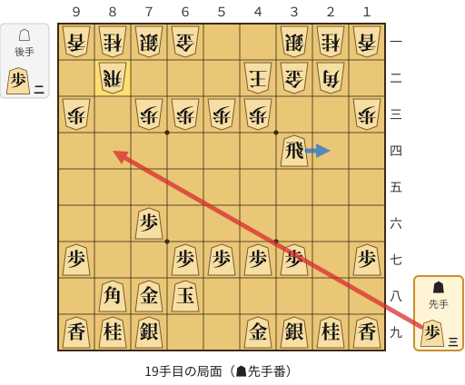

🔴 実戦 ▲８四歩打　🔵 AI推奨 ▲２四飛(34)　🟨 直前の相手の指し手

<details><summary>テキストの盤面図（BOD・将棋ソフトに貼り付け可）</summary>

```text
後手の持駒：歩二
  ９ ８ ７ ６ ５ ４ ３ ２ １
+---------------------------+
|v香v桂v銀v金 ・ ・v銀v桂v香|一
| ・v飛 ・ ・ ・v玉v金v角 ・|二
|v歩 ・v歩v歩v歩v歩 ・ ・v歩|三
| ・ ・ ・ ・ ・ ・ 飛 ・ ・|四
| ・ ・ ・ ・ ・ ・ ・ ・ ・|五
| ・ ・ 歩 ・ ・ ・ ・ ・ ・|六
| 歩 ・ ・ 歩 歩 歩 歩 ・ 歩|七
| ・ 角 金 玉 ・ ・ ・ ・ ・|八
| 香 桂 銀 ・ ・ 金 銀 桂 香|九
+---------------------------+
先手の持駒：歩三
手数＝18　△８二飛　まで
```

</details>

| | 指し手 | 評価値 | 読み筋 |
|---|---|--:|---|
| 実戦 | ▲８四歩打 | -230 | △７二銀(71) ▲５八玉(68) △１四歩(13) ▲９六歩(97) △２三金(32) ▲３六飛(34) |
| AI 1位 | ▲２四飛(34) | +81 | ▲２四飛(34) △２三歩打 ▲２八飛(24) △８六歩打 ▲２二角成(88) △同銀(31) |
| AI 2位 | ▲８七歩打 | +1 | ▲８七歩打 △８八角成(22) ▲同銀(79) △２七角打 ▲３八銀(39) △４五角成(27) |
| AI 3位 | ▲５八玉(68) | -16 | ▲５八玉(68) △３三角(22) ▲３六歩(37) △２二銀(31) ▲３八銀(39) △７二銀(71) |

SFEN: `lnsg2snl/1r3kgb1/p1pppp2p/6R2/9/2P6/P2PPPP1P/1BGK5/LNS2GSNL b 3P2p 19`

<a id="ply-27"></a>
### 27手目 ▲２六飛(24) — 悪手

| | 着手前 | 着手後 | 差 |
|---|--:|--:|--:|
| 期待勝率 | 60.0% | 49.5% | -10.5pt |
| 評価値 | +244 | -11 | |

着手前の局面:

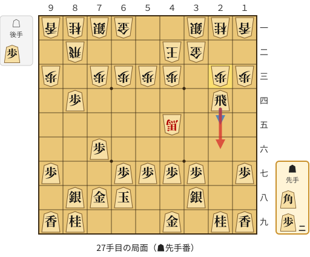

🔴 実戦 ▲２六飛(24)　🔵 AI推奨 ▲２五飛(24)　🟨 直前の相手の指し手

<details><summary>テキストの盤面図（BOD・将棋ソフトに貼り付け可）</summary>

```text
後手の持駒：歩
  ９ ８ ７ ６ ５ ４ ３ ２ １
+---------------------------+
|v香v桂v銀v金 ・ ・v銀v桂v香|一
| ・v飛 ・ ・ ・v玉v金 ・ ・|二
|v歩 ・v歩v歩v歩v歩 ・v歩v歩|三
| ・ 歩 ・ ・ ・ ・ ・ 飛 ・|四
| ・ ・ ・ ・ ・v馬 ・ ・ ・|五
| ・ ・ 歩 ・ ・ ・ ・ ・ ・|六
| 歩 ・ ・ 歩 歩 歩 歩 ・ 歩|七
| ・ 銀 金 玉 ・ ・ 銀 ・ ・|八
| 香 桂 ・ ・ ・ 金 ・ 桂 香|九
+---------------------------+
先手の持駒：角　歩二
手数＝26　△２三歩　まで
```

</details>

| | 指し手 | 評価値 | 読み筋 |
|---|---|--:|---|
| 実戦 | ▲２六飛(24) | -11 | △７二銀(71) ▲４六飛(26) △３四馬(45) ▲３六飛(46) △２四馬(34) ▲５六飛(36) |
| AI 1位 | ▲２五飛(24) | +244 | ▲２五飛(24) △３五歩打 ▲５六角打 △同馬(45) ▲同歩(57) △３三桂(21) |
| AI 2位 | ▲４六歩(47) | +52 | ▲４六歩(47) △同馬(45) ▲２六飛(24) △３五馬(46) ▲５六飛(26) △８四飛(82) |
| AI 3位 | ▲３四角打 | +14 | ▲３四角打 △５四馬(45) ▲２三角成(34) △同金(32) ▲同飛成(24) △２二歩打 |

SFEN: `lnsg2snl/1r3kg2/p1pppp1pp/1P5R1/5+b3/2P6/P2PPPP1P/1SGK2S2/LN3G1NL b B2Pp 27`

<a id="ply-29"></a>
### 29手目 ▲２五飛(26) — 悪手

| | 着手前 | 着手後 | 差 |
|---|--:|--:|--:|
| 期待勝率 | 50.3% | 38.4% | -11.9pt |
| 評価値 | +8 | -283 | |

着手前の局面:

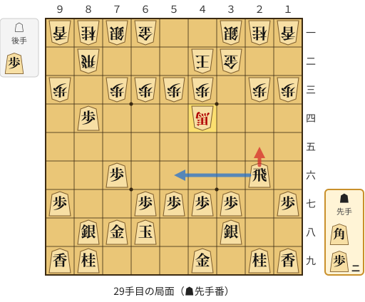

🔴 実戦 ▲２五飛(26)　🔵 AI推奨 ▲５六飛(26)　🟨 直前の相手の指し手

<details><summary>テキストの盤面図（BOD・将棋ソフトに貼り付け可）</summary>

```text
後手の持駒：歩
  ９ ８ ７ ６ ５ ４ ３ ２ １
+---------------------------+
|v香v桂v銀v金 ・ ・v銀v桂v香|一
| ・v飛 ・ ・ ・v玉v金 ・ ・|二
|v歩 ・v歩v歩v歩v歩 ・v歩v歩|三
| ・ 歩 ・ ・ ・v馬 ・ ・ ・|四
| ・ ・ ・ ・ ・ ・ ・ ・ ・|五
| ・ ・ 歩 ・ ・ ・ ・ 飛 ・|六
| 歩 ・ ・ 歩 歩 歩 歩 ・ 歩|七
| ・ 銀 金 玉 ・ ・ 銀 ・ ・|八
| 香 桂 ・ ・ ・ 金 ・ 桂 香|九
+---------------------------+
先手の持駒：角　歩二
手数＝28　△４四馬　まで
```

</details>

| | 指し手 | 評価値 | 読み筋 |
|---|---|--:|---|
| 実戦 | ▲２五飛(26) | -283 | △８四飛(82) ▲７七角打 △３四馬(44) ▲６五飛(25) △６四歩(63) ▲８五歩打 |
| AI 1位 | ▲５六飛(26) | +8 | ▲５六飛(26) △２二銀(31) ▲７七桂(89) △８四飛(82) ▲６六角打 △同馬(44) |
| AI 2位 | ▲４六飛(26) | -5 | ▲４六飛(26) △３三馬(44) ▲５六飛(46) △５二玉(42) ▲８三角打 △７二銀(71) |
| AI 3位 | ▲３六飛(26) | -28 | ▲３六飛(26) △８四飛(82) ▲６六角打 △同馬(44) ▲同飛(36) △６二銀(71) |

SFEN: `lnsg2snl/1r3kg2/p1pppp1pp/1P3+b3/9/2P4R1/P2PPPP1P/1SGK2S2/LN3G1NL b B2Pp 29`

<a id="ply-33"></a>
### 33手目 ▲９六歩(97) — 悪手

| | 着手前 | 着手後 | 差 |
|---|--:|--:|--:|
| 期待勝率 | 50.2% | 36.9% | -13.3pt |
| 評価値 | +5 | -321 | |

着手前の局面:

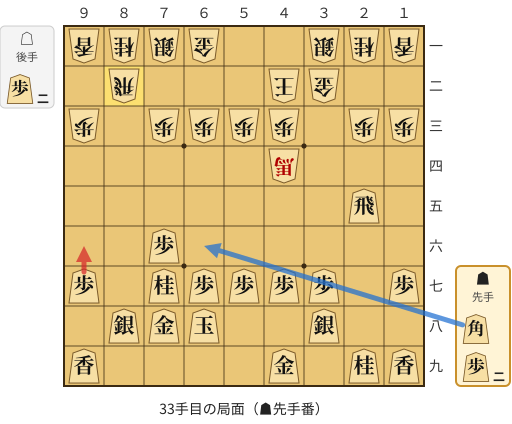

🔴 実戦 ▲９六歩(97)　🔵 AI推奨 ▲６六角打　🟨 直前の相手の指し手

<details><summary>テキストの盤面図（BOD・将棋ソフトに貼り付け可）</summary>

```text
後手の持駒：歩二
  ９ ８ ７ ６ ５ ４ ３ ２ １
+---------------------------+
|v香v桂v銀v金 ・ ・v銀v桂v香|一
| ・v飛 ・ ・ ・v玉v金 ・ ・|二
|v歩 ・v歩v歩v歩v歩 ・v歩v歩|三
| ・ ・ ・ ・ ・v馬 ・ ・ ・|四
| ・ ・ ・ ・ ・ ・ ・ 飛 ・|五
| ・ ・ 歩 ・ ・ ・ ・ ・ ・|六
| 歩 ・ 桂 歩 歩 歩 歩 ・ 歩|七
| ・ 銀 金 玉 ・ ・ 銀 ・ ・|八
| 香 ・ ・ ・ ・ 金 ・ 桂 香|九
+---------------------------+
先手の持駒：角　歩二
手数＝32　△８二飛　まで
```

</details>

| | 指し手 | 評価値 | 読み筋 |
|---|---|--:|---|
| 実戦 | ▲９六歩(97) | -321 | △２二銀(31) ▲６六角打 △５四馬(44) ▲８三歩打 △６二飛(82) ▲５五飛(25) |
| AI 1位 | ▲６六角打 | +5 | ▲６六角打 △同馬(44) ▲同歩(67) △３四角打 ▲８五飛(25) △同飛(82) |
| AI 2位 | ▲３六歩(37) | -141 | ▲３六歩(37) △２二銀(31) ▲８四歩打 △同飛(82) ▲６六角打 △同馬(44) |
| AI 3位 | ▲６五飛(25) | -145 | ▲６五飛(25) △５四馬(44) ▲８三歩打 △同飛(82) ▲８四歩打 △８二飛(83) |

SFEN: `lnsg2snl/1r3kg2/p1pppp1pp/5+b3/7R1/2P6/P1NPPPP1P/1SGK2S2/L4G1NL b B2P2p 33`

<a id="ply-35"></a>
### 35手目 ▲８七銀(88) — 悪手

| | 着手前 | 着手後 | 差 |
|---|--:|--:|--:|
| 期待勝率 | 38.8% | 20.8% | -18.0pt |
| 評価値 | -273 | -803 | |

着手前の局面:

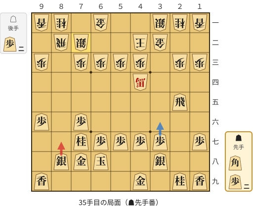

🔴 実戦 ▲８七銀(88)　🔵 AI推奨 ▲３六歩(37)　🟨 直前の相手の指し手

<details><summary>テキストの盤面図（BOD・将棋ソフトに貼り付け可）</summary>

```text
後手の持駒：歩二
  ９ ８ ７ ６ ５ ４ ３ ２ １
+---------------------------+
|v香v桂 ・v金 ・ ・v銀v桂v香|一
| ・v飛v銀 ・ ・v玉v金 ・ ・|二
|v歩 ・v歩v歩v歩v歩 ・v歩v歩|三
| ・ ・ ・ ・ ・v馬 ・ ・ ・|四
| ・ ・ ・ ・ ・ ・ ・ 飛 ・|五
| 歩 ・ 歩 ・ ・ ・ ・ ・ ・|六
| ・ ・ 桂 歩 歩 歩 歩 ・ 歩|七
| ・ 銀 金 玉 ・ ・ 銀 ・ ・|八
| 香 ・ ・ ・ ・ 金 ・ 桂 香|九
+---------------------------+
先手の持駒：角　歩二
手数＝34　△７二銀　まで
```

</details>

| | 指し手 | 評価値 | 読み筋 |
|---|---|--:|---|
| 実戦 | ▲８七銀(88) | -803 | △８六歩打 ▲９八銀(87) △２二銀(31) ▲３六歩(37) △６四歩(63) ▲７五飛(25) |
| AI 1位 | ▲３六歩(37) | -273 | ▲３六歩(37) △２二銀(31) ▲３七桂(29) △１四歩(13) ▲８四歩打 △５四馬(44) |
| AI 2位 | ▲４六歩(47) | -337 | ▲４六歩(47) △２二銀(31) ▲３六歩(37) △６四歩(63) ▲３七桂(29) △７四歩(73) |
| AI 3位 | ▲４六歩(47) | -341 | ▲４六歩(47) △２二銀(31) ▲３六歩(37) △６四歩(63) ▲３七桂(29) △７四歩(73) |

SFEN: `ln1g2snl/1rs2kg2/p1pppp1pp/5+b3/7R1/P1P6/2NPPPP1P/1SGK2S2/L4G1NL b B2P2p 35`

<a id="ply-39"></a>
### 39手目 ▲３七銀(38) — 疑問手

| | 着手前 | 着手後 | 差 |
|---|--:|--:|--:|
| 期待勝率 | 47.5% | 40.1% | -7.3pt |
| 評価値 | -61 | -240 | |

着手前の局面:

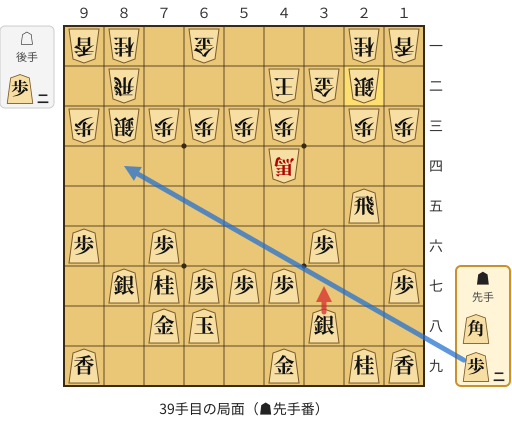

🔴 実戦 ▲３七銀(38)　🔵 AI推奨 ▲８四歩打　🟨 直前の相手の指し手

<details><summary>テキストの盤面図（BOD・将棋ソフトに貼り付け可）</summary>

```text
後手の持駒：歩二
  ９ ８ ７ ６ ５ ４ ３ ２ １
+---------------------------+
|v香v桂 ・v金 ・ ・ ・v桂v香|一
| ・v飛 ・ ・ ・v玉v金v銀 ・|二
|v歩v銀v歩v歩v歩v歩 ・v歩v歩|三
| ・ ・ ・ ・ ・v馬 ・ ・ ・|四
| ・ ・ ・ ・ ・ ・ ・ 飛 ・|五
| 歩 ・ 歩 ・ ・ ・ 歩 ・ ・|六
| ・ 銀 桂 歩 歩 歩 ・ ・ 歩|七
| ・ ・ 金 玉 ・ ・ 銀 ・ ・|八
| 香 ・ ・ ・ ・ 金 ・ 桂 香|九
+---------------------------+
先手の持駒：角　歩二
手数＝38　△２二銀　まで
```

</details>

| | 指し手 | 評価値 | 読み筋 |
|---|---|--:|---|
| 実戦 | ▲３七銀(38) | -240 | △７四銀(83) ▲８六歩打 △３三銀(22) ▲４六銀(37) △５四馬(44) ▲５八金(49) |
| AI 1位 | ▲８四歩打 | -61 | ▲８四歩打 △７四銀(83) ▲６六角打 △同馬(44) ▲同歩(67) △３三桂(21) |
| AI 2位 | ▲４六歩(47) | -66 | ▲４六歩(47) △５四馬(44) ▲４七銀(38) △８六歩打 ▲同銀(87) △７六馬(54) |
| AI 3位 | ▲３七桂(29) | -72 | ▲３七桂(29) △７四銀(83) ▲８六歩打 △３三銀(22) ▲７五歩(76) △２四歩(23) |

SFEN: `ln1g3nl/1r3kgs1/pspppp1pp/5+b3/7R1/P1P3P2/1SNPPP2P/2GK2S2/L4G1NL b B2P2p 39`

<a id="ply-43"></a>
### 43手目 ▲４六銀(37) — 大悪手

| | 着手前 | 着手後 | 差 |
|---|--:|--:|--:|
| 期待勝率 | 58.7% | 35.6% | -23.1pt |
| 評価値 | +210 | -356 | |

着手前の局面:

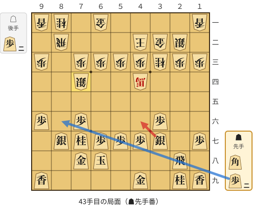

🔴 実戦 ▲４六銀(37)　🔵 AI推奨 ▲８六歩打　🟨 直前の相手の指し手

<details><summary>テキストの盤面図（BOD・将棋ソフトに貼り付け可）</summary>

```text
後手の持駒：歩二
  ９ ８ ７ ６ ５ ４ ３ ２ １
+---------------------------+
|v香v桂 ・v金 ・ ・ ・ ・v香|一
| ・v飛 ・ ・ ・v玉v金v銀 ・|二
|v歩 ・v歩v歩v歩v歩v桂v歩v歩|三
| ・ ・v銀 ・ ・v馬 ・ ・ ・|四
| ・ ・ ・ ・ ・ ・ ・ ・ ・|五
| 歩 ・ 歩 ・ ・ ・ 歩 ・ ・|六
| ・ 銀 桂 歩 歩 歩 銀 ・ 歩|七
| ・ ・ 金 玉 ・ ・ ・ 飛 ・|八
| 香 ・ ・ ・ ・ 金 ・ 桂 香|九
+---------------------------+
先手の持駒：角　歩二
手数＝42　△７四銀　まで
```

</details>

| | 指し手 | 評価値 | 読み筋 |
|---|---|--:|---|
| 実戦 | ▲４六銀(37) | -356 | △８六歩打 ▲９八銀(87) △９四歩(93) ▲８八歩打 △９五歩(94) ▲同歩(96) |
| AI 1位 | ▲８六歩打 | +210 | ▲８六歩打 △８五歩打 ▲同歩(86) △同銀(74) ▲同桂(77) △９九馬(44) |
| AI 2位 | ▲８四歩打 | -15 | ▲８四歩打 △８五歩打 ▲４六銀(37) △８四飛(82) ▲６六角打 △同馬(44) |
| AI 3位 | ▲８三歩打 | -127 | ▲８三歩打 △同飛(82) ▲８六歩打 △８五歩打 ▲同歩(86) △同銀(74) |

SFEN: `ln1g4l/1r3kgs1/p1ppppnpp/2s2+b3/9/P1P3P2/1SNPPPS1P/2GK3R1/L4G1NL b B2P2p 43`

<a id="ply-53"></a>
### 53手目 ▲３七桂(29) — 大悪手

| | 着手前 | 着手後 | 差 |
|---|--:|--:|--:|
| 期待勝率 | 46.3% | 23.9% | -22.4pt |
| 評価値 | -90 | -696 | |

着手前の局面:

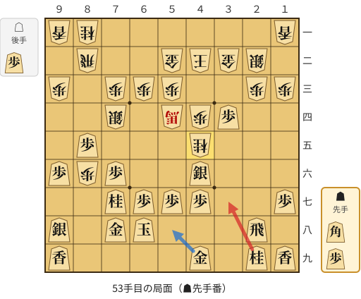

🔴 実戦 ▲３七桂(29)　🔵 AI推奨 ▲５八金(49)　🟨 直前の相手の指し手

<details><summary>テキストの盤面図（BOD・将棋ソフトに貼り付け可）</summary>

```text
後手の持駒：歩
  ９ ８ ７ ６ ５ ４ ３ ２ １
+---------------------------+
|v香v桂 ・ ・ ・ ・ ・ ・v香|一
| ・v飛 ・ ・v金v玉v金v銀 ・|二
|v歩 ・v歩v歩v歩 ・ ・v歩v歩|三
| ・ ・v銀 ・v馬v歩 歩 ・ ・|四
| ・ 歩 ・ ・ ・v桂 ・ ・ ・|五
| 歩v歩 歩 ・ ・ 銀 ・ ・ ・|六
| ・ ・ 桂 歩 歩 歩 ・ ・ 歩|七
| 銀 ・ 金 玉 ・ ・ ・ 飛 ・|八
| 香 ・ ・ ・ ・ 金 ・ 桂 香|九
+---------------------------+
先手の持駒：角　歩
手数＝52　△４五桂　まで
```

</details>

| | 指し手 | 評価値 | 読み筋 |
|---|---|--:|---|
| 実戦 | ▲３七桂(29) | -696 | △同桂不成(45) ▲同銀(46) |
| AI 1位 | ▲５八金(49) | -90 | ▲５八金(49) △３三歩打 ▲５六歩(57) △７六馬(54) ▲５五銀(46) △７五銀(74) |
| AI 2位 | ▲３八飛(28) | -134 | ▲３八飛(28) △３三歩打 ▲同歩成(34) △同金(32) ▲３五銀(46) △８五銀(74) |
| AI 3位 | ▲５六歩(57) | -152 | ▲５六歩(57) △７六馬(54) ▲５五銀(46) △３六歩打 ▲３八飛(28) △３七歩成(36) |

SFEN: `ln6l/1r2gkgs1/p1ppp2pp/2s1+bpP2/1P3n3/PpP2S3/2NPPP2P/S1GK3R1/L4G1NL b BPp 53`

<a id="ply-57"></a>
### 57手目 ▲６六桂打 — 悪手

| | 着手前 | 着手後 | 差 |
|---|--:|--:|--:|
| 期待勝率 | 45.0% | 26.5% | -18.5pt |
| 評価値 | -120 | -613 | |

着手前の局面:

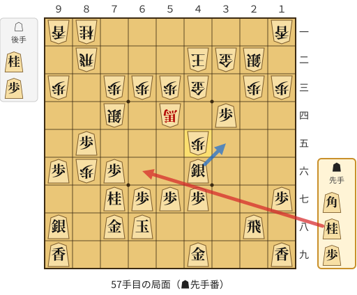

🔴 実戦 ▲６六桂打　🔵 AI推奨 ▲３五銀(46)　🟨 直前の相手の指し手

<details><summary>テキストの盤面図（BOD・将棋ソフトに貼り付け可）</summary>

```text
後手の持駒：桂　歩
  ９ ８ ７ ６ ５ ４ ３ ２ １
+---------------------------+
|v香v桂 ・ ・ ・ ・ ・ ・v香|一
| ・v飛 ・ ・ ・v玉v金v銀 ・|二
|v歩 ・v歩v歩v歩v金 ・v歩v歩|三
| ・ ・v銀 ・v馬 ・ 歩 ・ ・|四
| ・ 歩 ・ ・ ・v歩 ・ ・ ・|五
| 歩v歩 歩 ・ ・ 銀 ・ ・ ・|六
| ・ ・ 桂 歩 歩 歩 ・ ・ 歩|七
| 銀 ・ 金 玉 ・ ・ ・ 飛 ・|八
| 香 ・ ・ ・ ・ 金 ・ ・ 香|九
+---------------------------+
先手の持駒：角　桂　歩
手数＝56　△４五同歩　まで
```

</details>

| | 指し手 | 評価値 | 読み筋 |
|---|---|--:|---|
| 実戦 | ▲６六桂打 | -613 | △４四馬(54) ▲３七銀(46) △３一玉(42) ▲７四桂(66) △同歩(73) ▲６六角打 |
| AI 1位 | ▲３五銀(46) | -120 | ▲３五銀(46) △５五馬(54) ▲２六飛(28) △３三歩打 ▲３六飛(26) △３四金(43) |
| AI 2位 | ▲６六桂打 | -675 | ▲６六桂打 △４四馬(54) ▲３七銀(46) △３一玉(42) ▲７四桂(66) △同歩(73) |
| AI 3位 | ▲３七銀(46) | -705 | ▲３七銀(46) △３四金(43) ▲８四歩(85) △４四馬(54) ▲６六桂打 △３一玉(42) |

SFEN: `ln6l/1r3kgs1/p1pppg1pp/2s1+b1P2/1P3p3/PpP2S3/2NPPP2P/S1GK3R1/L4G2L b BNPnp 57`

<a id="ply-65"></a>
### 65手目 ▲５五角打 — 悪手

| | 着手前 | 着手後 | 差 |
|---|--:|--:|--:|
| 期待勝率 | 21.1% | 6.2% | -14.9pt |
| 評価値 | -790 | -1626 | |

着手前の局面:

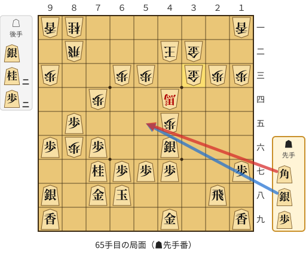

🔴 実戦 ▲５五角打　🔵 AI推奨 ▲５五銀打　🟨 直前の相手の指し手

<details><summary>テキストの盤面図（BOD・将棋ソフトに貼り付け可）</summary>

```text
後手の持駒：銀　桂二　歩二
  ９ ８ ７ ６ ５ ４ ３ ２ １
+---------------------------+
|v香v桂 ・ ・ ・ ・ ・ ・v香|一
| ・v飛 ・ ・ ・v玉v金 ・ ・|二
|v歩 ・ ・v歩v歩 ・v金v歩v歩|三
| ・ ・v歩 ・ ・v馬 ・ ・ ・|四
| ・ 歩 ・ ・ ・v歩 ・ ・ ・|五
| 歩v歩 歩 ・ ・ 銀 ・ ・ ・|六
| ・ ・ 桂 歩 歩 歩 ・ ・ 歩|七
| 銀 ・ 金 玉 ・ ・ ・ 飛 ・|八
| 香 ・ ・ ・ ・ 金 ・ ・ 香|九
+---------------------------+
先手の持駒：角　銀　歩
手数＝64　△３三同寄　まで
```

</details>

| | 指し手 | 評価値 | 読み筋 |
|---|---|--:|---|
| 実戦 | ▲５五角打 | -1626 | △同馬(44) ▲同銀(46) △３七角打 ▲３四歩打 △４三金(33) ▲３三銀打 |
| AI 1位 | ▲５五銀打 | -790 | ▲５五銀打 △４六歩(45) ▲４四銀(55) △同金(33) ▲４六歩(47) △６四桂打 |
| AI 2位 | ▲３五銀打 | -1170 | ▲３五銀打 △５四馬(44) ▲３四歩打 △４三金(33) ▲３七銀(46) △７五歩(74) |
| AI 3位 | ▲３七銀(46) | -1311 | ▲３七銀(46) △７五歩(74) ▲６六角打 △５五桂打 ▲７五角(66) △６四桂打 |

SFEN: `ln6l/1r3kg2/p2pp1gpp/2p2+b3/1P3p3/PpP2S3/2NPPP2P/S1GK3R1/L4G2L b BSPs2n2p 65`

<a id="ply-83"></a>
### 83手目 ▲３六飛(37) — 大悪手

| | 着手前 | 着手後 | 差 |
|---|--:|--:|--:|
| 期待勝率 | 52.2% | 8.6% | -43.6pt |
| 評価値 | +54 | -1415 | |

着手前の局面:

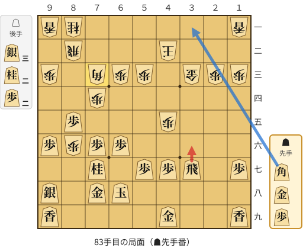

🔴 実戦 ▲３六飛(37)　🔵 AI推奨 ▲３一角打　🟨 直前の相手の指し手

<details><summary>テキストの盤面図（BOD・将棋ソフトに貼り付け可）</summary>

```text
後手の持駒：銀三　桂二　歩二
  ９ ８ ７ ６ ５ ４ ３ ２ １
+---------------------------+
|v香v桂 ・ ・ ・ ・ ・ ・v香|一
| ・v飛 ・ ・ ・v玉 ・ ・ ・|二
|v歩 ・v角v歩v歩 ・v金v歩v歩|三
| ・ ・v歩 ・ ・ ・ ・ ・ ・|四
| ・ 歩 ・ ・ ・v歩 ・ ・ ・|五
| 歩v歩 歩 歩 ・ ・ ・ ・ ・|六
| ・ ・ 桂 ・ 歩 歩 飛 ・ 歩|七
| 銀 ・ 金 玉 ・ ・ ・ ・ ・|八
| 香 ・ ・ ・ ・ 金 ・ ・ 香|九
+---------------------------+
先手の持駒：角　金　歩
手数＝82　△７三角　まで
```

</details>

| | 指し手 | 評価値 | 読み筋 |
|---|---|--:|---|
| 実戦 | ▲３六飛(37) | -1415 | △３五歩打 ▲同飛(36) △３四歩打 ▲４五飛(35) △４四銀打 ▲同飛(45) |
| AI 1位 | ▲３一角打 | +54 | ▲３一角打 △同玉(42) ▲３三飛成(37) △３二歩打 ▲２二金打 △４一玉(31) |
| AI 2位 | ▲３八飛(37) | -1175 | ▲３八飛(37) △３七歩打 ▲２八飛(38) △５五桂打 ▲３四歩打 △６七銀打 |
| AI 3位 | ▲３九飛(37) | -1178 | ▲３九飛(37) △３八歩打 ▲同飛(39) △３七歩打 ▲２八飛(38) △５五桂打 |

SFEN: `ln6l/1r3k3/p1bpp1gpp/2p6/1P3p3/PpPP5/2N1PPR1P/S1GK5/L4G2L b BGP3s2n2p 83`

<a id="ply-85"></a>
### 85手目 ▲３五飛(36) — 大悪手

| | 着手前 | 着手後 | 差 |
|---|--:|--:|--:|
| 期待勝率 | 74.5% | 2.4% | -72.1pt |
| 評価値 | +642 | -2222 | |

着手前の局面:

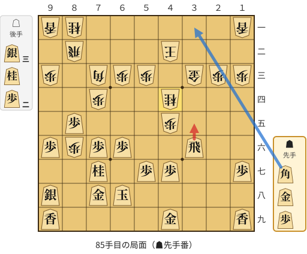

🔴 実戦 ▲３五飛(36)　🔵 AI推奨 ▲３一角打　🟨 直前の相手の指し手

<details><summary>テキストの盤面図（BOD・将棋ソフトに貼り付け可）</summary>

```text
後手の持駒：銀三　桂　歩二
  ９ ８ ７ ６ ５ ４ ３ ２ １
+---------------------------+
|v香v桂 ・ ・ ・ ・ ・ ・v香|一
| ・v飛 ・ ・ ・v玉 ・ ・ ・|二
|v歩 ・v角v歩v歩 ・v金v歩v歩|三
| ・ ・v歩 ・ ・v桂 ・ ・ ・|四
| ・ 歩 ・ ・ ・v歩 ・ ・ ・|五
| 歩v歩 歩 歩 ・ ・ 飛 ・ ・|六
| ・ ・ 桂 ・ 歩 歩 ・ ・ 歩|七
| 銀 ・ 金 玉 ・ ・ ・ ・ ・|八
| 香 ・ ・ ・ ・ 金 ・ ・ 香|九
+---------------------------+
先手の持駒：角　金　歩
手数＝84　△４四桂　まで
```

</details>

| | 指し手 | 評価値 | 読み筋 |
|---|---|--:|---|
| 実戦 | ▲３五飛(36) | -2222 | △３四歩打 ▲３九飛(35) △２八角成(73) ▲３七角打 △同馬(28) ▲同飛(39) |
| AI 1位 | ▲３一角打 | +642 | ▲３一角打 △３二玉(42) ▲２二金打 △４三玉(32) ▲５三角成(31) △同玉(43) |
| AI 2位 | ▲３九飛(36) | -1335 | ▲３九飛(36) △３六歩打 ▲６五桂(77) △６四角(73) ▲５八金(49) △８五飛(82) |
| AI 3位 | ▲３八飛(36) | -1450 | ▲３八飛(36) △３七銀打 ▲３九飛(38) △２八銀打 ▲６五桂(77) △３九銀成(28) |

SFEN: `ln6l/1r3k3/p1bpp1gpp/2p2n3/1P3p3/PpPP2R2/2N1PP2P/S1GK5/L4G2L b BGP3sn2p 85`

