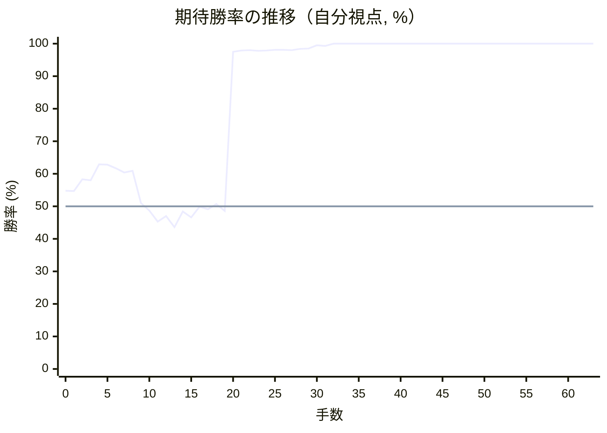
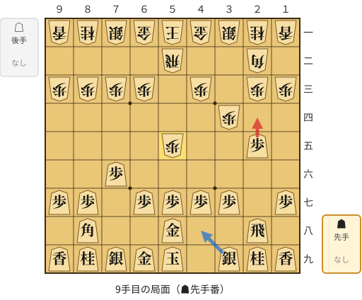

# 解析レポート 89htp7en6fm2

[README に戻る](../../../README.md)　/　棋譜: [CSA](../../../data/csa/shogi5/89htp7en6fm2.csa)　/　解析の見方: [docs/mistake_analysis.md](../../../docs/mistake_analysis.md)

## 対局情報

| 項目 | 内容 |
|---|---|
| 日時 | 2026-11-14 08:21:34 |
| 持ち時間 | 5分 |
| 自分 | 先手（▲）（1651） |
| 相手 | 相手（1458） |
| 結果 | 勝ち（投了, 63手） |

## 解析環境

| 項目 | 内容 |
|---|---|
| エンジン | YaneuraOu NNUE 9.00git 64AVX2（V9.00/YANEURAOU_ENGINE_NNUE/AVX2） |
| 評価関数 | **水匠5**（`suisho5`） |
| nn.bin SHA-256 | `768068f0d534a0603a5d38bcd143de6bbca820d5f1c95a14d40863e5b7892d76` |
| 第1パス | movetime=150ms, MultiPV 1 |
| 第2パス | movetime=2000ms, MultiPV 3 |
| Threads / Hash | 8 / 512MB |
| 判定基準 | 疑問手 ≥5pt, 悪手 ≥10pt, 大悪手 ≥20pt（期待勝率 W(E)=1/(1+exp(-E/600))） |
| 解析日時 | 2026-11-20T20:29:39+09:00（解析バージョン 1, 13秒） |

## サマリー

| 自分の手数 | 深掘りした手 | 詰み逃し | 大悪手 | 悪手 | 疑問手 |
|--:|--:|--:|--:|--:|--:|
| 32 | 1 | 0 | 0 | 1 | 0 |

## 期待勝率の推移



<details><summary>1手ごとの数値（第1パス）</summary>

| 手数 | 指し手 | 評価値 | 勝率 | 低下 | 判定 |
|--:|---|--:|--:|--:|---|
| 1 | ▲７六歩(77) | +112 | 54.7% | +0.1pt |  |
| 2 | △５四歩(53) | +202 | 58.3% |  |  |
| 3 | ▲２六歩(27) | +194 | 58.0% | +0.3pt |  |
| 4 | △３四歩(33) | +317 | 62.9% |  |  |
| 5 | ▲２五歩(26) | +314 | 62.8% | +0.1pt |  |
| 6 | △５二飛(82) | +287 | 61.7% |  |  |
| 7 | ▲５八金(49) | +254 | 60.4% | +1.3pt |  |
| 8 | △５五歩(54) | +266 | 60.9% |  |  |
| 9 | ▲２四歩(25) | +23 | 51.0% | +9.9pt | [悪手](#ply-9) |
| 10 | △同歩(23) | -31 | 48.7% |  |  |
| 11 | ▲同飛(28) | -112 | 45.3% | +3.4pt |  |
| 12 | △５六歩(55) | -73 | 47.0% |  |  |
| 13 | ▲同歩(57) | -155 | 43.6% | +3.4pt |  |
| 14 | △８八角成(22) | -38 | 48.4% |  |  |
| 15 | ▲同銀(79) | -82 | 46.6% | +1.8pt |  |
| 16 | △３三角打 | -3 | 49.9% |  |  |
| 17 | ▲２一飛成(24) | -21 | 49.1% | +0.7pt |  |
| 18 | △８八角成(33) | +17 | 50.7% |  |  |
| 19 | ▲５五桂打 | -33 | 48.6% | +2.1pt |  |
| 20 | △５四銀打 | +2192 | 97.5% |  |  |
| 21 | ▲３三角打 | +2308 | 97.9% | -0.4pt |  |
| 22 | △６二玉(51) | +2320 | 98.0% |  |  |
| 23 | ▲６三桂成(55) | +2276 | 97.8% | +0.2pt |  |
| 24 | △同銀(54) | +2311 | 97.9% |  |  |
| 25 | ▲８八角成(33) | +2373 | 98.1% | -0.2pt |  |
| 26 | △５六飛(52) | +2370 | 98.1% |  |  |
| 27 | ▲５七歩打 | +2320 | 98.0% | +0.2pt |  |
| 28 | △７六飛(56) | +2488 | 98.4% |  |  |
| 29 | ▲１一馬(88) | +2506 | 98.5% | -0.0pt |  |
| 30 | △５一金(61) | +3190 | 99.5% |  |  |
| 31 | ▲７九香打 | +3000 | 99.3% | +0.2pt |  |
| 32 | △７七桂打 | +4826 | 100.0% |  |  |
| 33 | ▲同香(79) | +4876 | 100.0% | -0.0pt |  |
| 34 | △同飛成(76) | +5157 | 100.0% |  |  |
| 35 | ▲同桂(89) | +5193 | 100.0% | -0.0pt |  |
| 36 | △２二香打 | +6082 | 100.0% |  |  |
| 37 | ▲２三歩打 | +5876 | 100.0% | +0.0pt |  |
| 38 | △同香(22) | +6066 | 100.0% |  |  |
| 39 | ▲同龍(21) | +6124 | 100.0% | -0.0pt |  |
| 40 | △６四歩打 | +6448 | 100.0% |  |  |
| 41 | ▲４三龍(23) | +6502 | 100.0% | -0.0pt |  |
| 42 | △４二銀(31) | +35281 | 100.0% |  |  |
| 43 | ▲４四馬(11) | +5997 | 100.0% | +0.0pt |  |
| 44 | △５三歩打 | +6193 | 100.0% |  |  |
| 45 | ▲１二飛打 | +6364 | 100.0% | -0.0pt |  |
| 46 | △５二金(41) | +6445 | 100.0% |  |  |
| 47 | ▲１三龍(43) | +6087 | 100.0% | +0.0pt |  |
| 48 | △４三歩打 | +6155 | 100.0% |  |  |
| 49 | ▲３四馬(44) | +6121 | 100.0% | +0.0pt |  |
| 50 | △３三歩打 | +6444 | 100.0% |  |  |
| 51 | ▲５六馬(34) | +6481 | 100.0% | -0.0pt |  |
| 52 | △５四歩(53) | +6470 | 100.0% |  |  |
| 53 | ▲８三馬(56) | +6602 | 100.0% | -0.0pt |  |
| 54 | △７二銀(71) | +7033 | 100.0% |  |  |
| 55 | ▲８二馬(83) | +6896 | 100.0% | +0.0pt |  |
| 56 | △５三玉(62) | #+9 | 100.0% |  |  |
| 57 | ▲７一馬(82) | #+10 | 100.0% | +0.0pt |  |
| 58 | △６二金(51) | #+9 | 100.0% |  |  |
| 59 | ▲４五桂打 | #+8 | 100.0% | +0.0pt |  |
| 60 | △４四玉(53) | #+7 | 100.0% |  |  |
| 61 | ▲２四龍(13) | #+6 | 100.0% | +0.0pt |  |
| 62 | △４五玉(44) | #+3 | 100.0% |  |  |
| 63 | ▲１五飛成(12) | #+2 | 100.0% | +0.0pt |  |

</details>

## 課題局面

<a id="ply-9"></a>
### 9手目 ▲２四歩(25) — 悪手

| | 着手前 | 着手後 | 差 |
|---|--:|--:|--:|
| 期待勝率 | 61.2% | 50.4% | -10.8pt |
| 評価値 | +274 | +10 | |

着手前の局面:



🔴 実戦 ▲２四歩(25)　🔵 AI推奨 ▲４八銀(39)　🟨 直前の相手の指し手

<details><summary>テキストの盤面図（BOD・将棋ソフトに貼り付け可）</summary>

```text
後手の持駒：なし
  ９ ８ ７ ６ ５ ４ ３ ２ １
+---------------------------+
|v香v桂v銀v金v玉v金v銀v桂v香|一
| ・ ・ ・ ・v飛 ・ ・v角 ・|二
|v歩v歩v歩v歩 ・v歩 ・v歩v歩|三
| ・ ・ ・ ・ ・ ・v歩 ・ ・|四
| ・ ・ ・ ・v歩 ・ ・ 歩 ・|五
| ・ ・ 歩 ・ ・ ・ ・ ・ ・|六
| 歩 歩 ・ 歩 歩 歩 歩 ・ 歩|七
| ・ 角 ・ ・ 金 ・ ・ 飛 ・|八
| 香 桂 銀 金 玉 ・ 銀 桂 香|九
+---------------------------+
先手の持駒：なし
手数＝8　△５五歩　まで
```

</details>

| | 指し手 | 評価値 | 読み筋 |
|---|---|--:|---|
| 実戦 | ▲２四歩(25) | +10 | △同歩(23) ▲３六歩(37) △６二玉(51) ▲６八玉(59) △３三角(22) ▲４六歩(47) |
| AI 1位 | ▲４八銀(39) | +274 | ▲４八銀(39) △３三角(22) ▲６八玉(59) △６二玉(51) ▲７八玉(68) △４二銀(31) |
| AI 2位 | ▲６八玉(59) | +255 | ▲６八玉(59) △３三角(22) ▲４八銀(39) △６二玉(51) ▲７八玉(68) △７二玉(62) |
| AI 3位 | ▲９六歩(97) | +215 | ▲９六歩(97) △３三角(22) ▲６八玉(59) △６二玉(51) ▲９五歩(96) △４二銀(31) |

SFEN: `lnsgkgsnl/4r2b1/pppp1p1pp/6p2/4p2P1/2P6/PP1PPPP1P/1B2G2R1/LNSGK1SNL b - 9`

