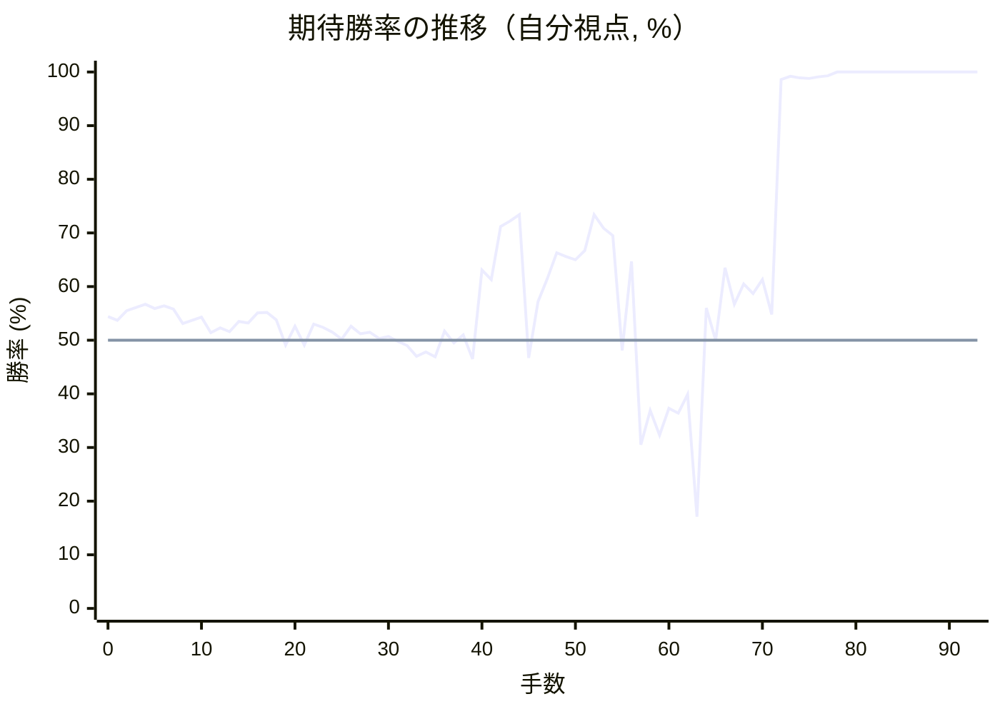

# 解析レポート 976gwds3rknl

[README に戻る](../../../README.md)　/　棋譜: [CSA](../../../data/csa/shogi5/976gwds3rknl.csa)　/　解析の見方: [docs/mistake_analysis.md](../../../docs/mistake_analysis.md)

## 対局情報

| 項目 | 内容 |
|---|---|
| 日時 | 2026-10-29 21:28:26 |
| 持ち時間 | 5分 |
| 自分 | 先手（▲）（1730） |
| 相手 | 相手（1624） |
| 結果 | 勝ち（詰み, 93手） |

## 解析環境

| 項目 | 内容 |
|---|---|
| エンジン | YaneuraOu NNUE 9.00git 64AVX2（V9.00/YANEURAOU_ENGINE_NNUE/AVX2） |
| 評価関数 | **水匠5**（`suisho5`） |
| nn.bin SHA-256 | `768068f0d534a0603a5d38bcd143de6bbca820d5f1c95a14d40863e5b7892d76` |
| 第1パス | movetime=150ms, MultiPV 1 |
| 第2パス | movetime=2000ms, MultiPV 3 |
| Threads / Hash | 8 / 512MB |
| 判定基準 | 疑問手 ≥5pt, 悪手 ≥10pt, 大悪手 ≥20pt（期待勝率 W(E)=1/(1+exp(-E/600))） |
| 解析日時 | 2026-11-03T04:15:57+09:00（解析バージョン 1, 36秒） |

## サマリー

| 自分の手数 | 深掘りした手 | 詰み逃し | 大悪手 | 悪手 | 疑問手 |
|--:|--:|--:|--:|--:|--:|
| 47 | 6 | 1 | 4 | 0 | 0 |

## 期待勝率の推移



<details><summary>1手ごとの数値（第1パス）</summary>

| 手数 | 指し手 | 評価値 | 勝率 | 低下 | 判定 |
|--:|---|--:|--:|--:|---|
| 1 | ▲７六歩(77) | +88 | 53.7% | +0.7pt |  |
| 2 | △８四歩(83) | +132 | 55.5% |  |  |
| 3 | ▲２六歩(27) | +146 | 56.1% | -0.6pt |  |
| 4 | △８五歩(84) | +161 | 56.7% |  |  |
| 5 | ▲７七角(88) | +142 | 55.9% | +0.8pt |  |
| 6 | △３四歩(33) | +154 | 56.4% |  |  |
| 7 | ▲６八銀(79) | +140 | 55.8% | +0.6pt |  |
| 8 | △７七角成(22) | +74 | 53.1% |  |  |
| 9 | ▲同銀(68) | +88 | 53.7% | -0.6pt |  |
| 10 | △２二銀(31) | +104 | 54.3% |  |  |
| 11 | ▲２五歩(26) | +34 | 51.4% | +2.9pt |  |
| 12 | △３二金(41) | +55 | 52.3% |  |  |
| 13 | ▲７八金(69) | +38 | 51.6% | +0.7pt |  |
| 14 | △４二玉(51) | +85 | 53.5% |  |  |
| 15 | ▲４八銀(39) | +76 | 53.2% | +0.4pt |  |
| 16 | △３三銀(22) | +122 | 55.1% |  |  |
| 17 | ▲６八玉(59) | +125 | 55.2% | -0.1pt |  |
| 18 | △７二銀(71) | +91 | 53.8% |  |  |
| 19 | ▲４六歩(47) | -22 | 49.1% | +4.7pt |  |
| 20 | △６四歩(63) | +62 | 52.6% |  |  |
| 21 | ▲４七銀(48) | -21 | 49.1% | +3.5pt |  |
| 22 | △７四歩(73) | +72 | 53.0% |  |  |
| 23 | ▲６六歩(67) | +57 | 52.4% | +0.6pt |  |
| 24 | △７三桂(81) | +36 | 51.5% |  |  |
| 25 | ▲５六銀(47) | +5 | 50.2% | +1.3pt |  |
| 26 | △９四歩(93) | +63 | 52.6% |  |  |
| 27 | ▲９六歩(97) | +28 | 51.2% | +1.5pt |  |
| 28 | △１四歩(13) | +36 | 51.5% |  |  |
| 29 | ▲１六歩(17) | +8 | 50.3% | +1.2pt |  |
| 30 | △６三銀(72) | +18 | 50.7% |  |  |
| 31 | ▲５八金(49) | -6 | 49.8% | +1.0pt |  |
| 32 | △６二金(61) | -23 | 49.0% |  |  |
| 33 | ▲７九玉(68) | -73 | 47.0% | +2.1pt |  |
| 34 | △５四銀(63) | -54 | 47.8% |  |  |
| 35 | ▲３六歩(37) | -74 | 46.9% | +0.8pt |  |
| 36 | △４四歩(43) | +41 | 51.7% |  |  |
| 37 | ▲３七桂(29) | -11 | 49.5% | +2.2pt |  |
| 38 | △８一飛(82) | +25 | 51.0% |  |  |
| 39 | ▲４五歩(46) | -85 | 46.5% | +4.6pt |  |
| 40 | △３一玉(42) | +323 | 63.1% |  |  |
| 41 | ▲４四歩(45) | +275 | 61.3% | +1.9pt |  |
| 42 | △同銀(33) | +542 | 71.2% |  |  |
| 43 | ▲２四歩(25) | +572 | 72.2% | -1.0pt |  |
| 44 | △同歩(23) | +608 | 73.4% |  |  |
| 45 | ▲同飛(28) | -80 | 46.7% | +26.7pt | [大悪手](#ply-45) |
| 46 | △２三歩打 | +173 | 57.2% |  |  |
| 47 | ▲２八飛(24) | +281 | 61.5% | -4.3pt |  |
| 48 | △３五歩(34) | +405 | 66.3% |  |  |
| 49 | ▲２四歩打 | +388 | 65.6% | +0.6pt |  |
| 50 | △同歩(23) | +372 | 65.0% |  |  |
| 51 | ▲同飛(28) | +416 | 66.7% | -1.6pt |  |
| 52 | △４三歩打 | +608 | 73.4% |  |  |
| 53 | ▲２二歩打 | +535 | 70.9% | +2.4pt |  |
| 54 | △同金(32) | +495 | 69.5% |  |  |
| 55 | ▲４五銀(56) | -46 | 48.1% | +21.4pt | [大悪手](#ply-55) |
| 56 | △２三歩打 | +364 | 64.7% |  |  |
| 57 | ▲３四飛(24) | -495 | 30.5% | +34.2pt | [大悪手](#ply-57) |
| 58 | △３三金(22) | -322 | 36.9% |  |  |
| 59 | ▲同飛成(34) | -445 | 32.3% | +4.6pt |  |
| 60 | △同銀(44) | -311 | 37.3% |  |  |
| 61 | ▲５四銀(45) | -336 | 36.4% | +1.0pt |  |
| 62 | △同歩(53) | -246 | 39.9% |  |  |
| 63 | ▲８八玉(79) | -948 | 17.1% | +22.8pt | [大悪手](#ply-63) |
| 64 | △３六歩(35) | +144 | 56.0% |  |  |
| 65 | ▲４五桂(37) | +1 | 50.0% | +5.9pt |  |
| 66 | △４四銀(33) | +331 | 63.5% |  |  |
| 67 | ▲３三歩打 | +162 | 56.7% | +6.7pt |  |
| 68 | △同桂(21) | +257 | 60.5% |  |  |
| 69 | ▲同桂成(45) | +212 | 58.7% | +1.8pt |  |
| 70 | △同銀(44) | +277 | 61.3% |  |  |
| 71 | ▲４五桂打 | +115 | 54.8% | +6.6pt |  |
| 72 | △４四銀(33) | +2568 | 98.6% |  |  |
| 73 | ▲３三銀打 | +2917 | 99.2% | -0.6pt |  |
| 74 | △３二飛打 | +2708 | 98.9% |  |  |
| 75 | ▲４四銀成(33) | +2637 | 98.8% | +0.1pt |  |
| 76 | △同歩(43) | +2791 | 99.1% |  |  |
| 77 | ▲３三銀打 | +3016 | 99.3% | -0.3pt |  |
| 78 | △４五歩(44) | +4897 | 100.0% |  |  |
| 79 | ▲４三金打 | +5591 | 100.0% | -0.0pt |  |
| 80 | △３三飛(32) | +8030 | 100.0% |  |  |
| 81 | ▲４二角打 | +7718 | 100.0% | +0.0pt |  |
| 82 | △２一玉(31) | +35281 | 100.0% |  |  |
| 83 | ▲３三角成(42) | #+10 | 100.0% | +0.0pt |  |
| 84 | △３一銀打 | #+5 | 100.0% |  |  |
| 85 | ▲４二飛打 | +35281 | 100.0% | +0.0pt |  |
| 86 | △２二銀打 | #+5 | 100.0% |  |  |
| 87 | ▲６二飛成(42) | +6407 | 100.0% | +0.0pt | [詰み逃し](#ply-87) |
| 88 | △３三銀(22) | +35281 | 100.0% |  |  |
| 89 | ▲同金(43) | #+10 | 100.0% | +0.0pt |  |
| 90 | △３二銀打 | #+3 | 100.0% |  |  |
| 91 | ▲同龍(62) | #+2 | 100.0% | +0.0pt |  |
| 92 | △同銀(31) | #+1 | 100.0% |  |  |
| 93 | ▲２二金打 | #+ | 100.0% | +0.0pt |  |

</details>

## 課題局面

<a id="ply-45"></a>
### 45手目 ▲同飛(28) — 大悪手

| | 着手前 | 着手後 | 差 |
|---|--:|--:|--:|
| 期待勝率 | 73.1% | 36.1% | -37.1pt |
| 評価値 | +601 | -343 | |

着手前の局面:

```text
後手の持駒：角　歩二
  ９ ８ ７ ６ ５ ４ ３ ２ １
+---------------------------+
|v香v飛 ・ ・ ・ ・v玉v桂v香|一
| ・ ・ ・v金 ・ ・v金 ・ ・|二
| ・ ・v桂 ・v歩 ・ ・ ・ ・|三
|v歩 ・v歩v歩v銀v銀v歩v歩v歩|四
| ・v歩 ・ ・ ・ ・ ・ ・ ・|五
| 歩 ・ 歩 歩 銀 ・ 歩 ・ 歩|六
| ・ 歩 銀 ・ 歩 ・ 桂 ・ ・|七
| ・ ・ 金 ・ 金 ・ ・ 飛 ・|八
| 香 桂 玉 ・ ・ ・ ・ ・ 香|九
+---------------------------+
先手の持駒：角　歩
手数＝44　△２四同歩　まで
```

| | 指し手 | 評価値 | 読み筋 |
|---|---|--:|---|
| 実戦 | ▲同飛(28) | -343 | △４六角打 ▲２九飛(24) △３七角成(46) ▲２二歩打 △同金(32) ▲２三歩打 |
| AI 1位 | ▲７五歩(76) | +601 | ▲７五歩(76) △６三銀(54) ▲１五歩(16) △７五歩(74) ▲１四歩(15) △４三歩打 |
| AI 2位 | ▲１五歩(16) | +453 | ▲１五歩(16) △８六歩(85) ▲同銀(77) △１五歩(14) ▲１三歩打 △４二玉(31) |
| AI 3位 | ▲８八玉(79) | +21 | ▲８八玉(79) △６五歩(64) ▲２五歩打 △６四角打 ▲２六角打 △８六歩(85) |

SFEN: `lr4knl/3g2g2/2n1p4/p1ppssppp/1p7/P1PPS1P1P/1PS1P1N2/2G1G2R1/LNK5L b BPb2p 45`

<a id="ply-55"></a>
### 55手目 ▲４五銀(56) — 大悪手

| | 着手前 | 着手後 | 差 |
|---|--:|--:|--:|
| 期待勝率 | 73.5% | 47.7% | -25.8pt |
| 評価値 | +613 | -55 | |

着手前の局面:

```text
後手の持駒：角　歩二
  ９ ８ ７ ６ ５ ４ ３ ２ １
+---------------------------+
|v香v飛 ・ ・ ・ ・v玉v桂v香|一
| ・ ・ ・v金 ・ ・ ・v金 ・|二
| ・ ・v桂 ・v歩v歩 ・ ・ ・|三
|v歩 ・v歩v歩v銀v銀 ・ 飛v歩|四
| ・v歩 ・ ・ ・ ・v歩 ・ ・|五
| 歩 ・ 歩 歩 銀 ・ 歩 ・ 歩|六
| ・ 歩 銀 ・ 歩 ・ 桂 ・ ・|七
| ・ ・ 金 ・ 金 ・ ・ ・ ・|八
| 香 桂 玉 ・ ・ ・ ・ ・ 香|九
+---------------------------+
先手の持駒：角　歩
手数＝54　△２二同金　まで
```

| | 指し手 | 評価値 | 読み筋 |
|---|---|--:|---|
| 実戦 | ▲４五銀(56) | -55 | △同銀(54) ▲同桂(37) △２三歩打 ▲２八飛(24) △３七角打 ▲２九飛(28) |
| AI 1位 | ▲２三歩打 | +613 | ▲２三歩打 △１二金(22) ▲４五銀(56) △同銀(54) ▲同桂(37) △３二玉(31) |
| AI 2位 | ▲７五歩(76) | +341 | ▲７五歩(76) △３六歩(35) ▲２五桂(37) △３二玉(31) ▲７四歩(75) △２三金(22) |
| AI 3位 | ▲２六飛(24) | +267 | ▲２六飛(24) △３六歩(35) ▲４五銀(56) △３二玉(31) ▲３六銀(45) △２四歩打 |

SFEN: `lr4knl/3g3g1/2n1pp3/p1ppss1Rp/1p4p2/P1PPS1P1P/1PS1P1N2/2G1G4/LNK5L b BPb2p 55`

<a id="ply-57"></a>
### 57手目 ▲３四飛(24) — 大悪手

| | 着手前 | 着手後 | 差 |
|---|--:|--:|--:|
| 期待勝率 | 66.6% | 38.5% | -28.2pt |
| 評価値 | +415 | -282 | |

着手前の局面:

```text
後手の持駒：角　歩
  ９ ８ ７ ６ ５ ４ ３ ２ １
+---------------------------+
|v香v飛 ・ ・ ・ ・v玉v桂v香|一
| ・ ・ ・v金 ・ ・ ・v金 ・|二
| ・ ・v桂 ・v歩v歩 ・v歩 ・|三
|v歩 ・v歩v歩v銀v銀 ・ 飛v歩|四
| ・v歩 ・ ・ ・ 銀v歩 ・ ・|五
| 歩 ・ 歩 歩 ・ ・ 歩 ・ 歩|六
| ・ 歩 銀 ・ 歩 ・ 桂 ・ ・|七
| ・ ・ 金 ・ 金 ・ ・ ・ ・|八
| 香 桂 玉 ・ ・ ・ ・ ・ 香|九
+---------------------------+
先手の持駒：角　歩
手数＝56　△２三歩　まで
```

| | 指し手 | 評価値 | 読み筋 |
|---|---|--:|---|
| 実戦 | ▲３四飛(24) | -282 | △３三金(22) ▲同飛成(34) △同桂(21) ▲５四銀(45) △同歩(53) ▲６三銀打 |
| AI 1位 | ▲５四銀(45) | +415 | ▲５四銀(45) △２四歩(23) ▲４三銀成(54) △４二歩打 ▲４四成銀(43) △４九飛打 |
| AI 2位 | ▲２八飛(24) | -61 | ▲２八飛(24) △４五銀(54) ▲同桂(37) △３七角打 ▲２九飛(28) △５五角成(37) |
| AI 3位 | ▲２六飛(24) | -81 | ▲２六飛(24) △４五銀(54) ▲同桂(37) △３七角打 ▲２九飛(26) △５五角成(37) |

SFEN: `lr4knl/3g3g1/2n1pp1p1/p1ppss1Rp/1p3Sp2/P1PP2P1P/1PS1P1N2/2G1G4/LNK5L b BPbp 57`

<a id="ply-63"></a>
### 63手目 ▲８八玉(79) — 大悪手

| | 着手前 | 着手後 | 差 |
|---|--:|--:|--:|
| 期待勝率 | 43.6% | 13.3% | -30.3pt |
| 評価値 | -154 | -1126 | |

着手前の局面:

```text
後手の持駒：飛　角　銀　歩
  ９ ８ ７ ６ ５ ４ ３ ２ １
+---------------------------+
|v香v飛 ・ ・ ・ ・v玉v桂v香|一
| ・ ・ ・v金 ・ ・ ・ ・ ・|二
| ・ ・v桂 ・ ・v歩v銀v歩 ・|三
|v歩 ・v歩v歩v歩 ・ ・ ・v歩|四
| ・v歩 ・ ・ ・ ・v歩 ・ ・|五
| 歩 ・ 歩 歩 ・ ・ 歩 ・ 歩|六
| ・ 歩 銀 ・ 歩 ・ 桂 ・ ・|七
| ・ ・ 金 ・ 金 ・ ・ ・ ・|八
| 香 桂 玉 ・ ・ ・ ・ ・ 香|九
+---------------------------+
先手の持駒：角　金　銀　歩
手数＝62　△５四同歩　まで
```

| | 指し手 | 評価値 | 読み筋 |
|---|---|--:|---|
| 実戦 | ▲８八玉(79) | -1126 | △６九銀打 ▲５九金打 △５八銀不成(69) ▲同金(59) △４九飛打 ▲２五桂(37) |
| AI 1位 | ▲６三銀打 | -154 | ▲６三銀打 △８六歩(85) ▲同歩(87) △３九飛打 ▲４九歩打 △２七角打 |
| AI 2位 | ▲４九歩打 | -337 | ▲４九歩打 △８六歩(85) ▲同銀(77) △２八飛打 ▲４八金(58) △５九銀打 |
| AI 3位 | ▲４五桂(37) | -594 | ▲４五桂(37) △３九飛打 ▲５九金打 △４二銀(33) ▲４九歩打 △３二玉(31) |

SFEN: `lr4knl/3g5/2n2psp1/p1ppp3p/1p4p2/P1PP2P1P/1PS1P1N2/2G1G4/LNK5L b BGSPrbsp 63`

<a id="ply-87"></a>
### 87手目 ▲６二飛成(42) — 詰み逃し

| | 着手前 | 着手後 | 差 |
|---|--:|--:|--:|
| 期待勝率 | 100.0% | 100.0% | -0.0pt |
| 評価値 | 5手詰め | +7420 | |

着手前の局面:

```text
後手の持駒：角　銀　桂二　歩三
  ９ ８ ７ ６ ５ ４ ３ ２ １
+---------------------------+
|v香v飛 ・ ・ ・ ・v銀v玉v香|一
| ・ ・ ・v金 ・ 飛 ・v銀 ・|二
| ・ ・v桂 ・ ・ 金 馬v歩 ・|三
|v歩 ・v歩v歩v歩 ・ ・ ・v歩|四
| ・v歩 ・ ・ ・v歩 ・ ・ ・|五
| 歩 ・ 歩 歩 ・ ・v歩 ・ 歩|六
| ・ 歩 銀 ・ 歩 ・ ・ ・ ・|七
| ・ 玉 金 ・ 金 ・ ・ ・ ・|八
| 香 桂 ・ ・ ・ ・ ・ ・ 香|九
+---------------------------+
先手の持駒：なし
手数＝86　△２二銀打　まで
```

| | 指し手 | 評価値 | 読み筋 |
|---|---|--:|---|
| 実戦 | ▲６二飛成(42) | +7420 | △１二玉(21) ▲１五歩(16) △２一桂打 ▲１四歩(15) △３五角打 ▲１三金打 |
| AI 1位 | ▲３二金(43) | 5手詰め | ▲３二金(43) △１二玉(21) ▲２二金(32) △同銀(31) ▲同飛成(42) |
| AI 2位 | ▲３二飛成(42) | 5手詰め | ▲３二飛成(42) △同銀(31) ▲同金(43) △１二玉(21) ▲２二馬(33) |
| AI 3位 | ▲同飛成(42) | 5手詰め | ▲同飛成(42) △同銀(31) ▲３二金(43) △１二玉(21) ▲２二馬(33) |

SFEN: `lr4skl/3g1R1s1/2n2G+Bp1/p1ppp3p/1p3p3/P1PP2p1P/1PS1P4/1KG1G4/LN6L b bs2n3p 87`

