# 解析レポート a1atsme3jlrv

[README に戻る](../../../README.md)　/　棋譜: [CSA](../../../data/csa/shogi5/a1atsme3jlrv.csa)　/　解析の見方: [docs/mistake_analysis.md](../../../docs/mistake_analysis.md)

## 対局情報

| 項目 | 内容 |
|---|---|
| 日時 | 2026-11-05 18:44:45 |
| 持ち時間 | 5分 |
| 自分 | 先手（▲）（1730） |
| 相手 | 相手（1875） |
| 結果 | 負け（時間切れ, 98手） |

## 解析環境

| 項目 | 内容 |
|---|---|
| エンジン | YaneuraOu NNUE 9.00git 64AVX2（V9.00/YANEURAOU_ENGINE_NNUE/AVX2） |
| 評価関数 | **水匠5**（`suisho5`） |
| nn.bin SHA-256 | `768068f0d534a0603a5d38bcd143de6bbca820d5f1c95a14d40863e5b7892d76` |
| 第1パス | movetime=150ms, MultiPV 1 |
| 第2パス | movetime=2000ms, MultiPV 3 |
| Threads / Hash | 8 / 512MB |
| 判定基準 | 疑問手 ≥5pt, 悪手 ≥10pt, 大悪手 ≥20pt（期待勝率 W(E)=1/(1+exp(-E/600))） |
| 解析日時 | 2026-11-11T20:37:37+09:00（解析バージョン 1, 71秒） |

## サマリー

| 自分の手数 | 深掘りした手 | 詰み逃し | 大悪手 | 悪手 | 疑問手 |
|--:|--:|--:|--:|--:|--:|
| 49 | 14 | 0 | 2 | 5 | 3 |

## 期待勝率の推移

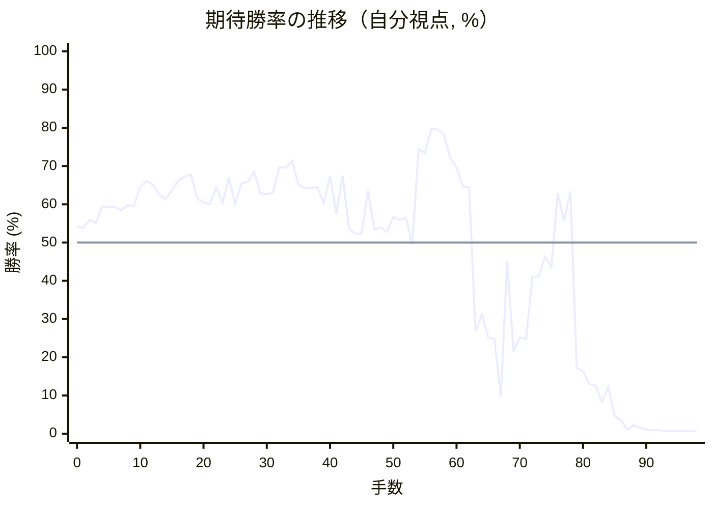

<details><summary>1手ごとの数値（第1パス）</summary>

| 手数 | 指し手 | 評価値 | 勝率 | 低下 | 判定 |
|--:|---|--:|--:|--:|---|
| 1 | ▲７六歩(77) | +91 | 53.8% | +0.5pt |  |
| 2 | △４二銀(31) | +144 | 56.0% |  |  |
| 3 | ▲２六歩(27) | +123 | 55.1% | +0.9pt |  |
| 4 | △５四歩(53) | +230 | 59.5% |  |  |
| 5 | ▲２五歩(26) | +227 | 59.3% | +0.1pt |  |
| 6 | △３二金(41) | +226 | 59.3% |  |  |
| 7 | ▲２四歩(25) | +207 | 58.5% | +0.8pt |  |
| 8 | △同歩(23) | +236 | 59.7% |  |  |
| 9 | ▲同飛(28) | +234 | 59.6% | +0.1pt |  |
| 10 | △５三銀(42) | +362 | 64.6% |  |  |
| 11 | ▲２八飛(24) | +397 | 66.0% | -1.3pt |  |
| 12 | △２三歩打 | +374 | 65.1% |  |  |
| 13 | ▲３八銀(39) | +307 | 62.5% | +2.6pt |  |
| 14 | △３一角(22) | +278 | 61.4% |  |  |
| 15 | ▲２七銀(38) | +336 | 63.6% | -2.3pt |  |
| 16 | △４四銀(53) | +403 | 66.2% |  |  |
| 17 | ▲３六銀(27) | +431 | 67.2% | -1.0pt |  |
| 18 | △５三角(31) | +446 | 67.8% |  |  |
| 19 | ▲６八銀(79) | +284 | 61.6% | +6.2pt | [疑問手](#ply-19) |
| 20 | △８四歩(83) | +256 | 60.5% |  |  |
| 21 | ▲７八金(69) | +245 | 60.1% | +0.4pt |  |
| 22 | △８五歩(84) | +356 | 64.4% |  |  |
| 23 | ▲７七銀(68) | +253 | 60.4% | +4.0pt |  |
| 24 | △７二銀(71) | +421 | 66.9% |  |  |
| 25 | ▲１六歩(17) | +247 | 60.1% | +6.7pt | [疑問手](#ply-25) |
| 26 | △８三銀(72) | +381 | 65.4% |  |  |
| 27 | ▲７九角(88) | +396 | 65.9% | -0.6pt |  |
| 28 | △８四銀(83) | +467 | 68.5% |  |  |
| 29 | ▲６八角(79) | +316 | 62.9% | +5.7pt |  |
| 30 | △９五銀(84) | +310 | 62.6% |  |  |
| 31 | ▲８八銀(77) | +322 | 63.1% | -0.5pt |  |
| 32 | △８六歩(85) | +500 | 69.7% |  |  |
| 33 | ▲同歩(87) | +497 | 69.6% | +0.1pt |  |
| 34 | △同角(53) | +545 | 71.3% |  |  |
| 35 | ▲８七歩打 | +376 | 65.2% | +6.1pt | [悪手](#ply-35) |
| 36 | △６八角成(86) | +350 | 64.2% |  |  |
| 37 | ▲同玉(59) | +354 | 64.3% | -0.2pt |  |
| 38 | △８四銀(95) | +358 | 64.5% |  |  |
| 39 | ▲７七桂(89) | +251 | 60.3% | +4.2pt |  |
| 40 | △９四歩(93) | +435 | 67.4% |  |  |
| 41 | ▲２五銀(36) | +181 | 57.5% | +9.9pt | [悪手](#ply-41) |
| 42 | △９五歩(94) | +438 | 67.5% |  |  |
| 43 | ▲２四歩打 | +88 | 53.7% | +13.8pt |  |
| 44 | △同歩(23) | +56 | 52.3% |  |  |
| 45 | ▲同銀(25) | +57 | 52.4% | -0.0pt |  |
| 46 | △２三歩打 | +334 | 63.6% |  |  |
| 47 | ▲同銀成(24) | +81 | 53.4% | +10.2pt |  |
| 48 | △２七歩打 | +94 | 53.9% |  |  |
| 49 | ▲同飛(28) | +67 | 52.8% | +1.1pt |  |
| 50 | △４五角打 | +161 | 56.7% |  |  |
| 51 | ▲３六歩(37) | +142 | 55.9% | +0.8pt |  |
| 52 | △２三角(45) | +157 | 56.5% |  |  |
| 53 | ▲３七桂(29) | -12 | 49.5% | +7.0pt |  |
| 54 | △２二銀打 | +640 | 74.4% |  |  |
| 55 | ▲４八金(49) | +610 | 73.4% | +1.0pt |  |
| 56 | △５五歩(54) | +817 | 79.6% |  |  |
| 57 | ▲４六歩(47) | +817 | 79.6% | +0.0pt |  |
| 58 | △５六歩(55) | +765 | 78.2% |  |  |
| 59 | ▲同歩(57) | +570 | 72.1% | +6.0pt | [疑問手](#ply-59) |
| 60 | △同角(23) | +501 | 69.7% |  |  |
| 61 | ▲４五歩(46) | +362 | 64.6% | +5.1pt | [悪手](#ply-61) |
| 62 | △５五銀(44) | +356 | 64.4% |  |  |
| 63 | ▲６五角打 | -602 | 26.8% | +37.6pt | [大悪手](#ply-63) |
| 64 | △同角(56) | -474 | 31.2% |  |  |
| 65 | ▲同桂(77) | -654 | 25.2% | +6.1pt |  |
| 66 | △６四銀(55) | -667 | 24.8% |  |  |
| 67 | ▲６六歩(67) | -1343 | 9.6% | +15.1pt | [悪手](#ply-67) |
| 68 | △８五銀(84) | -115 | 45.2% |  |  |
| 69 | ▲５三歩打 | -778 | 21.5% | +23.8pt | [悪手](#ply-69) |
| 70 | △７六銀(85) | -654 | 25.2% |  |  |
| 71 | ▲７七歩打 | -665 | 24.8% | +0.3pt |  |
| 72 | △８五銀(76) | -215 | 41.1% |  |  |
| 73 | ▲４四歩(45) | -217 | 41.1% | +0.1pt |  |
| 74 | △同歩(43) | -88 | 46.3% |  |  |
| 75 | ▲５四角打 | -151 | 43.7% | +2.6pt |  |
| 76 | △７四銀(85) | +318 | 62.9% |  |  |
| 77 | ▲３二角成(54) | +134 | 55.6% | +7.4pt |  |
| 78 | △同飛(82) | +333 | 63.5% |  |  |
| 79 | ▲７九玉(68) | -943 | 17.2% | +46.3pt | [大悪手](#ply-79) |
| 80 | △２三歩打 | -980 | 16.3% |  |  |
| 81 | ▲２四歩打 | -1138 | 13.0% | +3.3pt |  |
| 82 | △同歩(23) | -1170 | 12.5% |  |  |
| 83 | ▲８九玉(79) | -1433 | 8.4% | +4.0pt |  |
| 84 | △２三銀(22) | -1181 | 12.3% |  |  |
| 85 | ▲４三金打 | -1817 | 4.6% | +7.6pt |  |
| 86 | △８二飛(32) | -1971 | 3.6% |  |  |
| 87 | ▲４四金(43) | -2734 | 1.0% | +2.6pt |  |
| 88 | △３九角打 | -2258 | 2.3% |  |  |
| 89 | ▲５二歩成(53) | -2513 | 1.5% | +0.8pt |  |
| 90 | △同金(61) | -2688 | 1.1% |  |  |
| 91 | ▲５四歩打 | -2830 | 0.9% | +0.2pt |  |
| 92 | △６五銀(64) | -2821 | 0.9% |  |  |
| 93 | ▲同歩(66) | -2946 | 0.7% | +0.2pt |  |
| 94 | △４八角成(39) | -2937 | 0.7% |  |  |
| 95 | ▲５三歩成(54) | -3005 | 0.7% | +0.1pt |  |
| 96 | △６六桂打 | -3000 | 0.7% |  |  |
| 97 | ▲７九金(78) | -2956 | 0.7% | -0.1pt |  |
| 98 | △５六角打 | -3061 | 0.6% |  |  |

</details>

## 課題局面

<a id="ply-19"></a>
### 19手目 ▲６八銀(79) — 疑問手

| | 着手前 | 着手後 | 差 |
|---|--:|--:|--:|
| 期待勝率 | 69.7% | 61.1% | -8.6pt |
| 評価値 | +501 | +271 | |

着手前の局面:

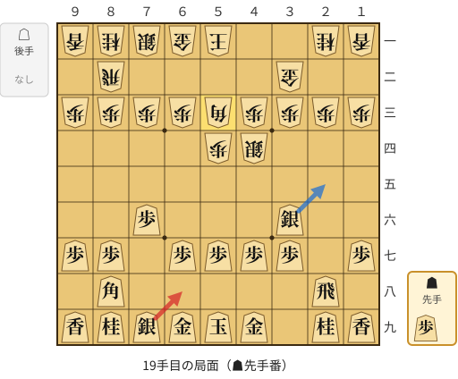

🔴 実戦 ▲６八銀(79)　🔵 AI推奨 ▲２五銀(36)　🟨 直前の相手の指し手

<details><summary>テキストの盤面図（BOD・将棋ソフトに貼り付け可）</summary>

```text
後手の持駒：なし
  ９ ８ ７ ６ ５ ４ ３ ２ １
+---------------------------+
|v香v桂v銀v金v玉 ・ ・v桂v香|一
| ・v飛 ・ ・ ・ ・v金 ・ ・|二
|v歩v歩v歩v歩v角v歩v歩v歩v歩|三
| ・ ・ ・ ・v歩v銀 ・ ・ ・|四
| ・ ・ ・ ・ ・ ・ ・ ・ ・|五
| ・ ・ 歩 ・ ・ ・ 銀 ・ ・|六
| 歩 歩 ・ 歩 歩 歩 歩 ・ 歩|七
| ・ 角 ・ ・ ・ ・ ・ 飛 ・|八
| 香 桂 銀 金 玉 金 ・ 桂 香|九
+---------------------------+
先手の持駒：歩
手数＝18　△５三角　まで
```

</details>

| | 指し手 | 評価値 | 読み筋 |
|---|---|--:|---|
| 実戦 | ▲６八銀(79) | +271 | △８四歩(83) ▲７八金(69) △８五歩(84) ▲７七角(88) △７四歩(73) ▲２五銀(36) |
| AI 1位 | ▲２五銀(36) | +501 | ▲２五銀(36) △３五銀(44) ▲３八金(49) △５二飛(82) ▲６八玉(59) △６二玉(51) |
| AI 2位 | ▲７八金(69) | +403 | ▲７八金(69) △９四歩(93) ▲９六歩(97) △８四歩(83) ▲５八玉(59) △８五歩(84) |
| AI 3位 | ▲７七角(88) | +401 | ▲７七角(88) △９四歩(93) ▲６八玉(59) △７四歩(73) ▲２五銀(36) △５二飛(82) |

SFEN: `lnsgk2nl/1r4g2/ppppbpppp/4ps3/9/2P3S2/PP1PPPP1P/1B5R1/LNSGKG1NL b P 19`

<a id="ply-25"></a>
### 25手目 ▲１六歩(17) — 疑問手

| | 着手前 | 着手後 | 差 |
|---|--:|--:|--:|
| 期待勝率 | 65.1% | 59.9% | -5.2pt |
| 評価値 | +373 | +240 | |

着手前の局面:

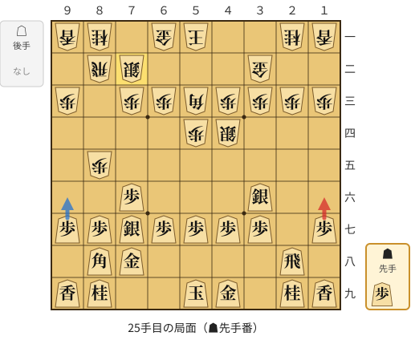

🔴 実戦 ▲１六歩(17)　🔵 AI推奨 ▲９六歩(97)　🟨 直前の相手の指し手

<details><summary>テキストの盤面図（BOD・将棋ソフトに貼り付け可）</summary>

```text
後手の持駒：なし
  ９ ８ ７ ６ ５ ４ ３ ２ １
+---------------------------+
|v香v桂 ・v金v玉 ・ ・v桂v香|一
| ・v飛v銀 ・ ・ ・v金 ・ ・|二
|v歩 ・v歩v歩v角v歩v歩v歩v歩|三
| ・ ・ ・ ・v歩v銀 ・ ・ ・|四
| ・v歩 ・ ・ ・ ・ ・ ・ ・|五
| ・ ・ 歩 ・ ・ ・ 銀 ・ ・|六
| 歩 歩 銀 歩 歩 歩 歩 ・ 歩|七
| ・ 角 金 ・ ・ ・ ・ 飛 ・|八
| 香 桂 ・ ・ 玉 金 ・ 桂 香|九
+---------------------------+
先手の持駒：歩
手数＝24　△７二銀　まで
```

</details>

| | 指し手 | 評価値 | 読み筋 |
|---|---|--:|---|
| 実戦 | ▲１六歩(17) | +240 | △７四歩(73) ▲２五銀(36) |
| AI 1位 | ▲９六歩(97) | +373 | ▲９六歩(97) △７四歩(73) ▲２五銀(36) △７三銀(72) ▲２四歩打 △同歩(23) |
| AI 2位 | ▲２五銀(36) | +325 | ▲２五銀(36) △４五銀(44) ▲２四歩打 △同歩(23) ▲同銀(25) △２二歩打 |
| AI 3位 | ▲６九玉(59) | +337 | ▲６九玉(59) △１四歩(13) ▲７九角(88) △７四歩(73) ▲５六歩(57) △４一玉(51) |

SFEN: `ln1gk2nl/1rs3g2/p1ppbpppp/4ps3/1p7/2P3S2/PPSPPPP1P/1BG4R1/LN2KG1NL b P 25`

<a id="ply-35"></a>
### 35手目 ▲８七歩打 — 悪手

| | 着手前 | 着手後 | 差 |
|---|--:|--:|--:|
| 期待勝率 | 76.1% | 64.1% | -12.1pt |
| 評価値 | +696 | +347 | |

着手前の局面:

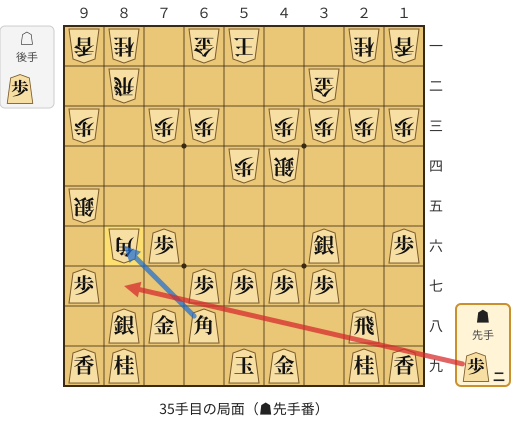

🔴 実戦 ▲８七歩打　🔵 AI推奨 ▲同角(68)　🟨 直前の相手の指し手

<details><summary>テキストの盤面図（BOD・将棋ソフトに貼り付け可）</summary>

```text
後手の持駒：歩
  ９ ８ ７ ６ ５ ４ ３ ２ １
+---------------------------+
|v香v桂 ・v金v玉 ・ ・v桂v香|一
| ・v飛 ・ ・ ・ ・v金 ・ ・|二
|v歩 ・v歩v歩 ・v歩v歩v歩v歩|三
| ・ ・ ・ ・v歩v銀 ・ ・ ・|四
|v銀 ・ ・ ・ ・ ・ ・ ・ ・|五
| ・v角 歩 ・ ・ ・ 銀 ・ 歩|六
| 歩 ・ ・ 歩 歩 歩 歩 ・ ・|七
| ・ 銀 金 角 ・ ・ ・ 飛 ・|八
| 香 桂 ・ ・ 玉 金 ・ 桂 香|九
+---------------------------+
先手の持駒：歩二
手数＝34　△８六同角　まで
```

</details>

| | 指し手 | 評価値 | 読み筋 |
|---|---|--:|---|
| 実戦 | ▲８七歩打 | +347 | △６八角成(86) ▲同玉(59) △８四銀(95) ▲４六歩(47) △８五銀(84) ▲７七銀(88) |
| AI 1位 | ▲同角(68) | +696 | ▲同角(68) △同銀(95) ▲８三歩打 △同飛(82) ▲５六角打 △８二飛(83) |
| AI 2位 | ▲８三歩打 | +586 | ▲８三歩打 △６八角成(86) ▲同玉(59) △８三飛(82) ▲５六角打 △８二飛(83) |
| AI 3位 | ▲７七桂(89) | +508 | ▲７七桂(89) △６四角(86) ▲９六歩(97) △８四銀(95) ▲２五銀(36) △４五銀(44) |

SFEN: `ln1gk2nl/1r4g2/p1pp1pppp/4ps3/s8/1bP3S1P/P2PPPP2/1SGB3R1/LN2KG1NL b 2Pp 35`

<a id="ply-41"></a>
### 41手目 ▲２五銀(36) — 悪手

| | 着手前 | 着手後 | 差 |
|---|--:|--:|--:|
| 期待勝率 | 66.9% | 53.6% | -13.3pt |
| 評価値 | +423 | +87 | |

着手前の局面:

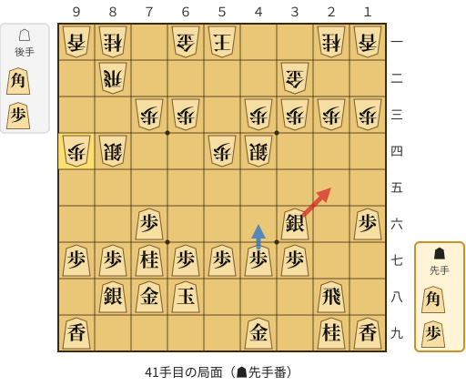

🔴 実戦 ▲２五銀(36)　🔵 AI推奨 ▲４六歩(47)　🟨 直前の相手の指し手

<details><summary>テキストの盤面図（BOD・将棋ソフトに貼り付け可）</summary>

```text
後手の持駒：角　歩
  ９ ８ ７ ６ ５ ４ ３ ２ １
+---------------------------+
|v香v桂 ・v金v玉 ・ ・v桂v香|一
| ・v飛 ・ ・ ・ ・v金 ・ ・|二
| ・ ・v歩v歩 ・v歩v歩v歩v歩|三
|v歩v銀 ・ ・v歩v銀 ・ ・ ・|四
| ・ ・ ・ ・ ・ ・ ・ ・ ・|五
| ・ ・ 歩 ・ ・ ・ 銀 ・ 歩|六
| 歩 歩 桂 歩 歩 歩 歩 ・ ・|七
| ・ 銀 金 玉 ・ ・ ・ 飛 ・|八
| 香 ・ ・ ・ ・ 金 ・ 桂 香|九
+---------------------------+
先手の持駒：角　歩
手数＝40　△９四歩　まで
```

</details>

| | 指し手 | 評価値 | 読み筋 |
|---|---|--:|---|
| 実戦 | ▲２五銀(36) | +87 | △７四歩(73) ▲４六歩(47) △７五歩(74) ▲６五桂(77) △４七角打 ▲４五歩(46) |
| AI 1位 | ▲４六歩(47) | +423 | ▲４六歩(47) △７四歩(73) ▲６五桂(77) △５二金(61) ▲２二歩打 △同金(32) |
| AI 2位 | ▲８六歩(87) | +325 | ▲８六歩(87) △７四歩(73) ▲４六歩(47) △６四角打 ▲６六歩(67) △８六角(64) |
| AI 3位 | ▲９六歩(97) | +321 | ▲９六歩(97) △７四歩(73) ▲４六歩(47) △３四歩(33) ▲２五銀(36) △３三銀(44) |

SFEN: `ln1gk2nl/1r4g2/2pp1pppp/ps2ps3/9/2P3S1P/PPNPPPP2/1SGK3R1/L4G1NL b BPbp 41`

<a id="ply-59"></a>
### 59手目 ▲同歩(57) — 疑問手

| | 着手前 | 着手後 | 差 |
|---|--:|--:|--:|
| 期待勝率 | 80.5% | 73.5% | -7.0pt |
| 評価値 | +851 | +613 | |

着手前の局面:

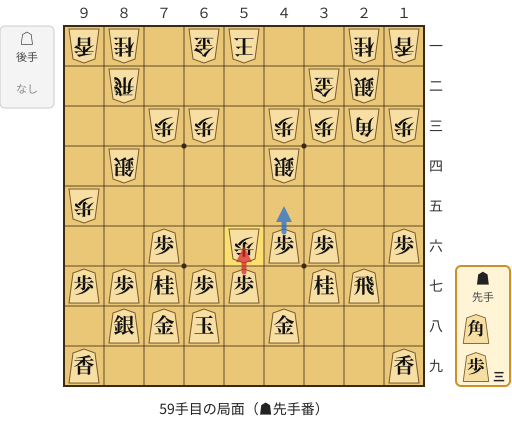

🔴 実戦 ▲同歩(57)　🔵 AI推奨 ▲４五歩(46)　🟨 直前の相手の指し手

<details><summary>テキストの盤面図（BOD・将棋ソフトに貼り付け可）</summary>

```text
後手の持駒：なし
  ９ ８ ７ ６ ５ ４ ３ ２ １
+---------------------------+
|v香v桂 ・v金v玉 ・ ・v桂v香|一
| ・v飛 ・ ・ ・ ・v金v銀 ・|二
| ・ ・v歩v歩 ・v歩v歩v角v歩|三
| ・v銀 ・ ・ ・v銀 ・ ・ ・|四
|v歩 ・ ・ ・ ・ ・ ・ ・ ・|五
| ・ ・ 歩 ・v歩 歩 歩 ・ 歩|六
| 歩 歩 桂 歩 歩 ・ 桂 飛 ・|七
| ・ 銀 金 玉 ・ 金 ・ ・ ・|八
| 香 ・ ・ ・ ・ ・ ・ ・ 香|九
+---------------------------+
先手の持駒：角　歩三
手数＝58　△５六歩　まで
```

</details>

| | 指し手 | 評価値 | 読み筋 |
|---|---|--:|---|
| 実戦 | ▲同歩(57) | +613 | △同角(23) ▲８六歩(87) △３四歩(33) ▲４五桂(37) △３三桂(21) ▲同桂成(45) |
| AI 1位 | ▲４五歩(46) | +851 | ▲４五歩(46) △５七歩成(56) ▲同金(48) △５五銀(44) ▲５六歩打 △６四銀(55) |
| AI 2位 | ▲４五桂(37) | +787 | ▲４五桂(37) △７四歩(73) ▲５六歩(57) △７三銀(84) ▲６五桂(77) △６二銀(73) |
| AI 3位 | ▲８六歩(87) | +758 | ▲８六歩(87) △５二飛(82) ▲６五桂(77) △５五銀(44) ▲４五歩(46) △４二金(32) |

SFEN: `ln1gk2nl/1r4gs1/2pp1ppbp/1s3s3/p8/2P1pPP1P/PPNPP1NR1/1SGK1G3/L7L b B3P 59`

<a id="ply-61"></a>
### 61手目 ▲４五歩(46) — 悪手

| | 着手前 | 着手後 | 差 |
|---|--:|--:|--:|
| 期待勝率 | 72.8% | 59.3% | -13.4pt |
| 評価値 | +590 | +227 | |

着手前の局面:

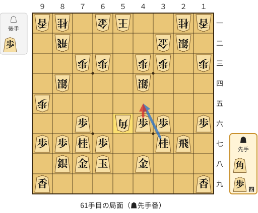

🔴 実戦 ▲４五歩(46)　🔵 AI推奨 ▲４五桂(37)　🟨 直前の相手の指し手

<details><summary>テキストの盤面図（BOD・将棋ソフトに貼り付け可）</summary>

```text
後手の持駒：歩
  ９ ８ ７ ６ ５ ４ ３ ２ １
+---------------------------+
|v香v桂 ・v金v玉 ・ ・v桂v香|一
| ・v飛 ・ ・ ・ ・v金v銀 ・|二
| ・ ・v歩v歩 ・v歩v歩 ・v歩|三
| ・v銀 ・ ・ ・v銀 ・ ・ ・|四
|v歩 ・ ・ ・ ・ ・ ・ ・ ・|五
| ・ ・ 歩 ・v角 歩 歩 ・ 歩|六
| 歩 歩 桂 歩 ・ ・ 桂 飛 ・|七
| ・ 銀 金 玉 ・ 金 ・ ・ ・|八
| 香 ・ ・ ・ ・ ・ ・ ・ 香|九
+---------------------------+
先手の持駒：角　歩四
手数＝60　△５六同角　まで
```

</details>

| | 指し手 | 評価値 | 読み筋 |
|---|---|--:|---|
| 実戦 | ▲４五歩(46) | +227 | △５五銀(44) ▲２六飛(27) △７四角(56) ▲６六歩(67) △同銀(55) ▲５四歩打 |
| AI 1位 | ▲４五桂(37) | +590 | ▲４五桂(37) △５二歩打 ▲７九玉(68) △９三銀(84) ▲４七金(48) △７四角(56) |
| AI 2位 | ▲８六歩(87) | +614 | ▲８六歩(87) △５五銀(44) ▲４五桂(37) △５二歩打 ▲５三歩打 △４六銀(55) |
| AI 3位 | ▲１五歩(16) | +462 | ▲１五歩(16) △５五銀(44) ▲４五桂(37) △５二歩打 ▲７九玉(68) △４六銀(55) |

SFEN: `ln1gk2nl/1r4gs1/2pp1pp1p/1s3s3/p8/2P1bPP1P/PPNP2NR1/1SGK1G3/L7L b B4Pp 61`

<a id="ply-63"></a>
### 63手目 ▲６五角打 — 大悪手

| | 着手前 | 着手後 | 差 |
|---|--:|--:|--:|
| 期待勝率 | 62.2% | 24.4% | -37.8pt |
| 評価値 | +298 | -680 | |

着手前の局面:

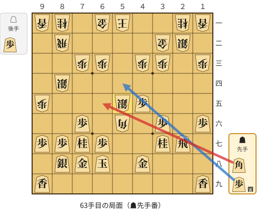

🔴 実戦 ▲６五角打　🔵 AI推奨 ▲５四歩打　🟨 直前の相手の指し手

<details><summary>テキストの盤面図（BOD・将棋ソフトに貼り付け可）</summary>

```text
後手の持駒：歩
  ９ ８ ７ ６ ５ ４ ３ ２ １
+---------------------------+
|v香v桂 ・v金v玉 ・ ・v桂v香|一
| ・v飛 ・ ・ ・ ・v金v銀 ・|二
| ・ ・v歩v歩 ・v歩v歩 ・v歩|三
| ・v銀 ・ ・ ・ ・ ・ ・ ・|四
|v歩 ・ ・ ・v銀 歩 ・ ・ ・|五
| ・ ・ 歩 ・v角 ・ 歩 ・ 歩|六
| 歩 歩 桂 歩 ・ ・ 桂 飛 ・|七
| ・ 銀 金 玉 ・ 金 ・ ・ ・|八
| 香 ・ ・ ・ ・ ・ ・ ・ 香|九
+---------------------------+
先手の持駒：角　歩四
手数＝62　△５五銀　まで
```

</details>

| | 指し手 | 評価値 | 読み筋 |
|---|---|--:|---|
| 実戦 | ▲６五角打 | -680 | △同角(56) ▲同桂(77) △６四銀(55) ▲３八角打 △５二歩打 ▲６六歩(67) |
| AI 1位 | ▲５四歩打 | +298 | ▲５四歩打 △５二歩打 ▲７九玉(68) △９二角(56) ▲８六歩(87) △４六銀(55) |
| AI 2位 | ▲８六歩(87) | +151 | ▲８六歩(87) △４六銀(55) ▲５四歩打 △４七銀不成(46) ▲５七金(48) △３六銀成(47) |
| AI 3位 | ▲２六飛(27) | +164 | ▲２六飛(27) △５二飛(82) ▲３五歩(36) △２五歩打 ▲同飛(26) △４六銀(55) |

SFEN: `ln1gk2nl/1r4gs1/2pp1pp1p/1s7/p3sP3/2P1b1P1P/PPNP2NR1/1SGK1G3/L7L b B4Pp 63`

<a id="ply-67"></a>
### 67手目 ▲６六歩(67) — 悪手

| | 着手前 | 着手後 | 差 |
|---|--:|--:|--:|
| 期待勝率 | 25.6% | 6.3% | -19.2pt |
| 評価値 | -641 | -1615 | |

着手前の局面:

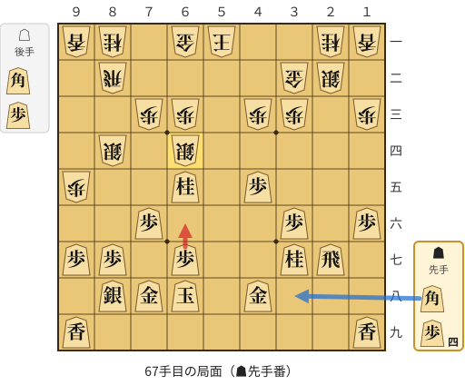

🔴 実戦 ▲６六歩(67)　🔵 AI推奨 ▲３八角打　🟨 直前の相手の指し手

<details><summary>テキストの盤面図（BOD・将棋ソフトに貼り付け可）</summary>

```text
後手の持駒：角　歩
  ９ ８ ７ ６ ５ ４ ３ ２ １
+---------------------------+
|v香v桂 ・v金v玉 ・ ・v桂v香|一
| ・v飛 ・ ・ ・ ・v金v銀 ・|二
| ・ ・v歩v歩 ・v歩v歩 ・v歩|三
| ・v銀 ・v銀 ・ ・ ・ ・ ・|四
|v歩 ・ ・ 桂 ・ 歩 ・ ・ ・|五
| ・ ・ 歩 ・ ・ ・ 歩 ・ 歩|六
| 歩 歩 ・ 歩 ・ ・ 桂 飛 ・|七
| ・ 銀 金 玉 ・ 金 ・ ・ ・|八
| 香 ・ ・ ・ ・ ・ ・ ・ 香|九
+---------------------------+
先手の持駒：角　歩四
手数＝66　△６四銀　まで
```

</details>

| | 指し手 | 評価値 | 読み筋 |
|---|---|--:|---|
| 実戦 | ▲６六歩(67) | -1615 | △６五銀(64) ▲５七歩打 △６六銀(65) ▲６七歩打 △５五銀(66) ▲５三角打 |
| AI 1位 | ▲３八角打 | -641 | ▲３八角打 △８五銀(84) ▲７七銀(88) △７四銀(85) ▲６六歩(67) △３四歩(33) |
| AI 2位 | ▲５六角打 | -695 | ▲５六角打 △５二歩打 ▲３八角(56) △３四歩(33) ▲８六歩(87) △７四歩(73) |
| AI 3位 | ▲５四歩打 | -697 | ▲５四歩打 △５二歩打 ▲３八角打 △３四歩(33) ▲８六歩(87) △７四歩(73) |

SFEN: `ln1gk2nl/1r4gs1/2pp1pp1p/1s1s5/p2N1P3/2P3P1P/PP1P2NR1/1SGK1G3/L7L b B4Pbp 67`

<a id="ply-69"></a>
### 69手目 ▲５三歩打 — 悪手

| | 着手前 | 着手後 | 差 |
|---|--:|--:|--:|
| 期待勝率 | 41.7% | 29.5% | -12.2pt |
| 評価値 | -200 | -522 | |

着手前の局面:

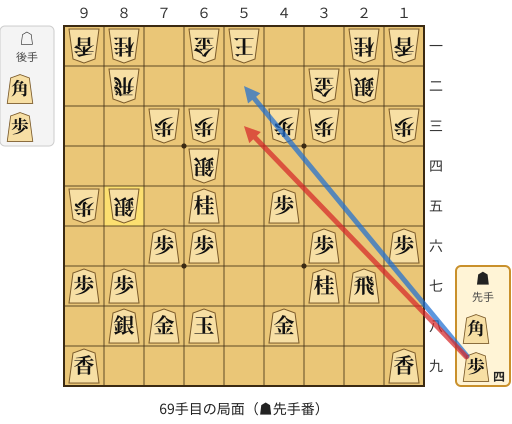

🔴 実戦 ▲５三歩打　🔵 AI推奨 ▲５二歩打　🟨 直前の相手の指し手

<details><summary>テキストの盤面図（BOD・将棋ソフトに貼り付け可）</summary>

```text
後手の持駒：角　歩
  ９ ８ ７ ６ ５ ４ ３ ２ １
+---------------------------+
|v香v桂 ・v金v玉 ・ ・v桂v香|一
| ・v飛 ・ ・ ・ ・v金v銀 ・|二
| ・ ・v歩v歩 ・v歩v歩 ・v歩|三
| ・ ・ ・v銀 ・ ・ ・ ・ ・|四
|v歩v銀 ・ 桂 ・ 歩 ・ ・ ・|五
| ・ ・ 歩 歩 ・ ・ 歩 ・ 歩|六
| 歩 歩 ・ ・ ・ ・ 桂 飛 ・|七
| ・ 銀 金 玉 ・ 金 ・ ・ ・|八
| 香 ・ ・ ・ ・ ・ ・ ・ 香|九
+---------------------------+
先手の持駒：角　歩四
手数＝68　△８五銀　まで
```

</details>

| | 指し手 | 評価値 | 読み筋 |
|---|---|--:|---|
| 実戦 | ▲５三歩打 | -522 | △６五銀(64) ▲同歩(66) △５六桂打 ▲７九玉(68) △２六歩打 ▲２八飛(27) |
| AI 1位 | ▲５二歩打 | -200 | ▲５二歩打 △６二玉(51) ▲６七金(78) △１四歩(13) ▲２九飛(27) △３四歩(33) |
| AI 2位 | ▲５二歩打 | -225 | ▲５二歩打 △６二玉(51) ▲６七金(78) △７四銀(85) ▲１七角打 △７二玉(62) |
| AI 3位 | ▲５七歩打 | -288 | ▲５七歩打 △７六銀(85) ▲７七歩打 △８五銀(76) ▲４四歩(45) △同歩(43) |

SFEN: `ln1gk2nl/1r4gs1/2pp1pp1p/3s5/ps1N1P3/2PP2P1P/PP4NR1/1SGK1G3/L7L b B4Pbp 69`

<a id="ply-79"></a>
### 79手目 ▲７九玉(68) — 大悪手

| | 着手前 | 着手後 | 差 |
|---|--:|--:|--:|
| 期待勝率 | 66.5% | 13.7% | -52.8pt |
| 評価値 | +411 | -1105 | |

着手前の局面:

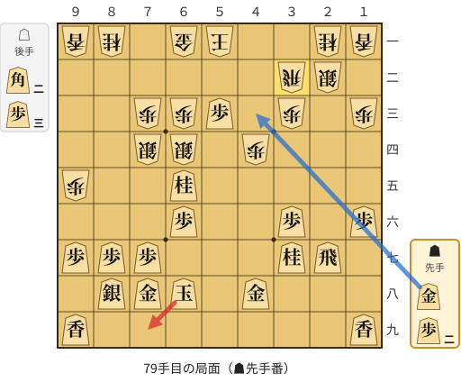

🔴 実戦 ▲７九玉(68)　🔵 AI推奨 ▲４三金打　🟨 直前の相手の指し手

<details><summary>テキストの盤面図（BOD・将棋ソフトに貼り付け可）</summary>

```text
後手の持駒：角二　歩三
  ９ ８ ７ ６ ５ ４ ３ ２ １
+---------------------------+
|v香v桂 ・v金v玉 ・ ・v桂v香|一
| ・ ・ ・ ・ ・ ・v飛v銀 ・|二
| ・ ・v歩v歩 歩 ・v歩 ・v歩|三
| ・ ・v銀v銀 ・v歩 ・ ・ ・|四
|v歩 ・ ・ 桂 ・ ・ ・ ・ ・|五
| ・ ・ ・ 歩 ・ ・ 歩 ・ 歩|六
| 歩 歩 歩 ・ ・ ・ 桂 飛 ・|七
| ・ 銀 金 玉 ・ 金 ・ ・ ・|八
| 香 ・ ・ ・ ・ ・ ・ ・ 香|九
+---------------------------+
先手の持駒：金　歩二
手数＝78　△３二同飛　まで
```

</details>

| | 指し手 | 評価値 | 読み筋 |
|---|---|--:|---|
| 実戦 | ▲７九玉(68) | -1105 | △５六角打 ▲２三歩打 △３一銀(22) ▲６七金打 △２六歩打 ▲同飛(27) |
| AI 1位 | ▲４三金打 | +411 | ▲４三金打 △４六角打 ▲５九玉(68) △５八歩打 ▲４九玉(59) △２六歩打 |
| AI 2位 | ▲２三歩打 | -315 | ▲２三歩打 △２四歩打 ▲２二歩成(23) △同飛(32) ▲７九玉(68) △６二玉(51) |
| AI 3位 | ▲４三歩打 | -503 | ▲４三歩打 △４六角打 ▲６九玉(68) △６二玉(51) ▲４二金打 △２六歩打 |

SFEN: `ln1gk2nl/6rs1/2ppP1p1p/2ss1p3/p2N5/3P2P1P/PPP3NR1/1SGK1G3/L7L b G2P2b3p 79`

