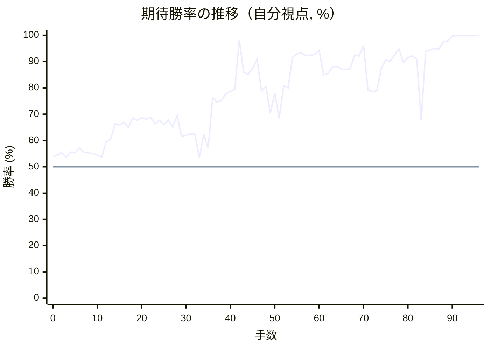
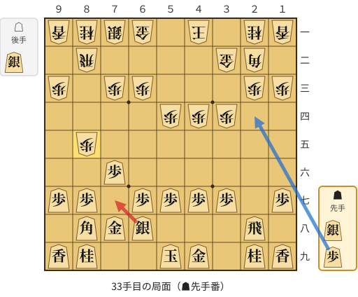
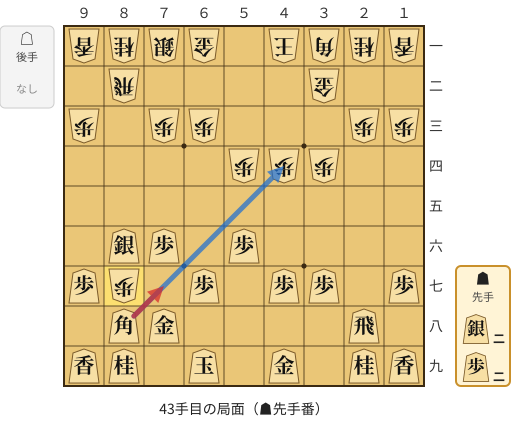
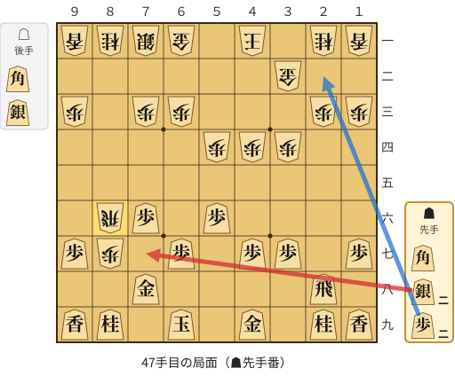
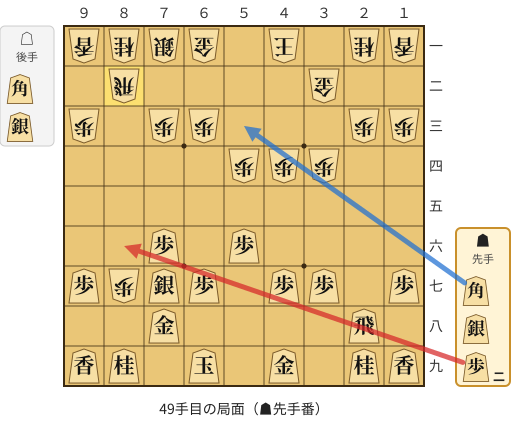
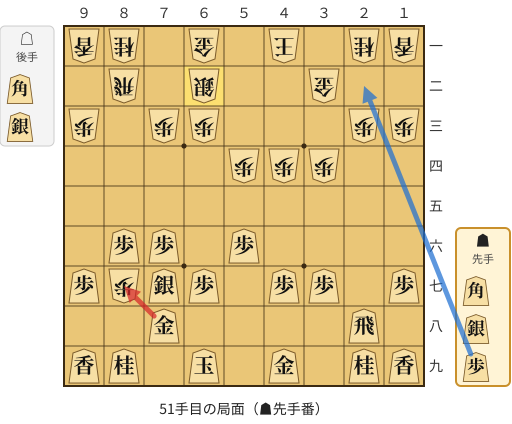
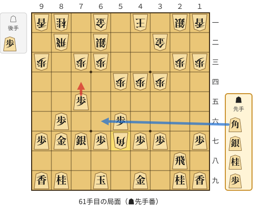
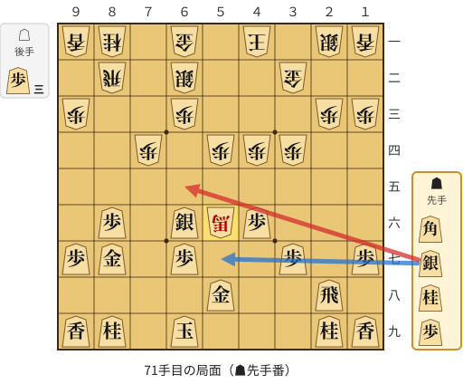

# 解析レポート aaa5ebeiiird

[README に戻る](../../../README.md)　/　棋譜: [CSA](../../../data/csa/shogi5/aaa5ebeiiird.csa)　/　解析の見方: [docs/mistake_analysis.md](../../../docs/mistake_analysis.md)

## 対局情報

| 項目 | 内容 |
|---|---|
| 日時 | 2026-11-17 03:07:18 |
| 持ち時間 | 5分 |
| 自分 | 先手（▲）（1676） |
| 相手 | 相手（1454） |
| 結果 | 負け（時間切れ, 96手） |

## 解析環境

| 項目 | 内容 |
|---|---|
| エンジン | YaneuraOu NNUE 9.00git 64AVX2（V9.00/YANEURAOU_ENGINE_NNUE/AVX2） |
| 評価関数 | **水匠5**（`suisho5`） |
| nn.bin SHA-256 | `768068f0d534a0603a5d38bcd143de6bbca820d5f1c95a14d40863e5b7892d76` |
| 第1パス | movetime=150ms, MultiPV 1 |
| 第2パス | movetime=2000ms, MultiPV 3 |
| Threads / Hash | 8 / 512MB |
| 判定基準 | 疑問手 ≥5pt, 悪手 ≥10pt, 大悪手 ≥20pt（期待勝率 W(E)=1/(1+exp(-E/600))） |
| 解析日時 | 2026-11-20T20:16:13+09:00（解析バージョン 1, 55秒） |

## サマリー

| 自分の手数 | 深掘りした手 | 詰み逃し | 大悪手 | 悪手 | 疑問手 |
|--:|--:|--:|--:|--:|--:|
| 48 | 10 | 0 | 0 | 5 | 2 |

## 期待勝率の推移



<details><summary>1手ごとの数値（第1パス）</summary>

| 手数 | 指し手 | 評価値 | 勝率 | 低下 | 判定 |
|--:|---|--:|--:|--:|---|
| 1 | ▲７六歩(77) | +108 | 54.5% | -0.7pt |  |
| 2 | △４二銀(31) | +127 | 55.3% |  |  |
| 3 | ▲２六歩(27) | +86 | 53.6% | +1.7pt |  |
| 4 | △３二金(41) | +135 | 55.6% |  |  |
| 5 | ▲２五歩(26) | +127 | 55.3% | +0.3pt |  |
| 6 | △４一玉(51) | +171 | 57.1% |  |  |
| 7 | ▲２四歩(25) | +133 | 55.5% | +1.6pt |  |
| 8 | △同歩(23) | +128 | 55.3% |  |  |
| 9 | ▲同飛(28) | +121 | 55.0% | +0.3pt |  |
| 10 | △２三歩打 | +108 | 54.5% |  |  |
| 11 | ▲２八飛(24) | +87 | 53.6% | +0.9pt |  |
| 12 | △５四歩(53) | +232 | 59.5% |  |  |
| 13 | ▲３八銀(39) | +254 | 60.4% | -0.9pt |  |
| 14 | △５三銀(42) | +410 | 66.4% |  |  |
| 15 | ▲２七銀(38) | +396 | 65.9% | +0.5pt |  |
| 16 | △４四銀(53) | +424 | 67.0% |  |  |
| 17 | ▲３六銀(27) | +368 | 64.9% | +2.1pt |  |
| 18 | △３四歩(33) | +470 | 68.6% |  |  |
| 19 | ▲２五銀(36) | +440 | 67.6% | +1.1pt |  |
| 20 | △３三銀(44) | +473 | 68.7% |  |  |
| 21 | ▲２四歩打 | +454 | 68.1% | +0.7pt |  |
| 22 | △同歩(23) | +475 | 68.8% |  |  |
| 23 | ▲同銀(25) | +407 | 66.3% | +2.5pt |  |
| 24 | △同銀(33) | +441 | 67.6% |  |  |
| 25 | ▲同飛(28) | +400 | 66.1% | +1.5pt |  |
| 26 | △２三歩打 | +446 | 67.8% |  |  |
| 27 | ▲２八飛(24) | +373 | 65.1% | +2.7pt |  |
| 28 | △４四歩(43) | +495 | 69.5% |  |  |
| 29 | ▲６八銀(79) | +280 | 61.5% | +8.1pt |  |
| 30 | △８四歩(83) | +293 | 62.0% |  |  |
| 31 | ▲７八金(69) | +307 | 62.5% | -0.5pt |  |
| 32 | △８五歩(84) | +305 | 62.4% |  |  |
| 33 | ▲７七銀(68) | +85 | 53.5% | +8.9pt | [悪手](#ply-33) |
| 34 | △３一角(22) | +301 | 62.3% |  |  |
| 35 | ▲５六歩(57) | +168 | 57.0% | +5.3pt |  |
| 36 | △９五銀打 | +701 | 76.3% |  |  |
| 37 | ▲６九玉(59) | +645 | 74.6% | +1.7pt |  |
| 38 | △８六歩(85) | +670 | 75.3% |  |  |
| 39 | ▲同歩(87) | +753 | 77.8% | -2.5pt |  |
| 40 | △同銀(95) | +784 | 78.7% |  |  |
| 41 | ▲同銀(77) | +813 | 79.5% | -0.8pt |  |
| 42 | △８七歩打 | +2416 | 98.2% |  |  |
| 43 | ▲７七角(88) | +1083 | 85.9% | +12.4pt | [疑問手](#ply-43) |
| 44 | △８六角(31) | +1050 | 85.2% |  |  |
| 45 | ▲同角(77) | +1163 | 87.4% | -2.2pt |  |
| 46 | △同飛(82) | +1381 | 90.9% |  |  |
| 47 | ▲７七銀打 | +790 | 78.9% | +12.0pt | [悪手](#ply-47) |
| 48 | △８二飛(86) | +851 | 80.5% |  |  |
| 49 | ▲８六歩打 | +517 | 70.3% | +10.2pt | [悪手](#ply-49) |
| 50 | △６二銀(71) | +763 | 78.1% |  |  |
| 51 | ▲８七金(78) | +463 | 68.4% | +9.7pt | [悪手](#ply-51) |
| 52 | △５七角打 | +864 | 80.8% |  |  |
| 53 | ▲２二歩打 | +833 | 80.0% | +0.8pt |  |
| 54 | △１二銀打 | +1438 | 91.7% |  |  |
| 55 | ▲２一歩成(22) | +1545 | 92.9% | -1.3pt |  |
| 56 | △同銀(12) | +1577 | 93.3% |  |  |
| 57 | ▲７五角打 | +1485 | 92.2% | +1.0pt |  |
| 58 | △同角成(57) | +1507 | 92.5% |  |  |
| 59 | ▲同歩(76) | +1525 | 92.7% | -0.2pt |  |
| 60 | △５七角打 | +1685 | 94.3% |  |  |
| 61 | ▲７四歩(75) | +1036 | 84.9% | +9.4pt | [疑問手](#ply-61) |
| 62 | △同歩(73) | +1067 | 85.5% |  |  |
| 63 | ▲６六銀(77) | +1190 | 87.9% | -2.4pt |  |
| 64 | △３五角成(57) | +1207 | 88.2% |  |  |
| 65 | ▲４六角打 | +1145 | 87.1% | +1.1pt |  |
| 66 | △同馬(35) | +1140 | 87.0% |  |  |
| 67 | ▲同歩(47) | +1156 | 87.3% | -0.3pt |  |
| 68 | △４七角打 | +1511 | 92.5% |  |  |
| 69 | ▲５八金(49) | +1473 | 92.1% | +0.4pt |  |
| 70 | △５六角成(47) | +1931 | 96.2% |  |  |
| 71 | ▲６五銀打 | +803 | 79.2% | +16.9pt | [悪手](#ply-71) |
| 72 | △４六馬(56) | +782 | 78.6% |  |  |
| 73 | ▲５四銀(65) | +792 | 78.9% | -0.3pt |  |
| 74 | △５六歩打 | +1160 | 87.4% |  |  |
| 75 | ▲５三桂打 | +1362 | 90.6% | -3.3pt |  |
| 76 | △同銀(62) | +1322 | 90.1% |  |  |
| 77 | ▲同銀成(54) | +1507 | 92.5% | -2.4pt |  |
| 78 | △５七歩成(56) | +1742 | 94.8% |  |  |
| 79 | ▲同銀(66) | +1298 | 89.7% | +5.1pt |  |
| 80 | △６四馬(46) | +1428 | 91.5% |  |  |
| 81 | ▲５四銀打 | +1481 | 92.2% | -0.7pt |  |
| 82 | △５二歩打 | +1381 | 90.9% |  |  |
| 83 | ▲６三銀成(54) | +442 | 67.6% | +23.3pt |  |
| 84 | △５三馬(64) | +1636 | 93.9% |  |  |
| 85 | ▲同成銀(63) | +1696 | 94.4% | -0.6pt |  |
| 86 | △同歩(52) | +1757 | 94.9% |  |  |
| 87 | ▲６四角打 | +1737 | 94.8% | +0.2pt |  |
| 88 | △５二飛(82) | +2191 | 97.5% |  |  |
| 89 | ▲９一角成(64) | +2314 | 97.9% | -0.5pt |  |
| 90 | △８二銀打 | +3496 | 99.7% |  |  |
| 91 | ▲８一馬(91) | +3631 | 99.8% | -0.1pt |  |
| 92 | △７一金(61) | +3722 | 99.8% |  |  |
| 93 | ▲６三馬(81) | +3748 | 99.8% | -0.0pt |  |
| 94 | △６二金(71) | +3733 | 99.8% |  |  |
| 95 | ▲７四馬(63) | +3755 | 99.8% | -0.0pt |  |
| 96 | △７八銀打 | +5800 | 100.0% |  |  |

</details>

## 課題局面

<a id="ply-33"></a>
### 33手目 ▲７七銀(68) — 悪手

| | 着手前 | 着手後 | 差 |
|---|--:|--:|--:|
| 期待勝率 | 64.6% | 54.0% | -10.6pt |
| 評価値 | +360 | +96 | |

着手前の局面:



🔴 実戦 ▲７七銀(68)　🔵 AI推奨 ▲２四歩打　🟨 直前の相手の指し手

<details><summary>テキストの盤面図（BOD・将棋ソフトに貼り付け可）</summary>

```text
後手の持駒：銀
  ９ ８ ７ ６ ５ ４ ３ ２ １
+---------------------------+
|v香v桂v銀v金 ・v玉 ・v桂v香|一
| ・v飛 ・ ・ ・ ・v金v角 ・|二
|v歩 ・v歩v歩 ・ ・ ・v歩v歩|三
| ・ ・ ・ ・v歩v歩v歩 ・ ・|四
| ・v歩 ・ ・ ・ ・ ・ ・ ・|五
| ・ ・ 歩 ・ ・ ・ ・ ・ ・|六
| 歩 歩 ・ 歩 歩 歩 歩 ・ 歩|七
| ・ 角 金 銀 ・ ・ ・ 飛 ・|八
| 香 桂 ・ ・ 玉 金 ・ 桂 香|九
+---------------------------+
先手の持駒：銀　歩
手数＝32　△８五歩　まで
```

</details>

| | 指し手 | 評価値 | 読み筋 |
|---|---|--:|---|
| 実戦 | ▲７七銀(68) | +96 | △５二金(61) ▲２五銀打 △４三金(52) ▲２四歩打 △同歩(23) ▲同銀(25) |
| AI 1位 | ▲２四歩打 | +360 | ▲２四歩打 △同歩(23) ▲同飛(28) △３三銀打 ▲２六飛(24) △２三歩打 |
| AI 2位 | ▲２五銀打 | +342 | ▲２五銀打 △３三銀打 ▲２四歩打 △同歩(23) ▲同銀(25) △同銀(33) |
| AI 3位 | ▲１五銀打 | +290 | ▲１五銀打 △１二銀打 ▲６九玉(59) △５二金(61) ▲４六歩(47) △６二銀(71) |

SFEN: `lnsg1k1nl/1r4gb1/p1pp3pp/4ppp2/1p7/2P6/PP1PPPP1P/1BGS3R1/LN2KG1NL b SPs 33`

<a id="ply-43"></a>
### 43手目 ▲７七角(88) — 疑問手

| | 着手前 | 着手後 | 差 |
|---|--:|--:|--:|
| 期待勝率 | 98.8% | 93.5% | -5.2pt |
| 評価値 | +2641 | +1604 | |

着手前の局面:



🔴 実戦 ▲７七角(88)　🔵 AI推奨 ▲４四角(88)　🟨 直前の相手の指し手

<details><summary>テキストの盤面図（BOD・将棋ソフトに貼り付け可）</summary>

```text
後手の持駒：なし
  ９ ８ ７ ６ ５ ４ ３ ２ １
+---------------------------+
|v香v桂v銀v金 ・v玉v角v桂v香|一
| ・v飛 ・ ・ ・ ・v金 ・ ・|二
|v歩 ・v歩v歩 ・ ・ ・v歩v歩|三
| ・ ・ ・ ・v歩v歩v歩 ・ ・|四
| ・ ・ ・ ・ ・ ・ ・ ・ ・|五
| ・ 銀 歩 ・ 歩 ・ ・ ・ ・|六
| 歩v歩 ・ 歩 ・ 歩 歩 ・ 歩|七
| ・ 角 金 ・ ・ ・ ・ 飛 ・|八
| 香 桂 ・ 玉 ・ 金 ・ 桂 香|九
+---------------------------+
先手の持駒：銀二　歩二
手数＝42　△８七歩　まで
```

</details>

| | 指し手 | 評価値 | 読み筋 |
|---|---|--:|---|
| 実戦 | ▲７七角(88) | +1604 | △８六角(31) ▲同角(77) △同飛(82) ▲２二歩打 △３三桂(21) ▲５三角打 |
| AI 1位 | ▲４四角(88) | +2641 | ▲４四角(88) △８六角(31) ▲１一角成(44) △３三桂(21) ▲４六香打 △５一玉(41) |
| AI 2位 | ▲７七角(88) | +1431 | ▲７七角(88) △８六角(31) ▲同角(77) △同飛(82) ▲２二歩打 △８八歩成(87) |
| AI 3位 | ▲同金(78) | +1104 | ▲同金(78) △８六角(31) ▲同金(87) △同飛(82) ▲９八銀打 △４三金打 |

SFEN: `lnsg1kbnl/1r4g2/p1pp3pp/4ppp2/9/1SP1P4/Pp1P1PP1P/1BG4R1/LN1K1G1NL b 2S2P 43`

<a id="ply-47"></a>
### 47手目 ▲７七銀打 — 悪手

| | 着手前 | 着手後 | 差 |
|---|--:|--:|--:|
| 期待勝率 | 93.2% | 80.9% | -12.3pt |
| 評価値 | +1574 | +868 | |

着手前の局面:



🔴 実戦 ▲７七銀打　🔵 AI推奨 ▲２二歩打　🟨 直前の相手の指し手

<details><summary>テキストの盤面図（BOD・将棋ソフトに貼り付け可）</summary>

```text
後手の持駒：角　銀
  ９ ８ ７ ６ ５ ４ ３ ２ １
+---------------------------+
|v香v桂v銀v金 ・v玉 ・v桂v香|一
| ・ ・ ・ ・ ・ ・v金 ・ ・|二
|v歩 ・v歩v歩 ・ ・ ・v歩v歩|三
| ・ ・ ・ ・v歩v歩v歩 ・ ・|四
| ・ ・ ・ ・ ・ ・ ・ ・ ・|五
| ・v飛 歩 ・ 歩 ・ ・ ・ ・|六
| 歩v歩 ・ 歩 ・ 歩 歩 ・ 歩|七
| ・ ・ 金 ・ ・ ・ ・ 飛 ・|八
| 香 桂 ・ 玉 ・ 金 ・ 桂 香|九
+---------------------------+
先手の持駒：角　銀二　歩二
手数＝46　△８六同飛　まで
```

</details>

| | 指し手 | 評価値 | 読み筋 |
|---|---|--:|---|
| 実戦 | ▲７七銀打 | +868 | △８二飛(86) ▲５三角打 △８八銀打 ▲同銀(77) △同歩成(87) ▲同金(78) |
| AI 1位 | ▲２二歩打 | +1574 | ▲２二歩打 △３三桂(21) ▲５三角打 △８五飛(86) ▲７七桂(89) △８二飛(85) |
| AI 2位 | ▲５三角打 | +1234 | ▲５三角打 △８二飛(86) ▲７五角成(53) △７四歩(73) ▲８三歩打 △７五歩(74) |
| AI 3位 | ▲７五角打 | +1021 | ▲７五角打 △７六飛(86) ▲５三角成(75) △８八歩成(87) ▲同金(78) △６二銀(71) |

SFEN: `lnsg1k1nl/6g2/p1pp3pp/4ppp2/9/1rP1P4/Pp1P1PP1P/2G4R1/LN1K1G1NL b B2S2Pbs 47`

<a id="ply-49"></a>
### 49手目 ▲８六歩打 — 悪手

| | 着手前 | 着手後 | 差 |
|---|--:|--:|--:|
| 期待勝率 | 83.3% | 68.9% | -14.4pt |
| 評価値 | +964 | +476 | |

着手前の局面:



🔴 実戦 ▲８六歩打　🔵 AI推奨 ▲５三角打　🟨 直前の相手の指し手

<details><summary>テキストの盤面図（BOD・将棋ソフトに貼り付け可）</summary>

```text
後手の持駒：角　銀
  ９ ８ ７ ６ ５ ４ ３ ２ １
+---------------------------+
|v香v桂v銀v金 ・v玉 ・v桂v香|一
| ・v飛 ・ ・ ・ ・v金 ・ ・|二
|v歩 ・v歩v歩 ・ ・ ・v歩v歩|三
| ・ ・ ・ ・v歩v歩v歩 ・ ・|四
| ・ ・ ・ ・ ・ ・ ・ ・ ・|五
| ・ ・ 歩 ・ 歩 ・ ・ ・ ・|六
| 歩v歩 銀 歩 ・ 歩 歩 ・ 歩|七
| ・ ・ 金 ・ ・ ・ ・ 飛 ・|八
| 香 桂 ・ 玉 ・ 金 ・ 桂 香|九
+---------------------------+
先手の持駒：角　銀　歩二
手数＝48　△８二飛　まで
```

</details>

| | 指し手 | 評価値 | 読み筋 |
|---|---|--:|---|
| 実戦 | ▲８六歩打 | +476 | △５二金(61) ▲８七金(78) △６四歩(63) ▲６六銀(77) △６五銀打 ▲７八玉(69) |
| AI 1位 | ▲５三角打 | +964 | ▲５三角打 △８八銀打 ▲同銀(77) △同歩成(87) ▲同金(78) △７四歩(73) |
| AI 2位 | ▲２二歩打 | +668 | ▲２二歩打 △３三桂(21) ▲２一歩成(22) △８八銀打 ▲１一と(21) △８九銀不成(88) |
| AI 3位 | ▲８四歩打 | +646 | ▲８四歩打 △４三銀打 ▲８三角打 △６二金(61) ▲６五角成(83) △８四飛(82) |

SFEN: `lnsg1k1nl/1r4g2/p1pp3pp/4ppp2/9/2P1P4/PpSP1PP1P/2G4R1/LN1K1G1NL b BS2Pbs 49`

<a id="ply-51"></a>
### 51手目 ▲８七金(78) — 悪手

| | 着手前 | 着手後 | 差 |
|---|--:|--:|--:|
| 期待勝率 | 81.9% | 71.5% | -10.3pt |
| 評価値 | +904 | +553 | |

着手前の局面:



🔴 実戦 ▲８七金(78)　🔵 AI推奨 ▲２二歩打　🟨 直前の相手の指し手

<details><summary>テキストの盤面図（BOD・将棋ソフトに貼り付け可）</summary>

```text
後手の持駒：角　銀
  ９ ８ ７ ６ ５ ４ ３ ２ １
+---------------------------+
|v香v桂 ・v金 ・v玉 ・v桂v香|一
| ・v飛 ・v銀 ・ ・v金 ・ ・|二
|v歩 ・v歩v歩 ・ ・ ・v歩v歩|三
| ・ ・ ・ ・v歩v歩v歩 ・ ・|四
| ・ ・ ・ ・ ・ ・ ・ ・ ・|五
| ・ 歩 歩 ・ 歩 ・ ・ ・ ・|六
| 歩v歩 銀 歩 ・ 歩 歩 ・ 歩|七
| ・ ・ 金 ・ ・ ・ ・ 飛 ・|八
| 香 桂 ・ 玉 ・ 金 ・ 桂 香|九
+---------------------------+
先手の持駒：角　銀　歩
手数＝50　△６二銀　まで
```

</details>

| | 指し手 | 評価値 | 読み筋 |
|---|---|--:|---|
| 実戦 | ▲８七金(78) | +553 | △５二金(61) ▲６六銀(77) △６四歩(63) ▲７八玉(69) △７四歩(73) ▲９六歩(97) |
| AI 1位 | ▲２二歩打 | +904 | ▲２二歩打 △同金(32) ▲４三角打 △５二金(61) ▲３四角成(43) △３三銀打 |
| AI 2位 | ▲８七金(78) | +533 | ▲８七金(78) △５二金(61) ▲６六銀(77) △６四歩(63) ▲７八玉(69) △７四歩(73) |
| AI 3位 | ▲９六歩(97) | +422 | ▲９六歩(97) △５二金(61) ▲８七金(78) △５七角打 ▲７八玉(69) △１四歩(13) |

SFEN: `ln1g1k1nl/1r1s2g2/p1pp3pp/4ppp2/9/1PP1P4/PpSP1PP1P/2G4R1/LN1K1G1NL b BSPbs 51`

<a id="ply-61"></a>
### 61手目 ▲７四歩(75) — 疑問手

| | 着手前 | 着手後 | 差 |
|---|--:|--:|--:|
| 期待勝率 | 94.4% | 87.8% | -6.6pt |
| 評価値 | +1692 | +1182 | |

着手前の局面:



🔴 実戦 ▲７四歩(75)　🔵 AI推奨 ▲６六角打　🟨 直前の相手の指し手

<details><summary>テキストの盤面図（BOD・将棋ソフトに貼り付け可）</summary>

```text
後手の持駒：歩
  ９ ８ ７ ６ ５ ４ ３ ２ １
+---------------------------+
|v香v桂 ・v金 ・v玉 ・v銀v香|一
| ・v飛 ・v銀 ・ ・v金 ・ ・|二
|v歩 ・v歩v歩 ・ ・ ・v歩v歩|三
| ・ ・ ・ ・v歩v歩v歩 ・ ・|四
| ・ ・ 歩 ・ ・ ・ ・ ・ ・|五
| ・ 歩 ・ ・ 歩 ・ ・ ・ ・|六
| 歩 金 銀 歩v角 歩 歩 ・ 歩|七
| ・ ・ ・ ・ ・ ・ ・ 飛 ・|八
| 香 桂 ・ 玉 ・ 金 ・ 桂 香|九
+---------------------------+
先手の持駒：角　銀　桂　歩
手数＝60　△５七角　まで
```

</details>

| | 指し手 | 評価値 | 読み筋 |
|---|---|--:|---|
| 実戦 | ▲７四歩(75) | +1182 | △７五角成(57) ▲２四歩打 △同歩(23) ▲同飛(28) △２二歩打 ▲３四飛(24) |
| AI 1位 | ▲６六角打 | +1692 | ▲６六角打 △同角成(57) ▲同銀(77) △２二銀(21) ▲７七桂(89) △５一金(61) |
| AI 2位 | ▲６六銀(77) | +1447 | ▲６六銀(77) △２四角成(57) ▲７七桂(89) △５二金(61) ▲５八金(49) △３一玉(41) |
| AI 3位 | ▲７六金(87) | +1443 | ▲７六金(87) △２四角成(57) ▲８八飛(28) △３一玉(41) ▲８五歩(86) △８三歩打 |

SFEN: `ln1g1k1sl/1r1s2g2/p1pp3pp/4ppp2/2P6/1P2P4/PGSPbPP1P/7R1/LN1K1G1NL b BSNPp 61`

<a id="ply-71"></a>
### 71手目 ▲６五銀打 — 悪手

| | 着手前 | 着手後 | 差 |
|---|--:|--:|--:|
| 期待勝率 | 96.9% | 79.4% | -17.4pt |
| 評価値 | +2060 | +811 | |

着手前の局面:



🔴 実戦 ▲６五銀打　🔵 AI推奨 ▲５七銀打　🟨 直前の相手の指し手

<details><summary>テキストの盤面図（BOD・将棋ソフトに貼り付け可）</summary>

```text
後手の持駒：歩三
  ９ ８ ７ ６ ５ ４ ３ ２ １
+---------------------------+
|v香v桂 ・v金 ・v玉 ・v銀v香|一
| ・v飛 ・v銀 ・ ・v金 ・ ・|二
|v歩 ・ ・v歩 ・ ・ ・v歩v歩|三
| ・ ・v歩 ・v歩v歩v歩 ・ ・|四
| ・ ・ ・ ・ ・ ・ ・ ・ ・|五
| ・ 歩 ・ 銀v馬 歩 ・ ・ ・|六
| 歩 金 ・ 歩 ・ ・ 歩 ・ 歩|七
| ・ ・ ・ ・ 金 ・ ・ 飛 ・|八
| 香 桂 ・ 玉 ・ ・ ・ 桂 香|九
+---------------------------+
先手の持駒：角　銀　桂　歩
手数＝70　△５六角成　まで
```

</details>

| | 指し手 | 評価値 | 読み筋 |
|---|---|--:|---|
| 実戦 | ▲６五銀打 | +811 | △４六馬(56) ▲５四銀(65) △５三歩打 ▲６五銀(54) △８八歩打 ▲同金(87) |
| AI 1位 | ▲５七銀打 | +2060 | ▲５七銀打 △同馬(56) ▲同金(58) △２二銀(21) ▲７七桂(89) △７三桂(81) |
| AI 2位 | ▲５七金(58) | +1974 | ▲５七金(58) △同馬(56) ▲同銀(66) △５三銀(62) ▲６六銀(57) △３一玉(41) |
| AI 3位 | ▲４七銀打 | +1953 | ▲４七銀打 △６六馬(56) ▲同歩(67) △２二銀(21) ▲４五歩(46) △同歩(44) |

SFEN: `ln1g1k1sl/1r1s2g2/p2p3pp/2p1ppp2/9/1P1S+bP3/PG1P2P1P/4G2R1/LN1K3NL b BSNP3p 71`

