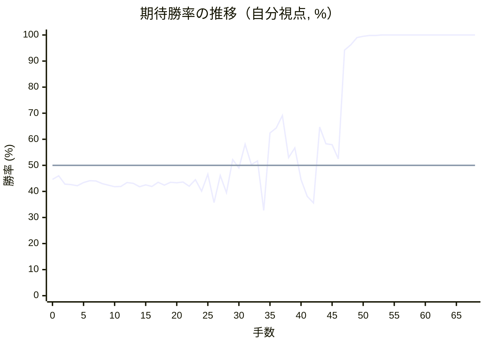
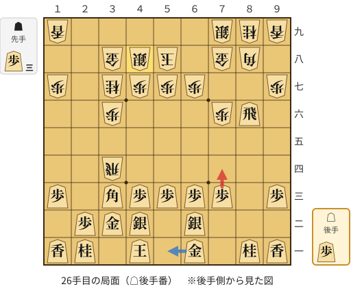
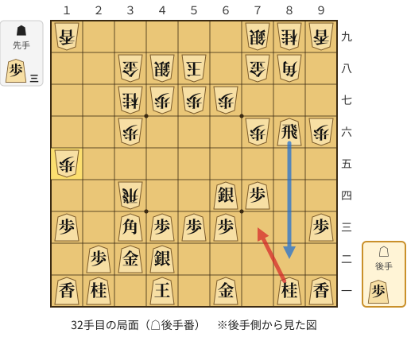
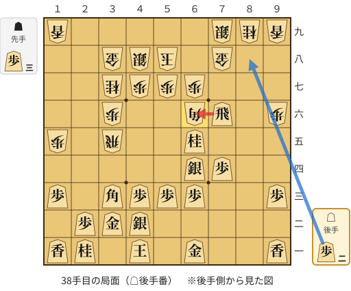
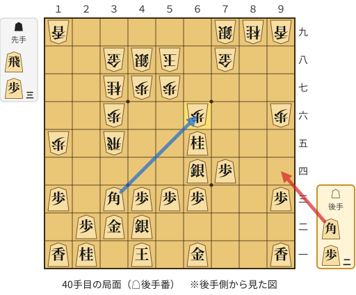
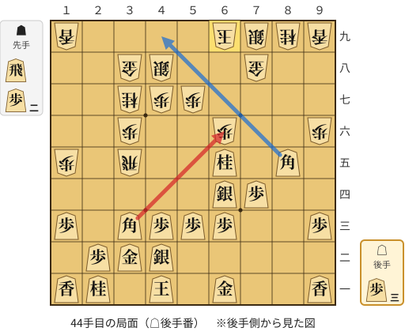

# 解析レポート aau7l0m9df11

[README に戻る](../../../README.md)　/　棋譜: [CSA](../../../data/csa/shogi5/aau7l0m9df11.csa)　/　解析の見方: [docs/mistake_analysis.md](../../../docs/mistake_analysis.md)

## 対局情報

| 項目 | 内容 |
|---|---|
| 日時 | 2026-11-16 20:29:42 |
| 持ち時間 | 5分 |
| 自分 | 後手（△）（1664） |
| 相手 | 相手（1872） |
| 結果 | 勝ち（詰み, 68手） |

## 解析環境

| 項目 | 内容 |
|---|---|
| エンジン | YaneuraOu NNUE 9.00git 64AVX2（V9.00/YANEURAOU_ENGINE_NNUE/AVX2） |
| 評価関数 | **水匠5**（`suisho5`） |
| nn.bin SHA-256 | `768068f0d534a0603a5d38bcd143de6bbca820d5f1c95a14d40863e5b7892d76` |
| 第1パス | movetime=150ms, MultiPV 1 |
| 第2パス | movetime=2000ms, MultiPV 3 |
| Threads / Hash | 8 / 512MB |
| 判定基準 | 疑問手 ≥5pt, 悪手 ≥10pt, 大悪手 ≥20pt（期待勝率 W(E)=1/(1+exp(-E/600))） |
| 解析日時 | 2026-11-20T20:18:49+09:00（解析バージョン 1, 38秒） |

## サマリー

| 自分の手数 | 深掘りした手 | 詰み逃し | 大悪手 | 悪手 | 疑問手 |
|--:|--:|--:|--:|--:|--:|
| 34 | 7 | 0 | 2 | 2 | 1 |

## 期待勝率の推移



<details><summary>1手ごとの数値（第1パス）</summary>

| 手数 | 指し手 | 評価値 | 勝率 | 低下 | 判定 |
|--:|---|--:|--:|--:|---|
| 1 | ▲７六歩(77) | -97 | 46.0% |  |  |
| 2 | △３四歩(33) | -174 | 42.8% | +3.2pt |  |
| 3 | ▲２六歩(27) | -180 | 42.6% |  |  |
| 4 | △８四歩(83) | -188 | 42.2% | +0.3pt |  |
| 5 | ▲２五歩(26) | -160 | 43.4% |  |  |
| 6 | △８五歩(84) | -142 | 44.1% | -0.7pt |  |
| 7 | ▲７八金(69) | -144 | 44.0% |  |  |
| 8 | △３二金(41) | -170 | 43.0% | +1.1pt |  |
| 9 | ▲２四歩(25) | -184 | 42.4% |  |  |
| 10 | △同歩(23) | -198 | 41.8% | +0.6pt |  |
| 11 | ▲同飛(28) | -195 | 41.9% |  |  |
| 12 | △８六歩(85) | -160 | 43.4% | -1.4pt |  |
| 13 | ▲同歩(87) | -166 | 43.1% |  |  |
| 14 | △同飛(82) | -198 | 41.8% | +1.3pt |  |
| 15 | ▲３四飛(24) | -181 | 42.5% |  |  |
| 16 | △３三角(22) | -197 | 41.9% | +0.7pt |  |
| 17 | ▲５八玉(59) | -158 | 43.5% |  |  |
| 18 | △４二銀(31) | -184 | 42.4% | +1.1pt |  |
| 19 | ▲３六歩(37) | -157 | 43.5% |  |  |
| 20 | △４一玉(51) | -162 | 43.3% | +0.2pt |  |
| 21 | ▲３七桂(29) | -155 | 43.6% |  |  |
| 22 | △２二歩打 | -193 | 42.0% | +1.6pt |  |
| 23 | ▲３八金(49) | -133 | 44.5% |  |  |
| 24 | △６二銀(71) | -241 | 40.1% | +4.4pt |  |
| 25 | ▲４八銀(39) | -82 | 46.6% |  |  |
| 26 | △７四歩(73) | -352 | 35.7% | +10.8pt | [悪手](#ply-26) |
| 27 | ▲１六歩(17) | -93 | 46.1% |  |  |
| 28 | △７三銀(62) | -255 | 39.5% | +6.6pt |  |
| 29 | ▲９六歩(97) | +53 | 52.2% |  |  |
| 30 | △６四銀(73) | -25 | 49.0% | +3.2pt |  |
| 31 | ▲１五歩(16) | +197 | 58.1% |  |  |
| 32 | △７三桂(81) | +7 | 50.3% | +7.8pt | [疑問手](#ply-32) |
| 33 | ▲３五飛(34) | +41 | 51.7% |  |  |
| 34 | △７六飛(86) | -434 | 32.7% | +19.0pt |  |
| 35 | ▲７七角(88) | +304 | 62.4% |  |  |
| 36 | △６五桂(73) | +354 | 64.3% | -1.9pt |  |
| 37 | ▲６六角(77) | +484 | 69.1% |  |  |
| 38 | △同飛(76) | +71 | 53.0% | +16.2pt | [大悪手](#ply-38) |
| 39 | ▲同歩(67) | +161 | 56.7% |  |  |
| 40 | △９四角打 | -132 | 44.5% | +12.1pt | [悪手](#ply-40) |
| 41 | ▲８五歩打 | -291 | 38.1% |  |  |
| 42 | △同角(94) | -355 | 35.6% | +2.5pt |  |
| 43 | ▲６九玉(58) | +363 | 64.7% |  |  |
| 44 | △６六角(33) | +201 | 58.3% | +6.4pt | [大悪手](#ply-44) |
| 45 | ▲８一飛打 | +191 | 57.9% |  |  |
| 46 | △９四角(85) | +61 | 52.5% | +5.4pt |  |
| 47 | ▲８三歩打 | +1676 | 94.2% |  |  |
| 48 | △５一金(61) | +1945 | 96.2% | -2.0pt |  |
| 49 | ▲８二歩成(83) | +2760 | 99.0% |  |  |
| 50 | △５七桂成(65) | +3214 | 99.5% | -0.5pt |  |
| 51 | ▲同銀(48) | +3624 | 99.8% |  |  |
| 52 | △同角成(66) | +3664 | 99.8% | -0.0pt |  |
| 53 | ▲６八銀(79) | +5262 | 100.0% |  |  |
| 54 | △５八角成(94) | +5790 | 100.0% | -0.0pt |  |
| 55 | ▲７九玉(69) | +5330 | 100.0% |  |  |
| 56 | △３五馬(57) | +5750 | 100.0% | -0.0pt |  |
| 57 | ▲同歩(36) | +6106 | 100.0% |  |  |
| 58 | △６九飛打 | +6080 | 100.0% | +0.0pt |  |
| 59 | ▲８八玉(79) | +6154 | 100.0% |  |  |
| 60 | △６八馬(58) | +6243 | 100.0% | -0.0pt |  |
| 61 | ▲９五角打 | #+9 | 100.0% |  |  |
| 62 | △７八馬(68) | #+8 | 100.0% | +0.0pt |  |
| 63 | ▲同玉(88) | #+7 | 100.0% |  |  |
| 64 | △６七銀打 | #+6 | 100.0% | +0.0pt |  |
| 65 | ▲６九玉(78) | #+3 | 100.0% |  |  |
| 66 | △７八銀打 | #+2 | 100.0% | +0.0pt |  |
| 67 | ▲５九玉(69) | #+1 | 100.0% |  |  |
| 68 | △５八金打 | #+ | 100.0% | +0.0pt |  |

</details>

## 課題局面

<a id="ply-26"></a>
### 26手目 △７四歩(73) — 悪手

| | 着手前 | 着手後 | 差 |
|---|--:|--:|--:|
| 期待勝率 | 47.3% | 35.0% | -12.4pt |
| 評価値 | -64 | -372 | |

着手前の局面:



🔴 実戦 △７四歩(73)　🔵 AI推奨 △５一金(61)　🟨 直前の相手の指し手

<details><summary>テキストの盤面図（BOD・将棋ソフトに貼り付け可）</summary>

```text
後手の持駒：歩
  ９ ８ ７ ６ ５ ４ ３ ２ １
+---------------------------+
|v香v桂 ・v金 ・v玉 ・v桂v香|一
| ・ ・ ・v銀 ・v銀v金v歩 ・|二
|v歩 ・v歩v歩v歩v歩v角 ・v歩|三
| ・ ・ ・ ・ ・ ・ 飛 ・ ・|四
| ・ ・ ・ ・ ・ ・ ・ ・ ・|五
| ・v飛 歩 ・ ・ ・ 歩 ・ ・|六
| 歩 ・ ・ 歩 歩 歩 桂 ・ 歩|七
| ・ 角 金 ・ 玉 銀 金 ・ ・|八
| 香 桂 銀 ・ ・ ・ ・ ・ 香|九
+---------------------------+
先手の持駒：歩三
後手番
手数＝25　▲４八銀　まで
```

</details>

| | 指し手 | 評価値 | 読み筋 |
|---|---|--:|---|
| 実戦 | △７四歩(73) | -372 | ▲同飛(34) △７三銀(62) ▲７五飛(74) △８二飛(86) ▲２五飛(75) △８六歩打 |
| AI 1位 | △５一金(61) | -64 | △５一金(61) ▲９六歩(97) △１四歩(13) ▲１六歩(17) △９四歩(93) ▲３九金(38) |
| AI 2位 | △１四歩(13) | -136 | △１四歩(13) ▲８七歩打 △８五飛(86) ▲７七桂(89) △８二飛(85) ▲３五飛(34) |
| AI 3位 | △１四歩(13) | -136 | △１四歩(13) ▲３五飛(34) △７四歩(73) ▲８七歩打 △８八角成(33) ▲同銀(79) |

SFEN: `ln1g1k1nl/3s1sgp1/p1ppppb1p/6R2/9/1rP3P2/P2PPPN1P/1BG1KSG2/LNS5L w 3Pp 26`

<a id="ply-32"></a>
### 32手目 △７三桂(81) — 疑問手

| | 着手前 | 着手後 | 差 |
|---|--:|--:|--:|
| 期待勝率 | 60.7% | 50.7% | -9.9pt |
| 評価値 | +260 | +18 | |

着手前の局面:



🔴 実戦 △７三桂(81)　🔵 AI推奨 △８二飛(86)　🟨 直前の相手の指し手

<details><summary>テキストの盤面図（BOD・将棋ソフトに貼り付け可）</summary>

```text
後手の持駒：歩
  ９ ８ ７ ６ ５ ４ ３ ２ １
+---------------------------+
|v香v桂 ・v金 ・v玉 ・v桂v香|一
| ・ ・ ・ ・ ・v銀v金v歩 ・|二
|v歩 ・ ・v歩v歩v歩v角 ・v歩|三
| ・ ・v歩v銀 ・ ・ 飛 ・ ・|四
| ・ ・ ・ ・ ・ ・ ・ ・ 歩|五
| 歩v飛 歩 ・ ・ ・ 歩 ・ ・|六
| ・ ・ ・ 歩 歩 歩 桂 ・ ・|七
| ・ 角 金 ・ 玉 銀 金 ・ ・|八
| 香 桂 銀 ・ ・ ・ ・ ・ 香|九
+---------------------------+
先手の持駒：歩三
後手番
手数＝31　▲１五歩　まで
```

</details>

| | 指し手 | 評価値 | 読み筋 |
|---|---|--:|---|
| 実戦 | △７三桂(81) | +18 | ▲８七歩打 △７六飛(86) |
| AI 1位 | △８二飛(86) | +260 | △８二飛(86) ▲８四歩打 △同飛(82) ▲３五飛(34) △８二飛(84) ▲８七歩打 |
| AI 2位 | △８八角成(33) | +181 | △８八角成(33) ▲同銀(79) △３三金(32) ▲３五飛(34) △２四金(33) ▲４五飛(35) |
| AI 3位 | △２三金(32) | +172 | △２三金(32) ▲３五飛(34) △８八角成(33) ▲同銀(79) △２四金(23) ▲４五飛(35) |

SFEN: `ln1g1k1nl/5sgp1/p2pppb1p/2ps2R2/8P/PrP3P2/3PPPN2/1BG1KSG2/LNS5L w 3Pp 32`

<a id="ply-38"></a>
### 38手目 △同飛(76) — 大悪手

| | 着手前 | 着手後 | 差 |
|---|--:|--:|--:|
| 期待勝率 | 81.7% | 45.3% | -36.4pt |
| 評価値 | +898 | -113 | |

着手前の局面:



🔴 実戦 △同飛(76)　🔵 AI推奨 △８八歩打　🟨 直前の相手の指し手

<details><summary>テキストの盤面図（BOD・将棋ソフトに貼り付け可）</summary>

```text
後手の持駒：歩二
  ９ ８ ７ ６ ５ ４ ３ ２ １
+---------------------------+
|v香 ・ ・v金 ・v玉 ・v桂v香|一
| ・ ・ ・ ・ ・v銀v金v歩 ・|二
|v歩 ・ ・v歩v歩v歩v角 ・v歩|三
| ・ ・v歩v銀 ・ ・ ・ ・ ・|四
| ・ ・ ・v桂 ・ ・ 飛 ・ 歩|五
| 歩 ・v飛 角 ・ ・ 歩 ・ ・|六
| ・ ・ ・ 歩 歩 歩 桂 ・ ・|七
| ・ ・ 金 ・ 玉 銀 金 ・ ・|八
| 香 桂 銀 ・ ・ ・ ・ ・ 香|九
+---------------------------+
先手の持駒：歩三
後手番
手数＝37　▲６六角　まで
```

</details>

| | 指し手 | 評価値 | 読み筋 |
|---|---|--:|---|
| 実戦 | △同飛(76) | -113 | ▲同歩(67) △同角(33) ▲８一飛打 △５一金(61) ▲７七歩打 △８八歩打 |
| AI 1位 | △８八歩打 | +898 | △８八歩打 ▲３三角成(66) △同桂(21) ▲８七角打 △８九歩成(88) ▲７六角(87) |
| AI 2位 | △３四歩打 | +700 | △３四歩打 ▲同飛(35) △６六角(33) ▲同歩(67) △８八歩打 ▲７七歩打 |
| AI 3位 | △８七歩打 | +611 | △８七歩打 ▲７七歩打 △６六角(33) ▲同歩(67) △同飛(76) ▲８三角打 |

SFEN: `l2g1k1nl/5sgp1/p2pppb1p/2ps5/3n2R1P/P1rB2P2/3PPPN2/2G1KSG2/LNS5L w 3P2p 38`

<a id="ply-40"></a>
### 40手目 △９四角打 — 悪手

| | 着手前 | 着手後 | 差 |
|---|--:|--:|--:|
| 期待勝率 | 45.6% | 31.8% | -13.8pt |
| 評価値 | -105 | -457 | |

着手前の局面:



🔴 実戦 △９四角打　🔵 AI推奨 △同角(33)　🟨 直前の相手の指し手

<details><summary>テキストの盤面図（BOD・将棋ソフトに貼り付け可）</summary>

```text
後手の持駒：角　歩二
  ９ ８ ７ ６ ５ ４ ３ ２ １
+---------------------------+
|v香 ・ ・v金 ・v玉 ・v桂v香|一
| ・ ・ ・ ・ ・v銀v金v歩 ・|二
|v歩 ・ ・v歩v歩v歩v角 ・v歩|三
| ・ ・v歩v銀 ・ ・ ・ ・ ・|四
| ・ ・ ・v桂 ・ ・ 飛 ・ 歩|五
| 歩 ・ ・ 歩 ・ ・ 歩 ・ ・|六
| ・ ・ ・ ・ 歩 歩 桂 ・ ・|七
| ・ ・ 金 ・ 玉 銀 金 ・ ・|八
| 香 桂 銀 ・ ・ ・ ・ ・ 香|九
+---------------------------+
先手の持駒：飛　歩三
後手番
手数＝39　▲６六同歩　まで
```

</details>

| | 指し手 | 評価値 | 読み筋 |
|---|---|--:|---|
| 実戦 | △９四角打 | -457 | ▲８五歩打 △３四歩打 ▲２五飛(35) △８五角(94) ▲５九玉(58) △６六角(33) |
| AI 1位 | △同角(33) | -105 | △同角(33) ▲８一飛打 △５一金(61) ▲７七歩打 △４四角(66) ▲２五飛(35) |
| AI 2位 | △９四角打 | -412 | △９四角打 ▲８五歩打 △同角(94) ▲５九玉(58) △３四歩打 ▲８一飛打 |
| AI 3位 | △８八歩打 | -540 | △８八歩打 ▲同銀(79) △６六角(33) ▲８一飛打 △５一金(61) ▲９一飛成(81) |

SFEN: `l2g1k1nl/5sgp1/p2pppb1p/2ps5/3n2R1P/P2P2P2/4PPN2/2G1KSG2/LNS5L w R3Pb2p 40`

<a id="ply-44"></a>
### 44手目 △６六角(33) — 大悪手

| | 着手前 | 着手後 | 差 |
|---|--:|--:|--:|
| 期待勝率 | 65.9% | 33.4% | -32.5pt |
| 評価値 | +394 | -415 | |

着手前の局面:



🔴 実戦 △６六角(33)　🔵 AI推奨 △４九角成(85)　🟨 直前の相手の指し手

<details><summary>テキストの盤面図（BOD・将棋ソフトに貼り付け可）</summary>

```text
後手の持駒：歩三
  ９ ８ ７ ６ ５ ４ ３ ２ １
+---------------------------+
|v香 ・ ・v金 ・v玉 ・v桂v香|一
| ・ ・ ・ ・ ・v銀v金v歩 ・|二
|v歩 ・ ・v歩v歩v歩v角 ・v歩|三
| ・ ・v歩v銀 ・ ・ ・ ・ ・|四
| ・v角 ・v桂 ・ ・ 飛 ・ 歩|五
| 歩 ・ ・ 歩 ・ ・ 歩 ・ ・|六
| ・ ・ ・ ・ 歩 歩 桂 ・ ・|七
| ・ ・ 金 ・ ・ 銀 金 ・ ・|八
| 香 桂 銀 玉 ・ ・ ・ ・ 香|九
+---------------------------+
先手の持駒：飛　歩二
後手番
手数＝43　▲６九玉　まで
```

</details>

| | 指し手 | 評価値 | 読み筋 |
|---|---|--:|---|
| 実戦 | △６六角(33) | -415 | ▲８一飛打 △９四角(85) ▲９五歩(96) △７二角(94) ▲９一飛成(81) △３四歩打 |
| AI 1位 | △４九角成(85) | +394 | △４九角成(85) ▲８一飛打 △５一金(61) ▲３九金(38) △同馬(49) ▲同銀(48) |
| AI 2位 | △３四歩打 | +15 | △３四歩打 ▲８一飛打 △５一金(61) ▲８五飛成(81) △３五歩(34) ▲６五歩(66) |
| AI 3位 | △８八歩打 | -211 | △８八歩打 ▲８一飛打 △９四角(85) ▲８八銀(79) △８七歩打 ▲同銀(88) |

SFEN: `l2g1k1nl/5sgp1/p2pppb1p/2ps5/1b1n2R1P/P2P2P2/4PPN2/2G2SG2/LNSK4L w R2P3p 44`

