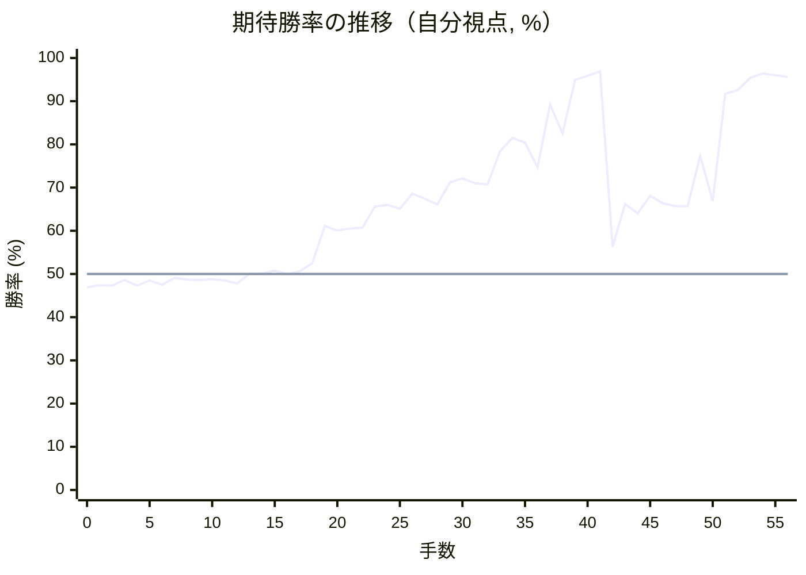
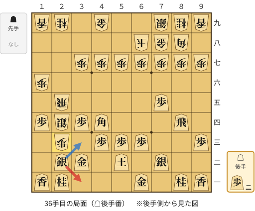
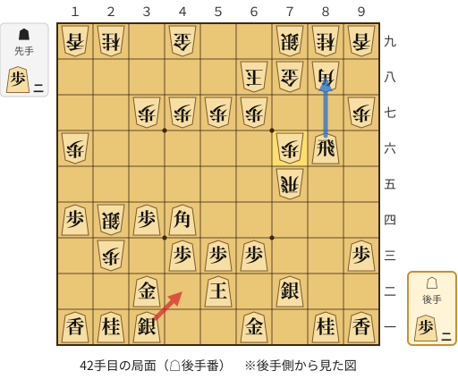
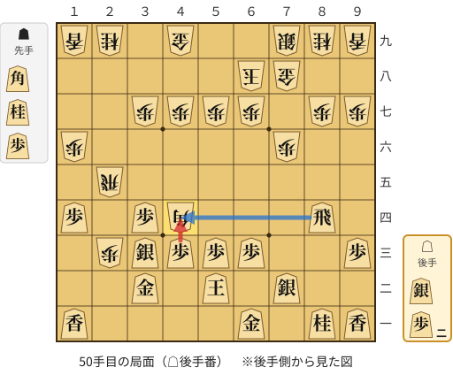

# 解析レポート ab426n07lqpe

[README に戻る](../../../README.md)　/　棋譜: [CSA](../../../data/csa/shogi5/ab426n07lqpe.csa)　/　解析の見方: [docs/mistake_analysis.md](../../../docs/mistake_analysis.md)

## 対局情報

| 項目 | 内容 |
|---|---|
| 日時 | 2026-10-27 22:40:50 |
| 持ち時間 | 5分 |
| 自分 | 後手（△）（1760） |
| 相手 | 相手（1611） |
| 結果 | 勝ち（投了, 56手） |

## 解析環境

| 項目 | 内容 |
|---|---|
| エンジン | YaneuraOu NNUE 9.00git 64AVX2（V9.00/YANEURAOU_ENGINE_NNUE/AVX2） |
| 評価関数 | **水匠5**（`suisho5`） |
| nn.bin SHA-256 | `768068f0d534a0603a5d38bcd143de6bbca820d5f1c95a14d40863e5b7892d76` |
| 第1パス | movetime=150ms, MultiPV 1 |
| 第2パス | movetime=2000ms, MultiPV 3 |
| Threads / Hash | 8 / 512MB |
| 判定基準 | 疑問手 ≥5pt, 悪手 ≥10pt, 大悪手 ≥20pt（期待勝率 W(E)=1/(1+exp(-E/600))） |
| 解析日時 | 2026-11-03T04:26:46+09:00（解析バージョン 1, 25秒） |

## サマリー

| 自分の手数 | 深掘りした手 | 詰み逃し | 大悪手 | 悪手 | 疑問手 |
|--:|--:|--:|--:|--:|--:|
| 28 | 4 | 0 | 1 | 0 | 2 |

## 期待勝率の推移



<details><summary>1手ごとの数値（第1パス）</summary>

| 手数 | 指し手 | 評価値 | 勝率 | 低下 | 判定 |
|--:|---|--:|--:|--:|---|
| 1 | ▲２六歩(27) | -62 | 47.4% |  |  |
| 2 | △８四歩(83) | -65 | 47.3% | +0.1pt |  |
| 3 | ▲２五歩(26) | -34 | 48.6% |  |  |
| 4 | △８五歩(84) | -65 | 47.3% | +1.3pt |  |
| 5 | ▲７八金(69) | -36 | 48.5% |  |  |
| 6 | △３二金(41) | -60 | 47.5% | +1.0pt |  |
| 7 | ▲２四歩(25) | -21 | 49.1% |  |  |
| 8 | △同歩(23) | -32 | 48.7% | +0.5pt |  |
| 9 | ▲同飛(28) | -33 | 48.6% |  |  |
| 10 | △１四歩(13) | -28 | 48.8% | -0.2pt |  |
| 11 | ▲２八飛(24) | -36 | 48.5% |  |  |
| 12 | △２三歩打 | -52 | 47.8% | +0.7pt |  |
| 13 | ▲１六歩(17) | +3 | 50.1% |  |  |
| 14 | △５二玉(51) | +2 | 50.1% | +0.0pt |  |
| 15 | ▲６八玉(59) | +20 | 50.8% |  |  |
| 16 | △７四歩(73) | +1 | 50.0% | +0.8pt |  |
| 17 | ▲３八銀(39) | +15 | 50.6% |  |  |
| 18 | △７二銀(71) | +60 | 52.5% | -1.9pt |  |
| 19 | ▲２七銀(38) | +270 | 61.1% |  |  |
| 20 | △７五歩(74) | +245 | 60.1% | +1.0pt |  |
| 21 | ▲３六銀(27) | +255 | 60.5% |  |  |
| 22 | △３四歩(33) | +260 | 60.7% | -0.2pt |  |
| 23 | ▲２五銀(36) | +387 | 65.6% |  |  |
| 24 | △８六歩(85) | +397 | 66.0% | -0.4pt |  |
| 25 | ▲同歩(87) | +375 | 65.1% |  |  |
| 26 | △同飛(82) | +468 | 68.6% | -3.4pt |  |
| 27 | ▲８七歩打 | +435 | 67.4% |  |  |
| 28 | △８四飛(86) | +401 | 66.1% | +1.3pt |  |
| 29 | ▲２四歩打 | +542 | 71.2% |  |  |
| 30 | △同歩(23) | +571 | 72.1% | -1.0pt |  |
| 31 | ▲同銀(25) | +538 | 71.0% |  |  |
| 32 | △４四角(22) | +528 | 70.7% | +0.3pt |  |
| 33 | ▲２五飛(28) | +773 | 78.4% |  |  |
| 34 | △２二銀(31) | +888 | 81.5% | -3.1pt |  |
| 35 | ▲２三歩打 | +845 | 80.4% |  |  |
| 36 | △３一銀(22) | +650 | 74.7% | +5.6pt | [疑問手](#ply-36) |
| 37 | ▲７五飛(25) | +1267 | 89.2% |  |  |
| 38 | △８六歩打 | +932 | 82.5% | +6.7pt |  |
| 39 | ▲同歩(87) | +1752 | 94.9% |  |  |
| 40 | △同飛(84) | +1896 | 95.9% | -1.0pt |  |
| 41 | ▲７六歩(77) | +2071 | 96.9% |  |  |
| 42 | △４二銀(31) | +151 | 56.3% | +40.7pt | [大悪手](#ply-42) |
| 43 | ▲８七歩打 | +403 | 66.2% |  |  |
| 44 | △８四飛(86) | +346 | 64.0% | +2.2pt |  |
| 45 | ▲２五飛(75) | +455 | 68.1% |  |  |
| 46 | △３三桂(21) | +408 | 66.4% | +1.7pt |  |
| 47 | ▲同銀成(24) | +391 | 65.7% |  |  |
| 48 | △同銀(42) | +391 | 65.7% | +0.0pt |  |
| 49 | ▲４四角(88) | +734 | 77.3% |  |  |
| 50 | △同歩(43) | +423 | 66.9% | +10.3pt | [疑問手](#ply-50) |
| 51 | ▲２二角打 | +1441 | 91.7% |  |  |
| 52 | △２四歩打 | +1517 | 92.6% | -0.9pt |  |
| 53 | ▲３三角成(22) | +1813 | 95.4% |  |  |
| 54 | △同金(32) | +1965 | 96.4% | -1.0pt |  |
| 55 | ▲２八飛(25) | +1913 | 96.0% |  |  |
| 56 | △２三金(33) | +1848 | 95.6% | +0.4pt |  |

</details>

## 課題局面

<a id="ply-36"></a>
### 36手目 △３一銀(22) — 疑問手

| | 着手前 | 着手後 | 差 |
|---|--:|--:|--:|
| 期待勝率 | 82.0% | 73.3% | -8.7pt |
| 評価値 | +908 | +606 | |

着手前の局面:



🔴 実戦 △３一銀(22)　🔵 AI推奨 △３三銀(22)　🟨 直前の相手の指し手

<details><summary>テキストの盤面図（BOD・将棋ソフトに貼り付け可）</summary>

```text
後手の持駒：歩二
  ９ ８ ７ ６ ５ ４ ３ ２ １
+---------------------------+
|v香v桂 ・v金 ・ ・ ・v桂v香|一
| ・ ・v銀 ・v玉 ・v金v銀 ・|二
|v歩 ・ ・v歩v歩v歩 ・ 歩 ・|三
| ・v飛 ・ ・ ・v角v歩 銀v歩|四
| ・ ・v歩 ・ ・ ・ ・ 飛 ・|五
| ・ ・ ・ ・ ・ ・ ・ ・ 歩|六
| 歩 歩 歩 歩 歩 歩 歩 ・ ・|七
| ・ 角 金 玉 ・ ・ ・ ・ ・|八
| 香 桂 銀 ・ ・ 金 ・ 桂 香|九
+---------------------------+
先手の持駒：なし
後手番
手数＝35　▲２三歩　まで
```

</details>

| | 指し手 | 評価値 | 読み筋 |
|---|---|--:|---|
| 実戦 | △３一銀(22) | +606 | ▲７六歩(77) △３三桂(21) ▲２八飛(25) △２七歩打 ▲同飛(28) △２六歩打 |
| AI 1位 | △３三銀(22) | +908 | △３三銀(22) ▲５八金(49) △７三桂(81) ▲３六歩(37) △８六歩打 ▲同歩(87) |
| AI 2位 | △３一銀(22) | +632 | △３一銀(22) ▲７六歩(77) △３三桂(21) ▲２八飛(25) △２七歩打 ▲同飛(28) |
| AI 3位 | △１三銀(22) | +617 | △１三銀(22) ▲同銀成(24) △同桂(21) ▲２四飛(25) △３五銀打 ▲２八飛(24) |

SFEN: `ln1g3nl/2s1k1gs1/p2ppp1P1/1r3bpSp/2p4R1/8P/PPPPPPP2/1BGK5/LNS2G1NL w 2p 36`

<a id="ply-42"></a>
### 42手目 △４二銀(31) — 大悪手

| | 着手前 | 着手後 | 差 |
|---|--:|--:|--:|
| 期待勝率 | 98.3% | 54.4% | -43.9pt |
| 評価値 | +2426 | +105 | |

着手前の局面:



🔴 実戦 △４二銀(31)　🔵 AI推奨 △８八飛成(86)　🟨 直前の相手の指し手

<details><summary>テキストの盤面図（BOD・将棋ソフトに貼り付け可）</summary>

```text
後手の持駒：歩二
  ９ ８ ７ ６ ５ ４ ３ ２ １
+---------------------------+
|v香v桂 ・v金 ・ ・v銀v桂v香|一
| ・ ・v銀 ・v玉 ・v金 ・ ・|二
|v歩 ・ ・v歩v歩v歩 ・ 歩 ・|三
| ・ ・ ・ ・ ・v角v歩 銀v歩|四
| ・ ・ 飛 ・ ・ ・ ・ ・ ・|五
| ・v飛 歩 ・ ・ ・ ・ ・ 歩|六
| 歩 ・ ・ 歩 歩 歩 歩 ・ ・|七
| ・ 角 金 玉 ・ ・ ・ ・ ・|八
| 香 桂 銀 ・ ・ 金 ・ 桂 香|九
+---------------------------+
先手の持駒：歩二
後手番
手数＝41　▲７六歩　まで
```

</details>

| | 指し手 | 評価値 | 読み筋 |
|---|---|--:|---|
| 実戦 | △４二銀(31) | +105 | ▲４四角(88) △同歩(43) ▲８七歩打 △８四飛(86) ▲２五飛(75) △３三桂(21) |
| AI 1位 | △８八飛成(86) | +2426 | △８八飛成(86) ▲同銀(79) △８六角打 ▲６九玉(68) △７五角(86) ▲同歩(76) |
| AI 2位 | △７七歩打 | +2390 | △７七歩打 ▲同桂(89) △８七歩打 ▲５八金(49) △８八歩成(87) ▲同銀(79) |
| AI 3位 | △８八角成(44) | +1325 | △８八角成(44) ▲同銀(79) △同飛成(86) ▲同金(78) △８六角打 ▲５八玉(68) |

SFEN: `ln1g2snl/2s1k1g2/p2ppp1P1/5bpSp/2R6/1rP5P/P2PPPP2/1BGK5/LNS2G1NL w 2P2p 42`

<a id="ply-50"></a>
### 50手目 △同歩(43) — 疑問手

| | 着手前 | 着手後 | 差 |
|---|--:|--:|--:|
| 期待勝率 | 77.3% | 71.2% | -6.2pt |
| 評価値 | +736 | +542 | |

着手前の局面:



🔴 実戦 △同歩(43)　🔵 AI推奨 △同飛(84)　🟨 直前の相手の指し手

<details><summary>テキストの盤面図（BOD・将棋ソフトに貼り付け可）</summary>

```text
後手の持駒：銀　歩二
  ９ ８ ７ ６ ５ ４ ３ ２ １
+---------------------------+
|v香v桂 ・v金 ・ ・ ・ ・v香|一
| ・ ・v銀 ・v玉 ・v金 ・ ・|二
|v歩 ・ ・v歩v歩v歩v銀 歩 ・|三
| ・v飛 ・ ・ ・ 角v歩 ・v歩|四
| ・ ・ ・ ・ ・ ・ ・ 飛 ・|五
| ・ ・ 歩 ・ ・ ・ ・ ・ 歩|六
| 歩 歩 ・ 歩 歩 歩 歩 ・ ・|七
| ・ ・ 金 玉 ・ ・ ・ ・ ・|八
| 香 桂 銀 ・ ・ 金 ・ 桂 香|九
+---------------------------+
先手の持駒：角　桂　歩
後手番
手数＝49　▲４四角　まで
```

</details>

| | 指し手 | 評価値 | 読み筋 |
|---|---|--:|---|
| 実戦 | △同歩(43) | +542 | ▲１五歩(16) △７三桂(81) ▲１四歩(15) △１六歩打 ▲６九玉(68) △８五飛(84) |
| AI 1位 | △同飛(84) | +736 | △同飛(84) ▲５八玉(68) △５四飛(44) ▲６八銀(79) △３五歩(34) ▲１五歩(16) |
| AI 2位 | △同歩(43) | +405 | △同歩(43) ▲１五歩(16) △７三桂(81) ▲１四歩(15) △同香(11) ▲１五歩打 |
| AI 3位 | △同銀(33) | -2 | △同銀(33) ▲２二歩成(23) △２四歩打 ▲同飛(25) △３三角打 ▲４一角打 |

SFEN: `ln1g4l/2s1k1g2/p2pppsP1/1r3Bp1p/7R1/2P5P/PP1PPPP2/2GK5/LNS2G1NL w BNPs2p 50`

