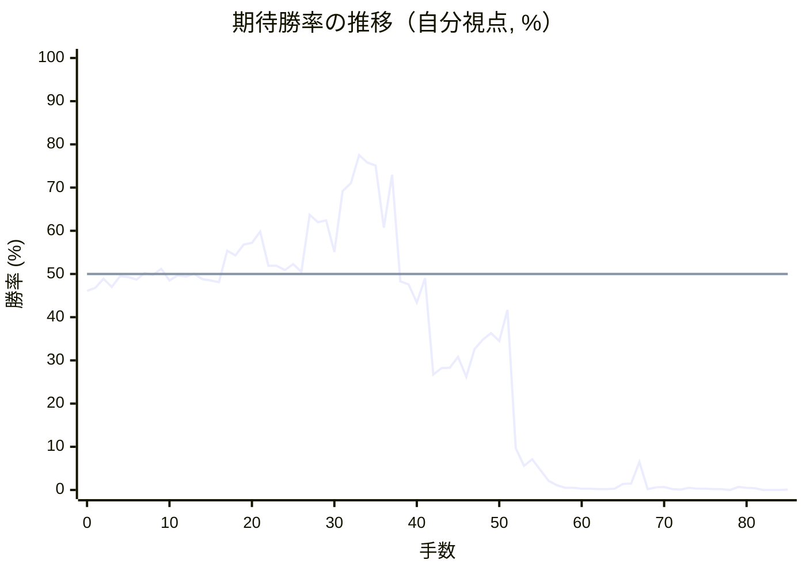
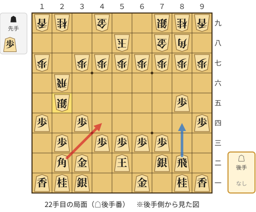
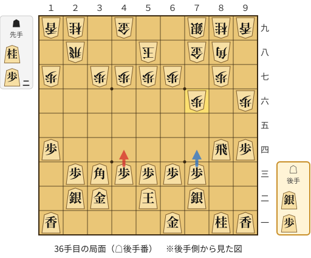
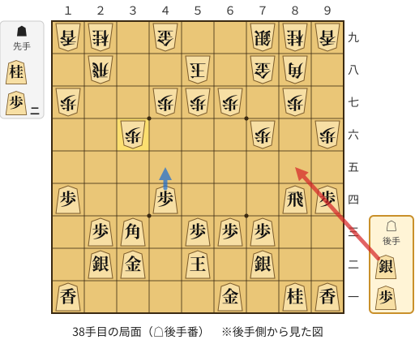
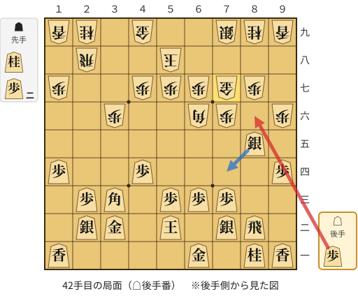
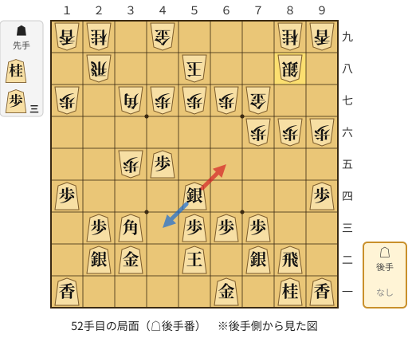

# 解析レポート as3sxs4gkx2h

[README に戻る](../../../README.md)　/　棋譜: [CSA](../../../data/csa/shogi5/as3sxs4gkx2h.csa)　/　解析の見方: [docs/mistake_analysis.md](../../../docs/mistake_analysis.md)

## 対局情報

| 項目 | 内容 |
|---|---|
| 日時 | 2026-11-09 18:21:16 |
| 持ち時間 | 5分 |
| 自分 | 後手（△）（1680） |
| 相手 | 相手（1725） |
| 結果 | 負け（投了, 85手） |

## 解析環境

| 項目 | 内容 |
|---|---|
| エンジン | YaneuraOu NNUE 9.00git 64AVX2（V9.00/YANEURAOU_ENGINE_NNUE/AVX2） |
| 評価関数 | **水匠5**（`suisho5`） |
| nn.bin SHA-256 | `768068f0d534a0603a5d38bcd143de6bbca820d5f1c95a14d40863e5b7892d76` |
| 第1パス | movetime=150ms, MultiPV 1 |
| 第2パス | movetime=2000ms, MultiPV 3 |
| Threads / Hash | 8 / 512MB |
| 判定基準 | 疑問手 ≥5pt, 悪手 ≥10pt, 大悪手 ≥20pt（期待勝率 W(E)=1/(1+exp(-E/600))） |
| 解析日時 | 2026-11-11T20:15:09+09:00（解析バージョン 1, 41秒） |

## サマリー

| 自分の手数 | 深掘りした手 | 詰み逃し | 大悪手 | 悪手 | 疑問手 |
|--:|--:|--:|--:|--:|--:|
| 42 | 7 | 0 | 3 | 2 | 0 |

## 期待勝率の推移



<details><summary>1手ごとの数値（第1パス）</summary>

| 手数 | 指し手 | 評価値 | 勝率 | 低下 | 判定 |
|--:|---|--:|--:|--:|---|
| 1 | ▲２六歩(27) | -77 | 46.8% |  |  |
| 2 | △８四歩(83) | -26 | 48.9% | -2.1pt |  |
| 3 | ▲２五歩(26) | -71 | 47.0% |  |  |
| 4 | △８五歩(84) | -13 | 49.5% | -2.4pt |  |
| 5 | ▲７八金(69) | -16 | 49.3% |  |  |
| 6 | △３二金(41) | -31 | 48.7% | +0.6pt |  |
| 7 | ▲２四歩(25) | +4 | 50.2% |  |  |
| 8 | △同歩(23) | -5 | 49.8% | +0.4pt |  |
| 9 | ▲同飛(28) | +30 | 51.2% |  |  |
| 10 | △１四歩(13) | -36 | 48.5% | +2.7pt |  |
| 11 | ▲２六飛(24) | -7 | 49.7% |  |  |
| 12 | △２三歩打 | -15 | 49.4% | +0.3pt |  |
| 13 | ▲５八玉(59) | +1 | 50.0% |  |  |
| 14 | △５二玉(51) | -30 | 48.8% | +1.3pt |  |
| 15 | ▲３八銀(39) | -37 | 48.5% |  |  |
| 16 | △７二銀(71) | -46 | 48.1% | +0.4pt |  |
| 17 | ▲２七銀(38) | +131 | 55.4% |  |  |
| 18 | △９四歩(93) | +104 | 54.3% | +1.1pt |  |
| 19 | ▲１六銀(27) | +164 | 56.8% |  |  |
| 20 | △３四歩(33) | +173 | 57.2% | -0.4pt |  |
| 21 | ▲２五銀(16) | +238 | 59.8% |  |  |
| 22 | △４四角(22) | +46 | 51.9% | +7.9pt | [悪手](#ply-22) |
| 23 | ▲２八飛(26) | +46 | 51.9% |  |  |
| 24 | △２二銀(31) | +21 | 50.9% | +1.0pt |  |
| 25 | ▲３四銀(25) | +55 | 52.3% |  |  |
| 26 | △３三桂(21) | +13 | 50.5% | +1.7pt |  |
| 27 | ▲９六歩(97) | +337 | 63.7% |  |  |
| 28 | △８六歩(85) | +294 | 62.0% | +1.7pt |  |
| 29 | ▲同歩(87) | +305 | 62.4% |  |  |
| 30 | △同飛(82) | +123 | 55.1% | +7.3pt |  |
| 31 | ▲８七歩打 | +485 | 69.2% |  |  |
| 32 | △８四飛(86) | +536 | 71.0% | -1.8pt |  |
| 33 | ▲３三銀成(34) | +741 | 77.5% |  |  |
| 34 | △同角(44) | +685 | 75.8% | +1.7pt |  |
| 35 | ▲７六歩(77) | +663 | 75.1% |  |  |
| 36 | △４四歩(43) | +261 | 60.7% | +14.4pt | [悪手](#ply-36) |
| 37 | ▲３六歩(37) | +596 | 73.0% |  |  |
| 38 | △８五銀打 | -41 | 48.3% | +24.7pt | [大悪手](#ply-38) |
| 39 | ▲６六角(88) | -57 | 47.6% |  |  |
| 40 | △８二飛(84) | -160 | 43.4% | +4.3pt |  |
| 41 | ▲７七金(78) | -23 | 49.0% |  |  |
| 42 | △８六歩打 | -605 | 26.7% | +22.3pt | [大悪手](#ply-42) |
| 43 | ▲同歩(87) | -561 | 28.2% |  |  |
| 44 | △７四銀(85) | -557 | 28.3% | -0.1pt |  |
| 45 | ▲３五歩(36) | -486 | 30.8% |  |  |
| 46 | △６五銀(74) | -621 | 26.2% | +4.6pt |  |
| 47 | ▲５五角(66) | -435 | 32.6% |  |  |
| 48 | △５四銀(65) | -377 | 34.8% | -2.2pt |  |
| 49 | ▲３七角(55) | -337 | 36.3% |  |  |
| 50 | △４五歩(44) | -385 | 34.5% | +1.8pt |  |
| 51 | ▲８八銀(79) | -202 | 41.7% |  |  |
| 52 | △６五銀(54) | -1338 | 9.7% | +32.0pt | [大悪手](#ply-52) |
| 53 | ▲３四歩(35) | -1700 | 5.6% |  |  |
| 54 | △４四角(33) | -1540 | 7.1% | -1.6pt |  |
| 55 | ▲３六桂打 | -1822 | 4.6% |  |  |
| 56 | △３五角(44) | -2315 | 2.1% | +2.5pt |  |
| 57 | ▲２五飛(28) | -2727 | 1.1% |  |  |
| 58 | △１三角(35) | -3175 | 0.5% | +0.6pt |  |
| 59 | ▲４四桂(36) | -3168 | 0.5% |  |  |
| 60 | △４二玉(52) | -3400 | 0.3% | +0.2pt |  |
| 61 | ▲３二桂成(44) | -3593 | 0.3% |  |  |
| 62 | △同玉(42) | -3622 | 0.2% | +0.0pt |  |
| 63 | ▲５五角(37) | -3648 | 0.2% |  |  |
| 64 | △５四銀(65) | -3420 | 0.3% | -0.1pt |  |
| 65 | ▲３三金打 | -2566 | 1.4% |  |  |
| 66 | △４一玉(32) | -2515 | 1.5% | -0.1pt |  |
| 67 | ▲４四角(55) | -1597 | 6.5% |  |  |
| 68 | △５二玉(41) | -3733 | 0.2% | +6.3pt |  |
| 69 | ▲２二金(33) | -3021 | 0.6% |  |  |
| 70 | △６五桂打 | -2960 | 0.7% | -0.1pt |  |
| 71 | ▲２三飛成(25) | -3825 | 0.2% |  |  |
| 72 | △５七角成(13) | -4275 | 0.1% | +0.1pt |  |
| 73 | ▲６九玉(58) | -3178 | 0.5% |  |  |
| 74 | △４三銀(54) | -3403 | 0.3% | +0.2pt |  |
| 75 | ▲３三角成(44) | -3561 | 0.3% |  |  |
| 76 | △７七桂不成(65) | -3741 | 0.2% | +0.1pt |  |
| 77 | ▲同銀(88) | -3850 | 0.2% |  |  |
| 78 | △５四銀(43) | #-3 | 0.0% | +0.2pt |  |
| 79 | ▲６八銀打 | -2944 | 0.7% |  |  |
| 80 | △４七馬(57) | -3202 | 0.5% | +0.3pt |  |
| 81 | ▲５八金(49) | -3335 | 0.4% |  |  |
| 82 | △７八金打 | -6144 | 0.0% | +0.4pt |  |
| 83 | ▲同玉(69) | -6342 | 0.0% |  |  |
| 84 | △５八馬(47) | #-3 | 0.0% | +0.0pt |  |
| 85 | ▲５九金打 | -4167 | 0.1% |  |  |

</details>

## 課題局面

<a id="ply-22"></a>
### 22手目 △４四角(22) — 悪手

| | 着手前 | 着手後 | 差 |
|---|--:|--:|--:|
| 期待勝率 | 61.1% | 49.8% | -11.3pt |
| 評価値 | +271 | -4 | |

着手前の局面:



🔴 実戦 △４四角(22)　🔵 AI推奨 △８四飛(82)　🟨 直前の相手の指し手

<details><summary>テキストの盤面図（BOD・将棋ソフトに貼り付け可）</summary>

```text
後手の持駒：なし
  ９ ８ ７ ６ ５ ４ ３ ２ １
+---------------------------+
|v香v桂 ・v金 ・ ・v銀v桂v香|一
| ・v飛v銀 ・v玉 ・v金v角 ・|二
| ・ ・v歩v歩v歩v歩 ・v歩 ・|三
|v歩 ・ ・ ・ ・ ・v歩 ・v歩|四
| ・v歩 ・ ・ ・ ・ ・ 銀 ・|五
| ・ ・ ・ ・ ・ ・ ・ 飛 ・|六
| 歩 歩 歩 歩 歩 歩 歩 ・ 歩|七
| ・ 角 金 ・ 玉 ・ ・ ・ ・|八
| 香 桂 銀 ・ ・ 金 ・ 桂 香|九
+---------------------------+
先手の持駒：歩
後手番
手数＝21　▲２五銀　まで
```

</details>

| | 指し手 | 評価値 | 読み筋 |
|---|---|--:|---|
| 実戦 | △４四角(22) | -4 | ▲２八飛(26) △２二銀(31) ▲７六歩(77) △８八角成(44) ▲同銀(79) △８四飛(82) |
| AI 1位 | △８四飛(82) | +271 | △８四飛(82) ▲３八金(49) △４四角(22) ▲５六飛(26) △３五歩(34) ▲９六歩(97) |
| AI 2位 | △８六歩(85) | +102 | △８六歩(85) ▲同歩(87) △８四飛(82) ▲９六歩(97) △３三桂(21) ▲３六銀(25) |
| AI 3位 | △４四角(22) | +2 | △４四角(22) ▲２八飛(26) △８六歩(85) ▲同歩(87) △同飛(82) ▲７六歩(77) |

SFEN: `ln1g2snl/1rs1k1gb1/2pppp1p1/p5p1p/1p5S1/7R1/PPPPPPP1P/1BG1K4/LNS2G1NL w P 22`

<a id="ply-36"></a>
### 36手目 △４四歩(43) — 悪手

| | 着手前 | 着手後 | 差 |
|---|--:|--:|--:|
| 期待勝率 | 73.9% | 60.2% | -13.8pt |
| 評価値 | +626 | +248 | |

着手前の局面:



🔴 実戦 △４四歩(43)　🔵 AI推奨 △７四歩(73)　🟨 直前の相手の指し手

<details><summary>テキストの盤面図（BOD・将棋ソフトに貼り付け可）</summary>

```text
後手の持駒：銀　歩
  ９ ８ ７ ６ ５ ４ ３ ２ １
+---------------------------+
|v香v桂 ・v金 ・ ・ ・ ・v香|一
| ・ ・v銀 ・v玉 ・v金v銀 ・|二
| ・ ・v歩v歩v歩v歩v角v歩 ・|三
|v歩v飛 ・ ・ ・ ・ ・ ・v歩|四
| ・ ・ ・ ・ ・ ・ ・ ・ ・|五
| 歩 ・ 歩 ・ ・ ・ ・ ・ ・|六
| ・ 歩 ・ 歩 歩 歩 歩 ・ 歩|七
| ・ 角 金 ・ 玉 ・ ・ 飛 ・|八
| 香 桂 銀 ・ ・ 金 ・ 桂 香|九
+---------------------------+
先手の持駒：桂　歩二
後手番
手数＝35　▲７六歩　まで
```

</details>

| | 指し手 | 評価値 | 読み筋 |
|---|---|--:|---|
| 実戦 | △４四歩(43) | +248 | ▲６六角(88) △７四飛(84) ▲６八銀(79) △７六飛(74) ▲６九玉(58) △６二玉(52) |
| AI 1位 | △７四歩(73) | +626 | △７四歩(73) ▲３三角成(88) △同銀(22) ▲６六角打 △７五歩(74) ▲６八銀(79) |
| AI 2位 | △７四飛(84) | +541 | △７四飛(84) ▲３三角成(88) △同銀(22) ▲７七桂(89) △７六飛(74) ▲６八銀(79) |
| AI 3位 | △８八角成(33) | +504 | △８八角成(33) ▲同銀(79) △２四飛(84) ▲同飛(28) △同歩(23) ▲２八歩打 |

SFEN: `ln1g4l/2s1k1gs1/2ppppbp1/pr6p/9/P1P6/1P1PPPP1P/1BG1K2R1/LNS2G1NL w N2Psp 36`

<a id="ply-38"></a>
### 38手目 △８五銀打 — 大悪手

| | 着手前 | 着手後 | 差 |
|---|--:|--:|--:|
| 期待勝率 | 73.3% | 49.9% | -23.5pt |
| 評価値 | +607 | -3 | |

着手前の局面:



🔴 実戦 △８五銀打　🔵 AI推奨 △４五歩(44)　🟨 直前の相手の指し手

<details><summary>テキストの盤面図（BOD・将棋ソフトに貼り付け可）</summary>

```text
後手の持駒：銀　歩
  ９ ８ ７ ６ ５ ４ ３ ２ １
+---------------------------+
|v香v桂 ・v金 ・ ・ ・ ・v香|一
| ・ ・v銀 ・v玉 ・v金v銀 ・|二
| ・ ・v歩v歩v歩 ・v角v歩 ・|三
|v歩v飛 ・ ・ ・v歩 ・ ・v歩|四
| ・ ・ ・ ・ ・ ・ ・ ・ ・|五
| 歩 ・ 歩 ・ ・ ・ 歩 ・ ・|六
| ・ 歩 ・ 歩 歩 歩 ・ ・ 歩|七
| ・ 角 金 ・ 玉 ・ ・ 飛 ・|八
| 香 桂 銀 ・ ・ 金 ・ 桂 香|九
+---------------------------+
先手の持駒：桂　歩二
後手番
手数＝37　▲３六歩　まで
```

</details>

| | 指し手 | 評価値 | 読み筋 |
|---|---|--:|---|
| 実戦 | △８五銀打 | -3 | ▲６六角(88) △６四飛(84) ▲７七金(78) △７四銀(85) ▲５五角(66) △５四飛(64) |
| AI 1位 | △４五歩(44) | +607 | △４五歩(44) ▲３三角成(88) △同銀(22) ▲７七桂(89) △６二玉(52) ▲３八金(49) |
| AI 2位 | △７四飛(84) | +563 | △７四飛(84) ▲６六角(88) △７六飛(74) ▲７七桂(89) △７五銀打 ▲５五角(66) |
| AI 3位 | △６二玉(52) | +492 | △６二玉(52) ▲６六角(88) △６四飛(84) ▲６八銀(79) △４五歩(44) ▲５六歩(57) |

SFEN: `ln1g4l/2s1k1gs1/2ppp1bp1/pr3p2p/9/P1P3P2/1P1PPP2P/1BG1K2R1/LNS2G1NL w N2Psp 38`

<a id="ply-42"></a>
### 42手目 △８六歩打 — 大悪手

| | 着手前 | 着手後 | 差 |
|---|--:|--:|--:|
| 期待勝率 | 53.7% | 27.7% | -26.0pt |
| 評価値 | +88 | -576 | |

着手前の局面:



🔴 実戦 △８六歩打　🔵 AI推奨 △７四銀(85)　🟨 直前の相手の指し手

<details><summary>テキストの盤面図（BOD・将棋ソフトに貼り付け可）</summary>

```text
後手の持駒：歩
  ９ ８ ７ ６ ５ ４ ３ ２ １
+---------------------------+
|v香v桂 ・v金 ・ ・ ・ ・v香|一
| ・v飛v銀 ・v玉 ・v金v銀 ・|二
| ・ ・v歩v歩v歩 ・v角v歩 ・|三
|v歩 ・ ・ ・ ・v歩 ・ ・v歩|四
| ・v銀 ・ ・ ・ ・ ・ ・ ・|五
| 歩 ・ 歩 角 ・ ・ 歩 ・ ・|六
| ・ 歩 金 歩 歩 歩 ・ ・ 歩|七
| ・ ・ ・ ・ 玉 ・ ・ 飛 ・|八
| 香 桂 銀 ・ ・ 金 ・ 桂 香|九
+---------------------------+
先手の持駒：桂　歩二
後手番
手数＝41　▲７七金　まで
```

</details>

| | 指し手 | 評価値 | 読み筋 |
|---|---|--:|---|
| 実戦 | △８六歩打 | -576 | ▲同歩(87) △７四銀(85) ▲８七金(77) △６五銀(74) ▲７七角(66) △７四歩(73) |
| AI 1位 | △７四銀(85) | +88 | △７四銀(85) ▲６九玉(58) △６五銀(74) ▲５五角(66) △５四銀(65) ▲６六角(55) |
| AI 2位 | △６四歩(63) | +6 | △６四歩(63) ▲３五歩(36) △６五歩(64) ▲５五角(66) △６三銀(72) ▲３四歩(35) |
| AI 3位 | △６二玉(52) | -34 | △６二玉(52) ▲８六歩(87) △７四銀(85) ▲８七金(77) △８五歩打 ▲同歩(86) |

SFEN: `ln1g4l/1rs1k1gs1/2ppp1bp1/p4p2p/1s7/P1PB2P2/1PGPPP2P/4K2R1/LNS2G1NL w N2Pp 42`

<a id="ply-52"></a>
### 52手目 △６五銀(54) — 大悪手

| | 着手前 | 着手後 | 差 |
|---|--:|--:|--:|
| 期待勝率 | 42.7% | 4.1% | -38.6pt |
| 評価値 | -176 | -1893 | |

着手前の局面:



🔴 実戦 △６五銀(54)　🔵 AI推奨 △４三銀(54)　🟨 直前の相手の指し手

<details><summary>テキストの盤面図（BOD・将棋ソフトに貼り付け可）</summary>

```text
後手の持駒：なし
  ９ ８ ７ ６ ５ ４ ３ ２ １
+---------------------------+
|v香v桂 ・v金 ・ ・ ・ ・v香|一
| ・v飛v銀 ・v玉 ・v金v銀 ・|二
| ・ ・v歩v歩v歩 ・v角v歩 ・|三
|v歩 ・ ・ ・v銀 ・ ・ ・v歩|四
| ・ ・ ・ ・ ・v歩 歩 ・ ・|五
| 歩 歩 歩 ・ ・ ・ ・ ・ ・|六
| ・ ・ 金 歩 歩 歩 角 ・ 歩|七
| ・ 銀 ・ ・ 玉 ・ ・ 飛 ・|八
| 香 桂 ・ ・ ・ 金 ・ 桂 香|九
+---------------------------+
先手の持駒：桂　歩三
後手番
手数＝51　▲８八銀　まで
```

</details>

| | 指し手 | 評価値 | 読み筋 |
|---|---|--:|---|
| 実戦 | △６五銀(54) | -1893 | ▲３四歩(35) △４四角(33) ▲３六桂打 △８四飛(82) ▲４四桂(36) △同飛(84) |
| AI 1位 | △４三銀(54) | -176 | △４三銀(54) ▲６九玉(58) △８四飛(82) ▲７八玉(69) △６二玉(52) ▲５八金(49) |
| AI 2位 | △４四角(33) | -177 | △４四角(33) ▲３八飛(28) △８四飛(82) ▲６九玉(58) △４三銀(54) ▲４八角(37) |
| AI 3位 | △８四飛(82) | -183 | △８四飛(82) ▲６九玉(58) △４四角(33) ▲５九角(37) △６二玉(52) ▲７八玉(69) |

SFEN: `ln1g4l/1rs1k1gs1/2ppp1bp1/p3s3p/5pP2/PPP6/2GPPPB1P/1S2K2R1/LN3G1NL w N3P 52`

