# 解析レポート atd8b3u377ka

[README に戻る](../../../README.md)　/　棋譜: [CSA](../../../data/csa/shogi5/atd8b3u377ka.csa)　/　解析の見方: [docs/mistake_analysis.md](../../../docs/mistake_analysis.md)

## 対局情報

| 項目 | 内容 |
|---|---|
| 日時 | 2026-11-02 18:02:18 |
| 持ち時間 | 5分 |
| 自分 | 後手（△）（1721） |
| 相手 | 相手（1669） |
| 結果 | 負け（時間切れ, 93手） |

## 解析環境

| 項目 | 内容 |
|---|---|
| エンジン | YaneuraOu NNUE 9.00git 64AVX2（V9.00/YANEURAOU_ENGINE_NNUE/AVX2） |
| 評価関数 | **水匠5**（`suisho5`） |
| nn.bin SHA-256 | `768068f0d534a0603a5d38bcd143de6bbca820d5f1c95a14d40863e5b7892d76` |
| 第1パス | movetime=150ms, MultiPV 1 |
| 第2パス | movetime=2000ms, MultiPV 3 |
| Threads / Hash | 8 / 512MB |
| 判定基準 | 疑問手 ≥5pt, 悪手 ≥10pt, 大悪手 ≥20pt（期待勝率 W(E)=1/(1+exp(-E/600))） |
| 解析日時 | 2026-11-03T05:26:37+09:00（解析バージョン 1, 86秒） |

## サマリー

| 自分の手数 | 深掘りした手 | 詰み逃し | 大悪手 | 悪手 | 疑問手 |
|--:|--:|--:|--:|--:|--:|
| 46 | 18 | 0 | 6 | 6 | 5 |

## 期待勝率の推移

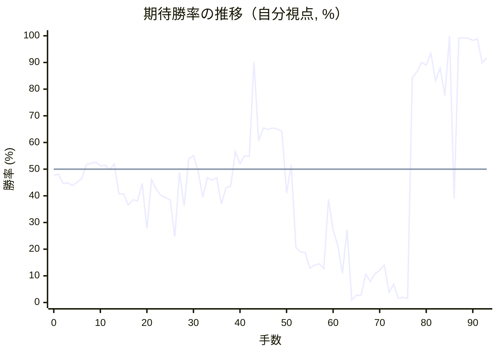

<details><summary>1手ごとの数値（第1パス）</summary>

| 手数 | 指し手 | 評価値 | 勝率 | 低下 | 判定 |
|--:|---|--:|--:|--:|---|
| 1 | ▲７六歩(77) | -46 | 48.1% |  |  |
| 2 | △３四歩(33) | -131 | 44.6% | +3.5pt |  |
| 3 | ▲２六歩(27) | -122 | 44.9% |  |  |
| 4 | △８四歩(83) | -148 | 43.9% | +1.1pt |  |
| 5 | ▲２五歩(26) | -120 | 45.0% |  |  |
| 6 | △８五歩(84) | -85 | 46.5% | -1.4pt |  |
| 7 | ▲９六歩(97) | +42 | 51.7% |  |  |
| 8 | △３二金(41) | +53 | 52.2% | -0.5pt |  |
| 9 | ▲２四歩(25) | +63 | 52.6% |  |  |
| 10 | △同歩(23) | +32 | 51.3% | +1.3pt |  |
| 11 | ▲同飛(28) | +36 | 51.5% |  |  |
| 12 | △２三歩打 | -3 | 49.9% | +1.6pt |  |
| 13 | ▲３四飛(24) | +45 | 51.9% |  |  |
| 14 | △４二玉(51) | -225 | 40.7% | +11.1pt | [悪手](#ply-14) |
| 15 | ▲７八金(69) | -225 | 40.7% |  |  |
| 16 | △８六歩(85) | -330 | 36.6% | +4.1pt |  |
| 17 | ▲同歩(87) | -281 | 38.5% |  |  |
| 18 | △同飛(82) | -291 | 38.1% | +0.4pt |  |
| 19 | ▲６八玉(59) | -131 | 44.6% |  |  |
| 20 | △７六飛(86) | -576 | 27.7% | +16.9pt | [大悪手](#ply-20) |
| 21 | ▲３六歩(37) | -94 | 46.1% |  |  |
| 22 | △７四歩(73) | -181 | 42.5% | +3.6pt |  |
| 23 | ▲３八銀(39) | -238 | 40.2% |  |  |
| 24 | △７三桂(81) | -260 | 39.3% | +0.9pt |  |
| 25 | ▲３七桂(29) | -282 | 38.5% |  |  |
| 26 | △９四歩(93) | -670 | 24.7% | +13.8pt | [悪手](#ply-26) |
| 27 | ▲４五桂(37) | -30 | 48.8% |  |  |
| 28 | △３三歩打 | -340 | 36.2% | +12.5pt | [悪手](#ply-28) |
| 29 | ▲７七歩打 | +93 | 53.9% |  |  |
| 30 | △７五飛(76) | +124 | 55.1% | -1.3pt |  |
| 31 | ▲３五飛(34) | -14 | 49.4% |  |  |
| 32 | △４四歩(43) | -255 | 39.5% | +9.9pt | [疑問手](#ply-32) |
| 33 | ▲５三桂成(45) | -76 | 46.8% |  |  |
| 34 | △同玉(42) | -98 | 45.9% | +0.9pt |  |
| 35 | ▲９七角(88) | -78 | 46.8% |  |  |
| 36 | △６二玉(53) | -323 | 36.9% | +9.9pt | [悪手](#ply-36) |
| 37 | ▲７五角(97) | -167 | 43.1% |  |  |
| 38 | △同歩(74) | -154 | 43.6% | -0.5pt |  |
| 39 | ▲同飛(35) | +156 | 56.5% |  |  |
| 40 | △６四角打 | +51 | 52.1% | +4.3pt |  |
| 41 | ▲７四飛(75) | +121 | 55.0% |  |  |
| 42 | △１九角成(64) | +115 | 54.8% | +0.2pt |  |
| 43 | ▲４一飛打 | +1340 | 90.3% |  |  |
| 44 | △４二香打 | +258 | 60.6% | +29.7pt | [大悪手](#ply-44) |
| 45 | ▲８四飛(74) | +383 | 65.4% |  |  |
| 46 | △８二歩打 | +368 | 64.9% | +0.6pt |  |
| 47 | ▲８三歩打 | +381 | 65.4% |  |  |
| 48 | △同歩(82) | +374 | 65.1% | +0.3pt |  |
| 49 | ▲同飛成(84) | +348 | 64.1% |  |  |
| 50 | △７二銀(71) | -218 | 41.0% | +23.1pt | [大悪手](#ply-50) |
| 51 | ▲８二龍(83) | +38 | 51.6% |  |  |
| 52 | △６五桂(73) | -807 | 20.7% | +30.9pt | [大悪手](#ply-52) |
| 53 | ▲６一飛成(41) | -872 | 18.9% |  |  |
| 54 | △同玉(62) | -878 | 18.8% | +0.2pt |  |
| 55 | ▲７一金打 | -1144 | 12.9% |  |  |
| 56 | △５二玉(61) | -1090 | 14.0% | -1.0pt |  |
| 57 | ▲７二龍(82) | -1063 | 14.5% |  |  |
| 58 | △４三玉(52) | -1157 | 12.7% | +1.8pt |  |
| 59 | ▲６六歩(67) | -276 | 38.7% |  |  |
| 60 | △５七桂成(65) | -591 | 27.2% | +11.5pt | [悪手](#ply-60) |
| 61 | ▲同玉(68) | -782 | 21.4% |  |  |
| 62 | △５六歩打 | -1254 | 11.0% | +10.4pt | [疑問手](#ply-62) |
| 63 | ▲６七玉(57) | -587 | 27.3% |  |  |
| 64 | △６四桂打 | -2848 | 0.9% | +26.5pt | [大悪手](#ply-64) |
| 65 | ▲６三龍(72) | -2153 | 2.7% |  |  |
| 66 | △３四玉(43) | -2147 | 2.7% | -0.0pt |  |
| 67 | ▲３五歩(36) | -1281 | 10.6% |  |  |
| 68 | △２四玉(34) | -1473 | 7.9% | +2.7pt |  |
| 69 | ▲２五歩打 | -1268 | 10.8% |  |  |
| 70 | △同玉(24) | -1188 | 12.1% | -1.4pt |  |
| 71 | ▲３七桂打 | -1084 | 14.1% |  |  |
| 72 | △２六玉(25) | -1946 | 3.8% | +10.3pt | [悪手](#ply-72) |
| 73 | ▲２七銀打 | -1573 | 6.8% |  |  |
| 74 | △１七玉(26) | -2473 | 1.6% | +5.2pt |  |
| 75 | ▲６四龍(63) | -2375 | 1.9% |  |  |
| 76 | △４五歩(44) | -2513 | 1.5% | +0.4pt |  |
| 77 | ▲３九金(49) | +1010 | 84.3% |  |  |
| 78 | △６九飛打 | +1114 | 86.5% | -2.2pt |  |
| 79 | ▲７六玉(67) | +1321 | 90.0% |  |  |
| 80 | △３九飛成(69) | +1252 | 89.0% | +1.1pt |  |
| 81 | ▲７五玉(76) | +1597 | 93.5% |  |  |
| 82 | △２八馬(19) | +961 | 83.2% | +10.2pt | [疑問手](#ply-82) |
| 83 | ▲７四玉(75) | +1192 | 87.9% |  |  |
| 84 | △３八馬(28) | +746 | 77.6% | +10.3pt | [疑問手](#ply-84) |
| 85 | ▲６三玉(74) | +4404 | 99.9% |  |  |
| 86 | △４一金打 | -265 | 39.1% | +60.8pt | [大悪手](#ply-86) |
| 87 | ▲５三桂打 | +2912 | 99.2% |  |  |
| 88 | △２七玉(17) | +2865 | 99.2% | +0.1pt |  |
| 89 | ▲４一桂成(53) | +2802 | 99.1% |  |  |
| 90 | △３七玉(27) | +2418 | 98.3% | +0.8pt |  |
| 91 | ▲５二玉(63) | +2652 | 98.8% |  |  |
| 92 | △６二銀打 | +1313 | 89.9% | +8.9pt | [疑問手](#ply-92) |
| 93 | ▲同玉(52) | +1440 | 91.7% |  |  |

</details>

## 課題局面

<a id="ply-14"></a>
### 14手目 △４二玉(51) — 悪手

| | 着手前 | 着手後 | 差 |
|---|--:|--:|--:|
| 期待勝率 | 54.0% | 39.7% | -14.3pt |
| 評価値 | +97 | -251 | |

着手前の局面:

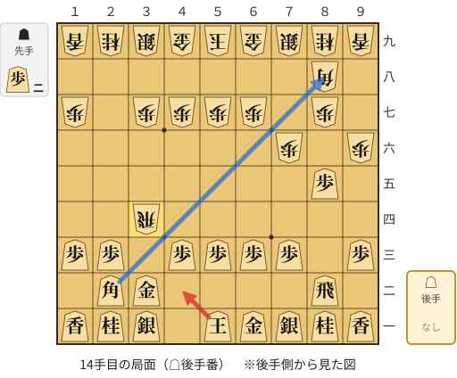

🔴 実戦 △４二玉(51)　🔵 AI推奨 △８八角成(22)　🟨 直前の相手の指し手

<details><summary>テキストの盤面図（BOD・将棋ソフトに貼り付け可）</summary>

```text
後手の持駒：なし
  ９ ８ ７ ６ ５ ４ ３ ２ １
+---------------------------+
|v香v桂v銀v金v玉 ・v銀v桂v香|一
| ・v飛 ・ ・ ・ ・v金v角 ・|二
|v歩 ・v歩v歩v歩v歩 ・v歩v歩|三
| ・ ・ ・ ・ ・ ・ 飛 ・ ・|四
| ・v歩 ・ ・ ・ ・ ・ ・ ・|五
| 歩 ・ 歩 ・ ・ ・ ・ ・ ・|六
| ・ 歩 ・ 歩 歩 歩 歩 ・ 歩|七
| ・ 角 ・ ・ ・ ・ ・ ・ ・|八
| 香 桂 銀 金 玉 金 銀 桂 香|九
+---------------------------+
先手の持駒：歩二
後手番
手数＝13　▲３四飛　まで
```

</details>

| | 指し手 | 評価値 | 読み筋 |
|---|---|--:|---|
| 実戦 | △４二玉(51) | -251 | ▲７八金(69) △８八角成(22) ▲同銀(79) △４五角打 ▲３五飛(34) △２七角成(45) |
| AI 1位 | △８八角成(22) | +97 | △８八角成(22) ▲同銀(79) △４五角打 ▲５六角打 △３四角(45) ▲同角(56) |
| AI 2位 | △８六歩(85) | +65 | △８六歩(85) ▲同歩(87) △８八角成(22) ▲同銀(79) △４五角打 ▲３二飛成(34) |
| AI 3位 | △４二玉(51) | -255 | △４二玉(51) ▲７八金(69) △７二銀(71) ▲３八銀(39) △９四歩(93) ▲５八玉(59) |

SFEN: `lnsgk1snl/1r4gb1/p1pppp1pp/6R2/1p7/P1P6/1P1PPPP1P/1B7/LNSGKGSNL w 2P 14`

<a id="ply-20"></a>
### 20手目 △７六飛(86) — 大悪手

| | 着手前 | 着手後 | 差 |
|---|--:|--:|--:|
| 期待勝率 | 46.4% | 24.4% | -22.0pt |
| 評価値 | -86 | -678 | |

着手前の局面:

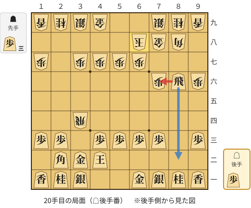

🔴 実戦 △７六飛(86)　🔵 AI推奨 △８二飛(86)　🟨 直前の相手の指し手

<details><summary>テキストの盤面図（BOD・将棋ソフトに貼り付け可）</summary>

```text
後手の持駒：歩
  ９ ８ ７ ６ ５ ４ ３ ２ １
+---------------------------+
|v香v桂v銀v金 ・ ・v銀v桂v香|一
| ・ ・ ・ ・ ・v玉v金v角 ・|二
|v歩 ・v歩v歩v歩v歩 ・v歩v歩|三
| ・ ・ ・ ・ ・ ・ 飛 ・ ・|四
| ・ ・ ・ ・ ・ ・ ・ ・ ・|五
| 歩v飛 歩 ・ ・ ・ ・ ・ ・|六
| ・ ・ ・ 歩 歩 歩 歩 ・ 歩|七
| ・ 角 金 玉 ・ ・ ・ ・ ・|八
| 香 桂 銀 ・ ・ 金 銀 桂 香|九
+---------------------------+
先手の持駒：歩三
後手番
手数＝19　▲６八玉　まで
```

</details>

| | 指し手 | 評価値 | 読み筋 |
|---|---|--:|---|
| 実戦 | △７六飛(86) | -678 | ▲２二角成(88) △同銀(31) ▲８四飛(34) △８二歩打 ▲８三歩打 △７四飛(76) |
| AI 1位 | △８二飛(86) | -86 | △８二飛(86) ▲７七桂(89) △７二銀(71) ▲３八銀(39) △１四歩(13) ▲５八玉(68) |
| AI 2位 | △７二銀(71) | -154 | △７二銀(71) ▲３六飛(34) △９四歩(93) ▲３八銀(39) △１四歩(13) ▲５八玉(68) |
| AI 3位 | △９四歩(93) | -183 | △９四歩(93) ▲１六歩(17) △８二飛(86) ▲３八銀(39) △８七歩打 ▲７七角(88) |

SFEN: `lnsg2snl/5kgb1/p1pppp1pp/6R2/9/PrP6/3PPPP1P/1BGK5/LNS2GSNL w 3Pp 20`

<a id="ply-26"></a>
### 26手目 △９四歩(93) — 悪手

| | 着手前 | 着手後 | 差 |
|---|--:|--:|--:|
| 期待勝率 | 37.2% | 21.8% | -15.5pt |
| 評価値 | -313 | -768 | |

着手前の局面:

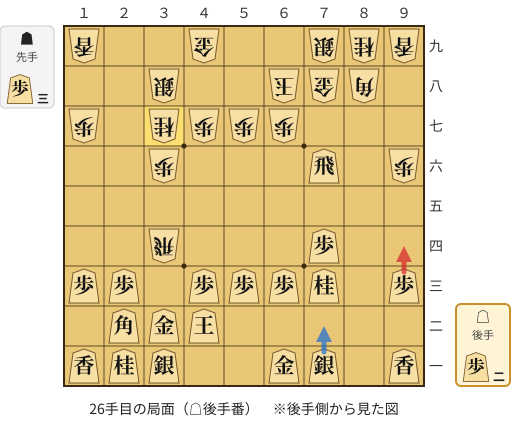

🔴 実戦 △９四歩(93)　🔵 AI推奨 △７二銀(71)　🟨 直前の相手の指し手

<details><summary>テキストの盤面図（BOD・将棋ソフトに貼り付け可）</summary>

```text
後手の持駒：歩二
  ９ ８ ７ ６ ５ ４ ３ ２ １
+---------------------------+
|v香 ・v銀v金 ・ ・v銀v桂v香|一
| ・ ・ ・ ・ ・v玉v金v角 ・|二
|v歩 ・v桂v歩v歩v歩 ・v歩v歩|三
| ・ ・v歩 ・ ・ ・ 飛 ・ ・|四
| ・ ・ ・ ・ ・ ・ ・ ・ ・|五
| 歩 ・v飛 ・ ・ ・ 歩 ・ ・|六
| ・ ・ ・ 歩 歩 歩 桂 ・ 歩|七
| ・ 角 金 玉 ・ ・ 銀 ・ ・|八
| 香 桂 銀 ・ ・ 金 ・ ・ 香|九
+---------------------------+
先手の持駒：歩三
後手番
手数＝25　▲３七桂　まで
```

</details>

| | 指し手 | 評価値 | 読み筋 |
|---|---|--:|---|
| 実戦 | △９四歩(93) | -768 | ▲２二角成(88) △同銀(31) ▲８七金(78) △７五飛(76) ▲８三角打 △７二銀(71) |
| AI 1位 | △７二銀(71) | -313 | △７二銀(71) ▲８七金(78) △８八角成(22) ▲同銀(79) △７五飛(76) ▲７七桂(89) |
| AI 2位 | △３三金(32) | -290 | △３三金(32) ▲３五飛(34) △４四金(33) ▲２五飛(35) △３二銀(31) ▲２四歩打 |
| AI 3位 | △１四歩(13) | -415 | △１四歩(13) ▲２二角成(88) △同銀(31) ▲７七金(78) △７五飛(76) ▲８三角打 |

SFEN: `l1sg2snl/5kgb1/p1nppp1pp/2p3R2/9/P1r3P2/3PPPN1P/1BGK2S2/LNS2G2L w 3P2p 26`

<a id="ply-28"></a>
### 28手目 △３三歩打 — 悪手

| | 着手前 | 着手後 | 差 |
|---|--:|--:|--:|
| 期待勝率 | 49.3% | 38.4% | -10.9pt |
| 評価値 | -17 | -284 | |

着手前の局面:

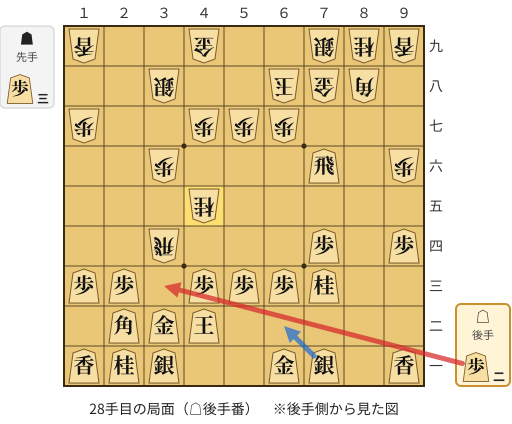

🔴 実戦 △３三歩打　🔵 AI推奨 △６二銀(71)　🟨 直前の相手の指し手

<details><summary>テキストの盤面図（BOD・将棋ソフトに貼り付け可）</summary>

```text
後手の持駒：歩二
  ９ ８ ７ ６ ５ ４ ３ ２ １
+---------------------------+
|v香 ・v銀v金 ・ ・v銀v桂v香|一
| ・ ・ ・ ・ ・v玉v金v角 ・|二
| ・ ・v桂v歩v歩v歩 ・v歩v歩|三
|v歩 ・v歩 ・ ・ ・ 飛 ・ ・|四
| ・ ・ ・ ・ ・ 桂 ・ ・ ・|五
| 歩 ・v飛 ・ ・ ・ 歩 ・ ・|六
| ・ ・ ・ 歩 歩 歩 ・ ・ 歩|七
| ・ 角 金 玉 ・ ・ 銀 ・ ・|八
| 香 桂 銀 ・ ・ 金 ・ ・ 香|九
+---------------------------+
先手の持駒：歩三
後手番
手数＝27　▲４五桂　まで
```

</details>

| | 指し手 | 評価値 | 読み筋 |
|---|---|--:|---|
| 実戦 | △３三歩打 | -284 | ▲３五飛(34) △３四歩(33) ▲同飛(35) △６二銀(71) ▲２二角成(88) △同銀(31) |
| AI 1位 | △６二銀(71) | -17 | △６二銀(71) ▲８七金(78) △８八角成(22) ▲同銀(79) △７五飛(76) ▲４六歩(47) |
| AI 2位 | △８八角成(22) | -260 | △８八角成(22) ▲同銀(79) △６二銀(71) ▲６六角打 △３三歩打 ▲３五飛(34) |
| AI 3位 | △３三歩打 | -295 | △３三歩打 ▲３五飛(34) △３四歩(33) ▲同飛(35) △６二銀(71) ▲８四歩打 |

SFEN: `l1sg2snl/5kgb1/2nppp1pp/p1p3R2/5N3/P1r3P2/3PPP2P/1BGK2S2/LNS2G2L w 3P2p 28`

<a id="ply-32"></a>
### 32手目 △４四歩(43) — 疑問手

| | 着手前 | 着手後 | 差 |
|---|--:|--:|--:|
| 期待勝率 | 51.5% | 45.1% | -6.4pt |
| 評価値 | +37 | -118 | |

着手前の局面:

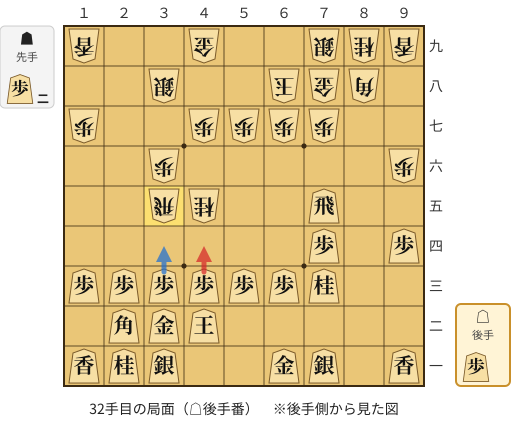

🔴 実戦 △４四歩(43)　🔵 AI推奨 △３四歩(33)　🟨 直前の相手の指し手

<details><summary>テキストの盤面図（BOD・将棋ソフトに貼り付け可）</summary>

```text
後手の持駒：歩
  ９ ８ ７ ６ ５ ４ ３ ２ １
+---------------------------+
|v香 ・v銀v金 ・ ・v銀v桂v香|一
| ・ ・ ・ ・ ・v玉v金v角 ・|二
| ・ ・v桂v歩v歩v歩v歩v歩v歩|三
|v歩 ・v歩 ・ ・ ・ ・ ・ ・|四
| ・ ・v飛 ・ ・ 桂 飛 ・ ・|五
| 歩 ・ ・ ・ ・ ・ 歩 ・ ・|六
| ・ ・ 歩 歩 歩 歩 ・ ・ 歩|七
| ・ 角 金 玉 ・ ・ 銀 ・ ・|八
| 香 桂 銀 ・ ・ 金 ・ ・ 香|九
+---------------------------+
先手の持駒：歩二
後手番
手数＝31　▲３五飛　まで
```

</details>

| | 指し手 | 評価値 | 読み筋 |
|---|---|--:|---|
| 実戦 | △４四歩(43) | -118 | ▲５三桂成(45) △同玉(42) |
| AI 1位 | △３四歩(33) | +37 | △３四歩(33) ▲７六歩(77) △同飛(75) ▲３四飛(35) △６二銀(71) ▲８四歩打 |
| AI 2位 | △５五飛(75) | -27 | △５五飛(75) ▲９七角(88) △８六歩打 ▲同角(97) △３四歩(33) ▲５三桂不成(45) |
| AI 3位 | △５五飛(75) | -32 | △５五飛(75) ▲９七角(88) △８六歩打 ▲同角(97) △３四歩(33) ▲５三角成(86) |

SFEN: `l1sg2snl/5kgb1/2npppppp/p1p6/2r2NR2/P5P2/2PPPP2P/1BGK2S2/LNS2G2L w 2Pp 32`

<a id="ply-36"></a>
### 36手目 △６二玉(53) — 悪手

| | 着手前 | 着手後 | 差 |
|---|--:|--:|--:|
| 期待勝率 | 45.4% | 31.9% | -13.5pt |
| 評価値 | -111 | -454 | |

着手前の局面:

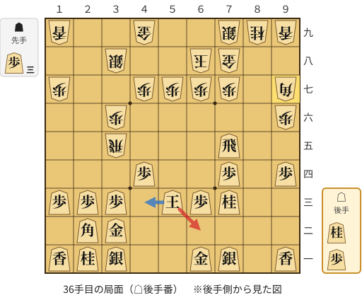

🔴 実戦 △６二玉(53)　🔵 AI推奨 △４三玉(53)　🟨 直前の相手の指し手

<details><summary>テキストの盤面図（BOD・将棋ソフトに貼り付け可）</summary>

```text
後手の持駒：桂　歩
  ９ ８ ７ ６ ５ ４ ３ ２ １
+---------------------------+
|v香 ・v銀v金 ・ ・v銀v桂v香|一
| ・ ・ ・ ・ ・ ・v金v角 ・|二
| ・ ・v桂v歩v玉 ・v歩v歩v歩|三
|v歩 ・v歩 ・ ・v歩 ・ ・ ・|四
| ・ ・v飛 ・ ・ ・ 飛 ・ ・|五
| 歩 ・ ・ ・ ・ ・ 歩 ・ ・|六
| 角 ・ 歩 歩 歩 歩 ・ ・ 歩|七
| ・ ・ 金 玉 ・ ・ 銀 ・ ・|八
| 香 桂 銀 ・ ・ 金 ・ ・ 香|九
+---------------------------+
先手の持駒：歩三
後手番
手数＝35　▲９七角　まで
```

</details>

| | 指し手 | 評価値 | 読み筋 |
|---|---|--:|---|
| 実戦 | △６二玉(53) | -454 | ▲７五飛(35) △同歩(74) ▲８一飛打 △２六桂打 ▲２九銀(38) △２七飛打 |
| AI 1位 | △４三玉(53) | -111 | △４三玉(53) ▲７五飛(35) △同歩(74) ▲同角(97) △４二銀(31) ▲８四歩打 |
| AI 2位 | △５二玉(53) | -152 | △５二玉(53) ▲７五飛(35) △同歩(74) ▲８一飛打 △２六桂打 ▲２九銀(38) |
| AI 3位 | △６二玉(53) | -462 | △６二玉(53) ▲７五飛(35) △同歩(74) ▲８一飛打 △８二飛打 ▲同飛成(81) |

SFEN: `l1sg2snl/6gb1/2npk1ppp/p1p2p3/2r3R2/P5P2/B1PPPP2P/2GK2S2/LNS2G2L w 3Pnp 36`

<a id="ply-44"></a>
### 44手目 △４二香打 — 大悪手

| | 着手前 | 着手後 | 差 |
|---|--:|--:|--:|
| 期待勝率 | 92.6% | 65.8% | -26.8pt |
| 評価値 | +1516 | +393 | |

着手前の局面:

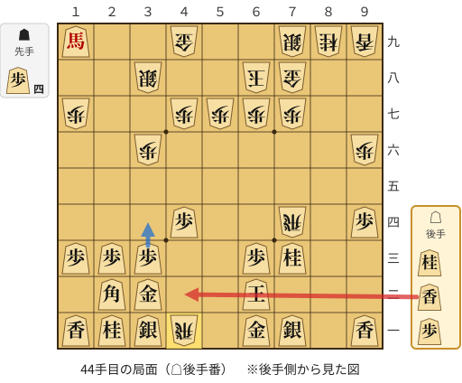

🔴 実戦 △４二香打　🔵 AI推奨 △３四歩(33)　🟨 直前の相手の指し手

<details><summary>テキストの盤面図（BOD・将棋ソフトに貼り付け可）</summary>

```text
後手の持駒：桂　香　歩
  ９ ８ ７ ６ ５ ４ ３ ２ １
+---------------------------+
|v香 ・v銀v金 ・ 飛v銀v桂v香|一
| ・ ・ ・v玉 ・ ・v金v角 ・|二
| ・ ・v桂v歩 ・ ・v歩v歩v歩|三
|v歩 ・ 飛 ・ ・v歩 ・ ・ ・|四
| ・ ・ ・ ・ ・ ・ ・ ・ ・|五
| 歩 ・ ・ ・ ・ ・ 歩 ・ ・|六
| ・ ・ 歩 歩 歩 歩 ・ ・ 歩|七
| ・ ・ 金 玉 ・ ・ 銀 ・ ・|八
| 香 桂 銀 ・ ・ 金 ・ ・v馬|九
+---------------------------+
先手の持駒：歩四
後手番
手数＝43　▲４一飛　まで
```

</details>

| | 指し手 | 評価値 | 読み筋 |
|---|---|--:|---|
| 実戦 | △４二香打 | +393 | ▲８四飛(74) △５一歩打 ▲２四歩打 △同歩(23) ▲２三歩打 △同金(32) |
| AI 1位 | △３四歩(33) | +1516 | △３四歩(33) ▲６一飛成(41) △同玉(62) ▲８四飛(74) △８二歩打 ▲８三歩打 |
| AI 2位 | △５一香打 | +1347 | △５一香打 ▲４四飛成(41) △３四歩(33) ▲４五龍(44) △３三桂(21) ▲４四龍(45) |
| AI 3位 | △７二銀(71) | +1278 | △７二銀(71) ▲６一飛成(41) △同玉(62) ▲８二金打 △８五飛打 ▲７二金(82) |

SFEN: `l1sg1Rsnl/3k2gb1/2np2ppp/p1R2p3/9/P5P2/2PPPP2P/2GK2S2/LNS2G2+b w 4Pnlp 44`

<a id="ply-50"></a>
### 50手目 △７二銀(71) — 大悪手

| | 着手前 | 着手後 | 差 |
|---|--:|--:|--:|
| 期待勝率 | 67.0% | 37.3% | -29.7pt |
| 評価値 | +425 | -311 | |

着手前の局面:

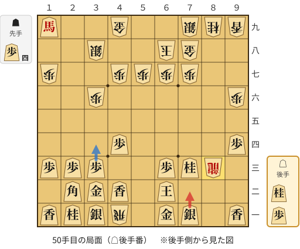

🔴 実戦 △７二銀(71)　🔵 AI推奨 △３四歩(33)　🟨 直前の相手の指し手

<details><summary>テキストの盤面図（BOD・将棋ソフトに貼り付け可）</summary>

```text
後手の持駒：桂　歩
  ９ ８ ７ ６ ５ ４ ３ ２ １
+---------------------------+
|v香 ・v銀v金 ・ 飛v銀v桂v香|一
| ・ ・ ・v玉 ・v香v金v角 ・|二
| ・ 龍v桂v歩 ・ ・v歩v歩v歩|三
|v歩 ・ ・ ・ ・v歩 ・ ・ ・|四
| ・ ・ ・ ・ ・ ・ ・ ・ ・|五
| 歩 ・ ・ ・ ・ ・ 歩 ・ ・|六
| ・ ・ 歩 歩 歩 歩 ・ ・ 歩|七
| ・ ・ 金 玉 ・ ・ 銀 ・ ・|八
| 香 桂 銀 ・ ・ 金 ・ ・v馬|九
+---------------------------+
先手の持駒：歩四
後手番
手数＝49　▲８三同成　まで
```

</details>

| | 指し手 | 評価値 | 読み筋 |
|---|---|--:|---|
| 実戦 | △７二銀(71) | -311 | ▲６一飛成(41) △同銀(72) ▲８二龍(83) △７二歩打 ▲９一龍(82) △６五桂(73) |
| AI 1位 | △３四歩(33) | +425 | △３四歩(33) ▲６一飛成(41) △同玉(62) ▲８一龍(83) △２六桂打 ▲６六歩(67) |
| AI 2位 | △５一歩打 | +367 | △５一歩打 ▲２四歩打 △２八馬(19) ▲８四龍(83) △２六桂打 ▲５四龍(84) |
| AI 3位 | △４五桂打 | +322 | △４五桂打 ▲６一飛成(41) △同玉(62) ▲６六歩(67) △６二玉(61) ▲６七金(78) |

SFEN: `l1sg1Rsnl/3k1lgb1/1+Rnp2ppp/p4p3/9/P5P2/2PPPP2P/2GK2S2/LNS2G2+b w 4Pnp 50`

<a id="ply-52"></a>
### 52手目 △６五桂(73) — 大悪手

| | 着手前 | 着手後 | 差 |
|---|--:|--:|--:|
| 期待勝率 | 49.6% | 12.3% | -37.3pt |
| 評価値 | -10 | -1180 | |

着手前の局面:

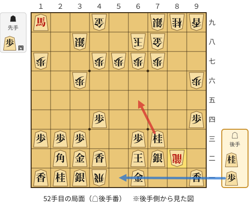

🔴 実戦 △６五桂(73)　🔵 AI推奨 △５一歩打　🟨 直前の相手の指し手

<details><summary>テキストの盤面図（BOD・将棋ソフトに貼り付け可）</summary>

```text
後手の持駒：桂　歩
  ９ ８ ７ ６ ５ ４ ３ ２ １
+---------------------------+
|v香 ・ ・v金 ・ 飛v銀v桂v香|一
| ・ 龍v銀v玉 ・v香v金v角 ・|二
| ・ ・v桂v歩 ・ ・v歩v歩v歩|三
|v歩 ・ ・ ・ ・v歩 ・ ・ ・|四
| ・ ・ ・ ・ ・ ・ ・ ・ ・|五
| 歩 ・ ・ ・ ・ ・ 歩 ・ ・|六
| ・ ・ 歩 歩 歩 歩 ・ ・ 歩|七
| ・ ・ 金 玉 ・ ・ 銀 ・ ・|八
| 香 桂 銀 ・ ・ 金 ・ ・v馬|九
+---------------------------+
先手の持駒：歩四
後手番
手数＝51　▲８二龍　まで
```

</details>

| | 指し手 | 評価値 | 読み筋 |
|---|---|--:|---|
| 実戦 | △６五桂(73) | -1180 | ▲６一飛成(41) △同玉(62) ▲７一金打 △６二玉(61) ▲７二龍(82) △５三玉(62) |
| AI 1位 | △５一歩打 | -10 | △５一歩打 ▲９一龍(82) △６五桂(73) ▲９四龍(91) △４五桂打 ▲５八香打 |
| AI 2位 | △５一桂打 | -276 | △５一桂打 ▲９一龍(82) △６四馬(19) ▲８三歩打 △同銀(72) ▲８二龍(91) |
| AI 3位 | △４五桂打 | -427 | △４五桂打 ▲６一飛成(41) △同玉(62) ▲９一龍(82) △６二玉(61) ▲４一龍(91) |

SFEN: `l2g1Rsnl/1+Rsk1lgb1/2np2ppp/p4p3/9/P5P2/2PPPP2P/2GK2S2/LNS2G2+b w 4Pnp 52`

<a id="ply-60"></a>
### 60手目 △５七桂成(65) — 悪手

| | 着手前 | 着手後 | 差 |
|---|--:|--:|--:|
| 期待勝率 | 36.0% | 20.0% | -16.0pt |
| 評価値 | -345 | -832 | |

着手前の局面:

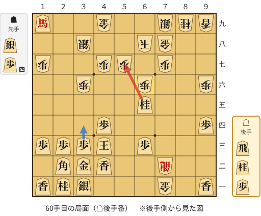

🔴 実戦 △５七桂成(65)　🔵 AI推奨 △３四歩(33)　🟨 直前の相手の指し手

<details><summary>テキストの盤面図（BOD・将棋ソフトに貼り付け可）</summary>

```text
後手の持駒：飛　桂　歩
  ９ ８ ７ ６ ５ ４ ３ ２ １
+---------------------------+
|v香 ・ 金 ・ ・ ・v銀v桂v香|一
| ・ ・ 龍 ・ ・v香v金v角 ・|二
| ・ ・ ・v歩 ・v玉v歩v歩v歩|三
|v歩 ・ ・ ・ ・v歩 ・ ・ ・|四
| ・ ・ ・v桂 ・ ・ ・ ・ ・|五
| 歩 ・ ・ 歩 ・ ・ 歩 ・ ・|六
| ・ ・ 歩 ・ 歩 歩 ・ ・ 歩|七
| ・ ・ 金 玉 ・ ・ 銀 ・ ・|八
| 香 桂 銀 ・ ・ 金 ・ ・v馬|九
+---------------------------+
先手の持駒：銀　歩四
後手番
手数＝59　▲６六歩　まで
```

</details>

| | 指し手 | 評価値 | 読み筋 |
|---|---|--:|---|
| 実戦 | △５七桂成(65) | -832 | ▲同玉(68) △６四馬(19) ▲６五銀打 △５五馬(64) ▲５四歩打 △６九飛打 |
| AI 1位 | △３四歩(33) | -345 | △３四歩(33) ▲６三龍(72) △５三歩打 ▲６五龍(63) △２六桂打 ▲３五歩(36) |
| AI 2位 | △４五歩(44) | -668 | △４五歩(44) ▲６三龍(72) △５三歩打 ▲６五龍(63) △３四歩(33) ▲３五歩(36) |
| AI 3位 | △４五歩(44) | -745 | △４五歩(44) ▲６五歩(66) △３四歩(33) ▲４一銀打 △５三飛打 ▲６一金(71) |

SFEN: `l1G3snl/2+R2lgb1/3p1kppp/p4p3/3n5/P2P2P2/2P1PP2P/2GK2S2/LNS2G2+b w S4Prnp 60`

<a id="ply-62"></a>
### 62手目 △５六歩打 — 疑問手

| | 着手前 | 着手後 | 差 |
|---|--:|--:|--:|
| 期待勝率 | 17.9% | 11.3% | -6.7pt |
| 評価値 | -913 | -1238 | |

着手前の局面:

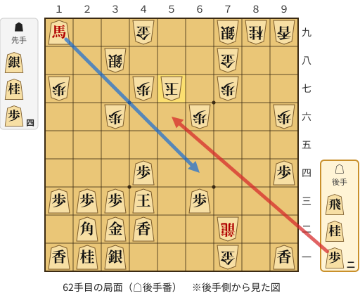

🔴 実戦 △５六歩打　🔵 AI推奨 △６四馬(19)　🟨 直前の相手の指し手

<details><summary>テキストの盤面図（BOD・将棋ソフトに貼り付け可）</summary>

```text
後手の持駒：飛　桂　歩二
  ９ ８ ７ ６ ５ ４ ３ ２ １
+---------------------------+
|v香 ・ 金 ・ ・ ・v銀v桂v香|一
| ・ ・ 龍 ・ ・v香v金v角 ・|二
| ・ ・ ・v歩 ・v玉v歩v歩v歩|三
|v歩 ・ ・ ・ ・v歩 ・ ・ ・|四
| ・ ・ ・ ・ ・ ・ ・ ・ ・|五
| 歩 ・ ・ 歩 ・ ・ 歩 ・ ・|六
| ・ ・ 歩 ・ 玉 歩 ・ ・ 歩|七
| ・ ・ 金 ・ ・ ・ 銀 ・ ・|八
| 香 桂 銀 ・ ・ 金 ・ ・v馬|九
+---------------------------+
先手の持駒：銀　桂　歩四
後手番
手数＝61　▲５七同玉　まで
```

</details>

| | 指し手 | 評価値 | 読み筋 |
|---|---|--:|---|
| 実戦 | △５六歩打 | -1238 | ▲同玉(57) △３四玉(43) ▲５四歩打 △６四馬(19) ▲５五銀打 △８六馬(64) |
| AI 1位 | △６四馬(19) | -913 | △６四馬(19) ▲６五銀打 △５五馬(64) ▲５四歩打 △５六歩打 ▲同銀(65) |
| AI 2位 | △３四玉(43) | -986 | △３四玉(43) ▲５四歩打 △６四馬(19) ▲６五銀打 △４五桂打 ▲６七玉(57) |
| AI 3位 | △４五桂打 | -1145 | △４五桂打 ▲６七玉(57) △３四玉(43) ▲５三歩打 △５一歩打 ▲６一金(71) |

SFEN: `l1G3snl/2+R2lgb1/3p1kppp/p4p3/9/P2P2P2/2P1KP2P/2G3S2/LNS2G2+b w SN4Prn2p 62`

<a id="ply-64"></a>
### 64手目 △６四桂打 — 大悪手

| | 着手前 | 着手後 | 差 |
|---|--:|--:|--:|
| 期待勝率 | 26.4% | 0.4% | -26.0pt |
| 評価値 | -616 | -3278 | |

着手前の局面:

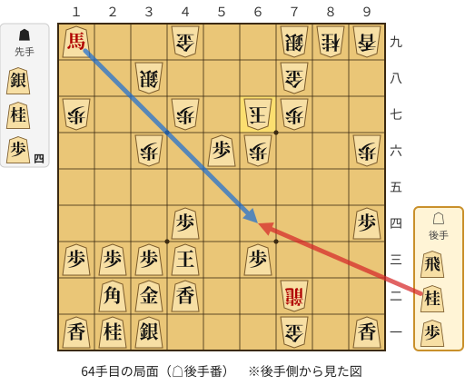

🔴 実戦 △６四桂打　🔵 AI推奨 △６四馬(19)　🟨 直前の相手の指し手

<details><summary>テキストの盤面図（BOD・将棋ソフトに貼り付け可）</summary>

```text
後手の持駒：飛　桂　歩
  ９ ８ ７ ６ ５ ４ ３ ２ １
+---------------------------+
|v香 ・ 金 ・ ・ ・v銀v桂v香|一
| ・ ・ 龍 ・ ・v香v金v角 ・|二
| ・ ・ ・v歩 ・v玉v歩v歩v歩|三
|v歩 ・ ・ ・ ・v歩 ・ ・ ・|四
| ・ ・ ・ ・ ・ ・ ・ ・ ・|五
| 歩 ・ ・ 歩v歩 ・ 歩 ・ ・|六
| ・ ・ 歩 玉 ・ 歩 ・ ・ 歩|七
| ・ ・ 金 ・ ・ ・ 銀 ・ ・|八
| 香 桂 銀 ・ ・ 金 ・ ・v馬|九
+---------------------------+
先手の持駒：銀　桂　歩四
後手番
手数＝63　▲６七玉　まで
```

</details>

| | 指し手 | 評価値 | 読み筋 |
|---|---|--:|---|
| 実戦 | △６四桂打 | -3278 | ▲４六桂打 △５七歩成(56) ▲同玉(67) △３四歩(33) ▲６三龍(72) △５三歩打 |
| AI 1位 | △６四馬(19) | -616 | △６四馬(19) ▲５六玉(67) △３四玉(43) ▲５五歩打 △２四歩(23) ▲６五歩(66) |
| AI 2位 | △６九飛打 | -957 | △６九飛打 ▲５六玉(67) △６四馬(19) ▲７五銀打 △５四馬(64) ▲５五歩打 |
| AI 3位 | △３四玉(43) | -1036 | △３四玉(43) ▲５三歩打 △６九飛打 ▲５六玉(67) △６四馬(19) ▲５二歩成(53) |

SFEN: `l1G3snl/2+R2lgb1/3p1kppp/p4p3/9/P2Pp1P2/2PK1P2P/2G3S2/LNS2G2+b w SN4Prnp 64`

<a id="ply-72"></a>
### 72手目 △２六玉(25) — 悪手

| | 着手前 | 着手後 | 差 |
|---|--:|--:|--:|
| 期待勝率 | 12.4% | 2.2% | -10.2pt |
| 評価値 | -1175 | -2284 | |

着手前の局面:

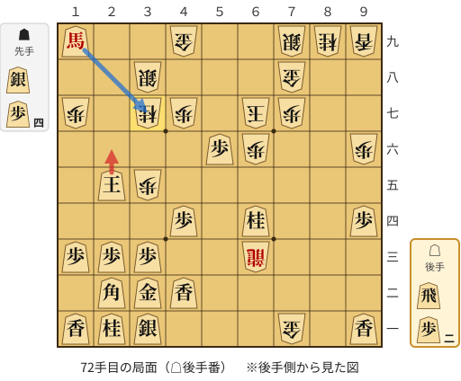

🔴 実戦 △２六玉(25)　🔵 AI推奨 △同馬(19)　🟨 直前の相手の指し手

<details><summary>テキストの盤面図（BOD・将棋ソフトに貼り付け可）</summary>

```text
後手の持駒：飛　歩二
  ９ ８ ７ ６ ５ ４ ３ ２ １
+---------------------------+
|v香 ・ 金 ・ ・ ・v銀v桂v香|一
| ・ ・ ・ ・ ・v香v金v角 ・|二
| ・ ・ ・ 龍 ・ ・v歩v歩v歩|三
|v歩 ・ ・v桂 ・v歩 ・ ・ ・|四
| ・ ・ ・ ・ ・ ・ 歩v玉 ・|五
| 歩 ・ ・ 歩v歩 ・ ・ ・ ・|六
| ・ ・ 歩 玉 ・ 歩 桂 ・ 歩|七
| ・ ・ 金 ・ ・ ・ 銀 ・ ・|八
| 香 桂 銀 ・ ・ 金 ・ ・v馬|九
+---------------------------+
先手の持駒：銀　歩四
後手番
手数＝71　▲３七桂　まで
```

</details>

| | 指し手 | 評価値 | 読み筋 |
|---|---|--:|---|
| 実戦 | △２六玉(25) | -2284 | ▲６四龍(63) △５七歩成(56) ▲同玉(67) △１四歩(13) ▲６八金(78) △３五玉(26) |
| AI 1位 | △同馬(19) | -1175 | △同馬(19) ▲同銀(38) △５七歩成(56) ▲同玉(67) △４五桂打 ▲６八玉(57) |
| AI 2位 | △２四玉(25) | -1755 | △２四玉(25) ▲２五歩打 △３五玉(24) ▲６四龍(63) △５七歩成(56) ▲同玉(67) |
| AI 3位 | △３五玉(25) | -2087 | △３五玉(25) ▲３六歩打 △２四玉(35) ▲２五銀打 △１五玉(24) ▲６四龍(63) |

SFEN: `l1G3snl/5lgb1/3+R2ppp/p2n1p3/6Pk1/P2Pp4/2PK1PN1P/2G3S2/LNS2G2+b w S4Pr2p 72`

<a id="ply-82"></a>
### 82手目 △２八馬(19) — 疑問手

| | 着手前 | 着手後 | 差 |
|---|--:|--:|--:|
| 期待勝率 | 95.5% | 87.8% | -7.7pt |
| 評価値 | +1831 | +1184 | |

着手前の局面:

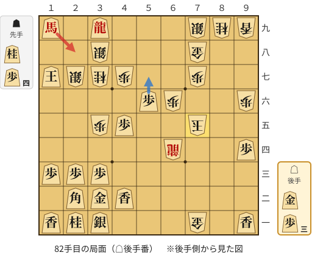

🔴 実戦 △２八馬(19)　🔵 AI推奨 △５七歩成(56)　🟨 直前の相手の指し手

<details><summary>テキストの盤面図（BOD・将棋ソフトに貼り付け可）</summary>

```text
後手の持駒：金　歩三
  ９ ８ ７ ６ ５ ４ ３ ２ １
+---------------------------+
|v香 ・ 金 ・ ・ ・v銀v桂v香|一
| ・ ・ ・ ・ ・v香v金v角 ・|二
| ・ ・ ・ ・ ・ ・v歩v歩v歩|三
|v歩 ・ ・ 龍 ・ ・ ・ ・ ・|四
| ・ ・ 玉 ・ ・v歩 歩 ・ ・|五
| 歩 ・ ・ 歩v歩 ・ ・ ・ ・|六
| ・ ・ 歩 ・ ・ 歩 桂 銀v玉|七
| ・ ・ 金 ・ ・ ・ 銀 ・ ・|八
| 香 桂 銀 ・ ・ ・v龍 ・v馬|九
+---------------------------+
先手の持駒：桂　歩四
後手番
手数＝81　▲７五玉　まで
```

</details>

| | 指し手 | 評価値 | 読み筋 |
|---|---|--:|---|
| 実戦 | △２八馬(19) | +1184 | ▲８四歩打 △３八龍(39) ▲同銀(27) △同馬(28) ▲８三歩成(84) △２七玉(17) |
| AI 1位 | △５七歩成(56) | +1831 | △５七歩成(56) ▲２九歩打 △４八と(57) ▲１八歩打 △同馬(19) ▲同銀(27) |
| AI 2位 | △３七馬(19) | +1445 | △３七馬(19) ▲同銀(38) △２七玉(17) ▲７三角打 △３七玉(27) ▲９一角成(73) |
| AI 3位 | △２八金打 | +1347 | △２八金打 ▲１八歩打 △同金(28) ▲同銀(27) △同玉(17) ▲４九金打 |

SFEN: `l1G3snl/5lgb1/6ppp/p2+R5/2K2pP2/P2Pp4/2P2PNSk/2G3S2/LNS3+r1+b w N4Pg3p 82`

<a id="ply-84"></a>
### 84手目 △３八馬(28) — 疑問手

| | 着手前 | 着手後 | 差 |
|---|--:|--:|--:|
| 期待勝率 | 88.9% | 81.4% | -7.5pt |
| 評価値 | +1248 | +887 | |

着手前の局面:

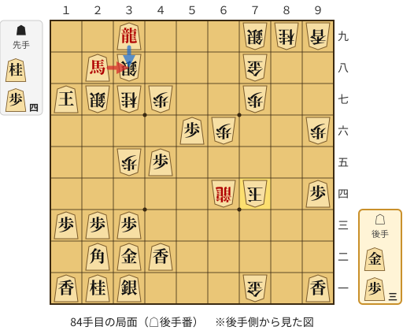

🔴 実戦 △３八馬(28)　🔵 AI推奨 △３八龍(39)　🟨 直前の相手の指し手

<details><summary>テキストの盤面図（BOD・将棋ソフトに貼り付け可）</summary>

```text
後手の持駒：金　歩三
  ９ ８ ７ ６ ５ ４ ３ ２ １
+---------------------------+
|v香 ・ 金 ・ ・ ・v銀v桂v香|一
| ・ ・ ・ ・ ・v香v金v角 ・|二
| ・ ・ ・ ・ ・ ・v歩v歩v歩|三
|v歩 ・ 玉 龍 ・ ・ ・ ・ ・|四
| ・ ・ ・ ・ ・v歩 歩 ・ ・|五
| 歩 ・ ・ 歩v歩 ・ ・ ・ ・|六
| ・ ・ 歩 ・ ・ 歩 桂 銀v玉|七
| ・ ・ 金 ・ ・ ・ 銀v馬 ・|八
| 香 桂 銀 ・ ・ ・v龍 ・ ・|九
+---------------------------+
先手の持駒：桂　歩四
後手番
手数＝83　▲７四玉　まで
```

</details>

| | 指し手 | 評価値 | 読み筋 |
|---|---|--:|---|
| 実戦 | △３八馬(28) | +887 | ▲同銀(27) △３四歩(33) ▲７三角打 △３八龍(39) ▲４五桂(37) △同香(42) |
| AI 1位 | △３八龍(39) | +1248 | △３八龍(39) ▲同銀(27) △同馬(28) ▲８四歩打 △２七玉(17) ▲２五桂(37) |
| AI 2位 | △５七歩成(56) | +1090 | △５七歩成(56) ▲７三玉(74) △３八龍(39) ▲同銀(27) △同馬(28) ▲８三歩打 |
| AI 3位 | △３四歩(33) | +1048 | △３四歩(33) ▲８三歩打 △３八龍(39) ▲同銀(27) △同馬(28) ▲８二歩成(83) |

SFEN: `l1G3snl/5lgb1/6ppp/p1K+R5/5pP2/P2Pp4/2P2PNSk/2G3S+b1/LNS3+r2 w N4Pg3p 84`

<a id="ply-86"></a>
### 86手目 △４一金打 — 大悪手

| | 着手前 | 着手後 | 差 |
|---|--:|--:|--:|
| 期待勝率 | 100.0% | 43.7% | -56.3pt |
| 評価値 | +4601 | -152 | |

着手前の局面:

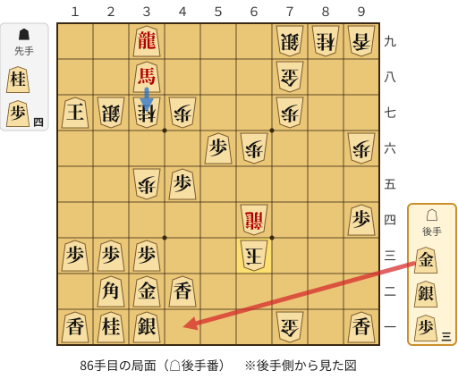

🔴 実戦 △４一金打　🔵 AI推奨 △３七馬(38)　🟨 直前の相手の指し手

<details><summary>テキストの盤面図（BOD・将棋ソフトに貼り付け可）</summary>

```text
後手の持駒：金　銀　歩三
  ９ ８ ７ ６ ５ ４ ３ ２ １
+---------------------------+
|v香 ・ 金 ・ ・ ・v銀v桂v香|一
| ・ ・ ・ ・ ・v香v金v角 ・|二
| ・ ・ ・ 玉 ・ ・v歩v歩v歩|三
|v歩 ・ ・ 龍 ・ ・ ・ ・ ・|四
| ・ ・ ・ ・ ・v歩 歩 ・ ・|五
| 歩 ・ ・ 歩v歩 ・ ・ ・ ・|六
| ・ ・ 歩 ・ ・ 歩 桂 銀v玉|七
| ・ ・ 金 ・ ・ ・v馬 ・ ・|八
| 香 桂 銀 ・ ・ ・v龍 ・ ・|九
+---------------------------+
先手の持駒：桂　歩四
後手番
手数＝85　▲６三玉　まで
```

</details>

| | 指し手 | 評価値 | 読み筋 |
|---|---|--:|---|
| 実戦 | △４一金打 | -152 | ▲３八銀(27) △同龍(39) ▲７二玉(63) △３四歩(33) ▲８一玉(72) △４四角(22) |
| AI 1位 | △３七馬(38) | +4601 | △３七馬(38) ▲８四龍(64) △２七玉(17) ▲７二玉(63) △３四歩(33) ▲８三歩打 |
| AI 2位 | △２七馬(38) | +4503 | △２七馬(38) ▲８三歩打 △３七馬(27) ▲５四龍(64) △３四歩(33) ▲７二玉(63) |
| AI 3位 | △２七玉(17) | +4480 | △２七玉(17) ▲４五桂(37) △同香(42) ▲７二玉(63) △３七馬(38) ▲６二龍(64) |

SFEN: `l1G3snl/5lgb1/3K2ppp/p2+R5/5pP2/P2Pp4/2P2PNSk/2G3+b2/LNS3+r2 w N4Pgs3p 86`

<a id="ply-92"></a>
### 92手目 △６二銀打 — 疑問手

| | 着手前 | 着手後 | 差 |
|---|--:|--:|--:|
| 期待勝率 | 99.0% | 92.7% | -6.2pt |
| 評価値 | +2735 | +1527 | |

着手前の局面:

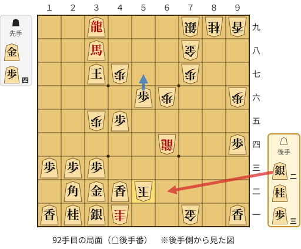

🔴 実戦 △６二銀打　🔵 AI推奨 △５七歩成(56)　🟨 直前の相手の指し手

<details><summary>テキストの盤面図（BOD・将棋ソフトに貼り付け可）</summary>

```text
後手の持駒：銀二　桂　歩三
  ９ ８ ７ ６ ５ ４ ３ ２ １
+---------------------------+
|v香 ・ 金 ・ ・ 圭v銀v桂v香|一
| ・ ・ ・ ・ 玉v香v金v角 ・|二
| ・ ・ ・ ・ ・ ・v歩v歩v歩|三
|v歩 ・ ・ 龍 ・ ・ ・ ・ ・|四
| ・ ・ ・ ・ ・v歩 歩 ・ ・|五
| 歩 ・ ・ 歩v歩 ・ ・ ・ ・|六
| ・ ・ 歩 ・ ・ 歩v玉 ・ ・|七
| ・ ・ 金 ・ ・ ・v馬 ・ ・|八
| 香 桂 銀 ・ ・ ・v龍 ・ ・|九
+---------------------------+
先手の持駒：金　歩四
後手番
手数＝91　▲５二玉　まで
```

</details>

| | 指し手 | 評価値 | 読み筋 |
|---|---|--:|---|
| 実戦 | △６二銀打 | +1527 | ▲同玉(52) △５七歩成(56) |
| AI 1位 | △５七歩成(56) | +2735 | △５七歩成(56) ▲５四歩打 △１六馬(38) ▲５一玉(52) △３四歩(33) ▲５三歩成(54) |
| AI 2位 | △３四歩(33) | +2638 | △３四歩(33) ▲５四歩打 △５七歩成(56) ▲５三歩成(54) △４四角(22) ▲６一玉(52) |
| AI 3位 | △１四歩(13) | +2664 | △１四歩(13) ▲５四歩打 △１六馬(38) ▲３四歩(35) △同馬(16) ▲５一玉(52) |

SFEN: `l1G2+Nsnl/4Klgb1/6ppp/p2+R5/5pP2/P2Pp4/2P2Pk2/2G3+b2/LNS3+r2 w G4P2sn3p 92`

