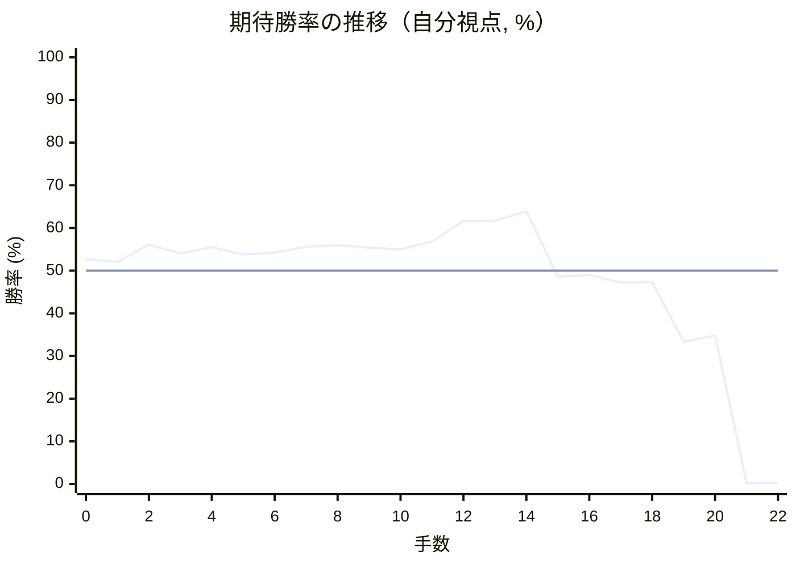
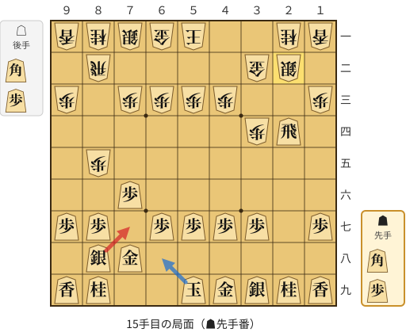
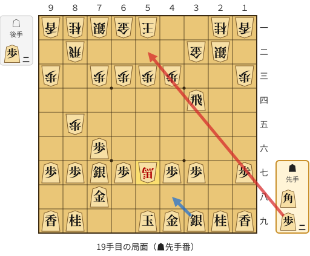
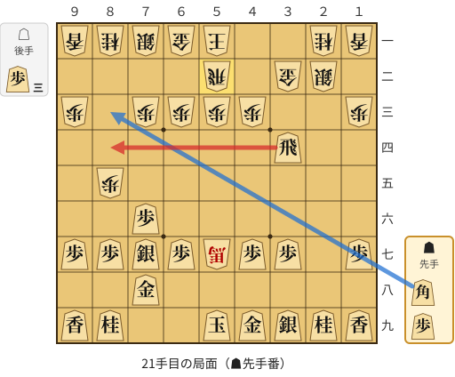

# 解析レポート avtm1zu70xp6

[README に戻る](../../../README.md)　/　棋譜: [CSA](../../../data/csa/shogi5/avtm1zu70xp6.csa)　/　解析の見方: [docs/mistake_analysis.md](../../../docs/mistake_analysis.md)

## 対局情報

| 項目 | 内容 |
|---|---|
| 日時 | 2026-10-27 22:55:51 |
| 持ち時間 | 5分 |
| 自分 | 先手（▲）（1765） |
| 相手 | 相手（1815） |
| 結果 | 負け（投了, 22手） |

## 解析環境

| 項目 | 内容 |
|---|---|
| エンジン | YaneuraOu NNUE 9.00git 64AVX2（V9.00/YANEURAOU_ENGINE_NNUE/AVX2） |
| 評価関数 | **水匠5**（`suisho5`） |
| nn.bin SHA-256 | `768068f0d534a0603a5d38bcd143de6bbca820d5f1c95a14d40863e5b7892d76` |
| 第1パス | movetime=150ms, MultiPV 1 |
| 第2パス | movetime=2000ms, MultiPV 3 |
| Threads / Hash | 8 / 512MB |
| 判定基準 | 疑問手 ≥5pt, 悪手 ≥10pt, 大悪手 ≥20pt（期待勝率 W(E)=1/(1+exp(-E/600))） |
| 解析日時 | 2026-11-03T04:25:48+09:00（解析バージョン 1, 15秒） |

## サマリー

| 自分の手数 | 深掘りした手 | 詰み逃し | 大悪手 | 悪手 | 疑問手 |
|--:|--:|--:|--:|--:|--:|
| 11 | 3 | 0 | 1 | 2 | 0 |

## 期待勝率の推移



<details><summary>1手ごとの数値（第1パス）</summary>

| 手数 | 指し手 | 評価値 | 勝率 | 低下 | 判定 |
|--:|---|--:|--:|--:|---|
| 1 | ▲７六歩(77) | +47 | 52.0% | +0.8pt |  |
| 2 | △３四歩(33) | +148 | 56.1% |  |  |
| 3 | ▲２六歩(27) | +95 | 54.0% | +2.2pt |  |
| 4 | △８四歩(83) | +132 | 55.5% |  |  |
| 5 | ▲２五歩(26) | +92 | 53.8% | +1.7pt |  |
| 6 | △８五歩(84) | +100 | 54.2% |  |  |
| 7 | ▲７八金(69) | +135 | 55.6% | -1.4pt |  |
| 8 | △３二金(41) | +145 | 56.0% |  |  |
| 9 | ▲２四歩(25) | +131 | 55.4% | +0.6pt |  |
| 10 | △同歩(23) | +120 | 55.0% |  |  |
| 11 | ▲同飛(28) | +163 | 56.8% | -1.8pt |  |
| 12 | △８八角成(22) | +284 | 61.6% |  |  |
| 13 | ▲同銀(79) | +287 | 61.7% | -0.1pt |  |
| 14 | △２二銀(31) | +343 | 63.9% |  |  |
| 15 | ▲７七銀(88) | -34 | 48.6% | +15.3pt | [悪手](#ply-15) |
| 16 | △３五角打 | -23 | 49.0% |  |  |
| 17 | ▲３四飛(24) | -67 | 47.2% | +1.8pt |  |
| 18 | △５七角成(35) | -65 | 47.3% |  |  |
| 19 | ▲５二歩打 | -418 | 33.3% | +14.0pt | [悪手](#ply-19) |
| 20 | △同飛(82) | -378 | 34.8% |  |  |
| 21 | ▲８四飛(34) | -3625 | 0.2% | +34.5pt | [大悪手](#ply-21) |
| 22 | △同馬(57) | -3585 | 0.3% |  |  |

</details>

## 課題局面

<a id="ply-15"></a>
### 15手目 ▲７七銀(88) — 悪手

| | 着手前 | 着手後 | 差 |
|---|--:|--:|--:|
| 期待勝率 | 63.1% | 49.8% | -13.2pt |
| 評価値 | +321 | -4 | |

着手前の局面:



🔴 実戦 ▲７七銀(88)　🔵 AI推奨 ▲６八玉(59)　🟨 直前の相手の指し手

<details><summary>テキストの盤面図（BOD・将棋ソフトに貼り付け可）</summary>

```text
後手の持駒：角　歩
  ９ ８ ７ ６ ５ ４ ３ ２ １
+---------------------------+
|v香v桂v銀v金v玉 ・ ・v桂v香|一
| ・v飛 ・ ・ ・ ・v金v銀 ・|二
|v歩 ・v歩v歩v歩v歩 ・ ・v歩|三
| ・ ・ ・ ・ ・ ・v歩 飛 ・|四
| ・v歩 ・ ・ ・ ・ ・ ・ ・|五
| ・ ・ 歩 ・ ・ ・ ・ ・ ・|六
| 歩 歩 ・ 歩 歩 歩 歩 ・ 歩|七
| ・ 銀 金 ・ ・ ・ ・ ・ ・|八
| 香 桂 ・ ・ 玉 金 銀 桂 香|九
+---------------------------+
先手の持駒：角　歩
手数＝14　△２二銀　まで
```

</details>

| | 指し手 | 評価値 | 読み筋 |
|---|---|--:|---|
| 実戦 | ▲７七銀(88) | -4 | △３五角打 ▲２八飛(24) △５七角成(35) ▲４八銀(39) △５六馬(57) ▲３六歩(37) |
| AI 1位 | ▲６八玉(59) | +321 | ▲６八玉(59) △２三歩打 ▲２八飛(24) △８六歩(85) ▲同歩(87) △同飛(82) |
| AI 2位 | ▲５八玉(59) | +237 | ▲５八玉(59) △８六歩(85) ▲同歩(87) △同飛(82) ▲７七桂(89) △５二玉(51) |
| AI 3位 | ▲５八玉(59) | +230 | ▲５八玉(59) △８六歩(85) ▲同歩(87) △同飛(82) ▲７七桂(89) △５二玉(51) |

SFEN: `lnsgk2nl/1r4gs1/p1pppp2p/6pR1/1p7/2P6/PP1PPPP1P/1SG6/LN2KGSNL b BPbp 15`

<a id="ply-19"></a>
### 19手目 ▲５二歩打 — 悪手

| | 着手前 | 着手後 | 差 |
|---|--:|--:|--:|
| 期待勝率 | 47.3% | 33.5% | -13.8pt |
| 評価値 | -66 | -412 | |

着手前の局面:



🔴 実戦 ▲５二歩打　🔵 AI推奨 ▲４八銀(39)　🟨 直前の相手の指し手

<details><summary>テキストの盤面図（BOD・将棋ソフトに貼り付け可）</summary>

```text
後手の持駒：歩二
  ９ ８ ７ ６ ５ ４ ３ ２ １
+---------------------------+
|v香v桂v銀v金v玉 ・ ・v桂v香|一
| ・v飛 ・ ・ ・ ・v金v銀 ・|二
|v歩 ・v歩v歩v歩v歩 ・ ・v歩|三
| ・ ・ ・ ・ ・ ・ 飛 ・ ・|四
| ・v歩 ・ ・ ・ ・ ・ ・ ・|五
| ・ ・ 歩 ・ ・ ・ ・ ・ ・|六
| 歩 歩 銀 歩v馬 歩 歩 ・ 歩|七
| ・ ・ 金 ・ ・ ・ ・ ・ ・|八
| 香 桂 ・ ・ 玉 金 銀 桂 香|九
+---------------------------+
先手の持駒：角　歩二
手数＝18　△５七角成　まで
```

</details>

| | 指し手 | 評価値 | 読み筋 |
|---|---|--:|---|
| 実戦 | ▲５二歩打 | -412 | △４二玉(51) ▲４八銀(39) △８四馬(57) ▲２四飛(34) △２三歩打 ▲２八飛(24) |
| AI 1位 | ▲４八銀(39) | -66 | ▲４八銀(39) △３三銀(22) ▲３六飛(34) △２四馬(57) ▲２六飛(36) △２五歩打 |
| AI 2位 | ▲２四角打 | -182 | ▲２四角打 △３三歩打 ▲５七角(24) △３四歩(33) ▲４六角(57) △３三銀(22) |
| AI 3位 | ▲４八金(49) | -190 | ▲４八金(49) △３三銀(22) ▲３六飛(34) △２四馬(57) ▲２六飛(36) △２五歩打 |

SFEN: `lnsgk2nl/1r4gs1/p1pppp2p/6R2/1p7/2P6/PPSP+bPP1P/2G6/LN2KGSNL b B2P2p 19`

<a id="ply-21"></a>
### 21手目 ▲８四飛(34) — 大悪手

| | 着手前 | 着手後 | 差 |
|---|--:|--:|--:|
| 期待勝率 | 34.3% | 0.2% | -34.1pt |
| 評価値 | -391 | -3708 | |

着手前の局面:



🔴 実戦 ▲８四飛(34)　🔵 AI推奨 ▲８三角打　🟨 直前の相手の指し手

<details><summary>テキストの盤面図（BOD・将棋ソフトに貼り付け可）</summary>

```text
後手の持駒：歩三
  ９ ８ ７ ６ ５ ４ ３ ２ １
+---------------------------+
|v香v桂v銀v金v玉 ・ ・v桂v香|一
| ・ ・ ・ ・v飛 ・v金v銀 ・|二
|v歩 ・v歩v歩v歩v歩 ・ ・v歩|三
| ・ ・ ・ ・ ・ ・ 飛 ・ ・|四
| ・v歩 ・ ・ ・ ・ ・ ・ ・|五
| ・ ・ 歩 ・ ・ ・ ・ ・ ・|六
| 歩 歩 銀 歩v馬 歩 歩 ・ 歩|七
| ・ ・ 金 ・ ・ ・ ・ ・ ・|八
| 香 桂 ・ ・ 玉 金 銀 桂 香|九
+---------------------------+
先手の持駒：角　歩
手数＝20　△５二同飛　まで
```

</details>

| | 指し手 | 評価値 | 読み筋 |
|---|---|--:|---|
| 実戦 | ▲８四飛(34) | -3708 | △同馬(57) ▲５八玉(59) △８三馬(84) ▲９六歩(97) △７二銀(71) ▲４八金(49) |
| AI 1位 | ▲８三角打 | -391 | ▲８三角打 △７二銀(71) ▲６五角成(83) △３三銀(22) ▲３六飛(34) △２四馬(57) |
| AI 2位 | ▲４八銀(39) | -452 | ▲４八銀(39) △３三銀(22) ▲３六飛(34) △２四馬(57) ▲２六飛(36) △８二銀(71) |
| AI 3位 | ▲３六飛(34) | -517 | ▲３六飛(34) △８二銀(71) ▲４八銀(39) △２四馬(57) ▲２六飛(36) △２五歩打 |

SFEN: `lnsgk2nl/4r1gs1/p1pppp2p/6R2/1p7/2P6/PPSP+bPP1P/2G6/LN2KGSNL b BP3p 21`

