# 解析レポート aw3j1ufdtcjj

[README に戻る](../../../README.md)　/　棋譜: [CSA](../../../data/csa/shogi5/aw3j1ufdtcjj.csa)　/　解析の見方: [docs/mistake_analysis.md](../../../docs/mistake_analysis.md)

## 対局情報

| 項目 | 内容 |
|---|---|
| 日時 | 2026-11-14 08:34:47 |
| 持ち時間 | 5分 |
| 自分 | 先手（▲）（1654） |
| 相手 | 相手（1676） |
| 結果 | 負け（時間切れ, 116手） |

## 解析環境

| 項目 | 内容 |
|---|---|
| エンジン | YaneuraOu NNUE 9.00git 64AVX2（V9.00/YANEURAOU_ENGINE_NNUE/AVX2） |
| 評価関数 | **水匠5**（`suisho5`） |
| nn.bin SHA-256 | `768068f0d534a0603a5d38bcd143de6bbca820d5f1c95a14d40863e5b7892d76` |
| 第1パス | movetime=150ms, MultiPV 1 |
| 第2パス | movetime=2000ms, MultiPV 3 |
| Threads / Hash | 8 / 512MB |
| 判定基準 | 疑問手 ≥5pt, 悪手 ≥10pt, 大悪手 ≥20pt（期待勝率 W(E)=1/(1+exp(-E/600))） |
| 解析日時 | 2026-11-20T20:29:26+09:00（解析バージョン 1, 86秒） |

## サマリー

| 自分の手数 | 深掘りした手 | 詰み逃し | 大悪手 | 悪手 | 疑問手 |
|--:|--:|--:|--:|--:|--:|
| 58 | 17 | 0 | 5 | 4 | 4 |

## 期待勝率の推移

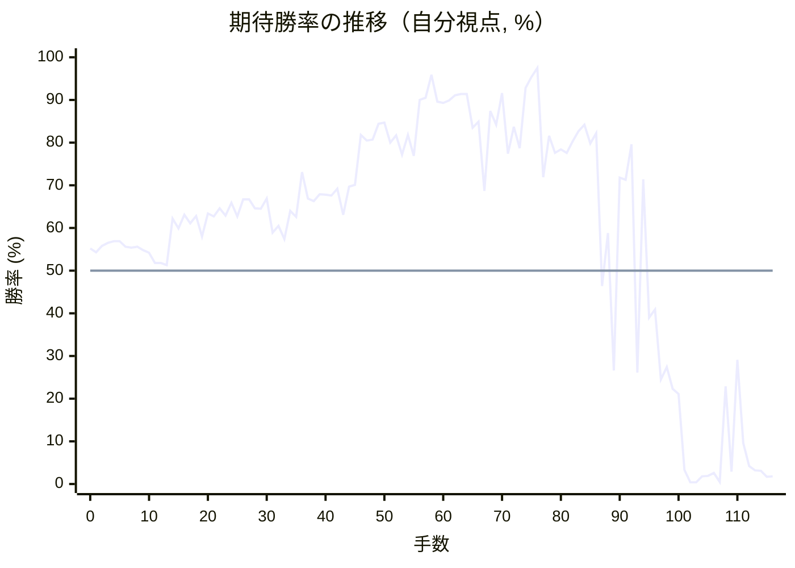

<details><summary>1手ごとの数値（第1パス）</summary>

| 手数 | 指し手 | 評価値 | 勝率 | 低下 | 判定 |
|--:|---|--:|--:|--:|---|
| 1 | ▲７六歩(77) | +104 | 54.3% | +0.9pt |  |
| 2 | △３四歩(33) | +141 | 55.8% |  |  |
| 3 | ▲２六歩(27) | +156 | 56.5% | -0.6pt |  |
| 4 | △４四歩(43) | +167 | 56.9% |  |  |
| 5 | ▲２五歩(26) | +167 | 56.9% | +0.0pt |  |
| 6 | △３三角(22) | +134 | 55.6% |  |  |
| 7 | ▲４八銀(39) | +130 | 55.4% | +0.2pt |  |
| 8 | △４二銀(31) | +136 | 55.6% |  |  |
| 9 | ▲６八玉(59) | +116 | 54.8% | +0.8pt |  |
| 10 | △４三銀(42) | +101 | 54.2% |  |  |
| 11 | ▲５六歩(57) | +43 | 51.8% | +2.4pt |  |
| 12 | △３二金(41) | +44 | 51.8% |  |  |
| 13 | ▲７八玉(68) | +32 | 51.3% | +0.5pt |  |
| 14 | △４二飛(82) | +300 | 62.2% |  |  |
| 15 | ▲５七銀(48) | +242 | 59.9% | +2.3pt |  |
| 16 | △６二玉(51) | +322 | 63.1% |  |  |
| 17 | ▲９六歩(97) | +270 | 61.1% | +2.0pt |  |
| 18 | △９四歩(93) | +313 | 62.8% |  |  |
| 19 | ▲８六歩(87) | +194 | 58.0% | +4.7pt |  |
| 20 | △７二玉(62) | +330 | 63.4% |  |  |
| 21 | ▲８七玉(78) | +312 | 62.7% | +0.7pt |  |
| 22 | △８二玉(72) | +361 | 64.6% |  |  |
| 23 | ▲７八銀(79) | +316 | 62.9% | +1.7pt |  |
| 24 | △７二銀(71) | +394 | 65.9% |  |  |
| 25 | ▲６六銀(57) | +312 | 62.7% | +3.1pt |  |
| 26 | △４五歩(44) | +418 | 66.7% |  |  |
| 27 | ▲７九角(88) | +417 | 66.7% | +0.0pt |  |
| 28 | △４四銀(43) | +360 | 64.6% |  |  |
| 29 | ▲１六歩(17) | +357 | 64.5% | +0.1pt |  |
| 30 | △３五銀(44) | +421 | 66.9% |  |  |
| 31 | ▲４八飛(28) | +215 | 58.9% | +8.0pt | [疑問手](#ply-31) |
| 32 | △１四歩(13) | +256 | 60.5% |  |  |
| 33 | ▲７七桂(89) | +180 | 57.4% | +3.1pt |  |
| 34 | △５二金(61) | +345 | 64.0% |  |  |
| 35 | ▲５七銀(66) | +310 | 62.6% | +1.4pt |  |
| 36 | △１五歩(14) | +600 | 73.1% |  |  |
| 37 | ▲同歩(16) | +422 | 66.9% | +6.2pt |  |
| 38 | △同香(11) | +407 | 66.3% |  |  |
| 39 | ▲同香(19) | +450 | 67.9% | -1.6pt |  |
| 40 | △同角(33) | +447 | 67.8% |  |  |
| 41 | ▲１八飛(48) | +442 | 67.6% | +0.2pt |  |
| 42 | △１四歩打 | +485 | 69.2% |  |  |
| 43 | ▲１二歩打 | +321 | 63.1% | +6.1pt |  |
| 44 | △２六銀(35) | +501 | 69.7% |  |  |
| 45 | ▲１一歩成(12) | +511 | 70.1% | -0.4pt |  |
| 46 | △２七銀成(26) | +903 | 81.8% |  |  |
| 47 | ▲１五飛(18) | +850 | 80.5% | +1.4pt |  |
| 48 | △同歩(14) | +857 | 80.7% |  |  |
| 49 | ▲２一と(11) | +1012 | 84.4% | -3.7pt |  |
| 50 | △１九飛打 | +1026 | 84.7% |  |  |
| 51 | ▲６六銀(57) | +830 | 80.0% | +4.7pt |  |
| 52 | △２九飛成(19) | +898 | 81.7% |  |  |
| 53 | ▲５八金(49) | +733 | 77.2% | +4.5pt |  |
| 54 | △３七成銀(27) | +900 | 81.8% |  |  |
| 55 | ▲５五角打 | +720 | 76.9% | +4.9pt |  |
| 56 | △６四香打 | +1318 | 90.0% |  |  |
| 57 | ▲４四香打 | +1354 | 90.5% | -0.5pt |  |
| 58 | △４三桂打 | +1888 | 95.9% |  |  |
| 59 | ▲同香成(44) | +1291 | 89.6% | +6.3pt | [疑問手](#ply-59) |
| 60 | △同金(32) | +1275 | 89.3% |  |  |
| 61 | ▲３七角(55) | +1310 | 89.9% | -0.5pt |  |
| 62 | △６六香(64) | +1392 | 91.1% |  |  |
| 63 | ▲７四桂打 | +1418 | 91.4% | -0.3pt |  |
| 64 | △７一玉(82) | +1417 | 91.4% |  |  |
| 65 | ▲８二銀打 | +971 | 83.5% | +7.9pt |  |
| 66 | △６一玉(71) | +1038 | 84.9% |  |  |
| 67 | ▲９一銀不成(82) | +472 | 68.7% | +16.2pt | [悪手](#ply-67) |
| 68 | △６七香成(66) | +1160 | 87.4% |  |  |
| 69 | ▲同金(58) | +1003 | 84.2% | +3.2pt |  |
| 70 | △６四香打 | +1431 | 91.6% |  |  |
| 71 | ▲６五香打 | +740 | 77.4% | +14.1pt |  |
| 72 | △７四歩(73) | +982 | 83.7% |  |  |
| 73 | ▲８二銀成(91) | +783 | 78.7% | +5.0pt | [疑問手](#ply-73) |
| 74 | △６五香(64) | +1538 | 92.8% |  |  |
| 75 | ▲同桂(77) | +1820 | 95.4% | -2.6pt |  |
| 76 | △６四香打 | +2190 | 97.5% |  |  |
| 77 | ▲７二成銀(82) | +565 | 71.9% | +25.5pt | [悪手](#ply-77) |
| 78 | △同玉(61) | +894 | 81.6% |  |  |
| 79 | ▲７三香打 | +745 | 77.6% | +4.0pt |  |
| 80 | △同桂(81) | +773 | 78.4% |  |  |
| 81 | ▲同桂成(65) | +746 | 77.6% | +0.8pt |  |
| 82 | △同玉(72) | +844 | 80.3% |  |  |
| 83 | ▲６五桂打 | +940 | 82.7% | -2.4pt |  |
| 84 | △６二玉(73) | +1004 | 84.2% |  |  |
| 85 | ▲７三銀打 | +824 | 79.8% | +4.4pt |  |
| 86 | △５一玉(62) | +918 | 82.2% |  |  |
| 87 | ▲６四銀成(73) | -87 | 46.4% | +35.8pt | [大悪手](#ply-87) |
| 88 | △同歩(63) | +213 | 58.8% |  |  |
| 89 | ▲同角(37) | -608 | 26.6% | +32.2pt | [大悪手](#ply-89) |
| 90 | △６三銀打 | +561 | 71.8% |  |  |
| 91 | ▲７三角成(64) | +545 | 71.3% | +0.5pt |  |
| 92 | △６二銀打 | +816 | 79.6% |  |  |
| 93 | ▲８三馬(73) | -624 | 26.1% | +53.5pt | [大悪手](#ply-93) |
| 94 | △６四銀打 | +548 | 71.4% |  |  |
| 95 | ▲６六歩打 | -268 | 39.0% | +32.4pt | [大悪手](#ply-95) |
| 96 | △８一香打 | -220 | 40.9% |  |  |
| 97 | ▲９四馬(83) | -674 | 24.5% | +16.4pt |  |
| 98 | △７五歩(74) | -585 | 27.4% |  |  |
| 99 | ▲１三角成(79) | -750 | 22.3% | +5.1pt | [悪手](#ply-99) |
| 100 | △７六歩(75) | -791 | 21.1% |  |  |
| 101 | ▲２三馬(13) | -2035 | 3.3% | +17.9pt | [疑問手](#ply-101) |
| 102 | △７五桂打 | -3268 | 0.4% |  |  |
| 103 | ▲７六玉(87) | -3371 | 0.4% | +0.1pt |  |
| 104 | △６七桂成(75) | -2398 | 1.8% |  |  |
| 105 | ▲同玉(76) | -2382 | 1.9% | -0.0pt |  |
| 106 | △７五桂打 | -2167 | 2.6% |  |  |
| 107 | ▲５七玉(67) | -3157 | 0.5% | +2.1pt |  |
| 108 | △８三金打 | -730 | 22.9% |  |  |
| 109 | ▲３一と(21) | -2110 | 2.9% | +20.0pt | [大悪手](#ply-109) |
| 110 | △６一玉(51) | -535 | 29.1% |  |  |
| 111 | ▲３二と(31) | -1344 | 9.6% | +19.5pt | [悪手](#ply-111) |
| 112 | △９四金(83) | -1874 | 4.2% |  |  |
| 113 | ▲４二と(32) | -2037 | 3.2% | +1.0pt |  |
| 114 | △同金(43) | -2060 | 3.1% |  |  |
| 115 | ▲７三桂打 | -2431 | 1.7% | +1.4pt |  |
| 116 | △同銀(62) | -2395 | 1.8% |  |  |

</details>

## 課題局面

<a id="ply-31"></a>
### 31手目 ▲４八飛(28) — 疑問手

| | 着手前 | 着手後 | 差 |
|---|--:|--:|--:|
| 期待勝率 | 67.2% | 60.4% | -6.8pt |
| 評価値 | +430 | +254 | |

着手前の局面:

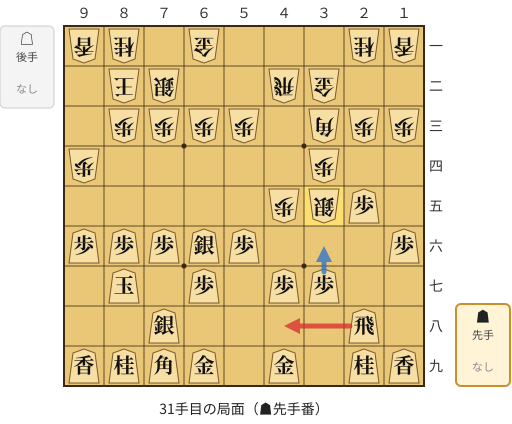

🔴 実戦 ▲４八飛(28)　🔵 AI推奨 ▲３六歩(37)　🟨 直前の相手の指し手

<details><summary>テキストの盤面図（BOD・将棋ソフトに貼り付け可）</summary>

```text
後手の持駒：なし
  ９ ８ ７ ６ ５ ４ ３ ２ １
+---------------------------+
|v香v桂 ・v金 ・ ・ ・v桂v香|一
| ・v玉v銀 ・ ・v飛v金 ・ ・|二
| ・v歩v歩v歩v歩 ・v角v歩v歩|三
|v歩 ・ ・ ・ ・ ・v歩 ・ ・|四
| ・ ・ ・ ・ ・v歩v銀 歩 ・|五
| 歩 歩 歩 銀 歩 ・ ・ ・ 歩|六
| ・ 玉 ・ 歩 ・ 歩 歩 ・ ・|七
| ・ ・ 銀 ・ ・ ・ ・ 飛 ・|八
| 香 桂 角 金 ・ 金 ・ 桂 香|九
+---------------------------+
先手の持駒：なし
手数＝30　△３五銀　まで
```

</details>

| | 指し手 | 評価値 | 読み筋 |
|---|---|--:|---|
| 実戦 | ▲４八飛(28) | +254 | △５四歩(53) ▲５八金(49) △４四角(33) ▲２八飛(48) △３三桂(21) ▲６八角(79) |
| AI 1位 | ▲３六歩(37) | +430 | ▲３六歩(37) △同銀(35) ▲５八金(49) △４六歩(45) ▲同歩(47) △４五歩打 |
| AI 2位 | ▲４八飛(28) | +213 | ▲４八飛(28) △６四歩(63) ▲５八金(49) △４三金(32) ▲２八飛(48) △４四金(43) |
| AI 3位 | ▲５八金(49) | +200 | ▲５八金(49) △４六歩(45) ▲同歩(47) △同銀(35) ▲４八飛(28) △４七歩打 |

SFEN: `ln1g3nl/1ks2rg2/1pppp1bpp/p5p2/5psP1/PPPSP3P/1K1P1PP2/2S4R1/LNBG1G1NL b - 31`

<a id="ply-59"></a>
### 59手目 ▲同香成(44) — 疑問手

| | 着手前 | 着手後 | 差 |
|---|--:|--:|--:|
| 期待勝率 | 97.2% | 91.7% | -5.5pt |
| 評価値 | +2137 | +1445 | |

着手前の局面:

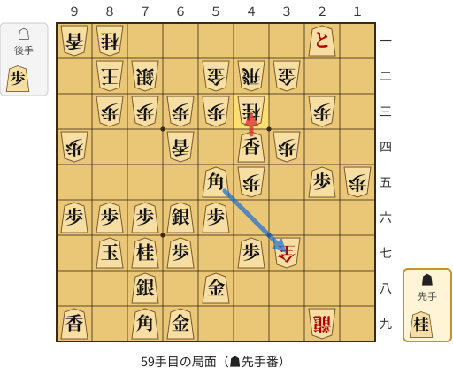

🔴 実戦 ▲同香成(44)　🔵 AI推奨 ▲３七角(55)　🟨 直前の相手の指し手

<details><summary>テキストの盤面図（BOD・将棋ソフトに貼り付け可）</summary>

```text
後手の持駒：歩
  ９ ８ ７ ６ ５ ４ ３ ２ １
+---------------------------+
|v香v桂 ・ ・ ・ ・ ・ と ・|一
| ・v玉v銀 ・v金v飛v金 ・ ・|二
| ・v歩v歩v歩v歩v桂 ・v歩 ・|三
|v歩 ・ ・v香 ・ 香v歩 ・ ・|四
| ・ ・ ・ ・ 角v歩 ・ 歩v歩|五
| 歩 歩 歩 銀 歩 ・ ・ ・ ・|六
| ・ 玉 桂 歩 ・ 歩v全 ・ ・|七
| ・ ・ 銀 ・ 金 ・ ・ ・ ・|八
| 香 ・ 角 金 ・ ・ ・v龍 ・|九
+---------------------------+
先手の持駒：桂
手数＝58　△４三桂　まで
```

</details>

| | 指し手 | 評価値 | 読み筋 |
|---|---|--:|---|
| 実戦 | ▲同香成(44) | +1445 | △同金(32) ▲３七角(55) △６六香(64) ▲同歩(67) △７四香打 ▲８九香打 |
| AI 1位 | ▲３七角(55) | +2137 | ▲３七角(55) △６六香(64) ▲同歩(67) △７一玉(82) ▲１五角(37) △８九銀打 |
| AI 2位 | ▲同香不成(44) | +1424 | ▲同香不成(44) △同金(32) ▲３七角(55) △３五香打 ▲５五角(37) △４四金(43) |
| AI 3位 | ▲同香成(44) | +1498 | ▲同香成(44) △同金(32) ▲３七角(55) △１六歩(15) ▲１三角成(79) △１七歩成(16) |

SFEN: `ln5+P1/1ks1grg2/1ppppn1p1/p2l1Lp2/4Bp1Pp/PPPSP4/1KNP1P+s2/2S1G4/L1BG3+r1 b Np 59`

<a id="ply-67"></a>
### 67手目 ▲９一銀不成(82) — 悪手

| | 着手前 | 着手後 | 差 |
|---|--:|--:|--:|
| 期待勝率 | 94.7% | 75.4% | -19.3pt |
| 評価値 | +1724 | +671 | |

着手前の局面:

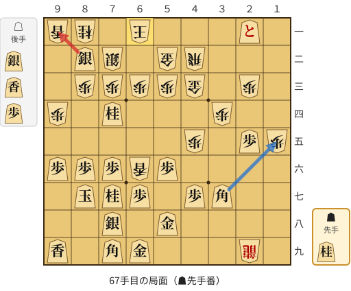

🔴 実戦 ▲９一銀不成(82)　🔵 AI推奨 ▲１五角(37)　🟨 直前の相手の指し手

<details><summary>テキストの盤面図（BOD・将棋ソフトに貼り付け可）</summary>

```text
後手の持駒：銀　香　歩
  ９ ８ ７ ６ ５ ４ ３ ２ １
+---------------------------+
|v香v桂 ・v玉 ・ ・ ・ と ・|一
| ・ 銀v銀 ・v金v飛 ・ ・ ・|二
| ・v歩v歩v歩v歩v金 ・v歩 ・|三
|v歩 ・ 桂 ・ ・ ・v歩 ・ ・|四
| ・ ・ ・ ・ ・v歩 ・ 歩v歩|五
| 歩 歩 歩v香 歩 ・ ・ ・ ・|六
| ・ 玉 桂 歩 ・ 歩 角 ・ ・|七
| ・ ・ 銀 ・ 金 ・ ・ ・ ・|八
| 香 ・ 角 金 ・ ・ ・v龍 ・|九
+---------------------------+
先手の持駒：桂
手数＝66　△６一玉　まで
```

</details>

| | 指し手 | 評価値 | 読み筋 |
|---|---|--:|---|
| 実戦 | ▲９一銀不成(82) | +671 | △７四歩(73) ▲８二銀成(91) △７五歩(74) ▲７四香打 △７三香打 ▲７二成銀(82) |
| AI 1位 | ▲１五角(37) | +1724 | ▲１五角(37) △７四歩(73) ▲４二角成(15) △同金(43) ▲６六歩(67) △７一銀打 |
| AI 2位 | ▲６六歩(67) | +1507 | ▲６六歩(67) △７四歩(73) ▲１五角(37) △１二飛(42) ▲１三歩打 △３二飛(12) |
| AI 3位 | ▲１三角成(79) | +1308 | ▲１三角成(79) △７四歩(73) ▲３一馬(13) △６四桂打 ▲６五桂(77) △７一銀打 |

SFEN: `ln1k3+P1/1Ss1gr3/1ppppg1p1/p1N3p2/5p1Pp/PPPlP4/1KNP1PB2/2S1G4/L1BG3+r1 b Nslp 67`

<a id="ply-73"></a>
### 73手目 ▲８二銀成(91) — 疑問手

| | 着手前 | 着手後 | 差 |
|---|--:|--:|--:|
| 期待勝率 | 93.8% | 86.7% | -7.1pt |
| 評価値 | +1635 | +1126 | |

着手前の局面:

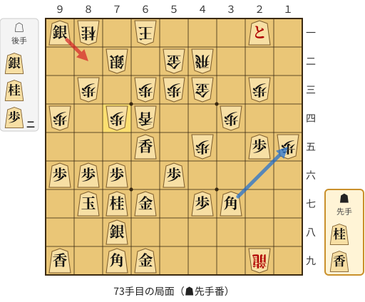

🔴 実戦 ▲８二銀成(91)　🔵 AI推奨 ▲１五角(37)　🟨 直前の相手の指し手

<details><summary>テキストの盤面図（BOD・将棋ソフトに貼り付け可）</summary>

```text
後手の持駒：銀　桂　歩二
  ９ ８ ７ ６ ５ ４ ３ ２ １
+---------------------------+
| 銀v桂 ・v玉 ・ ・ ・ と ・|一
| ・ ・v銀 ・v金v飛 ・ ・ ・|二
| ・v歩 ・v歩v歩v金 ・v歩 ・|三
|v歩 ・v歩v香 ・ ・v歩 ・ ・|四
| ・ ・ ・ 香 ・v歩 ・ 歩v歩|五
| 歩 歩 歩 ・ 歩 ・ ・ ・ ・|六
| ・ 玉 桂 金 ・ 歩 角 ・ ・|七
| ・ ・ 銀 ・ ・ ・ ・ ・ ・|八
| 香 ・ 角 金 ・ ・ ・v龍 ・|九
+---------------------------+
先手の持駒：桂　香
手数＝72　△７四歩　まで
```

</details>

| | 指し手 | 評価値 | 読み筋 |
|---|---|--:|---|
| 実戦 | ▲８二銀成(91) | +1126 | △５八銀打 ▲同金(69) △７九龍(29) ▲８八銀打 △４九龍(79) ▲４八金(58) |
| AI 1位 | ▲１五角(37) | +1635 | ▲１五角(37) △１二飛(42) ▲１三歩打 △３二飛(12) ▲５五桂打 △５八銀打 |
| AI 2位 | ▲５五桂打 | +1135 | ▲５五桂打 △７五歩(74) ▲８二銀成(91) △７六歩(75) ▲７二成銀(82) △同玉(61) |
| AI 3位 | ▲６四香(65) | +952 | ▲６四香(65) △５八銀打 ▲同金(69) △７九龍(29) ▲８八銀打 △４九龍(79) |

SFEN: `Sn1k3+P1/2s1gr3/1p1ppg1p1/p1pl2p2/3L1p1Pp/PPP1P4/1KNG1PB2/2S6/L1BG3+r1 b NLsn2p 73`

<a id="ply-77"></a>
### 77手目 ▲７二成銀(82) — 悪手

| | 着手前 | 着手後 | 差 |
|---|--:|--:|--:|
| 期待勝率 | 98.1% | 80.9% | -17.2pt |
| 評価値 | +2362 | +865 | |

着手前の局面:

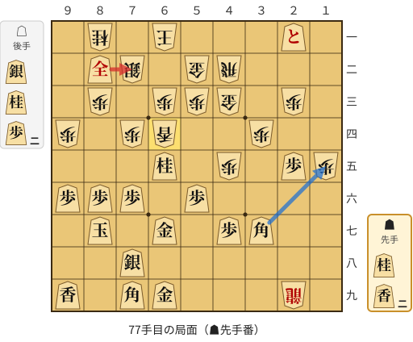

🔴 実戦 ▲７二成銀(82)　🔵 AI推奨 ▲１五角(37)　🟨 直前の相手の指し手

<details><summary>テキストの盤面図（BOD・将棋ソフトに貼り付け可）</summary>

```text
後手の持駒：銀　桂　歩二
  ９ ８ ７ ６ ５ ４ ３ ２ １
+---------------------------+
| ・v桂 ・v玉 ・ ・ ・ と ・|一
| ・ 全v銀 ・v金v飛 ・ ・ ・|二
| ・v歩 ・v歩v歩v金 ・v歩 ・|三
|v歩 ・v歩v香 ・ ・v歩 ・ ・|四
| ・ ・ ・ 桂 ・v歩 ・ 歩v歩|五
| 歩 歩 歩 ・ 歩 ・ ・ ・ ・|六
| ・ 玉 ・ 金 ・ 歩 角 ・ ・|七
| ・ ・ 銀 ・ ・ ・ ・ ・ ・|八
| 香 ・ 角 金 ・ ・ ・v龍 ・|九
+---------------------------+
先手の持駒：桂　香二
手数＝76　△６四香　まで
```

</details>

| | 指し手 | 評価値 | 読み筋 |
|---|---|--:|---|
| 実戦 | ▲７二成銀(82) | +865 | △同玉(61) ▲７三香打 △同桂(81) ▲同桂成(65) △同玉(72) ▲６五桂打 |
| AI 1位 | ▲１五角(37) | +2362 | ▲１五角(37) △３三桂打 ▲４四香打 △６五香(64) ▲３三角成(15) △４四金(43) |
| AI 2位 | ▲５五桂打 | +1635 | ▲５五桂打 △６五香(64) ▲１五角(37) △６二玉(61) ▲６六歩打 △７三銀打 |
| AI 3位 | ▲４四香打 | +1402 | ▲４四香打 △６五香(64) ▲４三香不成(44) △同金(52) ▲１五角(37) △６七香成(65) |

SFEN: `1n1k3+P1/1+Ss1gr3/1p1ppg1p1/p1pl2p2/3N1p1Pp/PPP1P4/1K1G1PB2/2S6/L1BG3+r1 b N2Lsn2p 77`

<a id="ply-87"></a>
### 87手目 ▲６四銀成(73) — 大悪手

| | 着手前 | 着手後 | 差 |
|---|--:|--:|--:|
| 期待勝率 | 85.2% | 62.4% | -22.8pt |
| 評価値 | +1048 | +304 | |

着手前の局面:

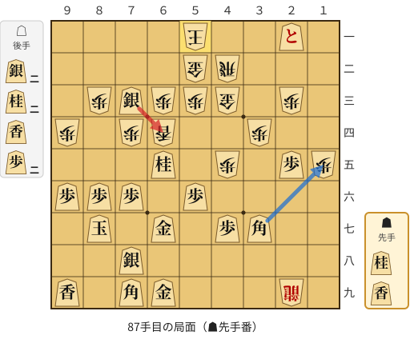

🔴 実戦 ▲６四銀成(73)　🔵 AI推奨 ▲１五角(37)　🟨 直前の相手の指し手

<details><summary>テキストの盤面図（BOD・将棋ソフトに貼り付け可）</summary>

```text
後手の持駒：銀二　桂二　香　歩二
  ９ ８ ７ ６ ５ ４ ３ ２ １
+---------------------------+
| ・ ・ ・ ・v玉 ・ ・ と ・|一
| ・ ・ ・ ・v金v飛 ・ ・ ・|二
| ・v歩 銀v歩v歩v金 ・v歩 ・|三
|v歩 ・v歩v香 ・ ・v歩 ・ ・|四
| ・ ・ ・ 桂 ・v歩 ・ 歩v歩|五
| 歩 歩 歩 ・ 歩 ・ ・ ・ ・|六
| ・ 玉 ・ 金 ・ 歩 角 ・ ・|七
| ・ ・ 銀 ・ ・ ・ ・ ・ ・|八
| 香 ・ 角 金 ・ ・ ・v龍 ・|九
+---------------------------+
先手の持駒：桂　香
手数＝86　△５一玉　まで
```

</details>

| | 指し手 | 評価値 | 読み筋 |
|---|---|--:|---|
| 実戦 | ▲６四銀成(73) | +304 | △同歩(63) ▲５五桂打 △５八銀打 ▲４三桂不成(55) △同飛(42) ▲５八金(69) |
| AI 1位 | ▲１五角(37) | +1048 | ▲１五角(37) △６五香(64) ▲６六歩打 △３三桂打 ▲５五桂打 △５八銀打 |
| AI 2位 | ▲５五桂打 | +517 | ▲５五桂打 △６五香(64) ▲４三桂成(55) △同金(52) ▲６六香打 △５八銀打 |
| AI 3位 | ▲６四銀成(73) | +263 | ▲６四銀成(73) △同歩(63) ▲５五桂打 △５八銀打 ▲４三桂成(55) △同飛(42) |

SFEN: `4k2+P1/4gr3/1pSppg1p1/p1pl2p2/3N1p1Pp/PPP1P4/1K1G1PB2/2S6/L1BG3+r1 b NL2s2nl2p 87`

<a id="ply-89"></a>
### 89手目 ▲同角(37) — 大悪手

| | 着手前 | 着手後 | 差 |
|---|--:|--:|--:|
| 期待勝率 | 60.4% | 19.9% | -40.5pt |
| 評価値 | +253 | -835 | |

着手前の局面:

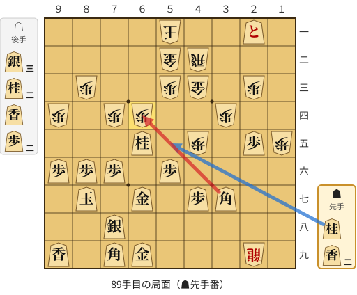

🔴 実戦 ▲同角(37)　🔵 AI推奨 ▲５五桂打　🟨 直前の相手の指し手

<details><summary>テキストの盤面図（BOD・将棋ソフトに貼り付け可）</summary>

```text
後手の持駒：銀三　桂二　香　歩二
  ９ ８ ７ ６ ５ ４ ３ ２ １
+---------------------------+
| ・ ・ ・ ・v玉 ・ ・ と ・|一
| ・ ・ ・ ・v金v飛 ・ ・ ・|二
| ・v歩 ・ ・v歩v金 ・v歩 ・|三
|v歩 ・v歩v歩 ・ ・v歩 ・ ・|四
| ・ ・ ・ 桂 ・v歩 ・ 歩v歩|五
| 歩 歩 歩 ・ 歩 ・ ・ ・ ・|六
| ・ 玉 ・ 金 ・ 歩 角 ・ ・|七
| ・ ・ 銀 ・ ・ ・ ・ ・ ・|八
| 香 ・ 角 金 ・ ・ ・v龍 ・|九
+---------------------------+
先手の持駒：桂　香二
手数＝88　△６四同歩　まで
```

</details>

| | 指し手 | 評価値 | 読み筋 |
|---|---|--:|---|
| 実戦 | ▲同角(37) | -835 | △６二香打 ▲７三角成(64) △８一桂打 ▲７四馬(73) △６三銀打 ▲７五馬(74) |
| AI 1位 | ▲５五桂打 | +253 | ▲５五桂打 △５八銀打 ▲同金(69) △７九龍(29) ▲４三桂不成(55) △同飛(42) |
| AI 2位 | ▲１五角(37) | -197 | ▲１五角(37) △６三桂打 ▲５七角(79) △７五桂打 ▲同歩(76) △同桂(63) |
| AI 3位 | ▲８八角(79) | -348 | ▲８八角(79) △６五歩(64) ▲６四桂打 △６三桂打 ▲５二桂成(64) △同玉(51) |

SFEN: `4k2+P1/4gr3/1p2pg1p1/p1pp2p2/3N1p1Pp/PPP1P4/1K1G1PB2/2S6/L1BG3+r1 b N2L3s2nl2p 89`

<a id="ply-93"></a>
### 93手目 ▲８三馬(73) — 大悪手

| | 着手前 | 着手後 | 差 |
|---|--:|--:|--:|
| 期待勝率 | 80.7% | 26.9% | -53.8pt |
| 評価値 | +860 | -600 | |

着手前の局面:

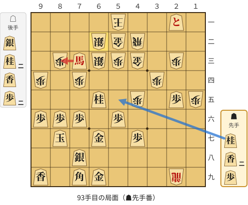

🔴 実戦 ▲８三馬(73)　🔵 AI推奨 ▲５五桂打　🟨 直前の相手の指し手

<details><summary>テキストの盤面図（BOD・将棋ソフトに貼り付け可）</summary>

```text
後手の持駒：銀　桂二　香　歩二
  ９ ８ ７ ６ ５ ４ ３ ２ １
+---------------------------+
| ・ ・ ・ ・v玉 ・ ・ と ・|一
| ・ ・ ・v銀v金v飛 ・ ・ ・|二
| ・v歩 馬v銀v歩v金 ・v歩 ・|三
|v歩 ・v歩 ・ ・ ・v歩 ・ ・|四
| ・ ・ ・ 桂 ・v歩 ・ 歩v歩|五
| 歩 歩 歩 ・ 歩 ・ ・ ・ ・|六
| ・ 玉 ・ 金 ・ 歩 ・ ・ ・|七
| ・ ・ 銀 ・ ・ ・ ・ ・ ・|八
| 香 ・ 角 金 ・ ・ ・v龍 ・|九
+---------------------------+
先手の持駒：桂　香二　歩
手数＝92　△６二銀　まで
```

</details>

| | 指し手 | 評価値 | 読み筋 |
|---|---|--:|---|
| 実戦 | ▲８三馬(73) | -600 | △８一香打 ▲８二香打 △７一桂打 ▲９三馬(83) △８二香(81) ▲６四歩打 |
| AI 1位 | ▲５五桂打 | +860 | ▲５五桂打 △６四香打 ▲６六香打 △５八銀打 ▲同金(69) △７九龍(29) |
| AI 2位 | ▲６四歩打 | +797 | ▲６四歩打 △同銀(63) ▲同馬(73) △６三香打 ▲７四馬(64) △６六歩打 |
| AI 3位 | ▲同馬(73) | +333 | ▲同馬(73) △同金(52) ▲５五桂打 △４九角打 ▲５九香打 △８四桂打 |

SFEN: `4k2+P1/3sgr3/1p+Bspg1p1/p1p3p2/3N1p1Pp/PPP1P4/1K1G1P3/2S6/L1BG3+r1 b N2LPs2nl2p 93`

<a id="ply-95"></a>
### 95手目 ▲６六歩打 — 大悪手

| | 着手前 | 着手後 | 差 |
|---|--:|--:|--:|
| 期待勝率 | 54.8% | 29.1% | -25.7pt |
| 評価値 | +115 | -534 | |

着手前の局面:

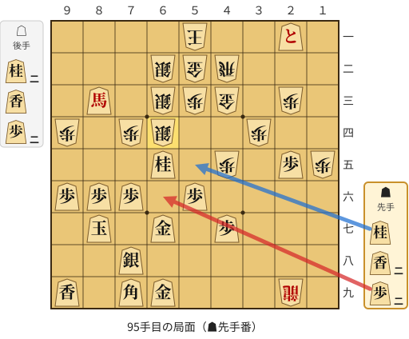

🔴 実戦 ▲６六歩打　🔵 AI推奨 ▲５五桂打　🟨 直前の相手の指し手

<details><summary>テキストの盤面図（BOD・将棋ソフトに貼り付け可）</summary>

```text
後手の持駒：桂二　香　歩二
  ９ ８ ７ ６ ５ ４ ３ ２ １
+---------------------------+
| ・ ・ ・ ・v玉 ・ ・ と ・|一
| ・ ・ ・v銀v金v飛 ・ ・ ・|二
| ・ 馬 ・v銀v歩v金 ・v歩 ・|三
|v歩 ・v歩v銀 ・ ・v歩 ・ ・|四
| ・ ・ ・ 桂 ・v歩 ・ 歩v歩|五
| 歩 歩 歩 ・ 歩 ・ ・ ・ ・|六
| ・ 玉 ・ 金 ・ 歩 ・ ・ ・|七
| ・ ・ 銀 ・ ・ ・ ・ ・ ・|八
| 香 ・ 角 金 ・ ・ ・v龍 ・|九
+---------------------------+
先手の持駒：桂　香二　歩二
手数＝94　△６四銀打　まで
```

</details>

| | 指し手 | 評価値 | 読み筋 |
|---|---|--:|---|
| 実戦 | ▲６六歩打 | -534 | △８一香打 ▲８二香打 △７一桂打 ▲９二馬(83) △８二香(81) ▲同馬(92) |
| AI 1位 | ▲５五桂打 | +115 | ▲５五桂打 △８一香打 ▲８二香打 △同香(81) ▲同馬(83) △８五歩打 |
| AI 2位 | ▲３一と(21) | -97 | ▲３一と(21) △８一香打 ▲８二香打 △７一桂打 ▲９三馬(83) △８二香(81) |
| AI 3位 | ▲１三角成(79) | -155 | ▲１三角成(79) △６五銀(64) ▲５五桂打 △８一香打 ▲８二香打 △同香(81) |

SFEN: `4k2+P1/3sgr3/1+B1spg1p1/p1ps2p2/3N1p1Pp/PPP1P4/1K1G1P3/2S6/L1BG3+r1 b N2L2P2nl2p 95`

<a id="ply-99"></a>
### 99手目 ▲１三角成(79) — 悪手

| | 着手前 | 着手後 | 差 |
|---|--:|--:|--:|
| 期待勝率 | 25.4% | 7.1% | -18.3pt |
| 評価値 | -645 | -1542 | |

着手前の局面:

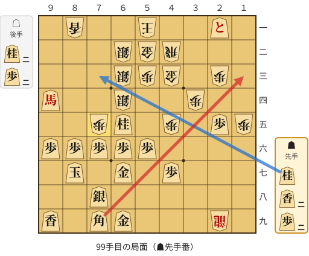

🔴 実戦 ▲１三角成(79)　🔵 AI推奨 ▲７三桂打　🟨 直前の相手の指し手

<details><summary>テキストの盤面図（BOD・将棋ソフトに貼り付け可）</summary>

```text
後手の持駒：桂二　歩二
  ９ ８ ７ ６ ５ ４ ３ ２ １
+---------------------------+
| ・v香 ・ ・v玉 ・ ・ と ・|一
| ・ ・ ・v銀v金v飛 ・ ・ ・|二
| ・ ・ ・v銀v歩v金 ・v歩 ・|三
| 馬 ・ ・v銀 ・ ・v歩 ・ ・|四
| ・ ・v歩 桂 ・v歩 ・ 歩v歩|五
| 歩 歩 歩 歩 歩 ・ ・ ・ ・|六
| ・ 玉 ・ 金 ・ 歩 ・ ・ ・|七
| ・ ・ 銀 ・ ・ ・ ・ ・ ・|八
| 香 ・ 角 金 ・ ・ ・v龍 ・|九
+---------------------------+
先手の持駒：桂　香二　歩二
手数＝98　△７五歩　まで
```

</details>

| | 指し手 | 評価値 | 読み筋 |
|---|---|--:|---|
| 実戦 | ▲１三角成(79) | -1542 | △７六歩(75) ▲同玉(87) △８四桂打 ▲７七玉(76) △７六歩打 ▲６八玉(77) |
| AI 1位 | ▲７三桂打 | -645 | ▲７三桂打 △同銀(62) ▲同桂成(65) △同銀(64) ▲３一銀打 △４一飛(42) |
| AI 2位 | ▲５五桂打 | -763 | ▲５五桂打 △７六歩(75) ▲４三桂不成(55) △同金(52) ▲７六金(67) △７五桂打 |
| AI 3位 | ▲９七玉(87) | -965 | ▲９七玉(87) △９三歩打 ▲９五馬(94) △７六歩(75) ▲５九香打 △７五桂打 |

SFEN: `1l2k2+P1/3sgr3/3spg1p1/+B2s2p2/2pN1p1Pp/PPPPP4/1K1G1P3/2S6/L1BG3+r1 b N2L2P2n2p 99`

<a id="ply-101"></a>
### 101手目 ▲２三馬(13) — 疑問手

| | 着手前 | 着手後 | 差 |
|---|--:|--:|--:|
| 期待勝率 | 6.7% | 0.2% | -6.5pt |
| 評価値 | -1585 | -3750 | |

着手前の局面:

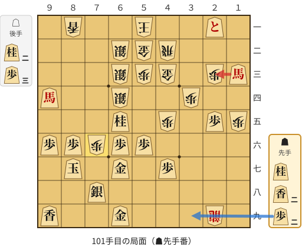

🔴 実戦 ▲２三馬(13)　🔵 AI推奨 ▲３九歩打　🟨 直前の相手の指し手

<details><summary>テキストの盤面図（BOD・将棋ソフトに貼り付け可）</summary>

```text
後手の持駒：桂二　歩三
  ９ ８ ７ ６ ５ ４ ３ ２ １
+---------------------------+
| ・v香 ・ ・v玉 ・ ・ と ・|一
| ・ ・ ・v銀v金v飛 ・ ・ ・|二
| ・ ・ ・v銀v歩v金 ・v歩 馬|三
| 馬 ・ ・v銀 ・ ・v歩 ・ ・|四
| ・ ・ ・ 桂 ・v歩 ・ 歩v歩|五
| 歩 歩v歩 歩 歩 ・ ・ ・ ・|六
| ・ 玉 ・ 金 ・ 歩 ・ ・ ・|七
| ・ ・ 銀 ・ ・ ・ ・ ・ ・|八
| 香 ・ ・ 金 ・ ・ ・v龍 ・|九
+---------------------------+
先手の持駒：桂　香二　歩二
手数＝100　△７六歩　まで
```

</details>

| | 指し手 | 評価値 | 読み筋 |
|---|---|--:|---|
| 実戦 | ▲２三馬(13) | -3750 | △７五桂打 ▲７六玉(87) △９三歩打 ▲３一と(21) △９四歩(93) ▲３二と(31) |
| AI 1位 | ▲３九歩打 | -1585 | ▲３九歩打 △７五桂打 ▲７六玉(87) △６七桂不成(75) ▲同玉(76) △９三歩打 |
| AI 2位 | ▲同玉(87) | -1680 | ▲同玉(87) △７五桂打 ▲５九桂打 △９三歩打 ▲同馬(94) △６七桂不成(75) |
| AI 3位 | ▲同金(67) | -1636 | ▲同金(67) △７五桂打 ▲７七玉(87) △９三歩打 ▲９五馬(94) △８四桂打 |

SFEN: `1l2k2+P1/3sgr3/3spg1p+B/+B2s2p2/3N1p1Pp/PPpPP4/1K1G1P3/2S6/L2G3+r1 b N2L2P2n3p 101`

<a id="ply-109"></a>
### 109手目 ▲３一と(21) — 大悪手

| | 着手前 | 着手後 | 差 |
|---|--:|--:|--:|
| 期待勝率 | 29.8% | 0.7% | -29.1pt |
| 評価値 | -513 | -2974 | |

着手前の局面:

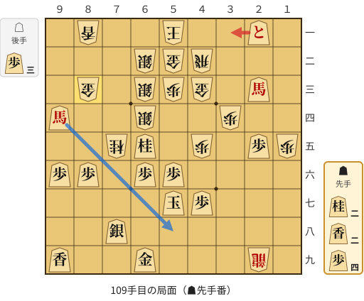

🔴 実戦 ▲３一と(21)　🔵 AI推奨 ▲５八馬(94)　🟨 直前の相手の指し手

<details><summary>テキストの盤面図（BOD・将棋ソフトに貼り付け可）</summary>

```text
後手の持駒：歩三
  ９ ８ ７ ６ ５ ４ ３ ２ １
+---------------------------+
| ・v香 ・ ・v玉 ・ ・ と ・|一
| ・ ・ ・v銀v金v飛 ・ ・ ・|二
| ・v金 ・v銀v歩v金 ・ 馬 ・|三
| 馬 ・ ・v銀 ・ ・v歩 ・ ・|四
| ・ ・v桂 桂 ・v歩 ・ 歩v歩|五
| 歩 歩 ・ 歩 歩 ・ ・ ・ ・|六
| ・ ・ ・ ・ 玉 歩 ・ ・ ・|七
| ・ ・ 銀 ・ ・ ・ ・ ・ ・|八
| 香 ・ ・ 金 ・ ・ ・v龍 ・|九
+---------------------------+
先手の持駒：桂二　香二　歩四
手数＝108　△８三金　まで
```

</details>

| | 指し手 | 評価値 | 読み筋 |
|---|---|--:|---|
| 実戦 | ▲３一と(21) | -2974 | △９四金(83) ▲３二と(31) △３五角打 ▲５八玉(57) △６五銀(64) ▲４二と(32) |
| AI 1位 | ▲５八馬(94) | -513 | ▲５八馬(94) △７七歩打 ▲同銀(78) △８七桂成(75) ▲３三歩打 △７七成桂(87) |
| AI 2位 | ▲５八馬(94) | -553 | ▲５八馬(94) △７七歩打 ▲同銀(78) △８七桂成(75) ▲２二と(21) △７七成桂(87) |
| AI 3位 | ▲３三歩打 | -2176 | ▲３三歩打 △９四金(83) ▲３二歩成(33) △３五角打 ▲４六桂打 △同歩(45) |

SFEN: `1l2k2+P1/3sgr3/1g1spg1+B1/+B2s2p2/2nN1p1Pp/PP1PP4/4KP3/2S6/L2G3+r1 b 2N2L4P3p 109`

<a id="ply-111"></a>
### 111手目 ▲３二と(31) — 悪手

| | 着手前 | 着手後 | 差 |
|---|--:|--:|--:|
| 期待勝率 | 18.9% | 1.9% | -17.0pt |
| 評価値 | -875 | -2367 | |

着手前の局面:

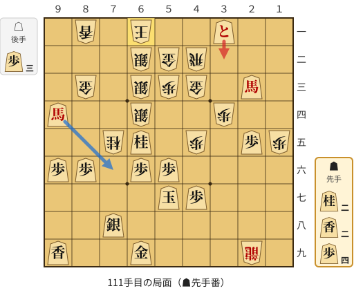

🔴 実戦 ▲３二と(31)　🔵 AI推奨 ▲７六馬(94)　🟨 直前の相手の指し手

<details><summary>テキストの盤面図（BOD・将棋ソフトに貼り付け可）</summary>

```text
後手の持駒：歩三
  ９ ８ ７ ６ ５ ４ ３ ２ １
+---------------------------+
| ・v香 ・v玉 ・ ・ と ・ ・|一
| ・ ・ ・v銀v金v飛 ・ ・ ・|二
| ・v金 ・v銀v歩v金 ・ 馬 ・|三
| 馬 ・ ・v銀 ・ ・v歩 ・ ・|四
| ・ ・v桂 桂 ・v歩 ・ 歩v歩|五
| 歩 歩 ・ 歩 歩 ・ ・ ・ ・|六
| ・ ・ ・ ・ 玉 歩 ・ ・ ・|七
| ・ ・ 銀 ・ ・ ・ ・ ・ ・|八
| 香 ・ ・ 金 ・ ・ ・v龍 ・|九
+---------------------------+
先手の持駒：桂二　香二　歩四
手数＝110　△６一玉　まで
```

</details>

| | 指し手 | 評価値 | 読み筋 |
|---|---|--:|---|
| 実戦 | ▲３二と(31) | -2367 | △９四金(83) ▲４二と(32) △同金(43) ▲３一飛打 △５一銀(62) ▲７三桂打 |
| AI 1位 | ▲７六馬(94) | -875 | ▲７六馬(94) △２五龍(29) ▲３二馬(23) △７七歩打 ▲同銀(78) △３二飛(42) |
| AI 2位 | ▲５八馬(94) | -857 | ▲５八馬(94) △７七歩打 ▲同銀(78) △２五龍(29) ▲２四歩打 △２二歩打 |
| AI 3位 | ▲７三桂打 | -1546 | ▲７三桂打 △同銀(62) ▲同桂不成(65) △同銀(64) ▲５八馬(94) △７七歩打 |

SFEN: `1l1k2+P2/3sgr3/1g1spg1+B1/+B2s2p2/2nN1p1Pp/PP1PP4/4KP3/2S6/L2G3+r1 b 2N2L4P3p 111`

