# 解析レポート bsxpb4pn004t

[README に戻る](../../../README.md)　/　棋譜: [CSA](../../../data/csa/shogi5/bsxpb4pn004t.csa)　/　解析の見方: [docs/mistake_analysis.md](../../../docs/mistake_analysis.md)

## 対局情報

| 項目 | 内容 |
|---|---|
| 日時 | 2026-11-11 07:55:59 |
| 持ち時間 | 5分 |
| 自分 | 後手（△）（1665） |
| 相手 | 相手（1494） |
| 結果 | 負け（時間切れ, 87手） |

## 解析環境

| 項目 | 内容 |
|---|---|
| エンジン | YaneuraOu NNUE 9.00git 64AVX2（V9.00/YANEURAOU_ENGINE_NNUE/AVX2） |
| 評価関数 | **水匠5**（`suisho5`） |
| nn.bin SHA-256 | `768068f0d534a0603a5d38bcd143de6bbca820d5f1c95a14d40863e5b7892d76` |
| 第1パス | movetime=150ms, MultiPV 1 |
| 第2パス | movetime=2000ms, MultiPV 3 |
| Threads / Hash | 8 / 512MB |
| 判定基準 | 疑問手 ≥5pt, 悪手 ≥10pt, 大悪手 ≥20pt（期待勝率 W(E)=1/(1+exp(-E/600))） |
| 解析日時 | 2026-11-14T10:37:38+09:00（解析バージョン 1, 85秒） |

## サマリー

| 自分の手数 | 深掘りした手 | 詰み逃し | 大悪手 | 悪手 | 疑問手 |
|--:|--:|--:|--:|--:|--:|
| 43 | 18 | 0 | 3 | 4 | 6 |

## 期待勝率の推移

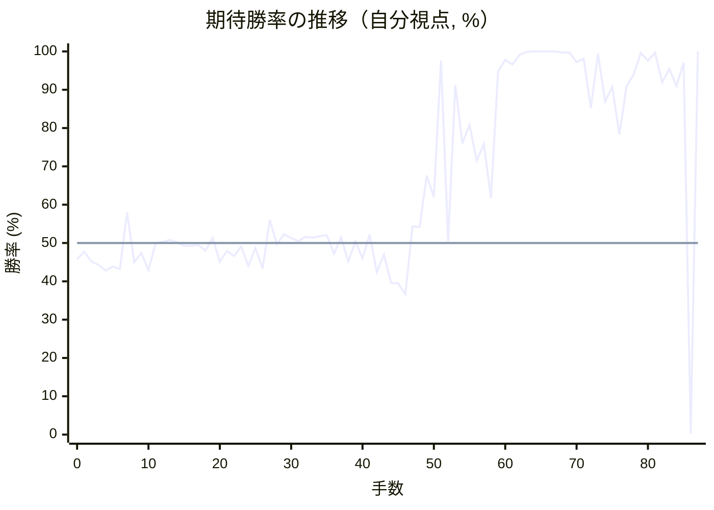

<details><summary>1手ごとの数値（第1パス）</summary>

| 手数 | 指し手 | 評価値 | 勝率 | 低下 | 判定 |
|--:|---|--:|--:|--:|---|
| 1 | ▲７六歩(77) | -55 | 47.7% |  |  |
| 2 | △３四歩(33) | -116 | 45.2% | +2.5pt |  |
| 3 | ▲２六歩(27) | -137 | 44.3% |  |  |
| 4 | △８四歩(83) | -175 | 42.8% | +1.6pt |  |
| 5 | ▲７八金(69) | -146 | 43.9% |  |  |
| 6 | △８五歩(84) | -164 | 43.2% | +0.7pt |  |
| 7 | ▲７七角(88) | +194 | 58.0% |  |  |
| 8 | △３二金(41) | -120 | 45.0% | +13.0pt | [疑問手](#ply-8) |
| 9 | ▲６八銀(79) | -62 | 47.4% |  |  |
| 10 | △６二銀(71) | -171 | 42.9% | +4.5pt |  |
| 11 | ▲６六歩(67) | -3 | 49.9% |  |  |
| 12 | △６四歩(63) | +7 | 50.3% | -0.4pt |  |
| 13 | ▲５八金(49) | +20 | 50.8% |  |  |
| 14 | △６三銀(62) | +5 | 50.2% | +0.6pt |  |
| 15 | ▲４八銀(39) | -18 | 49.3% |  |  |
| 16 | △５四銀(63) | -18 | 49.3% | +0.0pt |  |
| 17 | ▲６七銀(68) | -11 | 49.5% |  |  |
| 18 | △９四歩(93) | -48 | 48.0% | +1.5pt |  |
| 19 | ▲５六歩(57) | +32 | 51.3% |  |  |
| 20 | △７四歩(73) | -117 | 45.1% | +6.2pt |  |
| 21 | ▲５七銀(48) | -50 | 47.9% |  |  |
| 22 | △７三桂(81) | -81 | 46.6% | +1.3pt |  |
| 23 | ▲６九玉(59) | -22 | 49.1% |  |  |
| 24 | △６二金(61) | -144 | 44.0% | +5.1pt | [疑問手](#ply-24) |
| 25 | ▲３六歩(37) | -31 | 48.7% |  |  |
| 26 | △８一飛(82) | -161 | 43.3% | +5.4pt | [疑問手](#ply-26) |
| 27 | ▲５九角(77) | +145 | 56.0% |  |  |
| 28 | △５二玉(51) | -8 | 49.7% | +6.3pt |  |
| 29 | ▲７七桂(89) | +56 | 52.3% |  |  |
| 30 | △８六歩(85) | +31 | 51.3% | +1.0pt |  |
| 31 | ▲同歩(87) | +13 | 50.5% |  |  |
| 32 | △同飛(81) | +38 | 51.6% | -1.0pt |  |
| 33 | ▲８七歩打 | +33 | 51.4% |  |  |
| 34 | △８一飛(86) | +44 | 51.8% | -0.5pt |  |
| 35 | ▲２五歩(26) | +47 | 52.0% |  |  |
| 36 | △３三角(22) | -67 | 47.2% | +4.7pt |  |
| 37 | ▲１六歩(17) | +37 | 51.5% |  |  |
| 38 | △２二銀(31) | -116 | 45.2% | +6.4pt | [悪手](#ply-38) |
| 39 | ▲２六角(59) | +10 | 50.4% |  |  |
| 40 | △９五歩(94) | -95 | 46.0% | +4.4pt |  |
| 41 | ▲４六歩(47) | +54 | 52.2% |  |  |
| 42 | △６五歩(64) | -184 | 42.4% | +9.9pt | [疑問手](#ply-42) |
| 43 | ▲３七桂(29) | -71 | 47.0% |  |  |
| 44 | △６六歩(65) | -254 | 39.6% | +7.5pt | [悪手](#ply-44) |
| 45 | ▲同銀(57) | -257 | 39.5% |  |  |
| 46 | △６五歩打 | -330 | 36.6% | +2.9pt |  |
| 47 | ▲５七銀(66) | +104 | 54.3% |  |  |
| 48 | △８五桂(73) | +102 | 54.2% | +0.1pt |  |
| 49 | ▲５五歩(56) | +442 | 67.6% |  |  |
| 50 | △同角(33) | +295 | 62.0% | +5.6pt | [疑問手](#ply-50) |
| 51 | ▲５六銀(67) | +2211 | 97.6% |  |  |
| 52 | △３三角(55) | +10 | 50.4% | +47.1pt | [大悪手](#ply-52) |
| 53 | ▲４五桂(37) | +1401 | 91.2% |  |  |
| 54 | △同銀(54) | +691 | 76.0% | +15.2pt | [悪手](#ply-54) |
| 55 | ▲６五桂(77) | +862 | 80.8% |  |  |
| 56 | △５六銀(45) | +551 | 71.5% | +9.3pt |  |
| 57 | ▲同銀(57) | +686 | 75.8% |  |  |
| 58 | △７七桂成(85) | +287 | 61.7% | +14.1pt | [悪手](#ply-58) |
| 59 | ▲６四銀打 | +1746 | 94.8% |  |  |
| 60 | △７八成桂(77) | +2265 | 97.8% | -2.9pt |  |
| 61 | ▲同玉(69) | +2017 | 96.6% |  |  |
| 62 | △６六桂打 | +2842 | 99.1% | -2.5pt |  |
| 63 | ▲６七玉(78) | +4342 | 99.9% |  |  |
| 64 | △８七飛成(81) | +6040 | 100.0% | -0.1pt |  |
| 65 | ▲６八玉(67) | +5711 | 100.0% |  |  |
| 66 | △５八桂成(66) | +4566 | 100.0% | +0.0pt |  |
| 67 | ▲同玉(68) | +4700 | 100.0% |  |  |
| 68 | △５七金打 | +3456 | 99.7% | +0.3pt |  |
| 69 | ▲４九玉(58) | +3506 | 99.7% |  |  |
| 70 | △８九龍(87) | +2133 | 97.2% | +2.5pt |  |
| 71 | ▲５九歩打 | +2367 | 98.1% |  |  |
| 72 | △４四銀打 | +1048 | 85.2% | +12.9pt | [大悪手](#ply-72) |
| 73 | ▲４五銀(56) | +3025 | 99.4% |  |  |
| 74 | △４七金(57) | +1138 | 87.0% | +12.4pt | [疑問手](#ply-74) |
| 75 | ▲６三歩打 | +1365 | 90.7% |  |  |
| 76 | △同金(62) | +770 | 78.3% | +12.4pt |  |
| 77 | ▲同銀成(64) | +1383 | 90.9% |  |  |
| 78 | △同玉(52) | +1655 | 94.0% | -3.1pt |  |
| 79 | ▲４四銀(45) | +3375 | 99.6% |  |  |
| 80 | △同角(33) | +2225 | 97.6% | +2.0pt |  |
| 81 | ▲同角(26) | +3406 | 99.7% |  |  |
| 82 | △５八銀打 | +1457 | 91.9% | +7.8pt |  |
| 83 | ▲同飛(28) | +1813 | 95.4% |  |  |
| 84 | △同金(47) | +1388 | 91.0% | +4.4pt |  |
| 85 | ▲同玉(49) | +2105 | 97.1% |  |  |
| 86 | △５四飛打 | -3705 | 0.2% | +96.9pt | [大悪手](#ply-86) |
| 87 | ▲５七桂打 | #+9 | 100.0% |  |  |

</details>

## 課題局面

<a id="ply-8"></a>
### 8手目 △３二金(41) — 疑問手

| | 着手前 | 着手後 | 差 |
|---|--:|--:|--:|
| 期待勝率 | 56.8% | 47.8% | -9.0pt |
| 評価値 | +164 | -54 | |

着手前の局面:

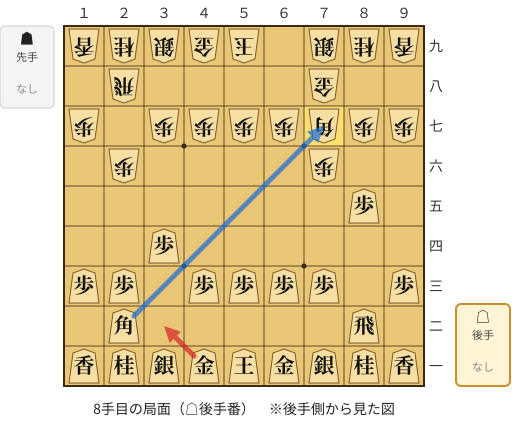

🔴 実戦 △３二金(41)　🔵 AI推奨 △同角成(22)　🟨 直前の相手の指し手

<details><summary>テキストの盤面図（BOD・将棋ソフトに貼り付け可）</summary>

```text
後手の持駒：なし
  ９ ８ ７ ６ ５ ４ ３ ２ １
+---------------------------+
|v香v桂v銀v金v玉v金v銀v桂v香|一
| ・v飛 ・ ・ ・ ・ ・v角 ・|二
|v歩 ・v歩v歩v歩v歩 ・v歩v歩|三
| ・ ・ ・ ・ ・ ・v歩 ・ ・|四
| ・v歩 ・ ・ ・ ・ ・ ・ ・|五
| ・ ・ 歩 ・ ・ ・ ・ 歩 ・|六
| 歩 歩 角 歩 歩 歩 歩 ・ 歩|七
| ・ ・ 金 ・ ・ ・ ・ 飛 ・|八
| 香 桂 銀 ・ 玉 金 銀 桂 香|九
+---------------------------+
先手の持駒：なし
後手番
手数＝7　▲７七角　まで
```

</details>

| | 指し手 | 評価値 | 読み筋 |
|---|---|--:|---|
| 実戦 | △３二金(41) | -54 | ▲６八銀(79) △４四歩(43) ▲３八銀(39) △４二銀(31) ▲４六歩(47) △６二銀(71) |
| AI 1位 | △同角成(22) | +164 | △同角成(22) ▲同金(78) △４二銀(31) ▲３六歩(37) △３三銀(42) ▲３八銀(39) |
| AI 2位 | △７二銀(71) | -85 | △７二銀(71) ▲６八銀(79) △７七角成(22) ▲同銀(68) △２二銀(31) ▲３八銀(39) |
| AI 3位 | △３二金(41) | -111 | △３二金(41) ▲６八銀(79) △７七角成(22) ▲同銀(68) △２二銀(31) ▲６八玉(59) |

SFEN: `lnsgkgsnl/1r5b1/p1pppp1pp/6p2/1p7/2P4P1/PPBPPPP1P/2G4R1/LNS1KGSNL w - 8`

<a id="ply-24"></a>
### 24手目 △６二金(61) — 疑問手

| | 着手前 | 着手後 | 差 |
|---|--:|--:|--:|
| 期待勝率 | 48.7% | 42.6% | -6.2pt |
| 評価値 | -31 | -180 | |

着手前の局面:

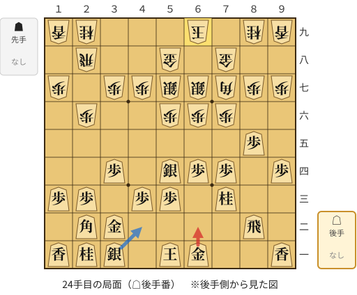

🔴 実戦 △６二金(61)　🔵 AI推奨 △４二銀(31)　🟨 直前の相手の指し手

<details><summary>テキストの盤面図（BOD・将棋ソフトに貼り付け可）</summary>

```text
後手の持駒：なし
  ９ ８ ７ ６ ５ ４ ３ ２ １
+---------------------------+
|v香 ・ ・v金v玉 ・v銀v桂v香|一
| ・v飛 ・ ・ ・ ・v金v角 ・|二
| ・ ・v桂 ・v歩v歩 ・v歩v歩|三
|v歩 ・v歩v歩v銀 ・v歩 ・ ・|四
| ・v歩 ・ ・ ・ ・ ・ ・ ・|五
| ・ ・ 歩 歩 歩 ・ ・ 歩 ・|六
| 歩 歩 角 銀 銀 歩 歩 ・ 歩|七
| ・ ・ 金 ・ 金 ・ ・ 飛 ・|八
| 香 桂 ・ 玉 ・ ・ ・ 桂 香|九
+---------------------------+
先手の持駒：なし
後手番
手数＝23　▲６九玉　まで
```

</details>

| | 指し手 | 評価値 | 読み筋 |
|---|---|--:|---|
| 実戦 | △６二金(61) | -180 | ▲４六銀(57) △４二銀(31) ▲２五歩(26) △４四歩(43) ▲５五歩(56) △４三銀(54) |
| AI 1位 | △４二銀(31) | -31 | △４二銀(31) ▲２五歩(26) △４一玉(51) ▲３六歩(37) △６五歩(64) ▲７九玉(69) |
| AI 2位 | △４一玉(51) | -35 | △４一玉(51) ▲２五歩(26) △４二銀(31) ▲４六銀(57) △８六歩(85) ▲同歩(87) |
| AI 3位 | △５二金(61) | -77 | △５二金(61) ▲２五歩(26) △４一玉(51) ▲３六歩(37) △４二銀(31) ▲３七桂(29) |

SFEN: `l2gk1snl/1r4gb1/2n1pp1pp/p1pps1p2/1p7/2PPP2P1/PPBSSPP1P/2G1G2R1/LN1K3NL w - 24`

<a id="ply-26"></a>
### 26手目 △８一飛(82) — 疑問手

| | 着手前 | 着手後 | 差 |
|---|--:|--:|--:|
| 期待勝率 | 48.0% | 42.1% | -5.9pt |
| 評価値 | -47 | -191 | |

着手前の局面:

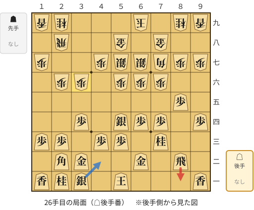

🔴 実戦 △８一飛(82)　🔵 AI推奨 △４二銀(31)　🟨 直前の相手の指し手

<details><summary>テキストの盤面図（BOD・将棋ソフトに貼り付け可）</summary>

```text
後手の持駒：なし
  ９ ８ ７ ６ ５ ４ ３ ２ １
+---------------------------+
|v香 ・ ・ ・v玉 ・v銀v桂v香|一
| ・v飛 ・v金 ・ ・v金v角 ・|二
| ・ ・v桂 ・v歩v歩 ・v歩v歩|三
|v歩 ・v歩v歩v銀 ・v歩 ・ ・|四
| ・v歩 ・ ・ ・ ・ ・ ・ ・|五
| ・ ・ 歩 歩 歩 ・ 歩 歩 ・|六
| 歩 歩 角 銀 銀 歩 ・ ・ 歩|七
| ・ ・ 金 ・ 金 ・ ・ 飛 ・|八
| 香 桂 ・ 玉 ・ ・ ・ 桂 香|九
+---------------------------+
先手の持駒：なし
後手番
手数＝25　▲３六歩　まで
```

</details>

| | 指し手 | 評価値 | 読み筋 |
|---|---|--:|---|
| 実戦 | △８一飛(82) | -191 | ▲４六銀(57) △４一玉(51) ▲２五歩(26) △６五歩(64) ▲同歩(66) △７七角成(22) |
| AI 1位 | △４二銀(31) | -47 | △４二銀(31) ▲４六銀(57) △６五歩(64) ▲同歩(66) △７七角成(22) ▲同桂(89) |
| AI 2位 | △４一玉(51) | -22 | △４一玉(51) ▲４六銀(57) △４二銀(31) ▲３五歩(36) △６五歩(64) ▲３四歩(35) |
| AI 3位 | △６五歩(64) | -56 | △６五歩(64) ▲２五歩(26) △４二銀(31) ▲３七桂(29) △４一玉(51) ▲２四歩(25) |

SFEN: `l3k1snl/1r1g2gb1/2n1pp1pp/p1pps1p2/1p7/2PPP1PP1/PPBSSP2P/2G1G2R1/LN1K3NL w - 26`

<a id="ply-38"></a>
### 38手目 △２二銀(31) — 悪手

| | 着手前 | 着手後 | 差 |
|---|--:|--:|--:|
| 期待勝率 | 55.1% | 44.6% | -10.6pt |
| 評価値 | +124 | -131 | |

着手前の局面:

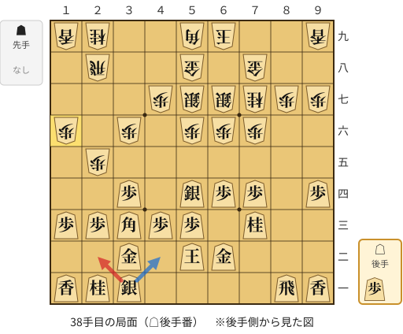

🔴 実戦 △２二銀(31)　🔵 AI推奨 △４二銀(31)　🟨 直前の相手の指し手

<details><summary>テキストの盤面図（BOD・将棋ソフトに貼り付け可）</summary>

```text
後手の持駒：歩
  ９ ８ ７ ６ ５ ４ ３ ２ １
+---------------------------+
|v香v飛 ・ ・ ・ ・v銀v桂v香|一
| ・ ・ ・v金v玉 ・v金 ・ ・|二
| ・ ・v桂 ・v歩v歩v角v歩v歩|三
|v歩 ・v歩v歩v銀 ・v歩 ・ ・|四
| ・ ・ ・ ・ ・ ・ ・ 歩 ・|五
| ・ ・ 歩 歩 歩 ・ 歩 ・ 歩|六
| 歩 歩 桂 銀 銀 歩 ・ ・ ・|七
| ・ ・ 金 ・ 金 ・ ・ 飛 ・|八
| 香 ・ ・ 玉 角 ・ ・ 桂 香|九
+---------------------------+
先手の持駒：なし
後手番
手数＝37　▲１六歩　まで
```

</details>

| | 指し手 | 評価値 | 読み筋 |
|---|---|--:|---|
| 実戦 | △２二銀(31) | -131 | ▲３七角(59) △６五歩(64) ▲４六角(37) △４五銀(54) ▲６四角(46) △６六歩(65) |
| AI 1位 | △４二銀(31) | +124 | △４二銀(31) ▲３七角(59) △６五歩(64) ▲４六角(37) △６六歩(65) ▲同銀(57) |
| AI 2位 | △６五歩(64) | +70 | △６五歩(64) ▲３七角(59) △４二銀(31) ▲４六角(37) △６六歩(65) ▲同銀(57) |
| AI 3位 | △１四歩(13) | -2 | △１四歩(13) ▲３七角(59) △６五歩(64) ▲４六角(37) △６六歩(65) ▲同銀(57) |

SFEN: `lr4snl/3gk1g2/2n1ppbpp/p1pps1p2/7P1/2PPP1P1P/PPNSSP3/2G1G2R1/L2KB2NL w p 38`

<a id="ply-42"></a>
### 42手目 △６五歩(64) — 疑問手

| | 着手前 | 着手後 | 差 |
|---|--:|--:|--:|
| 期待勝率 | 53.1% | 43.9% | -9.2pt |
| 評価値 | +75 | -147 | |

着手前の局面:

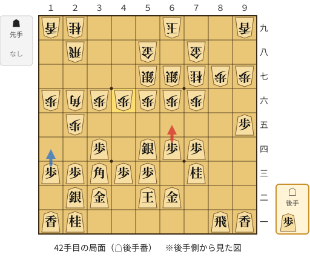

🔴 実戦 △６五歩(64)　🔵 AI推奨 △１四歩(13)　🟨 直前の相手の指し手

<details><summary>テキストの盤面図（BOD・将棋ソフトに貼り付け可）</summary>

```text
後手の持駒：歩
  ９ ８ ７ ６ ５ ４ ３ ２ １
+---------------------------+
|v香v飛 ・ ・ ・ ・ ・v桂v香|一
| ・ ・ ・v金v玉 ・v金v銀 ・|二
| ・ ・v桂 ・v歩v歩v角v歩v歩|三
| ・ ・v歩v歩v銀 ・v歩 ・ ・|四
|v歩 ・ ・ ・ ・ ・ ・ 歩 ・|五
| ・ ・ 歩 歩 歩 歩 歩 角 歩|六
| 歩 歩 桂 銀 銀 ・ ・ ・ ・|七
| ・ ・ 金 ・ 金 ・ ・ 飛 ・|八
| 香 ・ ・ 玉 ・ ・ ・ 桂 香|九
+---------------------------+
先手の持駒：なし
後手番
手数＝41　▲４六歩　まで
```

</details>

| | 指し手 | 評価値 | 読み筋 |
|---|---|--:|---|
| 実戦 | △６五歩(64) | -147 | ▲同歩(66) △同桂(73) ▲同桂(77) △同銀(54) ▲６六歩打 △５四銀(65) |
| AI 1位 | △１四歩(13) | +75 | △１四歩(13) ▲３七桂(29) △４四角(33) ▲同角(26) △同歩(43) ▲２四歩(25) |
| AI 2位 | △４四角(33) | +52 | △４四角(33) ▲同角(26) △同歩(43) ▲２四歩(25) △同歩(23) ▲同飛(28) |
| AI 3位 | △３一銀(22) | +2 | △３一銀(22) ▲４五歩(46) △同銀(54) ▲４七金(58) △５四銀(45) ▲３七角(26) |

SFEN: `lr5nl/3gk1gs1/2n1ppbpp/2pps1p2/p6P1/2PPPPPBP/PPNSS4/2G1G2R1/L2K3NL w p 42`

<a id="ply-44"></a>
### 44手目 △６六歩(65) — 悪手

| | 着手前 | 着手後 | 差 |
|---|--:|--:|--:|
| 期待勝率 | 47.8% | 37.8% | -10.1pt |
| 評価値 | -52 | -300 | |

着手前の局面:

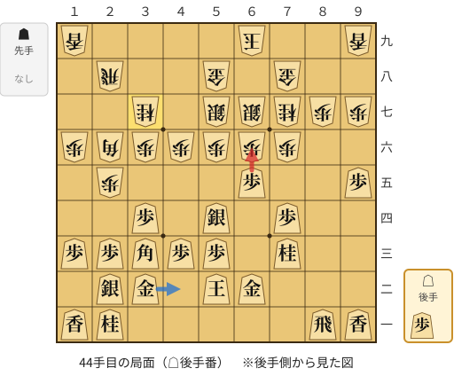

🔴 実戦 △６六歩(65)　🔵 AI推奨 △４二金(32)　🟨 直前の相手の指し手

<details><summary>テキストの盤面図（BOD・将棋ソフトに貼り付け可）</summary>

```text
後手の持駒：歩
  ９ ８ ７ ６ ５ ４ ３ ２ １
+---------------------------+
|v香v飛 ・ ・ ・ ・ ・v桂v香|一
| ・ ・ ・v金v玉 ・v金v銀 ・|二
| ・ ・v桂 ・v歩v歩v角v歩v歩|三
| ・ ・v歩 ・v銀 ・v歩 ・ ・|四
|v歩 ・ ・v歩 ・ ・ ・ 歩 ・|五
| ・ ・ 歩 歩 歩 歩 歩 角 歩|六
| 歩 歩 桂 銀 銀 ・ 桂 ・ ・|七
| ・ ・ 金 ・ 金 ・ ・ 飛 ・|八
| 香 ・ ・ 玉 ・ ・ ・ ・ 香|九
+---------------------------+
先手の持駒：なし
後手番
手数＝43　▲３七桂　まで
```

</details>

| | 指し手 | 評価値 | 読み筋 |
|---|---|--:|---|
| 実戦 | △６六歩(65) | -300 | ▲同銀(67) △６四歩打 ▲５五歩(56) △６三銀(54) ▲４五桂(37) △４四角(33) |
| AI 1位 | △４二金(32) | -52 | △４二金(32) ▲６八玉(69) △６六歩(65) ▲同銀(67) △６四歩打 ▲６七金(58) |
| AI 2位 | △１四歩(13) | -176 | △１四歩(13) ▲６五歩(66) △同桂(73) ▲同桂(77) △同銀(54) ▲６六歩打 |
| AI 3位 | △４二玉(52) | -197 | △４二玉(52) ▲６八玉(69) △３一玉(42) ▲６五歩(66) △４四角(33) ▲６四歩(65) |

SFEN: `lr5nl/3gk1gs1/2n1ppbpp/2p1s1p2/p2p3P1/2PPPPPBP/PPNSS1N2/2G1G2R1/L2K4L w p 44`

<a id="ply-50"></a>
### 50手目 △同角(33) — 疑問手

| | 着手前 | 着手後 | 差 |
|---|--:|--:|--:|
| 期待勝率 | 70.8% | 64.8% | -6.0pt |
| 評価値 | +532 | +367 | |

着手前の局面:

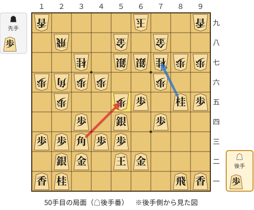

🔴 実戦 △同角(33)　🔵 AI推奨 △７七桂不成(85)　🟨 直前の相手の指し手

<details><summary>テキストの盤面図（BOD・将棋ソフトに貼り付け可）</summary>

```text
後手の持駒：歩
  ９ ８ ７ ６ ５ ４ ３ ２ １
+---------------------------+
|v香v飛 ・ ・ ・ ・ ・v桂v香|一
| ・ ・ ・v金v玉 ・v金v銀 ・|二
| ・ ・ ・ ・v歩v歩v角v歩v歩|三
| ・ ・v歩 ・v銀 ・v歩 ・ ・|四
|v歩v桂 ・v歩 歩 ・ ・ 歩 ・|五
| ・ ・ 歩 ・ ・ 歩 歩 角 歩|六
| 歩 歩 桂 銀 銀 ・ 桂 ・ ・|七
| ・ ・ 金 ・ 金 ・ ・ 飛 ・|八
| 香 ・ ・ 玉 ・ ・ ・ ・ 香|九
+---------------------------+
先手の持駒：歩
後手番
手数＝49　▲５五歩　まで
```

</details>

| | 指し手 | 評価値 | 読み筋 |
|---|---|--:|---|
| 実戦 | △同角(33) | +367 | ▲８五桂(77) △９九角成(55) ▲７七桂打 △３三桂(21) ▲５六銀(57) △６四香打 |
| AI 1位 | △７七桂不成(85) | +532 | △７七桂不成(85) ▲同金(78) △５五角(33) ▲６六歩打 △４四角(55) ▲７八金(77) |
| AI 2位 | △同角(33) | +403 | △同角(33) ▲８五桂(77) △９九角成(55) ▲７七桂打 △４二金(32) ▲５六銀(67) |
| AI 3位 | △同銀(54) | -448 | △同銀(54) ▲６五桂(77) △６四銀(55) ▲６六歩打 △６五銀(64) ▲４五桂(37) |

SFEN: `lr5nl/3gk1gs1/4ppbpp/2p1s1p2/pn1pP2P1/2P2PPBP/PPNSS1N2/2G1G2R1/L2K4L w Pp 50`

<a id="ply-52"></a>
### 52手目 △３三角(55) — 大悪手

| | 着手前 | 着手後 | 差 |
|---|--:|--:|--:|
| 期待勝率 | 97.7% | 51.1% | -46.6pt |
| 評価値 | +2245 | +26 | |

着手前の局面:

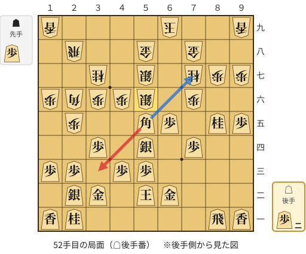

🔴 実戦 △３三角(55)　🔵 AI推奨 △７七角成(55)　🟨 直前の相手の指し手

<details><summary>テキストの盤面図（BOD・将棋ソフトに貼り付け可）</summary>

```text
後手の持駒：歩二
  ９ ８ ７ ６ ５ ４ ３ ２ １
+---------------------------+
|v香v飛 ・ ・ ・ ・ ・v桂v香|一
| ・ ・ ・v金v玉 ・v金v銀 ・|二
| ・ ・ ・ ・v歩v歩 ・v歩v歩|三
| ・ ・v歩 ・v銀 ・v歩 ・ ・|四
|v歩v桂 ・v歩v角 ・ ・ 歩 ・|五
| ・ ・ 歩 ・ 銀 歩 歩 角 歩|六
| 歩 歩 桂 ・ 銀 ・ 桂 ・ ・|七
| ・ ・ 金 ・ 金 ・ ・ 飛 ・|八
| 香 ・ ・ 玉 ・ ・ ・ ・ 香|九
+---------------------------+
先手の持駒：歩
後手番
手数＝51　▲５六銀左　まで
```

</details>

| | 指し手 | 評価値 | 読み筋 |
|---|---|--:|---|
| 実戦 | △３三角(55) | +26 | ▲５五歩打 △７七桂不成(85) ▲同金(78) △５五銀(54) ▲４五桂(37) △４四角(33) |
| AI 1位 | △７七角成(55) | +2245 | △７七角成(55) ▲同金(78) △同桂成(85) ▲５九玉(69) △８七飛成(81) ▲４五桂(37) |
| AI 2位 | △７七桂成(85) | +1971 | △７七桂成(85) ▲５五銀(56) △７八成桂(77) ▲同玉(69) △５五銀(54) ▲５四歩打 |
| AI 3位 | △７七桂不成(85) | +1244 | △７七桂不成(85) ▲６八玉(69) △６九桂成(77) ▲同玉(68) △９九角成(55) ▲４五銀(56) |

SFEN: `lr5nl/3gk1gs1/4pp1pp/2p1s1p2/pn1pb2P1/2P1SPPBP/PPN1S1N2/2G1G2R1/L2K4L w P2p 52`

<a id="ply-54"></a>
### 54手目 △同銀(54) — 悪手

| | 着手前 | 着手後 | 差 |
|---|--:|--:|--:|
| 期待勝率 | 94.3% | 79.3% | -15.0pt |
| 評価値 | +1683 | +805 | |

着手前の局面:

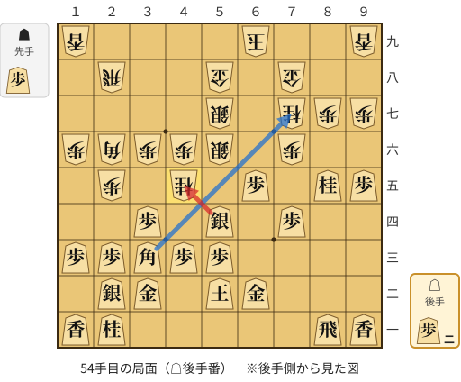

🔴 実戦 △同銀(54)　🔵 AI推奨 △７七角成(33)　🟨 直前の相手の指し手

<details><summary>テキストの盤面図（BOD・将棋ソフトに貼り付け可）</summary>

```text
後手の持駒：歩二
  ９ ８ ７ ６ ５ ４ ３ ２ １
+---------------------------+
|v香v飛 ・ ・ ・ ・ ・v桂v香|一
| ・ ・ ・v金v玉 ・v金v銀 ・|二
| ・ ・ ・ ・v歩v歩v角v歩v歩|三
| ・ ・v歩 ・v銀 ・v歩 ・ ・|四
|v歩v桂 ・v歩 ・ 桂 ・ 歩 ・|五
| ・ ・ 歩 ・ 銀 歩 歩 角 歩|六
| 歩 歩 桂 ・ 銀 ・ ・ ・ ・|七
| ・ ・ 金 ・ 金 ・ ・ 飛 ・|八
| 香 ・ ・ 玉 ・ ・ ・ ・ 香|九
+---------------------------+
先手の持駒：歩
後手番
手数＝53　▲４五桂　まで
```

</details>

| | 指し手 | 評価値 | 読み筋 |
|---|---|--:|---|
| 実戦 | △同銀(54) | +805 | ▲６五桂(77) △３六銀(45) ▲３七歩打 △２五銀(36) ▲５三角成(26) △同金(62) |
| AI 1位 | △７七角成(33) | +1683 | △７七角成(33) ▲５五歩打 △４五銀(54) ▲同歩(46) △９九馬(77) ▲６八金(58) |
| AI 2位 | △７七桂成(85) | +1037 | △７七桂成(85) ▲３三桂成(45) △７八成桂(77) ▲同玉(69) △３三銀(22) ▲５五歩打 |
| AI 3位 | △同銀(54) | +742 | △同銀(54) ▲６五桂(77) △３六銀(45) ▲３七歩打 △２五銀(36) ▲５三桂成(65) |

SFEN: `lr5nl/3gk1gs1/4ppbpp/2p1s1p2/pn1p1N1P1/2P1SPPBP/PPN1S4/2G1G2R1/L2K4L w P2p 54`

<a id="ply-58"></a>
### 58手目 △７七桂成(85) — 悪手

| | 着手前 | 着手後 | 差 |
|---|--:|--:|--:|
| 期待勝率 | 77.1% | 58.4% | -18.6pt |
| 評価値 | +727 | +204 | |

着手前の局面:

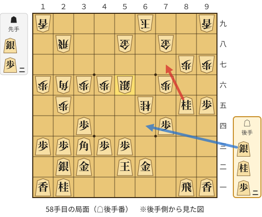

🔴 実戦 △７七桂成(85)　🔵 AI推奨 △６四銀打　🟨 直前の相手の指し手

<details><summary>テキストの盤面図（BOD・将棋ソフトに貼り付け可）</summary>

```text
後手の持駒：銀　桂　歩二
  ９ ８ ７ ６ ５ ４ ３ ２ １
+---------------------------+
|v香v飛 ・ ・ ・ ・ ・v桂v香|一
| ・ ・ ・v金v玉 ・v金v銀 ・|二
| ・ ・ ・ ・v歩v歩v角v歩v歩|三
| ・ ・v歩 ・ ・ ・v歩 ・ ・|四
|v歩v桂 ・ 桂 ・ ・ ・ 歩 ・|五
| ・ ・ 歩 ・ 銀 歩 歩 角 歩|六
| 歩 歩 ・ ・ ・ ・ ・ ・ ・|七
| ・ ・ 金 ・ 金 ・ ・ 飛 ・|八
| 香 ・ ・ 玉 ・ ・ ・ ・ 香|九
+---------------------------+
先手の持駒：銀　歩二
後手番
手数＝57　▲５六同銀　まで
```

</details>

| | 指し手 | 評価値 | 読み筋 |
|---|---|--:|---|
| 実戦 | △７七桂成(85) | +204 | ▲６三歩打 △７八成桂(77) ▲同玉(69) △６六桂打 ▲６八玉(78) △６三金(62) |
| AI 1位 | △６四銀打 | +727 | △６四銀打 ▲６三歩打 △同玉(52) ▲５三桂成(65) △同金(62) ▲６五歩打 |
| AI 2位 | △６四歩打 | +702 | △６四歩打 ▲５三桂成(65) △同金(62) ▲５四歩打 △同金(53) ▲５五歩打 |
| AI 3位 | △４二金(32) | +543 | △４二金(32) ▲６四銀打 △６三歩打 ▲５三銀成(64) △同金(62) ▲同桂成(65) |

SFEN: `lr5nl/3gk1gs1/4ppbpp/2p3p2/pn1N3P1/2P1SPPBP/PP7/2G1G2R1/L2K4L w S2Psn2p 58`

<a id="ply-72"></a>
### 72手目 △４四銀打 — 大悪手

| | 着手前 | 着手後 | 差 |
|---|--:|--:|--:|
| 期待勝率 | 99.7% | 70.3% | -29.4pt |
| 評価値 | +3570 | +518 | |

着手前の局面:

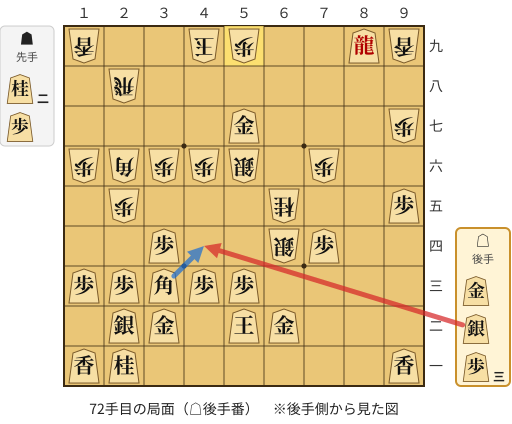

🔴 実戦 △４四銀打　🔵 AI推奨 △４四角(33)　🟨 直前の相手の指し手

<details><summary>テキストの盤面図（BOD・将棋ソフトに貼り付け可）</summary>

```text
後手の持駒：金　銀　歩三
  ９ ８ ７ ６ ５ ４ ３ ２ １
+---------------------------+
|v香 ・ ・ ・ ・ ・ ・v桂v香|一
| ・ ・ ・v金v玉 ・v金v銀 ・|二
| ・ ・ ・ ・v歩v歩v角v歩v歩|三
| ・ ・v歩 銀 ・ ・v歩 ・ ・|四
|v歩 ・ ・ 桂 ・ ・ ・ 歩 ・|五
| ・ ・ 歩 ・ 銀 歩 歩 角 歩|六
| 歩 ・ ・ ・v金 ・ ・ ・ ・|七
| ・ ・ ・ ・ ・ ・ ・ 飛 ・|八
| 香v龍 ・ ・ 歩 玉 ・ ・ 香|九
+---------------------------+
先手の持駒：桂二　歩
後手番
手数＝71　▲５九歩　まで
```

</details>

| | 指し手 | 評価値 | 読み筋 |
|---|---|--:|---|
| 実戦 | △４四銀打 | +518 | ▲６三歩打 △同金(62) ▲同銀成(64) △同玉(52) ▲５五桂打 △７二玉(63) |
| AI 1位 | △４四角(33) | +3570 | △４四角(33) ▲同角(26) △同歩(43) ▲２六角打 △５六金(57) ▲６三歩打 |
| AI 2位 | △７七角成(33) | +2214 | △７七角成(33) ▲５三銀不成(64) △４一玉(52) ▲５四桂打 △３三銀(22) ▲６二桂成(54) |
| AI 3位 | △４一玉(52) | +1714 | △４一玉(52) ▲５三桂不成(65) △同金(62) ▲同銀不成(64) △３七桂打 ▲３八玉(49) |

SFEN: `l6nl/3gk1gs1/4ppbpp/2pS2p2/p2N3P1/2P1SPPBP/P3g4/7R1/L+r2PK2L w 2NPgs3p 72`

<a id="ply-74"></a>
### 74手目 △４七金(57) — 疑問手

| | 着手前 | 着手後 | 差 |
|---|--:|--:|--:|
| 期待勝率 | 99.5% | 89.9% | -9.7pt |
| 評価値 | +3211 | +1310 | |

着手前の局面:

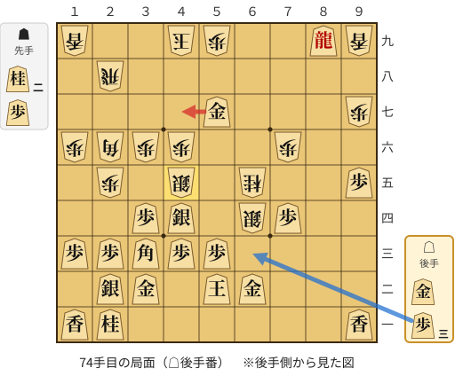

🔴 実戦 △４七金(57)　🔵 AI推奨 △６三歩打　🟨 直前の相手の指し手

<details><summary>テキストの盤面図（BOD・将棋ソフトに貼り付け可）</summary>

```text
後手の持駒：金　歩三
  ９ ８ ７ ６ ５ ４ ３ ２ １
+---------------------------+
|v香 ・ ・ ・ ・ ・ ・v桂v香|一
| ・ ・ ・v金v玉 ・v金v銀 ・|二
| ・ ・ ・ ・v歩v歩v角v歩v歩|三
| ・ ・v歩 銀 ・v銀v歩 ・ ・|四
|v歩 ・ ・ 桂 ・ 銀 ・ 歩 ・|五
| ・ ・ 歩 ・ ・ 歩 歩 角 歩|六
| 歩 ・ ・ ・v金 ・ ・ ・ ・|七
| ・ ・ ・ ・ ・ ・ ・ 飛 ・|八
| 香v龍 ・ ・ 歩 玉 ・ ・ 香|九
+---------------------------+
先手の持駒：桂二　歩
後手番
手数＝73　▲４五銀　まで
```

</details>

| | 指し手 | 評価値 | 読み筋 |
|---|---|--:|---|
| 実戦 | △４七金(57) | +1310 | ▲６三歩打 △６一金(62) ▲５三銀不成(64) △４一玉(52) ▲５四桂打 △４五銀(44) |
| AI 1位 | △６三歩打 | +3211 | △６三歩打 ▲５三桂成(65) △同金(62) ▲同銀成(64) △同銀(44) ▲６五桂打 |
| AI 2位 | △４七金打 | +2663 | △４七金打 ▲３九桂打 △６三歩打 ▲４七桂(39) △６四歩(63) ▲５八金打 |
| AI 3位 | △４二金(32) | +2506 | △４二金(32) ▲５六桂打 △５五銀(44) ▲６三歩打 △同金(62) ▲同銀成(64) |

SFEN: `l6nl/3gk1gs1/4ppbpp/2pS1sp2/p2N1S1P1/2P2PPBP/P3g4/7R1/L+r2PK2L w 2NPg3p 74`

<a id="ply-86"></a>
### 86手目 △５四飛打 — 大悪手

| | 着手前 | 着手後 | 差 |
|---|--:|--:|--:|
| 期待勝率 | 100.0% | 0.1% | -99.9pt |
| 評価値 | +5270 | -4380 | |

着手前の局面:

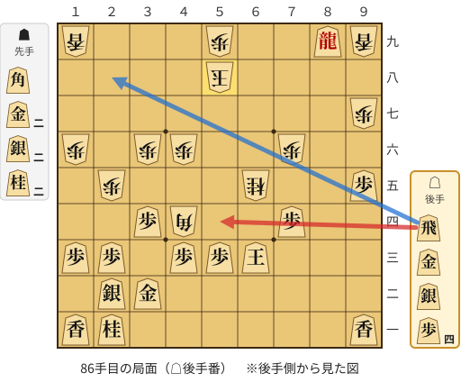

🔴 実戦 △５四飛打　🔵 AI推奨 △２八飛打　🟨 直前の相手の指し手

<details><summary>テキストの盤面図（BOD・将棋ソフトに貼り付け可）</summary>

```text
後手の持駒：飛　金　銀　歩四
  ９ ８ ７ ６ ５ ４ ３ ２ １
+---------------------------+
|v香 ・ ・ ・ ・ ・ ・v桂v香|一
| ・ ・ ・ ・ ・ ・v金v銀 ・|二
| ・ ・ ・v玉v歩v歩 ・v歩v歩|三
| ・ ・v歩 ・ ・ 角v歩 ・ ・|四
|v歩 ・ ・ 桂 ・ ・ ・ 歩 ・|五
| ・ ・ 歩 ・ ・ 歩 歩 ・ 歩|六
| 歩 ・ ・ ・ ・ ・ ・ ・ ・|七
| ・ ・ ・ ・ 玉 ・ ・ ・ ・|八
| 香v龍 ・ ・ 歩 ・ ・ ・ 香|九
+---------------------------+
先手の持駒：角　金二　銀二　桂二
後手番
手数＝85　▲５八同玉　まで
```

</details>

| | 指し手 | 評価値 | 読み筋 |
|---|---|--:|---|
| 実戦 | △５四飛打 | -4380 | ▲５五桂打 △同飛(54) ▲同角(44) △７八龍(89) ▲６八桂打 △６九銀打 |
| AI 1位 | △２八飛打 | +5270 | △２八飛打 ▲４八金打 △７八龍(89) ▲６八金打 △６七金打 ▲４九玉(58) |
| AI 2位 | △７八龍(89) | +2922 | △７八龍(89) ▲６八銀打 △２八飛打 ▲４七玉(58) △５七金打 ▲３七玉(47) |
| AI 3位 | △５六飛打 | +2071 | △５六飛打 ▲４七玉(58) △５七金打 ▲３七玉(47) △４四歩(43) ▲４一角打 |

SFEN: `l6nl/6gs1/3kpp1pp/2p2Bp2/p2N3P1/2P2PP1P/P8/4K4/L+r2P3L w B2G2S2Nrgs4p 86`

