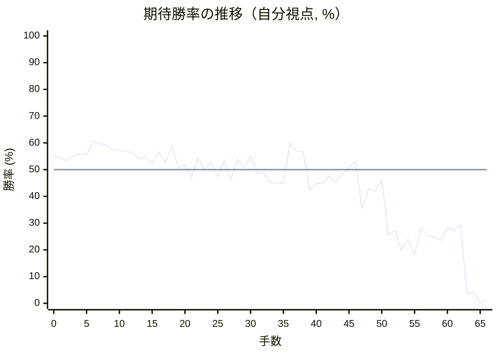
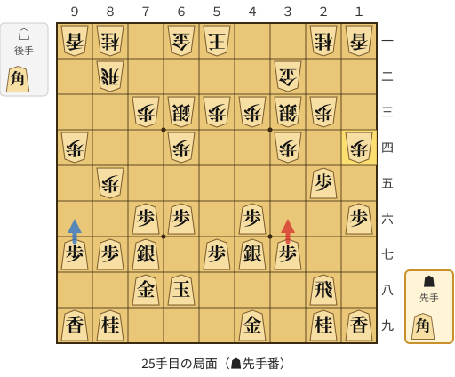
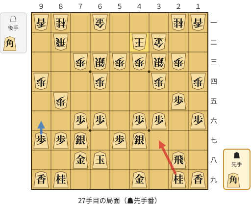
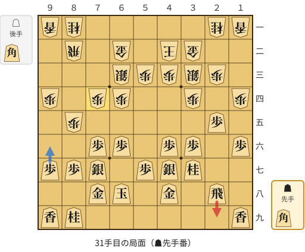
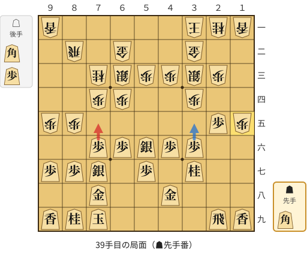
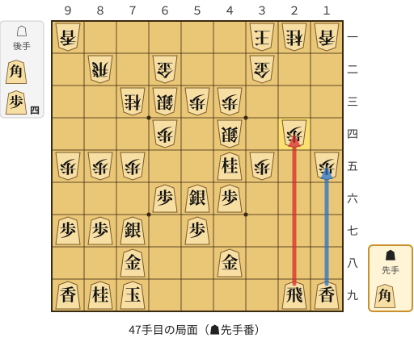
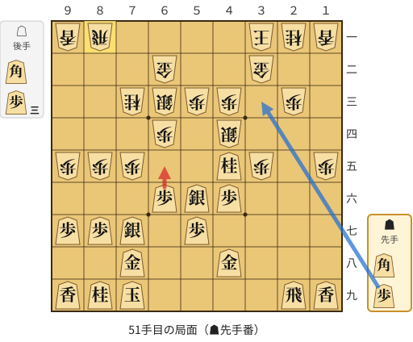
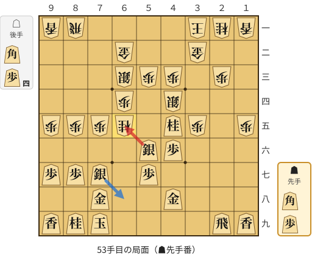
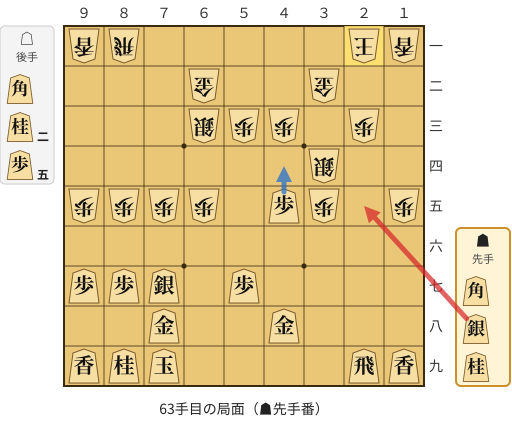

# 解析レポート c320vrfsxsa5

[README に戻る](../../../README.md)　/　棋譜: [CSA](../../../data/csa/shogi5/c320vrfsxsa5.csa)　/　解析の見方: [docs/mistake_analysis.md](../../../docs/mistake_analysis.md)

## 対局情報

| 項目 | 内容 |
|---|---|
| 日時 | 2026-11-17 03:59:28 |
| 持ち時間 | 5分 |
| 自分 | 先手（▲）（1667） |
| 相手 | 相手（1562） |
| 結果 | 負け（投了, 66手） |

## 解析環境

| 項目 | 内容 |
|---|---|
| エンジン | YaneuraOu NNUE 9.00git 64AVX2（V9.00/YANEURAOU_ENGINE_NNUE/AVX2） |
| 評価関数 | **水匠5**（`suisho5`） |
| nn.bin SHA-256 | `768068f0d534a0603a5d38bcd143de6bbca820d5f1c95a14d40863e5b7892d76` |
| 第1パス | movetime=150ms, MultiPV 1 |
| 第2パス | movetime=2000ms, MultiPV 3 |
| Threads / Hash | 8 / 512MB |
| 判定基準 | 疑問手 ≥5pt, 悪手 ≥10pt, 大悪手 ≥20pt（期待勝率 W(E)=1/(1+exp(-E/600))） |
| 解析日時 | 2026-11-20T20:14:28+09:00（解析バージョン 1, 50秒） |

## サマリー

| 自分の手数 | 深掘りした手 | 詰み逃し | 大悪手 | 悪手 | 疑問手 |
|--:|--:|--:|--:|--:|--:|
| 33 | 10 | 0 | 2 | 2 | 4 |

## 期待勝率の推移



<details><summary>1手ごとの数値（第1パス）</summary>

| 手数 | 指し手 | 評価値 | 勝率 | 低下 | 判定 |
|--:|---|--:|--:|--:|---|
| 1 | ▲７六歩(77) | +101 | 54.2% | +1.3pt |  |
| 2 | △８四歩(83) | +82 | 53.4% |  |  |
| 3 | ▲２六歩(27) | +124 | 55.1% | -1.7pt |  |
| 4 | △３四歩(33) | +142 | 55.9% |  |  |
| 5 | ▲２五歩(26) | +132 | 55.5% | +0.4pt |  |
| 6 | △８八角成(22) | +253 | 60.4% |  |  |
| 7 | ▲同銀(79) | +238 | 59.8% | +0.6pt |  |
| 8 | △２二銀(31) | +221 | 59.1% |  |  |
| 9 | ▲７七銀(88) | +178 | 57.4% | +1.7pt |  |
| 10 | △３三銀(22) | +171 | 57.1% |  |  |
| 11 | ▲４八銀(39) | +163 | 56.8% | +0.3pt |  |
| 12 | △６二銀(71) | +154 | 56.4% |  |  |
| 13 | ▲７八金(69) | +95 | 54.0% | +2.4pt |  |
| 14 | △３二金(41) | +114 | 54.7% |  |  |
| 15 | ▲６八玉(59) | +58 | 52.4% | +2.3pt |  |
| 16 | △８五歩(84) | +157 | 56.5% |  |  |
| 17 | ▲４六歩(47) | +67 | 52.8% | +3.7pt |  |
| 18 | △９四歩(93) | +210 | 58.7% |  |  |
| 19 | ▲４七銀(48) | +11 | 50.5% | +8.2pt |  |
| 20 | △６四歩(63) | +38 | 51.6% |  |  |
| 21 | ▲６六歩(67) | -68 | 47.2% | +4.4pt |  |
| 22 | △６三銀(62) | +101 | 54.2% |  |  |
| 23 | ▲１六歩(17) | +2 | 50.1% | +4.1pt |  |
| 24 | △１四歩(13) | +62 | 52.6% |  |  |
| 25 | ▲３六歩(37) | -60 | 47.5% | +5.1pt | [疑問手](#ply-25) |
| 26 | △４二玉(51) | +82 | 53.4% |  |  |
| 27 | ▲３七桂(29) | -88 | 46.3% | +7.1pt | [疑問手](#ply-27) |
| 28 | △６二金(61) | +93 | 53.9% |  |  |
| 29 | ▲４八金(49) | +16 | 50.7% | +3.2pt |  |
| 30 | △７四歩(73) | +122 | 55.1% |  |  |
| 31 | ▲２九飛(28) | -32 | 48.7% | +6.4pt | [疑問手](#ply-31) |
| 32 | △９五歩(94) | -27 | 48.9% |  |  |
| 33 | ▲７九玉(68) | -115 | 45.2% | +3.7pt |  |
| 34 | △７三桂(81) | -124 | 44.9% |  |  |
| 35 | ▲５六銀(47) | -120 | 45.0% | -0.2pt |  |
| 36 | △３一玉(42) | +236 | 59.7% |  |  |
| 37 | ▲１五歩(16) | +166 | 56.9% | +2.8pt |  |
| 38 | △同歩(14) | +165 | 56.8% |  |  |
| 39 | ▲７五歩(76) | -183 | 42.4% | +14.4pt | [悪手](#ply-39) |
| 40 | △同歩(74) | -126 | 44.8% |  |  |
| 41 | ▲３五歩(36) | -124 | 44.9% | -0.1pt |  |
| 42 | △同歩(34) | -57 | 47.6% |  |  |
| 43 | ▲４五桂(37) | -110 | 45.4% | +2.2pt |  |
| 44 | △４四銀(33) | -38 | 48.4% |  |  |
| 45 | ▲２四歩(25) | +16 | 50.7% | -2.2pt |  |
| 46 | △同歩(23) | +75 | 53.1% |  |  |
| 47 | ▲同飛(29) | -362 | 35.4% | +17.8pt | [悪手](#ply-47) |
| 48 | △２三歩打 | -177 | 42.7% |  |  |
| 49 | ▲２九飛(24) | -190 | 42.1% | +0.5pt |  |
| 50 | △８一飛(82) | -93 | 46.1% |  |  |
| 51 | ▲６五歩(66) | -640 | 25.6% | +20.5pt | [大悪手](#ply-51) |
| 52 | △同桂(73) | -587 | 27.3% |  |  |
| 53 | ▲同銀(56) | -837 | 19.9% | +7.5pt | [疑問手](#ply-53) |
| 54 | △同歩(64) | -690 | 24.0% |  |  |
| 55 | ▲３四桂打 | -898 | 18.3% | +5.8pt |  |
| 56 | △４五銀(44) | -562 | 28.2% |  |  |
| 57 | ▲同歩(46) | -645 | 25.4% | +2.7pt |  |
| 58 | △３三銀打 | -665 | 24.8% |  |  |
| 59 | ▲２二歩打 | -706 | 23.6% | +1.3pt |  |
| 60 | △３四銀(33) | -556 | 28.4% |  |  |
| 61 | ▲２一歩成(22) | -590 | 27.2% | +1.1pt |  |
| 62 | △同玉(31) | -530 | 29.2% |  |  |
| 63 | ▲２五銀打 | -1987 | 3.5% | +25.7pt | [大悪手](#ply-63) |
| 64 | △同銀(34) | -1876 | 4.2% |  |  |
| 65 | ▲２八飛(29) | -3676 | 0.2% | +4.0pt |  |
| 66 | △３四銀(25) | -2770 | 1.0% |  |  |

</details>

## 課題局面

<a id="ply-25"></a>
### 25手目 ▲３六歩(37) — 疑問手

| | 着手前 | 着手後 | 差 |
|---|--:|--:|--:|
| 期待勝率 | 55.5% | 48.2% | -7.3pt |
| 評価値 | +132 | -43 | |

着手前の局面:



🔴 実戦 ▲３六歩(37)　🔵 AI推奨 ▲９六歩(97)　🟨 直前の相手の指し手

<details><summary>テキストの盤面図（BOD・将棋ソフトに貼り付け可）</summary>

```text
後手の持駒：角
  ９ ８ ７ ６ ５ ４ ３ ２ １
+---------------------------+
|v香v桂 ・v金v玉 ・ ・v桂v香|一
| ・v飛 ・ ・ ・ ・v金 ・ ・|二
| ・ ・v歩v銀v歩v歩v銀v歩 ・|三
|v歩 ・ ・v歩 ・ ・v歩 ・v歩|四
| ・v歩 ・ ・ ・ ・ ・ 歩 ・|五
| ・ ・ 歩 歩 ・ 歩 ・ ・ 歩|六
| 歩 歩 銀 ・ 歩 銀 歩 ・ ・|七
| ・ ・ 金 玉 ・ ・ ・ 飛 ・|八
| 香 桂 ・ ・ ・ 金 ・ 桂 香|九
+---------------------------+
先手の持駒：角
手数＝24　△１四歩　まで
```

</details>

| | 指し手 | 評価値 | 読み筋 |
|---|---|--:|---|
| 実戦 | ▲３六歩(37) | -43 | △９五歩(94) ▲７五歩(76) △４二玉(51) ▲５八金(49) △５二金(61) ▲３七桂(29) |
| AI 1位 | ▲９六歩(97) | +132 | ▲９六歩(97) △７四歩(73) ▲３六歩(37) △７三桂(81) ▲３七桂(29) △６二金(61) |
| AI 2位 | ▲３六歩(37) | -88 | ▲３六歩(37) △９五歩(94) ▲３七桂(29) △４二玉(51) ▲７五歩(76) △７四歩(73) |
| AI 3位 | ▲５八金(49) | -90 | ▲５八金(49) △９五歩(94) ▲３六歩(37) △５二金(61) ▲７五歩(76) △４二玉(51) |

SFEN: `ln1gk2nl/1r4g2/2psppsp1/p2p2p1p/1p5P1/2PP1P2P/PPS1PSP2/2GK3R1/LN3G1NL b Bb 25`

<a id="ply-27"></a>
### 27手目 ▲３七桂(29) — 疑問手

| | 着手前 | 着手後 | 差 |
|---|--:|--:|--:|
| 期待勝率 | 54.4% | 48.6% | -5.7pt |
| 評価値 | +105 | -33 | |

着手前の局面:



🔴 実戦 ▲３七桂(29)　🔵 AI推奨 ▲９六歩(97)　🟨 直前の相手の指し手

<details><summary>テキストの盤面図（BOD・将棋ソフトに貼り付け可）</summary>

```text
後手の持駒：角
  ９ ８ ７ ６ ５ ４ ３ ２ １
+---------------------------+
|v香v桂 ・v金 ・ ・ ・v桂v香|一
| ・v飛 ・ ・ ・v玉v金 ・ ・|二
| ・ ・v歩v銀v歩v歩v銀v歩 ・|三
|v歩 ・ ・v歩 ・ ・v歩 ・v歩|四
| ・v歩 ・ ・ ・ ・ ・ 歩 ・|五
| ・ ・ 歩 歩 ・ 歩 歩 ・ 歩|六
| 歩 歩 銀 ・ 歩 銀 ・ ・ ・|七
| ・ ・ 金 玉 ・ ・ ・ 飛 ・|八
| 香 桂 ・ ・ ・ 金 ・ 桂 香|九
+---------------------------+
先手の持駒：角
手数＝26　△４二玉　まで
```

</details>

| | 指し手 | 評価値 | 読み筋 |
|---|---|--:|---|
| 実戦 | ▲３七桂(29) | -33 | △９五歩(94) ▲５八金(49) △５二金(61) ▲７五歩(76) △７四歩(73) ▲同歩(75) |
| AI 1位 | ▲９六歩(97) | +105 | ▲９六歩(97) △７四歩(73) ▲３七桂(29) △７三桂(81) ▲４八金(49) △７二金(61) |
| AI 2位 | ▲５八金(49) | -41 | ▲５八金(49) △９五歩(94) ▲７五歩(76) △５二金(61) ▲３七桂(29) △７四歩(73) |
| AI 3位 | ▲３七桂(29) | -58 | ▲３七桂(29) △９五歩(94) ▲７五歩(76) △７四歩(73) ▲同歩(75) △同銀(63) |

SFEN: `ln1g3nl/1r3kg2/2psppsp1/p2p2p1p/1p5P1/2PP1PP1P/PPS1PS3/2GK3R1/LN3G1NL b Bb 27`

<a id="ply-31"></a>
### 31手目 ▲２九飛(28) — 疑問手

| | 着手前 | 着手後 | 差 |
|---|--:|--:|--:|
| 期待勝率 | 55.1% | 49.0% | -6.1pt |
| 評価値 | +123 | -24 | |

着手前の局面:



🔴 実戦 ▲２九飛(28)　🔵 AI推奨 ▲９六歩(97)　🟨 直前の相手の指し手

<details><summary>テキストの盤面図（BOD・将棋ソフトに貼り付け可）</summary>

```text
後手の持駒：角
  ９ ８ ７ ６ ５ ４ ３ ２ １
+---------------------------+
|v香v桂 ・ ・ ・ ・ ・v桂v香|一
| ・v飛 ・v金 ・v玉v金 ・ ・|二
| ・ ・ ・v銀v歩v歩v銀v歩 ・|三
|v歩 ・v歩v歩 ・ ・v歩 ・v歩|四
| ・v歩 ・ ・ ・ ・ ・ 歩 ・|五
| ・ ・ 歩 歩 ・ 歩 歩 ・ 歩|六
| 歩 歩 銀 ・ 歩 銀 桂 ・ ・|七
| ・ ・ 金 玉 ・ 金 ・ 飛 ・|八
| 香 桂 ・ ・ ・ ・ ・ ・ 香|九
+---------------------------+
先手の持駒：角
手数＝30　△７四歩　まで
```

</details>

| | 指し手 | 評価値 | 読み筋 |
|---|---|--:|---|
| 実戦 | ▲２九飛(28) | -24 | △９五歩(94) ▲５六銀(47) △５二金(62) ▲６五歩(66) △同歩(64) ▲３五歩(36) |
| AI 1位 | ▲９六歩(97) | +123 | ▲９六歩(97) △７三桂(81) ▲５六銀(47) △８一飛(82) ▲７九玉(68) △５四銀(63) |
| AI 2位 | ▲５六銀(47) | -16 | ▲５六銀(47) △９五歩(94) ▲３五歩(36) △同歩(34) ▲４五桂(37) △２二銀(33) |
| AI 3位 | ▲５八金(48) | -37 | ▲５八金(48) △７三桂(81) ▲９六歩(97) △８一飛(82) ▲４八金(58) △５四銀(63) |

SFEN: `ln5nl/1r1g1kg2/3sppsp1/p1pp2p1p/1p5P1/2PP1PP1P/PPS1PSN2/2GK1G1R1/LN6L b Bb 31`

<a id="ply-39"></a>
### 39手目 ▲７五歩(76) — 悪手

| | 着手前 | 着手後 | 差 |
|---|--:|--:|--:|
| 期待勝率 | 58.7% | 45.7% | -13.0pt |
| 評価値 | +211 | -104 | |

着手前の局面:



🔴 実戦 ▲７五歩(76)　🔵 AI推奨 ▲３五歩(36)　🟨 直前の相手の指し手

<details><summary>テキストの盤面図（BOD・将棋ソフトに貼り付け可）</summary>

```text
後手の持駒：角　歩
  ９ ８ ７ ６ ５ ４ ３ ２ １
+---------------------------+
|v香 ・ ・ ・ ・ ・v玉v桂v香|一
| ・v飛 ・v金 ・ ・v金 ・ ・|二
| ・ ・v桂v銀v歩v歩v銀v歩 ・|三
| ・ ・v歩v歩 ・ ・v歩 ・ ・|四
|v歩v歩 ・ ・ ・ ・ ・ 歩v歩|五
| ・ ・ 歩 歩 銀 歩 歩 ・ ・|六
| 歩 歩 銀 ・ 歩 ・ 桂 ・ ・|七
| ・ ・ 金 ・ ・ 金 ・ ・ ・|八
| 香 桂 玉 ・ ・ ・ ・ 飛 香|九
+---------------------------+
先手の持駒：角
手数＝38　△１五同歩　まで
```

</details>

| | 指し手 | 評価値 | 読み筋 |
|---|---|--:|---|
| 実戦 | ▲７五歩(76) | -104 | △同歩(74) ▲３五歩(36) △７六歩(75) ▲同銀(77) △８六歩(85) ▲同歩(87) |
| AI 1位 | ▲３五歩(36) | +211 | ▲３五歩(36) △８一飛(82) ▲４五桂(37) △２二銀(33) ▲３四歩(35) △４二玉(31) |
| AI 2位 | ▲４五桂(37) | +175 | ▲４五桂(37) △４二銀(33) ▲３五歩(36) △４四歩(43) ▲３四歩(35) △４五歩(44) |
| AI 3位 | ▲２四歩(25) | +77 | ▲２四歩(25) △同銀(33) ▲４五銀(56) △１六歩(15) ▲５六角打 △８六歩(85) |

SFEN: `l5knl/1r1g2g2/2nsppsp1/2pp2p2/pp5Pp/2PPSPP2/PPS1P1N2/2G2G3/LNK4RL b Bbp 39`

<a id="ply-47"></a>
### 47手目 ▲同飛(29) — 悪手

| | 着手前 | 着手後 | 差 |
|---|--:|--:|--:|
| 期待勝率 | 50.5% | 40.3% | -10.3pt |
| 評価値 | +13 | -237 | |

着手前の局面:



🔴 実戦 ▲同飛(29)　🔵 AI推奨 ▲１五香(19)　🟨 直前の相手の指し手

<details><summary>テキストの盤面図（BOD・将棋ソフトに貼り付け可）</summary>

```text
後手の持駒：角　歩四
  ９ ８ ７ ６ ５ ４ ３ ２ １
+---------------------------+
|v香 ・ ・ ・ ・ ・v玉v桂v香|一
| ・v飛 ・v金 ・ ・v金 ・ ・|二
| ・ ・v桂v銀v歩v歩 ・ ・ ・|三
| ・ ・ ・v歩 ・v銀 ・v歩 ・|四
|v歩v歩v歩 ・ ・ 桂v歩 ・v歩|五
| ・ ・ ・ 歩 銀 歩 ・ ・ ・|六
| 歩 歩 銀 ・ 歩 ・ ・ ・ ・|七
| ・ ・ 金 ・ ・ 金 ・ ・ ・|八
| 香 桂 玉 ・ ・ ・ ・ 飛 香|九
+---------------------------+
先手の持駒：角
手数＝46　△２四同歩　まで
```

</details>

| | 指し手 | 評価値 | 読み筋 |
|---|---|--:|---|
| 実戦 | ▲同飛(29) | -237 | △２三歩打 ▲２九飛(24) △５二金(62) ▲１四歩打 △８一飛(82) ▲１五香(19) |
| AI 1位 | ▲１五香(19) | +13 | ▲１五香(19) △同香(11) ▲３三歩打 △２二金(32) ▲２四飛(29) △２三歩打 |
| AI 2位 | ▲７一角打 | -183 | ▲７一角打 △９二飛(82) ▲６二角成(71) △同飛(92) ▲３四金打 △４二角打 |
| AI 3位 | ▲同飛(29) | -243 | ▲同飛(29) △２三歩打 ▲２九飛(24) △５二金(62) ▲６八玉(79) △８一飛(82) |

SFEN: `l5knl/1r1g2g2/2nspp3/3p1s1p1/ppp2Np1p/3PSP3/PPS1P4/2G2G3/LNK4RL b Bb4p 47`

<a id="ply-51"></a>
### 51手目 ▲６五歩(66) — 大悪手

| | 着手前 | 着手後 | 差 |
|---|--:|--:|--:|
| 期待勝率 | 52.1% | 26.3% | -25.8pt |
| 評価値 | +51 | -617 | |

着手前の局面:



🔴 実戦 ▲６五歩(66)　🔵 AI推奨 ▲３三歩打　🟨 直前の相手の指し手

<details><summary>テキストの盤面図（BOD・将棋ソフトに貼り付け可）</summary>

```text
後手の持駒：角　歩三
  ９ ８ ７ ６ ５ ４ ３ ２ １
+---------------------------+
|v香v飛 ・ ・ ・ ・v玉v桂v香|一
| ・ ・ ・v金 ・ ・v金 ・ ・|二
| ・ ・v桂v銀v歩v歩 ・v歩 ・|三
| ・ ・ ・v歩 ・v銀 ・ ・ ・|四
|v歩v歩v歩 ・ ・ 桂v歩 ・v歩|五
| ・ ・ ・ 歩 銀 歩 ・ ・ ・|六
| 歩 歩 銀 ・ 歩 ・ ・ ・ ・|七
| ・ ・ 金 ・ ・ 金 ・ ・ ・|八
| 香 桂 玉 ・ ・ ・ ・ 飛 香|九
+---------------------------+
先手の持駒：角　歩
手数＝50　△８一飛　まで
```

</details>

| | 指し手 | 評価値 | 読み筋 |
|---|---|--:|---|
| 実戦 | ▲６五歩(66) | -617 | △同桂(73) ▲６八銀(77) △４五銀(44) ▲同歩(46) △８六歩(85) ▲同歩(87) |
| AI 1位 | ▲３三歩打 | +51 | ▲３三歩打 △同桂(21) ▲１五香(19) △７六歩(75) ▲同銀(77) △１五香(11) |
| AI 2位 | ▲６七銀(56) | -320 | ▲６七銀(56) △１六歩(15) ▲１四歩打 △３四角打 ▲４七角打 △６五歩(64) |
| AI 3位 | ▲６七銀(56) | -320 | ▲６七銀(56) △１六歩(15) ▲同香(19) △同香(11) ▲３三歩打 △同桂(21) |

SFEN: `lr4knl/3g2g2/2nspp1p1/3p1s3/ppp2Np1p/3PSP3/PPS1P4/2G2G3/LNK4RL b BPb3p 51`

<a id="ply-53"></a>
### 53手目 ▲同銀(56) — 疑問手

| | 着手前 | 着手後 | 差 |
|---|--:|--:|--:|
| 期待勝率 | 25.5% | 16.8% | -8.8pt |
| 評価値 | -642 | -962 | |

着手前の局面:



🔴 実戦 ▲同銀(56)　🔵 AI推奨 ▲６八銀(77)　🟨 直前の相手の指し手

<details><summary>テキストの盤面図（BOD・将棋ソフトに貼り付け可）</summary>

```text
後手の持駒：角　歩四
  ９ ８ ７ ６ ５ ４ ３ ２ １
+---------------------------+
|v香v飛 ・ ・ ・ ・v玉v桂v香|一
| ・ ・ ・v金 ・ ・v金 ・ ・|二
| ・ ・ ・v銀v歩v歩 ・v歩 ・|三
| ・ ・ ・v歩 ・v銀 ・ ・ ・|四
|v歩v歩v歩v桂 ・ 桂v歩 ・v歩|五
| ・ ・ ・ ・ 銀 歩 ・ ・ ・|六
| 歩 歩 銀 ・ 歩 ・ ・ ・ ・|七
| ・ ・ 金 ・ ・ 金 ・ ・ ・|八
| 香 桂 玉 ・ ・ ・ ・ 飛 香|九
+---------------------------+
先手の持駒：角　歩
手数＝52　△６五同桂　まで
```

</details>

| | 指し手 | 評価値 | 読み筋 |
|---|---|--:|---|
| 実戦 | ▲同銀(56) | -962 | △同歩(64) ▲２二歩打 △同玉(31) ▲３四桂打 △３一玉(22) ▲１五香(19) |
| AI 1位 | ▲６八銀(77) | -642 | ▲６八銀(77) △８六歩(85) ▲同歩(87) △８八歩打 ▲同金(78) △４五銀(44) |
| AI 2位 | ▲６八銀(77) | -662 | ▲６八銀(77) △８六歩(85) ▲同歩(87) △８八歩打 ▲同金(78) △４五銀(44) |
| AI 3位 | ▲同銀(56) | -782 | ▲同銀(56) △同歩(64) ▲２二歩打 △同玉(31) ▲３四桂打 △３一玉(22) |

SFEN: `lr4knl/3g2g2/3spp1p1/3p1s3/pppn1Np1p/4SP3/PPS1P4/2G2G3/LNK4RL b BPb4p 53`

<a id="ply-63"></a>
### 63手目 ▲２五銀打 — 大悪手

| | 着手前 | 着手後 | 差 |
|---|--:|--:|--:|
| 期待勝率 | 27.0% | 2.5% | -24.5pt |
| 評価値 | -596 | -2194 | |

着手前の局面:



🔴 実戦 ▲２五銀打　🔵 AI推奨 ▲４四歩(45)　🟨 直前の相手の指し手

<details><summary>テキストの盤面図（BOD・将棋ソフトに貼り付け可）</summary>

```text
後手の持駒：角　桂二　歩五
  ９ ８ ７ ６ ５ ４ ３ ２ １
+---------------------------+
|v香v飛 ・ ・ ・ ・ ・v玉v香|一
| ・ ・ ・v金 ・ ・v金 ・ ・|二
| ・ ・ ・v銀v歩v歩 ・v歩 ・|三
| ・ ・ ・ ・ ・ ・v銀 ・ ・|四
|v歩v歩v歩v歩 ・ 歩v歩 ・v歩|五
| ・ ・ ・ ・ ・ ・ ・ ・ ・|六
| 歩 歩 銀 ・ 歩 ・ ・ ・ ・|七
| ・ ・ 金 ・ ・ 金 ・ ・ ・|八
| 香 桂 玉 ・ ・ ・ ・ 飛 香|九
+---------------------------+
先手の持駒：角　銀　桂
手数＝62　△２一同玉　まで
```

</details>

| | 指し手 | 評価値 | 読み筋 |
|---|---|--:|---|
| 実戦 | ▲２五銀打 | -2194 | △同銀(34) ▲同飛(29) △６六桂打 ▲同銀(77) △同歩(65) ▲４四桂打 |
| AI 1位 | ▲４四歩(45) | -596 | ▲４四歩(45) △６六桂打 ▲４三歩成(44) △７八桂成(66) ▲同玉(79) △４三銀(34) |
| AI 2位 | ▲５五角打 | -642 | ▲５五角打 △２二角打 ▲同角成(55) △同玉(21) ▲１五香(19) △同香(11) |
| AI 3位 | ▲５五角打 | -642 | ▲５五角打 △２二角打 ▲同角成(55) △同玉(21) ▲１五香(19) △同香(11) |

SFEN: `lr5kl/3g2g2/3spp1p1/6s2/pppp1Pp1p/9/PPS1P4/2G2G3/LNK4RL b BSNb2n5p 63`

