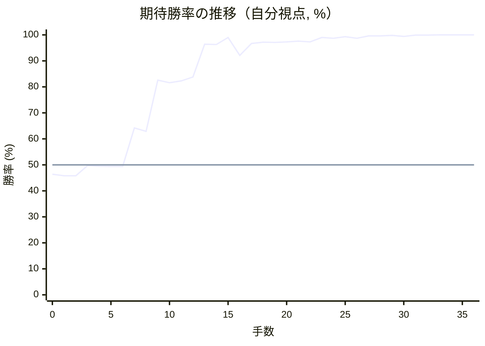
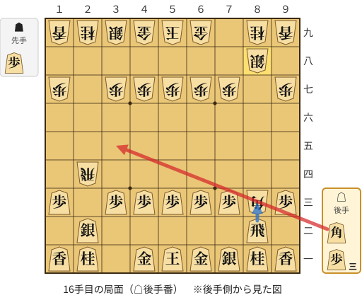

# 解析レポート c99nz039fot8

[README に戻る](../../../README.md)　/　棋譜: [CSA](../../../data/csa/shogi5/c99nz039fot8.csa)　/　解析の見方: [docs/mistake_analysis.md](../../../docs/mistake_analysis.md)

## 対局情報

| 項目 | 内容 |
|---|---|
| 日時 | 2026-11-17 02:38:08 |
| 持ち時間 | 5分 |
| 自分 | 後手（△）（1675） |
| 相手 | 相手（1341） |
| 結果 | 勝ち（投了, 36手） |

## 解析環境

| 項目 | 内容 |
|---|---|
| エンジン | YaneuraOu NNUE 9.00git 64AVX2（V9.00/YANEURAOU_ENGINE_NNUE/AVX2） |
| 評価関数 | **水匠5**（`suisho5`） |
| nn.bin SHA-256 | `768068f0d534a0603a5d38bcd143de6bbca820d5f1c95a14d40863e5b7892d76` |
| 第1パス | movetime=150ms, MultiPV 1 |
| 第2パス | movetime=2000ms, MultiPV 3 |
| Threads / Hash | 8 / 512MB |
| 判定基準 | 疑問手 ≥5pt, 悪手 ≥10pt, 大悪手 ≥20pt（期待勝率 W(E)=1/(1+exp(-E/600))） |
| 解析日時 | 2026-11-20T20:16:23+09:00（解析バージョン 1, 10秒） |

## サマリー

| 自分の手数 | 深掘りした手 | 詰み逃し | 大悪手 | 悪手 | 疑問手 |
|--:|--:|--:|--:|--:|--:|
| 18 | 1 | 0 | 0 | 0 | 1 |

## 期待勝率の推移



<details><summary>1手ごとの数値（第1パス）</summary>

| 手数 | 指し手 | 評価値 | 勝率 | 低下 | 判定 |
|--:|---|--:|--:|--:|---|
| 1 | ▲２六歩(27) | -100 | 45.8% |  |  |
| 2 | △８四歩(83) | -100 | 45.8% | +0.0pt |  |
| 3 | ▲２五歩(26) | -8 | 49.7% |  |  |
| 4 | △８五歩(84) | -12 | 49.5% | +0.2pt |  |
| 5 | ▲２四歩(25) | -14 | 49.4% |  |  |
| 6 | △同歩(23) | -14 | 49.4% | +0.0pt |  |
| 7 | ▲同飛(28) | +350 | 64.2% |  |  |
| 8 | △８六歩(85) | +317 | 62.9% | +1.3pt |  |
| 9 | ▲２三歩打 | +934 | 82.6% |  |  |
| 10 | △８七歩成(86) | +892 | 81.6% | +1.0pt |  |
| 11 | ▲２二歩成(23) | +923 | 82.3% |  |  |
| 12 | △同銀(31) | +986 | 83.8% | -1.5pt |  |
| 13 | ▲８三角打 | +1977 | 96.4% |  |  |
| 14 | △８八と(87) | +1955 | 96.3% | +0.1pt |  |
| 15 | ▲同銀(79) | +2775 | 99.0% |  |  |
| 16 | △３五角打 | +1472 | 92.1% | +6.9pt | [疑問手](#ply-16) |
| 17 | ▲６一角成(83) | +2027 | 96.7% |  |  |
| 18 | △同玉(51) | +2123 | 97.2% | -0.5pt |  |
| 19 | ▲２五飛(24) | +2108 | 97.1% |  |  |
| 20 | △５七角成(35) | +2147 | 97.3% | -0.2pt |  |
| 21 | ▲８三歩打 | +2230 | 97.6% |  |  |
| 22 | △５二飛(82) | +2152 | 97.3% | +0.3pt |  |
| 23 | ▲４八銀(39) | +2746 | 99.0% |  |  |
| 24 | △６七馬(57) | +2575 | 98.7% | +0.3pt |  |
| 25 | ▲５八金(49) | +2997 | 99.3% |  |  |
| 26 | △３四馬(67) | +2620 | 98.7% | +0.6pt |  |
| 27 | ▲２八飛(25) | +3317 | 99.6% |  |  |
| 28 | △８九馬(34) | +3291 | 99.6% | +0.0pt |  |
| 29 | ▲７九銀(88) | +3783 | 99.8% |  |  |
| 30 | △３二金(41) | +3076 | 99.4% | +0.4pt |  |
| 31 | ▲８二金打 | +4428 | 99.9% |  |  |
| 32 | △同銀(71) | +4553 | 99.9% | -0.0pt |  |
| 33 | ▲同歩成(83) | +4848 | 100.0% |  |  |
| 34 | △同飛(52) | +4747 | 100.0% | +0.0pt |  |
| 35 | ▲４一銀打 | +5541 | 100.0% |  |  |
| 36 | △３一金(32) | +5663 | 100.0% | -0.0pt |  |

</details>

## 課題局面

<a id="ply-16"></a>
### 16手目 △３五角打 — 疑問手

| | 着手前 | 着手後 | 差 |
|---|--:|--:|--:|
| 期待勝率 | 99.3% | 94.2% | -5.1pt |
| 評価値 | +2961 | +1670 | |

着手前の局面:



🔴 実戦 △３五角打　🔵 AI推奨 △８三飛(82)　🟨 直前の相手の指し手

<details><summary>テキストの盤面図（BOD・将棋ソフトに貼り付け可）</summary>

```text
後手の持駒：角　歩三
  ９ ８ ７ ６ ５ ４ ３ ２ １
+---------------------------+
|v香v桂v銀v金v玉v金 ・v桂v香|一
| ・v飛 ・ ・ ・ ・ ・v銀 ・|二
|v歩 角v歩v歩v歩v歩v歩 ・v歩|三
| ・ ・ ・ ・ ・ ・ ・ 飛 ・|四
| ・ ・ ・ ・ ・ ・ ・ ・ ・|五
| ・ ・ ・ ・ ・ ・ ・ ・ ・|六
| 歩 ・ 歩 歩 歩 歩 歩 ・ 歩|七
| ・ 銀 ・ ・ ・ ・ ・ ・ ・|八
| 香 桂 ・ 金 玉 金 銀 桂 香|九
+---------------------------+
先手の持駒：歩
後手番
手数＝15　▲８八同銀　まで
```

</details>

| | 指し手 | 評価値 | 読み筋 |
|---|---|--:|---|
| 実戦 | △３五角打 | +1670 | ▲８四飛(24) △７二金(61) ▲８五飛(84) △５七角成(35) ▲８四歩打 △６七馬(57) |
| AI 1位 | △８三飛(82) | +2961 | △８三飛(82) ▲２二飛成(24) △８八飛成(83) ▲７八銀打 △５二銀打 ▲１一龍(22) |
| AI 2位 | △３五角打 | +1901 | △３五角打 ▲８四飛(24) △７二金(61) ▲８五飛(84) △５七角成(35) ▲８四歩打 |
| AI 3位 | △８七歩打 | +1394 | △８七歩打 ▲７九銀(88) △８八歩成(87) ▲６一角成(83) △同玉(51) ▲８三歩打 |

SFEN: `lnsgkg1nl/1r5s1/pBppppp1p/7R1/9/9/P1PPPPP1P/1S7/LN1GKGSNL w Pb3p 16`

