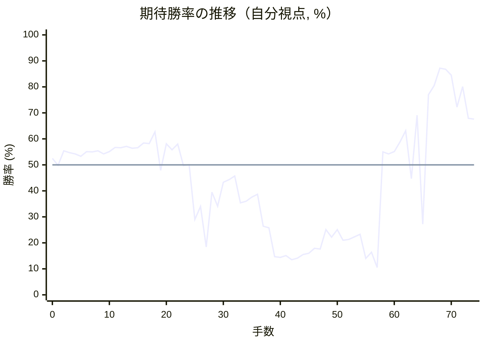

# 解析レポート cu1szf4scqyy

[README に戻る](../../../README.md)　/　棋譜: [CSA](../../../data/csa/shogi5/cu1szf4scqyy.csa)　/　解析の見方: [docs/mistake_analysis.md](../../../docs/mistake_analysis.md)

## 対局情報

| 項目 | 内容 |
|---|---|
| 日時 | 2026-11-07 12:43:05 |
| 持ち時間 | 5分 |
| 自分 | 先手（▲）（1721） |
| 相手 | 相手（1717） |
| 結果 | 負け（時間切れ, 74手） |

## 解析環境

| 項目 | 内容 |
|---|---|
| エンジン | YaneuraOu NNUE 9.00git 64AVX2（V9.00/YANEURAOU_ENGINE_NNUE/AVX2） |
| 評価関数 | **水匠5**（`suisho5`） |
| nn.bin SHA-256 | `768068f0d534a0603a5d38bcd143de6bbca820d5f1c95a14d40863e5b7892d76` |
| 第1パス | movetime=150ms, MultiPV 1 |
| 第2パス | movetime=2000ms, MultiPV 3 |
| Threads / Hash | 8 / 512MB |
| 判定基準 | 疑問手 ≥5pt, 悪手 ≥10pt, 大悪手 ≥20pt（期待勝率 W(E)=1/(1+exp(-E/600))） |
| 解析日時 | 2026-11-11T20:24:27+09:00（解析バージョン 1, 60秒） |

## サマリー

| 自分の手数 | 深掘りした手 | 詰み逃し | 大悪手 | 悪手 | 疑問手 |
|--:|--:|--:|--:|--:|--:|
| 37 | 12 | 0 | 3 | 5 | 1 |

## 期待勝率の推移



<details><summary>1手ごとの数値（第1パス）</summary>

| 手数 | 指し手 | 評価値 | 勝率 | 低下 | 判定 |
|--:|---|--:|--:|--:|---|
| 1 | ▲７六歩(77) | -5 | 49.8% | +2.7pt |  |
| 2 | △３四歩(33) | +131 | 55.4% |  |  |
| 3 | ▲２六歩(27) | +112 | 54.7% | +0.8pt |  |
| 4 | △８四歩(83) | +101 | 54.2% |  |  |
| 5 | ▲２五歩(26) | +80 | 53.3% | +0.9pt |  |
| 6 | △８五歩(84) | +124 | 55.1% |  |  |
| 7 | ▲７八金(69) | +121 | 55.0% | +0.1pt |  |
| 8 | △３二金(41) | +130 | 55.4% |  |  |
| 9 | ▲２四歩(25) | +100 | 54.2% | +1.2pt |  |
| 10 | △同歩(23) | +123 | 55.1% |  |  |
| 11 | ▲同飛(28) | +161 | 56.7% | -1.6pt |  |
| 12 | △８六歩(85) | +160 | 56.6% |  |  |
| 13 | ▲同歩(87) | +171 | 57.1% | -0.4pt |  |
| 14 | △同飛(82) | +154 | 56.4% |  |  |
| 15 | ▲３四飛(24) | +160 | 56.6% | -0.2pt |  |
| 16 | △８八角成(22) | +204 | 58.4% |  |  |
| 17 | ▲同銀(79) | +198 | 58.2% | +0.2pt |  |
| 18 | △７六飛(86) | +312 | 62.7% |  |  |
| 19 | ▲７七桂(89) | -50 | 47.9% | +14.8pt |  |
| 20 | △３三金(32) | +196 | 58.1% |  |  |
| 21 | ▲８四飛(34) | +140 | 55.8% | +2.3pt |  |
| 22 | △８二歩打 | +194 | 58.0% |  |  |
| 23 | ▲２二歩打 | -8 | 49.7% | +8.3pt | [悪手](#ply-23) |
| 24 | △同銀(31) | +2 | 50.1% |  |  |
| 25 | ▲８五角打 | -538 | 29.0% | +21.1pt | [悪手](#ply-25) |
| 26 | △２六飛(76) | -398 | 34.0% |  |  |
| 27 | ▲６三角成(85) | -893 | 18.4% | +15.6pt | [大悪手](#ply-27) |
| 28 | △７二角打 | -256 | 39.5% |  |  |
| 29 | ▲２七歩打 | -394 | 34.1% | +5.3pt |  |
| 30 | △６三角(72) | -162 | 43.3% |  |  |
| 31 | ▲２六歩(27) | -138 | 44.3% | -1.0pt |  |
| 32 | △２七角成(63) | -103 | 45.7% |  |  |
| 33 | ▲８三歩打 | -360 | 35.4% | +10.3pt |  |
| 34 | △７二馬(27) | -345 | 36.0% |  |  |
| 35 | ▲８二歩成(83) | -303 | 37.6% | -1.6pt |  |
| 36 | △同銀(71) | -276 | 38.7% |  |  |
| 37 | ▲５八玉(59) | -615 | 26.4% | +12.3pt | [悪手](#ply-37) |
| 38 | △２七角打 | -633 | 25.8% |  |  |
| 39 | ▲７四歩打 | -1056 | 14.7% | +11.1pt | [悪手](#ply-39) |
| 40 | △６三角成(27) | -1070 | 14.4% |  |  |
| 41 | ▲７三歩成(74) | -1038 | 15.1% | -0.7pt |  |
| 42 | △同銀(82) | -1116 | 13.5% |  |  |
| 43 | ▲８六飛(84) | -1086 | 14.1% | -0.6pt |  |
| 44 | △８二歩打 | -1018 | 15.5% |  |  |
| 45 | ▲２五歩(26) | -993 | 16.0% | -0.6pt |  |
| 46 | △３二金(33) | -915 | 17.9% |  |  |
| 47 | ▲２四歩(25) | -927 | 17.6% | +0.3pt |  |
| 48 | △４一馬(63) | -655 | 25.1% |  |  |
| 49 | ▲６五桂(77) | -751 | 22.2% | +2.9pt |  |
| 50 | △６二銀(73) | -655 | 25.1% |  |  |
| 51 | ▲７三歩打 | -795 | 21.0% | +4.1pt |  |
| 52 | △同桂(81) | -784 | 21.3% |  |  |
| 53 | ▲同桂成(65) | -750 | 22.3% | -1.0pt |  |
| 54 | △同銀(62) | -715 | 23.3% |  |  |
| 55 | ▲６五桂打 | -1090 | 14.0% | +9.3pt | [悪手](#ply-55) |
| 56 | △６二銀(73) | -977 | 16.4% |  |  |
| 57 | ▲７三歩打 | -1283 | 10.5% | +5.9pt |  |
| 58 | △５四馬(72) | +121 | 55.0% |  |  |
| 59 | ▲８二飛成(86) | +102 | 54.2% | +0.8pt |  |
| 60 | △８一歩打 | +124 | 55.1% |  |  |
| 61 | ▲９一龍(82) | +214 | 58.8% | -3.7pt |  |
| 62 | △６五馬(54) | +322 | 63.1% |  |  |
| 63 | ▲８一龍(91) | -127 | 44.7% | +18.4pt | [大悪手](#ply-63) |
| 64 | △６三馬(41) | +482 | 69.1% |  |  |
| 65 | ▲９一龍(81) | -590 | 27.2% | +41.8pt | [大悪手](#ply-65) |
| 66 | △８一歩打 | +725 | 77.0% |  |  |
| 67 | ▲６六香打 | +850 | 80.5% | -3.5pt |  |
| 68 | △７三馬(63) | +1153 | 87.2% |  |  |
| 69 | ▲６五香(66) | +1128 | 86.8% | +0.5pt |  |
| 70 | △９一馬(73) | +1017 | 84.5% |  |  |
| 71 | ▲６二香成(65) | +573 | 72.2% | +12.3pt |  |
| 72 | △同玉(51) | +835 | 80.1% |  |  |
| 73 | ▲７四歩打 | +450 | 67.9% | +12.2pt | [疑問手](#ply-73) |
| 74 | △７二歩打 | +442 | 67.6% |  |  |

</details>

## 課題局面

<a id="ply-23"></a>
### 23手目 ▲２二歩打 — 悪手

| | 着手前 | 着手後 | 差 |
|---|--:|--:|--:|
| 期待勝率 | 63.7% | 49.0% | -14.7pt |
| 評価値 | +337 | -24 | |

着手前の局面:

```text
後手の持駒：角　歩二
  ９ ８ ７ ６ ５ ４ ３ ２ １
+---------------------------+
|v香v桂v銀v金v玉 ・v銀v桂v香|一
| ・v歩 ・ ・ ・ ・ ・ ・ ・|二
|v歩 ・v歩v歩v歩v歩v金 ・v歩|三
| ・ 飛 ・ ・ ・ ・ ・ ・ ・|四
| ・ ・ ・ ・ ・ ・ ・ ・ ・|五
| ・ ・v飛 ・ ・ ・ ・ ・ ・|六
| 歩 ・ 桂 歩 歩 歩 歩 ・ 歩|七
| ・ 銀 金 ・ ・ ・ ・ ・ ・|八
| 香 ・ ・ ・ 玉 金 銀 桂 香|九
+---------------------------+
先手の持駒：角　歩三
手数＝22　△８二歩　まで
```

| | 指し手 | 評価値 | 読み筋 |
|---|---|--:|---|
| 実戦 | ▲２二歩打 | -24 | △同銀(31) ▲８三歩打 △７二金(61) ▲８二歩成(83) △同銀(71) ▲８五角打 |
| AI 1位 | ▲６六角打 | +337 | ▲６六角打 △５二玉(51) ▲８三歩打 △７二金(61) ▲８七銀(88) △６六飛(76) |
| AI 2位 | ▲８三歩打 | +247 | ▲８三歩打 △７二金(61) ▲８二歩成(83) △同銀(71) ▲６六角打 △５二玉(51) |
| AI 3位 | ▲５八玉(59) | +154 | ▲５八玉(59) △２六飛(76) ▲２八歩打 △４二銀(31) ▲７九銀(88) △５二玉(51) |

SFEN: `lnsgk1snl/1p7/p1ppppg1p/1R7/9/2r6/P1NPPPP1P/1SG6/L3KGSNL b B3Pb2p 23`

<a id="ply-25"></a>
### 25手目 ▲８五角打 — 悪手

| | 着手前 | 着手後 | 差 |
|---|--:|--:|--:|
| 期待勝率 | 50.5% | 32.8% | -17.6pt |
| 評価値 | +11 | -430 | |

着手前の局面:

```text
後手の持駒：角　歩三
  ９ ８ ７ ６ ５ ４ ３ ２ １
+---------------------------+
|v香v桂v銀v金v玉 ・ ・v桂v香|一
| ・v歩 ・ ・ ・ ・ ・v銀 ・|二
|v歩 ・v歩v歩v歩v歩v金 ・v歩|三
| ・ 飛 ・ ・ ・ ・ ・ ・ ・|四
| ・ ・ ・ ・ ・ ・ ・ ・ ・|五
| ・ ・v飛 ・ ・ ・ ・ ・ ・|六
| 歩 ・ 桂 歩 歩 歩 歩 ・ 歩|七
| ・ 銀 金 ・ ・ ・ ・ ・ ・|八
| 香 ・ ・ ・ 玉 金 銀 桂 香|九
+---------------------------+
先手の持駒：角　歩二
手数＝24　△２二同銀　まで
```

| | 指し手 | 評価値 | 読み筋 |
|---|---|--:|---|
| 実戦 | ▲８五角打 | -430 | △２六飛(76) ▲２七歩打 △同飛成(26) ▲２八歩打 △２三龍(27) ▲６三角成(85) |
| AI 1位 | ▲５八玉(59) | +11 | ▲５八玉(59) △５二玉(51) ▲３六歩(37) △同飛(76) ▲３八銀(39) △２八角打 |
| AI 2位 | ▲６六角打 | -21 | ▲６六角打 △２七角打 ▲８三歩打 △同歩(82) ▲同飛成(84) △６六飛(76) |
| AI 3位 | ▲６六角打 | -62 | ▲６六角打 △２七角打 ▲８三歩打 △同歩(82) ▲同飛成(84) △８二歩打 |

SFEN: `lnsgk2nl/1p5s1/p1ppppg1p/1R7/9/2r6/P1NPPPP1P/1SG6/L3KGSNL b B2Pb3p 25`

<a id="ply-27"></a>
### 27手目 ▲６三角成(85) — 大悪手

| | 着手前 | 着手後 | 差 |
|---|--:|--:|--:|
| 期待勝率 | 32.9% | 12.4% | -20.5pt |
| 評価値 | -427 | -1173 | |

着手前の局面:

```text
後手の持駒：角　歩三
  ９ ８ ７ ６ ５ ４ ３ ２ １
+---------------------------+
|v香v桂v銀v金v玉 ・ ・v桂v香|一
| ・v歩 ・ ・ ・ ・ ・v銀 ・|二
|v歩 ・v歩v歩v歩v歩v金 ・v歩|三
| ・ 飛 ・ ・ ・ ・ ・ ・ ・|四
| ・ 角 ・ ・ ・ ・ ・ ・ ・|五
| ・ ・ ・ ・ ・ ・ ・v飛 ・|六
| 歩 ・ 桂 歩 歩 歩 歩 ・ 歩|七
| ・ 銀 金 ・ ・ ・ ・ ・ ・|八
| 香 ・ ・ ・ 玉 金 銀 桂 香|九
+---------------------------+
先手の持駒：歩二
手数＝26　△２六飛　まで
```

| | 指し手 | 評価値 | 読み筋 |
|---|---|--:|---|
| 実戦 | ▲６三角成(85) | -1173 | △２九飛成(26) ▲２三歩打 △３一銀(22) ▲８一馬(63) △７五角打 ▲７二歩打 |
| AI 1位 | ▲２七歩打 | -427 | ▲２七歩打 △同飛成(26) ▲２八歩打 △２三龍(27) ▲６三角成(85) △７二角打 |
| AI 2位 | ▲６三角成(85) | -991 | ▲６三角成(85) △２九飛成(26) ▲７二歩打 △同銀(71) ▲１八馬(63) △同龍(29) |
| AI 3位 | ▲２三歩打 | -1071 | ▲２三歩打 △同銀(22) ▲６三角成(85) △２九飛成(26) ▲１八馬(63) △同龍(29) |

SFEN: `lnsgk2nl/1p5s1/p1ppppg1p/1R7/1B7/7r1/P1NPPPP1P/1SG6/L3KGSNL b 2Pb3p 27`

<a id="ply-37"></a>
### 37手目 ▲５八玉(59) — 悪手

| | 着手前 | 着手後 | 差 |
|---|--:|--:|--:|
| 期待勝率 | 39.9% | 26.7% | -13.2pt |
| 評価値 | -245 | -606 | |

着手前の局面:

```text
後手の持駒：角　歩四
  ９ ８ ７ ６ ５ ４ ３ ２ １
+---------------------------+
|v香v桂 ・v金v玉 ・ ・v桂v香|一
| ・v銀v馬 ・ ・ ・ ・v銀 ・|二
|v歩 ・v歩 ・v歩v歩v金 ・v歩|三
| ・ 飛 ・ ・ ・ ・ ・ ・ ・|四
| ・ ・ ・ ・ ・ ・ ・ ・ ・|五
| ・ ・ ・ ・ ・ ・ ・ 歩 ・|六
| 歩 ・ 桂 歩 歩 歩 歩 ・ 歩|七
| ・ 銀 金 ・ ・ ・ ・ ・ ・|八
| 香 ・ ・ ・ 玉 金 銀 桂 香|九
+---------------------------+
先手の持駒：飛　歩二
手数＝36　△８二同銀　まで
```

| | 指し手 | 評価値 | 読み筋 |
|---|---|--:|---|
| 実戦 | ▲５八玉(59) | -606 | △２七角打 ▲６四飛(84) △５二金(61) ▲３八銀(39) △４五角成(27) ▲３六歩(37) |
| AI 1位 | ▲３八金(49) | -245 | ▲３八金(49) △３二金(33) ▲５八玉(59) △７四歩(73) ▲８六飛(84) △３三銀(22) |
| AI 2位 | ▲２八銀(39) | -355 | ▲２八銀(39) △３二金(33) ▲５八玉(59) △７四歩(73) ▲８六飛(84) △３三銀(22) |
| AI 3位 | ▲８六飛(84) | -470 | ▲８六飛(84) △２七角打 ▲３六歩(37) △同角成(27) ▲８三歩打 △７一銀(82) |

SFEN: `ln1gk2nl/1s+b4s1/p1p1ppg1p/1R7/9/7P1/P1NPPPP1P/1SG6/L3KGSNL b R2Pb4p 37`

<a id="ply-39"></a>
### 39手目 ▲７四歩打 — 悪手

| | 着手前 | 着手後 | 差 |
|---|--:|--:|--:|
| 期待勝率 | 26.1% | 14.3% | -11.7pt |
| 評価値 | -626 | -1073 | |

着手前の局面:

```text
後手の持駒：歩四
  ９ ８ ７ ６ ５ ４ ３ ２ １
+---------------------------+
|v香v桂 ・v金v玉 ・ ・v桂v香|一
| ・v銀v馬 ・ ・ ・ ・v銀 ・|二
|v歩 ・v歩 ・v歩v歩v金 ・v歩|三
| ・ 飛 ・ ・ ・ ・ ・ ・ ・|四
| ・ ・ ・ ・ ・ ・ ・ ・ ・|五
| ・ ・ ・ ・ ・ ・ ・ 歩 ・|六
| 歩 ・ 桂 歩 歩 歩 歩v角 歩|七
| ・ 銀 金 ・ 玉 ・ ・ ・ ・|八
| 香 ・ ・ ・ ・ 金 銀 桂 香|九
+---------------------------+
先手の持駒：飛　歩二
手数＝38　△２七角　まで
```

| | 指し手 | 評価値 | 読み筋 |
|---|---|--:|---|
| 実戦 | ▲７四歩打 | -1073 | △６三角成(27) ▲７三歩成(74) △同銀(82) ▲８六飛(84) △４二玉(51) ▲８七銀(88) |
| AI 1位 | ▲６四飛(84) | -626 | ▲６四飛(84) △５二金(61) ▲８七銀(88) △３二金(33) ▲７六銀(87) △４五角成(27) |
| AI 2位 | ▲２五歩(26) | -666 | ▲２五歩(26) △６三角成(27) ▲８六飛(84) △４一玉(51) ▲２四歩(25) △３二玉(41) |
| AI 3位 | ▲８六飛(84) | -684 | ▲８六飛(84) △６三角成(27) ▲２五歩(26) △４二玉(51) ▲２四歩(25) △３二玉(42) |

SFEN: `ln1gk2nl/1s+b4s1/p1p1ppg1p/1R7/9/7P1/P1NPPPPbP/1SG1K4/L4GSNL b R2P4p 39`

<a id="ply-55"></a>
### 55手目 ▲６五桂打 — 悪手

| | 着手前 | 着手後 | 差 |
|---|--:|--:|--:|
| 期待勝率 | 23.1% | 13.1% | -10.0pt |
| 評価値 | -722 | -1136 | |

着手前の局面:

```text
後手の持駒：桂　歩五
  ９ ８ ７ ６ ５ ４ ３ ２ １
+---------------------------+
|v香 ・ ・v金v玉v馬 ・v桂v香|一
| ・v歩v馬 ・ ・ ・v金v銀 ・|二
|v歩 ・v銀 ・v歩v歩 ・ ・v歩|三
| ・ ・ ・ ・ ・ ・ ・ 歩 ・|四
| ・ ・ ・ ・ ・ ・ ・ ・ ・|五
| ・ 飛 ・ ・ ・ ・ ・ ・ ・|六
| 歩 ・ ・ 歩 歩 歩 歩 ・ 歩|七
| ・ 銀 金 ・ 玉 ・ ・ ・ ・|八
| 香 ・ ・ ・ ・ 金 銀 桂 香|九
+---------------------------+
先手の持駒：飛　桂　歩
手数＝54　△７三同銀　まで
```

| | 指し手 | 評価値 | 読み筋 |
|---|---|--:|---|
| 実戦 | ▲６五桂打 | -1136 | △６二銀(73) ▲７三歩打 △７一馬(72) ▲８四飛打 △８三桂打 ▲９六歩(97) |
| AI 1位 | ▲７七銀(88) | -722 | ▲７七銀(88) △６四歩打 ▲２三桂打 △１二香(11) ▲１六歩(17) △１四歩(13) |
| AI 2位 | ▲１六歩(17) | -734 | ▲１六歩(17) △１四歩(13) ▲７七銀(88) △６四歩打 ▲２三桂打 △１二香(11) |
| AI 3位 | ▲２六飛(86) | -797 | ▲２六飛(86) △１四歩(13) ▲７七銀(88) △６四歩打 ▲５九金(49) △６三馬(72) |

SFEN: `l2gk+b1nl/1p+b3gs1/p1s1pp2p/7P1/9/1R7/P2PPPP1P/1SG1K4/L4GSNL b RNPn5p 55`

<a id="ply-63"></a>
### 63手目 ▲８一龍(91) — 大悪手

| | 着手前 | 着手後 | 差 |
|---|--:|--:|--:|
| 期待勝率 | 69.9% | 42.9% | -27.0pt |
| 評価値 | +505 | -171 | |

着手前の局面:

```text
後手の持駒：桂二　歩四
  ９ ８ ７ ６ ５ ４ ３ ２ １
+---------------------------+
| 龍v歩 ・v金v玉v馬 ・v桂v香|一
| ・ ・ ・v銀 ・ ・v金v銀 ・|二
|v歩 ・ 歩 ・v歩v歩 ・ ・v歩|三
| ・ ・ ・ ・ ・ ・ ・ 歩 ・|四
| ・ ・ ・v馬 ・ ・ ・ ・ ・|五
| ・ ・ ・ ・ ・ ・ ・ ・ ・|六
| 歩 ・ ・ 歩 歩 歩 歩 ・ 歩|七
| ・ 銀 金 ・ 玉 ・ ・ ・ ・|八
| 香 ・ ・ ・ ・ 金 銀 桂 香|九
+---------------------------+
先手の持駒：飛　香　歩
手数＝62　△６五馬　まで
```

| | 指し手 | 評価値 | 読み筋 |
|---|---|--:|---|
| 実戦 | ▲８一龍(91) | -171 | △５四馬(65) ▲８四龍(81) △７一歩打 ▲７七銀(88) △８三歩打 ▲同龍(84) |
| AI 1位 | ▲６六香打 | +505 | ▲６六香打 △５四馬(65) ▲６二香成(66) △同金(61) ▲７一飛打 △６一歩打 |
| AI 2位 | ▲７二歩成(73) | +332 | ▲７二歩成(73) △同金(61) ▲６六香打 △５四馬(65) ▲８一龍(91) △６一歩打 |
| AI 3位 | ▲８四飛打 | +105 | ▲８四飛打 △７一歩打 ▲６六香打 △７四馬(41) ▲６五香(66) △８四馬(74) |

SFEN: `+Rp1gk+b1nl/3s2gs1/p1P1pp2p/7P1/3+b5/9/P2PPPP1P/1SG1K4/L4GSNL b RLP2n4p 63`

<a id="ply-65"></a>
### 65手目 ▲９一龍(81) — 大悪手

| | 着手前 | 着手後 | 差 |
|---|--:|--:|--:|
| 期待勝率 | 70.3% | 29.1% | -41.3pt |
| 評価値 | +518 | -535 | |

着手前の局面:

```text
後手の持駒：桂二　歩四
  ９ ８ ７ ６ ５ ４ ３ ２ １
+---------------------------+
| ・ 龍 ・v金v玉 ・ ・v桂v香|一
| ・ ・ ・v銀 ・ ・v金v銀 ・|二
|v歩 ・ 歩v馬v歩v歩 ・ ・v歩|三
| ・ ・ ・ ・ ・ ・ ・ 歩 ・|四
| ・ ・ ・v馬 ・ ・ ・ ・ ・|五
| ・ ・ ・ ・ ・ ・ ・ ・ ・|六
| 歩 ・ ・ 歩 歩 歩 歩 ・ 歩|七
| ・ 銀 金 ・ 玉 ・ ・ ・ ・|八
| 香 ・ ・ ・ ・ 金 銀 桂 香|九
+---------------------------+
先手の持駒：飛　香　歩二
手数＝64　△６三馬　まで
```

| | 指し手 | 評価値 | 読み筋 |
|---|---|--:|---|
| 実戦 | ▲９一龍(81) | -535 | △５五桂打 ▲３八銀(39) △７五桂打 ▲７七銀(88) △７三馬(63) ▲８二歩打 |
| AI 1位 | ▲３五飛打 | +518 | ▲３五飛打 △６六桂打 ▲同歩(67) △７六馬(65) ▲６七桂打 △３三桂(21) |
| AI 2位 | ▲７二歩成(73) | +477 | ▲７二歩成(73) △同馬(63) ▲同龍(81) △同金(61) ▲３五飛打 △６六桂打 |
| AI 3位 | ▲６一龍(81) | +97 | ▲６一龍(81) △同玉(51) ▲６六香打 △同馬(65) ▲同歩(67) △５二玉(61) |

SFEN: `1+R1gk2nl/3s2gs1/p1P+bpp2p/7P1/3+b5/9/P2PPPP1P/1SG1K4/L4GSNL b RL2P2n4p 65`

<a id="ply-73"></a>
### 73手目 ▲７四歩打 — 疑問手

| | 着手前 | 着手後 | 差 |
|---|--:|--:|--:|
| 期待勝率 | 86.1% | 77.1% | -9.1pt |
| 評価値 | +1095 | +727 | |

着手前の局面:

```text
後手の持駒：飛　桂二　香　歩四
  ９ ８ ７ ６ ５ ４ ３ ２ １
+---------------------------+
|v馬v歩 ・v金 ・ ・ ・v桂v香|一
| ・ ・ ・v玉 ・ ・v金v銀 ・|二
|v歩 ・ ・ ・v歩v歩 ・ ・v歩|三
| ・ ・ ・ ・ ・ ・ ・ 歩 ・|四
| ・ ・ ・ ・ ・ ・ ・ ・ ・|五
| ・ ・ ・ ・ ・ ・ ・ ・ ・|六
| 歩 ・ ・ 歩 歩 歩 歩 ・ 歩|七
| ・ 銀 金 ・ 玉 ・ ・ ・ ・|八
| 香 ・ ・ ・ ・ 金 銀 桂 香|九
+---------------------------+
先手の持駒：飛　角　銀　歩二
手数＝72　△６二同玉　まで
```

| | 指し手 | 評価値 | 読み筋 |
|---|---|--:|---|
| 実戦 | ▲７四歩打 | +727 | △７二歩打 ▲２三銀打 △同銀(22) ▲同歩成(24) △３一金(32) ▲２二歩打 |
| AI 1位 | ▲４一角打 | +1095 | ▲４一角打 △４二金(32) ▲６三飛打 △７一玉(62) ▲６一飛成(63) △同玉(71) |
| AI 2位 | ▲２三銀打 | +621 | ▲２三銀打 △同銀(22) ▲同歩成(24) △３一金(32) ▲２二と(23) △４一金(31) |
| AI 3位 | ▲２三歩成(24) | +671 | ▲２三歩成(24) △同銀(22) ▲２四歩打 △３四銀(23) ▲４一角打 △３一金(32) |

SFEN: `+bp1g3nl/3k2gs1/p3pp2p/7P1/9/9/P2PPPP1P/1SG1K4/L4GSNL b RBS2Pr2nl4p 73`

