# 解析レポート cuv3vgcaxi31

[README に戻る](../../../README.md)　/　棋譜: [CSA](../../../data/csa/shogi5/cuv3vgcaxi31.csa)　/　解析の見方: [docs/mistake_analysis.md](../../../docs/mistake_analysis.md)

## 対局情報

| 項目 | 内容 |
|---|---|
| 日時 | 2026-11-14 18:39:07 |
| 持ち時間 | 5分 |
| 自分 | 先手（▲）（1640） |
| 相手 | 相手（1584） |
| 結果 | 勝ち（詰み, 135手） |

## 解析環境

| 項目 | 内容 |
|---|---|
| エンジン | YaneuraOu NNUE 9.00git 64AVX2（V9.00/YANEURAOU_ENGINE_NNUE/AVX2） |
| 評価関数 | **水匠5**（`suisho5`） |
| nn.bin SHA-256 | `768068f0d534a0603a5d38bcd143de6bbca820d5f1c95a14d40863e5b7892d76` |
| 第1パス | movetime=150ms, MultiPV 1 |
| 第2パス | movetime=2000ms, MultiPV 3 |
| Threads / Hash | 8 / 512MB |
| 判定基準 | 疑問手 ≥5pt, 悪手 ≥10pt, 大悪手 ≥20pt（期待勝率 W(E)=1/(1+exp(-E/600))） |
| 解析日時 | 2026-11-20T20:24:31+09:00（解析バージョン 1, 79秒） |

## サマリー

| 自分の手数 | 深掘りした手 | 詰み逃し | 大悪手 | 悪手 | 疑問手 |
|--:|--:|--:|--:|--:|--:|
| 68 | 15 | 0 | 4 | 6 | 3 |

## 期待勝率の推移

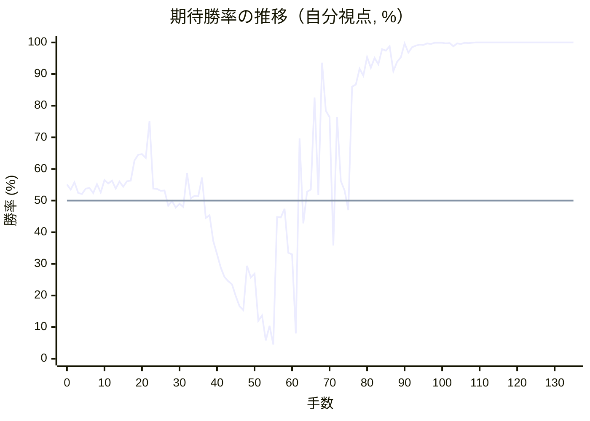

<details><summary>1手ごとの数値（第1パス）</summary>

| 手数 | 指し手 | 評価値 | 勝率 | 低下 | 判定 |
|--:|---|--:|--:|--:|---|
| 1 | ▲７六歩(77) | +85 | 53.5% | +1.6pt |  |
| 2 | △８四歩(83) | +140 | 55.8% |  |  |
| 3 | ▲２六歩(27) | +58 | 52.4% | +3.4pt |  |
| 4 | △８五歩(84) | +50 | 52.1% |  |  |
| 5 | ▲７七角(88) | +91 | 53.8% | -1.7pt |  |
| 6 | △３二金(41) | +96 | 54.0% |  |  |
| 7 | ▲２五歩(26) | +57 | 52.4% | +1.6pt |  |
| 8 | △１四歩(13) | +126 | 55.2% |  |  |
| 9 | ▲６八銀(79) | +62 | 52.6% | +2.6pt |  |
| 10 | △６二銀(71) | +158 | 56.5% |  |  |
| 11 | ▲７八金(69) | +130 | 55.4% | +1.1pt |  |
| 12 | △５二金(61) | +153 | 56.3% |  |  |
| 13 | ▲６九玉(59) | +91 | 53.8% | +2.6pt |  |
| 14 | △４一玉(51) | +144 | 56.0% |  |  |
| 15 | ▲４八銀(39) | +105 | 54.4% | +1.6pt |  |
| 16 | △４二銀(31) | +148 | 56.1% |  |  |
| 17 | ▲１六歩(17) | +152 | 56.3% | -0.2pt |  |
| 18 | △７四歩(73) | +311 | 62.7% |  |  |
| 19 | ▲２四歩(25) | +358 | 64.5% | -1.8pt |  |
| 20 | △同歩(23) | +363 | 64.7% |  |  |
| 21 | ▲同飛(28) | +331 | 63.5% | +1.2pt |  |
| 22 | △７三銀(62) | +667 | 75.2% |  |  |
| 23 | ▲２八飛(24) | +92 | 53.8% | +21.4pt | [悪手](#ply-23) |
| 24 | △２三歩打 | +90 | 53.7% |  |  |
| 25 | ▲３六歩(37) | +75 | 53.1% | +0.6pt |  |
| 26 | △６四銀(73) | +76 | 53.2% |  |  |
| 27 | ▲３七銀(48) | -38 | 48.4% | +4.7pt |  |
| 28 | △５四歩(53) | -2 | 49.9% |  |  |
| 29 | ▲２四歩打 | -54 | 47.8% | +2.2pt |  |
| 30 | △同歩(23) | -24 | 49.0% |  |  |
| 31 | ▲同飛(28) | -47 | 48.0% | +1.0pt |  |
| 32 | △５五歩(54) | +210 | 58.7% |  |  |
| 33 | ▲４六銀(37) | +16 | 50.7% | +8.0pt |  |
| 34 | △２三歩打 | +35 | 51.5% |  |  |
| 35 | ▲２五飛(24) | +34 | 51.4% | +0.0pt |  |
| 36 | △３四歩(33) | +176 | 57.3% |  |  |
| 37 | ▲３五歩(36) | -133 | 44.5% | +12.8pt | [悪手](#ply-37) |
| 38 | △７五歩(74) | -111 | 45.4% |  |  |
| 39 | ▲同歩(76) | -314 | 37.2% | +8.2pt | [悪手](#ply-39) |
| 40 | △同銀(64) | -422 | 33.1% |  |  |
| 41 | ▲３四歩(35) | -544 | 28.8% | +4.3pt |  |
| 42 | △８六歩(85) | -634 | 25.8% |  |  |
| 43 | ▲同歩(87) | -675 | 24.5% | +1.3pt |  |
| 44 | △同銀(75) | -708 | 23.5% |  |  |
| 45 | ▲５五角(77) | -841 | 19.8% | +3.8pt |  |
| 46 | △同角(22) | -970 | 16.6% |  |  |
| 47 | ▲同飛(25) | -1020 | 15.4% | +1.1pt |  |
| 48 | △４四角打 | -526 | 29.4% |  |  |
| 49 | ▲８三歩打 | -638 | 25.7% | +3.7pt |  |
| 50 | △同飛(82) | -601 | 26.9% |  |  |
| 51 | ▲８四歩打 | -1198 | 12.0% | +14.9pt | [悪手](#ply-51) |
| 52 | △同飛(83) | -1103 | 13.7% |  |  |
| 53 | ▲８五歩打 | -1676 | 5.8% | +8.0pt | [疑問手](#ply-53) |
| 54 | △７四飛(84) | -1295 | 10.4% |  |  |
| 55 | ▲５六飛(55) | -1833 | 4.5% | +5.9pt | [疑問手](#ply-55) |
| 56 | △９九角成(44) | -126 | 44.8% |  |  |
| 57 | ▲８六飛(56) | -128 | 44.7% | +0.1pt |  |
| 58 | △７七歩打 | -62 | 47.4% |  |  |
| 59 | ▲同桂(89) | -411 | 33.5% | +13.9pt | [大悪手](#ply-59) |
| 60 | △７六歩打 | -424 | 33.0% |  |  |
| 61 | ▲６五角打 | -1467 | 8.0% | +25.1pt | [悪手](#ply-61) |
| 62 | △７五飛(74) | +501 | 69.7% |  |  |
| 63 | ▲７六角(65) | -174 | 42.8% | +26.9pt | [大悪手](#ply-63) |
| 64 | △２五飛(75) | +67 | 52.8% |  |  |
| 65 | ▲３九金(49) | +85 | 53.5% | -0.7pt |  |
| 66 | △３五香打 | +934 | 82.6% |  |  |
| 67 | ▲３七桂(29) | +44 | 51.8% | +30.8pt | [悪手](#ply-67) |
| 68 | △２七飛成(25) | +1608 | 93.6% |  |  |
| 69 | ▲２八歩打 | +773 | 78.4% | +15.2pt | [疑問手](#ply-69) |
| 70 | △２六龍(27) | +706 | 76.4% |  |  |
| 71 | ▲３八金(39) | -351 | 35.8% | +40.7pt | [大悪手](#ply-71) |
| 72 | △３六歩打 | +704 | 76.4% |  |  |
| 73 | ▲２七歩(28) | +150 | 56.2% | +20.2pt | [大悪手](#ply-73) |
| 74 | △２四龍(26) | +78 | 53.2% |  |  |
| 75 | ▲２五銀打 | -71 | 47.0% | +6.2pt |  |
| 76 | △１三龍(24) | +1087 | 86.0% |  |  |
| 77 | ▲３五銀(46) | +1123 | 86.7% | -0.7pt |  |
| 78 | △３七歩成(36) | +1442 | 91.7% |  |  |
| 79 | ▲同金(38) | +1286 | 89.5% | +2.2pt |  |
| 80 | △３三歩打 | +1821 | 95.4% |  |  |
| 81 | ▲６五角(76) | +1463 | 92.0% | +3.4pt |  |
| 82 | △３四歩(33) | +1781 | 95.1% |  |  |
| 83 | ▲同銀(25) | +1564 | 93.1% | +2.0pt |  |
| 84 | △３三桂(21) | +2307 | 97.9% |  |  |
| 85 | ▲７六飛(86) | +2180 | 97.4% | +0.5pt |  |
| 86 | △７三歩打 | +2657 | 98.8% |  |  |
| 87 | ▲８四歩(85) | +1383 | 90.9% | +7.9pt |  |
| 88 | △９八馬(99) | +1644 | 93.9% |  |  |
| 89 | ▲５六飛(76) | +1812 | 95.3% | -1.4pt |  |
| 90 | △６四桂打 | +3395 | 99.7% |  |  |
| 91 | ▲６六飛(56) | +2055 | 96.8% | +2.8pt |  |
| 92 | △６五馬(98) | +2496 | 98.5% |  |  |
| 93 | ▲同桂(77) | +2732 | 99.0% | -0.5pt |  |
| 94 | △５五角打 | +2973 | 99.3% |  |  |
| 95 | ▲３六飛(66) | +2904 | 99.2% | +0.1pt |  |
| 96 | △２四歩(23) | +3574 | 99.7% |  |  |
| 97 | ▲８三歩成(84) | +3230 | 99.5% | +0.2pt |  |
| 98 | △２五桂(33) | +4055 | 99.9% |  |  |
| 99 | ▲４六金(37) | +4124 | 99.9% | -0.0pt |  |
| 100 | △９九角成(55) | +4145 | 99.9% |  |  |
| 101 | ▲７三と(83) | +3477 | 99.7% | +0.2pt |  |
| 102 | △７六桂(64) | +3835 | 99.8% |  |  |
| 103 | ▲７九銀(68) | +2636 | 98.8% | +1.1pt |  |
| 104 | △４四歩(43) | +3467 | 99.7% |  |  |
| 105 | ▲７七歩打 | +3216 | 99.5% | +0.2pt |  |
| 106 | △３三銀(42) | +3948 | 99.9% |  |  |
| 107 | ▲７六歩(77) | +3704 | 99.8% | +0.1pt |  |
| 108 | △４五歩(44) | +4503 | 99.9% |  |  |
| 109 | ▲同金(46) | +4858 | 100.0% | -0.0pt |  |
| 110 | △３四銀(33) | +5233 | 100.0% |  |  |
| 111 | ▲同銀(35) | +5204 | 100.0% | +0.0pt |  |
| 112 | △５三龍(13) | +7622 | 100.0% |  |  |
| 113 | ▲同桂成(65) | +35281 | 100.0% | -0.0pt |  |
| 114 | △同金(52) | +35281 | 100.0% |  |  |
| 115 | ▲３三歩打 | +8003 | 100.0% | +0.0pt |  |
| 116 | △４二金(32) | #+9 | 100.0% |  |  |
| 117 | ▲４四香打 | #+14 | 100.0% | +0.0pt |  |
| 118 | △４三桂打 | #+7 | 100.0% |  |  |
| 119 | ▲同香成(44) | #+20 | 100.0% | +0.0pt |  |
| 120 | △同金(53) | #+11 | 100.0% |  |  |
| 121 | ▲同銀成(34) | #+12 | 100.0% | +0.0pt |  |
| 122 | △同金(42) | #+5 | 100.0% |  |  |
| 123 | ▲３二銀打 | #+4 | 100.0% | +0.0pt |  |
| 124 | △５二玉(41) | #+3 | 100.0% |  |  |
| 125 | ▲４三銀成(32) | #+6 | 100.0% | +0.0pt |  |
| 126 | △同玉(52) | #+5 | 100.0% |  |  |
| 127 | ▲５四金打 | #+4 | 100.0% | +0.0pt |  |
| 128 | △５二玉(43) | #+3 | 100.0% |  |  |
| 129 | ▲７二飛打 | #+4 | 100.0% | +0.0pt |  |
| 130 | △４一玉(52) | #+1 | 100.0% |  |  |
| 131 | ▲３二歩成(33) | #+2 | 100.0% | +0.0pt |  |
| 132 | △５一玉(41) | #+1 | 100.0% |  |  |
| 133 | ▲４二と(32) | #+2 | 100.0% | +0.0pt |  |
| 134 | △６一玉(51) | #+1 | 100.0% |  |  |
| 135 | ▲６二と(73) | #+ | 100.0% | +0.0pt |  |

</details>

## 課題局面

<a id="ply-23"></a>
### 23手目 ▲２八飛(24) — 悪手

| | 着手前 | 着手後 | 差 |
|---|--:|--:|--:|
| 期待勝率 | 66.9% | 53.2% | -13.7pt |
| 評価値 | +423 | +77 | |

着手前の局面:

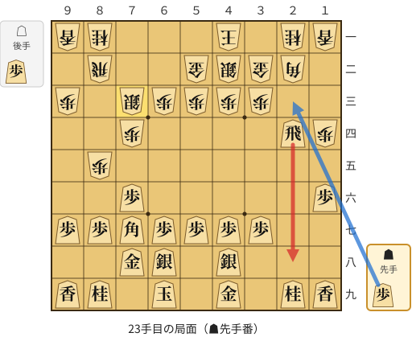

🔴 実戦 ▲２八飛(24)　🔵 AI推奨 ▲２三歩打　🟨 直前の相手の指し手

<details><summary>テキストの盤面図（BOD・将棋ソフトに貼り付け可）</summary>

```text
後手の持駒：歩
  ９ ８ ７ ６ ５ ４ ３ ２ １
+---------------------------+
|v香v桂 ・ ・ ・v玉 ・v桂v香|一
| ・v飛 ・ ・v金v銀v金v角 ・|二
|v歩 ・v銀v歩v歩v歩v歩 ・ ・|三
| ・ ・v歩 ・ ・ ・ ・ 飛v歩|四
| ・v歩 ・ ・ ・ ・ ・ ・ ・|五
| ・ ・ 歩 ・ ・ ・ ・ ・ 歩|六
| 歩 歩 角 歩 歩 歩 歩 ・ ・|七
| ・ ・ 金 銀 ・ 銀 ・ ・ ・|八
| 香 桂 ・ 玉 ・ 金 ・ 桂 香|九
+---------------------------+
先手の持駒：歩
手数＝22　△７三銀　まで
```

</details>

| | 指し手 | 評価値 | 読み筋 |
|---|---|--:|---|
| 実戦 | ▲２八飛(24) | +77 | △２三歩打 ▲３六歩(37) △６四銀(73) ▲３七桂(29) △３四歩(33) ▲５八金(49) |
| AI 1位 | ▲２三歩打 | +423 | ▲２三歩打 △３一角(22) ▲２六飛(24) △５四歩(53) ▲３六歩(37) △７五歩(74) |
| AI 2位 | ▲２五飛(24) | +126 | ▲２五飛(24) △２三歩打 ▲５九金(49) △３四歩(33) ▲２二角成(77) △同金(32) |
| AI 3位 | ▲５八金(49) | +74 | ▲５八金(49) △２三歩打 ▲２八飛(24) △６四銀(73) ▲６六歩(67) △７五歩(74) |

SFEN: `ln3k1nl/1r2gsgb1/p1spppp2/2p4Rp/1p7/2P5P/PPBPPPP2/2GS1S3/LN1K1G1NL b Pp 23`

<a id="ply-37"></a>
### 37手目 ▲３五歩(36) — 悪手

| | 着手前 | 着手後 | 差 |
|---|--:|--:|--:|
| 期待勝率 | 59.0% | 46.0% | -12.9pt |
| 評価値 | +218 | -95 | |

着手前の局面:

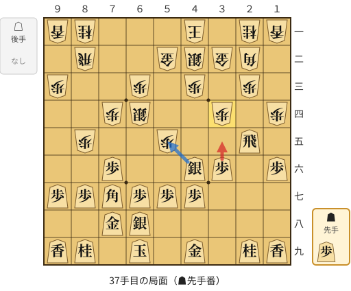

🔴 実戦 ▲３五歩(36)　🔵 AI推奨 ▲５五銀(46)　🟨 直前の相手の指し手

<details><summary>テキストの盤面図（BOD・将棋ソフトに貼り付け可）</summary>

```text
後手の持駒：なし
  ９ ８ ７ ６ ５ ４ ３ ２ １
+---------------------------+
|v香v桂 ・ ・ ・v玉 ・v桂v香|一
| ・v飛 ・ ・v金v銀v金v角 ・|二
|v歩 ・ ・v歩 ・v歩 ・v歩 ・|三
| ・ ・v歩v銀 ・ ・v歩 ・v歩|四
| ・v歩 ・ ・v歩 ・ ・ 飛 ・|五
| ・ ・ 歩 ・ ・ 銀 歩 ・ 歩|六
| 歩 歩 角 歩 歩 歩 ・ ・ ・|七
| ・ ・ 金 銀 ・ ・ ・ ・ ・|八
| 香 桂 ・ 玉 ・ 金 ・ 桂 香|九
+---------------------------+
先手の持駒：歩
手数＝36　△３四歩　まで
```

</details>

| | 指し手 | 評価値 | 読み筋 |
|---|---|--:|---|
| 実戦 | ▲３五歩(36) | -95 | △７五歩(74) ▲３四歩(35) △８六歩(85) ▲同歩(87) △７六歩(75) ▲８八角(77) |
| AI 1位 | ▲５五銀(46) | +218 | ▲５五銀(46) △同銀(64) ▲同飛(25) △８六歩(85) ▲同歩(87) △７三桂(81) |
| AI 2位 | ▲１五歩(16) | +41 | ▲１五歩(16) △７五歩(74) ▲１四歩(15) △７六歩(75) ▲６六角(77) △８六歩(85) |
| AI 3位 | ▲３七桂(29) | -97 | ▲３七桂(29) △８六歩(85) ▲同歩(87) △７五歩(74) ▲同歩(76) △７三桂(81) |

SFEN: `ln3k1nl/1r2gsgb1/p2p1p1p1/2ps2p1p/1p2p2R1/2P2SP1P/PPBPPP3/2GS5/LN1K1G1NL b P 37`

<a id="ply-39"></a>
### 39手目 ▲同歩(76) — 悪手

| | 着手前 | 着手後 | 差 |
|---|--:|--:|--:|
| 期待勝率 | 45.3% | 30.5% | -14.8pt |
| 評価値 | -113 | -494 | |

着手前の局面:

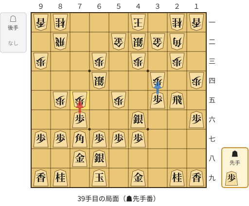

🔴 実戦 ▲同歩(76)　🔵 AI推奨 ▲３四歩(35)　🟨 直前の相手の指し手

<details><summary>テキストの盤面図（BOD・将棋ソフトに貼り付け可）</summary>

```text
後手の持駒：なし
  ９ ８ ７ ６ ５ ４ ３ ２ １
+---------------------------+
|v香v桂 ・ ・ ・v玉 ・v桂v香|一
| ・v飛 ・ ・v金v銀v金v角 ・|二
|v歩 ・ ・v歩 ・v歩 ・v歩 ・|三
| ・ ・ ・v銀 ・ ・v歩 ・v歩|四
| ・v歩v歩 ・v歩 ・ 歩 飛 ・|五
| ・ ・ 歩 ・ ・ 銀 ・ ・ 歩|六
| 歩 歩 角 歩 歩 歩 ・ ・ ・|七
| ・ ・ 金 銀 ・ ・ ・ ・ ・|八
| 香 桂 ・ 玉 ・ 金 ・ 桂 香|九
+---------------------------+
先手の持駒：歩
手数＝38　△７五歩　まで
```

</details>

| | 指し手 | 評価値 | 読み筋 |
|---|---|--:|---|
| 実戦 | ▲同歩(76) | -494 | △同銀(64) ▲２四歩打 △同歩(23) ▲同飛(25) △２三歩打 ▲３四飛(24) |
| AI 1位 | ▲３四歩(35) | -113 | ▲３四歩(35) △７六歩(75) ▲８八角(77) △８六歩(85) ▲同歩(87) △同飛(82) |
| AI 2位 | ▲６六角(77) | -198 | ▲６六角(77) △７六歩(75) ▲３四歩(35) △７三桂(81) ▲８八角(66) △８六歩(85) |
| AI 3位 | ▲１五歩(16) | -213 | ▲１五歩(16) △同歩(14) ▲３四歩(35) △７六歩(75) ▲６六角(77) △８六歩(85) |

SFEN: `ln3k1nl/1r2gsgb1/p2p1p1p1/3s2p1p/1pp1p1PR1/2P2S2P/PPBPPP3/2GS5/LN1K1G1NL b P 39`

<a id="ply-51"></a>
### 51手目 ▲８四歩打 — 悪手

| | 着手前 | 着手後 | 差 |
|---|--:|--:|--:|
| 期待勝率 | 23.4% | 10.2% | -13.2pt |
| 評価値 | -711 | -1305 | |

着手前の局面:

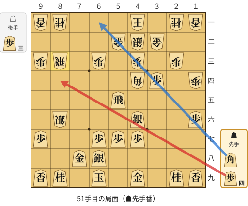

🔴 実戦 ▲８四歩打　🔵 AI推奨 ▲６一角打　🟨 直前の相手の指し手

<details><summary>テキストの盤面図（BOD・将棋ソフトに貼り付け可）</summary>

```text
後手の持駒：歩三
  ９ ８ ７ ６ ５ ４ ３ ２ １
+---------------------------+
|v香v桂 ・ ・ ・v玉 ・v桂v香|一
| ・ ・ ・ ・v金v銀v金 ・ ・|二
|v歩v飛 ・v歩 ・v歩 ・v歩 ・|三
| ・ ・ ・ ・ ・v角 歩 ・v歩|四
| ・ ・ ・ ・ 飛 ・ ・ ・ ・|五
| ・v銀 ・ ・ ・ 銀 ・ ・ 歩|六
| 歩 ・ ・ 歩 歩 歩 ・ ・ ・|七
| ・ ・ 金 銀 ・ ・ ・ ・ ・|八
| 香 桂 ・ 玉 ・ 金 ・ 桂 香|九
+---------------------------+
先手の持駒：角　歩四
手数＝50　△８三同飛　まで
```

</details>

| | 指し手 | 評価値 | 読み筋 |
|---|---|--:|---|
| 実戦 | ▲８四歩打 | -1305 | △同飛(83) ▲６六角打 △５五角(44) ▲同角(66) △７七歩打 ▲同桂(89) |
| AI 1位 | ▲６一角打 | -711 | ▲６一角打 △５五角(44) ▲８三角成(61) △９九角成(55) ▲２二歩打 △同馬(99) |
| AI 2位 | ▲５四飛(55) | -761 | ▲５四飛(55) △８五飛(83) ▲８八歩打 △８七歩打 ▲６六歩(67) △２五飛(85) |
| AI 3位 | ▲３三歩成(34) | -934 | ▲３三歩成(34) △同角(44) ▲５四飛(55) △７七歩打 ▲８八金(78) △９七銀成(86) |

SFEN: `ln3k1nl/4gsg2/pr1p1p1p1/5bP1p/4R4/1s3S2P/P2PPP3/2GS5/LN1K1G1NL b B4P3p 51`

<a id="ply-53"></a>
### 53手目 ▲８五歩打 — 疑問手

| | 着手前 | 着手後 | 差 |
|---|--:|--:|--:|
| 期待勝率 | 8.6% | 2.9% | -5.7pt |
| 評価値 | -1418 | -2098 | |

着手前の局面:

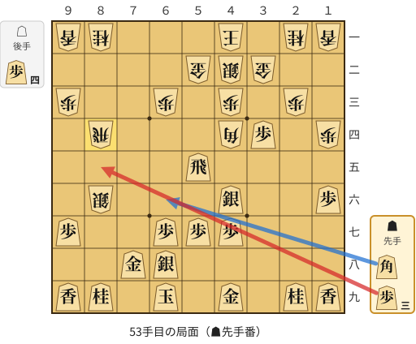

🔴 実戦 ▲８五歩打　🔵 AI推奨 ▲６六角打　🟨 直前の相手の指し手

<details><summary>テキストの盤面図（BOD・将棋ソフトに貼り付け可）</summary>

```text
後手の持駒：歩四
  ９ ８ ７ ６ ５ ４ ３ ２ １
+---------------------------+
|v香v桂 ・ ・ ・v玉 ・v桂v香|一
| ・ ・ ・ ・v金v銀v金 ・ ・|二
|v歩 ・ ・v歩 ・v歩 ・v歩 ・|三
| ・v飛 ・ ・ ・v角 歩 ・v歩|四
| ・ ・ ・ ・ 飛 ・ ・ ・ ・|五
| ・v銀 ・ ・ ・ 銀 ・ ・ 歩|六
| 歩 ・ ・ 歩 歩 歩 ・ ・ ・|七
| ・ ・ 金 銀 ・ ・ ・ ・ ・|八
| 香 桂 ・ 玉 ・ 金 ・ 桂 香|九
+---------------------------+
先手の持駒：角　歩三
手数＝52　△８四同飛　まで
```

</details>

| | 指し手 | 評価値 | 読み筋 |
|---|---|--:|---|
| 実戦 | ▲８五歩打 | -2098 | △５五角(44) ▲８四歩(85) △９九角成(55) ▲３三歩成(34) △同馬(99) ▲８三歩成(84) |
| AI 1位 | ▲６六角打 | -1418 | ▲６六角打 △５五角(44) ▲同角(66) △７七歩打 ▲同桂(89) △７六歩打 |
| AI 2位 | ▲３三歩成(34) | -1943 | ▲３三歩成(34) △同角(44) ▲６六角打 △５五角(33) ▲同角(66) △７七歩打 |
| AI 3位 | ▲５四角打 | -1675 | ▲５四角打 △５三歩打 ▲６五角(54) △７七歩打 ▲同桂(89) △５五角(44) |

SFEN: `ln3k1nl/4gsg2/p2p1p1p1/1r3bP1p/4R4/1s3S2P/P2PPP3/2GS5/LN1K1G1NL b B3P4p 53`

<a id="ply-55"></a>
### 55手目 ▲５六飛(55) — 疑問手

| | 着手前 | 着手後 | 差 |
|---|--:|--:|--:|
| 期待勝率 | 7.7% | 2.2% | -5.5pt |
| 評価値 | -1490 | -2285 | |

着手前の局面:

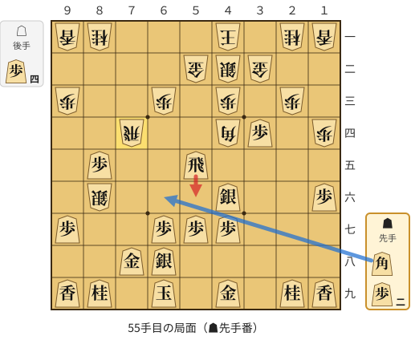

🔴 実戦 ▲５六飛(55)　🔵 AI推奨 ▲６六角打　🟨 直前の相手の指し手

<details><summary>テキストの盤面図（BOD・将棋ソフトに貼り付け可）</summary>

```text
後手の持駒：歩四
  ９ ８ ７ ６ ５ ４ ３ ２ １
+---------------------------+
|v香v桂 ・ ・ ・v玉 ・v桂v香|一
| ・ ・ ・ ・v金v銀v金 ・ ・|二
|v歩 ・ ・v歩 ・v歩 ・v歩 ・|三
| ・ ・v飛 ・ ・v角 歩 ・v歩|四
| ・ 歩 ・ ・ 飛 ・ ・ ・ ・|五
| ・v銀 ・ ・ ・ 銀 ・ ・ 歩|六
| 歩 ・ ・ 歩 歩 歩 ・ ・ ・|七
| ・ ・ 金 銀 ・ ・ ・ ・ ・|八
| 香 桂 ・ 玉 ・ 金 ・ 桂 香|九
+---------------------------+
先手の持駒：角　歩二
手数＝54　△７四飛　まで
```

</details>

| | 指し手 | 評価値 | 読み筋 |
|---|---|--:|---|
| 実戦 | ▲５六飛(55) | -2285 | △７七歩打 ▲７九金(78) △８七銀成(86) ▲７六歩打 △７八歩成(77) ▲同金(79) |
| AI 1位 | ▲６六角打 | -1490 | ▲６六角打 △５五角(44) ▲同角(66) △２八飛打 ▲７五歩打 △２九飛成(28) |
| AI 2位 | ▲８二角打 | -1702 | ▲８二角打 △７七歩打 ▲同金(78) △同銀成(86) ▲同銀(68) △８八歩打 |
| AI 3位 | ▲５六角打 | -1682 | ▲５六角打 △５五角(44) ▲同銀(46) △７八飛成(74) ▲同玉(69) △８八歩打 |

SFEN: `ln3k1nl/4gsg2/p2p1p1p1/2r2bP1p/1P2R4/1s3S2P/P2PPP3/2GS5/LN1K1G1NL b B2P4p 55`

<a id="ply-59"></a>
### 59手目 ▲同桂(89) — 大悪手

| | 着手前 | 着手後 | 差 |
|---|--:|--:|--:|
| 期待勝率 | 45.6% | 22.7% | -22.9pt |
| 評価値 | -105 | -734 | |

着手前の局面:

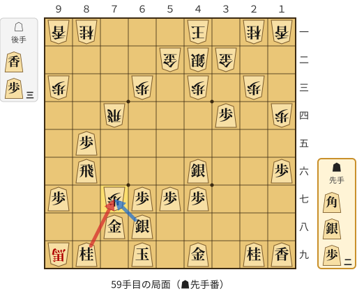

🔴 実戦 ▲同桂(89)　🔵 AI推奨 ▲同銀(68)　🟨 直前の相手の指し手

<details><summary>テキストの盤面図（BOD・将棋ソフトに貼り付け可）</summary>

```text
後手の持駒：香　歩三
  ９ ８ ７ ６ ５ ４ ３ ２ １
+---------------------------+
|v香v桂 ・ ・ ・v玉 ・v桂v香|一
| ・ ・ ・ ・v金v銀v金 ・ ・|二
|v歩 ・ ・v歩 ・v歩 ・v歩 ・|三
| ・ ・v飛 ・ ・ ・ 歩 ・v歩|四
| ・ 歩 ・ ・ ・ ・ ・ ・ ・|五
| ・ 飛 ・ ・ ・ 銀 ・ ・ 歩|六
| 歩 ・v歩 歩 歩 歩 ・ ・ ・|七
| ・ ・ 金 銀 ・ ・ ・ ・ ・|八
|v馬 桂 ・ 玉 ・ 金 ・ 桂 香|九
+---------------------------+
先手の持駒：角　銀　歩二
手数＝58　△７七歩　まで
```

</details>

| | 指し手 | 評価値 | 読み筋 |
|---|---|--:|---|
| 実戦 | ▲同桂(89) | -734 | △７六歩打 ▲８八銀打 △７七歩成(76) ▲同銀(68) △７六歩打 ▲６六銀(77) |
| AI 1位 | ▲同銀(68) | -105 | ▲同銀(68) △８八歩打 ▲同金(78) △８九馬(99) ▲５六角打 △７五飛(74) |
| AI 2位 | ▲同金(78) | -352 | ▲同金(78) △８八歩打 ▲５六角打 △９四飛(74) ▲２二歩打 △同金(32) |
| AI 3位 | ▲同桂(89) | -480 | ▲同桂(89) △７六歩打 ▲６六角打 △７七歩成(76) ▲同金(78) △７六歩打 |

SFEN: `ln3k1nl/4gsg2/p2p1p1p1/2r3P1p/1P7/1R3S2P/P1pPPP3/2GS5/+bN1K1G1NL b BS2Pl3p 59`

<a id="ply-61"></a>
### 61手目 ▲６五角打 — 悪手

| | 着手前 | 着手後 | 差 |
|---|--:|--:|--:|
| 期待勝率 | 20.6% | 2.9% | -17.7pt |
| 評価値 | -810 | -2113 | |

着手前の局面:

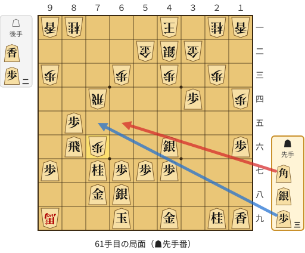

🔴 実戦 ▲６五角打　🔵 AI推奨 ▲７五歩打　🟨 直前の相手の指し手

<details><summary>テキストの盤面図（BOD・将棋ソフトに貼り付け可）</summary>

```text
後手の持駒：香　歩二
  ９ ８ ７ ６ ５ ４ ３ ２ １
+---------------------------+
|v香v桂 ・ ・ ・v玉 ・v桂v香|一
| ・ ・ ・ ・v金v銀v金 ・ ・|二
|v歩 ・ ・v歩 ・v歩 ・v歩 ・|三
| ・ ・v飛 ・ ・ ・ 歩 ・v歩|四
| ・ 歩 ・ ・ ・ ・ ・ ・ ・|五
| ・ 飛v歩 ・ ・ 銀 ・ ・ 歩|六
| 歩 ・ 桂 歩 歩 歩 ・ ・ ・|七
| ・ ・ 金 銀 ・ ・ ・ ・ ・|八
|v馬 ・ ・ 玉 ・ 金 ・ 桂 香|九
+---------------------------+
先手の持駒：角　銀　歩三
手数＝60　△７六歩　まで
```

</details>

| | 指し手 | 評価値 | 読み筋 |
|---|---|--:|---|
| 実戦 | ▲６五角打 | -2113 | △７七歩成(76) ▲７四角(65) △７八と(77) ▲同玉(69) △７五金打 ▲５六飛(86) |
| AI 1位 | ▲７五歩打 | -810 | ▲７五歩打 △７七歩成(76) ▲同銀(68) △３四飛(74) ▲５五角打 △２四飛(34) |
| AI 2位 | ▲８八銀打 | -790 | ▲８八銀打 △７五香打 ▲８三角打 △７三飛(74) ▲６五桂(77) △８三飛(73) |
| AI 3位 | ▲８八銀打 | -790 | ▲８八銀打 △７五香打 ▲６五角打 △７七歩成(76) ▲同銀(68) △同香成(75) |

SFEN: `ln3k1nl/4gsg2/p2p1p1p1/2r3P1p/1P7/1Rp2S2P/P1NPPP3/2GS5/+b2K1G1NL b BS3Pl2p 61`

<a id="ply-63"></a>
### 63手目 ▲７六角(65) — 大悪手

| | 着手前 | 着手後 | 差 |
|---|--:|--:|--:|
| 期待勝率 | 69.8% | 30.8% | -39.0pt |
| 評価値 | +504 | -485 | |

着手前の局面:

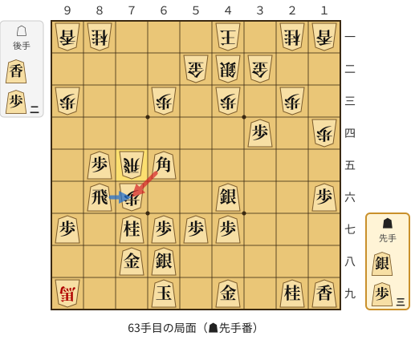

🔴 実戦 ▲７六角(65)　🔵 AI推奨 ▲７六飛(86)　🟨 直前の相手の指し手

<details><summary>テキストの盤面図（BOD・将棋ソフトに貼り付け可）</summary>

```text
後手の持駒：香　歩二
  ９ ８ ７ ６ ５ ４ ３ ２ １
+---------------------------+
|v香v桂 ・ ・ ・v玉 ・v桂v香|一
| ・ ・ ・ ・v金v銀v金 ・ ・|二
|v歩 ・ ・v歩 ・v歩 ・v歩 ・|三
| ・ ・ ・ ・ ・ ・ 歩 ・v歩|四
| ・ 歩v飛 角 ・ ・ ・ ・ ・|五
| ・ 飛v歩 ・ ・ 銀 ・ ・ 歩|六
| 歩 ・ 桂 歩 歩 歩 ・ ・ ・|七
| ・ ・ 金 銀 ・ ・ ・ ・ ・|八
|v馬 ・ ・ 玉 ・ 金 ・ 桂 香|九
+---------------------------+
先手の持駒：銀　歩三
手数＝62　△７五飛　まで
```

</details>

| | 指し手 | 評価値 | 読み筋 |
|---|---|--:|---|
| 実戦 | ▲７六角(65) | -485 | △７四香打 ▲２二歩打 △同金(32) ▲３三歩成(34) △同銀(42) ▲５八玉(69) |
| AI 1位 | ▲７六飛(86) | +504 | ▲７六飛(86) △同飛(75) ▲同角(65) △５一歩打 ▲７二飛打 △８七歩打 |
| AI 2位 | ▲７六角(65) | -364 | ▲７六角(65) △７四香打 ▲８八銀打 △８九馬(99) ▲７九銀(88) △２五飛(75) |
| AI 3位 | ▲６六銀打 | -655 | ▲６六銀打 △７七歩成(76) ▲７五銀(66) △７六歩打 ▲２二歩打 △７八と(77) |

SFEN: `ln3k1nl/4gsg2/p2p1p1p1/6P1p/1PrB5/1Rp2S2P/P1NPPP3/2GS5/+b2K1G1NL b S3Pl2p 63`

<a id="ply-67"></a>
### 67手目 ▲３七桂(29) — 悪手

| | 着手前 | 着手後 | 差 |
|---|--:|--:|--:|
| 期待勝率 | 82.7% | 64.7% | -18.0pt |
| 評価値 | +940 | +364 | |

着手前の局面:

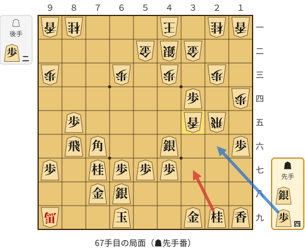

🔴 実戦 ▲３七桂(29)　🔵 AI推奨 ▲２六歩打　🟨 直前の相手の指し手

<details><summary>テキストの盤面図（BOD・将棋ソフトに貼り付け可）</summary>

```text
後手の持駒：歩二
  ９ ８ ７ ６ ５ ４ ３ ２ １
+---------------------------+
|v香v桂 ・ ・ ・v玉 ・v桂v香|一
| ・ ・ ・ ・v金v銀v金 ・ ・|二
|v歩 ・ ・v歩 ・v歩 ・v歩 ・|三
| ・ ・ ・ ・ ・ ・ 歩 ・v歩|四
| ・ 歩 ・ ・ ・ ・v香v飛 ・|五
| ・ 飛 角 ・ ・ 銀 ・ ・ 歩|六
| 歩 ・ 桂 歩 歩 歩 ・ ・ ・|七
| ・ ・ 金 銀 ・ ・ ・ ・ ・|八
|v馬 ・ ・ 玉 ・ ・ 金 桂 香|九
+---------------------------+
先手の持駒：銀　歩四
手数＝66　△３五香　まで
```

</details>

| | 指し手 | 評価値 | 読み筋 |
|---|---|--:|---|
| 実戦 | ▲３七桂(29) | +364 | △同香不成(35) ▲同銀(46) |
| AI 1位 | ▲２六歩打 | +940 | ▲２六歩打 △３九香成(35) ▲２五歩(26) △９五金打 ▲８七飛(86) △２九成香(39) |
| AI 2位 | ▲３七桂(29) | +268 | ▲３七桂(29) △同香成(35) ▲同銀(46) △７四桂打 ▲９六飛(86) △８六歩打 |
| AI 3位 | ▲３七銀打 | +237 | ▲３七銀打 △同香不成(35) ▲同桂(29) △２七飛成(25) ▲５四角(76) △３六歩打 |

SFEN: `ln3k1nl/4gsg2/p2p1p1p1/6P1p/1P4lr1/1RB2S2P/P1NPPP3/2GS5/+b2K2GNL b S4P2p 67`

<a id="ply-69"></a>
### 69手目 ▲２八歩打 — 疑問手

| | 着手前 | 着手後 | 差 |
|---|--:|--:|--:|
| 期待勝率 | 76.4% | 69.6% | -6.7pt |
| 評価値 | +704 | +498 | |

着手前の局面:

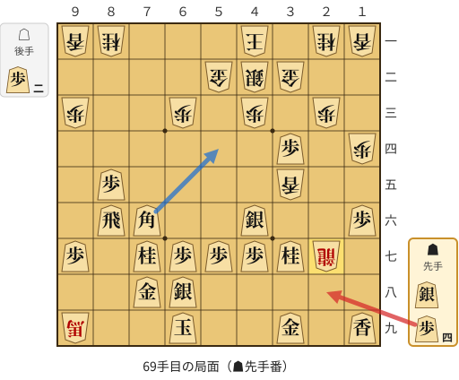

🔴 実戦 ▲２八歩打　🔵 AI推奨 ▲５四角(76)　🟨 直前の相手の指し手

<details><summary>テキストの盤面図（BOD・将棋ソフトに貼り付け可）</summary>

```text
後手の持駒：歩二
  ９ ８ ７ ６ ５ ４ ３ ２ １
+---------------------------+
|v香v桂 ・ ・ ・v玉 ・v桂v香|一
| ・ ・ ・ ・v金v銀v金 ・ ・|二
|v歩 ・ ・v歩 ・v歩 ・v歩 ・|三
| ・ ・ ・ ・ ・ ・ 歩 ・v歩|四
| ・ 歩 ・ ・ ・ ・v香 ・ ・|五
| ・ 飛 角 ・ ・ 銀 ・ ・ 歩|六
| 歩 ・ 桂 歩 歩 歩 桂v龍 ・|七
| ・ ・ 金 銀 ・ ・ ・ ・ ・|八
|v馬 ・ ・ 玉 ・ ・ 金 ・ 香|九
+---------------------------+
先手の持駒：銀　歩四
手数＝68　△２七飛成　まで
```

</details>

| | 指し手 | 評価値 | 読み筋 |
|---|---|--:|---|
| 実戦 | ▲２八歩打 | +498 | △２六龍(27) ▲２七歩(28) △４六龍(26) ▲同歩(47) △９五銀打 ▲３三歩成(34) |
| AI 1位 | ▲５四角(76) | +704 | ▲５四角(76) △２六龍(27) ▲２七歩打 △２四龍(26) ▲２五銀打 △３七香不成(35) |
| AI 2位 | ▲２八歩打 | +536 | ▲２八歩打 △２六龍(27) ▲２七歩(28) △４六龍(26) ▲同歩(47) △３七香成(35) |
| AI 3位 | ▲２八歩打 | +804 | ▲２八歩打 △２六龍(27) ▲２七歩(28) △４六龍(26) ▲同歩(47) △３七香成(35) |

SFEN: `ln3k1nl/4gsg2/p2p1p1p1/6P1p/1P4l2/1RB2S2P/P1NPPPN+r1/2GS5/+b2K2G1L b S4P2p 69`

<a id="ply-71"></a>
### 71手目 ▲３八金(39) — 大悪手

| | 着手前 | 着手後 | 差 |
|---|--:|--:|--:|
| 期待勝率 | 69.2% | 29.3% | -39.9pt |
| 評価値 | +487 | -528 | |

着手前の局面:

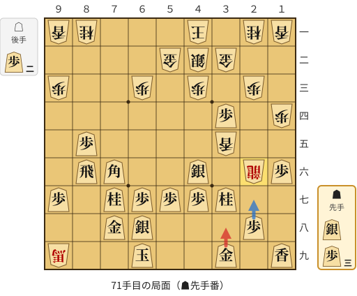

🔴 実戦 ▲３八金(39)　🔵 AI推奨 ▲２七歩(28)　🟨 直前の相手の指し手

<details><summary>テキストの盤面図（BOD・将棋ソフトに貼り付け可）</summary>

```text
後手の持駒：歩二
  ９ ８ ７ ６ ５ ４ ３ ２ １
+---------------------------+
|v香v桂 ・ ・ ・v玉 ・v桂v香|一
| ・ ・ ・ ・v金v銀v金 ・ ・|二
|v歩 ・ ・v歩 ・v歩 ・v歩 ・|三
| ・ ・ ・ ・ ・ ・ 歩 ・v歩|四
| ・ 歩 ・ ・ ・ ・v香 ・ ・|五
| ・ 飛 角 ・ ・ 銀 ・v龍 歩|六
| 歩 ・ 桂 歩 歩 歩 桂 ・ ・|七
| ・ ・ 金 銀 ・ ・ ・ 歩 ・|八
|v馬 ・ ・ 玉 ・ ・ 金 ・ 香|九
+---------------------------+
先手の持駒：銀　歩三
手数＝70　△２六龍　まで
```

</details>

| | 指し手 | 評価値 | 読み筋 |
|---|---|--:|---|
| 実戦 | ▲３八金(39) | -528 | △７五歩打 ▲２七銀打 △４六龍(26) ▲同歩(47) △７六歩(75) ▲同飛(86) |
| AI 1位 | ▲２七歩(28) | +487 | ▲２七歩(28) △４六龍(26) ▲同歩(47) △３七香成(35) ▲７一飛打 △５一歩打 |
| AI 2位 | ▲３三歩成(34) | +47 | ▲３三歩成(34) △同桂(21) ▲２七銀打 △３七龍(26) ▲同銀(46) △同香成(35) |
| AI 3位 | ▲２七銀打 | -88 | ▲２七銀打 △２四龍(26) ▲３三歩成(34) △同龍(24) ▲２六銀(27) △３七香成(35) |

SFEN: `ln3k1nl/4gsg2/p2p1p1p1/6P1p/1P4l2/1RB2S1+rP/P1NPPPN2/2GS3P1/+b2K2G1L b S3P2p 71`

<a id="ply-73"></a>
### 73手目 ▲２七歩(28) — 大悪手

| | 着手前 | 着手後 | 差 |
|---|--:|--:|--:|
| 期待勝率 | 67.4% | 41.6% | -25.8pt |
| 評価値 | +436 | -203 | |

着手前の局面:

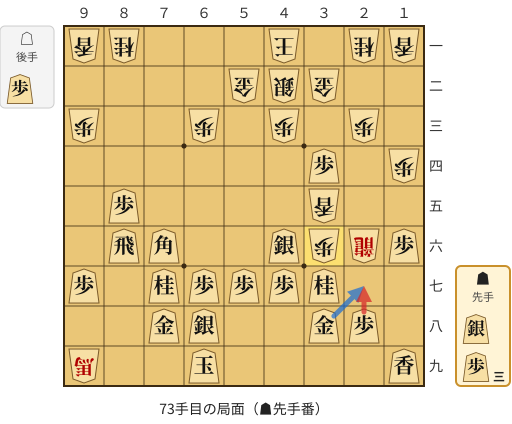

🔴 実戦 ▲２七歩(28)　🔵 AI推奨 ▲２七金(38)　🟨 直前の相手の指し手

<details><summary>テキストの盤面図（BOD・将棋ソフトに貼り付け可）</summary>

```text
後手の持駒：歩
  ９ ８ ７ ６ ５ ４ ３ ２ １
+---------------------------+
|v香v桂 ・ ・ ・v玉 ・v桂v香|一
| ・ ・ ・ ・v金v銀v金 ・ ・|二
|v歩 ・ ・v歩 ・v歩 ・v歩 ・|三
| ・ ・ ・ ・ ・ ・ 歩 ・v歩|四
| ・ 歩 ・ ・ ・ ・v香 ・ ・|五
| ・ 飛 角 ・ ・ 銀v歩v龍 歩|六
| 歩 ・ 桂 歩 歩 歩 桂 ・ ・|七
| ・ ・ 金 銀 ・ ・ 金 歩 ・|八
|v馬 ・ ・ 玉 ・ ・ ・ ・ 香|九
+---------------------------+
先手の持駒：銀　歩三
手数＝72　△３六歩　まで
```

</details>

| | 指し手 | 評価値 | 読み筋 |
|---|---|--:|---|
| 実戦 | ▲２七歩(28) | -203 | △２四龍(26) ▲２五銀打 △３七歩成(36) ▲２四銀(25) △同歩(23) ▲３七金(38) |
| AI 1位 | ▲２七金(38) | +436 | ▲２七金(38) △２四龍(26) ▲２五銀打 △３七歩成(36) ▲２四銀(25) △同歩(23) |
| AI 2位 | ▲２七歩(28) | -291 | ▲２七歩(28) △２四龍(26) ▲２五銀打 △３七歩成(36) ▲２四銀(25) △同歩(23) |
| AI 3位 | ▲３三歩成(34) | -1001 | ▲３三歩成(34) △同桂(21) ▲２七金(38) △２四龍(26) ▲４五桂(37) △３七歩成(36) |

SFEN: `ln3k1nl/4gsg2/p2p1p1p1/6P1p/1P4l2/1RB2Sp+rP/P1NPPPN2/2GS2GP1/+b2K4L b S3Pp 73`

