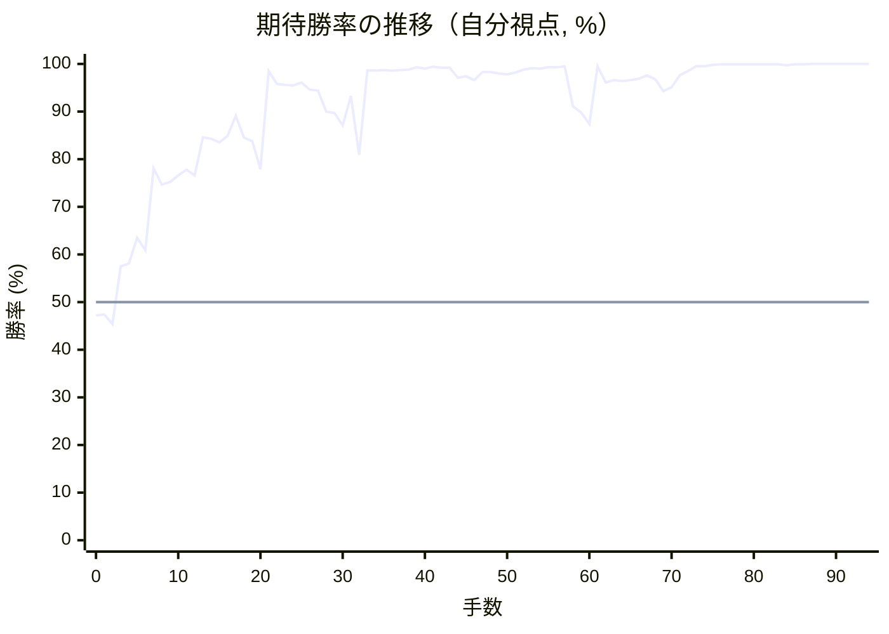

# 解析レポート cv45mi435man

[README に戻る](../../../README.md)　/　棋譜: [CSA](../../../data/csa/shogi5/cv45mi435man.csa)　/　解析の見方: [docs/mistake_analysis.md](../../../docs/mistake_analysis.md)

## 対局情報

| 項目 | 内容 |
|---|---|
| 日時 | 2026-11-05 02:43:44 |
| 持ち時間 | 5分 |
| 自分 | 後手（△）（1725） |
| 相手 | 相手（1704） |
| 結果 | 勝ち（投了, 94手） |

## 解析環境

| 項目 | 内容 |
|---|---|
| エンジン | YaneuraOu NNUE 9.00git 64AVX2（V9.00/YANEURAOU_ENGINE_NNUE/AVX2） |
| 評価関数 | **水匠5**（`suisho5`） |
| nn.bin SHA-256 | `768068f0d534a0603a5d38bcd143de6bbca820d5f1c95a14d40863e5b7892d76` |
| 第1パス | movetime=150ms, MultiPV 1 |
| 第2パス | movetime=2000ms, MultiPV 3 |
| Threads / Hash | 8 / 512MB |
| 判定基準 | 疑問手 ≥5pt, 悪手 ≥10pt, 大悪手 ≥20pt（期待勝率 W(E)=1/(1+exp(-E/600))） |
| 解析日時 | 2026-11-11T20:38:12+09:00（解析バージョン 1, 34秒） |

## サマリー

| 自分の手数 | 深掘りした手 | 詰み逃し | 大悪手 | 悪手 | 疑問手 |
|--:|--:|--:|--:|--:|--:|
| 47 | 5 | 2 | 0 | 1 | 2 |

## 期待勝率の推移



<details><summary>1手ごとの数値（第1パス）</summary>

| 手数 | 指し手 | 評価値 | 勝率 | 低下 | 判定 |
|--:|---|--:|--:|--:|---|
| 1 | ▲７六歩(77) | -62 | 47.4% |  |  |
| 2 | △３四歩(33) | -111 | 45.4% | +2.0pt |  |
| 3 | ▲７五歩(76) | +182 | 57.5% |  |  |
| 4 | △８四歩(83) | +195 | 58.1% | -0.5pt |  |
| 5 | ▲６六歩(67) | +333 | 63.5% |  |  |
| 6 | △８五歩(84) | +267 | 60.9% | +2.6pt |  |
| 7 | ▲７八飛(28) | +762 | 78.1% |  |  |
| 8 | △８六歩(85) | +651 | 74.7% | +3.3pt |  |
| 9 | ▲同歩(87) | +665 | 75.2% |  |  |
| 10 | △同飛(82) | +711 | 76.6% | -1.4pt |  |
| 11 | ▲７四歩(75) | +753 | 77.8% |  |  |
| 12 | △６二銀(71) | +713 | 76.6% | +1.2pt |  |
| 13 | ▲７三歩成(74) | +1021 | 84.6% |  |  |
| 14 | △同銀(62) | +1007 | 84.3% | +0.3pt |  |
| 15 | ▲９六歩(97) | +972 | 83.5% |  |  |
| 16 | △８七飛成(86) | +1037 | 84.9% | -1.4pt |  |
| 17 | ▲４八玉(59) | +1261 | 89.1% |  |  |
| 18 | △８四龍(87) | +1016 | 84.5% | +4.6pt |  |
| 19 | ▲６五歩(66) | +988 | 83.8% |  |  |
| 20 | △４四歩(43) | +756 | 77.9% | +5.9pt | [疑問手](#ply-20) |
| 21 | ▲７七桂(89) | +2512 | 98.5% |  |  |
| 22 | △４二玉(51) | +1871 | 95.8% | +2.7pt |  |
| 23 | ▲９七角(88) | +1851 | 95.6% |  |  |
| 24 | △８六歩打 | +1834 | 95.5% | +0.1pt |  |
| 25 | ▲８五歩打 | +1915 | 96.1% |  |  |
| 26 | △７五龍(84) | +1714 | 94.6% | +1.5pt |  |
| 27 | ▲８八飛(78) | +1696 | 94.4% |  |  |
| 28 | △７六歩打 | +1318 | 90.0% | +4.4pt |  |
| 29 | ▲８六角(97) | +1298 | 89.7% |  |  |
| 30 | △６六龍(75) | +1147 | 87.1% | +2.6pt |  |
| 31 | ▲６八銀(79) | +1580 | 93.3% |  |  |
| 32 | △４五歩(44) | +867 | 80.9% | +12.4pt | [悪手](#ply-32) |
| 33 | ▲５八金(69) | +2557 | 98.6% |  |  |
| 34 | △７七歩成(76) | +2557 | 98.6% | +0.0pt |  |
| 35 | ▲同角(86) | +2594 | 98.7% |  |  |
| 36 | △同龍(66) | +2556 | 98.6% | +0.1pt |  |
| 37 | ▲同銀(68) | +2620 | 98.7% |  |  |
| 38 | △同角成(22) | +2627 | 98.8% | -0.0pt |  |
| 39 | ▲６八飛(88) | +2986 | 99.3% |  |  |
| 40 | △３二銀(31) | +2744 | 99.0% | +0.3pt |  |
| 41 | ▲８四歩(85) | +3045 | 99.4% |  |  |
| 42 | △６八馬(77) | +2894 | 99.2% | +0.2pt |  |
| 43 | ▲同金(58) | +2885 | 99.2% |  |  |
| 44 | △８八飛打 | +2098 | 97.1% | +2.1pt |  |
| 45 | ▲７七角打 | +2170 | 97.4% |  |  |
| 46 | △８九飛成(88) | +2007 | 96.6% | +0.8pt |  |
| 47 | ▲８三歩成(84) | +2437 | 98.3% |  |  |
| 48 | △３三角打 | +2452 | 98.3% | -0.0pt |  |
| 49 | ▲同角成(77) | +2345 | 98.0% |  |  |
| 50 | △同桂(21) | +2283 | 97.8% | +0.2pt |  |
| 51 | ▲７三と(83) | +2395 | 98.2% |  |  |
| 52 | △４六歩(45) | +2623 | 98.8% | -0.6pt |  |
| 53 | ▲８二飛打 | +2835 | 99.1% |  |  |
| 54 | △同龍(89) | +2788 | 99.0% | +0.1pt |  |
| 55 | ▲同と(73) | +2977 | 99.3% |  |  |
| 56 | △４七歩成(46) | +2986 | 99.3% | -0.0pt |  |
| 57 | ▲同玉(48) | +3120 | 99.5% |  |  |
| 58 | △５五桂打 | +1396 | 91.1% | +8.3pt | [疑問手](#ply-58) |
| 59 | ▲３八玉(47) | +1302 | 89.8% |  |  |
| 60 | △８九飛打 | +1163 | 87.4% | +2.3pt |  |
| 61 | ▲６九飛打 | +3162 | 99.5% |  |  |
| 62 | △同飛成(89) | +1926 | 96.1% | +3.4pt |  |
| 63 | ▲同金(68) | +2010 | 96.6% |  |  |
| 64 | △４七角打 | +1977 | 96.4% | +0.2pt |  |
| 65 | ▲２八玉(38) | +2006 | 96.6% |  |  |
| 66 | △６九角成(47) | +2066 | 96.9% | -0.3pt |  |
| 67 | ▲８一と(82) | +2211 | 97.6% |  |  |
| 68 | △７八飛打 | +2045 | 96.8% | +0.8pt |  |
| 69 | ▲４八歩打 | +1682 | 94.3% |  |  |
| 70 | △４七歩打 | +1781 | 95.1% | -0.8pt |  |
| 71 | ▲３八銀打 | +2232 | 97.6% |  |  |
| 72 | △４八歩成(47) | +2492 | 98.5% | -0.8pt |  |
| 73 | ▲同銀(39) | +3151 | 99.5% |  |  |
| 74 | △４七歩打 | +3221 | 99.5% | -0.1pt |  |
| 75 | ▲５六角打 | +3772 | 99.8% |  |  |
| 76 | △４八歩成(47) | +4316 | 99.9% | -0.1pt |  |
| 77 | ▲７八角(56) | +4077 | 99.9% |  |  |
| 78 | △４九と(48) | +3944 | 99.9% | +0.0pt |  |
| 79 | ▲４四飛打 | +4003 | 99.9% |  |  |
| 80 | △３一玉(42) | +4245 | 99.9% | -0.0pt |  |
| 81 | ▲４九飛(44) | +3997 | 99.9% |  |  |
| 82 | △７八馬(69) | +4158 | 99.9% | -0.0pt |  |
| 83 | ▲４四桂打 | +4326 | 99.9% |  |  |
| 84 | △４五桂(33) | +3577 | 99.7% | +0.2pt |  |
| 85 | ▲３二桂成(44) | +4260 | 99.9% |  |  |
| 86 | △同金(41) | +4287 | 99.9% | -0.0pt |  |
| 87 | ▲４五飛(49) | +6440 | 100.0% |  |  |
| 88 | △同馬(78) | +6781 | 100.0% | -0.0pt |  |
| 89 | ▲７一と(81) | #+11 | 100.0% |  |  |
| 90 | △７九飛打 | +7511 | 100.0% | +0.0pt | [詰み逃し](#ply-90) |
| 91 | ▲４九歩打 | #+11 | 100.0% |  |  |
| 92 | △４八金打 | +6955 | 100.0% | +0.0pt | [詰み逃し](#ply-92) |
| 93 | ▲６一と(71) | #+3 | 100.0% |  |  |
| 94 | △３九銀打 | #+2 | 100.0% | +0.0pt |  |

</details>

## 課題局面

<a id="ply-20"></a>
### 20手目 △４四歩(43) — 疑問手

| | 着手前 | 着手後 | 差 |
|---|--:|--:|--:|
| 期待勝率 | 89.0% | 80.3% | -8.7pt |
| 評価値 | +1254 | +842 | |

着手前の局面:

```text
後手の持駒：歩二
  ９ ８ ７ ６ ５ ４ ３ ２ １
+---------------------------+
|v香v桂 ・v金v玉v金v銀v桂v香|一
| ・ ・ ・ ・ ・ ・ ・v角 ・|二
|v歩 ・v銀v歩v歩v歩 ・v歩v歩|三
| ・v龍 ・ ・ ・ ・v歩 ・ ・|四
| ・ ・ ・ 歩 ・ ・ ・ ・ ・|五
| 歩 ・ ・ ・ ・ ・ ・ ・ ・|六
| ・ ・ ・ ・ 歩 歩 歩 歩 歩|七
| ・ 角 飛 ・ ・ 玉 ・ ・ ・|八
| 香 桂 銀 金 ・ 金 銀 桂 香|九
+---------------------------+
先手の持駒：歩二
後手番
手数＝19　▲６五歩　まで
```

| | 指し手 | 評価値 | 読み筋 |
|---|---|--:|---|
| 実戦 | △４四歩(43) | +842 | ▲３八玉(48) △４二玉(51) |
| AI 1位 | △８八角成(22) | +1254 | △８八角成(22) ▲同飛(78) △８七歩打 ▲７八飛(88) △５五角打 ▲９五角打 |
| AI 2位 | △３三桂(21) | +910 | △３三桂(21) ▲３八玉(48) △７五歩打 ▲５五角(88) △４二玉(51) ▲４八金(49) |
| AI 3位 | △７七歩打 | +846 | △７七歩打 ▲同角(88) △同角成(22) ▲同飛(78) △８九龍(84) ▲８八角打 |

SFEN: `ln1gkgsnl/7b1/p1sppp1pp/1+r4p2/3P5/P8/4PPPPP/1BR2K3/LNSG1GSNL w 2P2p 20`

<a id="ply-32"></a>
### 32手目 △４五歩(44) — 悪手

| | 着手前 | 着手後 | 差 |
|---|--:|--:|--:|
| 期待勝率 | 94.1% | 83.7% | -10.4pt |
| 評価値 | +1663 | +982 | |

着手前の局面:

```text
後手の持駒：なし
  ９ ８ ７ ６ ５ ４ ３ ２ １
+---------------------------+
|v香v桂 ・v金 ・v金v銀v桂v香|一
| ・ ・ ・ ・ ・v玉 ・v角 ・|二
|v歩 ・v銀v歩v歩 ・ ・v歩v歩|三
| ・ ・ ・ ・ ・v歩v歩 ・ ・|四
| ・ 歩 ・ 歩 ・ ・ ・ ・ ・|五
| 歩 角v歩v龍 ・ ・ ・ ・ ・|六
| ・ ・ 桂 ・ 歩 歩 歩 歩 歩|七
| ・ 飛 ・ 銀 ・ 玉 ・ ・ ・|八
| 香 ・ ・ 金 ・ 金 銀 桂 香|九
+---------------------------+
先手の持駒：歩二
後手番
手数＝31　▲６八銀　まで
```

| | 指し手 | 評価値 | 読み筋 |
|---|---|--:|---|
| 実戦 | △４五歩(44) | +982 | ▲７八歩打 △４六歩(45) ▲３八銀(39) △４七歩成(46) ▲同銀(38) △５二金(61) |
| AI 1位 | △７七歩成(76) | +1663 | △７七歩成(76) ▲同角(86) △６五龍(66) ▲８六飛(88) △７五龍(65) ▲８九飛(86) |
| AI 2位 | △５二金(61) | +1500 | △５二金(61) ▲８四歩(85) △同銀(73) ▲７八歩打 △８五歩打 ▲同桂(77) |
| AI 3位 | △１四歩(13) | +1435 | △１四歩(13) ▲８四歩(85) △同銀(73) ▲７八金(69) △８五歩打 ▲同桂(77) |

SFEN: `ln1g1gsnl/5k1b1/p1spp2pp/5pp2/1P1P5/PBp+r5/2N1PPPPP/1R1S1K3/L2G1GSNL w 2P 32`

<a id="ply-58"></a>
### 58手目 △５五桂打 — 疑問手

| | 着手前 | 着手後 | 差 |
|---|--:|--:|--:|
| 期待勝率 | 99.6% | 91.2% | -8.3pt |
| 評価値 | +3276 | +1405 | |

着手前の局面:

```text
後手の持駒：飛　角　銀　桂　歩
  ９ ８ ７ ６ ５ ４ ３ ２ １
+---------------------------+
|v香v桂 ・v金 ・v金 ・ ・v香|一
| ・ と ・ ・ ・v玉v銀 ・ ・|二
|v歩 ・ ・v歩v歩 ・v桂v歩v歩|三
| ・ ・ ・ ・ ・ ・v歩 ・ ・|四
| ・ ・ ・ 歩 ・ ・ ・ ・ ・|五
| 歩 ・ ・ ・ ・ ・ ・ ・ ・|六
| ・ ・ ・ ・ 歩 玉 歩 歩 歩|七
| ・ ・ ・ 金 ・ ・ ・ ・ ・|八
| 香 ・ ・ ・ ・ 金 銀 桂 香|九
+---------------------------+
先手の持駒：飛　角　銀　歩四
後手番
手数＝57　▲４七同玉　まで
```

| | 指し手 | 評価値 | 読み筋 |
|---|---|--:|---|
| 実戦 | △５五桂打 | +1405 | ▲３八玉(47) △８九飛打 ▲４三歩打 △同銀(32) ▲５八銀打 △７九飛成(89) |
| AI 1位 | △３五桂打 | +3276 | △３五桂打 ▲４八玉(47) △７九飛打 ▲６九飛打 △同飛成(79) ▲同金(68) |
| AI 2位 | △８九飛打 | +3221 | △８九飛打 ▲６九銀打 △３五桂打 ▲４八玉(47) △９九飛成(89) ▲３八銀(39) |
| AI 3位 | △７九飛打 | +3307 | △７九飛打 ▲６九角打 △３五桂打 ▲４八玉(47) △４七銀打 ▲５九玉(48) |

SFEN: `ln1g1g2l/1+P3ks2/p2pp1npp/6p2/3P5/P8/4PKPPP/3G5/L4GSNL w RBS4Prbsnp 58`

<a id="ply-90"></a>
### 90手目 △７九飛打 — 詰み逃し

| | 着手前 | 着手後 | 差 |
|---|--:|--:|--:|
| 期待勝率 | 100.0% | 100.0% | -0.0pt |
| 評価値 | 11手詰め | +35281 | |

着手前の局面:

```text
後手の持駒：飛　角　金二　銀二　桂
  ９ ８ ７ ６ ５ ４ ３ ２ １
+---------------------------+
|v香 ・ とv金 ・ ・v玉 ・v香|一
| ・ ・ ・ ・ ・ ・v金 ・ ・|二
|v歩 ・ ・v歩v歩 ・ ・v歩v歩|三
| ・ ・ ・ ・ ・ ・v歩 ・ ・|四
| ・ ・ ・ 歩v桂v馬 ・ ・ ・|五
| 歩 ・ ・ ・ ・ ・ ・ ・ ・|六
| ・ ・ ・ ・ 歩 ・ 歩 歩 歩|七
| ・ ・ ・ ・ ・ ・ 銀 玉 ・|八
| 香 ・ ・ ・ ・ ・ ・ 桂 香|九
+---------------------------+
先手の持駒：飛　銀　桂　歩五
後手番
手数＝89　▲７一と　まで
```

| | 指し手 | 評価値 | 読み筋 |
|---|---|--:|---|
| 実戦 | △７九飛打 | +35281 | ▲４三桂打 △同金(32) ▲２二銀打 △同玉(31) ▲８二飛打 △３三玉(22) |
| AI 1位 | △３九銀打 | 11手詰め | △３九銀打 ▲同玉(28) △４七桂打 ▲同銀(38) △同桂不成(55) ▲３八玉(39) |
| AI 2位 | △３九角打 | 11手詰め | △３九角打 ▲同玉(28) △４七桂打 ▲同銀(38) △同桂不成(55) ▲３八玉(39) |
| AI 3位 | △１八金打 | 13手詰め | △１八金打 ▲同香(19) △３九銀打 ▲同玉(28) △４七桂打 ▲同銀(38) |

SFEN: `l1+Pg2k1l/6g2/p2pp2pp/6p2/3Pn+b3/P8/4P1PPP/6SK1/L6NL w RSN5Prb2g2sn 90`

<a id="ply-92"></a>
### 92手目 △４八金打 — 詰み逃し

| | 着手前 | 着手後 | 差 |
|---|--:|--:|--:|
| 期待勝率 | 100.0% | 100.0% | -0.0pt |
| 評価値 | 11手詰め | +35281 | |

着手前の局面:

```text
後手の持駒：角　金二　銀二　桂
  ９ ８ ７ ６ ５ ４ ３ ２ １
+---------------------------+
|v香 ・ とv金 ・ ・v玉 ・v香|一
| ・ ・ ・ ・ ・ ・v金 ・ ・|二
|v歩 ・ ・v歩v歩 ・ ・v歩v歩|三
| ・ ・ ・ ・ ・ ・v歩 ・ ・|四
| ・ ・ ・ 歩v桂v馬 ・ ・ ・|五
| 歩 ・ ・ ・ ・ ・ ・ ・ ・|六
| ・ ・ ・ ・ 歩 ・ 歩 歩 歩|七
| ・ ・ ・ ・ ・ ・ 銀 玉 ・|八
| 香 ・v飛 ・ ・ 歩 ・ 桂 香|九
+---------------------------+
先手の持駒：飛　銀　桂　歩四
後手番
手数＝91　▲４九歩　まで
```

| | 指し手 | 評価値 | 読み筋 |
|---|---|--:|---|
| 実戦 | △４八金打 | +35281 | ▲４三桂打 △同金(32) ▲２二銀打 △同玉(31) ▲８二飛打 △３三玉(22) |
| AI 1位 | △３九銀打 | 11手詰め | △３九銀打 ▲同玉(28) △４八金打 ▲同玉(39) △４七銀打 ▲３九玉(48) |
| AI 2位 | △３九角打 | 11手詰め | △３九角打 ▲同玉(28) △４八金打 ▲同玉(39) △４七銀打 ▲同銀(38) |
| AI 3位 | △１八金打 | 15手詰め | △１八金打 ▲同香(19) △３九銀打 ▲同玉(28) △４七桂打 ▲同銀(38) |

SFEN: `l1+Pg2k1l/6g2/p2pp2pp/6p2/3Pn+b3/P8/4P1PPP/6SK1/L1r2P1NL w RSN4Pb2g2sn 92`

