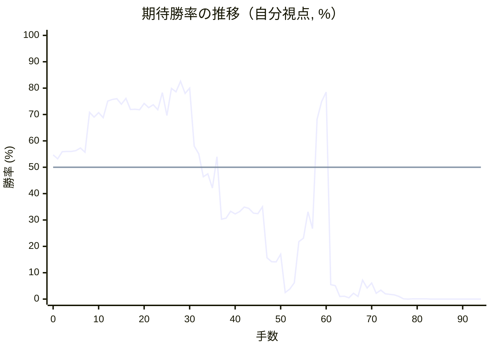
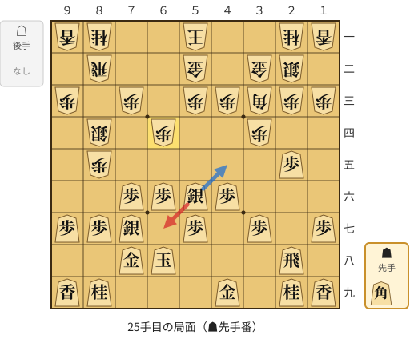
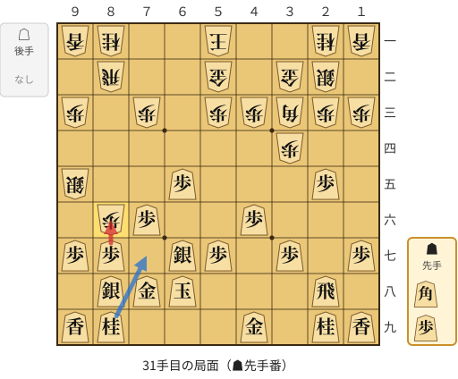
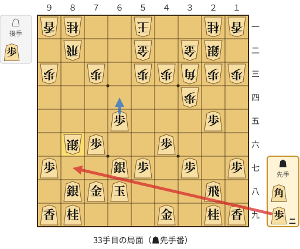
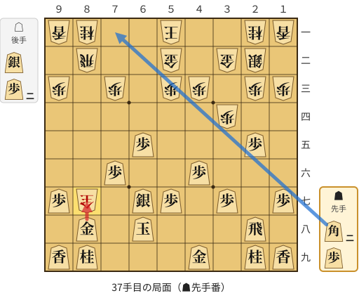
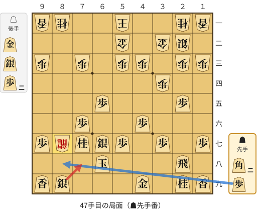
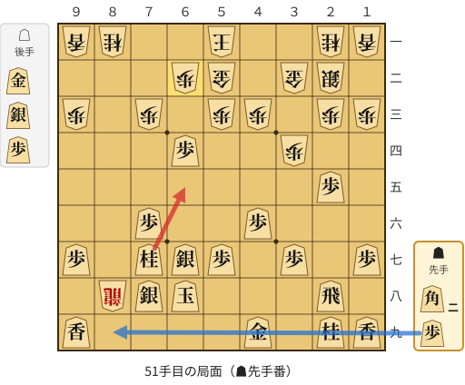
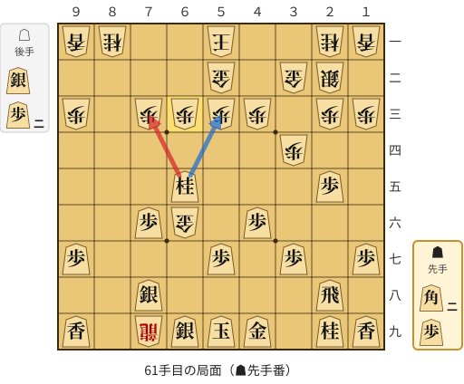

# 解析レポート dfl6vvybuzqw

[README に戻る](../../../README.md)　/　棋譜: [CSA](../../../data/csa/shogi5/dfl6vvybuzqw.csa)　/　解析の見方: [docs/mistake_analysis.md](../../../docs/mistake_analysis.md)

## 対局情報

| 項目 | 内容 |
|---|---|
| 日時 | 2026-11-14 19:02:19 |
| 持ち時間 | 5分 |
| 自分 | 先手（▲）（1649） |
| 相手 | 相手（1593） |
| 結果 | 負け（詰み, 94手） |

## 解析環境

| 項目 | 内容 |
|---|---|
| エンジン | YaneuraOu NNUE 9.00git 64AVX2（V9.00/YANEURAOU_ENGINE_NNUE/AVX2） |
| 評価関数 | **水匠5**（`suisho5`） |
| nn.bin SHA-256 | `768068f0d534a0603a5d38bcd143de6bbca820d5f1c95a14d40863e5b7892d76` |
| 第1パス | movetime=150ms, MultiPV 1 |
| 第2パス | movetime=2000ms, MultiPV 3 |
| Threads / Hash | 8 / 512MB |
| 判定基準 | 疑問手 ≥5pt, 悪手 ≥10pt, 大悪手 ≥20pt（期待勝率 W(E)=1/(1+exp(-E/600))） |
| 解析日時 | 2026-11-20T20:21:42+09:00（解析バージョン 1, 42秒） |

## サマリー

| 自分の手数 | 深掘りした手 | 詰み逃し | 大悪手 | 悪手 | 疑問手 |
|--:|--:|--:|--:|--:|--:|
| 47 | 7 | 0 | 4 | 2 | 1 |

## 期待勝率の推移



<details><summary>1手ごとの数値（第1パス）</summary>

| 手数 | 指し手 | 評価値 | 勝率 | 低下 | 判定 |
|--:|---|--:|--:|--:|---|
| 1 | ▲７六歩(77) | +77 | 53.2% | +1.5pt |  |
| 2 | △３四歩(33) | +142 | 55.9% |  |  |
| 3 | ▲２六歩(27) | +145 | 56.0% | -0.1pt |  |
| 4 | △３二金(41) | +144 | 56.0% |  |  |
| 5 | ▲２五歩(26) | +153 | 56.3% | -0.4pt |  |
| 6 | △８八角成(22) | +177 | 57.3% |  |  |
| 7 | ▲同銀(79) | +138 | 55.7% | +1.6pt |  |
| 8 | △３三角打 | +531 | 70.8% |  |  |
| 9 | ▲７七銀(88) | +480 | 69.0% | +1.8pt |  |
| 10 | △５二金(61) | +528 | 70.7% |  |  |
| 11 | ▲７八金(69) | +475 | 68.8% | +1.9pt |  |
| 12 | △２二銀(31) | +661 | 75.1% |  |  |
| 13 | ▲４八銀(39) | +681 | 75.7% | -0.6pt |  |
| 14 | △８四歩(83) | +692 | 76.0% |  |  |
| 15 | ▲６八玉(59) | +626 | 73.9% | +2.1pt |  |
| 16 | △８五歩(84) | +694 | 76.1% |  |  |
| 17 | ▲４六歩(47) | +565 | 71.9% | +4.1pt |  |
| 18 | △７二銀(71) | +566 | 72.0% |  |  |
| 19 | ▲４七銀(48) | +562 | 71.8% | +0.1pt |  |
| 20 | △８三銀(72) | +635 | 74.2% |  |  |
| 21 | ▲６六歩(67) | +585 | 72.6% | +1.6pt |  |
| 22 | △８四銀(83) | +617 | 73.7% |  |  |
| 23 | ▲５六銀(47) | +561 | 71.8% | +1.9pt |  |
| 24 | △６四歩(63) | +771 | 78.3% |  |  |
| 25 | ▲６七銀(56) | +498 | 69.6% | +8.7pt | [悪手](#ply-25) |
| 26 | △６五歩(64) | +827 | 79.9% |  |  |
| 27 | ▲同歩(66) | +780 | 78.6% | +1.3pt |  |
| 28 | △９五銀(84) | +935 | 82.6% |  |  |
| 29 | ▲８八銀(77) | +761 | 78.0% | +4.6pt |  |
| 30 | △８六歩(85) | +831 | 80.0% |  |  |
| 31 | ▲同歩(87) | +194 | 58.0% | +22.0pt | [大悪手](#ply-31) |
| 32 | △同銀(95) | +124 | 55.1% |  |  |
| 33 | ▲８七歩打 | -87 | 46.4% | +8.8pt | [大悪手](#ply-33) |
| 34 | △８八角成(33) | -61 | 47.5% |  |  |
| 35 | ▲同金(78) | -191 | 42.1% | +5.4pt |  |
| 36 | △８七銀成(86) | +96 | 54.0% |  |  |
| 37 | ▲同金(88) | -500 | 30.3% | +23.7pt | [疑問手](#ply-37) |
| 38 | △同飛成(82) | -488 | 30.7% |  |  |
| 39 | ▲７八銀打 | -416 | 33.3% | -2.6pt |  |
| 40 | △８二龍(87) | -444 | 32.3% |  |  |
| 41 | ▲８七歩打 | -420 | 33.2% | -0.9pt |  |
| 42 | △８八歩打 | -374 | 34.9% |  |  |
| 43 | ▲７七桂(89) | -387 | 34.4% | +0.5pt |  |
| 44 | △８九歩成(88) | -437 | 32.6% |  |  |
| 45 | ▲同銀(78) | -442 | 32.4% | +0.2pt |  |
| 46 | △８七龍(82) | -372 | 35.0% |  |  |
| 47 | ▲７八銀(89) | -1007 | 15.7% | +19.2pt | [悪手](#ply-47) |
| 48 | △８八龍(87) | -1077 | 14.2% |  |  |
| 49 | ▲６四歩(65) | -1082 | 14.1% | +0.1pt |  |
| 50 | △６二歩打 | -953 | 17.0% |  |  |
| 51 | ▲６五桂(77) | -2193 | 2.5% | +14.4pt | [大悪手](#ply-51) |
| 52 | △７七銀打 | -1936 | 3.8% |  |  |
| 53 | ▲５九玉(68) | -1633 | 6.2% | -2.4pt |  |
| 54 | △７八銀成(77) | -768 | 21.8% |  |  |
| 55 | ▲同銀(67) | -720 | 23.1% | -1.4pt |  |
| 56 | △７九龍(88) | -421 | 33.1% |  |  |
| 57 | ▲６九銀打 | -607 | 26.7% | +6.5pt |  |
| 58 | △６六金打 | +457 | 68.2% |  |  |
| 59 | ▲６三歩成(64) | +656 | 74.9% | -6.7pt |  |
| 60 | △同歩(62) | +778 | 78.5% |  |  |
| 61 | ▲７三桂成(65) | -1703 | 5.5% | +73.0pt | [大悪手](#ply-61) |
| 62 | △同桂(81) | -1756 | 5.1% |  |  |
| 63 | ▲５五角打 | -2736 | 1.0% | +4.0pt |  |
| 64 | △５七金(66) | -2694 | 1.1% |  |  |
| 65 | ▲７三角成(55) | -3134 | 0.5% | +0.6pt |  |
| 66 | △４二玉(51) | -2264 | 2.2% |  |  |
| 67 | ▲５八金(49) | -2754 | 1.0% | +1.2pt |  |
| 68 | △同金(57) | -1532 | 7.2% |  |  |
| 69 | ▲同玉(59) | -1871 | 4.2% | +3.0pt |  |
| 70 | △６六桂打 | -1643 | 6.1% |  |  |
| 71 | ▲６七玉(58) | -2275 | 2.2% | +3.9pt |  |
| 72 | △７八桂成(66) | -2012 | 3.4% |  |  |
| 73 | ▲同銀(69) | -2335 | 2.0% | +1.4pt |  |
| 74 | △６五銀打 | -2416 | 1.8% |  |  |
| 75 | ▲６九金打 | -2480 | 1.6% | +0.2pt |  |
| 76 | △９九龍(79) | -2758 | 1.0% |  |  |
| 77 | ▲５五馬(73) | -4097 | 0.1% | +0.9pt |  |
| 78 | △６六銀打 | -5177 | 0.0% |  |  |
| 79 | ▲同馬(55) | -4411 | 0.1% | -0.0pt |  |
| 80 | △同銀(65) | -4241 | 0.1% |  |  |
| 81 | ▲同玉(67) | -4550 | 0.1% | +0.0pt |  |
| 82 | △３九角打 | -4475 | 0.1% |  |  |
| 83 | ▲５七歩打 | -5078 | 0.0% | +0.0pt |  |
| 84 | △２八角成(39) | -4908 | 0.0% |  |  |
| 85 | ▲４五桂打 | -5525 | 0.0% | +0.0pt |  |
| 86 | △２九馬(28) | -5051 | 0.0% |  |  |
| 87 | ▲５六桂打 | -6441 | 0.0% | +0.0pt |  |
| 88 | △９七龍(99) | -6304 | 0.0% |  |  |
| 89 | ▲６一銀打 | #-5 | 0.0% | +0.0pt |  |
| 90 | △６二金(52) | -6164 | 0.0% |  |  |
| 91 | ▲７五角打 | #-7 | 0.0% | +0.0pt |  |
| 92 | △６四香打 | #-10 | 0.0% |  |  |
| 93 | ▲同桂(56) | #-1 | 0.0% | +0.0pt |  |
| 94 | △６五金打 | #- | 0.0% |  |  |

</details>

## 課題局面

<a id="ply-25"></a>
### 25手目 ▲６七銀(56) — 悪手

| | 着手前 | 着手後 | 差 |
|---|--:|--:|--:|
| 期待勝率 | 81.4% | 70.0% | -11.4pt |
| 評価値 | +884 | +508 | |

着手前の局面:



🔴 実戦 ▲６七銀(56)　🔵 AI推奨 ▲４五銀(56)　🟨 直前の相手の指し手

<details><summary>テキストの盤面図（BOD・将棋ソフトに貼り付け可）</summary>

```text
後手の持駒：なし
  ９ ８ ７ ６ ５ ４ ３ ２ １
+---------------------------+
|v香v桂 ・ ・v玉 ・ ・v桂v香|一
| ・v飛 ・ ・v金 ・v金v銀 ・|二
|v歩 ・v歩 ・v歩v歩v角v歩v歩|三
| ・v銀 ・v歩 ・ ・v歩 ・ ・|四
| ・v歩 ・ ・ ・ ・ ・ 歩 ・|五
| ・ ・ 歩 歩 銀 歩 ・ ・ ・|六
| 歩 歩 銀 ・ 歩 ・ 歩 ・ 歩|七
| ・ ・ 金 玉 ・ ・ ・ 飛 ・|八
| 香 桂 ・ ・ ・ 金 ・ 桂 香|九
+---------------------------+
先手の持駒：角
手数＝24　△６四歩　まで
```

</details>

| | 指し手 | 評価値 | 読み筋 |
|---|---|--:|---|
| 実戦 | ▲６七銀(56) | +508 | △９五銀(84) ▲７九玉(68) △４二玉(51) ▲５八金(49) △８六歩(85) ▲同歩(87) |
| AI 1位 | ▲４五銀(56) | +884 | ▲４五銀(56) △５五角(33) ▲３四銀(45) △９五銀(84) ▲２四歩(25) △同歩(23) |
| AI 2位 | ▲７九玉(68) | +792 | ▲７九玉(68) △９五銀(84) ▲５八金(49) △８六歩(85) ▲同歩(87) △同銀(95) |
| AI 3位 | ▲５八金(49) | +772 | ▲５八金(49) △９五銀(84) ▲６七金(58) △８六歩(85) ▲同銀(77) △同銀(95) |

SFEN: `ln2k2nl/1r2g1gs1/p1p1ppbpp/1s1p2p2/1p5P1/2PPSP3/PPS1P1P1P/2GK3R1/LN3G1NL b B 25`

<a id="ply-31"></a>
### 31手目 ▲同歩(87) — 大悪手

| | 着手前 | 着手後 | 差 |
|---|--:|--:|--:|
| 期待勝率 | 79.7% | 58.9% | -20.8pt |
| 評価値 | +822 | +216 | |

着手前の局面:



🔴 実戦 ▲同歩(87)　🔵 AI推奨 ▲７七桂(89)　🟨 直前の相手の指し手

<details><summary>テキストの盤面図（BOD・将棋ソフトに貼り付け可）</summary>

```text
後手の持駒：なし
  ９ ８ ７ ６ ５ ４ ３ ２ １
+---------------------------+
|v香v桂 ・ ・v玉 ・ ・v桂v香|一
| ・v飛 ・ ・v金 ・v金v銀 ・|二
|v歩 ・v歩 ・v歩v歩v角v歩v歩|三
| ・ ・ ・ ・ ・ ・v歩 ・ ・|四
|v銀 ・ ・ 歩 ・ ・ ・ 歩 ・|五
| ・v歩 歩 ・ ・ 歩 ・ ・ ・|六
| 歩 歩 ・ 銀 歩 ・ 歩 ・ 歩|七
| ・ 銀 金 玉 ・ ・ ・ 飛 ・|八
| 香 桂 ・ ・ ・ 金 ・ 桂 香|九
+---------------------------+
先手の持駒：角　歩
手数＝30　△８六歩　まで
```

</details>

| | 指し手 | 評価値 | 読み筋 |
|---|---|--:|---|
| 実戦 | ▲同歩(87) | +216 | △同銀(95) ▲６四歩(65) △８七歩打 ▲７七銀(88) △同銀不成(86) ▲同金(78) |
| AI 1位 | ▲７七桂(89) | +822 | ▲７七桂(89) △８七歩成(86) ▲同銀(88) △８六歩打 ▲９八銀(87) △８四銀(95) |
| AI 2位 | ▲７七角打 | +351 | ▲７七角打 △８七歩成(86) ▲同銀(88) △８六歩打 ▲９八銀(87) △４一玉(51) |
| AI 3位 | ▲同歩(87) | +202 | ▲同歩(87) △同銀(95) ▲６四歩(65) △８七歩打 ▲７七銀(88) △同銀不成(86) |

SFEN: `ln2k2nl/1r2g1gs1/p1p1ppbpp/6p2/s2P3P1/1pP2P3/PP1SP1P1P/1SGK3R1/LN3G1NL b BP 31`

<a id="ply-33"></a>
### 33手目 ▲８七歩打 — 大悪手

| | 着手前 | 着手後 | 差 |
|---|--:|--:|--:|
| 期待勝率 | 58.8% | 36.8% | -22.0pt |
| 評価値 | +214 | -325 | |

着手前の局面:



🔴 実戦 ▲８七歩打　🔵 AI推奨 ▲６四歩(65)　🟨 直前の相手の指し手

<details><summary>テキストの盤面図（BOD・将棋ソフトに貼り付け可）</summary>

```text
後手の持駒：歩
  ９ ８ ７ ６ ５ ４ ３ ２ １
+---------------------------+
|v香v桂 ・ ・v玉 ・ ・v桂v香|一
| ・v飛 ・ ・v金 ・v金v銀 ・|二
|v歩 ・v歩 ・v歩v歩v角v歩v歩|三
| ・ ・ ・ ・ ・ ・v歩 ・ ・|四
| ・ ・ ・ 歩 ・ ・ ・ 歩 ・|五
| ・v銀 歩 ・ ・ 歩 ・ ・ ・|六
| 歩 ・ ・ 銀 歩 ・ 歩 ・ 歩|七
| ・ 銀 金 玉 ・ ・ ・ 飛 ・|八
| 香 桂 ・ ・ ・ 金 ・ 桂 香|九
+---------------------------+
先手の持駒：角　歩二
手数＝32　△８六同銀　まで
```

</details>

| | 指し手 | 評価値 | 読み筋 |
|---|---|--:|---|
| 実戦 | ▲８七歩打 | -325 | △８八角成(33) ▲同金(78) △８七銀不成(86) ▲７一角打 △８三飛(82) ▲６四歩(65) |
| AI 1位 | ▲６四歩(65) | +214 | ▲６四歩(65) △８七歩打 ▲７七銀(88) △同銀成(86) ▲同金(78) △８八歩成(87) |
| AI 2位 | ▲８五歩打 | +22 | ▲８五歩打 △同飛(82) ▲６四歩(65) △６二歩打 ▲５九玉(68) △８四飛(85) |
| AI 3位 | ▲８三歩打 | -15 | ▲８三歩打 △同飛(82) ▲６四歩(65) △６二歩打 ▲６六角打 △８七歩打 |

SFEN: `ln2k2nl/1r2g1gs1/p1p1ppbpp/6p2/3P3P1/1sP2P3/P2SP1P1P/1SGK3R1/LN3G1NL b B2Pp 33`

<a id="ply-37"></a>
### 37手目 ▲同金(88) — 疑問手

| | 着手前 | 着手後 | 差 |
|---|--:|--:|--:|
| 期待勝率 | 41.2% | 34.1% | -7.1pt |
| 評価値 | -213 | -394 | |

着手前の局面:



🔴 実戦 ▲同金(88)　🔵 AI推奨 ▲７一角打　🟨 直前の相手の指し手

<details><summary>テキストの盤面図（BOD・将棋ソフトに貼り付け可）</summary>

```text
後手の持駒：銀　歩二
  ９ ８ ７ ６ ５ ４ ３ ２ １
+---------------------------+
|v香v桂 ・ ・v玉 ・ ・v桂v香|一
| ・v飛 ・ ・v金 ・v金v銀 ・|二
|v歩 ・v歩 ・v歩v歩 ・v歩v歩|三
| ・ ・ ・ ・ ・ ・v歩 ・ ・|四
| ・ ・ ・ 歩 ・ ・ ・ 歩 ・|五
| ・ ・ 歩 ・ ・ 歩 ・ ・ ・|六
| 歩v全 ・ 銀 歩 ・ 歩 ・ 歩|七
| ・ 金 ・ 玉 ・ ・ ・ 飛 ・|八
| 香 桂 ・ ・ ・ 金 ・ 桂 香|九
+---------------------------+
先手の持駒：角二　歩
手数＝36　△８七銀成　まで
```

</details>

| | 指し手 | 評価値 | 読み筋 |
|---|---|--:|---|
| 実戦 | ▲同金(88) | -394 | △同飛成(82) ▲７八銀打 △８二龍(87) ▲８七歩打 △８八歩打 ▲７七桂(89) |
| AI 1位 | ▲７一角打 | -213 | ▲７一角打 △８三飛(82) ▲６四歩(65) △６二歩打 ▲６六角打 △８八成銀(87) |
| AI 2位 | ▲同金(88) | -382 | ▲同金(88) △同飛成(82) ▲７八銀打 △８二龍(87) ▲８七歩打 △８八歩打 |
| AI 3位 | ▲７八金(88) | -791 | ▲７八金(88) △同成銀(87) ▲同銀(67) △６六歩打 ▲５八金(49) △８八飛成(82) |

SFEN: `ln2k2nl/1r2g1gs1/p1p1pp1pp/6p2/3P3P1/2P2P3/P+s1SP1P1P/1G1K3R1/LN3G1NL b 2BPs2p 37`

<a id="ply-47"></a>
### 47手目 ▲７八銀(89) — 悪手

| | 着手前 | 着手後 | 差 |
|---|--:|--:|--:|
| 期待勝率 | 33.8% | 14.0% | -19.9pt |
| 評価値 | -402 | -1091 | |

着手前の局面:



🔴 実戦 ▲７八銀(89)　🔵 AI推奨 ▲８八歩打　🟨 直前の相手の指し手

<details><summary>テキストの盤面図（BOD・将棋ソフトに貼り付け可）</summary>

```text
後手の持駒：金　銀　歩二
  ９ ８ ７ ６ ５ ４ ３ ２ １
+---------------------------+
|v香v桂 ・ ・v玉 ・ ・v桂v香|一
| ・ ・ ・ ・v金 ・v金v銀 ・|二
|v歩 ・v歩 ・v歩v歩 ・v歩v歩|三
| ・ ・ ・ ・ ・ ・v歩 ・ ・|四
| ・ ・ ・ 歩 ・ ・ ・ 歩 ・|五
| ・ ・ 歩 ・ ・ 歩 ・ ・ ・|六
| 歩v龍 桂 銀 歩 ・ 歩 ・ 歩|七
| ・ ・ ・ 玉 ・ ・ ・ 飛 ・|八
| 香 銀 ・ ・ ・ 金 ・ 桂 香|九
+---------------------------+
先手の持駒：角二　歩
手数＝46　△８七龍　まで
```

</details>

| | 指し手 | 評価値 | 読み筋 |
|---|---|--:|---|
| 実戦 | ▲７八銀(89) | -1091 | △８八龍(87) ▲８九歩打 △９九龍(88) ▲８八角打 △９八龍(99) ▲８七角打 |
| AI 1位 | ▲８八歩打 | -402 | ▲８八歩打 △８二龍(87) ▲５八金(49) △３三銀(22) ▲７九玉(68) △４二玉(51) |
| AI 2位 | ▲７八銀(67) | -731 | ▲７八銀(67) △７六龍(87) ▲５八金(49) △４六龍(76) ▲６四歩(65) △６七歩打 |
| AI 3位 | ▲７八角打 | -823 | ▲７八角打 △８二龍(87) ▲８七歩打 △４一玉(51) ▲５八金(49) △３一玉(41) |

SFEN: `ln2k2nl/4g1gs1/p1p1pp1pp/6p2/3P3P1/2P2P3/P+rNSP1P1P/3K3R1/LS3G1NL b 2BPgs2p 47`

<a id="ply-51"></a>
### 51手目 ▲６五桂(77) — 大悪手

| | 着手前 | 着手後 | 差 |
|---|--:|--:|--:|
| 期待勝率 | 24.6% | 1.8% | -22.8pt |
| 評価値 | -671 | -2402 | |

着手前の局面:



🔴 実戦 ▲６五桂(77)　🔵 AI推奨 ▲８九歩打　🟨 直前の相手の指し手

<details><summary>テキストの盤面図（BOD・将棋ソフトに貼り付け可）</summary>

```text
後手の持駒：金　銀　歩
  ９ ８ ７ ６ ５ ４ ３ ２ １
+---------------------------+
|v香v桂 ・ ・v玉 ・ ・v桂v香|一
| ・ ・ ・v歩v金 ・v金v銀 ・|二
|v歩 ・v歩 ・v歩v歩 ・v歩v歩|三
| ・ ・ ・ 歩 ・ ・v歩 ・ ・|四
| ・ ・ ・ ・ ・ ・ ・ 歩 ・|五
| ・ ・ 歩 ・ ・ 歩 ・ ・ ・|六
| 歩 ・ 桂 銀 歩 ・ 歩 ・ 歩|七
| ・v龍 銀 玉 ・ ・ ・ 飛 ・|八
| 香 ・ ・ ・ ・ 金 ・ 桂 香|九
+---------------------------+
先手の持駒：角二　歩
手数＝50　△６二歩　まで
```

</details>

| | 指し手 | 評価値 | 読み筋 |
|---|---|--:|---|
| 実戦 | ▲６五桂(77) | -2402 | △７七金打 ▲５八玉(68) △７八金(77) ▲４七玉(58) △９九龍(88) ▲５九角打 |
| AI 1位 | ▲８九歩打 | -671 | ▲８九歩打 △９九龍(88) ▲８八角打 △９八龍(99) ▲８七角打 △同龍(98) |
| AI 2位 | ▲６三歩成(64) | -1105 | ▲６三歩成(64) △同歩(62) ▲８九歩打 △９九龍(88) ▲８八角打 △９八龍(99) |
| AI 3位 | ▲２四歩(25) | -1316 | ▲２四歩(25) △９九龍(88) ▲８九歩打 △８六歩打 ▲６六角打 △８七歩成(86) |

SFEN: `ln2k2nl/3pg1gs1/p1p1pp1pp/3P2p2/7P1/2P2P3/P1NSP1P1P/1+rSK3R1/L4G1NL b 2BPgsp 51`

<a id="ply-61"></a>
### 61手目 ▲７三桂成(65) — 大悪手

| | 着手前 | 着手後 | 差 |
|---|--:|--:|--:|
| 期待勝率 | 79.4% | 4.9% | -74.6pt |
| 評価値 | +811 | -1784 | |

着手前の局面:



🔴 実戦 ▲７三桂成(65)　🔵 AI推奨 ▲５三桂成(65)　🟨 直前の相手の指し手

<details><summary>テキストの盤面図（BOD・将棋ソフトに貼り付け可）</summary>

```text
後手の持駒：銀　歩二
  ９ ８ ７ ６ ５ ４ ３ ２ １
+---------------------------+
|v香v桂 ・ ・v玉 ・ ・v桂v香|一
| ・ ・ ・ ・v金 ・v金v銀 ・|二
|v歩 ・v歩v歩v歩v歩 ・v歩v歩|三
| ・ ・ ・ ・ ・ ・v歩 ・ ・|四
| ・ ・ ・ 桂 ・ ・ ・ 歩 ・|五
| ・ ・ 歩v金 ・ 歩 ・ ・ ・|六
| 歩 ・ ・ ・ 歩 ・ 歩 ・ 歩|七
| ・ ・ 銀 ・ ・ ・ ・ 飛 ・|八
| 香 ・v龍 銀 玉 金 ・ 桂 香|九
+---------------------------+
先手の持駒：角二　歩
手数＝60　△６三同歩　まで
```

</details>

| | 指し手 | 評価値 | 読み筋 |
|---|---|--:|---|
| 実戦 | ▲７三桂成(65) | -1784 | △同桂(81) ▲８四角打 △７七歩打 ▲６八角打 △９九龍(79) ▲６六角(84) |
| AI 1位 | ▲５三桂成(65) | +811 | ▲５三桂成(65) △５六歩打 ▲５二成桂(53) △同玉(51) ▲４八玉(59) △５七歩成(56) |
| AI 2位 | ▲６八角打 | +1 | ▲６八角打 △９九龍(79) ▲５五角打 △９八龍(99) ▲６六角(55) △６四香打 |
| AI 3位 | ▲５五角打 | -655 | ▲５五角打 △５七金(66) ▲７七角(55) △６四歩(63) ▲５八金(49) △同金(57) |

SFEN: `ln2k2nl/4g1gs1/p1pppp1pp/6p2/3N3P1/2Pg1P3/P3P1P1P/2S4R1/L1+rSKG1NL b 2BPs2p 61`

