# 解析レポート dnk7otmi5vbw

[README に戻る](../../../README.md)　/　棋譜: [CSA](../../../data/csa/shogi5/dnk7otmi5vbw.csa)　/　解析の見方: [docs/mistake_analysis.md](../../../docs/mistake_analysis.md)

## 対局情報

| 項目 | 内容 |
|---|---|
| 日時 | 2026-11-05 00:47:50 |
| 持ち時間 | 5分 |
| 自分 | 先手（▲）（1734） |
| 相手 | 相手（1846） |
| 結果 | 勝ち（投了, 119手） |

## 解析環境

| 項目 | 内容 |
|---|---|
| エンジン | YaneuraOu NNUE 9.00git 64AVX2（V9.00/YANEURAOU_ENGINE_NNUE/AVX2） |
| 評価関数 | **水匠5**（`suisho5`） |
| nn.bin SHA-256 | `768068f0d534a0603a5d38bcd143de6bbca820d5f1c95a14d40863e5b7892d76` |
| 第1パス | movetime=150ms, MultiPV 1 |
| 第2パス | movetime=2000ms, MultiPV 3 |
| Threads / Hash | 8 / 512MB |
| 判定基準 | 疑問手 ≥5pt, 悪手 ≥10pt, 大悪手 ≥20pt（期待勝率 W(E)=1/(1+exp(-E/600))） |
| 解析日時 | 2026-11-06T01:49:07+09:00（解析バージョン 1, 74秒） |

## サマリー

| 自分の手数 | 深掘りした手 | 詰み逃し | 大悪手 | 悪手 | 疑問手 |
|--:|--:|--:|--:|--:|--:|
| 60 | 14 | 0 | 8 | 2 | 2 |

## 期待勝率の推移

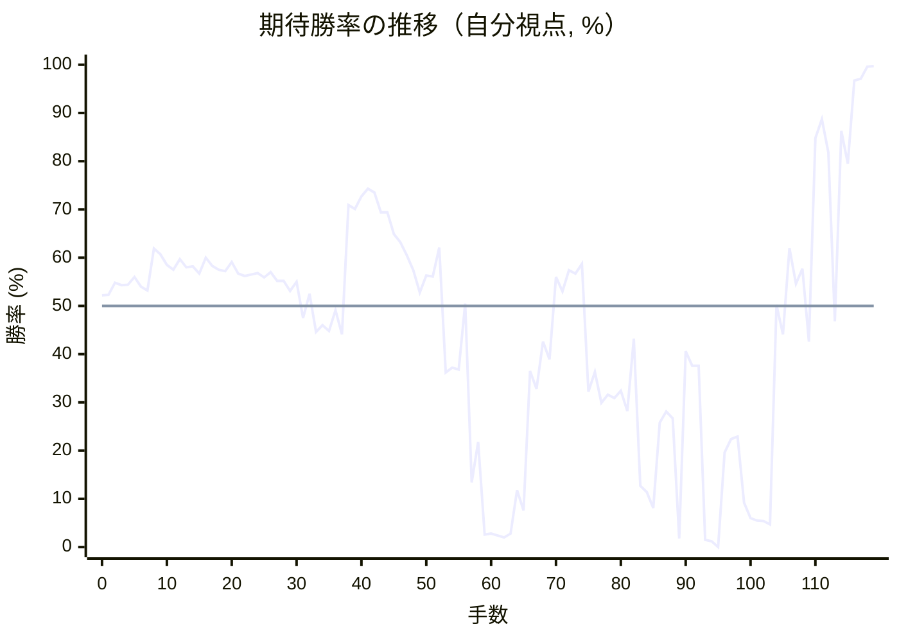

<details><summary>1手ごとの数値（第1パス）</summary>

| 手数 | 指し手 | 評価値 | 勝率 | 低下 | 判定 |
|--:|---|--:|--:|--:|---|
| 1 | ▲７六歩(77) | +56 | 52.3% | -0.1pt |  |
| 2 | △３四歩(33) | +116 | 54.8% |  |  |
| 3 | ▲２六歩(27) | +103 | 54.3% | +0.5pt |  |
| 4 | △４四歩(43) | +107 | 54.4% |  |  |
| 5 | ▲２五歩(26) | +145 | 56.0% | -1.6pt |  |
| 6 | △３三角(22) | +96 | 54.0% |  |  |
| 7 | ▲４八銀(39) | +77 | 53.2% | +0.8pt |  |
| 8 | △４二飛(82) | +292 | 61.9% |  |  |
| 9 | ▲６八玉(59) | +260 | 60.7% | +1.3pt |  |
| 10 | △３二銀(31) | +207 | 58.5% |  |  |
| 11 | ▲５六歩(57) | +181 | 57.5% | +1.1pt |  |
| 12 | △６二玉(51) | +235 | 59.7% |  |  |
| 13 | ▲７八玉(68) | +193 | 58.0% | +1.7pt |  |
| 14 | △９四歩(93) | +198 | 58.2% |  |  |
| 15 | ▲９六歩(97) | +161 | 56.7% | +1.5pt |  |
| 16 | △７二玉(62) | +244 | 60.0% |  |  |
| 17 | ▲８六歩(87) | +202 | 58.3% | +1.7pt |  |
| 18 | △５二金(41) | +181 | 57.5% |  |  |
| 19 | ▲８七玉(78) | +174 | 57.2% | +0.3pt |  |
| 20 | △８二銀(71) | +220 | 59.1% |  |  |
| 21 | ▲７八銀(79) | +161 | 56.7% | +2.4pt |  |
| 22 | △７四歩(73) | +150 | 56.2% |  |  |
| 23 | ▲５七銀(48) | +156 | 56.5% | -0.2pt |  |
| 24 | △８四歩(83) | +165 | 56.8% |  |  |
| 25 | ▲６六銀(57) | +143 | 55.9% | +0.9pt |  |
| 26 | △７三桂(81) | +170 | 57.0% |  |  |
| 27 | ▲７九角(88) | +125 | 55.2% | +1.8pt |  |
| 28 | △４三銀(32) | +126 | 55.2% |  |  |
| 29 | ▲１六歩(17) | +75 | 53.1% | +2.1pt |  |
| 30 | △６二金(61) | +120 | 55.0% |  |  |
| 31 | ▲３六歩(37) | -61 | 47.5% | +7.5pt | [疑問手](#ply-31) |
| 32 | △５四歩(53) | +61 | 52.5% |  |  |
| 33 | ▲３五歩(36) | -131 | 44.6% | +8.0pt | [疑問手](#ply-33) |
| 34 | △同歩(34) | -97 | 46.0% |  |  |
| 35 | ▲同角(79) | -125 | 44.8% | +1.2pt |  |
| 36 | △２二飛(42) | -22 | 49.1% |  |  |
| 37 | ▲７五歩(76) | -142 | 44.1% | +5.0pt |  |
| 38 | △８五歩(84) | +534 | 70.9% |  |  |
| 39 | ▲７四歩(75) | +512 | 70.1% | +0.8pt |  |
| 40 | △８六歩(85) | +587 | 72.7% |  |  |
| 41 | ▲同玉(87) | +637 | 74.3% | -1.6pt |  |
| 42 | △４二角(33) | +611 | 73.5% |  |  |
| 43 | ▲８七玉(86) | +491 | 69.4% | +4.1pt |  |
| 44 | △８六歩打 | +490 | 69.4% |  |  |
| 45 | ▲８八玉(87) | +370 | 64.9% | +4.4pt |  |
| 46 | △８五桂(73) | +324 | 63.2% |  |  |
| 47 | ▲４六角(35) | +255 | 60.5% | +2.7pt |  |
| 48 | △６四歩(63) | +178 | 57.4% |  |  |
| 49 | ▲７五銀(66) | +67 | 52.8% | +4.6pt |  |
| 50 | △４五歩(44) | +152 | 56.3% |  |  |
| 51 | ▲５七角(46) | +146 | 56.1% | +0.2pt |  |
| 52 | △３三角(42) | +296 | 62.1% |  |  |
| 53 | ▲９八玉(88) | -341 | 36.2% | +25.9pt | [大悪手](#ply-53) |
| 54 | △９五歩(94) | -315 | 37.2% |  |  |
| 55 | ▲８六銀(75) | -324 | 36.8% | +0.3pt |  |
| 56 | △９六歩(95) | +13 | 50.5% |  |  |
| 57 | ▲７三歩成(74) | -1122 | 13.4% | +37.2pt | [大悪手](#ply-57) |
| 58 | △同銀(82) | -766 | 21.8% |  |  |
| 59 | ▲７七歩打 | -2168 | 2.6% | +19.2pt | [大悪手](#ply-59) |
| 60 | △９七歩成(96) | -2136 | 2.8% |  |  |
| 61 | ▲同桂(89) | -2211 | 2.4% | +0.3pt |  |
| 62 | △同桂成(85) | -2322 | 2.0% |  |  |
| 63 | ▲同銀(86) | -2122 | 2.8% | -0.8pt |  |
| 64 | △８五桂打 | -1205 | 11.8% |  |  |
| 65 | ▲９二歩打 | -1503 | 7.6% | +4.3pt |  |
| 66 | △７七桂成(85) | -333 | 36.5% |  |  |
| 67 | ▲９一歩成(92) | -431 | 32.8% | +3.7pt |  |
| 68 | △９六歩打 | -178 | 42.6% |  |  |
| 69 | ▲同銀(97) | -272 | 38.9% | +3.8pt |  |
| 70 | △９七歩打 | +144 | 56.0% |  |  |
| 71 | ▲同玉(98) | +72 | 53.0% | +3.0pt |  |
| 72 | △７八成桂(77) | +178 | 57.4% |  |  |
| 73 | ▲同金(69) | +161 | 56.7% | +0.7pt |  |
| 74 | △９九角成(33) | +210 | 58.7% |  |  |
| 75 | ▲７五桂打 | -446 | 32.2% | +26.4pt | [大悪手](#ply-75) |
| 76 | △７四歩打 | -338 | 36.3% |  |  |
| 77 | ▲８三桂成(75) | -512 | 29.9% | +6.4pt |  |
| 78 | △同玉(72) | -463 | 31.6% |  |  |
| 79 | ▲８八香打 | -484 | 30.9% | +0.8pt |  |
| 80 | △８四歩打 | -441 | 32.4% |  |  |
| 81 | ▲６六角(57) | -560 | 28.2% | +4.2pt |  |
| 82 | △１二飛(22) | -165 | 43.2% |  |  |
| 83 | ▲８四香(88) | -1158 | 12.7% | +30.5pt | [大悪手](#ply-83) |
| 84 | △同銀(73) | -1230 | 11.4% |  |  |
| 85 | ▲９九角(66) | -1456 | 8.1% | +3.3pt |  |
| 86 | △９五香打 | -633 | 25.8% |  |  |
| 87 | ▲同銀(96) | -564 | 28.1% | -2.3pt |  |
| 88 | △同銀(84) | -607 | 26.7% |  |  |
| 89 | ▲８五歩打 | -2413 | 1.8% | +24.9pt | [大悪手](#ply-89) |
| 90 | △８六桂打 | -228 | 40.6% |  |  |
| 91 | ▲８七金(78) | -303 | 37.6% | +3.0pt |  |
| 92 | △９八銀打 | -304 | 37.6% |  |  |
| 93 | ▲８六金(87) | -2494 | 1.5% | +36.1pt | [大悪手](#ply-93) |
| 94 | △同銀(95) | -2650 | 1.2% |  |  |
| 95 | ▲同玉(97) | #-5 | 0.0% | +1.2pt |  |
| 96 | △７五銀打 | -845 | 19.6% |  |  |
| 97 | ▲７七玉(86) | -747 | 22.4% | -2.7pt |  |
| 98 | △９九銀不成(98) | -728 | 22.9% |  |  |
| 99 | ▲８四銀打 | -1374 | 9.2% | +13.7pt | [悪手](#ply-99) |
| 100 | △７二玉(83) | -1647 | 6.0% |  |  |
| 101 | ▲７五銀(84) | -1708 | 5.5% | +0.6pt |  |
| 102 | △同歩(74) | -1718 | 5.4% |  |  |
| 103 | ▲７四銀打 | -1804 | 4.7% | +0.7pt |  |
| 104 | △７三金打 | +5 | 50.2% |  |  |
| 105 | ▲９四角打 | -142 | 44.1% | +6.1pt |  |
| 106 | △８三香打 | +294 | 62.0% |  |  |
| 107 | ▲８四桂打 | +111 | 54.6% | +7.4pt |  |
| 108 | △６一玉(72) | +187 | 57.7% |  |  |
| 109 | ▲８三銀成(74) | -180 | 42.6% | +15.2pt | [悪手](#ply-109) |
| 110 | △同金(73) | +1030 | 84.8% |  |  |
| 111 | ▲同角成(94) | +1237 | 88.7% | -3.9pt |  |
| 112 | △５一玉(61) | +902 | 81.8% |  |  |
| 113 | ▲３五桂打 | -77 | 46.8% | +35.0pt | [大悪手](#ply-113) |
| 114 | △５七角打 | +1102 | 86.3% |  |  |
| 115 | ▲２三桂成(35) | +812 | 79.5% | +6.8pt |  |
| 116 | △７六銀打 | +2018 | 96.7% |  |  |
| 117 | ▲８六玉(77) | +2104 | 97.1% | -0.4pt |  |
| 118 | △７七銀打 | +3321 | 99.6% |  |  |
| 119 | ▲９五玉(86) | +3438 | 99.7% | -0.1pt |  |

</details>

## 課題局面

<a id="ply-31"></a>
### 31手目 ▲３六歩(37) — 疑問手

| | 着手前 | 着手後 | 差 |
|---|--:|--:|--:|
| 期待勝率 | 54.8% | 44.9% | -9.8pt |
| 評価値 | +115 | -122 | |

着手前の局面:

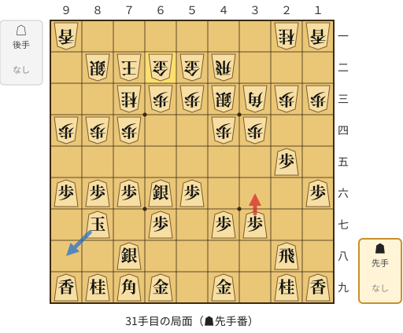

🔴 実戦 ▲３六歩(37)　🔵 AI推奨 ▲９八玉(87)　🟨 直前の相手の指し手

<details><summary>テキストの盤面図（BOD・将棋ソフトに貼り付け可）</summary>

```text
後手の持駒：なし
  ９ ８ ７ ６ ５ ４ ３ ２ １
+---------------------------+
|v香 ・ ・ ・ ・ ・ ・v桂v香|一
| ・v銀v玉v金v金v飛 ・ ・ ・|二
| ・ ・v桂v歩v歩v銀v角v歩v歩|三
|v歩v歩v歩 ・ ・v歩v歩 ・ ・|四
| ・ ・ ・ ・ ・ ・ ・ 歩 ・|五
| 歩 歩 歩 銀 歩 ・ ・ ・ 歩|六
| ・ 玉 ・ 歩 ・ 歩 歩 ・ ・|七
| ・ ・ 銀 ・ ・ ・ ・ 飛 ・|八
| 香 桂 角 金 ・ 金 ・ 桂 香|九
+---------------------------+
先手の持駒：なし
手数＝30　△６二金上　まで
```

</details>

| | 指し手 | 評価値 | 読み筋 |
|---|---|--:|---|
| 実戦 | ▲３六歩(37) | -122 | △４五歩(44) ▲５八金(49) △６四歩(63) ▲５七角(79) △５四銀(43) ▲３七桂(29) |
| AI 1位 | ▲９八玉(87) | +115 | ▲９八玉(87) △６四歩(63) ▲８七銀(78) △４五歩(44) ▲７八金(69) △５四銀(43) |
| AI 2位 | ▲７七銀(66) | +20 | ▲７七銀(66) △６四歩(63) ▲６六歩(67) △４五歩(44) ▲５八金(49) △６五歩(64) |
| AI 3位 | ▲５八金(49) | +18 | ▲５八金(49) △６四歩(63) ▲７七銀(66) △４五歩(44) ▲６六歩(67) △６五歩(64) |

SFEN: `l6nl/1skggr3/2nppsbpp/ppp2pp2/7P1/PPPSP3P/1K1P1PP2/2S4R1/LNBG1G1NL b - 31`

<a id="ply-33"></a>
### 33手目 ▲３五歩(36) — 疑問手

| | 着手前 | 着手後 | 差 |
|---|--:|--:|--:|
| 期待勝率 | 50.0% | 44.2% | -5.8pt |
| 評価値 | +0 | -140 | |

着手前の局面:

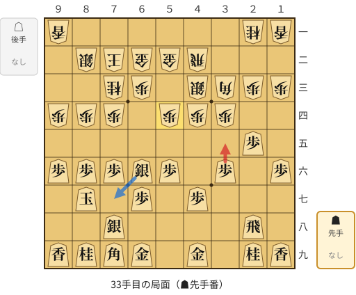

🔴 実戦 ▲３五歩(36)　🔵 AI推奨 ▲７七銀(66)　🟨 直前の相手の指し手

<details><summary>テキストの盤面図（BOD・将棋ソフトに貼り付け可）</summary>

```text
後手の持駒：なし
  ９ ８ ７ ６ ５ ４ ３ ２ １
+---------------------------+
|v香 ・ ・ ・ ・ ・ ・v桂v香|一
| ・v銀v玉v金v金v飛 ・ ・ ・|二
| ・ ・v桂v歩 ・v銀v角v歩v歩|三
|v歩v歩v歩 ・v歩v歩v歩 ・ ・|四
| ・ ・ ・ ・ ・ ・ ・ 歩 ・|五
| 歩 歩 歩 銀 歩 ・ 歩 ・ 歩|六
| ・ 玉 ・ 歩 ・ 歩 ・ ・ ・|七
| ・ ・ 銀 ・ ・ ・ ・ 飛 ・|八
| 香 桂 角 金 ・ 金 ・ 桂 香|九
+---------------------------+
先手の持駒：なし
手数＝32　△５四歩　まで
```

</details>

| | 指し手 | 評価値 | 読み筋 |
|---|---|--:|---|
| 実戦 | ▲３五歩(36) | -140 | △同歩(34) ▲同角(79) △３二飛(42) ▲７五歩(76) △４二角(33) ▲５七角(35) |
| AI 1位 | ▲７七銀(66) | +0 | ▲７七銀(66) △２二飛(42) ▲５八金(49) △４二角(33) ▲８八玉(87) △８三銀(82) |
| AI 2位 | ▲５八金(49) | -10 | ▲５八金(49) △６四歩(63) ▲７七銀(66) △６五歩(64) ▲６六歩(67) △同歩(65) |
| AI 3位 | ▲５七角(79) | -32 | ▲５七角(79) △６四歩(63) ▲３七桂(29) △２二飛(42) ▲５八金(49) △６三金(52) |

SFEN: `l6nl/1skggr3/2np1sbpp/ppp1ppp2/7P1/PPPSP1P1P/1K1P1P3/2S4R1/LNBG1G1NL b - 33`

<a id="ply-53"></a>
### 53手目 ▲９八玉(88) — 大悪手

| | 着手前 | 着手後 | 差 |
|---|--:|--:|--:|
| 期待勝率 | 61.3% | 29.7% | -31.6pt |
| 評価値 | +276 | -517 | |

着手前の局面:

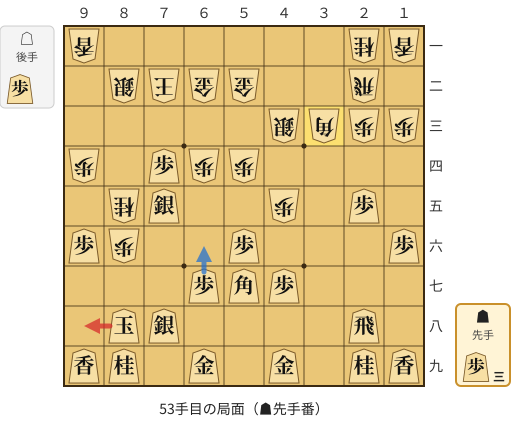

🔴 実戦 ▲９八玉(88)　🔵 AI推奨 ▲６六歩(67)　🟨 直前の相手の指し手

<details><summary>テキストの盤面図（BOD・将棋ソフトに貼り付け可）</summary>

```text
後手の持駒：歩
  ９ ８ ７ ６ ５ ４ ３ ２ １
+---------------------------+
|v香 ・ ・ ・ ・ ・ ・v桂v香|一
| ・v銀v玉v金v金 ・ ・v飛 ・|二
| ・ ・ ・ ・ ・v銀v角v歩v歩|三
|v歩 ・ 歩v歩v歩 ・ ・ ・ ・|四
| ・v桂 銀 ・ ・v歩 ・ 歩 ・|五
| 歩v歩 ・ ・ 歩 ・ ・ ・ 歩|六
| ・ ・ ・ 歩 角 歩 ・ ・ ・|七
| ・ 玉 銀 ・ ・ ・ ・ 飛 ・|八
| 香 桂 ・ 金 ・ 金 ・ 桂 香|九
+---------------------------+
先手の持駒：歩三
手数＝52　△３三角　まで
```

</details>

| | 指し手 | 評価値 | 読み筋 |
|---|---|--:|---|
| 実戦 | ▲９八玉(88) | -517 | △９五歩(94) ▲８六銀(75) △８八歩打 ▲８五銀(86) △８九歩成(88) ▲同玉(98) |
| AI 1位 | ▲６六歩(67) | +276 | ▲６六歩(67) △５五歩(54) ▲８三歩打 △９三銀(82) ▲３八飛(28) △３四歩打 |
| AI 2位 | ▲６六角(57) | +201 | ▲６六角(57) △６五歩(64) ▲３三角成(66) △同桂(21) ▲８三歩打 △同玉(72) |
| AI 3位 | ▲９八玉(88) | -345 | ▲９八玉(88) △９五歩(94) ▲８三歩打 △同銀(82) ▲８四歩打 △９四銀(83) |

SFEN: `l6nl/1skgg2r1/5sbpp/p1Ppp4/1nS2p1P1/Pp2P3P/3PBP3/1KS4R1/LN1G1G1NL b 3Pp 53`

<a id="ply-57"></a>
### 57手目 ▲７三歩成(74) — 大悪手

| | 着手前 | 着手後 | 差 |
|---|--:|--:|--:|
| 期待勝率 | 50.5% | 9.7% | -40.7pt |
| 評価値 | +11 | -1336 | |

着手前の局面:

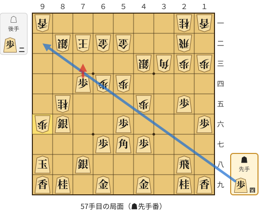

🔴 実戦 ▲７三歩成(74)　🔵 AI推奨 ▲９二歩打　🟨 直前の相手の指し手

<details><summary>テキストの盤面図（BOD・将棋ソフトに貼り付け可）</summary>

```text
後手の持駒：歩二
  ９ ８ ７ ６ ５ ４ ３ ２ １
+---------------------------+
|v香 ・ ・ ・ ・ ・ ・v桂v香|一
| ・v銀v玉v金v金 ・ ・v飛 ・|二
| ・ ・ ・ ・ ・v銀v角v歩v歩|三
| ・ ・ 歩v歩v歩 ・ ・ ・ ・|四
| ・v桂 ・ ・ ・v歩 ・ 歩 ・|五
|v歩 銀 ・ ・ 歩 ・ ・ ・ 歩|六
| ・ ・ ・ 歩 角 歩 ・ ・ ・|七
| 玉 ・ 銀 ・ ・ ・ ・ 飛 ・|八
| 香 桂 ・ 金 ・ 金 ・ 桂 香|九
+---------------------------+
先手の持駒：歩四
手数＝56　△９六歩　まで
```

</details>

| | 指し手 | 評価値 | 読み筋 |
|---|---|--:|---|
| 実戦 | ▲７三歩成(74) | -1336 | △同金(62) ▲８五銀(86) △９七歩成(96) ▲同桂(89) △９六歩打 ▲９二歩打 |
| AI 1位 | ▲９二歩打 | +11 | ▲９二歩打 △８八歩打 ▲９一歩成(92) △８九歩成(88) ▲同玉(98) △７七桂打 |
| AI 2位 | ▲８五銀(86) | -105 | ▲８五銀(86) △８八歩打 ▲８三歩打 △同銀(82) ▲８四歩打 △９四銀(83) |
| AI 3位 | ▲９四歩打 | -436 | ▲９四歩打 △９七歩成(96) ▲同桂(89) △同桂成(85) ▲同銀(86) △７六歩打 |

SFEN: `l6nl/1skgg2r1/5sbpp/2Ppp4/1n3p1P1/pS2P3P/3PBP3/K1S4R1/LN1G1G1NL b 4P2p 57`

<a id="ply-59"></a>
### 59手目 ▲７七歩打 — 大悪手

| | 着手前 | 着手後 | 差 |
|---|--:|--:|--:|
| 期待勝率 | 22.2% | 1.4% | -20.8pt |
| 評価値 | -751 | -2556 | |

着手前の局面:

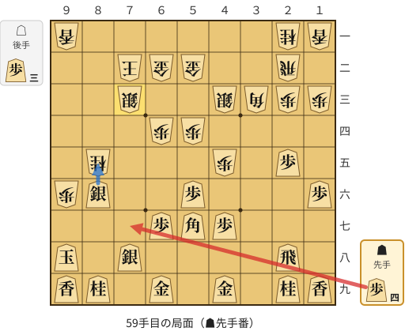

🔴 実戦 ▲７七歩打　🔵 AI推奨 ▲８五銀(86)　🟨 直前の相手の指し手

<details><summary>テキストの盤面図（BOD・将棋ソフトに貼り付け可）</summary>

```text
後手の持駒：歩三
  ９ ８ ７ ６ ５ ４ ３ ２ １
+---------------------------+
|v香 ・ ・ ・ ・ ・ ・v桂v香|一
| ・ ・v玉v金v金 ・ ・v飛 ・|二
| ・ ・v銀 ・ ・v銀v角v歩v歩|三
| ・ ・ ・v歩v歩 ・ ・ ・ ・|四
| ・v桂 ・ ・ ・v歩 ・ 歩 ・|五
|v歩 銀 ・ ・ 歩 ・ ・ ・ 歩|六
| ・ ・ ・ 歩 角 歩 ・ ・ ・|七
| 玉 ・ 銀 ・ ・ ・ ・ 飛 ・|八
| 香 桂 ・ 金 ・ 金 ・ 桂 香|九
+---------------------------+
先手の持駒：歩四
手数＝58　△７三同銀　まで
```

</details>

| | 指し手 | 評価値 | 読み筋 |
|---|---|--:|---|
| 実戦 | ▲７七歩打 | -2556 | △９七桂成(85) ▲同桂(89) △同歩成(96) ▲同銀(86) △７六歩打 ▲３四歩打 |
| AI 1位 | ▲８五銀(86) | -751 | ▲８五銀(86) △９七歩成(96) ▲同桂(89) △９六歩打 ▲９二歩打 △同香(91) |
| AI 2位 | ▲９二歩打 | -810 | ▲９二歩打 △８八歩打 ▲９一歩成(92) △８九歩成(88) ▲同玉(98) △７七桂打 |
| AI 3位 | ▲９四歩打 | -1178 | ▲９四歩打 △９七桂成(85) ▲同桂(89) △同歩成(96) ▲同銀(86) △７六歩打 |

SFEN: `l6nl/2kgg2r1/2s2sbpp/3pp4/1n3p1P1/pS2P3P/3PBP3/K1S4R1/LN1G1G1NL b 4P3p 59`

<a id="ply-75"></a>
### 75手目 ▲７五桂打 — 大悪手

| | 着手前 | 着手後 | 差 |
|---|--:|--:|--:|
| 期待勝率 | 58.6% | 32.6% | -26.0pt |
| 評価値 | +208 | -436 | |

着手前の局面:

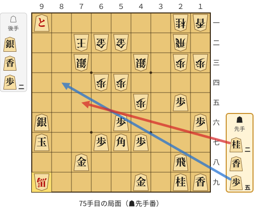

🔴 実戦 ▲７五桂打　🔵 AI推奨 ▲８四歩打　🟨 直前の相手の指し手

<details><summary>テキストの盤面図（BOD・将棋ソフトに貼り付け可）</summary>

```text
後手の持駒：銀　香　歩二
  ９ ８ ７ ６ ５ ４ ３ ２ １
+---------------------------+
| と ・ ・ ・ ・ ・ ・v桂v香|一
| ・ ・v玉v金v金 ・ ・v飛 ・|二
| ・ ・v銀 ・ ・v銀 ・v歩v歩|三
| ・ ・ ・v歩v歩 ・ ・ ・ ・|四
| ・ ・ ・ ・ ・v歩 ・ 歩 ・|五
| 銀 ・ ・ ・ 歩 ・ ・ ・ 歩|六
| 玉 ・ ・ 歩 角 歩 ・ ・ ・|七
| ・ ・ 金 ・ ・ ・ ・ 飛 ・|八
|v馬 ・ ・ ・ ・ 金 ・ 桂 香|九
+---------------------------+
先手の持駒：桂二　香　歩五
手数＝74　△９九角成　まで
```

</details>

| | 指し手 | 評価値 | 読み筋 |
|---|---|--:|---|
| 実戦 | ▲７五桂打 | -436 | △７四香打 ▲８八香打 △８四歩打 ▲９四歩打 △８九銀打 ▲９三歩成(94) |
| AI 1位 | ▲８四歩打 | +208 | ▲８四歩打 △８二香打 ▲８七香打 △７六歩打 ▲６九桂打 △７七銀打 |
| AI 2位 | ▲９三角成(57) | +194 | ▲９三角成(57) △８四銀打 ▲９四馬(93) △６三玉(72) ▲９二と(91) △９五歩打 |
| AI 3位 | ▲８八香打 | +103 | ▲８八香打 △３二飛(22) ▲９三角成(57) △８二歩打 ▲８四歩打 △６一玉(72) |

SFEN: `+P6nl/2kgg2r1/2s2s1pp/3pp4/5p1P1/S3P3P/K2PBP3/2G4R1/+b4G1NL b 2NL5Psl2p 75`

<a id="ply-83"></a>
### 83手目 ▲８四香(88) — 大悪手

| | 着手前 | 着手後 | 差 |
|---|--:|--:|--:|
| 期待勝率 | 45.8% | 9.4% | -36.3pt |
| 評価値 | -102 | -1357 | |

着手前の局面:

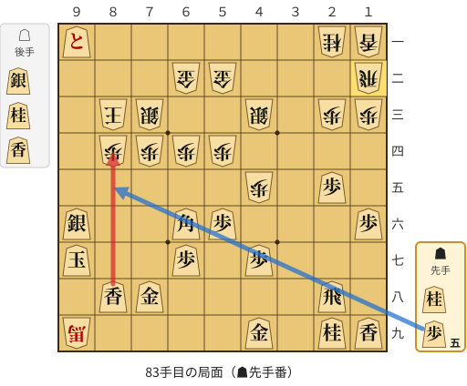

🔴 実戦 ▲８四香(88)　🔵 AI推奨 ▲８五歩打　🟨 直前の相手の指し手

<details><summary>テキストの盤面図（BOD・将棋ソフトに貼り付け可）</summary>

```text
後手の持駒：銀　桂　香
  ９ ８ ７ ６ ５ ４ ３ ２ １
+---------------------------+
| と ・ ・ ・ ・ ・ ・v桂v香|一
| ・ ・ ・v金v金 ・ ・ ・v飛|二
| ・v玉v銀 ・ ・v銀 ・v歩v歩|三
| ・v歩v歩v歩v歩 ・ ・ ・ ・|四
| ・ ・ ・ ・ ・v歩 ・ 歩 ・|五
| 銀 ・ ・ 角 歩 ・ ・ ・ 歩|六
| 玉 ・ ・ 歩 ・ 歩 ・ ・ ・|七
| ・ 香 金 ・ ・ ・ ・ 飛 ・|八
|v馬 ・ ・ ・ ・ 金 ・ 桂 香|九
+---------------------------+
先手の持駒：桂　歩五
手数＝82　△１二飛　まで
```

</details>

| | 指し手 | 評価値 | 読み筋 |
|---|---|--:|---|
| 実戦 | ▲８四香(88) | -1357 | △同銀(73) ▲９五桂打 △同銀(84) ▲同銀(96) △６六馬(99) ▲同歩(67) |
| AI 1位 | ▲８五歩打 | -102 | ▲８五歩打 △７五銀打 ▲８四歩(85) △７二玉(83) ▲８三歩成(84) △６一玉(72) |
| AI 2位 | ▲９四歩打 | -1015 | ▲９四歩打 △７二玉(83) ▲９三歩成(94) △６三玉(72) ▲８六玉(97) △６五歩(64) |
| AI 3位 | ▲４四桂打 | -1056 | ▲４四桂打 △７五銀打 ▲５二桂成(44) △同銀(43) ▲８四香(88) △同銀(73) |

SFEN: `+P6nl/3gg3r/1ks2s1pp/1pppp4/5p1P1/S2BP3P/K2P1P3/1LG4R1/+b4G1NL b N5Psnl 83`

<a id="ply-89"></a>
### 89手目 ▲８五歩打 — 大悪手

| | 着手前 | 着手後 | 差 |
|---|--:|--:|--:|
| 期待勝率 | 25.9% | 1.0% | -24.9pt |
| 評価値 | -630 | -2740 | |

着手前の局面:

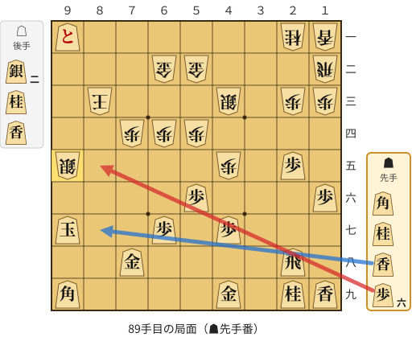

🔴 実戦 ▲８五歩打　🔵 AI推奨 ▲８七香打　🟨 直前の相手の指し手

<details><summary>テキストの盤面図（BOD・将棋ソフトに貼り付け可）</summary>

```text
後手の持駒：銀二　桂　香
  ９ ８ ７ ６ ５ ４ ３ ２ １
+---------------------------+
| と ・ ・ ・ ・ ・ ・v桂v香|一
| ・ ・ ・v金v金 ・ ・ ・v飛|二
| ・v玉 ・ ・ ・v銀 ・v歩v歩|三
| ・ ・v歩v歩v歩 ・ ・ ・ ・|四
|v銀 ・ ・ ・ ・v歩 ・ 歩 ・|五
| ・ ・ ・ ・ 歩 ・ ・ ・ 歩|六
| 玉 ・ ・ 歩 ・ 歩 ・ ・ ・|七
| ・ ・ 金 ・ ・ ・ ・ 飛 ・|八
| 角 ・ ・ ・ ・ 金 ・ 桂 香|九
+---------------------------+
先手の持駒：角　桂　香　歩六
手数＝88　△９五同銀　まで
```

</details>

| | 指し手 | 評価値 | 読み筋 |
|---|---|--:|---|
| 実戦 | ▲８五歩打 | -2740 | △９六香打 ▲８八玉(97) △９九香成(96) ▲７九玉(88) △６五桂打 ▲５八金(49) |
| AI 1位 | ▲８七香打 | -630 | ▲８七香打 △７三玉(83) ▲８二角打 △６三玉(73) ▲９六歩打 △８五桂打 |
| AI 2位 | ▲８七香打 | -650 | ▲８七香打 △８四香打 ▲同香(87) △同玉(83) ▲８七香打 △７三玉(84) |
| AI 3位 | ▲８八香打 | -828 | ▲８八香打 △８四桂打 ▲同香(88) △同玉(83) ▲８八玉(97) △７三玉(84) |

SFEN: `+P6nl/3gg3r/1k3s1pp/2ppp4/s4p1P1/4P3P/K2P1P3/2G4R1/B4G1NL b BNL6P2snl 89`

<a id="ply-93"></a>
### 93手目 ▲８六金(87) — 大悪手

| | 着手前 | 着手後 | 差 |
|---|--:|--:|--:|
| 期待勝率 | 42.0% | 1.1% | -41.0pt |
| 評価値 | -193 | -2723 | |

着手前の局面:

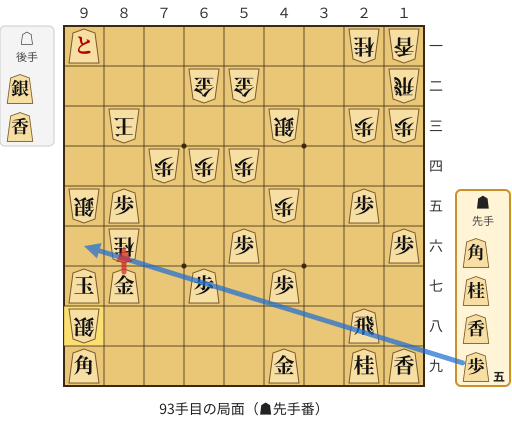

🔴 実戦 ▲８六金(87)　🔵 AI推奨 ▲９六歩打　🟨 直前の相手の指し手

<details><summary>テキストの盤面図（BOD・将棋ソフトに貼り付け可）</summary>

```text
後手の持駒：銀　香
  ９ ８ ７ ６ ５ ４ ３ ２ １
+---------------------------+
| と ・ ・ ・ ・ ・ ・v桂v香|一
| ・ ・ ・v金v金 ・ ・ ・v飛|二
| ・v玉 ・ ・ ・v銀 ・v歩v歩|三
| ・ ・v歩v歩v歩 ・ ・ ・ ・|四
|v銀 歩 ・ ・ ・v歩 ・ 歩 ・|五
| ・v桂 ・ ・ 歩 ・ ・ ・ 歩|六
| 玉 金 ・ 歩 ・ 歩 ・ ・ ・|七
|v銀 ・ ・ ・ ・ ・ ・ 飛 ・|八
| 角 ・ ・ ・ ・ 金 ・ 桂 香|九
+---------------------------+
先手の持駒：角　桂　香　歩五
手数＝92　△９八銀　まで
```

</details>

| | 指し手 | 評価値 | 読み筋 |
|---|---|--:|---|
| 実戦 | ▲８六金(87) | -2723 | △同銀(95) ▲９八玉(97) △９五香打 ▲９六歩打 △同香(95) ▲８八玉(98) |
| AI 1位 | ▲９六歩打 | -193 | ▲９六歩打 △８七銀不成(98) ▲同玉(97) △９八銀打 ▲７七玉(87) △９九銀不成(98) |
| AI 2位 | ▲９二角打 | -436 | ▲９二角打 △７二玉(83) ▲８六金(87) △同銀(95) ▲同玉(97) △９九銀不成(98) |
| AI 3位 | ▲８四香打 | -766 | ▲８四香打 △７二玉(83) ▲８六金(87) △同銀(95) ▲同玉(97) △８七金打 |

SFEN: `+P6nl/3gg3r/1k3s1pp/2ppp4/sP3p1P1/1n2P3P/KG1P1P3/s6R1/B4G1NL b BNL5Psl 93`

<a id="ply-99"></a>
### 99手目 ▲８四銀打 — 悪手

| | 着手前 | 着手後 | 差 |
|---|--:|--:|--:|
| 期待勝率 | 21.0% | 6.8% | -14.2pt |
| 評価値 | -795 | -1572 | |

着手前の局面:

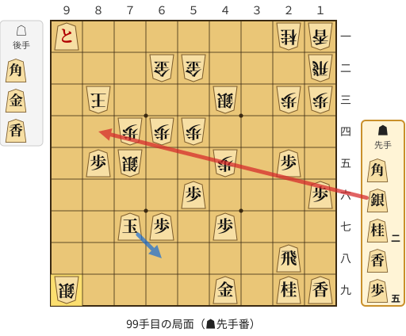

🔴 実戦 ▲８四銀打　🔵 AI推奨 ▲６八玉(77)　🟨 直前の相手の指し手

<details><summary>テキストの盤面図（BOD・将棋ソフトに貼り付け可）</summary>

```text
後手の持駒：角　金　香
  ９ ８ ７ ６ ５ ４ ３ ２ １
+---------------------------+
| と ・ ・ ・ ・ ・ ・v桂v香|一
| ・ ・ ・v金v金 ・ ・ ・v飛|二
| ・v玉 ・ ・ ・v銀 ・v歩v歩|三
| ・ ・v歩v歩v歩 ・ ・ ・ ・|四
| ・ 歩v銀 ・ ・v歩 ・ 歩 ・|五
| ・ ・ ・ ・ 歩 ・ ・ ・ 歩|六
| ・ ・ 玉 歩 ・ 歩 ・ ・ ・|七
| ・ ・ ・ ・ ・ ・ ・ 飛 ・|八
|v銀 ・ ・ ・ ・ 金 ・ 桂 香|九
+---------------------------+
先手の持駒：角　銀　桂二　香　歩五
手数＝98　△９九銀不成　まで
```

</details>

| | 指し手 | 評価値 | 読み筋 |
|---|---|--:|---|
| 実戦 | ▲８四銀打 | -1572 | △７二玉(83) ▲６八玉(77) △６三玉(72) ▲５八玉(68) △８八銀不成(99) ▲７八歩打 |
| AI 1位 | ▲６八玉(77) | -795 | ▲６八玉(77) △８八銀不成(99) ▲５九玉(68) △７二玉(83) ▲８一角打 △６一玉(72) |
| AI 2位 | ▲８九香打 | -892 | ▲８九香打 △７二玉(83) ▲７六歩打 △９五角打 ▲８六桂打 △同銀(75) |
| AI 3位 | ▲７八玉(77) | -1102 | ▲７八玉(77) △７三玉(83) ▲６九玉(78) △６三玉(73) ▲５八玉(69) △８八銀不成(99) |

SFEN: `+P6nl/3gg3r/1k3s1pp/2ppp4/1Ps2p1P1/4P3P/2KP1P3/7R1/s4G1NL b BS2NL5Pbgl 99`

<a id="ply-109"></a>
### 109手目 ▲８三銀成(74) — 悪手

| | 着手前 | 着手後 | 差 |
|---|--:|--:|--:|
| 期待勝率 | 56.5% | 40.1% | -16.3pt |
| 評価値 | +156 | -240 | |

着手前の局面:

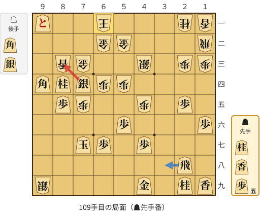

🔴 実戦 ▲８三銀成(74)　🔵 AI推奨 ▲３八飛(28)　🟨 直前の相手の指し手

<details><summary>テキストの盤面図（BOD・将棋ソフトに貼り付け可）</summary>

```text
後手の持駒：角　銀
  ９ ８ ７ ６ ５ ４ ３ ２ １
+---------------------------+
| と ・ ・v玉 ・ ・ ・v桂v香|一
| ・ ・ ・v金v金 ・ ・ ・v飛|二
| ・v香v金 ・ ・v銀 ・v歩v歩|三
| 角 桂 銀v歩v歩 ・ ・ ・ ・|四
| ・ 歩v歩 ・ ・v歩 ・ 歩 ・|五
| ・ ・ ・ ・ 歩 ・ ・ ・ 歩|六
| ・ ・ 玉 歩 ・ 歩 ・ ・ ・|七
| ・ ・ ・ ・ ・ ・ ・ 飛 ・|八
|v銀 ・ ・ ・ ・ 金 ・ 桂 香|九
+---------------------------+
先手の持駒：桂　香　歩五
手数＝108　△６一玉　まで
```

</details>

| | 指し手 | 評価値 | 読み筋 |
|---|---|--:|---|
| 実戦 | ▲８三銀成(74) | -240 | △５一玉(61) ▲７二桂成(84) △７六歩(75) ▲８六玉(77) △７二金(62) ▲同成銀(83) |
| AI 1位 | ▲３八飛(28) | +156 | ▲３八飛(28) △３三角打 ▲６八玉(77) △９三銀打 ▲８三角成(94) △同金(73) |
| AI 2位 | ▲８三銀成(74) | -252 | ▲８三銀成(74) △５一玉(61) ▲８六玉(77) △７六歩(75) ▲３八飛(28) △７七角打 |
| AI 3位 | ▲２四歩(25) | -367 | ▲２四歩(25) △同歩(23) ▲８三銀成(74) △５一玉(61) ▲８六玉(77) △７四銀打 |

SFEN: `+P2k3nl/3gg3r/1lg2s1pp/BNSpp4/1Pp2p1P1/4P3P/2KP1P3/7R1/s4G1NL b NL5Pbs 109`

<a id="ply-113"></a>
### 113手目 ▲３五桂打 — 大悪手

| | 着手前 | 着手後 | 差 |
|---|--:|--:|--:|
| 期待勝率 | 75.5% | 39.9% | -35.6pt |
| 評価値 | +675 | -245 | |

着手前の局面:

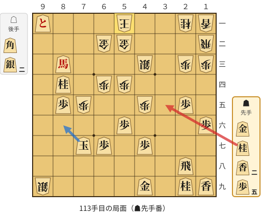

🔴 実戦 ▲３五桂打　🔵 AI推奨 ▲８六玉(77)　🟨 直前の相手の指し手

<details><summary>テキストの盤面図（BOD・将棋ソフトに貼り付け可）</summary>

```text
後手の持駒：角　銀二
  ９ ８ ７ ６ ５ ４ ３ ２ １
+---------------------------+
| と ・ ・ ・v玉 ・ ・v桂v香|一
| ・ ・ ・v金v金 ・ ・ ・v飛|二
| ・ 馬 ・ ・ ・v銀 ・v歩v歩|三
| ・ 桂 ・v歩v歩 ・ ・ ・ ・|四
| ・ 歩v歩 ・ ・v歩 ・ 歩 ・|五
| ・ ・ ・ ・ 歩 ・ ・ ・ 歩|六
| ・ ・ 玉 歩 ・ 歩 ・ ・ ・|七
| ・ ・ ・ ・ ・ ・ ・ 飛 ・|八
|v銀 ・ ・ ・ ・ 金 ・ 桂 香|九
+---------------------------+
先手の持駒：金　桂　香二　歩五
手数＝112　△５一玉　まで
```

</details>

| | 指し手 | 評価値 | 読み筋 |
|---|---|--:|---|
| 実戦 | ▲３五桂打 | -245 | △７六銀打 ▲８六玉(77) △７七角打 ▲７五玉(86) △６七銀成(76) ▲７二桂成(84) |
| AI 1位 | ▲８六玉(77) | +675 | ▲８六玉(77) △６三金(52) ▲７四歩打 △６五銀打 ▲６六桂打 △同銀(65) |
| AI 2位 | ▲７二桂成(84) | +176 | ▲７二桂成(84) △同金(62) ▲同馬(83) △６二金(52) ▲７一馬(72) △９五角打 |
| AI 3位 | ▲３五桂打 | +261 | ▲３五桂打 △７六銀打 ▲８六玉(77) △７七角打 ▲７五玉(86) △６七銀成(76) |

SFEN: `+P3k2nl/3gg3r/1+B3s1pp/1N1pp4/1Pp2p1P1/4P3P/2KP1P3/7R1/s4G1NL b GN2L5Pb2s 113`

